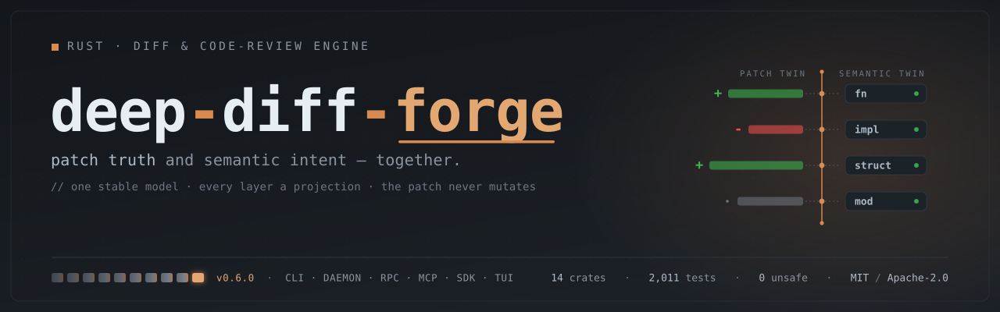
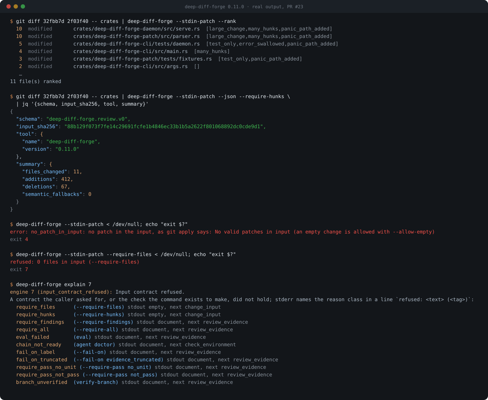

<p align="center">
  
</p>

<p align="center">
  <a href="https://github.com/Louranicas/deep-diff-forge/actions/workflows/ci.yml"></a>
  <a href="https://github.com/Louranicas/deep-diff-forge/releases"></a>
  
  
  <a href="#license"></a>
  <a href="CONTRIBUTING.md"></a>
</p>

# Deep-Diff-Forge

**A review engine for code changes. It keeps the patch exactly as Git would apply it, and
layers understanding on top that can never corrupt it.**

AI writes more of the code we merge, so reviewing a change has become harder than writing
one. Deep-Diff-Forge reads a diff as a review, not a blob of `+` and `-` lines. It ranks files
by risk, explains each ranking, parses source with tree-sitter, and serves the same answer
to people, scripts and agents:

- a terminal cockpit;
- a CLI with stable JSON;
- a Unix-socket daemon;
- an MCP server;
- Rust and Python SDKs.

Underneath sits one rule. The apply-able patch is truth, and nothing may rewrite it.

<p align="center">
  
  <br>
  <sub>Real output, not a mock-up: <code>scripts/docs/render_terminal_svg.py</code> runs the binary on the crate changes of PR #23 and draws what it prints.</sub>
</p>

> **Status: 0.8.4, a security release prepared 2026-11-16; it is a release once the signed tag `v0.8.4` exists.** It fixes reviews in v0.8.3 that differed from `git apply`: a `Files … differ` line, which Git reads as a binary marker, and one path in several sections, which Git applies as a set (rescore of v0.8.3, G1 and G2); and Rust code that a nested block comment, a character literal with a long escape, or a comment an earlier hunk of a created file opened had hidden from the Rust rules ([CHANGELOG](CHANGELOG.md); advisories [DDF-2026-001](docs/advisories/DDF-2026-001.md) for G1 and G2, [DDF-2026-002](docs/advisories/DDF-2026-002.md) for the Rust code view).
> - **Declared scope:** a local, single-user review tool on Linux and macOS ([the exact targets](#supported-platforms)), covering the CLI, daemon, `rpc`, MCP and SDKs. Up to v0.8.3 all four targets were built and smoke-tested on CI runners; 0.8.4 is built only for `x86_64-unknown-linux-gnu`, on the owner's machine. The oldest OS versions listed are declared from the binaries, not run. The [verdict and its evidence](#project-status) are below.
> - **Releases:** the latest GitHub release is [v0.8.3](https://github.com/Louranicas/deep-diff-forge/releases/tag/v0.8.3), with Linux (x86_64 and arm64) and macOS binaries, an SPDX SBOM and build provenance. 0.8.4 has no GitHub release: once the signed tag `v0.8.4` exists it is published on [GitLab](https://gitlab.com/lukeomahoney/deep-diff-forge), with mirrors on Gitea and Forgejo, as the signed tag and a Linux x86_64 archive built locally; `scripts/release_local.sh verify` checks it ([local release](docs/RELEASE_AND_PUBLICATION.md#local-release-from-084)).
> - **crates.io:** publication is on hold by decision until the codebase is fully production-hardened.

<p align="center">
  
  <br>
  <sub>The review cockpit, side by side: a risk-ranked file tree, a two-column diff with engine notes, and the menu bar. <code>git diff | deep-diff-forge review</code></sub>
</p>

---

## Contents

- [Why Deep-Diff-Forge](#why-deep-diff-forge)
- [The first principle](#the-first-principle)
- [How it works](#how-it-works)
- [Install](#install)
- [Quick start](#quick-start)
- [Command reference](#command-reference)
- [Output formats and schemas](#output-formats-and-schemas)
- [Exit codes](#exit-codes)
- [MCP server](#mcp-server)
- [SDKs](#sdks)
- [The optional daemon](#the-optional-daemon)
- [Verified agent findings](#verified-agent-findings)
- [Benchmarks and evaluation](#benchmarks-and-evaluation)
- [Risk ranking](#risk-ranking)
- [Architecture](#architecture)
- [Quality gates](#quality-gates)
- [Review council and evidence gates](#review-council-and-evidence-gates)
- [Project status](#project-status)
- [Contributing](#contributing)
- [Documentation map](#documentation-map)
- [License](#license)

---

## Why Deep-Diff-Forge

Each existing tool optimises one layer of review:

| Tool | Optimises | Limit |
| --- | --- | --- |
| `diff` | patch truth, exit codes, automation | no semantic or review intelligence |
| `delta`, `diff-so-fancy` | readable terminal rendering | line-oriented; pretty is not understanding |
| `difftastic` | structural (syntax-tree) diffing | its output is not an apply-able patch |
| `hunk` | review-first terminal UI and agent workflow | an interactive viewer, not a composable engine |

Deep-Diff-Forge makes these layers cooperate. The core is conservative and apply-able; the
enrichment on top is ambitious and clearly separate. It is built for people reviewing large,
often AI-generated changesets, and for the agents, scripts and CI that drive review more and
more.

It is **Bash-first and agent-first**. Every action:

- has a deterministic command;
- produces machine-readable output (`--json`, `--jsonl`);
- returns a documented exit code that names the next action;
- works as a Unix filter, with no daemon required.

| Capability | deep-diff-forge | [`hunk`][hunk] | [`delta`][delta] | [`difftastic`][difft] | [`diff-so-fancy`][dsf] | `diff` |
| --- | :---: | :---: | :---: | :---: | :---: | :---: |
| Review-first interactive UI | ✅ | ✅ | ❌ | ❌ | ❌ | ❌ |
| Inline agent / engine notes | ✅ | ✅ | ❌ | ❌ | ❌ | ❌ |
| Deterministic, explained risk ranking | ✅ | ❌ | ❌ | ❌ | ❌ | ❌ |
| Versioned JSON / JSONL output | ✅ | ❌ <sup>1</sup> | ❌ | ❌ <sup>2</sup> | ❌ | ❌ |
| Input sealing (`input_sha256`) | ✅ | ❌ | ❌ | ❌ | ❌ | ❌ |
| MCP server and SDKs | ✅ | ❌ | ❌ | ❌ | ❌ | ❌ |
| Optional daemon (Unix socket) | ✅ | ❌ | ❌ | ❌ | ❌ | ❌ |
| Apply-able patch preserved | ✅ | ❌ <sup>3</sup> | ✅ <sup>4</sup> | ❌ | ✅ <sup>4</sup> | ✅ |
| Syntax highlighting | ✅ <sup>5</sup> | ✅ | ✅ | ✅ | ❌ | ❌ |
| Structural / token-level diffing | ✅ <sup>6</sup> | ❌ | ❌ | ✅ | ❌ | ❌ |
| Native VCS input | Git <sup>7</sup> | Git · jj · Sapling | ❌ | ❌ | ❌ | ❌ |
| Watch / auto-reload | ❌ | ✅ | ❌ | ❌ | ❌ | ❌ |
| Pager / Unix-filter friendly | ✅ | ✅ <sup>8</sup> | ✅ | ✅ | ✅ | ✅ |

<sup>1</sup> `hunk`'s agent integration is a live in-session skill, not a schema'd document a script can consume.
<sup>2</sup> difftastic has an experimental JSON display; Deep-Diff-Forge ships versioned schemas.
<sup>3</sup> `hunk` renders patches but does not emit an apply-able patch.
<sup>4</sup> They re-render a Git diff that stays apply-able.
<sup>5</sup> Tree-sitter, terminal-injection-safe. Rust today; more grammars are [welcome](CONTRIBUTING.md).
<sup>6</sup> Token-level and reformat-aware, with best-effort moved-block detection. difftastic's tree-edit-distance diff is deeper.
<sup>7</sup> `--git-working-tree`, `--git-staged` and `--git-range A..B`. `deep-diff-forge <old> <new>` compares two regular files through the same hardened Git.
<sup>8</sup> `hunk` works as a pager but is a full-screen UI, not a stdout filter.

Comparisons are best effort against each tool's default behaviour. Corrections are welcome.

[hunk]: https://github.com/modem-dev/hunk
[delta]: https://github.com/dandavison/delta
[difft]: https://github.com/Wilfred/difftastic
[dsf]: https://github.com/so-fancy/diff-so-fancy

## The first principle

> **A diff engine must preserve patch truth while exposing semantic intent.**

Patch truth is the exact text that can be applied, and it is separate from every enrichment
layer. Semantic analysis, risk ranking and agent notes may be absent, partial or wrong, but
none of them can change the apply-able patch.

The reverse holds too. An internally incoherent patch is **refused, not repaired**:

- a hunk whose body disagrees with its `@@ -a,b +c,d @@` counts;
- a hunk cut off at end of file;
- a header missing its closing `@@`;
- a `GIT binary patch` body followed by anything but base85 lines;
- a file header after the file's first hunk, a `---` without its `+++`, or headers that
  contradict each other (a new file with old lines, a deleted file that is also renamed).
- a rename or copy that names a path `git apply` refuses: absolute, or with a `.`, `..` or
  `.git` component;
- a mode header that is not octal.

Each fails with exit 4. None is quietly turned into a plausible-looking model.

## How it works

<p align="center">
  
</p>

1. **One door to a sealed review.** Every review document comes from
   `deep_diff_forge_patch::SealedReview`, whether the patch was piped in or acquired from Git.
   It decodes the bytes, parses them within a 64 MiB budget in linear time, applies the input
   contracts, and seals them with SHA-256. This covers the CLI's `--json`, `--rank`,
   `--cluster` and layouts, the daemon's `diff.compute` and `diff.rank`, MCP's `review_patch`
   and `rank_patch`, and the SDKs.
   - `--jsonl` streams through the pipeline crate under the same parser and contracts, but
     unsealed.
   - The cockpit, `diff.plan` and `session.open` use the same strict parser without a seal.
   - Git runs with a fixed argv, and paths, modes and blob IDs come from NUL-delimited
     records.
2. **One model.** `deep-diff-forge-core` holds files, hunks, line anchors, the seal and the tool
   identity. It has no I/O and no parsing.
3. **Enrichment reads, never writes.** Projection, the risk graph, cluster lanes, tree-sitter
   syntax, agent notes and the learning loop each read the model.
4. **Every surface tells the same truth.** For the same bytes, `--stdin-patch --json`, the
   daemon's `diff.compute`, `rpc`, the MCP `review_patch` tool and the SDK's `review` produce the
   same document, and parity tests prove it.

## Install

**Prebuilt binaries** for Linux (x86_64 and, since v0.6.0, arm64) and macOS (Apple silicon and
Intel) are on the [releases page](https://github.com/Louranicas/deep-diff-forge/releases)
([supported platforms](#supported-platforms)). The commands below fetch v0.8.3,
the latest GitHub release (0.8.4 has none).
Each archive has a `.sha256` file, and the release carries an SPDX SBOM:

```bash
curl -LO https://github.com/Louranicas/deep-diff-forge/releases/download/v0.8.3/deep-diff-forge-v0.8.3-x86_64-unknown-linux-gnu.tar.gz
curl -LO https://github.com/Louranicas/deep-diff-forge/releases/download/v0.8.3/deep-diff-forge-v0.8.3-x86_64-unknown-linux-gnu.tar.gz.sha256
sha256sum -c deep-diff-forge-v0.8.3-x86_64-unknown-linux-gnu.tar.gz.sha256
```

**0.8.4** is published on GitLab, <https://gitlab.com/lukeomahoney/deep-diff-forge>, once the
owner's signed tag `v0.8.4` exists: the tag and a Linux x86_64 archive
(`deep-diff-forge-v0.8.4-x86_64-unknown-linux-gnu.tar.gz`) with its `.sha256`, the SBOM, the build
receipt, `SHA256SUMS` and the owner's signature of it, `SHA256SUMS.sig`. There is no arm64 Linux
or macOS binary of 0.8.4. Check the downloaded files from a clone with
`scripts/release_local.sh verify v0.8.4 <dir> .github/release_allowed_signers`: the tag's signature, every checksum and
its signature, and a rebuild that must give the same binary
([local release](docs/RELEASE_AND_PUBLICATION.md#local-release-from-084)).

**From source** (`main` on GitLab: 0.8.4, everything in this README; GitHub's `main` stays at
0.8.3). This needs Rust **1.88+** (edition 2024):

```bash
git clone https://gitlab.com/lukeomahoney/deep-diff-forge.git
cd deep-diff-forge
cargo build --release --locked -p deep-diff-forge-cli
target/release/deep-diff-forge --version        # deep-diff-forge 0.8.4
target/release/deep-diff-forge --self-test
```

### Supported platforms

These four release targets are the whole platform scope. Up to v0.8.3 each was built by
`release.yml` and its binary run (`--version` and a review) before it shipped. 0.8.4 is not built
by `release.yml`: only `x86_64-unknown-linux-gnu` is built, on the owner's machine in the
`fedora-toolbox-44` toolbox with `scripts/release_local.sh`, which runs the same smoke and glibc
check; the other three targets are not built for 0.8.4, and v0.8.3's binaries for them remain on
the GitHub releases page.

| Target | 0.8.4 | Built and run on (to v0.8.3) | Needs | Tests on every pull request (to v0.8.3) |
| --- | --- | --- | --- | --- |
| `x86_64-unknown-linux-gnu` | built locally (Fedora 44 toolbox, Rust 1.99.1, LLD); the whole local gate (`scripts/ci_local.sh`) | `ubuntu-24.04` | glibc 2.34 or newer | the whole suite (`deploy gate-feature`, required) |
| `aarch64-unknown-linux-gnu` | not built for 0.8.4 | `ubuntu-22.04-arm`, natively | glibc 2.34 or newer | the whole suite (`Linux arm64 tests`, not required; gates releases) |
| `aarch64-apple-darwin` | not built for 0.8.4 | `macos-26` (arm64) | macOS 11 or newer | the whole suite (`macOS tests`, required); the launchd agent (`macOS launchd agent`, not required; skipped in releases) |
| `x86_64-apple-darwin` | not built for 0.8.4 | cross-built on `macos-26`, run under Rosetta 2 | macOS 10.12 or newer | none (the release smoke only) |

- **The glibc floor, glibc 2.34**, is enforced: `scripts/check_glibc_floor.sh` fails the release
  smoke when a Linux binary requires a newer `GLIBC_` symbol version. Measured 2026-10-31: the
  v0.5.0 x86_64 binary requires at most `GLIBC_2.34`; it ran a review on AlmaLinux 9 (glibc
  2.34), Ubuntu 22.04 (2.35) and Debian 12 (2.36), and the loader refused it on Debian 11 (2.31).
  The arm64 binary, built on `ubuntu-22.04-arm`, passes the same check in CI (measured; built on
  `ubuntu-24.04-arm` it needed `GLIBC_2.39`, PR #79); it has not been run on an older arm64
  distribution (unmeasured). The 0.8.4 x86_64 binary, built on Fedora 44 (glibc 2.43) with the
  rustup toolchain's LLD, requires at most `GLIBC_2.34` (`readelf`, 2026-11-16; `GLIBC_2.39`
  only as the two weak symbols below); it has not been run on an older system.
- **On glibc 2.34 to 2.38 the loader prints one warning line to stderr per run**,
  ``weak version `GLIBC_2.39' not found``. The output and exit code are unchanged (measured on the
  three systems above). Rust's standard library references `pidfd_spawnp` and `pidfd_getpid`
  (glibc 2.39) as optional symbols; glibc 2.39 or newer prints nothing. Building from source on
  such a system also avoids it.
- **A source build is for the system that built it.** Linked with GNU ld on glibc 2.39 or newer
  (a distribution's own Rust package, for example), the binary requires `GLIBC_2.39` outright
  and does not start on an older glibc (measured 2026-11-10: built on Fedora 44, refused by the
  loader on Ubuntu 22.04). The release smoke holds every Linux release binary to the floor.
- **macOS minimums** are the ones the v0.5.0 binaries declare (`LC_BUILD_VERSION` minos 11.0 for
  arm64, `LC_VERSION_MIN_MACOSX` 10.12 for x86_64, read 2026-10-31). They are run only on the
  runner's current macOS, not on those versions.
- **Not supported:** musl (Alpine and other musl distributions) is neither built nor tested: the
  syntax layer compiles C (tree-sitter), which needs a musl C toolchain, and nothing would run
  the result. Windows is not supported (the daemon needs Unix domain sockets; the CLI does not
  compile there). Other architectures and the BSDs are not built or tested.

Optional shortcuts:

```bash
alias ddf='deep-diff-forge'
git config --global alias.review '!git diff | deep-diff-forge review'
```

## Quick start

```bash
git diff | deep-diff-forge review                       # the interactive cockpit
git diff | deep-diff-forge --stdin-patch --rank         # what to look at first, and why
deep-diff-forge --git-staged --rank                     # the same, without the pipe
deep-diff-forge --git-range main..HEAD --json           # a sealed review document
git diff | deep-diff-forge --stdin-patch --layout side-by-side
deep-diff-forge semantic src/lib.rs                     # tree-sitter symbols
deep-diff-forge structural old.rs new.rs                # reformat-aware diff
deep-diff-forge explain 4                               # what an exit code means
```

### For agents: look before you read

An agent should learn where to look before it reads anything large. Register DDF with your
agent and allow the repositories it may read; the agent never has to paste a patch.
`agent setup` prints the exact registration for this binary and writes nothing:

```bash
deep-diff-forge agent setup --client claude --allow-repo ~/code/project   # a `claude mcp add …` line
deep-diff-forge agent setup --client codex  --allow-repo ~/code/project   # a ~/.codex/config.toml block
deep-diff-forge agent doctor            # proves MCP, the daemon and the CLI agree on one sealed patch
```

1. **`review_change`** with `selection: "staged"` (or `working_tree`, or `range` with `A..B`)
   returns the **outline**: every file in review-risk order with its score, signals and hunks.
   Each hunk carries its address, line ranges, `@@` heading and counts, and no line text yet.
2. **`review_change`** with `view: "hunks"` and the `addresses` it cares about returns those
   hunks verbatim.
3. Every answer is sealed (`input_sha256`) and fits `max_bytes`, 32 KiB by default, both copies
   counted, as printed (escapes included). A `next_cursor` continues, and it belongs to that
   patch and that selection only: a cursor from another patch or selection, or one whose
   position is outside the selection (no page could have minted it), is refused.

Without `--allow-repo`, `review_outline` and `review_hunks` do the same for a patch the agent
passes. The same views exist on the CLI (`--outline`, `--hunks`), on the daemon's socket and
over `rpc` (`review.outline`, `review.hunks`, `review.change`).

```bash
deep-diff-forge --git-staged --outline                         # where to look
deep-diff-forge --git-staged --hunks --address 44a87108…        # read one hunk
git diff | deep-diff-forge --stdin-patch --hunks --path src/lib.rs --max-bytes 8192
```

For gates and orchestrators, refuse empty or hunkless input so it can't pass as a clean review:

```bash
git diff | deep-diff-forge --stdin-patch --rank --json --require-files --require-hunks
```

### For agents: told while it works, judged when it stops

**What the hooks are for.** They guard against an agent's honest mistakes and shortcuts: a
credential it commits, a check it silences, a policy it loosens. They are not a boundary
against an agent that sets out to evade them: it has a shell, so it can edit the settings that
install the hooks, the session's state, or do its work in a copy. That boundary is the judge
on the pull request (forge-warden on the server). So one rule sorts every case: an ordinary
workflow must never end in a silent stop with unjudged work; a deliberate evasion is made
visible where that is cheap, and is otherwise a stated limit (the list at the end of this
section is sorted that way).

**The rule of the stop hook: a stop prints nothing only when every unit of the session has a
pass.** The units are the uncommitted change, the staged change and each commit of the
session. Everything else that is true at a stop is said at that stop, every time, in a
bounded form: what fails and blocks; what fails and stands; what the judge holds; what has
no verdict (a commit that waits, one that is asked about again, one that cannot be judged);
and what is named beside the verdict.

A review at the end comes too late for an agent: it works one tool call at a time. With
Claude Code's hooks, this binary tells the agent what its own change looks like while it is
still working, and asks a judge before it stops. `agent setup --hooks` prints the settings and
writes nothing:

```bash
deep-diff-forge agent setup --client claude --hooks   # the MCP registration, then a `hooks` block for .claude/settings.json
```

| Event | Command | What the agent gets |
| --- | --- | --- |
| `SessionStart` | `agent hook session-start` | What the hooks do, the commit the session's changes are measured from, and whether a stop can be judged here: the chain is checked the way `agent doctor --gate` checks it, and a link that is missing is named instead of a promise. |
| `PostToolUse`, after every tool | `agent hook post-tool` | **Advice, never a block.** The evidence that is new in the working tree since the session began (commits pulled or made by others in that time are in that range too): label, path, line, how the line was read, and what answers the signal and what does not. A finding is said once per session, also when the line moves. |
| `Stop` | `agent hook stop` | A verdict on your uncommitted and staged changes, and on each commit made since the session began that your branches, tags, stash, `HEAD` or their history name: each commit once, by its own change. **Only a fail holds the stop**: a commit's at the stop that first judges it, an uncommitted change's once while it is there. The message has the rules that failed and what answers them. A hold is reported for a person. With no judge, no policy, or no ranker the policy admits, the result is **UNJUDGED**, said plainly, and never a pass. |

- **One project and one base for a session.** The session's first hook fixes three things:
  the project (the directory Claude Code names in `CLAUDE_PROJECT_DIR`, else the hook
  input's `cwd`), the commit `HEAD` names there (the base), and the id of every commit that
  something names at that moment: every ref (branches, remote-tracking refs, tags, the
  stash, whatever else), the `HEAD` of every working tree, and every entry of the reflogs of
  those `HEAD`s and of the stash. The first two are in the session's state; the ids are in a
  file beside it (ids only, one a line, no bound that a repository reaches: a million), and
  the state holds that file's SHA-256 and length, so a list that was cut or changed is not
  believed. Every later hook of the session judges that project, wherever the agent has gone
  with `cd`: a stop from a nested repository, another repository, a directory outside any,
  or one that is gone still judges the project. A directory that is gone is in the tree
  the nearest directory above it that is there is in: from a build directory removed
  inside a linked working tree, that tree is the one the stop is in, and it is judged. The project is a repository at a path: it
  is known by the inode of its Git directory and by where it stands. A clone put at its
  path is not it, and neither is the project once it was moved: the stop is UNJUDGED, says
  which, and says the remedy (start a new session). The device number is no part of the
  identity, so a reboot does not end a session.
- **What a stop has judged: units.** First the uncommitted change of the project's working
  tree: the tree, untracked files included, against the commit its own `HEAD` names. Then
  the staged change of that tree, what the index holds against the same commit, when it is
  another change than the tree's: what was staged and then repaired or deleted in the
  working tree without `git add` is what the next plain `git commit` records, so it is
  judged ("Staged changes in" the path). With everything staged and nothing changed since,
  the two are one patch and one run of the judge. When the session's directory is in
  another working tree of the same repository (a linked worktree it entered), that tree's
  uncommitted and staged changes as well. Then each commit of the session that has no
  answer yet, the oldest first, each as the patch from its first parent to itself (a commit
  with no parent: from nothing). A commit is the session's when your branches, your tags,
  the stash, the `HEAD` of a working tree, or the reflog of one of those `HEAD`s or of the
  stash leads to it now, and nothing that was named when the session began does. So a
  commit is judged for what it holds, whatever came after it: a credential that was
  committed and then reverted, or removed by a second commit; a commit on a branch the
  session left; a commit of a staged file that was edited again; a stash, with the commit
  that holds its untracked files (`git stash -u`), and the older entries of the stash; a
  commit made on a detached `HEAD` that was left; a commit in another working tree; a merge
  commit the session makes, against its first parent, so with what the merge brought in.
- **Which commits of others are judged.** A commit that was already in the repository when
  the session began, named by any ref (remote-tracking refs included) or by a reflog, is
  not the session's, also when the session then pulls it, merges it by fast-forward,
  rebases onto it or resets to it: it was there before, and it is not judged at a stop. So
  whether a pull is judged depends on when its fetch happened: a commit fetched during the
  session and then brought onto a local branch is the session's and is judged; one that an
  earlier fetch (an editor's background fetch, another session) had already brought is
  not. A commit that only a remote-tracking ref names is never the session's. Every message
  that names the session's range says this, the advice after a tool call included: advice
  reports what is in the working tree since the base, also from such a commit, and that is
  no promise that a stop judges it. All units are judged by the policy at the base. The
  same patch is judged once in a stop. Each commit that has its answer is kept with it in a
  file beside the state, which has no bound a session reaches, so a commit is asked about
  once in a session.
- **How much one stop judges, and a commit that gets no verdict.** The uncommitted and
  staged changes first; then two commits whose turn it is (below); then the commits never
  asked about, the oldest first; then the other commits that had no verdict before, the
  one asked about least recently first; all within the stop's time
  (45 seconds less four, and no new commit with less than three left). Commits that are not
  reached are counted in the message ("12 commits of this session: UNJUDGED … they are
  judged at the next stop"). **A commit that gets no verdict is not done.** It is named at
  every stop while it has none ("2 commits of this session have no verdict: ab12cd34ef56
  (the reason), …": the number and the first three with the latest reason) and it is asked
  about again: at every stop for its first five attempts that count, and after them in its
  turn, one such commit at each stop. It is never given up: a judge that fails on one patch
  for a while and then recovers gives its verdict at a later stop, and a fail then blocks
  like any first judgment. Such a commit is named as "no verdict in 7 attempts; it is asked
  about again in its turn". **Every commit without a verdict is submitted to the judge at
  least once in every N stops, N being the number of the session's commits that have no
  verdict, and a commit that was never asked about at the first stop that owes it an
  ask**: each stop first asks about the commit that has waited longest for its turn
  among those past five attempts, then about the one asked about least recently among
  those with fewer, then about the oldest commit that was never asked about, and only
  then about anything else. These are the asks a stop owes, three at most, and none of
  them can take another's time: an ask leaves 5 seconds for each ask owed after it, so a
  judge that hangs on one commit, or on two, cannot keep the next from being submitted.
  (A run of the judge has 30 seconds at most. A run that was cut is written down as
  asked and cut, with the time it had: its part of what was left, all that was left, or
  the 30 seconds.) That holds while the judge can be run, the state
  can be kept, and the stop has 13 seconds of its judging left when it comes to its
  commits (3 for the first ask it owes and 5 for each of the two after it), after the
  changes of its working trees are judged. With less, the asks are made in that order
  while 3 seconds are left, each with 3 seconds. A run of the judge on a working tree's
  change leaves the asks what they need (13 seconds when three are owed); Git taking long
  to read the working tree or the commits can use them. An ask that is not
  made is not written down: no attempt is counted, the commit keeps its turn, and the stop
  says of it "not asked at this stop for lack of time". An ask that was made is written
  down with what the judge said, whatever time is left after it, so the turn moves on: a
  session whose stops all come to their commits with a few seconds left asks about its
  commits in turn, not about the same one each time. An attempt is counted, and a turn
  used, for a commit the judge was run for, and only for such a one. Nothing of a stop is written before it
  ends: a stop that is killed leaves
  every commit where it was, its turn too. An attempt counts at a stop where
  some patch got a verdict; where an ask failed and none did, the judge is asked once about
  the probe `agent doctor --gate` uses (after three failed asks, or at the end of the
  asking), and with no verdict on that either the stop asks no more: the rest are counted,
  and nothing is given up. Only what the hook itself proves from the commit is final at
  once, and it too is named at every stop: a commit whose patch is over the size the
  builder makes (a commit does not change). A commit at the edge of a shallow clone, whose
  parent the repository does not have, is named at every stop while that is so and nothing
  is written down for it: after `git fetch --unshallow` it is judged like any other.
- **What a stop's message holds, in this order.** What blocks now: the staged change, the
  uncommitted change, then the commits, the newest first (the session's latest work before
  pulled history). Each with its rules and what answers them while there is room; then
  with each rule's name, its first path and the number of its other paths; then, for up to
  twenty more, its name with the names of its rules; the rest are counted. A rule's name
  is never dropped for its explanation, and a path that is cut keeps its file name. Then a
  working tree's change that got no verdict and the commits that wait, with the reason;
  then what the judge holds that is new at this stop, with its rules. A unit that fails
  and also has rules the judge holds for shows both, the failing ones first and the others
  marked "held, for a person". Then one line each, at every stop: the commits with no
  verdict, what the judge held at earlier stops, and the failures that stand (by name while
  there are three or fewer, else "13 earlier failures stand: Commit … (no-secrets), and 10
  more."); each unit these lines name comes with the names of its rules (whole names, and
  "+2 more" for those that have no room), or with the judge's own first words when it was
  held or failed for something that is no rule (a note, an expired waiver); both are kept
  with a commit's answer for the rest of the session. A message is at most 9,000
  characters. The lines of every stop are never cut: their room is taken first (each is a
  count and at most three names of a bounded length), what is above them is made inside
  what is left, and its own count ("and 42 more commits fail.") is inside that too, so
  every unit is named or counted. What the hook names beside the verdict gets the room
  that is left (a thing that has no room to be said in full is counted on its line, and is
  said in full at the first stop that has room), and a text that is still over the bound
  is cut where it is finished and ends with a line that says so. The first line
  is the worst answer that is new or still open at this stop: a block, else UNJUDGED, else
  HOLD, else FAIL STANDS.
- **The judge is [forge-warden](https://github.com/Louranicas/forge-warden)**, in its authority
  mode: `forge-warden check --policy P --patch F --ranker R --json`. DDF does not judge.
  `agent setup --hooks` finds it once and writes its absolute path into the commands as
  `--judge PATH`, so the program is chosen by whoever installs the hooks and not at every stop
  by `PATH`. Without `--judge` it is looked up in the directories of `PATH` that are named by
  an absolute path. A judge inside the repository it would judge is not run, however it was
  named: the change could have written it.
- **A verdict is an exit code and a document that agree.** Exit 0, 7 or 8 counts only with a
  whole `forge-warden.verdict.v2` document, checked member by member against the schema
  forge-warden ships (required members and their nested members, patterns, closed sets of
  values, the exit triple that belongs to the verdict, a summary that counts the rules, no
  key given twice). It must say the same outcome as the exit code, hold no rule stricter
  than that outcome, be sealed to the policy, the patch and the ranker this hook gave (their
  SHA-256), be on a ranking the judge produced itself, and be on a Git the machine's owner
  enrolled. Anything else is UNJUDGED: a program that is merely named `forge-warden` and exits 0 does not
  pass a stop. The seals do not prove who wrote the document; they bind a real judge's answer
  to these inputs.
- **The policy is the one at the commit the session began from** (`warden.toml`, or
  `--policy NAME`), read from Git, never from the working tree: a change cannot loosen the
  policy it is judged by, and committing the loosened policy does not make it the policy
  either, for as long as the session lasts.
- **The patch is the one a judge would be given for the commit.** The working tree, with
  untracked files and without ignored ones, is staged and diffed against the commit its
  `HEAD` names (advice after a tool call: against the commit the session began from) in a
  new, empty Git directory that only borrows the object store, the
  way forge-warden's patch maker diffs two commits. A file that the repository's index lists
  is staged whatever an ignore rule says: one added with `git add -f` is in the next commit,
  so it is in the patch. Staging reads no configuration: not the repository's, not the
  user's, not the system's, and no attributes file of the user, so no filter any of them
  defines runs; the diff reads no attributes at all. One thing of the user's is carried over
  by hand, the ignore file (`core.excludesFile` in the user's configuration). For a state
  that is committed with no conversion the bytes are equal (a test holds this). Nothing
  under the repository's Git directory but the object store, the list of paths in its index
  and `info/exclude` shapes the bytes: not its configuration, not `info/attributes`. A
  `.gitattributes` file in the working tree does convert content, and is itself in the
  patch. Where configuration would make a commit differ (`core.autocrlf`,
  `core.fileMode=false`, a filter), the judged tree is the working tree's bytes and modes.
  Making the patch writes nothing in the repository: the index and the objects are in a
  scratch directory under the Git directory, removed afterwards. A working tree with paths
  marked skip-worktree (a sparse checkout) is not judged: its absent files would read as
  deletions, so a stop is UNJUDGED with that reason and advice says so once.
- **The ranker is this binary first**, then the files in `--ranker-dir DIR` that come first
  by name, eight candidates in all. forge-warden
  admits a ranker only if the policy lists its SHA-256, so a newer DDF than the policy admits
  can still have its stop judged by an older, admitted one.
- **A failure blocks once.** A commit that fails holds the stop that first judges it. After
  that it stands: every later stop names it ("Commit 0123456789ab: FAIL, which stands") and
  does not block, because a commit cannot be made good by a later one and is for a person.
  A branch switch, a new ref or another working tree does not make it block again: it is
  known by its id. The failure of an uncommitted change is its lines: each rule, signal
  and path that fails, with the number of items the judge cites for it. A stop blocks for
  a line that has not blocked before, and for a line whose number of items has grown; the
  lines that have blocked stand, however many of the others are repaired, and when both
  are there the block says which lines are new and which stand. **A line is not a line of
  a file.** It is what the judge's verdict gives: a rule, a signal, a path and a number.
  "Stands" therefore says that this rule fails on this path as many times as before (or
  fewer), not that the lines of the file are the same ones: when a finding is removed
  and another that the same rule names is written into the same file between two stops,
  the stop says FAIL STANDS, and the new finding has never been put to the agent. (The
  post-tool advice does show it: advice is keyed by the text of the line.) The verdict
  holds nothing that would tell the two apart and stay the same when the file is edited
  above them: its evidence is a hunk's address and a line number. Every
  message in which something of an uncommitted change's failure stands, or stands beside
  what is new, says this in a line of its own, whatever heads the message (FAIL STANDS, a
  HOLD or UNJUDGED head, or a block). A stop that looked at the
  working tree remembers what it saw: a line that is gone is forgotten, so it blocks again
  if it comes back, and a number that fell is remembered as the lower one. A stop that did
  not look (the session's directory was not in that linked working tree) forgets nothing,
  names the tree and says at every such stop that a failure stands there. Such a stop
  looks at that tree with `git status`, which is not the reading the judge's patch is
  made by: it does not show a change in a file marked assume-unchanged, nor one that a
  clean filter or the line-ending settings of the repository hide (the judge's patch is
  made with the repository's filters off). So where something of the tree is
  remembered, `git status` saying nothing forgets nothing: the tree is read the way a
  stop from inside it reads it, and only that reading finding nothing forgets; a change
  it finds names the tree, and a tree it cannot read (a path marked skip-worktree) is
  named as one that could not be looked at. What is staged
  is a failure of its own only in the lines the working tree's failure does not have: a
  credential that blocked while it was staged and in the working tree blocks again, as
  "Staged changes", when the file is repaired and not staged again, and the message says
  what clears it (`git add` of the repaired file, or `git restore --staged`); it then
  stands for as long as the index holds it, whatever the working tree does meanwhile.
  Staging, and editing other files, does not make a failure block again, whatever its
  size and however much of it is staged: which of the staged lines the working tree's
  failure has too is asked of the two verdicts of the stop, line by line. A working tree
  is known by what it is, not by its path: a linked tree that is moved (`git worktree
  move`, or `mv` and `git worktree repair`) keeps what has blocked in it; a tree made anew
  at the path of a removed one is another tree, and its failure blocks, also when it is
  word for word the old one; and what was remembered of a tree that Git no longer lists
  is forgotten. (A linked tree is told by its administrative directory under the
  repository: the directory's inode and the time it was made, its birth time, which no
  `touch` and no tool that sets times can change. So setting the times of Git's files,
  `git gc` and `git worktree repair` leave a tree what it is. Where the file system keeps
  no birth time, the file `commondir` in that directory stands in, with its inode and
  modification time: there, a `touch` of that file or a restore that does not put its
  time back makes the tree a new one, and a failure in it blocks once more. And in the
  other direction, which is the one that matters: where there is no birth time, times
  are whole seconds and inode numbers are given out again, a tree that is removed and
  made again within one second can get the old tree's inode and the same second, and is
  then taken for the old tree: a failing line in it that the old tree's failure also had
  (the same rule on the same path as many times) does not block. btrfs and tmpfs keep a
  birth time (measured on Linux 7.2, with ext4 and ntfs3 there too). ext2, ext3 and ext4
  made with 128-byte inodes give none, have whole-second times and reuse inode numbers;
  many network and FUSE file systems give none either (these from knowledge, not
  measured: no such file system was at hand). Which trees a repository has is read from those
  directories, not from paths: a tree whose paths Git records as relative ones
  (`git worktree add --relative-paths`, `worktree.useRelativePaths`) is the same tree
  from inside and from outside. Nothing is written to mark a tree. A copy of the whole
  project put at its path is another repository, not the project: stops there are
  UNJUDGED and say so.) A failure of more than 256 lines is remembered as one, a digest of
  all of them: it stands while it is exactly what it was, and any change in it, the
  repair of one part too, blocks again as a whole, with a sentence that says the block is
  not all new. (A failure that was remembered by its lines and grows past 256 is still
  compared line by line at that stop: the block says which lines are new and that the
  others stand.) **The session remembers 2,048 failing lines** (under 140 KiB of a state
  that is read up to 4 MiB). When the changes of its working trees have more, the largest
  ones that the stop is not looking at are remembered the same way, each by one digest:
  an unchanged failure still stands, and a changed one blocks. **What is
  staged stands for as long as the index is untouched and the state can be written,
  whatever the working tree does, unless a stop has said that its memory of it could not
  be kept.** With up to 256 failing lines that is remembered line by line. Past that, and
  when the session has more lines than it keeps, what has blocked of a staged change is
  remembered by a digest, and a digest answers for the index in one case: it is exactly
  what the index holds. Then every staged line has blocked, and no part of it is new,
  whichever part the working tree's failure has too at a stop (a staged failure of 300
  files that is in the tree again in part, and repaired there again in part, stands
  throughout). Where a digest cannot answer, the stop at which that begins says so, in
  one of two sentences:
  "What has blocked of what is staged in 1 working tree is remembered as a whole from
  now on … after a change of that working tree it may block once more, although the index
  has not changed" (the staged change's own failure has more than 256 lines and the index
  holds further failing lines, or the session has more than 2,048 lines);
  "Of what is staged in 1 working tree, the hook remembered what had blocked as a whole …
  and the index no longer holds exactly that …" (a digest had to be given up: part of
  what it stood for left the index, for example by `git reset -- FILE` of one of 300
  staged failing files; one working tree is enough for this one). A change the stop is
  looking at is put into the short form only when
  every other already is, and the stop says so. Only when the working trees have more
  than 2,048 failing changes is the memory of the oldest ones given up, and the stop at
  which that happens says how many: those, and only those, may block once more although
  nothing changed, while the state can be written. (With 256 working
  trees or fewer the last of these sentences cannot be reached: it needs more than 2,048
  digests, and a working tree has at most three. The one about an uncommitted change the
  stop is looking at needs some 250 other trees that each have an uncommitted and a
  staged failure. Those two are held by unit tests, not by a run of the hooks; the two
  about what is staged are held by runs of the hooks too.) **A stop that could not read
  a working tree forgets nothing of it.** When Git cannot give the tree's change (a file
  that may not be read, a path marked skip-worktree, a Git that fails or is slow at that
  stop), the stop says UNJUDGED with the reason; it has not looked at the index either,
  and where something of what is staged has blocked before it says so ("what has blocked
  of it before stands"). "Could not be read" is never taken for "nothing there": a
  failure is forgotten only by a stop that looked and did not find it. A failing commit blocks at
  the stop that first judges it, whatever has blocked before as an uncommitted change: its
  lines are a rule, a path and a number, and another credential in the same file has the
  same. So a change that is stashed and brought back blocks three times, each time for
  something else: as the uncommitted change, as the stash's commit (a commit of the session
  that holds it), and as the change that is back in a working tree a stop had seen without
  it. A commit that was amended or rebased is another commit and is judged again. When the hook
  cannot keep its state (a read-only directory, a full disk), it says so with the decision,
  and nothing is remembered: a failure blocks again at the next turn. It does not block
  twice running: when the client says that it is continuing because a stop hook has just
  blocked (`stop_hook_active`), and only when the state could not be kept, the stop is
  allowed and says FAIL STANDS with the reason.
- **What the judge names beside its rules is passed on.** forge-warden also fails a change
  for a waiver that has expired and holds one for a note, with every rule passed. The message
  then carries the judge's own words for it (bounded, escaped, marked as the judge's text and
  not instructions), and a fail with no failing rule says that it is for a person to settle:
  it is not repaired by editing the change. It still holds the stop once.
- **No line of the change is repeated to the agent.** A message holds labels, line numbers
  and remedy text; a path is quoted, escaped and cut at 120 characters, and the message says
  that paths are data, not instructions.
- **UNJUDGED says why, in the judge's words.** For example, on a machine where forge-warden
  has no Git allowlist enrolled: "the judge could not read its inputs or its environment
  (exit 3): io: Git admission: no Git allowlist enrolled".
- **`agent doctor --gate` says whether a stop here would be judged**, before a session
  depends on it. In the repository of the current directory it checks each link and says what
  it found: Git 2.40 or later, the repository, the policy at `HEAD`, the judge, the chain (the
  judge is given a probe, a patch that adds one comment line to the policy, and must return a
  verdict with a ranker this machine has), whether the policy protects its own file (a policy
  that lets the probe pass can be loosened by any change), the patch (the one a stop would
  judge is made, and the one of what is staged, so a path marked skip-worktree, an untracked
  file that cannot be read or an index with unmerged paths is found here and not at the
  first stop), whether hooks are switched on (`disableAllHooks` in
  the settings file that wins), whether a Claude Code settings file registers the stop hook
  (a hook of type `command` with the exact command `agent setup --hooks` prints: this binary
  and the judge each named by its own absolute path, and the policy and the rankers that were
  checked; a command that only holds the words, starts with an assignment, names this binary
  through a link or a relative path, or names no judge is not it), and whether that hook's
  timeout leaves a stop its time (50 seconds or more; `agent setup --hooks` prints 60),
  whether the session-start hook and the hook after a tool call are registered too (the
  judged range depends on the first; a matcher that narrows either fails the link), and
  whether the commits the repository names can be listed as the first hook of a session
  lists them (where Git refuses them because there are more working trees or more
  commits named than a hook reads, a session is recorded with no such list, and its
  commits are UNJUDGED at every stop while what is not committed is judged; where they
  cannot be listed for another reason, no session is recorded and every stop is
  UNJUDGED), and
  whether the directory the sessions' state is kept in can be used (there, a directory of
  its own, writable, outside the project's working tree). The
  settings read are the project's `.claude/settings.local.json` and `.claude/settings.json`
  and the user's `~/.claude/settings.json`; settings an administrator manages are not read.
  A link that cannot be checked because an earlier one is missing is reported as not ready,
  never as fine. Exit 0 only when every link is ready, otherwise 7 (the contract asked for is
  not met). In `--json` the checks are named `git`, `repository`, `policy`, `judge`, `chain`,
  `policy_protects_itself`, `patch`, `commits`, `state_directory`, `hooks_enabled`,
  `hooks_registered`,
  `hook_timeout`, `start_hook_registered` and `advice_hook_registered`,
  after the checks `agent doctor` always makes. It takes the same `--judge`, `--policy` and
  `--ranker-dir` as the stop hook. The start of a session runs the same checks in the time
  it has and says "stops will be judged" only when every one of them is ready.
- **A hook never fails its client, and a failure is never silence.** A hook always exits 0;
  exit 2, which Claude Code reads from a stop hook as a block, is never used, also not for a
  command line the hook cannot read (a mistyped option says that the hook did not run, and
  for a stop that it is UNJUDGED). Nothing is said in three cases only: Git ran and found no
  repository around a session that has no project recorded; the repository had no commit
  when the session began, has none now and holds no file (with files, every stop says that
  they are not judged: there is no commit to measure from); every unit has a pass (nothing is uncommitted
  or staged that does not pass, and every commit of the session has passed: a commit that
  is held, that failed, or that has no verdict is said at every stop) and nothing that is
  known in the project stays outside what was judged. The last clause is the rule for what
  a stop names beside its verdict: a nested repository that was left out, another
  repository the session's directory is in, a submodule with changes, another working tree
  with changes or one that is gone, working trees a stop did not look at, and a start that
  no session-start hook recorded (the project and the base were then recorded by the first
  stop or by an advice hook before it, and what was committed before is not judged). Each
  is said at every stop while it is true: in full the first time, afterwards in one line
  that counts such things and names the first three. None of them blocks; a stop where
  every unit has a pass and one of them is true is allowed and is not silent. A state
  file that is there and cannot be read (a link, too large, another version, damaged) is
  never "no state": the stop is UNJUDGED and nothing is recorded over it. The same holds
  for the list of commits beside it when it is missing or is not the list the state names.
  At most five such things are said in full at one stop, and a session remembers 32 as
  said in full; the others are in the line that counts them, at every stop. Everything else is said: Git
  missing or refusing the repository (another owner), a directory inside `.git`, a base that
  cannot be read, an orphan branch, a patch that cannot be made. A stop then says UNJUDGED
  with the reason, a start says that stops will not be judged, and advice says each reason
  once in a session, not after every tool call.
- **One deadline for each hook.** Everything a stop does (Git, hashing the rankers, every
  run of the judge, for every tree and every commit) shares 45 seconds, inside the 60 its client waits;
  advice has 4 of 5 and a start 8 of 10. A step gets the time that is left, never a limit of
  its own on top. The scratch directory a hook that was killed left behind is removed by the
  next hook of the repository, once its process is gone (where `/proc` says so).

Limits, sorted by the rule above.

Ordinary workflows, which must never end in silence. These are said (a thing that is in the
project and not judged at every stop while it is true, as stated above):

- A session whose start no session-start hook recorded (the hook was installed after the
  session began, or not at all): its base is where `HEAD` was at its first hook, and every
  stop of it says that work committed before was not judged.
- Uncommitted work that was already in the tree when the session began is inside what is
  judged: start sessions on a clean tree. The start says so when the tree is not clean.
- Another repository: when the session's directory is in a repository that is not its
  project at a stop, the stop names it as not judged. A submodule with changes that are not
  committed in it is named the same way (the project's patch shows a submodule only as the
  commit it is at). A nested repository in the project's tree (a scratch `git init`, a
  checkout) is left out of the patch and named. So is a directory there that Git places in
  this repository with a Git directory whose records name another directory (a copy of a
  linked tree made inside the project with `cp -a`): it is no working tree of the project
  by the records, and it is named so. Another working tree of the project that
  lies inside its tree (`.claude/worktrees/…`) is left out too and is no nested
  repository: it is a working tree of the project, judged at a stop made from inside it
  and named under the next rule but one.
- Commits fetched during the session and brought onto a local branch are the session's and
  are judged, each once: a failure in one blocks once and is then left for a person, like
  any other. A pull of many commits takes several stops to judge; each stop says how many
  wait. Commits that were already in the repository when the session began are not judged,
  whatever brings them onto the branch: every message that names the range says so.
- Another working tree of the project that the session's directory is not in and that has
  uncommitted or staged changes: named, as not judged. The other trees are looked at
  last, after everything the stop judges, in six seconds of their own (each `git status`
  may take half of what is left of them, or an even share when that is more), the trees
  where a failure has blocked first. Sixteen are looked at; the ones beyond, and the ones the six seconds did not
  reach, were not looked at: the stop says how many, and nothing that is remembered of
  them is forgotten. A working tree that was removed by hand: named, with
  `git worktree prune`, which forgets a linked tree that is gone; where a failure stands in
  it the note advises no prune but `git worktree repair` where a tree moved with `mv` is
  now (prune would forget what blocked there). Git lists a main Git
  directory made apart under another name than `.git` as the main tree itself: a session
  that began in a linked tree of such a repository has that entry named so at every stop,
  and prune does not change it. Where nothing is remembered of a tree, `git status` alone decides whether it is
  named: a tree whose only change is in a file marked assume-unchanged (or one a clean
  filter or the line-ending settings hide from `git status`), and in which nothing has
  blocked yet, is not named by a stop made from another tree. Where something is
  remembered of a tree and `git status` there shows nothing, the tree is read with the
  judge's own reader within that tree's share of the six seconds (all six when it is the
  only other tree); a tree too large to read in that time (that reader hashes every
  tracked file again: 10,000 files, 314 MB took 0.9 seconds with a warm cache) is named
  "could not be looked at", with its failure standing, at each stop made from elsewhere,
  also after the failure was repaired, and each such stop takes about that much longer. A
  tree in which a failure has blocked is named with that ("a failure stands there") at
  every stop, before the others; for the trees a stop's line
  does not name, and for the ones it only counts, the line gives their number ("among
  them 2 working trees where a failure stands that has blocked").
- A repository with more than 256 working trees: the hooks do not read the history of so
  many (a session's commits are found from the `HEAD` and the reflog of every working
  tree), so the session's commits cannot be told from the ones that were there:
  "The commits of this session: UNJUDGED", with that reason, at every stop, whatever is
  committed. What is not committed in the tree the stop is in, and in the project's tree,
  is judged as always, and a failure there blocks. That is so for a session that began
  while there were 256 or fewer, and for one that begins in such a repository: its start
  records the project and the commit it began from, and that there is no list of the
  commits that were there (the list is not taken later: a commit the session made
  before then would count as one that was there). `git worktree prune` forgets the
  entries of trees that are gone; it does nothing for trees that exist. The reason a stop
  gives says first what follows ("not in this session, whatever is committed (what is
  not committed is judged)"), then the cause; a reason a message cuts for room ends with
  "…", on the line that counts the commits with no verdict too (150 characters each).
- A bare repository with its working trees inside it (`repo.git/main`, `repo.git/feature`)
  is a layout like any other: the tree a stop is in is the one Git says its directory is
  in, wherever the Git directory lies. A directory Git cannot place is never taken for one
  of Git's own files, wherever it lies: nothing on disk tells a linked tree whose `.git`
  file and administrative directory were both removed from a plain directory, and
  `git worktree add` makes a tree under any name in the Git directory, also under the
  names Git uses itself (`repo.git/hooks/feature`, `repo.git/logs/feat`, `repo.git/svn`).
  Where Git fails or does not answer for the directory the session is in, the stop is
  UNJUDGED with Git's words, which come first in its reason so that a cut for room keeps
  them. So is a stop made from inside a Git directory (`.git`, `.git/hooks`,
  `.git/NOTES_MERGE_WORKTREE` while `git notes merge` waits there, what other programs
  keep in it such as `.git/lfs`, a bare repository's own directory): its reason says that
  the session's directory is inside the Git directory and that Git cannot say which
  working tree it is in, and nothing there is judged as a tree of its own (the project is
  judged as at every stop). A stop made from a submodule's Git directory
  (`.git/modules/<name>`, or a directory under it) is UNJUDGED as well, for another reason
  that it says: there Git names the submodule's working tree, which does not contain the
  session's directory ("Git names as the working tree a directory that does not contain
  the session's directory", with "inside the Git directory" after the paths). At such a
  stop the tree the directory is under is named as one the session's directory may be in,
  also when the directory cannot be resolved, under a directory that cannot be searched: a
  relative directory is taken from the hook's own directory, and a `..` after a link steps
  up from where the link leads; where that cannot be done, every tree is named so. And the
  stop forgets nothing because a tree is no longer listed (a tree the judge's own reading
  finds clean is forgotten, as at every stop). No stop is silent because of where its
  directory lies.
- Where the session's directory is, is found one way, first, for every use of it: a
  relative directory is taken from the hook's own directory, and then, like an absolute
  one, the nearest directory of its path that is there is the one asked about (a part
  that was removed, or that names a file, is passed over). When the hook's own directory
  cannot be had, or a part of the path cannot be looked at, the stop is UNJUDGED and the
  trees the directory may be in are named so.
- What Git answers is believed only as a pair that names one tree. The top level Git names
  and the Git directory it names must be one tree of the repository's own records: a
  linked tree's Git directory pairs with the directory its `gitdir` file names, the main
  one with the main tree's top as `git worktree list` gives it. Where they are not (a
  `core.worktree` in a linked tree's own configuration, pointing at the project, at an
  outer tree the tree lies in, or at a subdirectory of the tree; a copy of a linked tree
  made with `cp -a`), the stop is UNJUDGED with words that say so ("Git names … as the
  working tree of a Git directory whose records name … as that tree", the Git directory's
  path after it), nothing of
  either tree is forgotten, and neither directory is judged as that tree. A pair must also
  contain the session's directory. What is read of every other tree counts as that tree's
  only when Git names that tree there, at every stop: one `git rev-parse` more for each
  tree looked at. Where a repository records no top level of its main tree (its Git
  directory made apart with `--separate-git-dir` under another name than `.git`), the main
  tree's top is the project's when the session began in the main tree; a session that began
  in a linked tree of such a repository is UNJUDGED at a stop made from the main tree. A
  main Git directory named `.git` that does not lie at the tree's top (made with
  `--separate-git-dir=…/.git`, or `.git` a link to such a directory) pairs with its own
  parent directory: every stop made from the main tree of such a repository is UNJUDGED,
  with words that say so. A linked tree moved with a plain
  `mv` and not repaired is such a pair too (its `gitdir` names where it was): a stop from it
  is UNJUDGED until `git worktree repair` in it records where it is, and its reason names
  that remedy where the directory it was moved from is gone (only there: run in a copy, the
  repair makes the copy the tree). The remedy comes after the names of both trees, and the
  reason is cut at a fixed length, so with long names it can be cut off; where a failure
  stands in the tree, the note on the tree that is gone gives the remedy whole.
- A tree does not move while the directory it is remembered at stands. Where Git and the
  records pair a linked tree something has blocked in with another top level than the one
  the session's state records for it, and the tree still stands at the recorded directory
  (a directory whose `.git` file names that tree's own administrative directory, or whose
  `.git` is a file that is not a `gitdir: ` line naming a path, such as an empty one, or one
  that cannot be looked at), neither directory is judged as that tree: a stop from it is UNJUDGED, a
  stop from elsewhere names it, both paths are said, and nothing of it is forgotten, until
  `git worktree repair` is run in the directory that stands or that directory is removed.
  This is what a copy of a tree that `git worktree repair` was run in (`cp -a`, then the
  repair in the copy), or Git's own files edited by hand, give. Where the recorded
  directory is gone, or is no longer that tree (a new tree, a clone or a build directory
  made at the old path of a tree moved with `git worktree move`), the tree is read at its
  new top: a tree moved and repaired, or moved with `git worktree move`, keeps what has
  blocked in it and does not block again, and a new failure in it blocks.
- A listed tree is left out as the one a stop judges only by which tree it is, never by
  its path: two entries `git worktree list` gives with one path (an administrative `gitdir`
  record edited to name another tree's `.git`) are two trees, and each is looked at or
  named.
- The hooks keep the caller's `GIT_CEILING_DIRECTORIES`, without each entry that lies at
  or under one of the project's working trees, an entry compared with its `..` and its
  links resolved (`repo/../hidden` is `hidden`, beside the project): a ceiling inside a
  tree does not hide it, and a repository the user hides with a ceiling above the project
  (a home directory's) stays hidden. The project itself is found with the caller's ceiling
  as it is, so a session that begins below a ceiling that hides its repository has no
  project there.
- `GIT_DISCOVERY_ACROSS_FILESYSTEM` is as the session has it. Unset, Git stops at a file
  system boundary (a mount, or a btrfs subvolume, which one unprivileged command makes):
  where a linked tree of the project lies across the boundary Git stopped at, the stop is
  UNJUDGED with Git's words and that tree is one the session's directory may be in. A
  boundary no linked tree lies across is Git's "no repository", as before (on many systems
  every directory under `/var` is below one).
- A linked tree a failure is remembered of stays remembered while its directory stands,
  also when the repository no longer lists it (its `.git` file and administrative
  directory removed, or its `.git` file removed and `git worktree prune`): every stop
  names it ("… is no longer a working tree of this repository; what blocked there stands
  until the directory is gone or it is a tree again"), and a stop made from inside it is
  UNJUDGED. It is forgotten when its directory is gone (the ordinary
  `git worktree remove`), or when it is a tree again and the judge's own reading finds
  that tree clean. For this the session's state (schema `deep-diff-forge.hook-state.v10`)
  records the top level of each linked tree it remembers a failure of; a state of the
  schema before (`v9`) is read with no tree recorded and written back in the new one by
  the first hook that reads it and keeps its state (a stop, or a session's start), changed
  or not. A path that is not UTF-8 or is longer than 16 KiB, and the paths past 256 KiB in
  all, are not recorded: such a tree is forgotten when it is no longer listed, as before.
- The order of a stop, and its time. One limit: 45 seconds for everything, of which 4 are
  kept for remembering and saying, and 6 more for looking at the submodules and the other
  working trees when the project has any. So the judging has 41 seconds, or 35.

  | in this order | the time one run of the judge may take |
  | --- | --- |
  | the working tree the stop is in: its uncommitted change, then its staged change when that is another | what is left of the judging, less what the asks about commits can need (3 seconds when no commit of the session waits for a verdict; 5 more when one waits for its turn, 5 more when one with fewer attempts waits: 13 at most; a commit waits by the last line the session's file of judged commits has for it), less 5 for its own staged change when there is one, less 3 for the project's tree when the stop is in a linked tree and the project's tree has something that is not committed (one `git status` of at most 2 seconds says; what it cannot say counts as a change), and 30 seconds at most. From a linked tree with nothing else to judge: 30 seconds (32 are left, and no run has more than 30). When that leaves under 3 seconds: all that is left. |
  | the project's tree, when the stop is in a linked one | the same, of what is left then |
  | the asks a stop owes, three at most: the commit whose turn it is, the one with fewer attempts asked about longest ago, the oldest commit never asked about | what is left, less 5 seconds for each owed ask after it; when that is under 3 seconds, 3 seconds. Not made with under 3 seconds left. |
  | the other commits | what is left; not made with under 3 seconds left |
  | the submodules and up to sixteen other working trees, looked at and not judged | 6 seconds together; one `git status` may take half of what is left of them |

  No run of the judge has more than 30 seconds, and no stop takes longer than the 45. A
  run that was stopped says what time it had. A tree is read (Git) when its turn comes,
  not before: the project's tree is read after the tree the stop is in has its verdicts.
- A shallow clone: a commit whose parent the clone does not have is UNJUDGED by its id,
  at every stop, until the clone has the parent (`git fetch --unshallow`); then it is
  judged.
- A session that began in a repository with no commit, or on an orphan branch, has no base:
  its stops are UNJUDGED (after the first commit, in the first case; before it, every stop
  says that the repository's files are not judged).
- More commits than one stop has time for: the rest are counted as UNJUDGED and judged at
  the next stops.

Deliberate evasion, made visible where that is cheap:

- A clone put at the project's path, a project that was moved, a state file or a list of
  commits that was damaged or replaced, a state directory inside the working tree:
  UNJUDGED, with the reason. A removed state file: the
  next stop says that the session's start was not recorded.
- An agent can make a stop UNJUDGED by breaking what the judge needs (a file that cannot be
  read, a path marked skip-worktree). That is never a pass and always visible to the user,
  and it is never a block either.
- Git's own administrative files edited by hand (`gitdir`, `commondir`, `core.worktree`,
  a tree's `.git` file) so that one tree is read as another: where a directory the session remembers a failure
  at still stands, the stop is UNJUDGED and both directories are named; otherwise it is a
  stated limit, as an edited state file is.

Stated limits, which the judge on the pull request covers:

- A commit that only a remote-tracking ref names (fetched and never pulled; or made with
  plumbing and pushed without ever being on `HEAD` or under a local ref) is not judged.
- A commit that is gone from every ref and from the reflogs (the reflog expired or was
  cleared with `git reflog expire`, a branch that was deleted with its commits never on
  `HEAD`) is not judged. The reflogs read are those of each working tree's `HEAD` and of
  the stash; a working tree whose directory is gone is not asked.
- Work in a copy of the repository, and anything in a repository that is not the session's
  project: named where the hook sees it, not judged.
- `git worktree repair` run in a copy of a linked tree before anything blocked in the tree
  makes the copy the tree: the directory copied is then no tree of the project, and nothing
  in it is judged (a stop from inside it is UNJUDGED). A tree moved with `mv` whose entry Git
  then ends (`git worktree prune`, or `git worktree add -f` at its old path) is forgotten
  with what blocked there; a stop from the moved directory is UNJUDGED.
- Two stops of one session do not run at the same time: every stop, the session's first
  too, holds a lock beside the session's state while it runs (`flock` on
  `session-<hash>.lock`), and a second one waits three seconds and then says UNJUDGED,
  "another hook of this session is running" (it may be the session's start that holds the
  lock). A session-start hook holds the lock while it
  reads and records; when it cannot have it in two seconds it records nothing and says
  so. An advice hook works without the lock and takes it only to write, onto the state as
  it is then, and only what it owns (what it has said): what a stop wrote in the meantime
  stays. When it cannot have the lock in a third of a second it writes nothing and says
  nothing; the advice is new again after the next tool call. The lock ends with the
  process that holds it, so a hook that is killed holds nothing, and a stop that is cut off
  in the middle (an outage, a kill) has written nothing and makes nothing final: only a
  verdict is written down as one. On a file system with no locks, and where no state
  directory can be made, the hooks run as they did without one: two that overlap can each
  write what the other did not see, and a commit is then judged again or a failure blocks
  again; nothing becomes a pass by it.
- An entry made with `git add -N` is no staged content; it is in the uncommitted change.
- A session with only commits the judge cannot judge, and nothing else that gets a
  verdict, asks about up to three of them at a stop and then about the judge's probe: the
  probe gets its verdict, so their attempts count, and after five each is asked about in
  its turn, one at a stop. Under a policy that has no probe (a policy file with no line)
  nothing shows that the chain works: no attempt counts, and each stop asks about up to
  three of them, the ones asked about least recently, so each still comes round.
- While the state cannot be written, nothing of a stop is remembered: every stop starts
  from what was last written, asks about the same commits first, and says that it could
  not keep its state.
- The settings that install the hooks, the state file, the list of commits beside it and
  the judge on `PATH` are the agent's to edit: it shares the user's account. Whoever edits
  the state or that list can move the base, or make a commit count as there before.
- A commit that amends or rebases work from before the session is the session's commit and
  is judged whole, with what it took over.
- Advice after a tool call covers the project's working tree against the session's base
  only: not a linked working tree the session is in, and not commits that are no longer in
  the tree. The stop has both judged.
- "No repository here" is read from Git's own English message, with `LC_ALL=C` set for that
  call. A Git that words it otherwise is read as a failure, which is said, not as silence.
- The scratch directory of a hook that was killed is removed only where `/proc` says its
  process is gone (Linux).
- The state of a session is up to three files in the user's state directory
  (`deep-diff-forge/hooks` under `$XDG_STATE_HOME`, else under `~/.local/state`), found by
  the session's id: the state, the list of commits that were there when it began, and the
  list of commits that have their answer. Files of sessions that have
  ended are not removed. Hooks for Codex are not designed.

---

## Command reference

`deep-diff-forge --help` is the authoritative list, and `deep-diff-forge <command> --help` prints one command's usage and what it does, with exit 0. A test runs it for every command `--help` lists.

### Review a change

```bash
deep-diff-forge --stdin-patch [MODE] [--require-files] [--require-hunks]
deep-diff-forge {--git-working-tree [--include-untracked] | --git-staged | --git-range A..B} [--repo PATH] [MODE | --acquisition-json]
deep-diff-forge [--] <old> <new> [MODE] [--require-files] [--require-hunks]
# MODE: --json | --jsonl | --rank | --cluster [--parallel N] | --layout inline|side-by-side
#       | --outline | --hunks [--address A]... [--path P]...   (both: [--max-bytes N] [--cursor C])
```

Choose one MODE: a second is refused with exit 2 before any input is read. `--json` also
selects the JSON form of `--rank` and `--cluster` (and is accepted, redundantly, with
`--outline` and `--hunks`, which always print JSON). An option that takes one value is
refused when given twice; only `--address` and `--path` repeat.

| Mode | Output |
| --- | --- |
| *(none)* | One line per file: status, path, `+adds -dels`, hunk count. |
| `--json` | One `deep-diff-forge.review.v0` document: files, hunks, line anchors, summary, seal. |
| `--jsonl` | One `{"event":"diff.file",…}` event per file, streamed. |
| `--rank` | Files by review risk, highest first, with their signals. Add `--json` for `deep-diff-forge.rank.v0`. |
| `--cluster [--parallel serial\|auto\|N]` | The same ranking through bounded parallel lanes with a deterministic join and a receipt. Add `--json` for `deep-diff-forge.cluster.v0`. |
| `--layout inline` / `--layout side-by-side` | Text projections with old and new line numbers, as wide as the file's largest. A `\` note row follows what a row cannot show: a non-UTF-8 line shown lossily, `\ No newline at end of file`, and a removed/added pair whose printed text looks the same (a tab against the spaces it advances to, a literal `\x1b` against a raw `ESC`, a trailing or no-break space, or in side-by-side a change past the column width). Inline prints tabs raw and judges them by 8-column tab stops; side-by-side shows a tab as four spaces. Letters that only look alike (Cyrillic `а` against Latin `a`) are not noted. |
| `--require-files` | Refuse a patch with 0 files: exit 7, empty stdout, `refused: 0 files in input (--require-files)`. |
| `--require-hunks` | Refuse a patch with 0 hunks or 0 changed lines (header-only, rename-only, context-only): exit 7, `refused: 0 hunks in input (--require-hunks)`. |
| `--outline` | `deep-diff-forge.review-outline.v0`: files in review-risk order, each hunk's address, ranges, `@@` heading and counts, no line text. |
| `--hunks [--address A]... [--path P]...` | `deep-diff-forge.review-hunks.v0`: the chosen hunks verbatim (all, by address or by path). A long hunk continues at a line (`complete: false`). |
| `--max-bytes N` · `--cursor C` | For `--outline` / `--hunks`: the most bytes the answer may take (1 KiB–16 MiB, default 64 KiB), and the `next_cursor` of the previous page. The page prints as one line of JSON, the daemon's page byte for byte. |
| `--acquisition-json` | Git input only: the `deep-diff-forge.git-acquisition.v0` identity of what Git returned. |

Git selections run Git with a fixed argv and stop it after 120 s (`TimedOut`, exit 3), so a
stalled filesystem or hook cannot hang the caller. A repository's own content filters (from its
local or worktree configuration and their includes) never run; the user's global and system
filters, such as Git LFS, stay on by decision, and nothing else they configure runs
([SECURITY.md](SECURITY.md#residual-risks-and-non-goals)). A filter name that is not UTF-8
refuses the acquisition (`InvalidSelection`, which exits 2 today, measured 2026-11-01).

#### Compare two files

`deep-diff-forge <old> <new>` reviews two regular files: Git writes the patch with
`git diff --no-index`, and DDF seals those exact bytes and prints any MODE above. Git runs from
`/` on the canonical paths, with no attributes file and no CRLF conversion, so neither a
repository around the files nor the user's attributes can run a filter or change the bytes
compared. File headers therefore name the canonical path without its leading `/`
(`a/home/me/old.rs`). Put `--` first when a path is also a command name
(`deep-diff-forge -- doctor notes.txt`).

| Refusal | Exit |
| --- | --- |
| A path that does not exist or cannot be inspected (`cannot read the old file: …`) | 3 |
| The path itself is a symbolic link, a directory, or a FIFO, socket or device (`old file refused: … is a directory, not a regular file`); a linked parent directory is resolved, not refused | 4 |
| Git cannot open a file it was given, as when it is removed after the checks (`` `git diff --no-index` exited with status 1: error: Could not access … ``) | 3 |
| Two files whose sizes together exceed the 64 MiB input budget, checked before Git reads them | 4 |
| Fewer than two paths, an unknown option, or conflicting modes | 2 |
| A first word that is neither a command nor an existing path, without `--` (`unknown command: …`) | 2 |

Directories are out of scope: a tree comparison brings nested repositories, links and special
files with it, which `--git-range` and the working-tree selections already handle for a
repository. The check and Git's read are separate steps, so a concurrent writer can still
change a file in between; compare files you control. Git's answer is checked too: exit 0 must
come with no patch and exit 1 with one, and anything on Git's stderr is a failure (exit 3), so a
file that vanishes in between is never reviewed as unchanged.

A gate should **always pass both guards**. When both fail, the files guard reports first.

### The review cockpit

```bash
git diff | deep-diff-forge review                    # interactive (needs a terminal)
git diff | deep-diff-forge review --side             # start side by side
git diff | deep-diff-forge review --probe            # one headless frame for CI and agents
git diff | deep-diff-forge review --probe --cols 120 --rows 40 --cmd rank
```

| Key | Action |
| --- | --- |
| `j` / `k` · `↓` / `↑` | next / previous file, in rank order |
| `g` / `G` · `Home` / `End` | first / last file |
| `h` / `l` · `←` / `→` | focus the file tree / the diff |
| `Enter` | open the selected file's diff (focus it), or run the selected palette command |
| `s` · `Tab` · `t` | toggle inline and side-by-side |
| `z` · `w` · `n` | fold context · wrap rows · show notes |
| `v` · `Space` | mark the file reviewed and move on |
| `T` | cycle theme (dark · midnight · mono) |
| `:` · `?` | command palette · key help |
| `Ctrl-d` / `Ctrl-u` · `PageDown` / `PageUp` | scroll the diff |
| `q` · `Esc` | quit · close the overlay |

The mouse works too: the wheel scrolls, and clicks select the file on the row clicked, focus
the diff when inside its pane and open menus; a click on a border or the status bar does
nothing. The palette (`:` in the app, or `--palette` / `--cmd NAME` headless) runs `rank`,
`outline`, `cluster`, `summary`, `notes`, `review`, `daemon`, `learning` and `maturity`
against the loaded review. An unknown name or a non-numeric size is a usage error (exit 2).

### Source files

```bash
deep-diff-forge semantic <path> [--json]       # top-level symbols with line ranges (semantic.v0)
deep-diff-forge highlight <path> [--color|--no-color]
deep-diff-forge structural <old> <new> [--json]   # token-level, reformat-aware (structural.v0)
```

Rust is supported today. Other extensions degrade explicitly to `fallback:UnsupportedLanguage`,
never to a guess. Parsing is byte- and node-budgeted, and a malformed file reports
`parsed_with_errors:N` instead of failing. Highlighting is **terminal-injection-safe**: source
text passes through a control-character sanitiser, so the only raw escapes are fixed colour codes.

### Machine surfaces

```bash
deep-diff-forge envelope -- <command…>          # any command as one ddf.result.v1 object
deep-diff-forge schema [result|exit-codes|signals]  # the envelope's JSON Schema, the registry, or the signal vocabulary
deep-diff-forge explain {<code> [--family engine|council] | signal <label>} [--json]
deep-diff-forge mcp                             # read-only MCP server over stdio
deep-diff-forge rpc                             # the daemon's JSON-RPC over stdio, no daemon
deep-diff-forge daemon {path|start [--foreground] [--log-format text|json]|health|status|metrics [--format json|prometheus] [--out PATH]|stop} [--socket PATH]
```

### Learning, analysis, deployment and diagnostics

```bash
deep-diff-forge learn status [--json]                 # local receipts, scores, trust verdict
echo '<receipt>' | deep-diff-forge learn record --stdin
deep-diff-forge analyze <patch-file> <base-dir> <candidate-dir>   # deep-diff-forge.analysis.v1
deep-diff-forge deploy status [--json]                # declared maturity and gate stack
deep-diff-forge deploy release [--json]               # per-target publication posture
deep-diff-forge deploy doctor [--json] [--socket PATH] # can this machine run the daemon and Git? exit 6 if not
deep-diff-forge doctor                                # runtime, cache, state and socket paths
deep-diff-forge --self-test
deep-diff-forge {claude-code-contract|chain-contract|cluster-contract|loom-contract}
```

`learn` is local-only. A receipt holds hashes, counts and timings, never a path or a source
line. Receipts live under `$XDG_STATE_HOME/deep-diff-forge/learning/` (an absolute path; a
relative one is ignored for `$HOME/.local/state`). An invalid receipt exits 4.

`analyze` checks that a patch turns the captured base directory into the candidate before it
attaches semantics.

`deploy release` is a declared snapshot. From 0.8.4 the source is published on GitLab, Gitea
and Forgejo, nothing goes to GitHub (`github` and `github-release` are `skipped`), the release
is the owner's signed tag and a local release, and crates.io is on hold.

### Review council

```bash
deep-diff-forge council {example|prepare|review|gate|status|import|export-tuicr|import-tuicr}
```

See [Review council and evidence gates](#review-council-and-evidence-gates).

---

## Output formats and schemas

Every machine document names its schema. `--json` prints one document and `--jsonl` one
event per line. Results go to **stdout**, diagnostics to **stderr**, and on error stdout is
empty.

| Command | Schema |
| --- | --- |
| `--stdin-patch --json`, `--git-* --json` | `deep-diff-forge.review.v0` |
| `--stdin-patch --jsonl` | line events `{"event":"diff.file",…}` |
| `--rank --json` · `--cluster --json` | `deep-diff-forge.rank.v0` · `deep-diff-forge.cluster.v0` |
| `--git-* --acquisition-json` | `deep-diff-forge.git-acquisition.v0` |
| `--outline` · `--hunks`, `review.outline` · `review.hunks` · `review.change`, MCP `review_outline` · `review_hunks` · `review_change` | `deep-diff-forge.review-outline.v0` · `deep-diff-forge.review-hunks.v0` |
| `semantic --json` · `structural --json` | `deep-diff-forge.semantic.v0` · `deep-diff-forge.structural.v0` |
| `analyze` | `deep-diff-forge.analysis.v1` |
| `learn status --json` | `deep-diff-forge.learning.v0` |
| `deploy status --json` · `deploy release --json` · `deploy doctor --json` | `deep-diff-forge.deployment-status.v0` · `deep-diff-forge.release.v0` · `deep-diff-forge.deploy-doctor.v0` |
| MCP `review_patch` / `rank_patch` over 256 KiB | `deep-diff-forge.review-summary.v0` · `deep-diff-forge.rank-summary.v0` |
| `envelope` | `ddf.result.v1` |
| `agent setup --json` · `agent doctor --json` | `deep-diff-forge.agent-setup.v0` · `deep-diff-forge.agent-doctor.v0` |
| `findings verify`, `findings.verify`, MCP `verify_findings` | `deep-diff-forge.findings.v0` (input: one `deep-diff-forge.finding.v0` object per finding) |
| `daemon metrics`, `daemon.metrics` | `deep-diff-forge.daemon-metrics.v0` (`--format prometheus`: Prometheus text 0.0.4) |
| `bench --json` · `eval --json` | `deep-diff-forge.bench.v0` · `deep-diff-forge.eval.v0` (corpus: `deep-diff-forge.eval-manifest.v0`) |
| `daemon`, `rpc` | JSON-RPC 2.0, protocol 2 |

**Input sealing.** `review.v0`, `rank.v0`, `cluster.v0`, `semantic.v0` and
`git-acquisition.v0` carry two members right after `schema`:
- `input_sha256`: lowercase hex SHA-256 of the exact bytes read, before any parsing.
  `sha256sum < input` reproduces it.
- `tool`: `{"name": "deep-diff-forge", "version": "<CARGO_PKG_VERSION>"}`.

The outline and hunk views carry the seal as well.

Output is deterministic: the same bytes give byte-identical stdout on every run.

**Hunk addresses.** Every hunk in `review.v0` and in the views carries these fields:
- `address`: SHA-256 over `ddf-hunk-v1`, the file path, the header's ranges and the body. It names
  that hunk's content and place in that patch: changing the path, the position or one byte of the
  body changes it. A patch that repeats a section of one path with a byte-identical hunk at the
  same ranges gives both copies one address; `--address` then selects every copy, and a finding
  anchored to it resolves to the first in review order.
- `body_sha256`: the body alone. It survives a move, so use it to recognise the same change
  across revisions, never as proof that two reviews saw the same patch.
- `section`: the `@@` heading Git wrote. It is display-only and never re-rendered into the patch.
- `old_lines` and `new_lines`: the header's counts.

The new fields are additive, so the schema stays `review.v0`.

**Hazards.** A file whose path traverses, names `.git` or hides characters, and a line that
carries a bidi control, an invisible character or a control character, gets a `hazards` list:
`path_traversal`, `git_internal`, `bidi_control`, `invisible` or `control`. `invisible` covers
zero-width and joiner characters, invisible operators, fillers, the soft hyphen, variation
selectors (the Mongolian free variation selectors included) and tag characters: with
`bidi_control`, every Unicode `Default_Ignorable_Code_Point`, plus the interlinear annotation
controls; `control` covers C0/C1 controls other than tab and the Unicode line and paragraph
separators. The carriage return of a CRLF body line does not count; one in a path does. A
`---`/`+++` path ends at a CR, as Git's does, so a CRLF patch names the paths Git writes and a
CR reaches such a path only quoted (`"x\r"`). The `diff --git` line keeps its CR: a section
named only by that line, such as a mode change, reports a path ending in CR with `control`,
although Git refuses that patch. Hazards are facts about the bytes, reported only where found.
An empty list never means the text is safe. They also raise the file's rank
(`hazardous_text`).

```json
{
  "schema": "deep-diff-forge.rank.v0",
  "input_sha256": "9317219840467a00fbb7bc3ff905b0ae26a999582c12c8d02f49d380b398bbb3",
  "tool": {"name": "deep-diff-forge", "version": "0.8.4"},
  "ranked": [
    {"path": "src/lib.rs", "status": "modified", "score": 7, "signals": ["public_api_surface"]},
    {"path": "tests/it.rs", "status": "modified", "score": 1, "signals": ["test_only"]}
  ]
}
```

Strings are RFC 8259-escaped, and valid UTF-8 passes through. A hunk line decoded lossily is
marked `"lossy": true`; a header line that is not UTF-8 (a path, a mode, a hunk header) is
refused with exit 3, because the name it gives would be a substitute. File statuses use one snake-case spelling everywhere: `added`, `modified`,
`deleted`, `renamed`, `copied`, `type_changed` (a file, a symlink or a submodule became
another), `mode_changed` (only the mode changed, such as the executable bit), `binary_changed`,
`unknown`.

## Exit codes

| Code | Meaning | Next |
| --- | --- | --- |
| 0 | Success. | `proceed` |
| 2 | CLI usage / argument error. | `fix_invocation` |
| 3 | I/O or encoding failure: reading input (stdin, a file, Git, the learning store), non-UTF-8 input, or writing output. | `check_environment` |
| 4 | Invalid input: a patch or analysis input that fails to parse or validate, input over the byte budget, an invalid receipt, a named path that is not a regular file, or a refused Git acquisition or file pair. | `change_input` |
| 6 | Daemon / interactive-terminal failure. | `check_environment` |
| 7 | Input contract refused. `--require-files`: the (well-formed) patch describes 0 files — stderr `refused: 0 files in input (--require-files)`. `--require-hunks`: the patch has 0 hunks or 0 added+removed lines (header-only, rename-only, context-only) — stderr `refused: 0 hunks in input (--require-hunks)`. Gates should pass both. | `change_input` |
| 101 | Internal error (a panic). Report it as a bug. | `report_bug` |

The `council` subcommands use their own family ([review council](docs/REVIEW_COUNCIL.md)):

| Council code | Meaning | Next |
| --- | --- | --- |
| 0 | The requested council operation completed under its contract; `status` exit 0 means ready for human review. | `proceed` |
| 4 | Malformed input, stale admission, an existing artifact, or a protocol or I/O failure. | `change_input` |
| 7 | HOLD: failed, missing or inconclusive evidence, or an import conflict. | `review_evidence` |

**Next** is what a caller, person or agent, should do. `schema exit-codes`, `explain --json`
and the MCP tools report it as `action`, with `may_be_transient`, which is true only for
`check_environment`:

- `proceed`: use the result.
- `fix_invocation`: correct the command line; the same arguments fail the same way.
- `check_environment`: check what the message names (a file or stream, the terminal, the daemon);
  the same command can succeed once that is fixed.
- `change_input`: change the input or the state the message names (a stale admission, an
  existing artifact), or drop the contract that refused it; the same input is refused again.
- `review_evidence`: read the evidence the council reported and decide; rerunning does not change it.
- `report_bug`: report the command and its input; do not retry blindly.

Both tables come from one registry in the binary, and a test fails if this README drifts from it.

### Machine contract (`ddf.result.v1`)

```bash
deep-diff-forge envelope -- --stdin-patch --json < change.patch   # one ddf.result.v1 object
deep-diff-forge schema result        # JSON Schema (2020-12) of the envelope
deep-diff-forge schema exit-codes    # the registry: family, code, name, meaning, action
deep-diff-forge explain 7 --family council
```

`envelope` runs the command as a child of the same binary, with stdin passed through. It reports:

- `exit_code`, and `outcome`, the registry name for that code (`undocumented` for an unlisted code, `signal` and the `signal` number if the command was killed);
- `ok`, which is true only for exit 0 with nothing truncated;
- `stdout`, parsed when it is exactly one JSON value (otherwise text, so `--jsonl` stays text);
- `stderr`.

The command's own output is unchanged, and `envelope` exits with the command's code; a command ended by signal N gives 128 + N, the status a shell reports for it (not a registry code). Everything after `--` is the command's, `--help` included: `envelope -- council --help` wraps council's help. Captured stdout is capped at 16 MiB and stderr at 1 MiB; anything cut is listed in `truncated` and never parsed.

## MCP server

`deep-diff-forge mcp` serves read-only [Model Context Protocol](https://modelcontextprotocol.io)
tools over stdio, one JSON-RPC message per line.

- **Modern clients** (specification 2026-07-28) send the protocol version and client capabilities in each request's `_meta`, and may call `server/discover` first.
- **Legacy clients** (2025-11-25, 2025-06-18, 2025-03-26) use the `initialize` handshake.

| Tool | What it returns |
| --- | --- |
| `review_patch` | The `deep-diff-forge.review.v0` document for `patch`: the same JSON value `--stdin-patch --json` prints, up to 256 KiB (see *Large reviews*). `require_files` / `require_hunks` refuse as the CLI flags do; `paths` limits the document to chosen files |
| `rank_patch` | The sealed `deep-diff-forge.rank.v0` document `--stdin-patch --rank --json` prints: files by review risk, with their signals. `require_files` / `require_hunks` refuse as the CLI flags do |
| `review_outline` | **Start here.** `deep-diff-forge.review-outline.v0` for `patch`: files in review-risk order with their hunks' addresses, ranges, `@@` headings and counts, no line text. Fits `max_bytes`; `cursor` continues |
| `review_hunks` | `deep-diff-forge.review-hunks.v0`: chosen hunks verbatim, by `addresses` or `paths` (or all). Fits `max_bytes`; `cursor` continues |
| `review_change` | The outline or hunks of a change read straight from Git (`selection`: `staged`, `working_tree`, `range`), with an `acquisition` member that lists any `omitted_untracked` directories (a nested repository is not captured). Only for repositories the server was started with `--allow-repo`; Git is stopped after 30 s |
| `explain_exit_code` | One exit code's family, name, meaning and next action |
| `verify_findings` | `deep-diff-forge.findings.v0`: each agent finding in `findings` checked against `patch` (address, line, path, freshness, size, duplicates) and accepted with its anchor normalised, or refused with a reason; `claim_verified` is always `false` |
| `exit_code_registry` | Every documented exit code |

Every tool is annotated `readOnlyHint: true`, and none writes anything. Every tool declares an
`outputSchema`. The patch tools' results always carry `schema`, `input_sha256` and `tool`, so an
agent can check which bytes an answer is about. A full result arrives twice, as
`structuredContent` and as a text copy, because the MCP specification asks servers to keep the
text copy for older clients. Ask for `detail: "summary"` or `paths` to keep answers small. The server
instructions and the patch-reading tools tell the model that paths and line text come from
the patch's authors: data to review, never instructions.

- **Errors:** an unknown tool or malformed JSON-RPC is a JSON-RPC error. Bad or missing arguments, a parse failure or a broken input contract is a tool result with `isError: true`, so a model can correct its input.
- **Limits:** a request line is capped at the 64 MiB patch budget plus 1 MiB.
- **Large reviews:** `review_patch` returns the full document while it is at most 256 KiB. A larger review returns a bounded `deep-diff-forge.review-summary.v0` instead: the same seal and totals, and per-file counts for up to 1,000 files, with `reason` and `omitted_files`. Pass `paths` to get chosen files in full, or `detail: "summary"` to ask for the summary. `rank_patch` returns the full ranking while it is at most 256 KiB; a larger one returns `deep-diff-forge.rank-summary.v0`: the same seal, and the highest-ranked files that fit, in order, with `total_files` and `omitted_files`.
- **Lifetime:** the server exits when stdin closes.

```json
{"mcpServers": {"deep-diff-forge": {"command": "deep-diff-forge", "args": ["mcp"]}}}
```

## SDKs

**Rust:** the `deep-diff-forge-sdk` crate is a stable facade over the same crates the CLI and
daemon use.

```rust
use deep_diff_forge_sdk::{review, rank, Guards};
let review = review(patch, Guards::all())?;   // or Guards::none().require_files()
let document = review.to_json();   // byte for byte what `--stdin-patch --json` prints
let ranked = rank(&review);
```

`Client::at(socket).call(method, &params)` calls a running daemon. It is Unix-only, and it
checks every answer's version, id and error shape.

- **Exit codes:** errors map to the CLI's exit codes (`Error::exit_code`).
- **Ownership:** the SDK owns `Guards`, `Review` (opaque) and `Error` (`#[non_exhaustive]`). `ReviewFile`, `InputSeal` and `RankedFile` are model types and change only with the schema version.
- **Stability:** `tests/api.rs` pins every public signature, so changing one is a deliberate breaking change.

**Python:** `sdk/python/deep_diff_forge.py` uses only the standard library, and installs as the
package `deep-diff-forge` (`python3 -m pip install ./sdk/python`, or from GitHub with
`"deep-diff-forge @ git+https://github.com/Louranicas/deep-diff-forge@v0.8.3#subdirectory=sdk/python"`;
not on PyPI; the package metadata arrived in 0.6.0, so `@v0.5.0` and older tags have no `pyproject.toml` to install). It drives the `deep-diff-forge` binary, which it does not ship. It speaks the
daemon protocol over two transports with the same calls:

- `deep-diff-forge rpc` over a pipe (`StdioClient`), which needs no daemon;
- a running daemon's socket (`SocketClient`).

```python
from deep_diff_forge import StdioClient
with StdioClient() as client:
    document = client.review_patch(patch, require_files=True, require_hunks=True)
```

`deep-diff-forge rpc` answers each stdin line with the socket server's own handler and framing:
an 80 MiB cap that counts the newline, with an oversized request refused at once. It stops at
`daemon.shutdown`. The Python client checks every answer's version and id, bounds each answer's
size and time, and kills a child that exceeds either. CI runs the Python tests against the
built binary over both transports.

## The optional daemon

The daemon speeds up repeated review and multi-client workflows. It is **never required**:
every command works without it. It is **std-first**, with no async runtime: a JSON-RPC 2.0
server on an owner-private Unix domain socket.

**Security boundary:**
- **Ownership.** The runtime directory is `0700` and must be owned by the effective user. The
  socket is `0600`.
- **Same user only, checked by the kernel.** The daemon reads each client's user ID from the
  socket (`SO_PEERCRED` on Linux, `getpeereid` on macOS) and drops any client that is not its
  own user, whatever the socket's mode. The CLI, the Rust SDK and the Python SDK check the
  daemon the same way before sending anything.
- **One daemon per socket.** `daemon start` takes an exclusive lock on `<socket>.lock` before it
  probes for a stale socket and holds it until the daemon exits. A second start, even one racing
  the first, exits 6 and leaves the running daemon reachable.
- **Explicit `--socket` paths fail closed.** A missing parent is created `0700`. An existing
  parent is validated and never re-permissioned. A path is replaced only if it is already a
  socket that nothing answers on. A live daemon is never displaced, and a regular file,
  directory or symlink is never deleted.
- **Bounded sessions.** Sessions are capped by an LRU count and 128 MiB of total payload.
- **Bounded connections and work.** At most eight connections are admitted, and their
  requests run in parallel. The request bytes in flight are capped at 128 MiB, first come,
  first served, so a heavy request waits rather than multiplying peak memory, and a waiting
  request is never overtaken.
- **Bounded I/O.** Each request line has an absolute read deadline, each response write a
  per-write timeout, and both are capped at 80 MiB. A response over the cap becomes a
  `RESOURCE_EXHAUSTED` (8) error for the same id.
- **No repository unless allowed.** `review.change` reads Git only in a repository whose
  canonical path and Git top level are both at or under a root named with
  `daemon start --allow-repo PATH` (also `rpc` and `mcp`). Without one it reads nothing.
  Symlinks are resolved first, and Git is stopped after 30 s. A Git failure is error 3.

**Default socket:** `$XDG_RUNTIME_DIR/deep-diff-forge/deep-diff-forge.sock`. There is no
`/tmp` fallback. Without `$XDG_RUNTIME_DIR` (or with a relative one, which the XDG spec makes
invalid) the daemon fails closed until you pass `--socket PATH`.

**JSON-RPC methods** (protocol 2; `engine.methods` lists them with their parameters and the protocol that added them):
`engine.initialize`, `engine.methods`, `daemon.health`, `daemon.status`,
`daemon.shutdown`, `diff.plan`, `diff.compute`, `diff.rank`, `review.outline`, `review.hunks`,
`review.change`, `session.open`, `session.snapshot`, `session.close`, `daemon.metrics`,
`findings.verify`.

```bash
deep-diff-forge daemon start --foreground      # terminal 1
deep-diff-forge daemon health                  # terminal 2
# {"id":1,"jsonrpc":"2.0","result":{"cache_entries":0,"pid":…,"protocol":2,"retained_bytes":0,"sessions":0,"status":"ok","version":"0.8.4"}}
deep-diff-forge daemon stop                    # answers what is in progress, returns once it has exited
```

To run it as a service, use the systemd user unit or the launchd agent in `contrib/`
([running as a service](docs/OPERATIONS_AND_DAEMON.md#running-as-a-service)). For Prometheus,
`deep-diff-forge daemon metrics --format prometheus --out DIR/deep-diff-forge.prom` writes the
metrics as a file for node_exporter's textfile collector, with no new listener; a user timer that
runs it ships too ([exporting metrics](docs/OPERATIONS_AND_DAEMON.md#exporting-metrics-to-prometheus)).

## Verified agent findings

Agents report findings, and DDF checks each one against patch truth before anyone reads it. A
finding is one JSON object per line (`deep-diff-forge.finding.v0`):

```json
{"agent": "codex", "severity": "high", "title": "spawns curl", "body": "…", "address": "<hunk address>", "line": 2}
```

```bash
deep-diff-forge findings verify --findings found.jsonl < change.patch     # the sealed verdict
deep-diff-forge findings verify --findings found.jsonl --require-all < change.patch   # exit 7 if any is refused
deep-diff-forge review --findings found.jsonl < change.patch              # the accepted ones as notes
```

- **Anchors.** A finding is anchored by a hunk `address` (from the outline or `rank.v0`
  evidence), or by a `path` with an optional `line` and `side` (`new` or `old`). A path and a
  line resolve to the hunk that holds the line, in any section with the path (a concatenated
  patch can name one file twice), so a finding survives an agent that never saw addresses.
- **Accepted findings** come back normalised from the review: the path, the address, and the
  line's own kind and text. The title and body are sanitised: no control, bidi or invisible
  characters.
- **Refused findings** carry one reason: `malformed`, `stale_review` (the finding's `review` is
  not this patch's `input_sha256`), `unknown_path`, `unknown_address`, `line_outside_hunk`,
  `duplicate` (same agent, title and anchor) or `too_long`.
- **Limits.** At most 10,000 findings and 8 MiB per call; the rest are counted as `over_limit`.
- **Claims are not checked.** DDF checks *where* a finding points, never *what* it says.
  `claim_verified` is always `false`, every accepted finding says `source: "agent"`, and
  findings never enter `review.v0`. In the cockpit they are agent notes, never grounded, and an
  agent cannot pass for the engine whatever it calls itself.
- **The same verdict everywhere.** The daemon's `findings.verify` (protocol 2), `rpc`, MCP
  `verify_findings` and the Python SDK's `verify_findings` take the findings as an array and give
  the same document as the CLI. `findings_sha256` covers the CLI's file bytes, or for an array
  its JSONL (one compact object per line, keys sorted).

## Benchmarks and evaluation

```bash
deep-diff-forge bench --quick                 # time the hot paths on generated inputs
deep-diff-forge bench --json > after.json     # a deep-diff-forge.bench.v0 receipt
scripts/bench_compare.py --base before*.json --head after*.json   # same machine only
deep-diff-forge eval                          # score the labelled corpus in fixtures/eval
```

- **`bench`** runs nine workloads on inputs generated from fixed parameters, so every run
  measures the same bytes:
  - `parse_seal`, `rank_with_evidence` and `outline_page` on a 200-file patch;
  - `rank_long_line`: one added line of 4 MiB made of near-matches of the evidence rules'
    words, the costliest input per byte to rank;
  - `rank_many_fragments`: 64 hunks of about 60 KB, each a sum of thirty thousand terms, so
    as many tokens as source of that size gets. It was the costliest input per byte for the
    parser that once read Rust hunks; the reader of tokens reads each of these hunks whole,
    and the workload holds that cost;
  - `findings_verify` and `findings_by_address`;
  - `structural_rust`;
  - `daemon_parallel` (four clients through the daemon's own request path).

  Each workload warms up once, then runs 15 repetitions (5 with `--quick`). The receipt names
  the build profile and the host, and each workload's input SHA-256, minimum, median, p95 and
  throughput.
- **`scripts/bench_compare.py`** compares receipts from one machine. It takes the best median of
  each side's runs, and fails a workload that is over 25% *and* over 0.2 ms slower. A workload
  whose input SHA-256 changed is reported as not compared, never as ok or slow. It refuses
  receipts whose profile, CPU count, OS or architecture differ (two machines that agree on all
  four are not told apart), and exits 2 on a malformed receipt.
- **On every pull request,** a required `bench` job builds the merge base and the head on
  one runner and alternates them three times. The weekly campaign keeps a full run's receipt.
- **`eval`** scores the engine against `fixtures/eval/MANIFEST.json`, where every case has its
  file's SHA-256, its origin (a CVE, GHSA or RUSTSEC shape, a real-world shape, one of this
  project's findings, or `synthetic:` with its reason) and its labels:
  - ranking pairs (`must_outrank`), including hard negatives, where a risky-looking file must
    *not* outrank;
  - code evidence (expected items; any other item is a false positive);
  - each finding's expected verdict.

  A limit the engine has today is declared (`known_miss` for a ranking pair or an evidence item,
  `known_false_positive` for an evidence item). It is counted as wrong in its metric and listed
  in the receipt's `declared` (`known_misses` counts only the evidence `known_miss` items), but it does not fail the run; it fails once the engine gets it
  right, so the label has to move. The manifest is refused (exit 4) when a file no longer matches
  its hash, a file in the corpus is named by no case or is a symlink, a case has no origin, a
  repeated id or a field its kind does not read, or a ranking pair is not two distinct paths. `eval` prints `deep-diff-forge.eval.v0` and exits 7 when a case
  fails.

  **Measured 2026-11-18 on the integrated tree (release 0.8.4 with the integrity signals and the agent hooks), 55 cases** (14 ranking, 38 evidence, 3 findings; 110 declared misses). The two items of a second section for one path (IR7-H-2) went from declared misses to expected when the sections of one path that Git applies in order were read as one file.
  Three evidence cases were added for the integrity signals, one of them a declared miss, and
  one case of twelve declared misses: ways an agent makes a gate pass without doing the work
  (a tautological assertion, a deleted assertion, an early `return` in a test, an error
  replaced by a default, a special-cased input, an edited snapshot, a mocked subject), which
  no rule sees yet, and four cases from an adversarial review of these signals (nineteen items
  its fixes now catch, eight declared misses and one declared false positive; a second false
  positive, a panic path in a `#[test]` function, is declared because a test attribute is not
  proof of test code), and one case from an independent review (ten items its fixes now
  catch, thirteen declared misses, most of them respellings in Python, JavaScript and Go,
  where no parser backs the token rules, and three declared false positives: a method named
  `expect` that is not `Result`'s, twice, and a Python name that begins with
  `unittest.skip`), and one case for raw identifiers (`x.r#unwrap()`; six items), and one
  case from a second independent review and the ninth round of the first (eight items its
  fixes now catch, one declared miss and one declared false positive). Seven false
  positives are declared since 2026-11-14 that were not reported before: six panic paths in
  `#[cfg(test)]` code of a file the patch creates (the parser no longer withdraws them: see
  `panic_path_added` under *Risk ranking*; each carries `test_likely`), and a conditional
  skip of which only the reason changed. That is why precision fell from 69 / 75. The last
  case is from a third independent review, after which the parser was taken out of the
  evidence path (five items found by reading the tokens of a hunk across its lines; three
  declared misses, all changes that add no token to the construct). With that change three
  constructs inside a macro's body went from declared misses to found, two items the parser
  found became declared misses (a function of the patch's own type passed as a value, and a
  call after `/* /* */ // */`), and a conditional skip of which only the spacing changed
  became a declared false positive, so precision went from 77 / 90 to 81 / 95 and recall
  from 77 / 119 to 81 / 125. Then the code view was made to read Rust as the compiler's lexer
  does: the two calls after `/* /* */ // */` are found again, and a new case holds what a
  nested block comment and a character literal with a long escape had hidden from every Rust
  rule, the released ones included (fourteen items, all found), so precision was 97 / 111 and
  recall 97 / 139. Last, a Rust hunk became a set of whole views whose findings are united,
  and a case from the fifth independent review and round 12 of the first holds what that
  closes (nineteen items: constructs with a comment between their tokens after a string over
  lines, raw identifiers after white space past ASCII, a line inside an existing block
  comment, a shebang line, `k#r"\"`, the line that closes a string opened above its hunk),
  what it costs (two declared false positives, one for each further reading) and what stays
  open (four declared misses: a text only editions before 2021 read as the compiler does, and
  a string opened by an earlier hunk), so precision was 116 / 132 and recall 116 / 162. Then
  nothing about a hunk's place or start was taken on the patch writer's word any more, and a
  case from the sixth independent review, round 13 of the first and a review of the port of
  the Rust scanner to the released line holds what that closes (seventeen items: hunks whose
  header says `+1`, a file created as several hunks, two hunks of added lines that are read
  together and each on its own, a hunk between two strings over lines,
  a string whose text opens more comments than it closes, and the full-context forms of two
  constructions a bare fragment cannot show), what it costs (three declared false positives,
  two of them items release 0.8.3 reports in the text of a string, kept so that nothing that
  release reports is lost) and what stays open (eight declared misses: a fragment that
  begins in a string and shows no sign of it, one that begins two comments deep, two hunks
  that touch behind a false position, and four spellings of a suppressed lint); one declared
  miss of the case before is found, so precision was 134 / 153 and recall 134 / 187. Then no
  number of a hunk header decided what is found any more and the edges of a hunk side were
  read, and a case from the seventh independent review and round 14 of the first holds what
  that closes (twenty items: a script under false header numbers, a raw string whose text
  holds `"#`, hunks joined on the hint of either number, a call cut by hunks that nothing
  joins, the released signals' paths with white space and line ends in them, a second
  section for one path), what it costs (two declared false positives: a call of a function
  named `expect` at the start of a hunk, and a text file read as a script) and what stays
  open (five declared misses: a second section that goes on in a string the first opened, an
  assertion cut after its bracket, a raw string past four counts of `#`, a spawn through an
  alias, a Python call with a space before its dot); three declared misses of the case
  before are found, so precision was 158 / 179 and recall 158 / 213. Then the end of a hunk
  side was read only where it is evidence by itself and its beginning not at all (a return
  type named `Command` at the end of a line had been a spawn): the case gained two expected
  items and nine hard negatives, lines of honest code that end or begin with a word a
  construct is known by, and four items went back to declared misses (a call cut after
  `.unwrap` by hunks that nothing joins, and its forms), so precision was 156 / 176 and recall
  156 / 215. Then the end of a side was read at one form only (round 17) and at none (round
  18: a hunk side is read as text that ends there), and two cases from the ninth and tenth
  independent reviews and rounds 16 and 17 of the first were added (released paths in angle
  brackets, also after a keyword; `#[ignore(…)]`; hard negatives where a form at the end of
  a side goes on as something else, in a macro's braces and after a range; declared misses
  and false positives of hunks at old position 0, of spellings and of far joins), so
  precision was 171 / 194 and recall 171 / 252. Then a skip was read only where the side
  holds its attribute whole (but for a seventeenth nested `cfg_attr` list) and the keywords
  before a bracketed path became the ones rustc compiles there (round 19), and a case from the eleventh independent review and round 18 of
  the first was added (six expected spawns after `&mut`, `become` and `do yeet`; two hard
  negatives, `#[ignore(` at the end of a side in a macro's braces; a declared miss,
  `ignore = "…"` above an unchanged `)]`; a declared false positive, a side that begins at
  `<Command>::new();` under an unseen `Vec::`), so precision was 177 / 201 and recall
  177 / 259. Then the two reviews of round 19 were answered by declaring, with no code: a case
  from both (a declared miss, `ignore = "…"` above `)]` where plain `git diff` ends a hunk; two
  declared false positives, both a writer's: a seventeenth nested `cfg_attr` list with no
  `ignore`, and `mut <Command>::new` in a macro that discards it), so precision was 177 / 203
  and recall 177 / 260; with the sections of one path read as one file (2026-11-18) they are
  179 / 205 and 179 / 260. Declared
  misses lower recall on purpose until rules
  catch them; the
  2026-10-31 measurement on 34 cases was precision 21 / 22 and recall 21 / 28:
  The case `evidence/rust-code-view-20261114`, added in 0.8.4 with seven expected items, is in this corpus with fourteen (the same patch, read by the integrity signals as well); the 0.8.4 measurement on 35 cases was precision 28 / 29 and recall 28 / 35, and before it, on 34 cases (2026-10-31), 21 / 22 and 21 / 28.

  | Metric | Right / total | Floor |
  | --- | ---: | ---: |
  | ranking pairs | 12 / 15 | 80.0% |
  | evidence precision | 179 / 205 | 87.3% |
  | evidence recall | 179 / 260 | 68.8% |
  | findings verdicts | 33 / 33 | 100% |

  `crates/deep-diff-forge-cli/tests/eval.rs` holds these floors (the measured values) and fails
  on any undeclared miss. The corpus is written by the rules' author and is small: it is a
  regression gate and an honest list of known limits, not a measure of review quality on
  real-world code. The declared misses are a removed authorization check, a GitHub Actions
  script injection and a lockfile registry swap (ranking), and aliased imports, `window.fetch`,
  a fullwidth `ｅval`, a triple-quoted f-string, bash `/dev/tcp`, an assembled call and a
  JavaScript placeholder that exists only as a message string (evidence), plus one false
  positive (a heredoc read as code).

## Risk ranking

`--rank`, `--cluster`, the cockpit and `rank_patch` share one deterministic, additive score
per file (`crates/deep-diff-forge-graph/src/risk.rs`). Higher means review first.

| Signal | When | Score |
| --- | --- | ---: |
| *(base)* | any reviewable change | +1 |
| *(primary source)* | not a test, config or lockfile | +1 |
| `public_api_surface` | `lib.rs`, `mod.rs`, or an `/api/` path | +5 |
| `large_change` | ≥ 80 changed lines | +3 |
| `deleted_file` · `new_file` | removed · added (a binary section with a `deleted file mode` · `new file mode` header too, beside `binary_change`) | +3 · +2 |
| `many_hunks` | ≥ 5 hunks | +2 |
| `config_or_lockfile` · `binary_change` | `Cargo.toml`, `*.lock`, `*.yaml`, … · binary | +1 · +1 |
| `test_only` | under `tests/` or `test/`, `*_test.*`, `*.test.*` | no bonus |
| `hazardous_text` | a changed line holds a bidi control, an invisible or a control character, or the path (or the path a rename or copy leaves) traverses (`..`, absolute) or names `.git` | +3 |
| `symlink_change` | a symlink is created, changed, removed, or made from a file | +3 |
| `executable_bit` | a file becomes executable: a new `100755` file, or a mode change that adds an `x` bit | +2 |
| `generated_or_vendored` | `vendor/`, `node_modules/`, `target/`, `generated/`, `dist/`, `*.min.js`, `*.pb.rs`, `*.pb.go` | base only: no bonuses, but keeps new · deleted · binary · hazards · symlink · executable |

Whoever writes a patch also chooses its paths, so a path can lower a file's score but never zero it. A new file under `generated/` still ranks above a one-line edit elsewhere.

**Code evidence** reads what the changed lines *do*, not what the path says (`crates/deep-diff-forge-graph/src/evidence.rs`). Each signal adds its weight once per file and points at the hunk (by address) and the line, so an agent can check it:

| Signal | Lines | Finds (outside comments and strings) | Score |
| --- | --- | --- | ---: |
| `secret_like` | added | a private key header; an `AKIA…`, `ghp_…`, `xoxb-…` or `sk_live_…` token (read in strings and comments too; never copied out) | +5 |
| `unsafe_added` | added | Rust `unsafe` | +4 |
| `process_spawn` | added | `Command::new`; `subprocess.`, `os.system(`; `child_process`, or a `require`, `import` or `from` of `"child_process"` (the quoted name is read; `node:` optional; `import type`, `export type` and `typeof import(…)` do not count), `execSync(`; `exec.Command(` | +4 |
| `dynamic_eval` | added | `eval(`, `exec(`, `compile(` (Python); `eval(`, `new Function(` (JS/TS); shell `eval` | +4 |
| `ci_privilege` | added, in `.github/workflows/*.yml` or `.gitlab-ci.yml` | `pull_request_target`, `write-all`, `contents: write`, `id-token: write`, `secrets: inherit`, … | +4 |
| `network_fetch` | added | `reqwest::`, `TcpStream::connect`; `requests.`, `urllib.request`; `fetch(`; `http.Get(`; `curl`, `wget` (shell, Dockerfile, Makefile, CI) | +3 |
| `build_hook` | added | any code in `build.rs` or `setup.py`; npm `preinstall`/`install`/`postinstall`/`prepare` | +3 |
| `test_removed` | removed | `#[test]`, `#[tokio::test]`, `#[rstest]`, bare or with arguments (`#[tokio::test(flavor = "multi_thread")]`), whatever the spacing and the lines (`#[r#test]` is `#[test]`); `def test…`; `it(`, `test(`, `describe(`; `func Test…` | +3 |
| `test_skipped` | added | `#[ignore]`, `#[ignore = "…"]`, `#[ignore(…)]` (a form the compiler reports through the lint `ill_formed_attribute_input`, which is deny by default and which a crate can allow in `Cargo.toml`: then the test compiles and is ignored), `#![ignore]`, and `#[cfg_attr(…, ignore)]` (or `ignore(…)`) where `ignore` is an attribute of its own after the condition (also when a `cfg_attr` inside the first applies it: `#[cfg_attr(all(), cfg_attr(all(), ignore))]`; not `serde(skip, ignore)`), whatever the spacing and the lines. A conditional skip is reported when any token from its `#` to its `ignore` is on an added line, so a changed condition is another skip (`all(miri)` to `all()`), and so is a condition written again with other spacing; `pytest.mark.skip…`, `pytest.mark.xfail`, `pytest.skip(`, `unittest.skip…`, `self.skipTest(`; `it.skip(`, `test.skip(`, `describe.skip(`, `it.todo(`, `test.todo(`, `xit(`, `xtest(`, `xdescribe(`; `t.Skip(`, `t.Skipf(`, `t.SkipNow(` | +3 |
| `trivial_assert` | added | `assert!(true)`, `assert!(true, …)`, `assert_eq!(true, true)`, `assert_eq!(true, true, …)` and their `debug_` forms, with any of the three brackets (`assert!{true}`), whatever the spacing and the lines, a comment inside included (in Rust an assertion that was there and whose condition becomes `true` is reported on the line of the `true`; one that only gets another message is not); `assert True`, `self.assertTrue(True)`; `expect(true).toBe(true)`, `expect(true).toEqual(true)`, `assert(true)`, `assert.ok(true)` | +3 |
| `stub_added` | added | `todo!(`, `unimplemented!(`, with any of the three brackets and whatever the spacing and the lines (`todo` and `!()` on two lines); `raise NotImplementedError` (a placeholder named only in a message string, as in JS and Go, is not read) | +3 |
| `error_swallowed` | added | an `except` whose body is `pass` or `...`; an empty `catch` block; an empty `if err != nil` block, `_ = err`; `Err(_) => {}`, `Err(_) => ()`. A handler and its body on two lines are read together (`"basis": "hunk"`); a handler whose body the hunk does not show is not reported | +3 |
| `panic_path_added` | added | Rust `unwrap` and `expect`: called as a method (`.unwrap()`, `.expect(`), called by a path whoever owns it (`Result::unwrap(x)`, `<Option<u32>>::unwrap(x)`, `X::unwrap(x)`), each with generic arguments or without (`x.unwrap::<>()`, `a::unwrap::<u8>(x)`), or the standard function passed as a value (`.map(Result::unwrap)`, `Option::<u32>::expect`). No parser is involved: the tokens of the hunk are read across its lines, so the spacing and the lines do not matter (`X::` with `unwrap(x)` on the next line), and a call inside another macro's body or in a `macro_rules!` arm is read like any other. A function of another type passed as a value (`.map(X::unwrap)`) is not read, since tokens do not tell it from an import or a type. A raw identifier is read as the identifier it is (`x.r#unwrap()`), here and in every Rust rule. A method of another type that has one of the two names is reported too (a declared false positive). **It is reported in test code too: nothing withdraws it.** Until 2026-11-14 a parser withdrew a panic path that it had "proved" to be test code (under an exact `#[cfg(test)]`, first attribute of a top-level item of a file the patch creates whole). Five rounds of review each found another text that the grammar and the compiler read differently, each compiled and run to a panic in production code, and that class has no end. The cost: a panic path in a test module is reported. A test path halves its weight, and where the hunk shows the call inside the braces of an item whose attribute spells a test (`#[test]`, a path ending in `::test`, `#[rstest]`, exactly `#[cfg(test)]`; other attributes may stand between) the item carries `"test_likely": true`. That is a hint for a reader and never proof (an import or a renamed dependency can bind any attribute name but `cfg` to a macro that leaves the function in the program, an attribute macro can drop a `cfg`, a comment or a string can be open above a hunk, and the braces are only counted): it changes neither the signal nor the score, and nothing else comes of it | +3 |
| `check_suppressed` | added | `#[allow(` and `#![allow(`, whatever the spacing; `# noqa`, `# type: ignore`; `eslint-disable`, `@ts-ignore`; `//nolint` (read in comments) | +2 |

Languages come from the extension, or a shebang for a file with none: Rust, Python, JS/TS, Go, shell (with `Dockerfile` and `Makefile`) and YAML. The scan is **lexical** (`"basis": "lexical"` for what is found on one line; `"hunk"` for what is read across the lines of a hunk: a handler and its empty body, and in Rust any construct of the integrity signals whose tokens stand on several lines). For Rust the rules for `panic_path_added`, `trivial_assert`, `stub_added`, `test_skipped` and `test_removed` read the tokens of a hunk across its lines: each side of the hunk (its unchanged lines with its added or its removed lines) is cut into identifiers and single punctuation marks, white space and line ends only separate them, and a construct is evidence when at least one of its tokens is on an added line (for `test_removed`, a removed line), reported on the first such line. There is no parser in the evidence path and these readings have no budgets: the cost of a hunk is its length times the number of its readings: a hunk stands in at most seven texts (itself, the run Git must make of it and its neighbours, the run round 14's rule makes by its old number, and the runs each of its two numbers makes, with those and alone), a side of a text has at most eight readings, and a Rust hunk has one more, as release 0.8.3 read it (two megabytes of any text rank in a few seconds at most: the slowest of thirty-four hostile units takes 1.4 s of CPU, twice what it took before the further readings), the answer of these readings for a hunk does not depend on what else the review holds (only on the hunks of its own file that it is read together with; the reading of release 0.8.4, below, carries from hunk to hunk of a created file within a bound that the created files of a patch share), and a view of one hunk (`--hunks --address`) scans that hunk only, or, when the hunk is read together with others of its file, the texts it stands in and no other hunk (so in a file that `git diff -U0` wrote as thousands of hunks of added lines, one reading of the run those hunks make at the end of the file). Memory is linear in the patch. Beside the patch a scan holds one reading of one text at a time (for each line of the text, a copy for each side the line is on), so at most one reading of the longest text of a file, and that is the whole file when its hunks touch or are joined; a test counts the lines it holds (ninth independent review, IR9-L-3: the figure stated before was measured on other shapes and was low); the test counts lines, not memory, and the figures that follow are measured, not held by it. Measured 2026-11-16, `--rank`, peak resident memory of this version against release 0.8.3: 43,000 hunks of 21 short lines that touch by true numbers, 280 MB against 106 MB (2.65 times); the same with context lines of 60 bytes, a 54 MB patch, 451 MB against 197 MB (2.29 times); the same with empty context lines, 2.56 times; 200,000 hunks whose old numbers chain forward and new numbers backward, 2.19 times; the same 20,000 hunks apart, so that nothing joins them, 1.06 times; 20,000 and 40,000 touching hunks, 133 MB and 261 MB. A view of many hunks of one file, by path or by address, goes through the headers of that file twice (which hunks are read together; what language the file is) however many hunks it shows, and reads each hunk it shows once. (For one round, until 2026-11-15, it asked for the language of a file with no extension again for every hunk it showed, a pass over every hunk of the file each time: a page of 2,768 hunks of such a file took 26 s where it takes 0.3 s. A test counts the passes now.) Until 2026-11-14 a parser read each hunk under two budgets, an item it confirmed said `"basis": "syntax_fragment"`, and a hunk it did not read carried a signal `syntax_unchecked`; all three are gone (the changelog says why). For Rust the code view, which decides what is a comment or a string, reads the text as the compiler's own lexer does in editions 2021 and 2024 (nested block comments, character and byte literals with any escape, lifetimes, raw strings with any number of `#`, raw identifiers, literal suffixes), and a fuzz target holds it to that lexer: no byte of a token that is code is blank, and every byte of a comment or of a literal's text is. Until 2026-11-14 it ended a block comment at the first `*/` and lost step after a character literal such as `'\x41'`, and code after either was hidden from every Rust rule (the changelog has both). A hunk is not read on the word of its header, and no number in a header decides what is found. What plain `git apply` does with a hunk (Git 2.56.0, run in scratch repositories; the runs are quoted in the tests): it looks for the hunk's old lines, starting at the NEW position and going outward, and puts the hunk at the nearest place that has them; the old position is read for one thing only, 0 or 1, which says the hunk must be at the beginning; and a hunk whose last line is not a context line must match at the end of the file. So `@@ -9,4 +1,5 @@` goes to line 1 of a file whose first four lines are its old lines, with no message, and to line 9 only when they stand there and not at line 1. (Until 2026-11-15 this paragraph said that the old position places a hunk and the new one is never used. It is the other way round; the rule for the top was right and stays.) The top of a file is a hunk whose OLD position is 0, or is 1 and that holds a line of the old file, and the first hunk of a file the patch creates. Any other hunk can be at the top too, and is read so that nothing the top reading gives is lost. The language of a file whose name gives none is the one a shebang names on the first line of the old or the new side of ANY of its hunks, beside the one release 0.8.3's rule gives (the first hunk, when its header says its new side starts at line 1), which is kept as the floor; two hunks that name two languages make the file read as each. Until 2026-11-15 the shebang was read from the first hunk only and on the word of one number of its header, so `@@ -4,3 +1,5 @@` on a script scored 2 where release 0.8.3 scores 9, and the same hunk written `+4`, or written second in its section, was silent in every version. Every hunk is read on its own. Hunks that plain `git apply` must put one straight after the other are also read together as one text, as if they were one hunk, each item still reported with its own hunk and line: a file created as several hunks whatever their headers say, and a hunk of added lines after one that ends its file. Hunks whose numbers say they touch are read together too, on the hint of either number, the old or the new, since Git obeys neither: a hunk with no line on a side counts on that side as standing after the line it names, and the hints are taken once beside the joins Git must make and once alone, as an applier takes them that goes by the numbers (`git apply --unidiff-zero`, which a `git diff -U0` patch needs, puts a hunk with no old line at its new position and not at the end of the file; unless its old position is 0, which says "at the beginning" there too: then it goes to line 1 whatever its new number is, above every hunk at old position 0 written before it. Until round 17 this sentence did not have that exception, and the reader has no join for it: see the limits). Where several hunks name one place, a hunk that has lines on that side comes before a hunk that has none: beside the joins Git must make, two hunks with lines whose numbers say they touch are joined whatever hunks of added lines name the same place (plain Git puts those at the end of the file, not between the two), and by the numbers alone such a hunk stands between them, in one text with both. **A hint that a later round added takes no join away that an earlier rule made**: round 14's joins (old numbers, hunks with old lines) are still made by round 14's rule, beside the others. (For one round they were not: round 15 kept one hunk for a place, the first of the patch, and a hunk of added lines written early took the place of the hunk that truly ended there. An assertion made trivial by two hunks that touch was reported by round 14, not by round 15, and by round 15 again when a number that Git never reads was changed.) A hunk stands in at most seven texts; where its numbers are true and it has context, in two at most. A join is a further reading and takes none away: what a hunk gives when it is read alone is always in the answer, in every language. A `git diff` with context lines writes none of these joins, so for its patches every hunk is a text of its own and nothing else; a `git diff -U0` writes hunks of added lines only, which plain Git would put together at the end of the file and `--unidiff-zero` puts where their numbers say, and both readings are made. **A section of a patch is a file here, and the sections of one path that Git applies in order are also one file.** The parser refuses a path named by more than one section (since release 0.8.4), except where Git applies the sections one after the other: a change in place after a section that wrote the path, and a new file after a deleted file (which begins the file again). Plain `git apply` applies the sections of such a patch to the same file, so in the reading of a patch they are also read as one file, a copy of the first with the hunks of all of them in patch order, by every reading, those that join hunks among them; what that finds is reported on the section that holds its line, and each section is still read on its own too. Such a run of sections spends its whole new side from the patch's 256 KiB (in patch order, no line longer than 512 bytes) and is read as one file only when it fits. Until 2026-11-18 nothing joined them, in any release: a call cut between a creation and a change in place of the same path (`opt.unwrap` and `();`), or a spawn after the end of a string that the first section opens, was not found in the forms create then change, change then change, and delete, create, change, though the same text in one section is (seventh independent review, IR7-H-2, which the signals line had answered with the parser's refusal; 0.8.4 and 0.8.3 miss the spawn the same way). **A hunk side is read as text that ends there; nothing is inferred from how it ends.** A construct of which a side shows only the beginning is not read, and neither is one of which it shows only the end (one start is read as the beginning of a construct though a line the side does not show may make it the end of another: a bracketed released path at the very start of a side, below). Rounds 15 to 17 read forms at the end of a side as the beginning of a construct, each time on an argument that the form could only go on as the construct, and grammar broke each: a bare name (`pub fn command() -> Command` with its brace on the next line); a released path up to its `::` (`const X: u8 = Command::` and `VERSION;` on the next line compiles, and `git diff -U0` ends a hunk on the first); `assert!(true` (rustfmt writes `assert!(`, `true` and `&& …` on three lines when a condition is long); `todo!` (a sentence of a comment ends so, and a hunk can begin inside a comment it does not show); `#[ignore` and `#[allow` (`#[ignore::case]`, an attribute of a crate of that name); on the old side `#[test`, `#[rstest`, `#[tokio` (`#[rstest::fixture]`, `#[tokio::main]`); and last a method's name with `::` after it, `.unwrap::` and `.expect::<`, read in round 17 because only generic arguments and the call can follow outside a macro: inside a macro that takes any tokens it goes on as anything (`discard! { value.unwrap:: NOT_A_CALL }` compiles and calls nothing; round 17 of Vesper's review, VD3R17-M-1), and after a range `unwrap` is a free function (`0..unwrap::<u8>()`; tenth independent review, IR10-L-3). Since round 18 none is read. With the token that ends the doubt each construct is read anywhere, at the end of a side too (`assert!(true,`, `#[allow(`, `todo!(`, `Command::new`, `x.unwrap::<u8>(`). A skip is read only where the side holds its attribute whole, from `#` to its `]` (in a `cfg_attr` list, to the list's `)` and the `]` after it), for the first 16 `#[cfg_attr(` lists followed at once: one opened inside 16 others is not followed and is taken to hold a skip, with no `ignore` and no `]` (a *writer's* false item, below): round 18 read `#[ignore(` and `cfg_attr(…, ignore(` from their parenthesis, and rounds 13 to 18 `#[ignore =` and an `ignore` followed by `,`, `=` or `)` in an open list, and inside a macro that takes any tokens all of these go on as anything (`discard! { #[ignore(` and on the next lines `NOT_A_SKIP )] }` compiles and skips nothing, and its `git diff -U0` ends on `#[ignore(`; round 18 of Vesper's review, VD3R18-M-1). Since round 19 none of them is read where the side ends before the `]` (but for that seventeenth list). The same rule takes away what rounds 13 to 16 read, the `ignore` that a `cfg_attr` list left open ends on (it can go on as `ignore::case`), and what rounds 13 to 18 read, a list left open after `ignore = "…"`. These are *ordinary*: rustfmt writes a long condition over lines and `ignore` or `ignore = "reason"` alone on the line above `)]`, and the skip is not reported wherever a hunk ends between the `ignore` and the `)]`, at any context width (plain `git diff` included): `git diff -U0` of two rustfmt-clean files ends there on the `ignore` line (tenth independent review, `cfgu0.patch`; with a reason, round 19's `cfgeqnew-u0.patch`), `-U1` when the changed line of the condition stands directly above the `ignore`, and the default three lines when the last changed line is three lines above the `ignore` in rustfmt's vertical layout of a condition (twelfth independent review, IR12-L-1, `four-u3.patch`). None of 15,864 patches of the `-U0`, `-U1` and `-U3` history of ten real repositories is lower than round 14 for it (the twelfth review's count). They are the places where a later round reports less than round 14 did; release 0.8.3 reports nothing there. A construct cut in two by hunks is found when the hunks are joined, for which ONE number of the second hunk has to be true, the old or the new; behind two false numbers it is found only where one half holds it whole. (Of the 265 ways to cut 28 constructs in two between tokens, each written as two hunks: with one true number all 265 are found; with none, 173, the cuts that leave a whole construct in one half; round 17, which read `.unwrap ::` and `.unwrap :: <` at an edge, had 178, and round 18, which read a skip's attribute before its `]` (`#[ignore =`, `#[ignore = why`, a `cfg_attr` list closed by its `)` with no `]` after it), had 176. A test holds both counts, and another that no form some round read at the end of a side gives an item there, at the end of a new side and of an old side, in a macro's braces as outside.) A view is one whole reading of a side of a text from a stated start. A text at the top of its file is read from code and in no other way, with the compiler's shebang rule, and that reading is exact: **a patch made with full context (`git diff -U<large>`) has no unknown start.** Any other side that the change touches is read more than once, because a fragment does not say how its first line starts: from code; as beginning inside one block comment (a line `// */ call(); /*` added inside an existing comment is a call); when its reading from code carries anything over a line end (a string, a raw string or a block comment), also as beginning inside an ordinary string and, if the side holds a quote with `#` straight after it, inside a raw string, once for each count of `#` that sets a record among the side's quotes, four at most (the quote that ends a raw string has more `#` after it than any quote of the string's own text: `href="#top"` in a page kept in `r##"…"##` does not end it; until 2026-11-15 the first quote with any `#` was taken, and that page lost every item after the string in a plain `git diff`); from the top of a file, when its first line is a shebang; and every Rust hunk once more through the scanner and the rules of release 0.8.3, so that no item that release reports is lost where the two scanners read a fragment differently. Every Rust rule reads each view on its own and an item any view gives is reported; the bytes of two readings are never mixed (until 2026-11-14 they were, after any string that ran over a line end, and `x.unwrap/*""*/()` was then no call), and one reading is made, read and dropped before the next. The hint `test_likely` is the one the reading from code gives when that reading finds the item. The signals release 0.8.3 keyed on a path or on `#[allow(` (`Command::new`, `process::Command`, `reqwest::`, `ureq::`, `TcpStream::connect`, `UdpSocket::bind`) are read as tokens as well as by that release's rules, which look for each as one string on one line: `std::process :: Command :: new("sh")`, or `Command` and `::new` on two lines, compile and run, and no version before 2026-11-15 reported them, release 0.8.3 included. So do `<Command>::new(…)` and `Command::<>::new(…)` (the name in angle brackets, and an empty list of generic arguments; the same for `TcpStream::connect` and `UdpSocket::bind`), which are the same paths to the compiler and are read, also with the name as the last name of a path in the brackets (`<std::net::TcpStream>::connect`, `<self::UdpSocket>::bind`, `<p::Command>::new` after `use std::process as p`; up to eight names before it); `Vec::<Command>::new()` is another path and is not, except where a side begins at its `<` (a *writer's* false item, below). A bracketed spelling is read where its `<` follows a mark (`= <Command>::new`, `(<Command>::new`), where nothing of the side precedes it, or where it follows a keyword of rustc 1.99.1 after which an expression can begin and a `<` opens a path. That list is measured, not chosen: `KW <Command>::new("true")` was compiled after every strict and reserved keyword of the Rust reference and after `do yeet`, in editions 2021 and 2024, in every position that fits the keyword, and the keywords whose program compiles are the list: `return`, `match`, `in` (of `for … in`), `break` with or without its label, `if`, `while`, `mut` (measured as `&mut`), and, with a nightly feature (`RUSTC_BOOTSTRAP=1`), `yield` (`coroutines`), `become` (`explicit_tail_calls`) and `yeet` after `do` (`yeet_expr`). (`return <Command>::new("true").status()` compiles and runs, and no version read it before round 18; tenth independent review, IR10-L-2; eleventh, IR11-L-2, `&mut <Command>::new(…)`, and round 18 of Vesper's review, VD3R18-L-1, `become` and `do yeet`, read since round 19.) `else` is not among them, nor `const` after `&raw` (the compiler takes no address of a temporary); after any other name the `<` is a comparison or a generic list and is not read. The rule is lexical: it looks at the one word before the `<`, so a bracketed path is read after any `mut` straight before it, not only after `&mut` (a *writer's* false item, below). Three more spellings of the same types are declared and NOT read: in parentheses (`<(Command)>::new`), with an empty list of generic arguments inside the brackets (`<Command<>>::new`), and as an associated type (`<<Command as T>::Me>::new`). Formatted code does not write them so: on the fragments, the history and 603 crates the token reading of these paths adds no item. **If you build patches for a gate and have the repository, build the Rust patches with full context: then no start is unknown and none of the fragment limits below applies. From a bare fragment, DDF reads the starts above and cannot know the rest.** Known limits of the Rust reading, each marked: *ordinary* is what an honest diff can do, *writer* is what needs someone who sets out to. Measured on 177,957 fragments cut from 13,779 real crate files, on 25,208 more whose true start is known, on 7,758 hunks that begin inside a raw string, and on this repository's history at three context widths. *Ordinary:* a construct of which the hunk shows only a part is not read: an assertion cut after its opening bracket or after its `true`, a `cfg_attr` list cut before or after its `ignore` (a hunk that ends between the `ignore` or the `ignore = "…"` and the `)]`, at any context width, cuts it so, above: the places below round 14), a path cut after its `::` are not (`assert!(` ends a line of every assertion written over several, 279 of the fragments; it is no evidence); a change that only removes tokens (a condition deleted from a `cfg_attr`, a comment taken away from around a call) adds no token and is not reported; a name that a macro builds or that is bound to another name is not read, in the integrity signals and in the released paths alike (`use std::process::{Command as C}` and then `C::new`); generic arguments of more than 64 tokens are not passed over; a suppressed lint inside `cfg_attr(…)` or written `#[expect(…)]` is not read; a side that began inside a raw string opened with no `#` whose closing quote follows a backslash (`r"C:\dir\"`) is read with the string ending in the wrong place; the further readings add false items (from inside a comment, 1 on the fragments and 8 on the history, in strings that hold `*/`; from inside a string, 60 and 24; from inside a raw string, none; the reading of release 0.8.3, by that release's rules, 2 and 9, and 148 on 603 crates read as created files, all of them text of strings and comments that its scanner took for code; and nothing is read at the end of a side); a hunk in the middle of a file with no extension whose first line reads as a shebang makes the file read as that language; a file with no extension none of whose hunks shows a shebang has no language at all, so a `curl … | sh` or an `eval` added in the middle of such a script is not reported by any version (an ordinary `git diff -U3` of line 20 of a script named `deploy`: the patch does not show line 1; full context does); a hunk of added lines is also read as going on from the last hunk before it that ends its file, which is where plain `git apply` puts it, and in a `git diff -U0` the two can stand far apart: a construct can then form across them that is in neither place (`assert!(` changed on line 10 and `true,` added on line 41 as an argument of another call is a `trivial_assert`; a changed `} catch (e) {` and an added hunk far below that begins with `}` is an `error_swallowed`; on the `-U0` history of two repositories, 10,333 Rust hunks in sections of two or more, these joins add no label and take none); `test_likely` is spelled, not proved; and the list of a file holds 32 items (below). *Writer:* a side that began inside a string and that, read from code, carries nothing over a line end (the last line of the string with code after it and quotes that balance, `"; call(); // "`) is read from code only (none of the fragments with known starts loses an item, and reading every fragment from inside a string would close it for 457 false items on the fragments and 212 on the history); a side that began two or more block comments deep is read as one deep, and that reading can hide code the compiler reads later (`// */ //`, then `// */ call(); /*`; an honest hunk can begin two deep, where a block that holds block comments was commented out, but loses an item only if the text also has an odd quote or a `//` before the outer end, and none of the fragments with known starts begins two deep); a side that began inside a raw string whose text has quotes with one, two, three and four `#` after them and that ends at a quote with more (no real side measured has more than four such counts); two hunks that touch while neither number of the second says so: a call cut after `.unwrap` or after `.unwrap::`, a path cut after its first name or after its `::` (`Command::` and then `new`), a stub cut after `todo!`, an assertion cut before or after its `true`, an attribute cut after its name, a skip's attribute cut anywhere before its `]` (a conditional skip after its `ignore`, `#[ignore(` after its parenthesis), and any construct cut before its word (Git finds a hunk by its text wherever its header says it is, and prints nothing when the new number is true; one true number of the second hunk, the old or the new, still joins the two and finds the construct); a construct cut twice, so that its word stands alone in a hunk of its own (`let v = opt.`, then `unwrap`, then `();`, the last two behind false numbers), and a function passed as a value cut before its name (`Option::`, then `unwrap;`): no side ends on evidence there; two hunks that touch by a true number while a third hunk, which has lines on that side too and is written before them, says falsely that it ends before the same line (the hunk that follows goes after the first hunk of the patch that says so; a hunk with no line on that side cannot take the place, as it could for one round), and its mirror: a third hunk with lines on that side that says falsely that it BEGINS at the line where the two touch, written between them (the first of the two goes before the first hunk of the patch that says it begins there; written after both, the third takes nothing); two or more hunks at old position 0 of an existing file, or one of them with a hunk at old position 1 under it (each is the top of its file to the reader, is read from the start of a file only and is joined to nothing; `git apply --unidiff-zero` stacks them at line 1, the one written later above the other, so `opt.unwrap` in one and `()` in the next are a call, and a line `// */ call(); /*` under a hunk that ends on `/*` is code; plain `git apply` refuses such a patch, and release 0.8.3 reads none of it either), and a file the patch creates written as several hunks at old position 0, which `--unidiff-zero` stacks the same way, the later one above, while the reader joins a created file's hunks in the order written: so the call is missed in one order and reported falsely in the other (tenth independent review, IR10-L-1: `newtwotop.patch`, `newtop-natural.patch`; plain `git apply` refuses both); a hunk of added lines that `git apply --unidiff-zero` puts by its new number between two lines that an earlier hunk showed (`@@ -1,3 +1,4 @@` with `let v = opt.unwrap` as its third line, then `@@ -3,0 +4,1 @@` with `();`: a hunk's lines are read as lines that stand together, and plain Git puts the second hunk at the end of the file); the spellings of the released paths that are declared above (`<(Command)>::new`, `<Command<>>::new`, `<<Command as T>::Me>::new`); a side that begins at the `<` of a bracketed released path whose line above, which the side does not show, ends on `Vec::` or another path's `::` (`let v = Vec::` and then `<Command>::new();`, which compiles and spawns nothing): a side's first token can go on from a line it does not show, and the path is read and reported as a `process_spawn` (eleventh independent review, IR11-L-1, `vecturbo-u0.patch`; no formatter breaks a line between `::` and `<`, and not reading a `<` that nothing shown precedes would lose `let c =` and `<Command>::new(…)` written over two lines); a text that opens more than 16 `#[cfg_attr(` lists inside one another, as only a macro's token tree can hold them: the seventeenth is not followed and is taken to hold a skip, though it has no `ignore` and no `]` (round 19 of Vesper's review, VD3R19-M-1, `depth-new.rs`, and the twelfth independent review, IR12-L-2, `deep17.rs`: each compiles and skips nothing; rounds 14 to 19 report a `test_skipped`, release 0.8.3 does not); a bracketed released path after a `mut` that is not the `mut` of `&mut`, as `&raw mut <Command>::new(…)` (which the compiler refuses, E0745) and `mut <Command>::new("true")` in the token tree of a macro that discards it (which compiles and spawns nothing): the keyword rule is lexical, and each is reported as a `process_spawn` (round 19 of Vesper's review, VD3R19-L-1, `raw-mut.patch` and `mut-macro.patch`; twelfth review, IR12-L-3); the sections of one path read as one file past the patch's bound (with earlier joins using up the 256 KiB, or a line longer than 512 bytes), which are read apart again; a later section of one path whose hunks have old lines, which is joined to the earlier ones only where the joins of a file join it (Git puts a hunk of added lines at the end of the file; a later section's old numbers count lines of the file after the earlier sections and are read as the numbers of one file); a section of one path read as the only file of its patch (`file_evidence`), which is read alone; and a section that renames or copies a path, which is joined to the later sections of its new path (a rename followed by a change in place of the new path: measured, found) but not to the earlier sections of its old path (Git reads the source of a rename or a copy as it was before the patch, and the parser refuses a change followed by a rename of the same path); a hunk whose old position is 1 and that holds old lines is read as the top of its file and in no other way, though `git apply --unidiff-zero` (and `-C0`, when the hunk begins with a context line) puts it lower when its old lines are lower in the file, where plain `git apply` refuses it; editions before 2021 read `cr"…"` as a name and an ordinary string and `'r#name` as `'r`, `#` and what follows, so a text written for them can end a string elsewhere than the view does (`c"…"` blanks the same bytes either way, and `k#…`, which 2021 and 2024 refuse, is read as those editions read it); frontmatter (experimental in the compiler) and characters assigned after Unicode 18.0.0 are read as the lexer of this version reads them. The other languages are read as before: one line at a time as it is written, a fragment from code only. A space defeats their rules where the rule keys on a dotted name or a call's bracket. Before the bracket it is *ordinary*: `eval (source)` and `os.system (command)` in Python, `eval (x)` and `fetch (u)` in JS and TS are what code that no formatter has touched writes, and they are not reported. Inside a dotted name it is a *writer's*: `os . system(cmd)` in Python, `exec . Command(…)` and `http . Get(u)` in Go; and so is, in shell, a quote inside the word (`c""url`, `ev""al`). YAML keys are found with any spacing. The scan it blanks comments and strings, following block comments and triple-quoted strings across a hunk's lines, and matches tokens with word boundaries. Code that runs inside a string stays code, so quoting a fetch or a spawn does not hide it: `$(…)` and backticks in shell double quotes, `${…}` in JS template literals, and `{…}` in one-line Python f-strings, each scanned as code with its own strings, escapes and comments. It finds tokens; it does not prove a change safe, and code assembled at run time hides from it. A path cannot hide code: token evidence keeps its weight under `generated/` or `vendor/` (a test path counts half, except `test_removed`); the path-scoped `build_hook` follows the generated rule like every path signal. Every hunk is also read as release 0.8.4 reads it, and what that reading finds is united with what the readings above find. In that reading the hunks of a section that creates a file are also read as one text, in the order of the patch: a later hunk is read once more from what the hunks before it left open (one state), beside the reading that starts it as code, so a comment opened at the end of one hunk does not hide code in the next (hidden in 0.5.0 to 0.8.3). The bound is for the whole patch: its created files share 256 KiB of new side (each line counted with its end) in patch order, each read together from its first hunk up to the hunk that would take it past what the files before it left, or that has a line longer than 512 bytes; from that hunk on, each hunk is read alone, as in 0.8.3. Where that is depends on the patch alone, so a hunk has the same labels however it is asked for, and one request reads at most 256 KiB in the carried reading in all, whatever it asks. That is the only reading of release 0.8.4 that goes from one hunk to another. Not closed by that reading, and stated in the changelog of 0.8.4 (the readings above close some of it, as they say): the hunks of a file that exists are read each on its own, whatever their numbers say (hunks that touch by their numbers, appended hunks of added lines, removal hunks in reverse file order, hunks out of order, and hunks placed by `git apply --unidiff-zero`, `--allow-overlap` or `--inaccurate-eof` are forms of that one limit); a path named by more than one section was read section by section (the parser of 0.8.4 refuses one path in several sections except in two section shapes that Git can apply in order; since 2026-11-18 those are also read as one file, above); a hunk with unseen lines above it starts as code; and past a creation's share of the patch's bound (what the created files before it left of 256 KiB, or a line longer than 512 bytes) what one hunk leaves open is not open in the next, so a patch's earlier created files can use the bound up and its later ones are read hunk by hunk, as in 0.8.3. This is no defence against a patch's author who means to hide code this way: one line longer than 512 bytes in the hunk with the hidden code or any hunk of the file before it, or earlier created files, or the file's own earlier hunks, that use up the 256 KiB, turn the join off at no cost to the author. Code that an earlier hunk's open comment or string hides is then found only where its hunk read alone shows it (each hunk is read alone, as 0.8.3 reads it, with the second reading of Rust beside it); the answer is not all 0.8.3's, since in Rust that second reading still reads every hunk and can find more. The join closes the case for patches that honest tools write within the bound; `git diff` writes a creation as one hunk. In that reading Rust has two readings, and a rule that reads Rust code is asked of each on its own; what either finds is found. One is the reading every release up to 0.8.3 had, kept exactly, so that for every patch the signals, the score and the listed items (at the bound of 32 a file) of the ranking are at least those of 0.8.3 (a property test and a fuzz rule hold that). An answer that is bounded in bytes (the MCP summary, a protocol line, a page) reaches its bound sooner when it says more, and says so as before (a summary with its omitted count, error 8, a cursor); time and memory are linear in the patch (measured for release 0.8.4, not again for this version: the changelog of 0.8.4 has the bound, in scans of a line, and samples measured on one host against the published binary, the least of two runs with the load recorded: ordinary Rust ranked in 1.3 to 1.4 times the time of 0.8.3, and text made to cost the most in 2.5 times in a file that exists and 2.4 times in a file the patch creates in several hunks, 1.9 s against 0.8 s for the ranking and 3.9 s against 1.6 s for `review.outline` at the parser's size limit, where the shipped clients give an exchange 30 s; one MCP view call runs its view again with a smaller page while the answer is over its byte bound, up to 8 times as on 0.8.3, so it takes up to 8 times one view's time, with the factor of a view applying to each run (one `review_outline` call on a 64 MB patch, part JavaScript and part Rust, 34 s against 25 s; MCP over stdio has no 30 s deadline of DDF's own); for patches of many created files, each under every limit of a file of its own, 2.0 s against 0.8 s for the ranking and 4.0 s against 1.7 s for `review.outline` (255 Rust creations, 65 MB), and 16.6 s against 16.4 s for `diff.rank` and 1.5 s against 1.3 s for the last hunk of each of 245 JavaScript creations asked at once (66.5 MB); one request's carried reading, 256 KiB at the most whatever it asks, took about 0.2 s more than 0.8.3 at the most; peak memory as on 0.8.3 for the same answer within 1.03 times, and 120 bytes more for each item that 0.8.3 did not find); measured against the published v0.8.3 binary: an MCP `rank_patch` summary of a 1,500-file patch lists 1,082 files where 0.8.3 listed 1,094, a `diff.rank` answer a few hundred bytes under the 80 MiB line cap on 0.8.3 is error 8, and the first page of `--outline` for a file of 313 one-line hunks holds 312 and a cursor where 0.8.3's held all 313 (the changelog has each). A file's score is never lower than on 0.8.3; its place in the ranking can fall when another file's score rises. The other reads Rust as the compiler's own lexer reads it (nested block comments, character and byte literals with any escape, lifetimes, raw strings with any number of `#`, raw identifiers, literal suffixes), and a fuzz target holds it to that lexer: no byte of a token that is code is blank. In 0.5.0 to 0.8.3 there was only the first, which ends a Rust block comment at the first `*/` and loses step after a character literal such as `'\x41'`, and code after either was hidden from every Rust rule (the changelog has both). Limits that remain for Rust in that reading (the readings above add starts from inside a comment, a string and the top of a file): both of its readings start a hunk as code, so where a comment or a string is opened above the hunk the readings are 0.8.3's and the lexer's, and code that neither shows is not found; a shebang line, which the compiler skips, is read as Rust; `cr"\"` is read as a raw C string, as editions 2021 and 2024 read it, by both; and the reading of 0.8.3 still reports what it wrongly takes for code (the changelog has each).
`rank.v0` lists each file's `evidence` (`signal`, `address`, `side`, `line`, `basis`; at most 32, in the file's order, then `evidence_truncated: true`), and each outline hunk lists its `evidence` labels. The score and `signals` count every item; only the list is bounded. When a file has more than 32 items, the list holds first the items release 0.8.3 listed (its first 32, so no item that release showed is missing from the list of a later version, however many items the newer signals and readings add above it), then the first item of every signal that has no item in the list yet, the heavier signal first (so a signal the file carries has a place to look at while there is room: forty panic paths do not leave out the one stub at the end of the file), then the other items as they come. Where that release's items fill all 32 places, a newer signal has no item in the list and is in `signals` only. (An item is that release's when it found it: in a file with no extension, under its own rule for the language, the shebang of a first hunk whose header says `+1`.) A further reading only adds: the full set of items, the signals and the score hold everything release 0.8.3 reports, and everything the joins and the views of an earlier round of this branch found. That is not true of every change between two rounds, and the rounds that took something back say so in the changelog: round 16 stopped reading what a line of honest code can end or begin with (round 15 had reported a bare `Command` at the end of a hunk side as a spawn, and four other such forms, for one round); round 15's hints lost joins of round 14 that round 16 put back; round 17 put the end of a side under one rule, which took away the other forms of rounds 15 and 16 and one of round 13 (the `ignore` a `cfg_attr` list is left open on); round 18 took away the last forms read at the end of a side, `.unwrap::` and `.expect::` with or without the `<`, read in rounds 15 to 17 (224 patches of the eleventh independent review's 58,198 are lower than round 17 for that alone, by its count; 12 of the 6,110 patches this branch is compared on, re-measured); and round 19 took away a skip whose attribute the side does not hold whole (round 18's `#[ignore(` and `cfg_attr(…, ignore(`, and what rounds 13 to 18 read of an attribute left open after `#[ignore =` or after an `ignore` followed by `,`, `=` or `)`: 14 of the same patches; the items of round 14 that are no longer reported are the `ignore` and the `ignore = "…"` above). The list of 32 is not: it keeps release 0.8.3's items, and for that it gives up items that an earlier version of this branch listed (in this repository's history, `tests/repo_scripts.rs` listed a panic path on line 330 until the list kept the release's spawn on line 368; 13 of the 483 history patches list fewer of round 13's items for this reason).

**The vocabulary as data.** `deep-diff-forge schema signals` prints every label above as one `deep-diff-forge.signals.v0` document: `label`, `class` (`security`, `integrity` or `shape`), `kind` (`direct`, or `heuristic` for a guess), `weight`, `basis`, `sides`, `since` and a one-line `summary`. The weights are the ones the scorer uses and the sides come from the rule table, so the document cannot disagree with a ranking; a test holds the two tables above to it. `deep-diff-forge explain signal <label> [--json]` says why a signal matters, which changes answer it (`accept`), which only hide it (`not_accepted`, each naming the signal that substitute raises, or `null` where none sees it yet), and the compiler or linter rules that stop the construct before a review does (`native_lints`).

Ties break on path, so the order is reproducible. Under `--cluster` the result is
**identical for any worker count**: parallelism never changes the answer.

---

## Architecture

There are 14 narrow crates with one-way dependencies. `core` is pure vocabulary, with no I/O
and no parsing. Every crate except `learning` depends on `core`, and patch truth is upstream
of everything.

```mermaid
flowchart LR
  subgraph surfaces[" "]
    cli[cli]
    tui[tui]
    sdk[sdk]
  end
  cli --> tui & pipeline & cluster & daemon & review & learning & agent & syntax & projection & graph & patch
  tui --> agent & cluster & daemon & learning & syntax & projection & graph & patch
  sdk --> graph & patch
  sdk -. "cfg(unix)" .-> daemon
  pipeline --> syntax & projection & graph & patch
  cluster --> graph
  daemon --> agent & graph & patch
  core((core))
  patch --> core
```

<sub>Drawn from <a href="docs/crate-edges.txt"><code>docs/crate-edges.txt</code></a>, which a test checks against <code>cargo metadata</code>. Edges into <code>core</code> are left out except one: every crate but <code>learning</code> has one. Dev-only edges are omitted.</sub>

| Crate | Role |
| --- | --- |
| `deep-diff-forge-core` | The stable model: IDs, patch and semantic twins, planner and graph vocabulary, the exit-code registry, release and deployment types. |
| `deep-diff-forge-patch` | Strict unified/Git patch parser, `SealedReview`, Git acquisition, apply-able renderer, `review.v0` JSON. |
| `deep-diff-forge-projection` | Renderer-neutral inline and side-by-side projections. |
| `deep-diff-forge-pipeline` | Composable Unix-filter stages and JSONL. |
| `deep-diff-forge-syntax` | Tree-sitter detection, budgeted parsing, symbols, highlighting, token-level structural diff. |
| `deep-diff-forge-graph` | The review intelligence graph: deterministic risk ranking and lexical code evidence. |
| `deep-diff-forge-agent` | Annotation provenance, grounding, sanitisation, anchor validation, agent-findings verification. |
| `deep-diff-forge-cluster` | Bounded parallel lanes, deterministic joins, receipts. |
| `deep-diff-forge-learning` | Local-only learning loop: receipts, scoring, gated promotion. |
| `deep-diff-forge-daemon` | The optional Unix-socket JSON-RPC service and its shared request handler. |
| `deep-diff-forge-tui` | The review cockpit (ratatui), tested headlessly. |
| `deep-diff-forge-review` | The review council: captured rosters, challenge rounds, sandboxed evidence gates. |
| `deep-diff-forge-sdk` | The stable Rust facade and daemon client. |
| `deep-diff-forge-cli` | The `deep-diff-forge` binary, plus the MCP, `rpc` and `envelope` surfaces. |

Deeper: [`docs/ARCHITECTURE.md`](docs/ARCHITECTURE.md) and [`docs/SCHEMATICS.md`](docs/SCHEMATICS.md).

## Quality gates

Deep-Diff-Forge reviews untrusted code, so it is built to make bad code hard to write. Up to
0.8.3, `main` changed only through a pull request, on a branch that is up to date, after
**thirteen required checks** that nobody could bypass. From 0.8.4 nothing runs at GitHub: `main`
moves on GitLab, and the release commit passes the local gate (`scripts/ci_local.sh`, the steps of
the `secrets`, `msrv`, `gate` and `supply-chain` jobs), run by the owner's release script in a
fresh clone of that commit before the tag; `just release-tag` itself runs only `gate-release`,
a subset of it (the procedure is in [Tag And Push](docs/RELEASE_AND_PUBLICATION.md#tag-and-push)); the macOS, diff-mutation, bench and
CodeQL checks below do not run for it.

| Required check | What it proves |
| --- | --- |
| `deploy gate-feature` | fmt, check, clippy `-D warnings`, pedantic, all tests, docs, contract probes, fuzz-harness compile, hostile-daemon soak, learning-privacy probes, Python SDK against the built binary |
| `diff mutation` × 4 shards | `cargo-mutants` on the lines the PR changes; one surviving mutant fails it |
| `review controller mutation and fuzz evidence` | scoped mutation of the council's admission code; a fuzz smoke for every target; 12 planted-breach probes against the rootless Podman sandbox |
| `supply chain audit` | `cargo-deny` (bans, licences, sources, advisories), strict `cargo-audit`, and the committed SPDX SBOM regenerated and compared |
| `declared Rust 1.88 compatibility` | the MSRV still builds |
| `macOS tests` | the whole suite on macOS |
| `secret scan (gitleaks)` | a pinned, checksum-verified gitleaks over the full history |
| `bench (base vs head)` | the merge base and the head benchmarked on one runner; a workload over 25% and 0.2 ms slower fails |
| `codeql (rust)`, `codeql (actions)` | CodeQL security-extended queries over the Rust code and the workflows (required since 2026-11-02) |

Across the tree:
- **No `unsafe`.** It is forbidden in every crate.
- **No production `unwrap` or `expect`.** No suppression goes unexplained.
- **Pinned Actions.** Every GitHub Action is pinned to a commit SHA.
- **Platforms.** Jobs on macOS and on arm64 Linux run the whole suite on every pull request,
  every push to `main`, weekly, on manual runs and in every release run (where both gate the
  build), and outside release runs a macOS job loads the launchd agent into a real launchd
  ([supported platforms](#supported-platforms)).
- **Campaigns.** Each week `campaign.yml` runs a 10-minute hostile daemon soak with real review
  work and leak checks (RSS and open-fd growth), and an hour of fuzzing for every fuzz target.
- **Releases.** Each release up to v0.8.3 built four targets (three up to v0.5.0) and ran every one (the
  x86_64 macOS binary under Rosetta 2), held the Linux ones to the glibc floor, verified checksums, and attached SLSA provenance and the SBOM. 0.8.4 is built
  on the owner's machine for Linux x86_64 only, twice from fresh exports that must give one SHA-256,
  with the same smoke, glibc check, SBOM and checksums, and `SHA256SUMS` signed by the owner; it
  has no build-provenance attestation ([local release](docs/RELEASE_AND_PUBLICATION.md#local-release-from-084)). GitHub release tags
  are immutable (a tag ruleset), and CodeQL analyses the code and workflows. The crates.io job
  (on hold) runs in the `release` environment, which deploys only from `v*` tags and, since
  2026-11-01, waits for the owner's approval.
- **Secret scanning.** GitHub secret scanning with push protection and provider patterns is on.
  Non-provider patterns and validity checks are not available for this user-owned repository, so
  gitleaks (the `secret scan` check and the versioned pre-push hook) is the compensating control
  ([SECURITY.md](SECURITY.md#supply-chain-and-releases)).
- **Local replica.** `scripts/ci_local.sh` (`just ci`) runs the CI gate jobs locally.

The engine is hardened against:
- terminal-escape injection;
- Trojan-Source bidi text;
- memory exhaustion;
- hidden-content patches;
- attacks on the daemon's transport and filesystem.

Fifteen fuzz targets cover the parser, review JSON, daemon protocol, agent annotations, council
reports, the MCP and `rpc` stdio servers, the soundness of the structural diff's
"formatting only" verdict, agent-findings verification, the code-evidence scanner, the
reader of a Rust hunk's tokens (every item on a line the change made, and the same signals
however a construct is spread over lines), where a Rust hunk stands and how it starts (the
same change written in other ways Git accepts loses no item), the Rust code views against
the compiler's own lexer (no byte of a token that is code is blank), the JSON a client gives
the agent hooks (`hook_input`: an input the hook cannot read is refused with the hooks' own
"did not run" message, UNJUDGED for a stop, never a pass), and the patch the hooks make of a
working tree (`judge_patch`, with real Git: the parser reads exactly the paths the edits
changed, or refuses the patch). See
[`SECURITY.md`](SECURITY.md) for the threat model.

## Review council and evidence gates

[`docs/REVIEW_COUNCIL.md`](docs/REVIEW_COUNCIL.md) holds the full design, threat model and
per-round history. This section is a map, not a copy.

- **The council.** `deep-diff-forge council prepare|review|gate|status` runs six reviewer
  slots over a sealed snapshot, split between Claude Code and Codex. The slots are correctness,
  security, architecture, falsifier, performance and subtractor. They review once
  independently, then in a challenge round. A report is admitted only if its citations resolve
  to real bytes in the snapshot. Missing evidence is `HOLD` with exit 7, never an empty pass.
  Nothing is approved automatically.
- **Eight evidence gates** run only inside a [rootless Podman sandbox](docs/REVIEW_COUNCIL.md#gate-sandbox):
  format, check, clippy, pedantic, tests, antipatterns, fuzz and mutation. The sandbox:
  - uses the operator-admitted image, by ID;
  - runs with `--network=none` (only dependency vendoring is networked);
  - mounts the root and the source read-only;
  - drops all capabilities and sets `no-new-privileges` and `--userns=keep-id`;
  - runs as `--user=<uid>:<gid>` from the operator's effective IDs (`geteuid`/`getegid`), so a
    gate never runs as root.

  Twelve planted-breach probes run in CI.
- **Diff-scoped mutation.** cargo-mutants runs `--in-diff` against a scope built from the
  sealed base and candidate blobs, with `--no-config`, so a candidate cannot shrink its own
  scope.
- **Exemption oracle.** [`exemption_oracle.py`](crates/deep-diff-forge-review/policy/exemption_oracle.py)
  refuses code hidden from mutation by anything other than `#[cfg(test)]`, and checks that
  `#[cfg(test)]` code leaves non-test MIR unchanged ([r18](docs/REVIEW_COUNCIL.md#cfg-test-only-r18)).
- **tuicr and the decision journal.** `council export-tuicr` files admitted findings into a
  local [tuicr](docs/REVIEW_COUNCIL.md#tuicr-export) session. `council import-tuicr` appends
  human dispositions to an append-only [`decisions.jsonl`](docs/REVIEW_COUNCIL.md#decision-journal).

---

## Project status

**0.8.4 is not production-ready yet (verdict of 2026-11-16).** The independent rescore of
v0.8.1 (2026-11-09) scored
[80/100](docs/PRODUCTION_READINESS.md#assessment-2026-11-09-v081-d290379-independent-rescore)
and found two high findings, both present in v0.8.1 and earlier: a copy, and a `---`/`+++` name with
nothing after its first component, could each be reviewed as a different file than the one
`git apply` writes ([GHSA-gp5v-m67f-gmgp](https://github.com/Louranicas/deep-diff-forge/security/advisories/GHSA-gp5v-m67f-gmgp), published 2026-11-10). 0.8.2
fixes both, and two more of the kind that a rescore of the code before its tag found
([80/100](docs/PRODUCTION_READINESS.md#assessment-2026-11-09-main-af5c3d1-the-untagged-082-independent-rescore-before-the-tag):
a header after a binary line, and a carriage return in a move name). The last three
independent rescores (v0.8.0, v0.8.1 and that one) each scored 80 and each found a new high
finding of this kind ([release evidence](EVIDENCE.md#v082-release-2026-11-10)). The independent
rescore of the released v0.8.2 (2026-11-11) scored
[70/100](docs/PRODUCTION_READINESS.md#assessment-2026-11-11-v082-fb5ffe1-independent-rescore)
and found another: a `diff --git` line followed directly by a binary line left its name for
the next section, so a change shown on one file was written to another. 0.8.3 fixes that, a
new file's mode overridden by a `new mode` line, and content under a mode Git reads as a
submodule ([GHSA-rq5r-p3g9-phff](https://github.com/Louranicas/deep-diff-forge/security/advisories/GHSA-rq5r-p3g9-phff)); a binary body Git finds corrupt is still shown
as applied ([CHANGELOG](CHANGELOG.md)). The released v0.8.3 refuses the finding patches
([release evidence](EVIDENCE.md#v083-release-2026-11-11)). The independent rescore of the
released v0.8.3 (2026-11-12) scored 67/100 and found two more high findings, G1 and G2: a
`Files … differ` line, which Git reads as a binary marker, and one path in several
sections, which Git applies as a set. 0.8.4 fixes both, and Rust code the code view hid
([CHANGELOG](CHANGELOG.md)). 0.8.4 has not had an independent rescore, and each of the
last five independent rescores found a new high finding. The
declared scope
is a local, single-user
review tool on Linux and macOS ([the four targets](#supported-platforms)): CLI, Unix-socket
daemon, `rpc`, MCP and SDKs, released as GitHub binaries. A scored assessment (2026-10-30, [83/100](docs/PRODUCTION_READINESS.md)) named
the gaps that 0.4.0 closed: daemon requests run in parallel, the socket checks peer
credentials, starts cannot race, `deploy doctor` exists, macOS runs on every pull request,
and a weekly campaign soaks the daemon and fuzzes every target for an hour
([EVIDENCE.md](EVIDENCE.md#v040-release-readiness-2026-10-30)). 0.5.0 added code evidence in
risk ranking, verified agent findings, daemon metrics, and the `bench` and `eval` commands,
and fixed DDF-EVID-001 ([EVIDENCE.md](EVIDENCE.md#v050-release-readiness-2026-10-31)). Its
assessment of 2026-10-31 scored 91 (self) and 81 (an independent rescore by Codex), reconciled
at [86/100](docs/PRODUCTION_READINESS.md#reconciled-score-86--100), with the open items listed there. 0.6.0 adds the
arm64 Linux target, `<old> <new>` for two regular files, Prometheus daemon metrics and a 34-case
evaluation corpus; the assessment of 2026-11-02 (`main` `1eaba47`) was reconciled at
[89/100](docs/PRODUCTION_READINESS.md#reconciled-score-89--100). 0.7.0 adds signed release tags
that the release workflow verifies, reproducible archives, SBOM source checksums, a daemon read
budget and request deadlines, and Git-parity fixes for renames and modes; an adversarial circle of
experts (2026-11-03) reconciled it at
[86/100](docs/PRODUCTION_READINESS.md#assessment-2026-11-03-adversarial-circle-of-experts). The assessment of
2026-11-04 scored 0.7.0 at [80/100](docs/PRODUCTION_READINESS.md#assessment-2026-11-04-main-7c0910b-v070-and-test-only-fixes-claude):
a hunk header without its space hid a file that `git apply` wrote. 0.8.0 fixes that and what
came with it (Git's hunk grammar byte for byte, checked against `git apply`; bounded child
processes; a daemon response deadline). An independent rescore of v0.8.0 (2026-11-07) also
scored [80/100](docs/PRODUCTION_READINESS.md#assessment-2026-11-07-v080-dd1aa89-independent-rescore):
a line between two `rename to` headers made the review name a destination Git did not write.
0.8.1 fixes that, with a `git apply` differential that breaks every extended-header position.
That differential compared line counts only; it now compares Git's summary too (copies,
created and deleted files, and modes). The evidence below was
measured for `v0.3.0` on 2026-10-29 and still holds:

- **Release dry run.** The release workflow passed at `478db26`: every quality gate including
  macOS, three builds, a smoke test of each runnable binary, and checksum verification.
- **Fuzzing.** Each fuzz target runs on every PR. After the last parser change, a local run of
  300 s for each of the 8 targets crashed 0 times (`patch_parser` 6.47 M runs, `review_json`
  4.97 M) at `8f957aa`.
- **Fidelity and soak.**
  - A sweep rebuilt 13,811 real files exactly from the review JSON.
  - A one-hour daemon soak held flat memory, and the CI soak now also sends requests at and
    over the 80 MiB cap, a flood past the 8-connection limit and 32 concurrent clients.
- **Audit fixes, 2026-10-28.** An independent audit and the first macOS runs found ten issues,
  and all are fixed. The most serious was a text change hidden after a `GIT binary patch` body,
  which the review missed and `git apply` applied. Each fix has a test that fails on the old
  code. See [CHANGELOG.md](CHANGELOG.md) and [EVIDENCE.md](EVIDENCE.md).

**Not claimed:** crates.io publication (on hold), and multi-user or shared-host daemon
deployment.

**Known limits.** Contributions are welcome on any of these; see [CONTRIBUTING.md](CONTRIBUTING.md#open-problems-worth-owning):

- Interactive `review` on macOS is built with a key reader that can wait on `/dev/tty`, but no
  run on a Mac has been observed yet; the `macOS tests` job's pty test is the check.
- **On hold (2026-11-01): the launchd agent on a physical Mac.** No real Mac is available to the
  maintainer; CI loads the agent on a hosted macOS runner only. Running it on a physical Mac is
  an open item for future maintainers ([ROADMAP](docs/ROADMAP.md#open-items-for-maintainers)).
- Syntax features speak Rust.
- Comparing two directories is not supported; `<old> <new>` takes two regular files.
- The `chain`, `cluster` and `loom` subcommands were withdrawn (2026-10-31): chaining is shell
  composition of single commands, clustering is the `--cluster` mode, and no loom runner is
  planned. Each is refused with exit 2 and names its replacement.

The L0–L9 maturity labels in `deploy status` are historical capability declarations, not a
readiness claim. [`docs/ROADMAP.md`](docs/ROADMAP.md) has what comes next.

## Contributing

**Everyone is welcome.** Deep-Diff-Forge is an open invitation, with no prior involvement
needed, and no contribution is too small. Fix a typo, report a bug with a patch that reproduces
it, add a tree-sitter language, close one of the [known limits](#project-status), or review
someone else's pull request.

1. Read [CONTRIBUTING.md](CONTRIBUTING.md). It covers setup in three commands, the quality bar
   and the open problems.
2. Pick an issue labelled [`good first issue`](https://github.com/Louranicas/deep-diff-forge/labels/good%20first%20issue)
   or [`help wanted`](https://github.com/Louranicas/deep-diff-forge/labels/help%20wanted), or
   [open your own](https://gitlab.com/lukeomahoney/deep-diff-forge/-/issues/new).
3. Send a pull request. CI tells you everything a reviewer would check mechanically, so the
   human review can focus on ideas.

Everyone participates under the [Code of Conduct](CODE_OF_CONDUCT.md). Security issues go
through a confidential issue on GitLab ([SECURITY.md](SECURITY.md#reporting-a-vulnerability)), not a public issue.

## Documentation map

| If you want to… | Read |
| --- | --- |
| Use the engine from scripts, CI or an agent | [`BASH_API_CONTRACTS`](docs/BASH_API_CONTRACTS.md) · [`CLAUDE_CODE_BASH_CLI`](docs/CLAUDE_CODE_BASH_CLI.md) · [`API_AND_IPC`](docs/API_AND_IPC.md) · [`MAKING_SKILLS`](docs/MAKING_SKILLS.md) |
| Run the daemon or ship a release | [`OPERATIONS_AND_DAEMON`](docs/OPERATIONS_AND_DAEMON.md) · [`RELEASE_AND_PUBLICATION`](docs/RELEASE_AND_PUBLICATION.md) · [`END_TO_END_DEPLOYMENT`](docs/END_TO_END_DEPLOYMENT.md) |
| Understand the design | [`ARCHITECTURE`](docs/ARCHITECTURE.md) · [`SCHEMATICS`](docs/SCHEMATICS.md) · [`VISION`](docs/VISION.md) · [`PIONEER_FEATURE_SPECS`](docs/PIONEER_FEATURE_SPECS.md) · [`ROADMAP`](docs/ROADMAP.md) |
| Hold the quality bar | [`TESTING_GOLD_STANDARD`](docs/TESTING_GOLD_STANDARD.md) · [`DEPLOYMENT_FRAMEWORK`](docs/DEPLOYMENT_FRAMEWORK.md) · [`REVIEW_COUNCIL`](docs/REVIEW_COUNCIL.md) · [`SECURITY`](SECURITY.md) |
| See the record | [`CHANGELOG`](CHANGELOG.md) · [`EVIDENCE`](EVIDENCE.md) · [`NOTES`](NOTES.md) · [`DEPLOYMENT_GAP_ANALYSIS`](docs/DEPLOYMENT_GAP_ANALYSIS.md) · [`PRODUCTION_READINESS`](docs/PRODUCTION_READINESS.md) · [`RECOMMENDATION_INTEGRATION`](docs/RECOMMENDATION_INTEGRATION.md) |

## License

Licensed under either of [MIT](LICENSE-MIT) or [Apache-2.0](LICENSE-APACHE) at your option.
Unless you state otherwise, contributions are dual-licensed the same way.

<sub>Maintainer navigation (owner's local Obsidian vault): [module notes](obsidian://open?vault=deep-diff-forge.vault&file=Implementation%2FModules%2FREADME) · [council hub](obsidian://open?vault=deep-diff-forge.vault&file=Implementation%2FReview%20Council).</sub>
