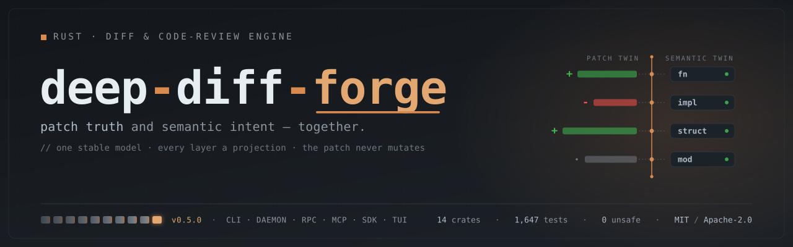
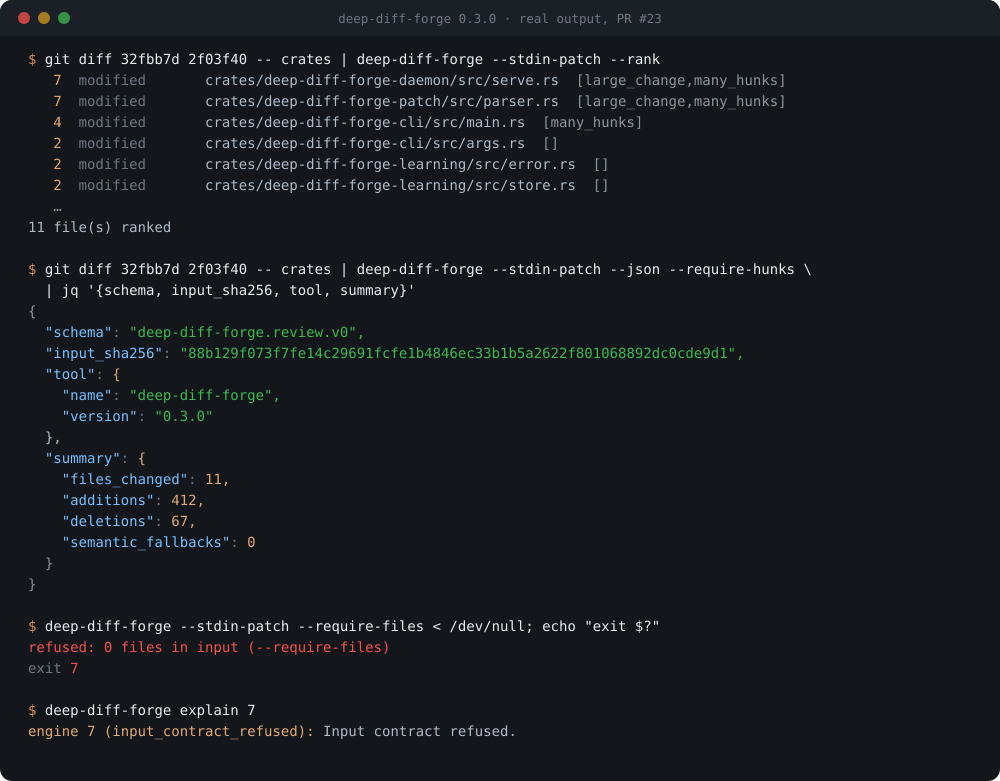
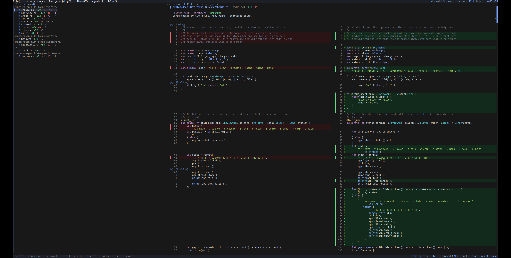

<p align="center">
  
</p>

<p align="center">
  <a href="https://github.com/Louranicas/deep-diff-forge/actions/workflows/ci.yml"></a>
  <a href="https://github.com/Louranicas/deep-diff-forge/releases"></a>
  
  
  <a href="#license"></a>
  <a href="CONTRIBUTING.md"></a>
</p>

# Deep-Diff-Forge

**A review engine for code changes. It keeps the patch exactly as Git would apply it, and
layers understanding on top that can never corrupt it.**

AI writes more of the code we merge, so reviewing a change has become harder than writing
one. Deep-Diff-Forge reads a diff as a review, not a blob of `+` and `-` lines. It ranks files
by risk, explains each ranking, parses source with tree-sitter, and serves the same answer
to people, scripts and agents:

- a terminal cockpit;
- a CLI with stable JSON;
- a Unix-socket daemon;
- an MCP server;
- Rust and Python SDKs.

Underneath sits one rule. The apply-able patch is truth, and nothing may rewrite it.

<p align="center">
  
  <br>
  <sub>Real output, not a mock-up: <code>scripts/docs/render_terminal_svg.py</code> runs the binary on the crate changes of PR #23 and draws what it prints.</sub>
</p>

> **Status: 0.3.0 (2026-10-29).**
> - **Ready** for its declared scope: a local, single-user review tool on Linux and macOS, covering the CLI, daemon, `rpc`, MCP and SDKs. The [verdict and its evidence](#project-status) are below.
> - **Releases:** the latest release is [v0.3.0](https://github.com/Louranicas/deep-diff-forge/releases/tag/v0.3.0), with Linux and macOS binaries, an SPDX SBOM and build provenance.
> - **crates.io:** publication is on hold by decision until the codebase is fully production-hardened.

<p align="center">
  
  <br>
  <sub>The review cockpit, side by side: a risk-ranked file tree, a two-column diff with engine notes, and the menu bar. <code>git diff | deep-diff-forge review</code></sub>
</p>

---

## Contents

- [Why Deep-Diff-Forge](#why-deep-diff-forge)
- [The first principle](#the-first-principle)
- [How it works](#how-it-works)
- [Install](#install)
- [Quick start](#quick-start)
- [Command reference](#command-reference)
- [Output formats and schemas](#output-formats-and-schemas)
- [Exit codes](#exit-codes)
- [MCP server](#mcp-server)
- [SDKs](#sdks)
- [The optional daemon](#the-optional-daemon)
- [Risk ranking](#risk-ranking)
- [Architecture](#architecture)
- [Quality gates](#quality-gates)
- [Review council and evidence gates](#review-council-and-evidence-gates)
- [Project status](#project-status)
- [Contributing](#contributing)
- [Documentation map](#documentation-map)
- [License](#license)

---

## Why Deep-Diff-Forge

Each existing tool optimises one layer of review:

| Tool | Optimises | Limit |
| --- | --- | --- |
| `diff` | patch truth, exit codes, automation | no semantic or review intelligence |
| `delta`, `diff-so-fancy` | readable terminal rendering | line-oriented; pretty is not understanding |
| `difftastic` | structural (syntax-tree) diffing | its output is not an apply-able patch |
| `hunk` | review-first terminal UI and agent workflow | an interactive viewer, not a composable engine |

Deep-Diff-Forge makes these layers cooperate. The core is conservative and apply-able; the
enrichment on top is ambitious and clearly separate. It is built for people reviewing large,
often AI-generated changesets, and for the agents, scripts and CI that drive review more and
more.

It is **Bash-first and agent-first**. Every action:

- has a deterministic command;
- produces machine-readable output (`--json`, `--jsonl`);
- returns a documented exit code that names the next action;
- works as a Unix filter, with no daemon required.

| Capability | deep-diff-forge | [`hunk`][hunk] | [`delta`][delta] | [`difftastic`][difft] | [`diff-so-fancy`][dsf] | `diff` |
| --- | :---: | :---: | :---: | :---: | :---: | :---: |
| Review-first interactive UI | ✅ | ✅ | ❌ | ❌ | ❌ | ❌ |
| Inline agent / engine notes | ✅ | ✅ | ❌ | ❌ | ❌ | ❌ |
| Deterministic, explained risk ranking | ✅ | ❌ | ❌ | ❌ | ❌ | ❌ |
| Versioned JSON / JSONL output | ✅ | ❌ <sup>1</sup> | ❌ | ❌ <sup>2</sup> | ❌ | ❌ |
| Input sealing (`input_sha256`) | ✅ | ❌ | ❌ | ❌ | ❌ | ❌ |
| MCP server and SDKs | ✅ | ❌ | ❌ | ❌ | ❌ | ❌ |
| Optional daemon (Unix socket) | ✅ | ❌ | ❌ | ❌ | ❌ | ❌ |
| Apply-able patch preserved | ✅ | ❌ <sup>3</sup> | ✅ <sup>4</sup> | ❌ | ✅ <sup>4</sup> | ✅ |
| Syntax highlighting | ✅ <sup>5</sup> | ✅ | ✅ | ✅ | ❌ | ❌ |
| Structural / token-level diffing | ✅ <sup>6</sup> | ❌ | ❌ | ✅ | ❌ | ❌ |
| Native VCS input | Git <sup>7</sup> | Git · jj · Sapling | ❌ | ❌ | ❌ | ❌ |
| Watch / auto-reload | ❌ | ✅ | ❌ | ❌ | ❌ | ❌ |
| Pager / Unix-filter friendly | ✅ | ✅ <sup>8</sup> | ✅ | ✅ | ✅ | ✅ |

<sup>1</sup> `hunk`'s agent integration is a live in-session skill, not a schema'd document a script can consume.
<sup>2</sup> difftastic has an experimental JSON display; Deep-Diff-Forge ships versioned schemas.
<sup>3</sup> `hunk` renders patches but does not emit an apply-able patch.
<sup>4</sup> They re-render a Git diff that stays apply-able.
<sup>5</sup> Tree-sitter, terminal-injection-safe. Rust today; more grammars are [welcome](CONTRIBUTING.md).
<sup>6</sup> Token-level and reformat-aware, with best-effort moved-block detection. difftastic's tree-edit-distance diff is deeper.
<sup>7</sup> `--git-working-tree`, `--git-staged` and `--git-range A..B`. Comparing two files directly (`deep-diff-forge <old> <new>`) is on the roadmap.
<sup>8</sup> `hunk` works as a pager but is a full-screen UI, not a stdout filter.

Comparisons are best effort against each tool's default behaviour. Corrections are welcome.

[hunk]: https://github.com/modem-dev/hunk
[delta]: https://github.com/dandavison/delta
[difft]: https://github.com/Wilfred/difftastic
[dsf]: https://github.com/so-fancy/diff-so-fancy

## The first principle

> **A diff engine must preserve patch truth while exposing semantic intent.**

Patch truth is the exact text that can be applied, and it is separate from every enrichment
layer. Semantic analysis, risk ranking and agent notes may be absent, partial or wrong, but
none of them can change the apply-able patch.

The reverse holds too. An internally incoherent patch is **refused, not repaired**:

- a hunk whose body disagrees with its `@@ -a,b +c,d @@` counts;
- a hunk cut off at end of file;
- a header missing its closing `@@`;
- a `GIT binary patch` body followed by anything but base85 lines;
- a file header after the file's first hunk, a `---` without its `+++`, or headers that
  contradict each other (a new file with old lines, a deleted file that is also renamed).
- a rename or copy that names a path `git apply` refuses: absolute, or with a `.`, `..` or
  `.git` component;
- a mode header that is not octal.

Each fails with exit 4. None is quietly turned into a plausible-looking model.

## How it works

<p align="center">
  
</p>

1. **One door to a sealed review.** Every review document comes from
   `deep_diff_forge_patch::SealedReview`, whether the patch was piped in or acquired from Git.
   It decodes the bytes, parses them within a 64 MiB budget in linear time, applies the input
   contracts, and seals them with SHA-256. This covers the CLI's `--json`, `--rank`,
   `--cluster` and layouts, the daemon's `diff.compute` and `diff.rank`, MCP's `review_patch`
   and `rank_patch`, and the SDKs.
   - `--jsonl` streams through the pipeline crate under the same parser and contracts, but
     unsealed.
   - The cockpit, `diff.plan` and `session.open` use the same strict parser without a seal.
   - Git runs with a fixed argv, and paths, modes and blob IDs come from NUL-delimited
     records.
2. **One model.** `deep-diff-forge-core` holds files, hunks, line anchors, the seal and the tool
   identity. It has no I/O and no parsing.
3. **Enrichment reads, never writes.** Projection, the risk graph, cluster lanes, tree-sitter
   syntax, agent notes and the learning loop each read the model.
4. **Every surface tells the same truth.** For the same bytes, `--stdin-patch --json`, the
   daemon's `diff.compute`, `rpc`, the MCP `review_patch` tool and the SDK's `review` produce the
   same document, and parity tests prove it.

## Install

**Prebuilt binaries** (latest release: v0.3.0) for Linux x86_64 and macOS (Apple silicon and
Intel) are on the [releases page](https://github.com/Louranicas/deep-diff-forge/releases).
Each archive has a `.sha256` file, and the release carries an SPDX SBOM:

```bash
curl -LO https://github.com/Louranicas/deep-diff-forge/releases/download/v0.3.0/deep-diff-forge-v0.3.0-x86_64-unknown-linux-gnu.tar.gz
curl -LO https://github.com/Louranicas/deep-diff-forge/releases/download/v0.3.0/deep-diff-forge-v0.3.0-x86_64-unknown-linux-gnu.tar.gz.sha256
sha256sum -c deep-diff-forge-v0.3.0-x86_64-unknown-linux-gnu.tar.gz.sha256
```

**From source** (0.3.0, everything in this README). This needs Rust **1.88+** (edition 2024):

```bash
git clone https://github.com/Louranicas/deep-diff-forge.git
cd deep-diff-forge
cargo build --release --locked -p deep-diff-forge-cli
target/release/deep-diff-forge --version        # deep-diff-forge 0.3.0
target/release/deep-diff-forge --self-test
```

Optional shortcuts:

```bash
alias ddf='deep-diff-forge'
git config --global alias.review '!git diff | deep-diff-forge review'
```

## Quick start

```bash
git diff | deep-diff-forge review                       # the interactive cockpit
git diff | deep-diff-forge --stdin-patch --rank         # what to look at first, and why
deep-diff-forge --git-staged --rank                     # the same, without the pipe
deep-diff-forge --git-range main..HEAD --json           # a sealed review document
git diff | deep-diff-forge --stdin-patch --layout side-by-side
deep-diff-forge semantic src/lib.rs                     # tree-sitter symbols
deep-diff-forge structural old.rs new.rs                # reformat-aware diff
deep-diff-forge explain 4                               # what an exit code means
```

### For agents: look before you read

An agent should learn where to look before it reads anything large. Register DDF with your
agent and allow the repositories it may read; the agent never has to paste a patch.
`agent setup` prints the exact registration for this binary and writes nothing:

```bash
deep-diff-forge agent setup --client claude --allow-repo ~/code/project   # a `claude mcp add …` line
deep-diff-forge agent setup --client codex  --allow-repo ~/code/project   # a ~/.codex/config.toml block
deep-diff-forge agent doctor            # proves MCP, the daemon and the CLI agree on one sealed patch
```

1. **`review_change`** with `selection: "staged"` (or `working_tree`, or `range` with `A..B`)
   returns the **outline**: every file in review-risk order with its score, signals and hunks.
   Each hunk carries its address, line ranges, `@@` heading and counts, and no line text yet.
2. **`review_change`** with `view: "hunks"` and the `addresses` it cares about returns those
   hunks verbatim.
3. Every answer is sealed (`input_sha256`) and fits `max_bytes`, 32 KiB by default, both copies
   counted. A `next_cursor` continues, and it belongs to that patch and that selection only.

Without `--allow-repo`, `review_outline` and `review_hunks` do the same for a patch the agent
passes. The same views exist on the CLI (`--outline`, `--hunks`), on the daemon's socket and
over `rpc` (`review.outline`, `review.hunks`, `review.change`).

```bash
deep-diff-forge --git-staged --outline                         # where to look
deep-diff-forge --git-staged --hunks --address 44a87108…        # read one hunk
git diff | deep-diff-forge --stdin-patch --hunks --path src/lib.rs --max-bytes 8192
```

For gates and orchestrators, refuse empty or hunkless input so it can't pass as a clean review:

```bash
git diff | deep-diff-forge --stdin-patch --rank --json --require-files --require-hunks
```

---

## Command reference

`deep-diff-forge --help` is the authoritative list, and `deep-diff-forge <command> --help` prints one command's usage and what it does, with exit 0. A test runs it for every command `--help` lists.

### Review a change

```bash
deep-diff-forge --stdin-patch [MODE] [--require-files] [--require-hunks]
deep-diff-forge {--git-working-tree [--include-untracked] | --git-staged | --git-range A..B} [--repo PATH] [MODE | --acquisition-json]
# MODE: --json | --jsonl | --rank | --cluster [--parallel N] | --layout inline|side-by-side
#       | --outline | --hunks [--address A]... [--path P]...   (both: [--max-bytes N] [--cursor C])
```

| Mode | Output |
| --- | --- |
| *(none)* | One line per file: status, path, `+adds -dels`, hunk count. |
| `--json` | One `deep-diff-forge.review.v0` document: files, hunks, line anchors, summary, seal. |
| `--jsonl` | One `{"event":"diff.file",…}` event per file, streamed. |
| `--rank` | Files by review risk, highest first, with their signals. Add `--json` for `deep-diff-forge.rank.v0`. |
| `--cluster [--parallel serial\|auto\|N]` | The same ranking through bounded parallel lanes with a deterministic join and a receipt. Add `--json` for `deep-diff-forge.cluster.v0`. |
| `--layout inline` / `--layout side-by-side` | Text projections with old and new line numbers. |
| `--require-files` | Refuse a patch with 0 files: exit 7, empty stdout, `refused: 0 files in input (--require-files)`. |
| `--require-hunks` | Refuse a patch with 0 hunks or 0 changed lines (header-only, rename-only, context-only): exit 7, `refused: 0 hunks in input (--require-hunks)`. |
| `--outline` | `deep-diff-forge.review-outline.v0`: files in review-risk order, each hunk's address, ranges, `@@` heading and counts, no line text. |
| `--hunks [--address A]... [--path P]...` | `deep-diff-forge.review-hunks.v0`: the chosen hunks verbatim (all, by address or by path). A long hunk continues at a line (`complete: false`). |
| `--max-bytes N` · `--cursor C` | For `--outline` / `--hunks`: the most bytes the answer may take (1 KiB–16 MiB, default 64 KiB), and the `next_cursor` of the previous page. The page prints as one line of JSON, the daemon's page byte for byte. |
| `--acquisition-json` | Git input only: the `deep-diff-forge.git-acquisition.v0` identity of what Git returned. |

Git selections run Git with a fixed argv and stop it after 120 s (`TimedOut`, exit 3), so a
stalled filesystem or hook cannot hang the caller.

A gate should **always pass both guards**. When both fail, the files guard reports first.

### The review cockpit

```bash
git diff | deep-diff-forge review                    # interactive (needs a terminal)
git diff | deep-diff-forge review --side             # start side by side
git diff | deep-diff-forge review --probe            # one headless frame for CI and agents
git diff | deep-diff-forge review --probe --cols 120 --rows 40 --cmd rank
```

| Key | Action |
| --- | --- |
| `j` / `k` · `↓` / `↑` | next / previous file, in rank order |
| `g` / `G` · `Home` / `End` | first / last file |
| `h` / `l` · `←` / `→` | focus the file tree / the diff |
| `Enter` | open the file, or run the selected palette command |
| `s` · `Tab` · `t` | toggle inline and side-by-side |
| `z` · `w` · `n` | fold context · wrap rows · show notes |
| `v` · `Space` | mark the file reviewed and move on |
| `T` | cycle theme (dark · midnight · mono) |
| `:` · `?` | command palette · key help |
| `Ctrl-d` / `Ctrl-u` · `PageDown` / `PageUp` | scroll the diff |
| `q` · `Esc` | quit · close the overlay |

The mouse works too: the wheel scrolls, and clicks select files, focus the diff and open
menus. The palette (`:` in the app, or `--palette` / `--cmd NAME` headless) runs `rank`,
`outline`, `cluster`, `summary`, `notes`, `review`, `daemon`, `learning` and `maturity`
against the loaded review. An unknown name or a non-numeric size is a usage error (exit 2).

### Source files

```bash
deep-diff-forge semantic <path> [--json]       # top-level symbols with line ranges (semantic.v0)
deep-diff-forge highlight <path> [--color|--no-color]
deep-diff-forge structural <old> <new> [--json]   # token-level, reformat-aware (structural.v0)
```

Rust is supported today. Other extensions degrade explicitly to `fallback:UnsupportedLanguage`,
never to a guess. Parsing is byte- and node-budgeted, and a malformed file reports
`parsed_with_errors:N` instead of failing. Highlighting is **terminal-injection-safe**: source
text passes through a control-character sanitiser, so the only raw escapes are fixed colour codes.

### Machine surfaces

```bash
deep-diff-forge envelope -- <command…>          # any command as one ddf.result.v1 object
deep-diff-forge schema [result|exit-codes]      # the envelope's JSON Schema, or the registry
deep-diff-forge explain <code> [--family engine|council] [--json]
deep-diff-forge mcp                             # read-only MCP server over stdio
deep-diff-forge rpc                             # the daemon's JSON-RPC over stdio, no daemon
deep-diff-forge daemon {path|start [--foreground]|health|status|stop} [--socket PATH]
```

### Learning, analysis, deployment and diagnostics

```bash
deep-diff-forge learn status [--json]                 # local receipts, scores, trust verdict
echo '<receipt>' | deep-diff-forge learn record --stdin
deep-diff-forge analyze <patch-file> <base-dir> <candidate-dir>   # deep-diff-forge.analysis.v1
deep-diff-forge deploy status [--json]                # declared maturity and gate stack
deep-diff-forge deploy release [--json]               # per-target publication posture
deep-diff-forge deploy doctor [--json] [--socket PATH] # can this machine run the daemon and Git? exit 6 if not
deep-diff-forge doctor                                # runtime, cache, state and socket paths
deep-diff-forge --self-test
deep-diff-forge {claude-code-contract|chain-contract|cluster-contract|loom-contract}
```

`learn` is local-only. A receipt holds hashes, counts and timings, never a path or a source
line. Receipts live under `$XDG_STATE_HOME/deep-diff-forge/learning/`. An invalid receipt
exits 4.

`analyze` checks that a patch turns the captured base directory into the candidate before it
attaches semantics.

`deploy release` is a declared snapshot. The source is published on GitHub and GitLab, the
GitHub release waits for the owner's tag, and crates.io is on hold.

### Review council

```bash
deep-diff-forge council {example|prepare|review|gate|status|import|export-tuicr|import-tuicr}
```

See [Review council and evidence gates](#review-council-and-evidence-gates).

---

## Output formats and schemas

Every machine document names its schema. `--json` prints one document and `--jsonl` one
event per line. Results go to **stdout**, diagnostics to **stderr**, and on error stdout is
empty.

| Command | Schema |
| --- | --- |
| `--stdin-patch --json`, `--git-* --json` | `deep-diff-forge.review.v0` |
| `--stdin-patch --jsonl` | line events `{"event":"diff.file",…}` |
| `--rank --json` · `--cluster --json` | `deep-diff-forge.rank.v0` · `deep-diff-forge.cluster.v0` |
| `--git-* --acquisition-json` | `deep-diff-forge.git-acquisition.v0` |
| `--outline` · `--hunks`, `review.outline` · `review.hunks` · `review.change`, MCP `review_outline` · `review_hunks` · `review_change` | `deep-diff-forge.review-outline.v0` · `deep-diff-forge.review-hunks.v0` |
| `semantic --json` · `structural --json` | `deep-diff-forge.semantic.v0` · `deep-diff-forge.structural.v0` |
| `analyze` | `deep-diff-forge.analysis.v1` |
| `learn status --json` | `deep-diff-forge.learning.v0` |
| `deploy status --json` · `deploy release --json` · `deploy doctor --json` | `deep-diff-forge.deployment-status.v0` · `deep-diff-forge.release.v0` · `deep-diff-forge.deploy-doctor.v0` |
| MCP `review_patch` / `rank_patch` over 256 KiB | `deep-diff-forge.review-summary.v0` · `deep-diff-forge.rank-summary.v0` |
| `envelope` | `ddf.result.v1` |
| `agent setup --json` · `agent doctor --json` | `deep-diff-forge.agent-setup.v0` · `deep-diff-forge.agent-doctor.v0` |
| `daemon`, `rpc` | JSON-RPC 2.0, protocol 1 |

**Input sealing.** `review.v0`, `rank.v0`, `cluster.v0`, `semantic.v0` and
`git-acquisition.v0` carry two members right after `schema`:
- `input_sha256`: lowercase hex SHA-256 of the exact bytes read, before any parsing.
  `sha256sum < input` reproduces it.
- `tool`: `{"name": "deep-diff-forge", "version": "<CARGO_PKG_VERSION>"}`.

The outline and hunk views carry the seal as well.

Output is deterministic: the same bytes give byte-identical stdout on every run.

**Hunk addresses.** Every hunk in `review.v0` and in the views carries these fields:
- `address`: SHA-256 over `ddf-hunk-v1`, the file path, the header's ranges and the body. It names
  exactly that hunk in that patch: changing the path, the position or one byte of the body
  changes it.
- `body_sha256`: the body alone. It survives a move, so use it to recognise the same change
  across revisions, never as proof that two reviews saw the same patch.
- `section`: the `@@` heading Git wrote. It is display-only and never re-rendered into the patch.
- `old_lines` and `new_lines`: the header's counts.

The new fields are additive, so the schema stays `review.v0`.

**Hazards.** A file whose path traverses, names `.git` or hides characters, and a line that
carries a bidi control, an invisible character or a control character, gets a `hazards` list:
`path_traversal`, `git_internal`, `bidi_control`, `invisible` or `control`. `invisible` covers
zero-width and joiner characters, invisible operators, fillers, the soft hyphen, variation
selectors and tag characters; `control` covers C0/C1 controls other than tab and the Unicode
line and paragraph separators. The carriage return of a CRLF body line does not count; one at
the end of a path does. Hazards are facts about the bytes, reported only where
found. An empty list never means the text is safe. They also raise the file's rank
(`hazardous_text`).

```json
{
  "schema": "deep-diff-forge.rank.v0",
  "input_sha256": "9317219840467a00fbb7bc3ff905b0ae26a999582c12c8d02f49d380b398bbb3",
  "tool": {"name": "deep-diff-forge", "version": "0.3.0"},
  "ranked": [
    {"path": "src/lib.rs", "status": "modified", "score": 7, "signals": ["public_api_surface"]},
    {"path": "tests/it.rs", "status": "modified", "score": 1, "signals": ["test_only"]}
  ]
}
```

Strings are RFC 8259-escaped, and valid UTF-8 passes through. A line decoded lossily is marked
`"lossy": true`. File statuses use one snake-case spelling everywhere: `added`, `modified`,
`deleted`, `renamed`, `copied`, `type_changed` (a file, a symlink or a submodule became
another), `mode_changed` (only the mode changed, such as the executable bit), `binary_changed`,
`unknown`.

## Exit codes

| Code | Meaning | Next |
| --- | --- | --- |
| 0 | Success. | `proceed` |
| 2 | CLI usage / argument error. | `fix_invocation` |
| 3 | I/O or encoding failure: reading input (stdin, a file, Git, the learning store), non-UTF-8 input, or writing output. | `check_environment` |
| 4 | Invalid input: a patch or analysis input that fails to parse or validate, input over the byte budget, an invalid receipt, or a refused Git acquisition. | `change_input` |
| 6 | Daemon / interactive-terminal failure. | `check_environment` |
| 7 | Input contract refused. `--require-files`: the (well-formed) patch describes 0 files — stderr `refused: 0 files in input (--require-files)`. `--require-hunks`: the patch has 0 hunks or 0 added+removed lines (header-only, rename-only, context-only) — stderr `refused: 0 hunks in input (--require-hunks)`. Gates should pass both. | `change_input` |
| 101 | Internal error (a panic). Report it as a bug. | `report_bug` |

The `council` subcommands use their own family ([review council](docs/REVIEW_COUNCIL.md)):

| Council code | Meaning | Next |
| --- | --- | --- |
| 0 | The requested council operation completed under its contract; `status` exit 0 means ready for human review. | `proceed` |
| 4 | Malformed input, stale admission, an existing artifact, or a protocol or I/O failure. | `change_input` |
| 7 | HOLD: failed, missing or inconclusive evidence, or an import conflict. | `review_evidence` |

**Next** is what a caller, person or agent, should do. `schema exit-codes`, `explain --json`
and the MCP tools report it as `action`, with `may_be_transient`, which is true only for
`check_environment`:

- `proceed`: use the result.
- `fix_invocation`: correct the command line; the same arguments fail the same way.
- `check_environment`: check what the message names (a file or stream, the terminal, the daemon);
  the same command can succeed once that is fixed.
- `change_input`: change the input or the state the message names (a stale admission, an
  existing artifact), or drop the contract that refused it; the same input is refused again.
- `review_evidence`: read the evidence the council reported and decide; rerunning does not change it.
- `report_bug`: report the command and its input; do not retry blindly.

Both tables come from one registry in the binary, and a test fails if this README drifts from it.

### Machine contract (`ddf.result.v1`)

```bash
deep-diff-forge envelope -- --stdin-patch --json < change.patch   # one ddf.result.v1 object
deep-diff-forge schema result        # JSON Schema (2020-12) of the envelope
deep-diff-forge schema exit-codes    # the registry: family, code, name, meaning, action
deep-diff-forge explain 7 --family council
```

`envelope` runs the command as a child of the same binary, with stdin passed through. It reports:

- `exit_code`, and `outcome`, the registry name for that code (`undocumented` for an unlisted code, `signal` if the command was killed);
- `ok`, which is true only for exit 0 with nothing truncated;
- `stdout`, parsed when it is exactly one JSON value (otherwise text, so `--jsonl` stays text);
- `stderr`.

The command's own output is unchanged, and `envelope` exits with the command's code. Captured stdout is capped at 16 MiB and stderr at 1 MiB; anything cut is listed in `truncated` and never parsed.

## MCP server

`deep-diff-forge mcp` serves read-only [Model Context Protocol](https://modelcontextprotocol.io)
tools over stdio, one JSON-RPC message per line.

- **Modern clients** (specification 2026-07-28) send the protocol version and client capabilities in each request's `_meta`, and may call `server/discover` first.
- **Legacy clients** (2025-11-25, 2025-06-18, 2025-03-26) use the `initialize` handshake.

| Tool | What it returns |
| --- | --- |
| `review_patch` | The `deep-diff-forge.review.v0` document for `patch`: the same JSON value `--stdin-patch --json` prints, up to 256 KiB (see *Large reviews*). `require_files` / `require_hunks` refuse as the CLI flags do; `paths` limits the document to chosen files |
| `rank_patch` | The sealed `deep-diff-forge.rank.v0` document `--stdin-patch --rank --json` prints: files by review risk, with their signals. `require_files` / `require_hunks` refuse as the CLI flags do |
| `review_outline` | **Start here.** `deep-diff-forge.review-outline.v0` for `patch`: files in review-risk order with their hunks' addresses, ranges, `@@` headings and counts, no line text. Fits `max_bytes`; `cursor` continues |
| `review_hunks` | `deep-diff-forge.review-hunks.v0`: chosen hunks verbatim, by `addresses` or `paths` (or all). Fits `max_bytes`; `cursor` continues |
| `review_change` | The outline or hunks of a change read straight from Git (`selection`: `staged`, `working_tree`, `range`), with an `acquisition` member that lists any `omitted_untracked` directories (a nested repository is not captured). Only for repositories the server was started with `--allow-repo`; Git is stopped after 30 s |
| `explain_exit_code` | One exit code's family, name, meaning and next action |
| `exit_code_registry` | Every documented exit code |

Every tool is annotated `readOnlyHint: true`, and none writes anything. Every tool declares an
`outputSchema`. The patch tools' results always carry `schema`, `input_sha256` and `tool`, so an
agent can check which bytes an answer is about. A full result arrives twice, as
`structuredContent` and as a text copy, because the MCP specification asks servers to keep the
text copy for older clients. Ask for `detail: "summary"` or `paths` to keep answers small. The server
instructions and the patch-reading tools tell the model that paths and line text come from
the patch's authors: data to review, never instructions.

- **Errors:** an unknown tool or malformed JSON-RPC is a JSON-RPC error. Bad or missing arguments, a parse failure or a broken input contract is a tool result with `isError: true`, so a model can correct its input.
- **Limits:** a request line is capped at the 64 MiB patch budget plus 1 MiB.
- **Large reviews:** `review_patch` returns the full document while it is at most 256 KiB. A larger review returns a bounded `deep-diff-forge.review-summary.v0` instead: the same seal and totals, and per-file counts for up to 1,000 files, with `reason` and `omitted_files`. Pass `paths` to get chosen files in full, or `detail: "summary"` to ask for the summary. `rank_patch` returns the full ranking while it is at most 256 KiB; a larger one returns `deep-diff-forge.rank-summary.v0`: the same seal, and the highest-ranked files that fit, in order, with `total_files` and `omitted_files`.
- **Lifetime:** the server exits when stdin closes.

```json
{"mcpServers": {"deep-diff-forge": {"command": "deep-diff-forge", "args": ["mcp"]}}}
```

## SDKs

**Rust:** the `deep-diff-forge-sdk` crate is a stable facade over the same crates the CLI and
daemon use.

```rust
use deep_diff_forge_sdk::{review, rank, Guards};
let review = review(patch, Guards::all())?;   // or Guards::none().require_files()
let document = review.to_json();   // byte for byte what `--stdin-patch --json` prints
let ranked = rank(&review);
```

`Client::at(socket).call(method, &params)` calls a running daemon. It is Unix-only, and it
checks every answer's version, id and error shape.

- **Exit codes:** errors map to the CLI's exit codes (`Error::exit_code`).
- **Ownership:** the SDK owns `Guards`, `Review` (opaque) and `Error` (`#[non_exhaustive]`). `ReviewFile`, `InputSeal` and `RankedFile` are model types and change only with the schema version.
- **Stability:** `tests/api.rs` pins every public signature, so changing one is a deliberate breaking change.

**Python:** `sdk/python/deep_diff_forge.py` uses only the standard library. It speaks the
daemon protocol over two transports with the same calls:

- `deep-diff-forge rpc` over a pipe (`StdioClient`), which needs no daemon;
- a running daemon's socket (`SocketClient`).

```python
from deep_diff_forge import StdioClient
with StdioClient() as client:
    document = client.review_patch(patch, require_files=True, require_hunks=True)
```

`deep-diff-forge rpc` answers each stdin line with the socket server's own handler and framing:
an 80 MiB cap that counts the newline, with an oversized request refused at once. It stops at
`daemon.shutdown`. The Python client checks every answer's version and id, bounds each answer's
size and time, and kills a child that exceeds either. CI runs the Python tests against the
built binary over both transports.

## The optional daemon

The daemon speeds up repeated review and multi-client workflows. It is **never required**:
every command works without it. It is **std-first**, with no async runtime: a JSON-RPC 2.0
server on an owner-private Unix domain socket.

**Security boundary:**
- **Ownership.** The runtime directory is `0700` and must be owned by the effective user. The
  socket is `0600`.
- **Same user only, checked by the kernel.** The daemon reads each client's user ID from the
  socket (`SO_PEERCRED` on Linux, `getpeereid` on macOS) and drops any client that is not its
  own user, whatever the socket's mode. The CLI, the Rust SDK and the Python SDK check the
  daemon the same way before sending anything.
- **One daemon per socket.** `daemon start` takes an exclusive lock on `<socket>.lock` before it
  probes for a stale socket and holds it until the daemon exits. A second start, even one racing
  the first, exits 6 and leaves the running daemon reachable.
- **Explicit `--socket` paths fail closed.** A missing parent is created `0700`. An existing
  parent is validated and never re-permissioned. A path is replaced only if it is already a
  socket that nothing answers on. A live daemon is never displaced, and a regular file,
  directory or symlink is never deleted.
- **Bounded sessions.** Sessions are capped by an LRU count and 128 MiB of total payload.
- **Bounded connections.** At most eight connections are admitted. One engine serves them,
  so requests run one at a time.
- **Bounded I/O.** Each request line has an absolute read deadline, each response write a
  per-write timeout, and both are capped at 80 MiB. A response over the cap becomes a
  `RESOURCE_EXHAUSTED` (8) error for the same id.
- **No repository unless allowed.** `review.change` reads Git only in a repository whose
  canonical path and Git top level are both at or under a root named with
  `daemon start --allow-repo PATH` (also `rpc` and `mcp`). Without one it reads nothing.
  Symlinks are resolved first, and Git is stopped after 30 s. A Git failure is error 3.

**Default socket:** `$XDG_RUNTIME_DIR/deep-diff-forge/deep-diff-forge.sock`. There is no
`/tmp` fallback. Without `$XDG_RUNTIME_DIR` the daemon fails closed until you pass `--socket PATH`.

**JSON-RPC methods** (protocol 1; `engine.methods` lists them with their parameters):
`engine.initialize`, `engine.methods`, `daemon.health`, `daemon.status`,
`daemon.shutdown`, `diff.plan`, `diff.compute`, `diff.rank`, `review.outline`, `review.hunks`,
`review.change`, `session.open`, `session.snapshot`, `session.close`.

```bash
deep-diff-forge daemon start --foreground      # terminal 1
deep-diff-forge daemon health                  # terminal 2
# {"id":1,"jsonrpc":"2.0","result":{"cache_entries":0,"pid":…,"protocol":1,"retained_bytes":0,"sessions":0,"status":"ok","version":"0.3.0"}}
deep-diff-forge daemon stop
```

## Risk ranking

`--rank`, `--cluster`, the cockpit and `rank_patch` share one deterministic, additive score
per file (`crates/deep-diff-forge-graph/src/risk.rs`). Higher means review first.

| Signal | When | Score |
| --- | --- | ---: |
| *(base)* | any reviewable change | +1 |
| *(primary source)* | not a test, config or lockfile | +1 |
| `public_api_surface` | `lib.rs`, `mod.rs`, or an `/api/` path | +5 |
| `large_change` | ≥ 80 changed lines | +3 |
| `deleted_file` · `new_file` | removed · added | +3 · +2 |
| `many_hunks` | ≥ 5 hunks | +2 |
| `config_or_lockfile` · `binary_change` | `Cargo.toml`, `*.lock`, `*.yaml`, … · binary | +1 · +1 |
| `test_only` | under `tests/` or `test/`, `*_test.*`, `*.test.*` | no bonus |
| `hazardous_text` | a changed line holds a bidi control, an invisible or a control character, or the path (or the path a rename or copy leaves) traverses (`..`, absolute) or names `.git` | +3 |
| `symlink_change` | a symlink is created, changed, removed, or made from a file | +3 |
| `executable_bit` | a file becomes executable: a new `100755` file, or a mode change that adds an `x` bit | +2 |
| `generated_or_vendored` | `vendor/`, `node_modules/`, `target/`, `generated/`, `dist/`, `*.min.js`, `*.pb.rs`, `*.pb.go` | base only: no bonuses, but keeps new · deleted · binary · hazards · symlink · executable |

Whoever writes a patch also chooses its paths, so a path can lower a file's score but never zero it. A new file under `generated/` still ranks above a one-line edit elsewhere.

Ties break on path, so the order is reproducible. Under `--cluster` the result is
**identical for any worker count**: parallelism never changes the answer.

---

## Architecture

There are 14 narrow crates with one-way dependencies. `core` is pure vocabulary, with no I/O
and no parsing. Every crate except `learning` depends on `core`, and patch truth is upstream
of everything.

```mermaid
flowchart LR
  subgraph surfaces[" "]
    cli[cli]
    tui[tui]
    sdk[sdk]
  end
  cli --> tui & pipeline & cluster & daemon & review & learning & syntax & projection & graph & patch
  tui --> agent & cluster & daemon & learning & syntax & projection & graph & patch
  sdk --> graph & patch
  sdk -. "cfg(unix)" .-> daemon
  pipeline --> syntax & projection & graph & patch
  cluster --> graph
  daemon --> graph & patch
  core((core))
  patch --> core
```

<sub>Drawn from <a href="docs/crate-edges.txt"><code>docs/crate-edges.txt</code></a>, which a test checks against <code>cargo metadata</code>. Edges into <code>core</code> are left out except one: every crate but <code>learning</code> has one. Dev-only edges are omitted.</sub>

| Crate | Role |
| --- | --- |
| `deep-diff-forge-core` | The stable model: IDs, patch and semantic twins, planner and graph vocabulary, the exit-code registry, release and deployment types. |
| `deep-diff-forge-patch` | Strict unified/Git patch parser, `SealedReview`, Git acquisition, apply-able renderer, `review.v0` JSON. |
| `deep-diff-forge-projection` | Renderer-neutral inline and side-by-side projections. |
| `deep-diff-forge-pipeline` | Composable Unix-filter stages and JSONL. |
| `deep-diff-forge-syntax` | Tree-sitter detection, budgeted parsing, symbols, highlighting, token-level structural diff. |
| `deep-diff-forge-graph` | The review intelligence graph: deterministic risk ranking. |
| `deep-diff-forge-agent` | Annotation provenance, grounding, sanitisation, anchor validation. |
| `deep-diff-forge-cluster` | Bounded parallel lanes, deterministic joins, receipts. |
| `deep-diff-forge-learning` | Local-only learning loop: receipts, scoring, gated promotion. |
| `deep-diff-forge-daemon` | The optional Unix-socket JSON-RPC service and its shared request handler. |
| `deep-diff-forge-tui` | The review cockpit (ratatui), tested headlessly. |
| `deep-diff-forge-review` | The review council: captured rosters, challenge rounds, sandboxed evidence gates. |
| `deep-diff-forge-sdk` | The stable Rust facade and daemon client. |
| `deep-diff-forge-cli` | The `deep-diff-forge` binary, plus the MCP, `rpc` and `envelope` surfaces. |

Deeper: [`docs/ARCHITECTURE.md`](docs/ARCHITECTURE.md) and [`docs/SCHEMATICS.md`](docs/SCHEMATICS.md).

## Quality gates

Deep-Diff-Forge reviews untrusted code, so it is built to make bad code hard to write. `main`
changes only through a pull request, on a branch that is up to date, after **nine required
checks**. Nobody can bypass them.

| Required check | What it proves |
| --- | --- |
| `deploy gate-feature` | fmt, check, clippy `-D warnings`, pedantic, all tests, docs, contract probes, fuzz-harness compile, hostile-daemon soak, learning-privacy probes, Python SDK against the built binary |
| `diff mutation` × 4 shards | `cargo-mutants` on the lines the PR changes; one surviving mutant fails it |
| `review controller mutation and fuzz evidence` | scoped mutation of the council's admission code; a fuzz smoke for every target; 12 planted-breach probes against the rootless Podman sandbox |
| `supply chain audit` | `cargo-deny` (bans, licences, sources, advisories), strict `cargo-audit`, and the committed SPDX SBOM regenerated and compared |
| `declared Rust 1.88 compatibility` | the MSRV still builds |
| `secret scan (gitleaks)` | a pinned, checksum-verified gitleaks |

Across the tree:
- **No `unsafe`.** It is forbidden in every crate.
- **No production `unwrap` or `expect`.** No suppression goes unexplained.
- **Pinned Actions.** Every GitHub Action is pinned to a commit SHA.
- **Platforms.** A macOS job runs the whole suite weekly, on manual runs and in every
  release run.
- **Releases.** Each release builds three targets, smoke-tests the two that run on the build
  machine, verifies checksums, and attaches SLSA provenance and the SBOM.
- **Local replica.** `scripts/ci_local.sh` (`just ci`) runs the CI gate jobs locally.

The engine is hardened against:
- terminal-escape injection;
- Trojan-Source bidi text;
- memory exhaustion;
- hidden-content patches;
- attacks on the daemon's transport and filesystem.

Eight fuzz targets cover the parser, review JSON, daemon protocol, agent annotations, council
reports, the MCP and `rpc` stdio servers, and the soundness of the structural diff's
"formatting only" verdict. See [`SECURITY.md`](SECURITY.md) for the threat
model.

## Review council and evidence gates

[`docs/REVIEW_COUNCIL.md`](docs/REVIEW_COUNCIL.md) holds the full design, threat model and
per-round history. This section is a map, not a copy.

- **The council.** `deep-diff-forge council prepare|review|gate|status` runs six reviewer
  slots over a sealed snapshot, split between Claude Code and Codex. The slots are correctness,
  security, architecture, falsifier, performance and subtractor. They review once
  independently, then in a challenge round. A report is admitted only if its citations resolve
  to real bytes in the snapshot. Missing evidence is `HOLD` with exit 7, never an empty pass.
  Nothing is approved automatically.
- **Eight evidence gates** run only inside a [rootless Podman sandbox](docs/REVIEW_COUNCIL.md#gate-sandbox):
  format, check, clippy, pedantic, tests, antipatterns, fuzz and mutation. The sandbox:
  - uses the operator-admitted image, by ID;
  - runs with `--network=none` (only dependency vendoring is networked);
  - mounts the root and the source read-only;
  - drops all capabilities and sets `no-new-privileges` and `--userns=keep-id`;
  - runs as `--user=<uid>:<gid>` from the operator's effective IDs (`geteuid`/`getegid`), so a
    gate never runs as root.

  Twelve planted-breach probes run in CI.
- **Diff-scoped mutation.** cargo-mutants runs `--in-diff` against a scope built from the
  sealed base and candidate blobs, with `--no-config`, so a candidate cannot shrink its own
  scope.
- **Exemption oracle.** [`exemption_oracle.py`](crates/deep-diff-forge-review/policy/exemption_oracle.py)
  refuses code hidden from mutation by anything other than `#[cfg(test)]`, and checks that
  `#[cfg(test)]` code leaves non-test MIR unchanged ([r18](docs/REVIEW_COUNCIL.md#cfg-test-only-r18)).
- **tuicr and the decision journal.** `council export-tuicr` files admitted findings into a
  local [tuicr](docs/REVIEW_COUNCIL.md#tuicr-export) session. `council import-tuicr` appends
  human dispositions to an append-only [`decisions.jsonl`](docs/REVIEW_COUNCIL.md#decision-journal).

---

## Project status

**0.3.0 is production-ready for its declared scope.** That scope is a local, single-user
review tool on Linux and macOS: CLI, Unix-socket daemon, `rpc`, MCP and SDKs, released as
GitHub binaries. The evidence was measured on 2026-10-29 for `v0.3.0` (details in
[EVIDENCE.md](EVIDENCE.md#v030-release-readiness-2026-10-29)):

- **Release dry run.** The release workflow passed at `478db26`: every quality gate including
  macOS, three builds, a smoke test of each runnable binary, and checksum verification.
- **Fuzzing.** Each fuzz target runs on every PR. After the last parser change, a local run of
  300 s for each of the 8 targets crashed 0 times (`patch_parser` 6.47 M runs, `review_json`
  4.97 M) at `8f957aa`.
- **Fidelity and soak.**
  - A sweep rebuilt 13,811 real files exactly from the review JSON.
  - A one-hour daemon soak held flat memory, and the CI soak now also sends requests at and
    over the 80 MiB cap, a flood past the 8-connection limit and 32 concurrent clients.
- **Audit fixes, 2026-10-28.** An independent audit and the first macOS runs found ten issues,
  and all are fixed. The most serious was a text change hidden after a `GIT binary patch` body,
  which the review missed and `git apply` applied. Each fix has a test that fails on the old
  code. See [CHANGELOG.md](CHANGELOG.md) and [EVIDENCE.md](EVIDENCE.md).

**Not claimed:** crates.io publication (on hold), and multi-user or shared-host daemon
deployment.

**Known limits.** Contributions are welcome on any of these; see [CONTRIBUTING.md](CONTRIBUTING.md#open-problems-worth-owning):

- One engine serves all daemon connections, so a long request delays the others.
- macOS tests run weekly and on demand, not on every PR.
- The cockpit is tested by headless frames; there is no key-sequence harness yet.
- Syntax features speak Rust; comparing two files directly (`<old> <new>`) and the `chain`,
  `cluster` and `loom` subcommands are planned and refused today.

The L0–L9 maturity labels in `deploy status` are historical capability declarations, not a
readiness claim. [`docs/ROADMAP.md`](docs/ROADMAP.md) has what comes next.

## Contributing

**Everyone is welcome.** Deep-Diff-Forge is an open invitation, with no prior involvement
needed, and no contribution is too small. Fix a typo, report a bug with a patch that reproduces
it, add a tree-sitter language, close one of the [known limits](#project-status), or review
someone else's pull request.

1. Read [CONTRIBUTING.md](CONTRIBUTING.md). It covers setup in three commands, the quality bar
   and the open problems.
2. Pick an issue labelled [`good first issue`](https://github.com/Louranicas/deep-diff-forge/labels/good%20first%20issue)
   or [`help wanted`](https://github.com/Louranicas/deep-diff-forge/labels/help%20wanted), or
   [open your own](https://github.com/Louranicas/deep-diff-forge/issues/new/choose).
3. Send a pull request. CI tells you everything a reviewer would check mechanically, so the
   human review can focus on ideas.

Everyone participates under the [Code of Conduct](CODE_OF_CONDUCT.md). Security issues go
through a [private advisory](SECURITY.md), not a public issue.

## Documentation map

| If you want to… | Read |
| --- | --- |
| Use the engine from scripts, CI or an agent | [`BASH_API_CONTRACTS`](docs/BASH_API_CONTRACTS.md) · [`CLAUDE_CODE_BASH_CLI`](docs/CLAUDE_CODE_BASH_CLI.md) · [`API_AND_IPC`](docs/API_AND_IPC.md) · [`MAKING_SKILLS`](docs/MAKING_SKILLS.md) |
| Run the daemon or ship a release | [`OPERATIONS_AND_DAEMON`](docs/OPERATIONS_AND_DAEMON.md) · [`RELEASE_AND_PUBLICATION`](docs/RELEASE_AND_PUBLICATION.md) · [`END_TO_END_DEPLOYMENT`](docs/END_TO_END_DEPLOYMENT.md) |
| Understand the design | [`ARCHITECTURE`](docs/ARCHITECTURE.md) · [`SCHEMATICS`](docs/SCHEMATICS.md) · [`VISION`](docs/VISION.md) · [`PIONEER_FEATURE_SPECS`](docs/PIONEER_FEATURE_SPECS.md) · [`ROADMAP`](docs/ROADMAP.md) |
| Hold the quality bar | [`TESTING_GOLD_STANDARD`](docs/TESTING_GOLD_STANDARD.md) · [`DEPLOYMENT_FRAMEWORK`](docs/DEPLOYMENT_FRAMEWORK.md) · [`REVIEW_COUNCIL`](docs/REVIEW_COUNCIL.md) · [`SECURITY`](SECURITY.md) |
| See the record | [`CHANGELOG`](CHANGELOG.md) · [`EVIDENCE`](EVIDENCE.md) · [`NOTES`](NOTES.md) · [`DEPLOYMENT_GAP_ANALYSIS`](docs/DEPLOYMENT_GAP_ANALYSIS.md) · [`PRODUCTION_READINESS`](docs/PRODUCTION_READINESS.md) · [`RECOMMENDATION_INTEGRATION`](docs/RECOMMENDATION_INTEGRATION.md) |

## License

Licensed under either of [MIT](LICENSE-MIT) or [Apache-2.0](LICENSE-APACHE) at your option.
Unless you state otherwise, contributions are dual-licensed the same way.

<sub>Maintainer navigation (owner's local Obsidian vault): [module notes](obsidian://open?vault=deep-diff-forge.vault&file=Implementation%2FModules%2FREADME) · [council hub](obsidian://open?vault=deep-diff-forge.vault&file=Implementation%2FReview%20Council).</sub>
