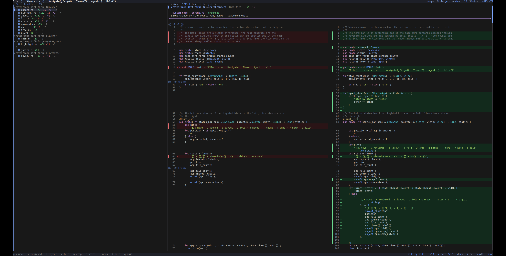

<p align="center">
  
</p>

<p align="center">
  <a href="https://gitlab.com/lukeomahoney/deep-diff-forge/-/releases"></a>
  
  
  <a href="#license"></a>
  <a href="CONTRIBUTING.md"></a>
</p>

# Deep-Diff-Forge

**A review engine for code changes. It keeps the patch exactly as Git would apply it, and
layers understanding on top that can never corrupt it.**

AI writes more of the code we merge, so reviewing a change has become harder than writing
one. Deep-Diff-Forge reads a diff as a review, not a blob of `+` and `-` lines. It ranks files
by risk, explains each ranking, parses source with tree-sitter, and serves the same answer
to people, scripts and agents:

- a terminal cockpit;
- a CLI with stable JSON;
- a Unix-socket daemon;
- an MCP server;
- Rust and Python SDKs.

Underneath sits one rule. The apply-able patch is truth, and nothing may rewrite it.

<p align="center">
  
  <br>
  <sub>Real output, not a mock-up: <code>scripts/docs/render_terminal_svg.py</code> runs the binary on the crate changes of PR #23 and draws what it prints.</sub>
</p>

<p align="center">
  
  <br>
  <sub>The review cockpit, side by side: a risk-ranked file tree, a two-column diff with engine notes, and the menu bar. <code>git diff | deep-diff-forge review</code></sub>
</p>

---

## Contents

- [Why Deep-Diff-Forge](#why-deep-diff-forge)
- [The first principle](#the-first-principle)
- [How it works](#how-it-works)
- [Install](#install)
- [Quick start](#quick-start)
- [Reference](#reference)
- [Project status](#project-status)
- [Contributing](#contributing)
- [Documentation map](#documentation-map)
- [License](#license)

---

## Why Deep-Diff-Forge

Each existing tool optimises one layer of review:

| Tool | Optimises | Limit |
| --- | --- | --- |
| `diff` | patch truth, exit codes, automation | no semantic or review intelligence |
| `delta`, `diff-so-fancy` | readable terminal rendering | line-oriented; pretty is not understanding |
| `difftastic` | structural (syntax-tree) diffing | its output is not an apply-able patch |
| `hunk` | review-first terminal UI and agent workflow | an interactive viewer, not a composable engine |

Deep-Diff-Forge makes these layers cooperate. The core is conservative and apply-able; the
enrichment on top is ambitious and clearly separate. It is built for people reviewing large,
often AI-generated changesets, and for the agents, scripts and CI that drive review more and
more.

It is **Bash-first and agent-first**. Every action:

- has a deterministic command;
- produces machine-readable output (`--json`, `--jsonl`);
- returns a documented exit code that names the next action;
- works as a Unix filter, with no daemon required.

| Capability | deep-diff-forge | [`hunk`][hunk] | [`delta`][delta] | [`difftastic`][difft] | [`diff-so-fancy`][dsf] | `diff` |
| --- | :---: | :---: | :---: | :---: | :---: | :---: |
| Review-first interactive UI | ✅ | ✅ | ❌ | ❌ | ❌ | ❌ |
| Inline agent / engine notes | ✅ | ✅ | ❌ | ❌ | ❌ | ❌ |
| Deterministic, explained risk ranking | ✅ | ❌ | ❌ | ❌ | ❌ | ❌ |
| Versioned JSON / JSONL output | ✅ | ❌ <sup>1</sup> | ❌ | ❌ <sup>2</sup> | ❌ | ❌ |
| Input sealing (`input_sha256`) | ✅ | ❌ | ❌ | ❌ | ❌ | ❌ |
| MCP server and SDKs | ✅ | ❌ | ❌ | ❌ | ❌ | ❌ |
| Optional daemon (Unix socket) | ✅ | ❌ | ❌ | ❌ | ❌ | ❌ |
| Apply-able patch preserved | ✅ | ❌ <sup>3</sup> | ✅ <sup>4</sup> | ❌ | ✅ <sup>4</sup> | ✅ |
| Syntax highlighting | ✅ <sup>5</sup> | ✅ | ✅ | ✅ | ❌ | ❌ |
| Structural / token-level diffing | ✅ <sup>6</sup> | ❌ | ❌ | ✅ | ❌ | ❌ |
| Native VCS input | Git <sup>7</sup> | Git · jj · Sapling | ❌ | ❌ | ❌ | ❌ |
| Watch / auto-reload | ❌ | ✅ | ❌ | ❌ | ❌ | ❌ |
| Pager / Unix-filter friendly | ✅ | ✅ <sup>8</sup> | ✅ | ✅ | ✅ | ✅ |

<sup>1</sup> `hunk`'s agent integration is a live in-session skill, not a schema'd document a script can consume.
<sup>2</sup> difftastic has an experimental JSON display; Deep-Diff-Forge ships versioned schemas.
<sup>3</sup> `hunk` renders patches but does not emit an apply-able patch.
<sup>4</sup> They re-render a Git diff that stays apply-able.
<sup>5</sup> Tree-sitter, terminal-injection-safe. Rust today; more grammars are [welcome](CONTRIBUTING.md).
<sup>6</sup> Token-level and reformat-aware, with best-effort moved-block detection. difftastic's tree-edit-distance diff is deeper.
<sup>7</sup> `--git-working-tree`, `--git-staged` and `--git-range A..B`. `deep-diff-forge <old> <new>` compares two regular files through the same hardened Git.
<sup>8</sup> `hunk` works as a pager but is a full-screen UI, not a stdout filter.

Comparisons are best effort against each tool's default behaviour. Corrections are welcome.

[hunk]: https://github.com/modem-dev/hunk
[delta]: https://github.com/dandavison/delta
[difft]: https://github.com/Wilfred/difftastic
[dsf]: https://github.com/so-fancy/diff-so-fancy

## The first principle

> **A diff engine must preserve patch truth while exposing semantic intent.**

Patch truth is the exact text that can be applied, and it is separate from every enrichment
layer. Semantic analysis, risk ranking and agent notes may be absent, partial or wrong, but
none of them can change the apply-able patch.

The reverse holds too. These internally incoherent patches are **refused, not repaired** (hunks
out of order, overlapping hunks and a new-side start that the old start and earlier counts do not
give are read: Git either places each hunk by its own rule or refuses the whole patch and writes
nothing, and the review states neither which, `CONFORMANCE.md`):

- a hunk whose body disagrees with its `@@ -a,b +c,d @@` counts;
- a hunk cut off at end of file;
- a header missing its closing `@@`;
- a `GIT binary patch` body followed by anything but base85 lines;
- a file header after the file's first hunk, a `---` without its `+++`, or headers that
  contradict each other (a new file with old lines, a deleted file that is also renamed).
- a rename or copy that names a path `git apply` refuses: absolute, or with a `.`, `..` or
  `.git` component;
- a mode header that is not octal.

Each fails with exit 4. None is quietly turned into a plausible-looking model.

A `diff --git` section is read only if its header lines are one of the shapes Git's own diff writes
(`crates/deep-diff-forge-patch/CONFORMANCE.md`). What that promises is what a patch alone can
settle: for every patch DDF accepts, a plain `git apply` in Git's default configuration either
refuses the whole patch while checking it and writes nothing, or writes exactly the paths, types
and modes the review shows and, for each hunk, removes and adds exactly the lines (as Git stores
them) the review shows, at the place Git's own anchor rule gives: a hunk with no trailing context
at the end of the file, one at old line 0 or 1 at its start, any other by Git's search outward from
the new-side line its header names, over lines no earlier hunk of the same section wrote (a later
section for the same path is applied to the earlier section's result, where no line is skipped; the
review does not say which of several equal places Git takes). A header's line numbers are the
patch's claim, true on the tree Git made it from; a hand-written header can name one copy of some
lines while Git changes another, so the review states the anchor ("Git places this hunk at the end
of the file"). Checking the place against the tree is not built. DDF reads a diff without the tree
it applies to, so a review can show a change that never lands, but never one that lands otherwise.
It refuses a hunk with no context past line 1, or one after a hunk with no trailing context (`git
diff -U0` output), and a patch Git would fail to write halfway
(`crates/deep-diff-forge-patch/CONFORMANCE.md` has the limits). The restated promise does not need
the first refusal: a hunk with no context past line 1 would be stated as placed at the end of the
file. DDF refuses such hunks (`HunkPlacedElsewhere`) because plain `git apply` places them at the
end of the file whatever their author meant (`git diff -U0` output is meant for `git apply
--unidiff-zero`). `GitCannotWrite` is what the promise's second outcome needs.
"Git writes it" is not "`git apply` accepts it": a plain `git diff` of a binary file, a
`--submodule=diff` envelope and a `--no-index` pair of binary files are read, and `git apply`
refuses each whole.

## How it works

<p align="center">
  
</p>

1. **One door to a sealed review.** Every review document comes from
   `deep_diff_forge_patch::SealedReview`, whether the patch was piped in or acquired from Git.
   It decodes the bytes, parses them within a 64 MiB budget in linear time, applies the input
   contracts, and seals them with SHA-256. This covers the CLI's `--json`, `--rank`,
   `--cluster` and layouts, the daemon's `diff.compute` and `diff.rank`, MCP's `review_patch`
   and `rank_patch`, and the SDKs.
   - `--jsonl` streams through the pipeline crate under the same parser and contracts, but
     unsealed.
   - The cockpit, `diff.plan` and `session.open` use the same strict parser without a seal.
   - Git runs with a fixed argv, and paths, modes and blob IDs come from NUL-delimited
     records.
2. **One model.** `deep-diff-forge-core` holds files, hunks, line anchors, the seal and the tool
   identity. It has no I/O and no parsing.
3. **Enrichment reads, never writes.** Projection, the risk graph, cluster lanes, tree-sitter
   syntax, agent notes and the learning loop each read the model.
4. **Every surface tells the same truth.** For the same bytes, `--stdin-patch --json`, the
   daemon's `diff.compute`, `rpc`, the MCP `review_patch` tool and the SDK's `review` produce the
   same document, and parity tests prove it.

## Install

**Prebuilt binaries.** From 0.8.4 a release ships one binary, for Linux x86_64, built and
tested on the owner's machine; Linux arm64 and macOS are not built for this release, and v0.8.3
is the last release with binaries for them ([supported platforms](#supported-platforms)).
GitLab is the place of release: **0.9.0** (the signed tag `v0.9.0`, 2026-11-18) and **0.8.4**
(`v0.8.4`, 2026-11-17) are on its [releases page](https://gitlab.com/lukeomahoney/deep-diff-forge/-/releases)
with the archive and its `.sha256`, the SBOM, the build receipt, `SHA256SUMS` and the owner's
signature of it, `SHA256SUMS.sig`. GitHub's [releases page](https://github.com/Louranicas/deep-diff-forge/releases)
mirrors the same files (since 2026-11-22):

```bash
curl -LO https://github.com/Louranicas/deep-diff-forge/releases/download/v0.9.0/deep-diff-forge-v0.9.0-x86_64-unknown-linux-gnu.tar.gz
curl -LO https://github.com/Louranicas/deep-diff-forge/releases/download/v0.9.0/deep-diff-forge-v0.9.0-x86_64-unknown-linux-gnu.tar.gz.sha256
sha256sum -c deep-diff-forge-v0.9.0-x86_64-unknown-linux-gnu.tar.gz.sha256
```

Check all the downloaded files from a clone with
`scripts/release_local.sh verify v0.9.0 <dir> .github/release_allowed_signers`: the tag's signature, every checksum and
its signature, and a rebuild that must give the same binary
([local release](docs/RELEASE_AND_PUBLICATION.md#local-release-from-084)).

**From crates.io** (0.9.0, published 2026-11-23): `cargo install deep-diff-forge-cli --locked`
builds the same CLI from the fourteen published crates.

**From source** (`main` on GitLab, mirrored to GitHub: everything in this README). This needs
Rust **1.88+** (edition 2024):

```bash
git clone https://gitlab.com/lukeomahoney/deep-diff-forge.git
cd deep-diff-forge
cargo build --release --locked -p deep-diff-forge-cli
target/release/deep-diff-forge --version        # deep-diff-forge 0.10.0
target/release/deep-diff-forge --self-test
```

### Supported platforms

These four release targets are the whole platform scope. Up to v0.8.3 each was built by
`release.yml` and its binary run (`--version` and a review) before it shipped. From 0.8.4 a
release is not built by `release.yml`: only `x86_64-unknown-linux-gnu` is built, on the owner's
machine in the `fedora-toolbox-44` toolbox with `scripts/release_local.sh`, which runs the same
smoke and glibc check, and each such build has a receipt
([runs on record](docs/reference/supported-platforms.md#runs-on-record)). The other three
targets are not built for this release; v0.8.3's binaries for them remain on its GitHub release.

| Target | This release (from 0.8.4) | Built and run on (to v0.8.3) | Needs | Tests on every pull request (to v0.8.3) |
| --- | --- | --- | --- | --- |
| `x86_64-unknown-linux-gnu` | built and tested (Fedora 44 toolbox, Rust 1.99.1, LLD): the release smoke and the whole local gate (`scripts/ci_local.sh`); [receipts](docs/reference/supported-platforms.md#runs-on-record) | `ubuntu-24.04` | glibc 2.34 or newer | the whole suite (`deploy gate-feature`, required) |
| `aarch64-unknown-linux-gnu` | not built for this release | `ubuntu-22.04-arm`, natively | glibc 2.34 or newer | the whole suite (`Linux arm64 tests`, not required; gates releases) |
| `aarch64-apple-darwin` | not built for this release | `macos-26` (arm64) | macOS 11 or newer | the whole suite (`macOS tests`, required); the launchd agent (`macOS launchd agent`, not required; skipped in releases) |
| `x86_64-apple-darwin` | not built for this release | cross-built on `macos-26`, run under Rosetta 2 | macOS 10.12 or newer | none (the release smoke only) |

The glibc floor and how it is held, the loader warning on glibc 2.34 to 2.38, source builds and
the macOS minimums are measured in [supported platforms: measurements](docs/reference/supported-platforms.md).

- **Not supported:** musl (Alpine and other musl distributions) is neither built nor tested: the
  syntax layer compiles C (tree-sitter), which needs a musl C toolchain, and nothing would run
  the result. Windows is not supported (the daemon needs Unix domain sockets; the CLI does not
  compile there). Other architectures and the BSDs are not built or tested.

Optional shortcuts:

```bash
alias ddf='deep-diff-forge'
git config --global alias.review '!git diff | deep-diff-forge review'
```

## Quick start

```bash
git diff | deep-diff-forge review                       # the interactive cockpit
git diff | deep-diff-forge --stdin-patch --rank         # what to look at first, and why
deep-diff-forge --git-staged --rank                     # the same, without the pipe
deep-diff-forge --git-range main..HEAD --json           # a sealed review document
git diff | deep-diff-forge --stdin-patch --layout side-by-side
deep-diff-forge semantic src/lib.rs                     # tree-sitter symbols
deep-diff-forge structural old.rs new.rs                # reformat-aware diff
deep-diff-forge explain 4                               # what an exit code means
```

### For agents: look before you read

An agent should learn where to look before it reads anything large. Register DDF with your
agent and allow the repositories it may read; the agent never has to paste a patch.
`agent setup` prints the exact registration for this binary and writes nothing:

```bash
deep-diff-forge agent setup --client claude --allow-repo ~/code/project   # a `claude mcp add …` line
deep-diff-forge agent setup --client codex  --allow-repo ~/code/project   # a ~/.codex/config.toml block
deep-diff-forge agent doctor            # proves MCP, the daemon and the CLI agree on one sealed patch
```

1. **`review_change`** with `selection: "staged"` (or `working_tree`, or `range` with `A..B`)
   returns the **outline**: every file in review-risk order with its score, signals and hunks.
   Each hunk carries its address, line ranges, `@@` heading and counts, and no line text yet.
2. **`review_change`** with `view: "hunks"` and the `addresses` it cares about returns those
   hunks verbatim.
3. Every answer is sealed (`input_sha256`) and fits `max_bytes`, 32 KiB by default, both copies
   counted, as printed (escapes included). A `next_cursor` continues, and it belongs to that
   patch and that selection only: a cursor from another patch or selection, or one whose
   position is outside the selection (no page could have minted it), is refused.

Without `--allow-repo`, `review_outline` and `review_hunks` do the same for a patch the agent
passes. The same views exist on the CLI (`--outline`, `--hunks`), on the daemon's socket and
over `rpc` (`review.outline`, `review.hunks`, `review.change`).

```bash
deep-diff-forge --git-staged --outline                         # where to look
deep-diff-forge --git-staged --hunks --address 44a87108…        # read one hunk
git diff | deep-diff-forge --stdin-patch --hunks --path src/lib.rs --max-bytes 8192
```

For gates and orchestrators, refuse empty or hunkless input so it can't pass as a clean review:

```bash
git diff | deep-diff-forge --stdin-patch --rank --json --require-files --require-hunks
```

### For agents: hooks

With Claude Code's hooks, this binary tells the agent what its own change looks like while it is
still working, and asks a judge before it stops.
`deep-diff-forge agent setup --client claude --hooks` prints the settings and writes nothing. The
hooks guard against an agent's honest mistakes and shortcuts; they are not a boundary against an
agent that sets out to evade them (that boundary is the judge on the pull request). The events,
the rule of the stop hook and the stated limits are in [the agent hooks reference](docs/reference/agent-hooks.md).

## Reference

The sections that stood on this page until 0.9.0 are in [`docs/reference/`](docs/reference/),
moved from this page. The release archive ships this README alone: read them in a clone or at
<https://gitlab.com/lukeomahoney/deep-diff-forge/-/tree/main/docs>.

| Sections | What is there |
| --- | --- |
| [For agents: told while it works, judged when it stops](docs/reference/agent-hooks.md#for-agents-told-while-it-works-judged-when-it-stops) | The agent hooks: what each event gives the agent, the rule of the stop hook, what a stop judges, and the stated limits. |
| [Command reference](docs/reference/commands.md#command-reference) | Every command by task: review a change, compare two files, the review cockpit, source files, machine surfaces, learning, analysis, deployment and diagnostics, and the review council. |
| [Output formats and schemas](docs/reference/output-and-exit-codes.md#output-formats-and-schemas) · [Exit codes](docs/reference/output-and-exit-codes.md#exit-codes) · [Machine contract (`ddf.result.v1`)](docs/reference/output-and-exit-codes.md#machine-contract-ddfresultv1) | The schema each machine document names; each exit code, its meaning and next action; the `ddf.result.v1` envelope. |
| [MCP server](docs/reference/mcp-sdk-daemon.md#mcp-server) · [SDKs](docs/reference/mcp-sdk-daemon.md#sdks) · [The optional daemon](docs/reference/mcp-sdk-daemon.md#the-optional-daemon) | Read-only MCP tools over stdio; the Rust `deep-diff-forge-sdk` crate and the Python client; a JSON-RPC 2.0 server on an owner-private Unix domain socket, never required. |
| [Verified agent findings](docs/reference/verified-agent-findings.md#verified-agent-findings) | Agent findings, one JSON object per line, checked against patch truth before anyone reads them. |
| [Benchmarks and evaluation](docs/reference/evaluation.md#benchmarks-and-evaluation) | `bench`, which times the hot paths on generated inputs, and `eval`, which scores the engine against the labelled corpus in `fixtures/eval`. |
| [Risk ranking](docs/reference/risk-ranking.md#risk-ranking) | The one deterministic, additive score per file that `--rank`, `--cluster`, the cockpit and `rank_patch` share, with its signal tables. |
| [Architecture](docs/reference/architecture-overview.md#architecture) | The 14 narrow crates with one-way dependencies; `core` is pure vocabulary. |
| [Quality gates](docs/reference/quality-gates.md#quality-gates) · [Review council and evidence gates](docs/reference/quality-gates.md#review-council-and-evidence-gates) | The required checks up to 0.8.3 and the local gate a release commit passes from 0.8.4; a map of the review council (`docs/REVIEW_COUNCIL.md` has the full design). |

---

## Project status

- **Released:** 0.9.0 (2026-11-18), a signed tag on GitLab, Gitea and Forgejo, with release
  pages on GitLab and, mirrored, on GitHub, and on crates.io since 2026-11-23; from 0.8.4 a
  release is built only for `x86_64-unknown-linux-gnu` ([supported platforms](#supported-platforms)).
- **Readiness:** 0.9.0 is not production-ready yet (verdict of 2026-11-18); neither 0.8.4 nor 0.9.0 has had an independent rescore.
- **Not claimed:** multi-user or shared-host daemon deployment; the known limits are in the [0.9.0 notes](docs/release-notes/0.9.0.md#status-at-release).
- **History:** the notes of every release, and the dated history of this section, are in [`docs/release-notes/`](docs/release-notes/README.md).
- **Known issues:** issues found after a release are listed on its [release page](https://gitlab.com/lukeomahoney/deep-diff-forge/-/releases).

## Contributing

**Everyone is welcome.** Deep-Diff-Forge is an open invitation, with no prior involvement
needed, and no contribution is too small. Fix a typo, report a bug with a patch that reproduces
it, add a tree-sitter language, close one of the [known limits](docs/release-notes/0.9.0.md#status-at-release), or review
someone else's merge request.

1. Read [CONTRIBUTING.md](CONTRIBUTING.md). It covers setup in three commands, the quality bar
   and the open problems.
2. Pick an [open issue on GitLab](https://gitlab.com/lukeomahoney/deep-diff-forge/-/issues), or
   [open your own](https://gitlab.com/lukeomahoney/deep-diff-forge/-/issues/new).
3. Open a [merge request on GitLab](https://gitlab.com/lukeomahoney/deep-diff-forge/-/merge_requests).
   The local gate (`scripts/ci_local.sh`) checks everything a reviewer would check mechanically,
   so the human review can focus on ideas. GitHub is a mirror and takes pull requests only to
   bring its `main` up to date.

Everyone participates under the [Code of Conduct](CODE_OF_CONDUCT.md). Security issues go
through a confidential issue on GitLab ([SECURITY.md](SECURITY.md#reporting-a-vulnerability)), not a public issue.

## Documentation map

| If you want to… | Read |
| --- | --- |
| Use the engine from scripts, CI or an agent | [`BASH_API_CONTRACTS`](docs/BASH_API_CONTRACTS.md) · [`CLAUDE_CODE_BASH_CLI`](docs/CLAUDE_CODE_BASH_CLI.md) · [`API_AND_IPC`](docs/API_AND_IPC.md) · [`MAKING_SKILLS`](docs/MAKING_SKILLS.md) |
| Run the daemon or ship a release | [`OPERATIONS_AND_DAEMON`](docs/OPERATIONS_AND_DAEMON.md) · [`RELEASE_AND_PUBLICATION`](docs/RELEASE_AND_PUBLICATION.md) · [`END_TO_END_DEPLOYMENT`](docs/END_TO_END_DEPLOYMENT.md) |
| Understand the design | [`ARCHITECTURE`](docs/ARCHITECTURE.md) · [`SCHEMATICS`](docs/SCHEMATICS.md) · [`VISION`](docs/VISION.md) · [`PIONEER_FEATURE_SPECS`](docs/PIONEER_FEATURE_SPECS.md) · [`ROADMAP`](docs/ROADMAP.md) |
| Hold the quality bar | [`TESTING_GOLD_STANDARD`](docs/TESTING_GOLD_STANDARD.md) · [`DEPLOYMENT_FRAMEWORK`](docs/DEPLOYMENT_FRAMEWORK.md) · [`REVIEW_COUNCIL`](docs/REVIEW_COUNCIL.md) · [`SECURITY`](SECURITY.md) |
| See the record | [`CHANGELOG`](CHANGELOG.md) · [`EVIDENCE`](EVIDENCE.md) · [`NOTES`](NOTES.md) · [`DEPLOYMENT_GAP_ANALYSIS`](docs/DEPLOYMENT_GAP_ANALYSIS.md) · [`PRODUCTION_READINESS`](docs/PRODUCTION_READINESS.md) · [`RECOMMENDATION_INTEGRATION`](docs/RECOMMENDATION_INTEGRATION.md) |
| Read the reference sections and every release's notes | [`docs/reference`](docs/reference/README.md) · [`docs/release-notes`](docs/release-notes/README.md) |

## License

Licensed under either of [MIT](LICENSE-MIT) or [Apache-2.0](LICENSE-APACHE) at your option.
Unless you state otherwise, contributions are dual-licensed the same way.
