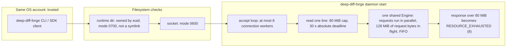

# Security Policy

Deep-Diff-Forge is a diff and code-review engine designed to process hostile
patches and source files. Untrusted input is a normal operating condition, not
an exceptional one. This policy documents the maintained security boundary,
the controls enforced by the repository, and the limits operators must account
for.

## Status of 0.11.0 and the releases before it

- 0.11.0 fixes one miss of 0.10.0 and earlier, with an advisory:
  [DDF-2026-011](docs/advisories/DDF-2026-011.md) (`eval` and `agent doctor --gate` exited 0
  when the reader of their output had gone); and it closes the miss
  [DDF-2026-006](docs/advisories/DDF-2026-006.md) declared (a source file that a stray byte
  makes binary is read). The advisory is published with the release: as a file in
  `docs/advisories/` of the signed tag `v0.11.0`, which is published on GitLab (the place of
  release), Gitea and Forgejo with a binary built locally for Linux x86_64 and its
  `RELEASE-MANIFEST.json` signed beside `SHA256SUMS`, mirrored on GitHub with its release page,
  and with its crates on crates.io. Its known issues, its contract changes and the order of the
  cutover with forge-warden are in its [release notes](docs/release-notes/0.11.0.md).
- 0.10.0 reads a `diff --git` section only if its headers are a shape Git's own diff writes, and
  fixes six misses of 0.9.0 and earlier, each with an advisory:
  [DDF-2026-004](docs/advisories/DDF-2026-004.md) (one fault during `council import-tuicr
  --execute` could block a run's decision journal for good),
  [DDF-2026-005](docs/advisories/DDF-2026-005.md) (a CI privilege grant written with quotes),
  [DDF-2026-006](docs/advisories/DDF-2026-006.md) (one attribute line made a reviewed source
  change unreadable), [DDF-2026-007](docs/advisories/DDF-2026-007.md) (GitLab tokens and
  fine-grained GitHub tokens), [DDF-2026-008](docs/advisories/DDF-2026-008.md) (a judge's
  leftover process stretched an agent's stop) and
  [DDF-2026-010](docs/advisories/DDF-2026-010.md) (a findings gate passed when the reader of its
  output had gone); the number DDF-2026-009 was not used. The advisories are published with the
  release: as files in `docs/advisories/` of the signed tag `v0.10.0`, which is published on
  GitLab (the place of release), Gitea and Forgejo with a binary built locally for Linux x86_64,
  mirrored on GitHub with its release page, and with its crates on crates.io. Its known issues,
  its contract changes and the order of the cutover with forge-warden are in its
  [release notes](docs/release-notes/0.10.0.md).
- 0.9.0 adds five integrity signals and the agent hooks, and fixes two defects of 0.8.4 and
  earlier ([DDF-2026-003](docs/advisories/DDF-2026-003.md)): a process spawn cut across two
  sections of one path that Git applies in order was not found, and one long JavaScript word or
  run of secret prefixes cost ranking time quadratic in its length. 0.9.0 was released as the
  signed tag `v0.9.0` (2026-11-18), published on GitLab, Gitea and Forgejo with a binary built
  locally for Linux x86_64; GitHub mirrors its release page (since 2026-11-22), and its crates
  are on crates.io (since 2026-11-23). A forge-warden that does not know the five new signals reads each as an
  unknown signal and holds.
- 0.8.4 (the signed tag `v0.8.4`, 2026-11-17; published on GitLab, Gitea and Forgejo on
  2026-11-18), the release before 0.9.0, is a security release: v0.8.3 and earlier can review a patch otherwise than `git apply`
  writes it, for a `Files … differ` line (Git reads it as a binary marker and writes a blob from
  its object store) and for one path in several sections (Git applies them as a set): G1 and G2
  of the v0.8.3 rescore. They also hide Rust code after a nested block comment, a character
  literal with a long escape, or a comment an earlier hunk of a created file opened from the
  Rust rules. It is published on GitLab
  (`https://gitlab.com/lukeomahoney/deep-diff-forge`), with mirrors on Gitea and Forgejo, as the
  signed tag and a Linux x86_64 binary built on the owner's machine; GitHub mirrors its release
  page since 2026-11-22
  ([local release](docs/RELEASE_AND_PUBLICATION.md#local-release-from-084)). Advisories:
  [DDF-2026-001](docs/advisories/DDF-2026-001.md) (G1, G2) and
  [DDF-2026-002](docs/advisories/DDF-2026-002.md) (the Rust code view).
- `v0.8.3` (2026-11-11 UTC, signed), the release before 0.8.4, is a security release: v0.8.2 and earlier can review a change on a
  different file, or with a different mode or type, than `git apply` writes (F3 and F2 of the
  v0.8.2 rescore and a case found in the fix's review, [GHSA-rq5r-p3g9-phff](https://github.com/Louranicas/deep-diff-forge/security/advisories/GHSA-rq5r-p3g9-phff)).
  It also updates three dependencies, rustix among them (RUSTSEC-2026-0486; DDF calls none of
  the affected functions). Upgrade to 0.8.3.
- `v0.8.2` (2026-11-10, signed) was a security release: v0.8.1 and earlier
  can review a different file or mode than `git apply` writes (N1-N3 of the v0.8.1 rescore and F1-F2 of the rescore before the v0.8.2 tag,
  [GHSA-gp5v-m67f-gmgp](https://github.com/Louranicas/deep-diff-forge/security/advisories/GHSA-gp5v-m67f-gmgp), published 2026-11-10); upgrade to 0.8.2 or later. Cutting any later `v*` tag is
  the owner's decision. The published releases are `v0.1.0`, `v0.2.0`, `v0.3.0`, `v0.4.0`,
  `v0.5.0`, `v0.6.0`, `v0.7.0`, `v0.8.0`, `v0.8.1`, `v0.8.2` and `v0.8.3`. `0.2.1` was never tagged or published.
- The controls below describe the code on `main`. The `v0.2.0` binaries were
  built on 2026-06-24 and predate the SOL-1 hardening (2026-09-04), the review
  council work and the 2026-10-28 fixes listed under
  [Fixed on 2026-10-28](#fixed-on-2026-10-28).
- Declared scope: a local, single-user review tool (CLI, daemon, `rpc`, `mcp`,
  SDKs) on exactly four targets, shipped as GitHub release binaries:
  `x86_64-unknown-linux-gnu` and `aarch64-unknown-linux-gnu` (x86_64 built on
  Ubuntu 24.04, arm64 on Ubuntu 22.04 since v0.6.0; glibc 2.34 or newer, enforced
  by `scripts/check_glibc_floor.sh`), `aarch64-apple-darwin` and `x86_64-apple-darwin`.
  Every shipped binary is run in the release smoke test, the x86_64 macOS one under
  Rosetta 2. From 0.8.4 a release ships only `x86_64-unknown-linux-gnu`, built and smoke-tested on the owner's
  machine (Fedora 44 toolbox) by `scripts/release_local.sh`; the other three targets are not
  built for this release. From 0.9.0 the crates are also published on crates.io, as source that
  whoever installs them builds. Not claimed: musl,
  Windows, other architectures, or a daemon shared between users on one host
  ([supported platforms](README.md#supported-platforms)).
- Known limits are listed under [Residual risks](#residual-risks-and-non-goals).

## Reporting a vulnerability

Do not open a public issue for an unfixed vulnerability or include sensitive
repository content in a report.

- Preferred: open a **confidential issue** on GitLab,
  `https://gitlab.com/lukeomahoney/deep-diff-forge/-/issues/new` (tick *This issue is
  confidential*).
- Include the affected version or commit, impact, prerequisites, and the
  smallest safe reproduction available.
- State whether the report concerns the CLI, daemon, parser, local learning
  store, release pipeline, or an official artifact.
- Remove credentials, proprietary source, and personal data from reproductions.

We target an acknowledgement within five business days. Confirmed
High/Critical issues are prioritized for a fix or documented mitigation. We
coordinate publication with the reporter and publish an advisory and patched
release when the fix is ready; these targets are not a service-level agreement.

## Supported versions

Before 1.0, only the newest released minor line receives security fixes.
Fixes land on `main` first and reach users in the next tagged release.

| Version | State | Security fixes |
| --- | --- | --- |
| `main` | Unreleased work after the newest tag | Land here first. |
| `v0.11.0` (2026-11-25) | Published | While it is the newest released minor line. |
| `v0.10.0` (2026-11-23) | Published, superseded | No. `eval` and `agent doctor --gate` with the reader of their output gone ([DDF-2026-011](docs/advisories/DDF-2026-011.md)), and a source file a stray byte makes binary ([DDF-2026-006](docs/advisories/DDF-2026-006.md), the miss it declared); 0.11.0 fixes them. |
| `v0.9.0` (2026-11-18) | Published, superseded | No. A journal one fault could block ([DDF-2026-004](docs/advisories/DDF-2026-004.md)), a quoted CI privilege grant ([DDF-2026-005](docs/advisories/DDF-2026-005.md)), a source change an attribute made unreadable ([DDF-2026-006](docs/advisories/DDF-2026-006.md)), GitLab and fine-grained GitHub tokens ([DDF-2026-007](docs/advisories/DDF-2026-007.md)), a judge's leftover process ([DDF-2026-008](docs/advisories/DDF-2026-008.md)) and a findings gate with its reader gone ([DDF-2026-010](docs/advisories/DDF-2026-010.md)); 0.10.0 fixes them. |
| `v0.8.4` (2026-11-17) | Published, superseded | No. A process spawn cut across two sections of one path, and the cost of one long word or run of secret prefixes ([DDF-2026-003](docs/advisories/DDF-2026-003.md)); 0.9.0 fixes them. |
| `v0.8.3` (2026-11-11 UTC) | Published, superseded | No. G1/G2 ([DDF-2026-001](docs/advisories/DDF-2026-001.md)) and the Rust code view ([DDF-2026-002](docs/advisories/DDF-2026-002.md)); 0.8.4 fixes them. |
| `v0.8.2` (2026-11-10) | Published, superseded | No. It can show a change on a different file, or with a different mode or type, than `git apply` writes: a name left by a bare `diff --git` line before a binary line, a new file's mode overridden by `new mode`, or content under a mode Git reads as a submodule ([GHSA-rq5r-p3g9-phff](https://github.com/Louranicas/deep-diff-forge/security/advisories/GHSA-rq5r-p3g9-phff)); 0.8.3 fixes them. |
| `v0.8.1` (2026-11-08) | Published, superseded | No. It can review a different file or mode than `git apply` writes: a copy, a `---`/`+++` name with nothing after its first component, repeated mode headers, a header after a binary line, or a carriage return in a move name (N1-N3 of the v0.8.1 rescore and F1-F2 of the rescore before the v0.8.2 tag, [GHSA-gp5v-m67f-gmgp](https://github.com/Louranicas/deep-diff-forge/security/advisories/GHSA-gp5v-m67f-gmgp)); 0.8.2 fixes them. |
| `v0.8.0` (2026-11-07) | Published, superseded | No. It reviews a rename to a different destination than `git apply` writes when a non-header line comes between two `rename to` lines (F1 of the v0.8.0 rescore, high); 0.8.1 fixes it. |
| `v0.7.0` (2026-11-03) | Published, superseded | No. It lacks the 0.8.0 hunk-header fix (a header without its space hid a file that `git apply` wrote), the refusal of non-UTF-8 file names, the daemon's response deadline for slow readers and the bounds on child processes. |
| `v0.6.0` (2026-11-02) | Published, superseded | No. It lacks the 0.7.0 daemon read budget and request deadlines, the release workflow's tag-signature check and the DDF-FUZZ-PATCH-8 fix (a doubled slash in a `diff --git` name broke render stability). |
| `v0.5.0` (2026-10-31) | Published, superseded | No. It lacks the 0.6.0 Git-filter fixes (a `config.worktree` or checked-out submodule filter no longer runs during acquisition) and the escaping of every default-ignorable code point. |
| `v0.4.0` (2026-10-30) | Published, superseded | No. It lacks the 0.5.0 code-evidence fix (DDF-EVID-001) and the bidi/invisible-character sanitising of agent text. |
| `v0.3.0` (2026-10-29) | Published, superseded | No. It lacks the 0.4.0 daemon fixes (peer credentials, start lock). |
| `v0.2.0` (2026-06-24) | Published, superseded | No. It does not contain the fixes made since 2026-06-24. |
| `v0.1.0` (2026-06-22) | Published, superseded | No. |
| `0.2.1` | Never tagged or published | Not applicable. |

Use a tagged release for production automation. Reports against `main` are
welcome, but `main` can contain unreleased behavior.

## Scope and trust boundaries

The security scope includes first-party Rust crates, the optional Unix-domain
socket daemon, local learning receipts, command-line and terminal output,
repository automation, and artifacts published by this repository.

The following data is always treated as attacker-controlled:

- unified diffs, file names, paths, hunk headers, and line bodies;
- source bytes passed to syntax or semantic analysis;
- JSON/JSONL and JSON-RPC requests, identifiers, and parameters;
- agent annotations, labels, evidence, and claimed provenance;
- learning metadata supplied at the receipt boundary.

The operating-system kernel, effective user identity, process environment,
installed trust roots, and GitHub release infrastructure (to v0.8.3; from 0.8.4 the owner's
build machine and the GitLab, Gitea and Forgejo hosts instead) are trusted. The local
OS account is the daemon's isolation boundary: another process running as the
same effective user is not considered isolated from the daemon or its learning
store.

The daemon is local IPC, not a multi-tenant network service. It must not be
exposed through TCP forwarding, a shared container mount, or a socket directory
writable by another account. Windows named-pipe support and TCP listeners are
not implemented security boundaries.

### Git settings that change what `git apply` writes

DDF's promise about a patch is made for a plain `git apply` in Git's default configuration
([`CONFORMANCE.md`](crates/deep-diff-forge-patch/CONFORMANCE.md#what-is-promised)): Git
either refuses the whole patch and writes nothing, or writes what the review shows. A patch
does not carry the configuration or the options of the `git apply` that will apply it, so DDF
cannot read them. Each setting below is either `tested` (a test shows Git still writes the
reviewed tree or nothing with it) or `declared` (Git writes otherwise, and DDF does not model
it). The test `a_setting_that_changes_the_write_is_declared`
(`crates/deep-diff-forge-patch/tests/conformance.rs`) reads this table and runs a real
`git apply` with each measured value: a value that writes another tree than the default needs a
`declared` row, a value a row says keeps the promise must keep it, and every test a row names
must exist. Measured with Git 2.56 on Linux, 2026-11-23.

| Setting | State | What DDF does not model |
| --- | --- | --- |
| `apply.whitespace` (`--whitespace`) | declared; measured by `a_setting_that_changes_the_write_is_declared` | With `fix` or `strip`, Git removes the trailing whitespace of the lines it adds, so it writes other bytes than the review shows. `nowarn` and `warn` (the default) write the reviewed lines; `error` and `error-all` refuse a patch with a whitespace error and write nothing. |
| `core.autocrlf` | declared; measured by `a_setting_that_changes_the_write_is_declared` | With `true`, Git writes the lines of a text file with CRLF where the review shows LF; `input` writes the reviewed bytes. Attributes in the target tree (`eol`, `ident`, `working-tree-encoding`) change the bytes written as well (`CONFORMANCE.md`, "Attributes in the target tree"). |
| `-p<n>` | declared; measured by `a_setting_that_changes_the_write_is_declared` | DDF strips one leading component from each name, as Git's default `-p1` does. With another `-p`, Git applies the hunks to other paths (`-p2` writes `x` for `a/d/x`) or refuses. |
| `--directory=<root>` | declared; measured by `a_setting_that_changes_the_write_is_declared` | Git writes every path under `<root>`; the review shows the paths without it. |
| `--3way` | declared; measured by `a_setting_that_changes_the_write_is_declared` | Where plain `git apply` refuses a hunk, Git merges with the blob the `index` line names and writes the result, with conflict markers when the merge conflicts, while it exits non-zero. DDF promises only the outcomes of a plain apply. |
| `core.fileMode` | declared; measured by `a_setting_that_changes_the_write_is_declared` | With `false`, Git does not trust the executable bit: an edit of an executable file that names no mode is written as `100644`, and the mode an `index` line names is the one written (`CONFORMANCE.md`, "A non-default configuration"). |
| A case-insensitive file system (`core.ignorecase`) | declared; not measured (it needs a file system that folds case) | DDF compares paths byte for byte. Where the file system folds case, two paths that differ only in case name one file, so what Git writes for one can land on the other. |

## Enforced controls

### First-party memory safety

`unsafe_code = "forbid"` is compiler-enforced for every first-party workspace
crate and the separate fuzz package. This does not assert that the complete
third-party dependency graph contains no `unsafe`; native and low-level
dependencies are controlled through pinning, review, audit, and minimal feature
selection.

### Untrusted input and output

- Stdin, source files, daemon lines, responses, learning records, and patch
  structure are bounded before unbounded allocation or retention.
- Patch parsing rejects more than one million physical lines and more than
  64 MiB of input (`DEFAULT_LINE_BUDGET`, `DEFAULT_BYTE_BUDGET` in
  `crates/deep-diff-forge-patch/src/lib.rs`), preventing tiny lines from
  amplifying into an unbounded object graph.
- After a `GIT binary patch` header, the parser admits only lines of git's
  binary-body grammar until the next `diff --git`: `literal N`, `delta N`, the
  empty line that ends a hunk, or a data line whose length letter matches its
  base85 payload. Any other line is refused as `UnsupportedFormat` (exit 4).
  Before 2026-10-28 every later line went into the binary body, so a text change
  placed after a binary section was hidden from the review while `git apply`
  still applied it (`is_binary_body_line` and the regression test
  `a_text_change_after_a_binary_body_is_never_hidden_in_it` in
  `crates/deep-diff-forge-patch/src/parser.rs`).
- Since 0.10.0 the body is also held to the hunk structure of Git's
  `parse_binary` (S3.6): a `literal`/`delta` hunk needs at least one data line
  and the empty line that ends it, a second (reverse) hunk is optional and held
  to the same rules, and every base85 group must decode to at most 0xffffffff
  (Git's `decode_85`). A body Git calls corrupt is refused with exit 4, where
  0.9.0 reviewed it as a binary change. Lines after the two hunks, which Git
  skips, are admitted as before. Deflate corruption is not detected: DDF does not
  inflate the data, so a body whose structure is sound but whose data does not
  inflate, or inflates to another size than its `literal N`/`delta N` says, is
  reviewed as a binary change while `git apply` refuses it (after other sections,
  Git stops there and applies only those: see the residual risk "A corrupt binary
  body"). That is a stated
  limit (the patch crate depends on the core crate alone and adds no inflate
  code); the review shows such a section as binary and never shows text from it.
- Human-facing terminal output passes through `core::display_safe`, which
  exposes ANSI/CSI/OSC controls, C0/C1 controls, carriage returns, DEL, bidi
  overrides/isolates, directional marks, zero-width characters, BOM and every
  other Unicode `Default_Ignorable_Code_Point` rather than executing, hiding or
  visually reordering them. Before 2026-11-01 the Mongolian free variation
  selectors (`U+180B`-`U+180D`, `U+180F`, which rustc accepts inside an
  identifier), the Khmer inherent vowels, the musical and shorthand format
  controls, the reserved default-ignorables and the interlinear annotation controls passed
  through raw and unflagged.
- Hand-built JSON/JSONL output uses the canonical `core::json_escape` path,
  including DEL and C1 escaping. Serde-built JSON (the `--outline` and `--hunks`
  views, `rpc`, MCP, the daemon socket, the review CLI, and the pretty-printed
  `findings verify`, `deploy doctor --json`, `eval --json` and `bench --json`
  documents) goes out through `core::json_line_safe`, which applies the same DEL,
  C1 and `U+2028`/`U+2029` escaping, and view pages are budgeted on that escaped
  text. Before 2026-11-01 `json_line_safe` escaped only the separators, so those
  views printed raw 8-bit CSI (`U+009B`) and OSC (`U+009D`) from patch paths,
  headings and lines, and the pretty-printed documents skipped it, so `findings
  verify` printed a finding's patch path with the raw CSI. A
  downstream program that decodes those JSON strings must apply its own
  terminal-safe rendering before displaying them.
- A gate flag's refusal does not depend on who reads stdout. Every `--require-*` refusal
  (`--require-files`, `--require-hunks`, `--require-findings`, `--require-all`) is decided
  before the output is written, and exits 7 with its reason when the reader of stdout has gone;
  a diagnostic that cannot be written (`2>/dev/full`) leaves the exit code as it was. Before
  0.10.0 `findings verify --require-findings` and `--require-all` exited 0 when the reader had
  gone ([DDF-2026-010](docs/advisories/DDF-2026-010.md)), and an unwritable stderr turned any
  exit into 101. From 0.11.0 every verdict refusal (`eval` and `agent doctor` as well) goes
  through one door and keeps its exit 7 and its reason when stdout's reader has gone or stdout
  cannot be written; 0.8.3 to 0.10.0 exited 0 for `eval` and `agent doctor --gate` when the
  reader had gone ([DDF-2026-011](docs/advisories/DDF-2026-011.md)).
- Annotation provenance is fail-closed: a claimed `source` is not trusted until
  evidence grounds it.

### Local daemon

The trust boundary is the OS account. Code: `crates/deep-diff-forge-daemon/src/`
(`serve.rs`, `security.rs`, `handler.rs`).



- The daemon is Unix-only and listens on a filesystem Unix-domain socket.
- Its managed runtime directory (`$XDG_RUNTIME_DIR/deep-diff-forge/`) is owned
  by the effective user with mode `0700`; its socket is mode `0600`
  (`SECURE_DIR_MODE`, `SECURE_SOCKET_MODE` in `security.rs`). There is no `/tmp`
  fallback when `$XDG_RUNTIME_DIR` is unset: the CLI exits 2.
- A socket path of 108 bytes or more (Linux's `sun_path`, its NUL included) is refused by
  `daemon path` and `daemon start` with exit 2 before anything is created (since 0.10.0).
- Explicit `--socket PATH` locations require an owner-private parent. A missing
  parent is created at `0700`; an existing parent is validated and never
  chmodded, so a `0755` parent is refused. Symlinks, wrong-owner directories,
  permissive directories and inode swaps fail closed. Shutdown removes only the
  socket inode that server created (`cleanup_owned_socket`).
- Before binding, `remove_stale_socket` (`serve.rs`) handles whatever is at the
  socket path. A non-socket file is never deleted; the start fails. A socket
  that accepts a connection belongs to a live daemon; the start fails with
  `AddrInUse` (exit 6) and the running daemon keeps its socket. Only a socket
  whose connect is refused (`ConnectionRefused`, a leftover from a daemon that
  is gone) is removed. Before 2026-10-28 a second `daemon start` deleted a live
  daemon's socket and orphaned it. Measured 2026-10-28 with the 0.3.0 debug
  build: second start exit 6; restart over a socket left by `kill -9` succeeds;
  regular file at the path refused, exit 6.
- JSON-RPC envelopes are shape-checked, including protocol version, method,
  identifier, and parameter types.
- Request and response lines are capped at 80 MiB (`MAX_REQUEST_BYTES`,
  `MAX_RESPONSE_BYTES`), the newline counted (the answer bound counts it since 0.10.0). An oversized request gets one `INVALID_REQUEST` error
  and the connection closes. A response over the cap is replaced by a
  `RESOURCE_EXHAUSTED` (8) error naming its size (`bounded_response`); before
  2026-10-28 the server sent it and the client failed. Since 2026-11-01 an error
  answer is held to the same cap, measured after `json_line_safe`, and an error
  message is cut at 4 KiB (`MAX_ERROR_MESSAGE_BYTES`) where it is built, so request
  text an error repeats cannot push it past the cap; the MCP server's tool and
  protocol errors are cut the same way. `deep-diff-forge rpc`
  uses the same `process_line` and caps over stdio.
- Each line read has a 30-second absolute deadline (`READ_TIMEOUT`), applied as
  the remaining time before every read, so slow byte-drip traffic cannot renew
  it. Writes have a 30-second timeout (`WRITE_TIMEOUT`).
- At most eight connections are served at once (`MAX_CONNECTIONS`). Beyond them, two
  control slots (`CONTROL_CONNECTIONS`) take one request each, of at most 4 KiB read within
  5 s, and answer only `daemon.health`, `daemon.status`, `daemon.metrics` and
  `daemon.shutdown` (anything else is refused `RESOURCE_EXHAUSTED`). A connection beyond those
  has 250 ms (`FULL_READ_TIMEOUT`) to send `daemon.shutdown`, which the accept loop answers
  itself, so `daemon stop` answers within a second with every slot held by idle clients (since
  0.10.0; before, the stop was closed unanswered until a control slot's client timed out after
  5 s). Anything else beyond the slots is closed with no response; the CLI reports that as no
  answer (exit 6), not as no daemon. SIGTERM and SIGINT stop the daemon as `daemon stop` does. Workers share one
  engine and their requests run in parallel. Only the session table is locked, and
  only for bookkeeping; parsing, ranking and Git run outside it. The request bytes
  in flight are capped at 128 MiB (`MAX_IN_FLIGHT_BYTES`, `admission.rs`), first
  come, first served; a `review.change` weighs the 64 MiB patch budget, and a
  request heavier than the cap runs alone. A request that waits 30 s for its
  turn is answered `RESOURCE_EXHAUSTED` and gives up its place.
- Request lines being read and answered are capped across connections at 160 MiB
  (`MAX_READ_BYTES`, `admission.rs`, since 2026-11-03). Before, eight connections
  could each hold an 80 MiB line, and parse it, outside the in-flight budget. A
  line over the shared budget is answered `RESOURCE_EXHAUSTED` and its connection
  closed. Work on a socket request stops at its client's 30 s read deadline
  (`deadline.rs`), checked between stages, so a client that has given up does not
  hold a worker and admission weight.
- Sessions are LRU-bounded to 64 (`MAX_SESSIONS`) and their aggregate retained
  payload is capped at 128 MiB (`MAX_RETAINED_SESSION_BYTES`, `handler.rs`).
- A dispatch panic is caught per request. A panic while the session table was
  held empties the table and clears its poison on the next use; any other panic
  leaves every session in place. Later requests are served as before.

### Review council gate sandbox

Council quality gates run candidate code only inside a rootless Podman
container (`crates/deep-diff-forge-review/src/sandbox.rs`; design and threat
model: [`docs/REVIEW_COUNCIL.md`](docs/REVIEW_COUNCIL.md#gate-sandbox)). The
container is started with `--rm --pull=never --read-only --cap-drop=all
--security-opt=no-new-privileges --userns=keep-id --init --pids-limit=8192
--memory=32g --memory-swap=32g --log-driver=none`, all host CPUs but one,
`--network=none` unless the job is dependency vendoring, and a conmon
`--timeout` of the job's deadline plus 60 seconds. The candidate source, the
vendored dependencies and the Cargo home are mounted read-only; only the job's
scratch directory is writable. The controller removes the container by name and
proves it gone before reading anything it wrote.

The container runs as the controller's own `uid:gid`, taken from
`geteuid()`/`getegid()` (`operator()` in `sandbox.rs`). Before 2026-10-28 it was
read from `/proc/self` and fell back to `0:0`, so on a host without `/proc`
every gate ran as root inside the container. Gates refuse to run unless
`DDF_COUNCIL_GATE_IMAGE` names a local image.

The import lock (`decisions.lock`) is new in 0.10.0: an import by 0.9.0 or earlier takes
none and can append beside a running 0.10.0 import of the same run, guarded only by the
journal's length check. Do not run imports of one run with different versions at once. A host
path to mount that is not UTF-8 or holds `:` or `,` is refused before the sandbox starts.

### Local learning store

- Store directories and files must be owned by the effective user and remain
  owner-private (`0700` directories and `0600` files).
- Directory/file symlinks and inode replacement are rejected. New receipt files
  use exclusive creation.
- The store is capped at 64 MiB, individual JSONL records at 1 MiB, and retained
  records at 100,000.
- File identifiers must be redacted lowercase hexadecimal values; language and
  parser-version fields accept bounded token characters rather than paths.
- The stable FNV identifier is pseudonymous and dictionary-guessable, not a
  confidentiality primitive. Confidentiality comes from local access controls.
  Learning data is not uploaded by the project.

### Agent hooks

The hooks guard against an agent's honest mistakes and shortcuts: a credential it commits, a
check it silences, a policy it loosens. They are **not** a boundary against an agent that sets
out to evade them: it has a shell, so it can edit the settings, the session's state, or work
in a copy. That boundary is the judge on the pull request (forge-warden on the server). The
rule for every case below: an ordinary workflow must never end in a silent stop with unjudged
work; a deliberate evasion is made visible where that is cheap, and is otherwise a stated
limit.

`agent hook` runs inside an agent's session, on the agent's own change. **A stop prints nothing
only when every unit of the session (the uncommitted change, the staged change, each commit)
has a pass; everything else that is true at a stop is said at that stop, every time, in a
bounded form.** What it holds to:

- **The change is attacker-controlled, and so is everything read from it.** A hook message
  never repeats the text of a changed line. A path is shown quoted, with control characters
  escaped, cut at 120 characters, and the message says that paths are data. Rule text comes
  from the policy a change was judged under (at the session's base, or the project's accepted
  policy) and is escaped the same way.
- **The session cannot move what is judged.** The project and the commit its changes are
  measured from are fixed by the session's first hook and kept in its state: the directory
  the client names (`CLAUDE_PROJECT_DIR`), else the one recorded, else the hook input's
  `cwd`; and the commit `HEAD` named there. Before, both were read at every stop from things
  the session itself moves. A `cd` into a nested repository, another repository or a
  directory that was gone let the stop pass with no output, and so did committing the work;
  a committed policy change was the policy for the rest of the session. A stop now judges
  the project wherever the session's directory is, by the policy of the recorded commit and,
  from 0.11.1, by the project's accepted policy too where its file differs, the stricter
  answer standing: where the project's ledger first recorded a commit that has the policy file, a
  policy edit that is merely committed does not judge anything, in the session that makes it or
  after it. A
  linked working tree the session's directory is in is judged as well.
- **The unit that is judged is a commit, by its own change.** The session's first hook
  records, with the base, the id of every commit that something names then: every ref, the
  `HEAD` of every working tree, and the reflogs of those `HEAD`s and of the stash. A commit
  is the session's when a branch, a tag, the stash, a `HEAD` or one of those reflogs leads
  to it now and none of the recorded commits does. A stop has judged the uncommitted change
  of the working tree (against that tree's `HEAD`) and each commit of the session that no
  earlier stop judged, as the patch from its first parent to itself, the oldest first, as
  many as its time allows; the rest are counted as UNJUDGED and judged at later stops.
  Before, a stop judged for each ref the net patch from the base to its tip, over bounded
  lists of refs. A credential that was committed and then reverted left an empty net patch
  and a silent stop while the branch kept the commit; the untracked files of `git stash -u`
  and the older entries of the stash were in no net patch; four patches of sixteen tips in
  name order could leave out the session's own; a list of 4,096 refs dropped the stash of a
  repository with more. None of these has a bound or an order by name now: the recorded
  ids are a file of their own with no such limit, and no name of a ref is read or shown, so
  a name that is not UTF-8 or that somebody else chose cannot matter. A commit that only a
  remote-tracking ref names was fetched and is not the session's. A commit that is gone
  from every ref and every reflog read is not found; that is a stated limit.
- **What is staged is judged.** A stop judged the working tree and the commits; the index
  was in neither. A credential that was staged and then repaired or deleted in the working
  tree without `git add` was in no patch, the stop was silent, and the next plain
  `git commit` recorded it. The change the index holds against the tree's `HEAD` is a unit
  now ("Staged changes in" the path), judged when it is another change than the working
  tree's. Its entries are read with `git ls-files --stage` and written into an index of the
  scratch repository; the repository's own index is not written.
- **Which commits of others are judged.** A commit that was in the repository when the
  session began, named by any ref (remote-tracking ones included) or reflog, is not the
  session's, also when the session pulls it, merges it by fast-forward, rebases onto it or
  resets to it. One fetched during the session and brought onto a local branch is. The
  documents said that a pull or a merge always makes commits the session's; every message
  that names the range says the rule now, the advice after a tool call included.
- **A stop's message never loses what blocks.** It holds, in this order: every unit that
  blocks now, with its rules while there is room, then with the names of its rules (twenty
  more), then counted; every unit that got no verdict, named, and the
  count of commits that wait; new holds; what stands from before, as a count with three
  names once there are more than three. Twelve units used to be listed, the oldest first:
  with twelve failures standing, a commit that failed blocked the stop without being named,
  and one that got no verdict was not said. The last two parts give way first when the
  message is full, and it says how many it left out.
- **No verdict is never "done".** A commit that got no verdict was written down as not
  judgeable, said once, and then neither asked about nor named again: one transient failure
  of the judge on a commit with a credential made every later stop silent. Now only a
  verdict is an answer. A commit without one is named at every stop and asked about again,
  at every stop for its first five attempts that count, then one such commit at each stop
  in turn. It is never given up while the session lives: the cap of five used to end the
  asking, so a judge that failed on one patch five times while it answered for others left
  a commit with a credential UNJUDGED for good, and its failing verdict was never
  obtained. And its turn is kept for it: every stop first asks about the commit that has
  waited longest among those past five attempts, then about the one asked about least
  recently among those with fewer, and only then about anything else. Every commit
  without a verdict is so submitted at least once in as many stops as there are such
  commits, whatever the judge answers for the others. The commit whose turn it was used
  to be asked last: three commits in front of it that the judge gave no verdict for, with
  no verdict on its probe either, ended the asking of every stop before it was reached,
  for the rest of the session. Only
  what the hook proves from the commit itself is final at once (a patch over the builder's
  size), and is named at every stop too. A shallow clone's edge is not such a thing: the
  clone can get the parent, so it is looked at again at every stop, and the commit is
  judged once the history is there (it was written down as final and stayed unjudged after
  `git fetch --unshallow`). What the judge holds and what stands are a line of every stop
  as well, each with the names of its rules: a hold first seen at a stop that blocked for
  something else was never shown again, and a rule the judge held for beside a rule that
  failed was shown at no stop. A verdict that fails keeps the rules it holds for, and a
  commit's answer keeps the names of its rules for the rest of the session.
- **A message is bounded and what blocks keeps its rule.** At most 9,000 characters. The
  lines of every stop (the commits with no verdict, what is held, what stands) are never
  cut: each is a count and at most three names of a bounded length, their room is taken
  first, and what is above them, with its own count of the commits that block, is made
  inside what is left. Every unit of a stop is so named or counted. A text that is still
  over the bound where it is finished is cut and ends with a line that says it was. (The
  parts once added up to 9,005 characters; then the lines of every stop had 1,700 and
  could need 1,787, and the cut that made room took the count of 43 commits that
  blocked.) What
  blocks is shown the staged change first, then the uncommitted one, then the commits the
  newest first; a unit that does not fit whole is shown with each rule's name and first
  path, then with its rules' names alone, then counted. Before, a unit whose rules were
  longer than the room was shown with no rule, and 150 failing commits put the session's
  own past where the client cuts the message.
- **A failure is its lines, and what is left of one does not block again.** What is
  remembered of an uncommitted or staged change is each rule, signal and path that failed,
  with its number of items. A stop blocks for a line that has not blocked and for a
  number that has grown, and says which lines are new and which stand; the lines that
  have blocked stand when others beside them are repaired. The identity used to be one
  digest over all the lines of a unit, so the part of a failure that was left untouched,
  and had been told to a person, blocked again whenever another part was repaired.
- **A staged failure is its own where the working tree does not have it.** What is staged
  blocks for itself after the working tree was repaired, in the lines the working tree's
  failure does not have; a staged line that the working tree's failure has too is that
  failure. As a second identity it made a failure that stood block again after
  `git add -A` and one more edit of any file, every other turn. A staged line that has
  blocked stands for as long as the index holds it: it was forgotten while the working
  tree's failure had the line again, and blocked a second time when the tree was repaired
  again, with the index untouched.
- **A commit with no verdict never stops the judging of others.** When the chain gives
  verdicts and one patch is refused (a name that is not UTF-8, a size, a shallow clone's
  edge), that commit is said once by its id, remembered as not judgeable, and the next is
  asked about. Only a chain that gives no verdict ends the asking, for that stop, with
  nothing remembered. Before, such a commit was asked about first at every stop, and three
  of them ended the judging of every later commit for the session.
- **A hook that cannot keep its state does not block for good.** A failing commit cannot
  be repaired, and with a state that cannot be written it was judged, and blocked, at every
  stop. When, and only when, the state could not be kept, the client's `stop_hook_active`
  is honoured: the stop that follows a block is allowed, says FAIL STANDS and says why.
  The next turn blocks again, which is said each time.
- **A failing commit blocks once and stands; a failing uncommitted change blocks again when
  it comes back.** A failing commit always blocks at the stop that first judges it: the
  exception for one "committed as it is" after its failure had blocked is gone, because its
  match (rule, signal, path, count) let another credential in the same file stand without
  ever blocking. A commit is known by its id, so a branch switch or a new ref does not
  make its failure block again, and a later commit cannot make it pass. The failure of an
  uncommitted change is known by its rules, signals, paths and numbers of items, and is
  remembered with the working tree it is in. It is forgotten only by a stop that looked at
  that tree and found the change without it. Once it was remembered for the whole session,
  so a failure that was repaired and then brought back never blocked; then it was
  forgotten whenever its unit was absent from a stop, also when nothing had looked, so a
  failure in a linked working tree blocked again each time the session's directory left
  the tree and came back. A stop that does not look at a tree names it and says, at every
  such stop, that a failure stands there.
- **A working tree is what it is, not where it is.** A failure is remembered with the
  working tree it is in, and a linked tree is known by its administrative directory under
  the repository: its inode and its birth time, which no program can set. The file
  `commondir` in it (its inode and modification time) stood there too, so a `touch` of
  that file made an unchanged tree a new one whose failure blocked again; it is used now
  only where the file system keeps no birth time, and there that limit remains. Nothing is
  written to mark a tree, and nothing of a tree's identity is taken from a path, as a
  message shows it or as Git records it: which trees a repository has is read from the
  directories under `worktrees`, a listed tree is left out as judged by which tree it is
  and not by its path (two listed entries with one path are two trees), and a path from
  Git's files is read as bytes and from
  the directory Git reads it from (a tree recorded by relative paths had another identity
  from outside than from inside, and what had blocked in it was forgotten by every stop
  made from the project).
  That stays over `git worktree move`, over `mv` with `git worktree repair`, over
  `git gc` and over a change of every time that can be set, and is
  new for a tree made at the path of a removed one. A tree was known by its path: moved,
  an unchanged failing tree blocked a second time; removed and made again at the same
  path, a new tree inherited "has already blocked" and its failure never blocked; and two
  trees whose long paths were cut to the same words shared one identity. What is
  remembered of a tree that has no administrative directory any more is forgotten. Where
  there is no birth time, modification times are whole seconds and inode numbers are
  reused, a tree removed and made again within one second can be taken for the old one.
- **What "the same failure" is, and what it is not.** For a change that is not committed
  it is the judge's lines: a rule, a signal, a path and a number of items. That is all a
  verdict gives that stays the same from one stop to the next (its evidence is a hunk's
  address and a line number, which change when the file is edited above). So a finding
  that is removed and replaced by another under the same rule in the same file between
  two stops is not told apart: the stop says that the failure stands, and says in a line
  of that message what "stands" means, whatever heads the message. The limit reaches one turn: a line that was gone at any stop that
  looked is forgotten. The post-tool advice, which is keyed by the text of a line, does
  show the new finding.
- **The memory of failures is bounded, and nothing leaves it in silence.** A session keeps
  2,048 failing lines of uncommitted and staged changes. The list was cut from its front
  with no word, so nine working trees with large failures made the first one's unchanged
  failure block again. Now a change whose lines do not fit is kept as one digest of all
  of them (the largest changes that the stop is not looking at first): it stands
  unchanged and blocks as a whole on any change, and the block says that it is not all
  new. Only with more than 2,048 failing changes is any memory given up, and the stop at
  which that happens says for how many. What a failure is remembered by is not what two
  verdicts of one stop are compared by: which of the staged lines the working tree's
  failure has too, and which lines of a failure that has grown are new, is asked line by
  line whatever their number. It was asked of the digest, which covers no single line: past
  256 lines every partial `git add` of an unchanged failure blocked again. The lines kept
  for a staged change (they have blocked as its own, and the tree's failure has them too
  now) are shortened into a digest of everything that has blocked for it, and kept while
  that can be checked against what the index holds; they were let go with no word. Where
  such a digest cannot be kept, the stop says so. A digest that is exactly what the index
  holds says that every staged line has blocked: then nothing staged is new, whatever
  part of it the working tree's failure has too (it was asked only whether the staged
  change's own failure is exactly it, and a large staged failure blocked again when the
  tree was repaired in part with the index untouched). The rule: with the index untouched
  and the state writable, what is staged does not block twice unless a stop said that its
  memory of it could not be kept; and each such sentence says what happened at that stop.
- **"Could not be read" is not "nothing there".** Whatever a stop reads of a working tree
  (its uncommitted change, its index, whether another tree has changes, whether the clone
  is shallow, which trees there are) has three answers: read and nothing there, read and
  this, not read and why. Only the first forgets anything. A tree that could not be read
  came with "no staged change", so one stop at which Git failed, or a file could not be
  opened, forgot what had blocked of the staged change, and it blocked a second time.
  And a look is not a reading: a stop made from another tree looks at a tree with `git
  status`, which does not show a file marked assume-unchanged nor what a clean filter or
  the line-ending settings hide, all of which the judge's patch has. Where a failure had
  blocked in such a tree, a stop from the project's tree forgot it and printed nothing,
  and the unchanged failure blocked again on return. Only the reader the judge's patch is
  made by may say that a tree where something is remembered has nothing there. Two limits
  follow. Where nothing is remembered of a tree, `git status` alone decides whether a stop
  from another tree names it: a linked tree whose only change is in a file marked
  assume-unchanged, with nothing blocked there yet, is not named. And that reading must end
  within the tree's share of the six seconds a stop has for looking (all six for a single
  other tree): a tree too large for it is named "could not be looked at", its failure
  standing, at each stop made from elsewhere, also after a repair, and each such stop takes
  about that much longer (10,000 files, 314 MB read in 0.9 seconds with a warm cache).
- **The tree a stop is in is the one Git says.** A directory under the Git common
  directory was taken for one of Git's own files, and Git was not asked: in a bare
  repository with its working trees inside it, a stop made from a linked tree did not
  judge that tree's uncommitted work at all. Git is asked first; and a directory Git
  cannot place is never taken for one of Git's own files. That was concluded from any
  failure of Git for the tree the session is in, so a tree pruned while its directory was
  away, with credentials in it, was a silent stop; then from no `.git` entry above the
  directory, and then from where it lies, under one of seventeen names Git uses in its
  directory (`hooks`, `logs`, `svn` …), and each time a tree whose `.git` file and
  administrative directory had both been removed, its files left in place, was a silent
  stop that forgot the failure that had blocked in it: `git worktree add` makes a tree
  under any name in the Git directory. Such a stop is UNJUDGED with Git's words first,
  wherever its directory lies, also from inside a Git directory (`.git/hooks`, a bare
  repository's own directory), where the reason says so; it forgets nothing because a tree
  is no longer listed (a tree the judge's own reading finds clean is forgotten, as at
  every stop), and the tree the directory is under is never named as one the session is
  not in (also when the session's directory cannot be resolved, under a directory that
  cannot be searched: a relative path is taken from the hook's own directory and a `..`
  after a link from where the link leads; where that cannot be done, every tree may be the
  one). A session directory that was removed is asked about at the nearest directory above
  it that is there, a relative one after it is taken from the hook's own directory: where
  the session is, is found one way for every use of it. What Git answers is believed only
  as a pair that names one tree of the repository's records: the top level it names must
  be the one the Git directory it names records (a linked tree's `gitdir` file; for the
  main Git directory, its parent when it is named `.git`, and where it was made apart under
  another name and records no top, the project's top when the session began in the main
  tree), and must contain the session's directory. A main Git directory named `.git` that
  does not lie at the tree's top (`--separate-git-dir=…/.git`, or a `.git` link to it)
  therefore makes every stop from the main tree UNJUDGED, said and never silent. A
  `core.worktree` that points Git at the project, at an outer tree, or at a subdirectory
  of the tree, and a copy of a linked tree made with `cp -a`, make the stop UNJUDGED;
  nothing of either tree is forgotten and neither directory is judged as that tree. What
  is read of every other tree counts as that tree's only when Git names that tree there,
  at every stop. And a tree does not move while the directory it is remembered at stands:
  where Git and the records pair a tree something has blocked in with another top than
  the one the state records for it, and the tree stands at that directory (its `.git` file
  names the tree's own administrative directory, or is a file that is not a `gitdir: ` line
  naming a path, such as an empty one) or it cannot be looked at,
  neither directory is read as that tree (UNJUDGED from it, named from elsewhere, both
  paths said, nothing forgotten) until `git worktree repair` is run in the directory that
  stands or it is removed; where it is gone or holds something else (a tree, a clone or a
  build directory made at the old path of a tree moved with `git worktree move`), the tree
  was moved and is read where it is. Two cases Git's own commands make are stated limits:
  `git worktree repair` run in a copy of a linked tree before anything blocked there makes
  the copy the tree, and the directory copied is then no tree of the project (nothing in it
  is judged; a stop from inside it is UNJUDGED); and a tree moved with `mv` whose entry Git
  then ends (`git worktree prune`, or `git worktree add -f` at its old path) is forgotten,
  with what blocked there (a stop from the moved directory is UNJUDGED). Where a failure
  stands in a gone tree, its note advises `git worktree repair`, not prune; the remedy for
  `mv` is said only where the directory moved from is gone. A stop made from a submodule's Git directory (`.git/modules/<name>`) is
  UNJUDGED: Git names the submodule's working tree there, which does not contain the
  session's directory, and the reason says so. The caller's `GIT_CEILING_DIRECTORIES` is
  kept without the entries at or under one of the project's trees, each compared with its
  `..` and its links resolved: a ceiling hides nothing of the project, and a repository
  the user hides above it stays hidden, also when its entry is written through the
  project's path. Where Git stops at a file-system boundary
  (`GIT_DISCOVERY_ACROSS_FILESYSTEM` unset) that a linked tree of the project lies across,
  the stop is UNJUDGED with Git's words, never "no repository".
- **What blocked in a tree is not forgotten while its directory stands.** A linked tree
  the repository no longer lists (both records removed, or its `.git` file removed and
  `git worktree prune`) was forgotten at the next stop, and Git places its directory in no
  repository: the stop from inside it was silent with credentials there. The state (schema
  `v10`) records the top level of each linked tree it remembers a failure of; while that
  directory stands the tree is named at every stop and a stop from inside it is UNJUDGED.
  It is forgotten when the directory is gone, or when it is a tree again and the judge's
  own reading finds it clean, a reading of that tree that Git names there. A `v9` state is
  read with no tree recorded and written back as `v10` by the first hook that reads it and
  keeps its state, changed or not.
- **A repository the hooks cannot list the commits of is still judged for what is not
  committed.** With more than 256 working trees (or a million named commits) the commits
  that were there when a session begins cannot be listed. The start recorded nothing
  then, and every stop was wholly UNJUDGED. It records the project and the commit the
  session began from, and that there is no list: the session's commits are UNJUDGED at
  every stop, and the working tree's own changes are judged. The list is never taken
  later in the session: a commit made before then would pass as one that was there.
- **No run of the judge can take the time of what the stop owes after it.** A stop owes
  three asks about commits at most (the one whose turn it is, the one with fewer attempts
  asked about longest ago, the oldest never asked about); each leaves five seconds for
  each one after it, and a run on a working tree's change leaves them what they need. The last
  owed ask had all that was left, and a run that would have had under three seconds too:
  a judge that hangs on two commits took every stop between them, and a commit with a
  credential that had never been asked about was never submitted.
- **A session's state is changed by one hook at a time.** Every stop holds a lock
  (`flock`) on a file beside the session's state, named from the session's id, from before
  it reads the state until it has written it; so does the stop that is the session's
  first hook, which took none while there was no state yet (two such stops both judged,
  both blocked for one failure and both wrote). A second stop of the same session waits
  three seconds, then says UNJUDGED and that another hook is running. A session-start
  hook holds the lock for its reading and recording. An advice hook takes it for its
  write alone, re-reads the state under it and adds only what it has said: it wrote back
  its whole older copy, and with it a failure that a stop had meanwhile seen repaired and
  forgotten, which then did not block when it came back. The lock ends with its process:
  a hook that is killed holds nothing. A hook that leaves its session with no state (no
  repository) takes its lock file away again.
- **The project is a repository at a path.** It is recorded with the inode of its Git common
  directory and its top level. What stands at that path with another inode is not the
  project (a clean clone put there used to be judged in its place, in silence), and neither
  is the project once it was moved: the stop is UNJUDGED, says which, and names the remedy,
  a new session. The device number stood in the identity before and is left out: it is
  given at mount time, and a session resumed after a reboot was refused for good, with a
  reason that was not true.
- **The first stop of a session whose start was not recorded says so.** When no
  session-start hook recorded the project and the base, they were recorded by the first stop
  or by an advice hook before it (the hook after the tool call that commits always runs
  first), and nothing is known of what the session did before. That stop says that
  the session's start was not recorded and that work committed before was not judged,
  whatever the judge says of what is left (a pass or an empty change is allowed with that
  message; a fail, a hold and UNJUDGED carry it too), and every later stop of the session
  says it again, in one line: it stays true. A stop stays
  silent only where no project can be found at all: Git says there is no repository around
  the session's directory, the client names none, and none is recorded.
- **What the hooks do not judge, and what they name.** They judge the uncommitted and the
  staged change of the project's working tree and of a linked working tree the session's
  directory is in, and the session's commits. Another working tree of the project that has
  changes which are not committed is named as not judged, and so is one that was
  removed by hand (sixteen are looked at, after everything that is judged and in six
  seconds of their own, the ones where a failure stands first; how many were not looked
  at, and in how many of those a failure stands, is said). Named the same way: another repository the
  session's directory is in at a stop, a submodule with changes that are not committed in
  it, a nested repository in the project's tree, which is left out of the patch (Git cannot
  even stage one that has no commit), a directory there that Git places in this repository
  with a Git directory whose records name another directory (a copy of a linked tree made
  inside the project: named as no working tree by the records), and another working tree
  of the project that lies inside its tree (named as that). Each of these is said at every stop while it is true:
  in full the first time, afterwards in one line that counts such things and names the
  first three (five are said in full at one stop and a session remembers 32 as said in
  full; the others are in that line). Before, each was said once in a session, and a stop
  where every unit passed was then silent beside something known and not judged. None of
  them blocks. Not judged and not named, for the judge on
  the pull request: a commit that only a remote-tracking ref names; a commit that is gone
  from every ref and from the reflogs that are read (those of each working tree's `HEAD`
  and of the stash); a commit that was in the repository when the session began;
  and work in a copy. An agent can make a stop UNJUDGED by breaking what the judge needs (an
  unreadable file; a path marked skip-worktree): never a pass, always visible, and never a
  block. Advice after a tool call covers the project's tree only. "No repository" is read
  from Git's English message under `LC_ALL=C`; any other wording is a failure and is said.
  The cleanup of a killed hook's scratch directory needs `/proc`. The state file and the
  list of commits beside it are the agent's to edit, as below: whoever edits them can move
  the base or make a commit count as there before the session.
- **Neither the repository's configuration nor the user's shapes the patch.** The working
  tree is staged, and the patch diffed, in a new, empty Git directory that only borrows the
  object store: the repository's own configuration and its `info/attributes` are never read,
  so no filter it defines exists and making the patch runs no program the repository chose.
  Staging and the diff both run with system and user configuration off, no configuration
  passed down by a parent Git and no attributes file of the user or the system; the diff
  takes its attributes from the empty tree, with fixed options. A filter in the user's
  configuration used to run on every staged file, and the judge was given its output. One
  value of the user's is passed on by hand: `core.excludesFile`, the user's own ignore file,
  when it is an absolute path. What is read from under the Git directory is the object
  store, the list of paths in the index (a file added with `git add -f` is staged whatever
  an ignore rule says, as a commit would hold it) and `info/exclude` (which files are left
  out, copied up to 1 MiB). A `.gitattributes` in the working tree converts content as Git's
  built-in rules say, and is in the patch the judge reads. Tests plant a hostile
  configuration, an attribute that hides source as binary, a filter of the repository and
  one of the user, an `info/attributes` line and `core.autocrlf`, and require the same bytes
  and no run.
- **Nothing in the repository is written.** The index that is filled and the objects that are
  written are in a scratch directory under the Git common directory (`deep-diff-forge/`),
  removed when the hook ends; the repository's index, object store and configuration are only
  read. A scratch directory that a killed hook left (`tmp-<pid>`) is removed by the next hook
  once `/proc` says its process is gone: only a directory directly under `deep-diff-forge/`,
  never what a link of that name points at. Two hooks in different process-id namespaces
  that share one repository can take each other's process for gone; the hook that loses its
  directory then reports UNJUDGED, not a pass.
- **Up to three files per session, in the user's state directory.** `deep-diff-forge/hooks` under
  an absolute `$XDG_STATE_HOME`, else under `~/.local/state`. They are there, and not in
  the repository, so that they are found by the session's id alone: before the repository
  is found, and when Git cannot find it. The session id is hashed and never chooses a file
  name. The state file holds the project's top level and the inode of its Git directory,
  the commit the session began from (a full commit id, or that there was none), the keys of
  findings already said, the reasons already given for not running and the things a stop
  named (hashed), the failures of uncommitted changes that have blocked a stop (each as a
  SHA-256 and a count), and the SHA-256 and the length of each of the other two files. Every list is bounded when it is
  written, so the largest state is far under the 4 MiB a hook reads back. The second file
  is the list of commit ids that were named when the session began, one a line (up to a
  million; a repository that names more cannot be recorded, which is said). The third is
  the list of the session's commits that have their answer, one `id:outcome` a line in the
  order they got it, with no bound that makes one be forgotten (the state kept the last
  4,096, and what a forgotten one led to counted as judged, an unjudged ancestor included);
  the state names its first lines by digest and count, and what stands after them is not
  read. The reflogs are read with `git rev-list --walk-reflogs`, which prints ids alone: a
  user's `log.showSignature` made every session one that could not be recorded. A state file
  that is there and is not a state the hooks can read (a link, another kind of file, too
  large, another schema than `v10` or the `v9` before it, a project that is not whole) is
  never read as "no state", and a
  list that is missing, is a link, or is not the text the state names by its SHA-256 and
  length is never read as another list: the stop is UNJUDGED with the reason and nothing is
  recorded over either. Before, a block with thousands of violations wrote a state the next
  hook would not read, and the session forgot its base. A state directory inside the
  project's working tree is refused the same way. Every hook that writes a session's state
  holds that session's lock, the first hook of an account too, whatever repository stands
  above the state directory (before 0.11.1 a hook that found no state directory under a `.git`
  took no lock while it made one). It writes through the directory it took the lock in, held
  open: a process that moves the state directory away and puts another at its name while a
  hook holds the lock gets nothing written into the other, and the hook says that its state
  could not be saved. Where the lock cannot be taken in the state directory (its lock file
  cannot be opened), no state is written and a stop says that cause first. A file system on
  which `flock` fails for another cause than another holder is the stated exception: there the
  state is written without a lock, as before 0.11.1. When the state cannot be kept, a stop
  says so every time and the advice hook once, marked by an empty file beside the scratch
  directory.
- **Each directory of the hooks is a directory of its own.** `deep-diff-forge/` under the Git
  common directory and `deep-diff-forge/hooks` in the state directory are made with mode
  0700; when a symbolic link or a file stands at either the hook does not run and says so. A
  state file is opened without following a link, must be a regular file of at most 4 MiB
  (the list of commits beside it: 65 MiB), and is written to a new file of mode 0600 that
  is moved into place. These are checks by
  path: whoever can swap the directory between a check and a use can already write wherever
  this account can.
- **The policy is read from the commit the session began from**, never from the working tree
  and never from a later commit, and only when it is a regular file there.
- **A failure is never "nothing to judge".** Only two things are: no commit when the session
  began (and none since: nothing is judged then, and while the repository holds files
  every stop says that they are not judged), and no change. One more is silent because there is nothing to
  look at: Git ran and found no repository around a session that has no project recorded.
  Everything else is said. Git missing from `PATH`, Git refusing the repository for its
  owner, a session directory inside `.git` or gone with nothing recorded, a base commit that
  can no longer be read, an orphan branch in a repository that has commits, a first commit
  made after the session began, and a patch that cannot be made (Git fails, a file cannot be
  prepared, paths marked skip-worktree as in a sparse checkout) each make a stop UNJUDGED
  with the reason, make the start of a session say that stops will not be judged, and are
  told once per session by the advice hook. Before, each of these let a stop pass in
  silence. "No repository" is read from Git's own words in the `C` locale; any other failure
  of Git is a failure.
- **A hook exits 0, always.** Claude Code reads exit 2 from a `Stop` hook as a block with the
  hook's error stream as the reason. A command line the hook cannot read (an unknown, doubled
  or valueless option, no event, another client) used to end with exit 2, so a mistyped
  settings entry held every stop. It is said in the client's JSON now, with exit 0: the hook
  did not run, and for a stop UNJUDGED.
- **A stop has one deadline.** Git, the helper that hashes the rankers and every run of the
  judge, for every working tree, share 45 seconds; the client waits 60 and `agent doctor
  --gate` fails a registered timeout under 50. Each step is given the time that is left.
  Before, the steps' own limits added up to several minutes, and a client that ended the
  hook dropped its answer, which reads as a pass.
- **Every child DDF's process runner waits for runs in a process group of its own.** Git in a
  review's acquisition (`--git-*`, `review_change`, `review.change`) is not run by it: that
  runner kills Git alone at the time limit and returns, and a process Git started runs on
  (see "Git subprocesses have a time limit" below). The judge, the helper
  that hashes the rankers, and the council's Git and tuicr calls are each the leader of their
  own group, and the whole group is killed when the call ends, however it ends (time limit,
  output cap, normal exit); the call returns by its time limit even when something holds its
  output (0.9.0 let a judge's leftover child stretch a stop to 75 s:
  [DDF-2026-008](docs/advisories/DDF-2026-008.md)). A process that leaves the group (`setsid`,
  or a double fork into its own group) is not killed by DDF and runs on. Under Claude Code
  2.1.330 the client ends a timed-out hook's descendants, including those in their own group
  or session (measured 2026-11-22); a process that detaches from them is ended by no one.
  A judge that exits while a process it detached from its group still holds its output is not
  read: the stop is UNJUDGED when the limit passes, whatever the judge's exit code was;
  forge-warden starts no such process.
- **Text from the judge is data.** When a verdict fails or holds for something that is not a
  rule (an expired waiver, a note), the message repeats the judge's own words for it: at
  most twelve, each cut at 400 characters, escaped like every other text the hook did not
  write, and marked as the judge's words and not instructions. A note's path is shown as
  every path is.
- **What the judged agent is told names the accepted repair only.** Advice after a tool call
  and the rules of a stop's message say, for each label, the change that answers it, never a
  substitute that does not count (0.9.0 named the first of them, and some no label raises: a
  list of what the tool will not catch), and the agent is not pointed at `explain signal`.
  Every command a hook names is this binary's own absolute path, quoted for the shell.
- **The gate reads the notes of the judge's verdict on its probe.** A note `claims_unverified`
  (a policy that requires verified claims) fails the link `claims_verified` of `agent doctor
  --gate`. With a judge that takes bound mode (0.11.0, S3.25.b) a commit with one parent is
  judged with `--repo`, `--base` and `--head` and can pass; an uncommitted or staged change, a
  root commit and a merge commit still hold, and with a judge that does not take bound mode
  every stop holds. What is not committed can never be verified.
- **The patch given to the judge has forge-warden's patch-maker options** (full index lines,
  `--submodule=short`, `--ignore-submodules=none`, the store's commit-graph and multi-pack
  index not read), held byte for byte by a test that runs a recorded copy of `make_patch.sh`.
- **Not a boundary: work hidden with Git's own rules.** A judged agent can hide work from the
  hooks with a directory of mode 000, an untracked `.gitignore` that ignores itself, a
  directory named `.git` below the top, or a plain directory at a path the base records as a
  submodule, whose content Git never lists (the stop is then silent), or make staging run
  out of time with a very large sparse file (UNJUDGED, with no run of the judge). These are
  stated limits, measured again on the 0.11.0 candidate, where each still holds: the working
  tree and the merge request still show the work.
- **`agent doctor --gate` reads a registered stop hook only in the form `agent setup --hooks`
  prints.** One program and its arguments, written with plain characters and single quotes:
  no comment, second command, pipe, redirection or substitution. The program word must be
  this binary's own absolute path, the word itself and not what it leads to: a shell runs
  `A=ddf agent …` as the program `agent`, and a link can be pointed elsewhere later. The
  judge must be named, by the absolute path the gate checked; the policy and the rankers
  must be the gate's. The entry is read whole: its type must be `command`, a timeout it sets
  must leave a stop its time, and `disableAllHooks` in the settings file that wins (the
  project's local file, the project's shared file, then the user's) fails the gate. The gate
  also makes the patch a stop would make, so a tree a stop cannot judge is found by it; it
  checks that the session-start hook and the hook after a tool call are registered for this
  program with no matcher that narrows them; and that the state directory can be used.
  Settings an administrator manages are not read.
- **The judge decides, by its exit code and its document together.** DDF starts
  `forge-warden` under a deadline and output caps. Exit 0, 7 or 8 is a verdict only with a
  whole `forge-warden.verdict.v2` or `forge-warden.verdict.v3` document, checked member by
  member against the schema forge-warden ships for that version (`cli/src/verdict_v2.rs`;
  v3's bound claims and `builtin:` rules in their schema's form only): every required member and nested member, its
  pattern or closed set of values, lists the schema says are never empty, the `exit` triple
  that belongs to the `verdict`, a `summary` that counts the `rules`; no key given twice at
  any depth. It must agree with the process exit, hold no rule stricter than the verdict,
  carry the SHA-256 of the policy, of the patch and of the ranker this hook gave, be on a
  ranking the judge produced, and be on a Git whose admission is `approved`. Open on purpose:
  members a later forge-warden adds, and a rule `kind` or note `code` this version does not
  know. A member the schema makes optional is checked when it is present. Not checked: the
  date the judge evaluated on (a verdict for the same policy, patch and ranker is the same
  verdict tomorrow). Exit 7 with a document that is no verdict holds the stop once all the
  same, saying that the verdict could not be read and why: a fail is never taken for silence.
- **A ranker is hashed under bounds.** To seal a verdict to the ranker it gave, the hook
  hashes each candidate in pieces: a regular file of at most 256 MiB. Listing the ranker
  directory and hashing are done by a helper the hook starts as a child (`agent hook
  seal-rankers`, not an event of a client) and kills when 8 seconds have passed, since a
  stalled file system can hold one read for as long as it likes. A candidate that is larger
  or not a regular file is not offered and is named with its reason; a helper that does not
  come back makes the stop UNJUDGED. A read the kernel will not interrupt even for a kill
  (a hard-mounted network file system that has gone away) is beyond this bound. A code
  without that, a code that is not a verdict, a missing judge or policy, or a ranker the
  policy does not admit is UNJUDGED: never a pass, and never a block. The seals bind an
  answer to its inputs; they do not authenticate the program.
- **Which program is the judge is decided at setup.** `agent setup --hooks` prints the judge
  it finds as an absolute `--judge PATH`. Without `--judge`, only directories of `PATH` named
  by an absolute path are searched. A judge inside the repository it would judge is refused.
  A directory outside the repository that a change can also write to is not detected: keep
  the judge where the session's tools cannot write.
- **What the state can and cannot do.** The state file holds the session's project and base,
  which findings were said and which failures have blocked. A removed file makes the next
  hook the session's first: the base becomes the commit `HEAD` names then, the first stop
  says that the start was not recorded, a finding can be said twice and a failure can block
  once more. A failure blocks once in a session: one that has blocked is said to stand at
  every later stop. A verdict is always fresh, so no
  state turns a judged fail into a pass; but whoever edits the file can move the base, and
  with it what is judged. A base in the file is believed only as a full commit id. "The same
  failure" is the rule, the signal, the path and the number of items the judge cites: a new
  item blocks again. A state that cannot be kept is said with the stop's decision. A state
  of a newer schema than a build reads (a newer build of the hooks wrote it) is refused by
  its name and never written over, and its refusal advises no removal; where file locks do
  not keep two hooks of a session apart, a newer build that writes between a hook's last
  read of the file and its write is not seen, and is written over: the read narrows that
  race and does not close it (`docs/reference/agent-hooks.md`, "The state's schema"). Since
  0.11.0 (hook state v12) no file of the state directory holds text from the patch, the
  judge or Git: every digest the hooks keep is an HMAC under the user's key file, and the
  file of judged commits keeps rule ids and class codes only. A copy of a state file, a
  ledger or a log without the key no longer confirms a guessed line, rule or path; whoever
  can read the key file (the same user, the agent included) can still compute the digest of
  a guess. The key is not a boundary against the judged agent: it bounds what a copied file
  gives away.
- **Not a boundary:** the agent runs as the user. It can edit the settings that install the
  hooks, the state file, or the judge on `PATH`. An agent that edits Git's own
  administrative files (`gitdir`, `commondir`, `core.worktree`, a tree's `.git` file) can make one tree be read
  as another; the hooks make this visible where a remembered directory still stands (the
  stop is UNJUDGED and both directories are named), and otherwise it is a stated limit, as
  editing the state file is. The hooks guard against honest mistakes; CI running the judge
  in authority mode is the authority.

### Supply chain and releases

- Root and fuzz lockfiles are checked by strict `cargo audit --deny warnings`
  and `cargo deny` advisory, ban, license, and source policies. There are no
  advisory waivers.
- Tree-sitter crates, which execute native build scripts, are pinned exactly.
  The TUI disables unused default features.
- GitHub Actions are pinned to full commit SHAs (a test,
  `cli/tests/workflow_pins.rs`, fails on any other `uses:`), use least-privilege job
  permissions (in `release.yml` the compiling `build` matrix is read-only; only the tag-only
  `release` job, which runs no project code, holds write and OIDC grants; checked by
  `cli/tests/release_workflow.rs`), do not persist checkout credentials, and have bounded run times.
- `release.yml` runs on `v*` tags and on manual `workflow_dispatch`. A tag must
  exactly match the workspace version. Both runs repeat the full `ci.yml`
  quality workflow and a supply-chain gate, build four targets, run every
  binary (the x86_64 macOS one under Rosetta 2), hold the Linux ones to the
  glibc floor, and verify every archive's SHA-256. A ruleset makes `v*` tags immutable: once pushed, a release tag
  cannot be moved or deleted. Only a
  pushed `v*` tag attests, uploads and (when the owner opens it) publishes to
  crates.io; a dispatched run, from any ref including a tag, is a dry run that
  publishes nothing.
  See [`docs/RELEASE_AND_PUBLICATION.md`](docs/RELEASE_AND_PUBLICATION.md).
- Release archives, checksums, and the generated SPDX SBOM receive GitHub build
  provenance attestations on tag runs. Dependabot monitors both Cargo graphs, the Python
  client's build requirement and Actions. CodeQL (`codeql.yml`, security-extended queries) analyses the Rust code
  and the workflows on pull requests, on `main` and weekly; since 2026-11-02 both analyses,
  `codeql (rust)` and `codeql (actions)`, are required checks.
- **From 0.8.4, releases are built without GitHub.** `release.yml` is not used: the owner
  builds on his own machine with `scripts/release_local.sh build`, which builds the commit twice
  from fresh exports with `release.yml`'s cargo command and stops unless both binaries have one
  SHA-256, then runs the same smoke and glibc check, writes the SBOM, archive, receipt and
  `SHA256SUMS`, and signs nothing. The owner signs `SHA256SUMS` with the release key in the
  namespace `deep-diff-forge-release-sha256sums` and publishes the signed tag and the files on
  GitLab, Gitea and Forgejo. There is no build-provenance attestation and no CI run on the
  release commit; `scripts/ci_local.sh` passes on it instead. Only `x86_64-unknown-linux-gnu`
  is built ([local release](docs/RELEASE_AND_PUBLICATION.md#local-release-from-084)).
- crates.io: the owner lifted the hold, and 0.9.0's fourteen crates were published on
  2026-11-23 from the tag's commit on the owner's machine (`cargo publish --workspace --exclude
  deep-diff-forge-testkit --locked`, after a dry run, with the token `cargo login` stored there);
  the twelve names published at 0.2.0 keep that version as yanked. From 0.10.0 publishing is a
  step of the local release. `release.yml`'s `publish` job is not used for it. That job runs
  only on a tag and only when the repository variable `DDF_CRATES_IO` is `open`; a configured
  `CARGO_REGISTRY_TOKEN` alone does not open it. It runs in the `release`
  environment, which only `v*` tags can deploy to, and an open gate without a
  token fails the job instead of passing without publishing. It would publish
  with that token; crates.io trusted publishing remains an account-level
  hardening step outside this repository. Since 2026-11-01 (owner decision) the
  `release` environment also has the owner as its required reviewer, so the job
  waits for the owner's approval, and its deployment policy admits only `v*`
  tags (measured with `gh api .../environments`). Only the `publish` job uses
  that environment; the build, attestation and GitHub Release upload do not
  wait for it.
- **Secret scanning (owner decision, 2026-11-01).** GitHub secret scanning is on
  with push protection and the provider patterns. Non-provider patterns and
  validity checks are not available for this user-owned repository: the API
  accepts the change, but their status stays `disabled` (measured with
  `gh api repos/Louranicas/deep-diff-forge`, `security_and_analysis`), and GitHub
  documents validity checks for organisation repositories with Secret Protection.
  The compensating control is gitleaks: the required `secrets` CI job
  (`secret scan (gitleaks)`, full history) and the versioned pre-push hook
  `scripts/hooks/pre-push` (`just install-hooks`), which refuses a push when
  gitleaks finds a secret or is missing.
- CI and release toolchains are pinned (stable 1.99.1, `nightly-2026-10-25`),
  so a toolchain release cannot change a gate's result. The committed SBOM is
  reproducible: its namespace is content-addressed and `created` comes from the
  last `Cargo.lock` commit.

## Secure operation

1. Run the latest supported release as an unprivileged, dedicated OS account
   when processing mutually untrusted users' content.
2. Keep `$XDG_RUNTIME_DIR` owned by that account and inaccessible to group and
   others. For `--socket PATH`, pre-create an owner-private parent directory.
3. Start one daemon per socket path, from one supervisor. A second start exits 6
   and leaves the running daemon reachable, even when the two starts race: the
   start lock (`<socket>.lock`) is held from before the stale-socket probe until
   the daemon exits.
4. Do not publish, proxy, or bind-mount the daemon socket into a less-trusted
   environment.
5. Treat exported JSON and annotations as untrusted when another tool renders
   them. Never interpolate paths or labels into a shell command.
6. Protect learning-store backups and logs with the same access policy as the
   source repositories they describe.
7. Install from a tagged release or use `cargo install --locked`; retain the
   lockfile in reproducible deployments.

For a downloaded release up to v0.8.3, check its SHA-256 sidecar and verify its GitHub
attestation against `Louranicas/deep-diff-forge`. For 0.8.4 and later, run
`scripts/release_local.sh verify` from a clone: it checks the tag's signature, every file
against `SHA256SUMS`, the owner's signature of `SHA256SUMS`, and a fresh build against the
archive's binary. A checksum obtained from the
same untrusted location as an artifact detects corruption but is not, alone, an
independent authenticity proof.

## Reproducing the security gates

The authoritative gate is [`.github/workflows/ci.yml`](.github/workflows/ci.yml).
`just ci` runs [`scripts/ci_local.sh`](scripts/ci_local.sh), a step-for-step
replica of its `secrets`, `msrv`, `gate` and `supply-chain` jobs (checked by
`crates/deep-diff-forge-cli/tests/ci_replica.rs`, which also checks it runs on the
toolchains ci.yml pins; it needs gitleaks, Rust 1.99.1 with rustfmt and clippy, Rust 1.88.0,
cargo-deny and cargo-audit installed). It does not replay the review
controller evidence job (rootless Podman) or the diff-mutation job; run
`scripts/diff_mutation.sh origin/main` for the latter. The principal local
checks are:

```bash
cargo fmt --all --check
cargo check --workspace --locked
cargo clippy --workspace --all-targets --locked -- -D warnings
cargo clippy --workspace --all-targets --locked -- -D warnings -W clippy::pedantic
cargo test --workspace --locked
cargo check --locked --manifest-path fuzz/Cargo.toml --bins
cargo deny check
cargo deny --manifest-path fuzz/Cargo.toml --locked check
cargo audit --deny warnings
cargo audit --deny warnings --file fuzz/Cargo.lock
DDF_SOAK_SECONDS=10 python3 scripts/security/daemon_soak.py
python3 scripts/security/privacy_probe.py
```

CI verifies the committed SBOM against a fresh dependency-graph regeneration.
The release workflow repeats the supply-chain gate, regenerates the release
SBOM, and attests it before irreversible publication.

### Readers of hostile bytes and their fuzz targets

Twenty-one fuzz targets cover the readers of bytes a patch, a peer or a judge controls; release
0.10.0 added three for readers it added or changed: `verdict_reader` (forge-warden verdict
documents v2 and v3 as the stop hook judges them), `journal_recover` (the decision journal's
reading and torn-record repair) and `git_raw_stream` (Git's `--raw -z --patch` stream). Release
0.11.1 added three missing hostile-input boundaries: `learning_receipt` (the JSON receipt parser
used by `learn record --stdin`), `council_request` (typed council request parsing and admission)
and `council_analysis` (the full council prepare path through analysis verification and sealing).
Two readers have no target of their own, on purpose:

- The tuicr session reader (`review tuicr import`, `open_session` in
  `crates/deep-diff-forge-review/src/tuicr.rs`): the session is a file the reviewer's own tuicr
  writes on the reviewer's machine and is read only from a path the reviewer names, so it is the
  reviewer's input, not a patch's; the file names a reviewed repository can put in it are refused
  when they leave the repository, the file is read through a 32 MiB cap, and the target
  `journal_recover` runs the whole import, session reading included, on a fixed session.
- The learning store reader (`load_receipts` in `crates/deep-diff-forge-learning/src/store.rs`):
  it reads only receipts this program appended to its own state directory (a regular file of
  mode 0600, refused when it is a link), not bytes from a patch or a peer; whoever can write that
  file already runs as the user, and the reader still caps the file at 64 MiB, a record at 1 MiB
  and the count at 100,000, and refuses a corrupt line instead of skipping it.

## Residual risks and non-goals

Known limits, first listed at 0.3.0 (production-readiness review, 2026-10-28); each closed item
says when it closed:

- **Closed in 0.4.0: one engine serialized daemon requests.** Every
  connection shared one `Mutex<Engine>`, so one slow request delayed all other
  clients. Requests now run in parallel under the 128 MiB in-flight cap above
  (EVIDENCE.md).
- **Closed in 0.4.0: the socket checks peer credentials.** The daemon reads
  each client's effective uid from the kernel (`SO_PEERCRED` on Linux,
  `getpeereid` on macOS and the BSDs; other platforms refuse every client) and
  drops a client that is not its own user, so a socket whose mode was loosened is
  still single-user. The CLI and both SDKs check the daemon's uid the same way
  before sending a request. Measured with a client and a daemon of a different
  uid (a user-namespace subordinate uid) in both directions (EVIDENCE.md).
- **Closed in 0.3.0: Git subprocesses have a time limit.** One deadline
  bounds every Git call of an acquisition: 120 s for the CLI's Git selections and
  30 s for `review.change`. A Git still running at the deadline is killed, and the
  acquisition fails with `TimedOut` (CLI exit 3). Before, `child.wait()` waited
  forever on a stalled filesystem or hook. Git's output readers are joined against the
  acquisition's deadline, so a helper Git leaves running cannot hold the review past the
  limit; the helper itself is not killed by the acquisition (process groups are the general
  runner's).
- **Hidden text is flagged, not filtered.** Lines and paths carrying bidi controls, invisible
  or control characters, and paths that traverse or name `.git`, get `hazards` in `review.v0`
  and the views, and the `hazardous_text` risk signal. The patch text itself is never rewritten.
  The flags are objective: no list of "instruction-like" words, so an unflagged line is not
  thereby safe.
- **A repository's own filters never run.** Git acquisition turns off every content filter
  (`clean`, `smudge`, `process`) that the repository's own configuration defines, so reviewing a
  repository someone handed you cannot run their code through `.gitattributes`. "Own" is every
  scope Git does not call protected: `local` (`.git/config`), `worktree` (`config.worktree`,
  read once `extensions.worktreeConfig` is set) and whatever they include. Before 2026-10-31 only
  `.git/config` was listed, so a filter in `config.worktree` still ran and its output was reviewed
  in place of the file (`a_repository_worktree_config_filter_never_runs`). A repository filter
  whose name is not UTF-8 refuses the acquisition (`InvalidSelection`) on every platform:
  decoding it lossily named another filter, and on macOS `git config --get-regexp` never listed
  it, so it ran. The listing now reads every key and picks the `filter.` ones itself
  (`a_repository_filter_with_a_non_utf8_name_never_runs`, measured on the macOS CI job). A
  checked-out submodule is part of the repository too: until 2026-11-01 the working-tree diff
  (`--ignore-submodules=none`) ran `git status` inside each submodule to see whether it was
  dirty, which read the submodule's own configuration (`.git/modules/<name>/config`) and
  `.gitattributes` and ran its clean filter. Acquisition now passes `--ignore-submodules=dirty`,
  which compares only the commit each submodule records and never runs Git inside it
  (`a_submodule_filter_never_runs_and_its_commit_change_is_captured`); a submodule's uncommitted
  changes are therefore not captured.
- **The user's own Git configuration is trusted for filters only (decided 2026-10-31).** Filters
  from Git's protected scopes (global `~/.gitconfig` or `$XDG_CONFIG_HOME/git/config`, system
  `/etc/gitconfig`, `-c` and the caller's `GIT_CONFIG_COUNT`/`KEY`/`VALUE`, which DDF's own
  entries are numbered after rather than replacing; `a_caller_git_config_env_filter_still_runs`)
  stay on. Whoever can write those files already runs code as the user without Git (the
  same-account boundary above, and Git's own model in git-config(1), "Protected
  configuration"), and a filter there such as Git LFS defines what the repository stores:
  turning it off would show an LFS file's raw bytes against its committed pointer, a change
  `git add` would never record. A hostile repository can still choose, through
  `.gitattributes`, which of the user's filters reads which file, as any `git status` in it
  would. Nothing else in any scope runs: fsmonitor, the hooks path, an external diff, a diff
  driver's `textconv` or `command`, and transports are overridden on the command line or by flag,
  which no configuration file outranks. Measured with planted global and system files, set
  directly and through `include.path` and `includeIf`
  (`protected_config_keeps_its_filters_and_runs_nothing_else`): only the user's filter ran and the
  capture was byte for byte the one taken without the planted programs. The review of an LFS file
  is a review of its pointer, not of the object it names.
- **A file pair is compared through Git, outside any repository (since 0.6.0).**
  `deep-diff-forge <old> <new>` refuses a path that is itself a symbolic link, a directory or a
  special file, and two files over the 64 MiB budget, then runs `git diff --no-index` with the
  acquisition's fixed argv and environment, from `/`, with `core.attributesFile=/dev/null`,
  `GIT_ATTR_NOSYSTEM=1`, `core.autocrlf=false`, `--no-ext-diff` and `--no-textconv`
  (`deep_diff_forge_patch::diff_files`), so neither a repository around the files nor the user's
  attributes chooses a filter or changes the bytes (`cli/tests/file_pair.rs`). The check and
  Git's read are separate steps: a writer racing them can change what is compared, so compare
  files you control. A file that vanishes in between is an error, never "unchanged".
- **Tags before v0.6.0 are not signed.** v0.6.0 and later are SSH-signed and verify with
  `git -c gpg.ssh.allowedSignersFile=.github/allowed_signers tag -v vX.Y.Z`
  ([release](docs/RELEASE_AND_PUBLICATION.md#signed-tags)). `v0.2.0` to `v0.5.0` are unsigned
  annotated tags and `v0.1.0` a lightweight tag. A tag ruleset makes every tag immutable, and
  the checksums and build provenance identify the artifacts.
- **Repository reads are opt-in (`review.change`).** The daemon, `rpc` and `mcp`
  read Git only for a repository whose canonical path and Git top level are both
  under a root the operator named with `--allow-repo`, and so must its Git directory and common
  directory (a `.git` file cannot point outside); a repository whose object store borrows
  another's (`objects/info/alternates`) is refused. Without a root they read none.
  The roots are an operator decision: any client of that daemon or MCP server can
  read every change under them, though never write anything.
- **Closed in 0.4.0: two `daemon start`s cannot race.** Before, between
  `remove_stale_socket`'s probe and the bind, a second start could remove the
  first's fresh socket and bind its own, leaving the first running but
  unreachable. Each start now takes a non-blocking exclusive `flock` on
  `<socket>.lock` (opened without following symlinks, a regular file owned by
  the effective user) before the probe and holds it until the daemon has exited
  and removed its socket. A start that finds the lock held exits 6.
- **Closed in 0.4.0: macOS tests did not run on pull requests.** The `macos`
  CI job now runs on every event, each pull request included, and `macOS tests`
  is a required check.
- **Closed on Linux 2026-10-31, open on macOS: the TUI's live terminal path was untested.**
  The event loop and terminal restore are driven by scripted input (keys, bursts, resizes,
  mouse, failing or ending input, a panic) in `crates/deep-diff-forge-tui/src/run.rs`, and
  `cli/tests/review_tty.rs` runs bare `review` in a pseudo-terminal (Python's `pty`): alternate
  screen and mouse capture on, the cockpit drawn, `q` exits 0, both restored. Measured on
  Linux. On macOS, crossterm's default key reader cannot wait on `/dev/tty` (kqueue refuses
  it, crossterm-rs/crossterm#500), and `review` reads keys there because its patch is on
  stdin, so the tui crate turns on crossterm's `use-dev-tty` reader for macOS only. Measured:
  crossterm 0.29.0 with that feature type-checks for `aarch64-apple-darwin` (the whole
  workspace cannot be cross-checked here: tree-sitter's C build needs the macOS SDK), and the
  same reader passes the pty test on Linux with the feature turned on for that run.
  Interactive `review` on macOS stays open until the `macOS tests` job is seen passing it.
- **A binary section that deletes, creates or renames a file is shown as `binary_changed`
  (G3 of the v0.8.3 rescore, medium; open in 0.8.4).** A deletion, creation or rename with a
  binary line has status `binary_changed` in every view. From 0.8.4 the ranking gives a binary
  section with a `new file mode` or `deleted file mode` header the `new_file` or `deleted_file`
  signal with its weight (the names on the binary line are not read for it); elsewhere the
  deletion or creation is visible only as the raw `deleted file mode` or `new file mode` line in
  the full JSON's metadata.
- **Two hunks can share an address.** A section that creates a file followed by a change in
  place with an identical hunk gives two hunks one address, in v0.8.3 and in 0.8.4.
- **A corrupt binary body (F1 of the v0.8.2 rescore, medium; still open in v0.8.3 and 0.8.4).**
  Git stops at a `GIT binary patch` body that does not inflate and exits 0, applying only the
  sections before it, while DDF, which checks the body's line grammar only, shows every section
  as changed: nothing unreviewed is written, but reviewed changes do not land.
  Since 0.10.0 a body Git calls corrupt for its hunk structure or its base85 is refused (exit
  4, S3.6); one whose data does not inflate is still read, the stated deflate limit.
- **The review council trial is undesigned.** The council is used on this
  repository; no controlled trial of its review quality exists.

- Resource caps limit individual operations and retained state; they are not a
  CPU or process sandbox. A permitted local client can temporarily occupy all
  eight daemon workers, and hostile syntax input still consumes bounded compute.
- Owner-only permissions do not protect against another compromised process
  running as the same OS user, including one that replaces an existing socket
  path; nor do they protect against a compromised kernel or administrator.
- Tree-sitter parsers and transitive dependencies can contain native or `unsafe`
  implementation code even though first-party crates forbid it.
- Pseudonymous file identifiers can be guessed from a small candidate set.
- The project does not claim isolation suitable for hosting unrelated tenants,
  cryptographic secrecy for review content, or safe display by downstream tools
  that bypass its rendering APIs.
- The project's ledger (`.git/deep-diff-forge/ledger.jsonl`) is written with the user's
  permissions, the agent's included: a record is evidence of a stop, not proof, and
  `agent verify-branch` run where the agent can write is advice; the pull request's judge is
  the boundary.
- The hooks' frontier of judged commits (0.11.0) is that ledger's `baseline`, `start` and
  stop records: evidence kept where the agent can write. An agent that removes or edits the
  ledger is judged at its stops as before 0.11.0 (its own session's commits only), and a
  stop whose session state cannot be used then judges the tree under the policy at `HEAD`,
  which a commit of the session can have loosened. Neither is a boundary; the pull request's
  judge reads the policy at the base.
- From 0.11.1 the hooks judge every unit under the project's accepted policy too: the policy
  file at the commit the ledger first recorded, where it differs from the one at the session's
  base. After this, where the project's ledger first recorded a commit that has the policy file, a
  policy edit that is merely committed does not judge anything, in the session that makes it or
  after it. A deliberate act by a process of the same user can still
  change what the hooks judge by: a rewritten or removed ledger, or a changed settings file
  together with a removed ledger. The criteria of the 0.11.1 security review read as follows:
  U2 is **not met** against its named attacker; with the ledger intact and no act on it, a
  policy edit that is committed cannot make a stop judge less, and a required run of the judge
  that is missing is UNJUDGED. U3 is **not met**: `agent verify-branch` reads evidence the same
  user can write. The pull request's judge, under the target branch's policy, is the boundary.
- From 0.11.1 the accepted policy changes only by an acceptance record of the project's policy
  record (`deep-diff-forge/policy.jsonl` beside the ledger), which `agent policy-accept` appends
  after a person typed the new digest, and which the hooks apply as a compare-and-swap; the same
  file binds the policy name the hooks are given on first use. It is a local convention, not
  authentication: any process running as this user can run the command or write the file. The
  file joins the list of deliberate same-user acts: writing it (an acceptance record written by
  hand that applies takes effect as one the command appended), removing it (the policy of
  the ledger's first record is accepted again, which is never below 0.11.0, since the policy at
  the session's base is still judged by), or truncating it inside a record (the cut line is
  passed over and the doctor names it; the accepted policy goes back to the one before that
  record, and an acceptance chained on it no longer applies). A ledger grown past the 64 MiB its
  readers read (a session's own commits and stops can do it) leaves the accepted policy unknown:
  no change passes in the project until a person deals with the file, a way to deny the hooks'
  service but never a way to pass. A record that cannot be read whole, a binding the
  ledger disagrees with, and a hook given another policy name than the bound one pass nothing;
  a stop whose accepted policy changed while it judged records no `pass`. The pull request's
  judge, under the target branch's policy, is the authority.

## Hardening provenance

The current posture follows these review cycles:

- **S1008412** — eight-dimension STRIDE audit and Trojan-Source/bidi defence.
- **S1008443** — patch-truth, daemon fail-closed behavior, bounded sessions, and
  CI/release supply-chain review.
- **S1008452** — unified JSON/JSONL escaping and C1/DEL coverage.
- **SOL-1 (2026-09-04)** — removed advisory waivers; bounded daemon concurrency,
  deadlines, and aggregate memory; added inode-safe local storage and receipt
  privacy; and closed non-tag release publication. Full tests, strict lint/docs,
  fuzz compilation, RustSec/cargo-deny, privacy probing, and hostile daemon soak
  passed at completion.
- **Review council r4–r18 (2026-10-25 to 2026-10-26)** — council evidence
  gates run on a sealed snapshot in a rootless Podman sandbox (image by ID,
  no network except dependency vendoring, read-only root and source, no
  capabilities, `no-new-privileges`, the operator's own uid); a 12-probe
  planted-breach suite runs in CI on GitHub-hosted runners; the diff-scoped
  mutation gate ignores the candidate's cargo-mutants config, and an exemption
  oracle refuses code hidden from mutation by anything but `#[cfg(test)]`.
  Threat model, controls and residual risks:
  [`docs/REVIEW_COUNCIL.md`](docs/REVIEW_COUNCIL.md#gate-sandbox). Evidence:
  [`EVIDENCE.md`](EVIDENCE.md#review-council-and-ci-2026-10-26).

### Fixed on 2026-10-28

PRs #21 to #23, released in `v0.3.0` (2026-10-29):

- text change hidden after a `GIT binary patch` body (strict base85 grammar, else
  exit 4);
- gate containers ran as `0:0` on hosts without `/proc` (now `geteuid`/`getegid`);
- quadratic patch-metadata parsing (1M lines: 139 s before, 0.20 s after,
  measured);
- a second `daemon start` orphaned the first (now refused with `AddrInUse`);
- the server sent responses over the 80 MiB cap (now `RESOURCE_EXHAUSTED`);
- macOS `SO_RCVTIMEO` EINVAL after a peer disconnect.

Status of the 2026-10-26 open items, as of 2026-10-28: the MCP server ships
read-only (tools `review_patch`, `rank_patch`, `explain_exit_code`,
`exit_code_registry`; no write tool); CI is pinned to `ubuntu-26.04` and the
rootless-Podman step was re-measured there on 2026-10-27; the pinned actions
are Node 24 builds.

Open security-relevant work (2026-10-26, kept as written): council r18 triage; an MCP server
(slice D) must stay read-only by default with each write tool opt-in; the
`ubuntu-latest` move to Ubuntu 26 needs the rootless-Podman CI step
re-measured; and Node 20 actions are deprecated.
