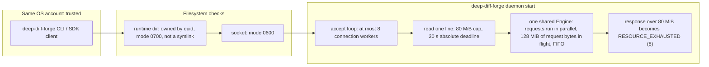

# Security Policy

Deep-Diff-Forge is a diff and code-review engine designed to process hostile
patches and source files. Untrusted input is a normal operating condition, not
an exceptional one. This policy documents the maintained security boundary,
the controls enforced by the repository, and the limits operators must account
for.

## Status 2026-10-28 (0.3.0)

- `main` carries **0.5.0**, tagged `v0.5.0` on 2026-10-31; cutting any later
  `v*` tag is the owner's decision. The published releases are `v0.1.0`,
  `v0.2.0`, `v0.3.0`, `v0.4.0` and `v0.5.0`. `0.2.1` was never tagged or published.
- The controls below describe the code on `main`. The `v0.2.0` binaries were
  built on 2026-06-24 and predate the SOL-1 hardening (2026-09-04), the review
  council work and the 2026-10-28 fixes listed under
  [Fixed on 2026-10-28](#fixed-on-2026-10-28).
- Declared scope: a local, single-user review tool (CLI, daemon, `rpc`, `mcp`,
  SDKs) on x86_64 GNU/Linux (glibc, built on Ubuntu 24.04) and macOS (arm64 and
  x86_64), shipped as GitHub release binaries; every shipped binary is run in the
  release smoke test, the x86_64 macOS one under Rosetta 2. Not claimed:
  crates.io packages, or a daemon shared between users on one host.
- Known limits are listed under [Residual risks](#residual-risks-and-non-goals).

## Reporting a vulnerability

Do not open a public issue for an unfixed vulnerability or include sensitive
repository content in a report.

- Preferred: submit a [private GitHub security advisory][report] using
  **Security → Report a vulnerability**.
- Include the affected version or commit, impact, prerequisites, and the
  smallest safe reproduction available.
- State whether the report concerns the CLI, daemon, parser, local learning
  store, release pipeline, or an official artifact.
- Remove credentials, proprietary source, and personal data from reproductions.

We target an acknowledgement within five business days. Confirmed
High/Critical issues are prioritized for a fix or documented mitigation. We
coordinate publication with the reporter and publish an advisory and patched
release when the fix is ready; these targets are not a service-level agreement.

[report]: https://github.com/Louranicas/deep-diff-forge/security/advisories/new

## Supported versions

Before 1.0, only the newest released minor line receives security fixes.
Fixes land on `main` first and reach users in the next tagged release.

| Version | State | Security fixes |
| --- | --- | --- |
| `main` | Development line after `v0.5.0` | Land here first. |
| `v0.5.0` (2026-10-31) | Latest published release | Yes: the next release carries them. |
| `v0.4.0` (2026-10-30) | Published, superseded | No. It lacks the 0.5.0 code-evidence fix (DDF-EVID-001) and the bidi/invisible-character sanitising of agent text. |
| `v0.3.0` (2026-10-29) | Published, superseded | No. It lacks the 0.4.0 daemon fixes (peer credentials, start lock). |
| `v0.2.0` (2026-06-24) | Published, superseded | No. It does not contain the fixes made since 2026-06-24. |
| `v0.1.0` (2026-06-22) | Published, superseded | No. |
| `0.2.1` | Never tagged or published | Not applicable. |

Use a tagged release for production automation. Reports against `main` are
welcome, but `main` can contain unreleased behavior.

## Scope and trust boundaries

The security scope includes first-party Rust crates, the optional Unix-domain
socket daemon, local learning receipts, command-line and terminal output,
repository automation, and artifacts published by this repository.

The following data is always treated as attacker-controlled:

- unified diffs, file names, paths, hunk headers, and line bodies;
- source bytes passed to syntax or semantic analysis;
- JSON/JSONL and JSON-RPC requests, identifiers, and parameters;
- agent annotations, labels, evidence, and claimed provenance;
- learning metadata supplied at the receipt boundary.

The operating-system kernel, effective user identity, process environment,
installed trust roots, and GitHub release infrastructure are trusted. The local
OS account is the daemon's isolation boundary: another process running as the
same effective user is not considered isolated from the daemon or its learning
store.

The daemon is local IPC, not a multi-tenant network service. It must not be
exposed through TCP forwarding, a shared container mount, or a socket directory
writable by another account. Windows named-pipe support and TCP listeners are
not implemented security boundaries.

## Enforced controls

### First-party memory safety

`unsafe_code = "forbid"` is compiler-enforced for every first-party workspace
crate and the separate fuzz package. This does not assert that the complete
third-party dependency graph contains no `unsafe`; native and low-level
dependencies are controlled through pinning, review, audit, and minimal feature
selection.

### Untrusted input and output

- Stdin, source files, daemon lines, responses, learning records, and patch
  structure are bounded before unbounded allocation or retention.
- Patch parsing rejects more than one million physical lines and more than
  64 MiB of input (`DEFAULT_LINE_BUDGET`, `DEFAULT_BYTE_BUDGET` in
  `crates/deep-diff-forge-patch/src/lib.rs`), preventing tiny lines from
  amplifying into an unbounded object graph.
- After a `GIT binary patch` header, the parser admits only lines of git's
  binary-body grammar until the next `diff --git`: `literal N`, `delta N`, the
  empty line that ends a hunk, or a data line whose length letter matches its
  base85 payload. Any other line is refused as `UnsupportedFormat` (exit 4).
  Before 2026-10-28 every later line went into the binary body, so a text change
  placed after a binary section was hidden from the review while `git apply`
  still applied it (`is_binary_body_line` and the regression test
  `a_text_change_after_a_binary_body_is_never_hidden_in_it` in
  `crates/deep-diff-forge-patch/src/parser.rs`).
- Human-facing terminal output passes through `core::display_safe`, which
  exposes ANSI/CSI/OSC controls, C0/C1 controls, carriage returns, DEL, bidi
  overrides/isolates, directional marks, zero-width characters, and BOM rather
  than executing or visually reordering them.
- Raw JSON/JSONL terminal output uses the canonical `core::json_escape` path,
  including DEL and C1 escaping. A downstream program that decodes those JSON
  strings must apply its own terminal-safe rendering before displaying them.
- Annotation provenance is fail-closed: a claimed `source` is not trusted until
  evidence grounds it.

### Local daemon

The trust boundary is the OS account. Code: `crates/deep-diff-forge-daemon/src/`
(`serve.rs`, `security.rs`, `handler.rs`).



- The daemon is Unix-only and listens on a filesystem Unix-domain socket.
- Its managed runtime directory (`$XDG_RUNTIME_DIR/deep-diff-forge/`) is owned
  by the effective user with mode `0700`; its socket is mode `0600`
  (`SECURE_DIR_MODE`, `SECURE_SOCKET_MODE` in `security.rs`). There is no `/tmp`
  fallback when `$XDG_RUNTIME_DIR` is unset: the CLI exits 2.
- Explicit `--socket PATH` locations require an owner-private parent. A missing
  parent is created at `0700`; an existing parent is validated and never
  chmodded, so a `0755` parent is refused. Symlinks, wrong-owner directories,
  permissive directories and inode swaps fail closed. Shutdown removes only the
  socket inode that server created (`cleanup_owned_socket`).
- Before binding, `remove_stale_socket` (`serve.rs`) handles whatever is at the
  socket path. A non-socket file is never deleted; the start fails. A socket
  that accepts a connection belongs to a live daemon; the start fails with
  `AddrInUse` (exit 6) and the running daemon keeps its socket. Only a socket
  whose connect is refused (`ConnectionRefused`, a leftover from a daemon that
  is gone) is removed. Before 2026-10-28 a second `daemon start` deleted a live
  daemon's socket and orphaned it. Measured 2026-10-28 with the 0.3.0 debug
  build: second start exit 6; restart over a socket left by `kill -9` succeeds;
  regular file at the path refused, exit 6.
- JSON-RPC envelopes are shape-checked, including protocol version, method,
  identifier, and parameter types.
- Request and response lines are capped at 80 MiB (`MAX_REQUEST_BYTES`,
  `MAX_RESPONSE_BYTES`). An oversized request gets one `INVALID_REQUEST` error
  and the connection closes. A response over the cap is replaced by a
  `RESOURCE_EXHAUSTED` (8) error naming its size (`bounded_response`); before
  2026-10-28 the server sent it and the client failed. `deep-diff-forge rpc`
  uses the same `process_line` and caps over stdio.
- Each line read has a 30-second absolute deadline (`READ_TIMEOUT`), applied as
  the remaining time before every read, so slow byte-drip traffic cannot renew
  it. Writes have a 30-second timeout (`WRITE_TIMEOUT`).
- At most eight connections are served at once (`MAX_CONNECTIONS`). A further
  connection is accepted and closed at once, with no response. Workers share one
  engine and their requests run in parallel. Only the session table is locked, and
  only for bookkeeping; parsing, ranking and Git run outside it. The request bytes
  in flight are capped at 128 MiB (`MAX_IN_FLIGHT_BYTES`, `admission.rs`), first
  come, first served; a `review.change` weighs the 64 MiB patch budget, and a
  request heavier than the cap runs alone. A request that waits 30 s for its
  turn is answered `RESOURCE_EXHAUSTED` and gives up its place.
- Sessions are LRU-bounded to 64 (`MAX_SESSIONS`) and their aggregate retained
  payload is capped at 128 MiB (`MAX_RETAINED_SESSION_BYTES`, `handler.rs`).
- A dispatch panic is caught per request. A panic while the session table was
  held empties the table and clears its poison on the next use; any other panic
  leaves every session in place. Later requests are served as before.

### Review council gate sandbox

Council quality gates run candidate code only inside a rootless Podman
container (`crates/deep-diff-forge-review/src/sandbox.rs`; design and threat
model: [`docs/REVIEW_COUNCIL.md`](docs/REVIEW_COUNCIL.md#gate-sandbox)). The
container is started with `--rm --pull=never --read-only --cap-drop=all
--security-opt=no-new-privileges --userns=keep-id --init --pids-limit=8192
--memory=32g --memory-swap=32g --log-driver=none`, all host CPUs but one,
`--network=none` unless the job is dependency vendoring, and a conmon
`--timeout` of the job's deadline plus 60 seconds. The candidate source, the
vendored dependencies and the Cargo home are mounted read-only; only the job's
scratch directory is writable. The controller removes the container by name and
proves it gone before reading anything it wrote.

The container runs as the controller's own `uid:gid`, taken from
`geteuid()`/`getegid()` (`operator()` in `sandbox.rs`). Before 2026-10-28 it was
read from `/proc/self` and fell back to `0:0`, so on a host without `/proc`
every gate ran as root inside the container. Gates refuse to run unless
`DDF_COUNCIL_GATE_IMAGE` names a local image.

### Local learning store

- Store directories and files must be owned by the effective user and remain
  owner-private (`0700` directories and `0600` files).
- Directory/file symlinks and inode replacement are rejected. New receipt files
  use exclusive creation.
- The store is capped at 64 MiB, individual JSONL records at 1 MiB, and retained
  records at 100,000.
- File identifiers must be redacted lowercase hexadecimal values; language and
  parser-version fields accept bounded token characters rather than paths.
- The stable FNV identifier is pseudonymous and dictionary-guessable, not a
  confidentiality primitive. Confidentiality comes from local access controls.
  Learning data is not uploaded by the project.

### Supply chain and releases

- Root and fuzz lockfiles are checked by strict `cargo audit --deny warnings`
  and `cargo deny` advisory, ban, license, and source policies. There are no
  advisory waivers.
- Tree-sitter crates, which execute native build scripts, are pinned exactly.
  The TUI disables unused default features.
- GitHub Actions are pinned to full commit SHAs (a test,
  `cli/tests/workflow_pins.rs`, fails on any other `uses:`), use least-privilege job
  permissions, do not persist checkout credentials, and have bounded run times.
- `release.yml` runs on `v*` tags and on manual `workflow_dispatch`. A tag must
  exactly match the workspace version. Both runs repeat the full `ci.yml`
  quality workflow and a supply-chain gate, build three targets, run every
  binary (the x86_64 macOS one under Rosetta 2), and verify every archive's
  SHA-256. A ruleset makes `v*` tags immutable: once pushed, a release tag
  cannot be moved or deleted. Only a
  pushed `v*` tag attests, uploads and (when the owner opens it) publishes to
  crates.io; a dispatched run, from any ref including a tag, is a dry run that
  publishes nothing.
  See [`docs/RELEASE_AND_PUBLICATION.md`](docs/RELEASE_AND_PUBLICATION.md).
- Release archives, checksums, and the generated SPDX SBOM receive GitHub build
  provenance attestations on tag runs. Dependabot monitors both Cargo graphs and
  Actions. CodeQL (`codeql.yml`, security-extended queries) analyses the Rust code
  and the workflows on pull requests, on `main` and weekly; it is not yet a
  required check.
- crates.io publication is on hold by owner decision until the codebase is
  production-hardened. The `publish` job runs only on a tag and only when the
  repository variable `DDF_CRATES_IO` is `open`; a configured
  `CARGO_REGISTRY_TOKEN` alone does not lift the hold. It runs in the `release`
  environment, which only `v*` tags can deploy to, and an open gate without a
  token fails the job instead of passing without publishing. It would publish
  with that token; crates.io trusted publishing remains an account-level
  hardening step outside this repository. No crates.io release is recorded in
  [`EVIDENCE.md`](EVIDENCE.md) (not re-checked against crates.io in this
  refresh).
- CI and release toolchains are pinned (stable 1.99.1, `nightly-2026-10-25`),
  so a toolchain release cannot change a gate's result. The committed SBOM is
  reproducible: its namespace is content-addressed and `created` comes from the
  last `Cargo.lock` commit.

## Secure operation

1. Run the latest supported release as an unprivileged, dedicated OS account
   when processing mutually untrusted users' content.
2. Keep `$XDG_RUNTIME_DIR` owned by that account and inaccessible to group and
   others. For `--socket PATH`, pre-create an owner-private parent directory.
3. Start one daemon per socket path, from one supervisor. A second start exits 6
   and leaves the running daemon reachable, even when the two starts race: the
   start lock (`<socket>.lock`) is held from before the stale-socket probe until
   the daemon exits.
4. Do not publish, proxy, or bind-mount the daemon socket into a less-trusted
   environment.
5. Treat exported JSON and annotations as untrusted when another tool renders
   them. Never interpolate paths or labels into a shell command.
6. Protect learning-store backups and logs with the same access policy as the
   source repositories they describe.
7. Install from a tagged release or use `cargo install --locked`; retain the
   lockfile in reproducible deployments.

For a downloaded release, check its SHA-256 sidecar and verify its GitHub
attestation against `Louranicas/deep-diff-forge`. A checksum obtained from the
same untrusted location as an artifact detects corruption but is not, alone, an
independent authenticity proof.

## Reproducing the security gates

The authoritative gate is [`.github/workflows/ci.yml`](.github/workflows/ci.yml).
`just ci` runs [`scripts/ci_local.sh`](scripts/ci_local.sh), a step-for-step
replica of its `secrets`, `msrv`, `gate` and `supply-chain` jobs (checked by
`crates/deep-diff-forge-cli/tests/ci_replica.rs`; it needs gitleaks, Rust
1.88.0, cargo-deny and cargo-audit installed). It does not replay the review
controller evidence job (rootless Podman) or the diff-mutation job; run
`scripts/diff_mutation.sh origin/main` for the latter. The principal local
checks are:

```bash
cargo fmt --all --check
cargo check --workspace --locked
cargo clippy --workspace --all-targets --locked -- -D warnings
cargo clippy --workspace --all-targets --locked -- -D warnings -W clippy::pedantic
cargo test --workspace --locked
cargo check --locked --manifest-path fuzz/Cargo.toml --bins
cargo deny check
cargo deny --manifest-path fuzz/Cargo.toml --locked check
cargo audit --deny warnings
cargo audit --deny warnings --file fuzz/Cargo.lock
DDF_SOAK_SECONDS=10 python3 scripts/security/daemon_soak.py
python3 scripts/security/privacy_probe.py
```

CI verifies the committed SBOM against a fresh dependency-graph regeneration.
The release workflow repeats the supply-chain gate, regenerates the release
SBOM, and attests it before irreversible publication.

## Residual risks and non-goals

Known limits on `main` at 0.3.0 (production-readiness review, 2026-10-28):

- **Closed in 0.4.0: one engine serialized daemon requests.** Every
  connection shared one `Mutex<Engine>`, so one slow request delayed all other
  clients. Requests now run in parallel under the 128 MiB in-flight cap above
  (EVIDENCE.md).
- **Closed in 0.4.0: the socket checks peer credentials.** The daemon reads
  each client's effective uid from the kernel (`SO_PEERCRED` on Linux,
  `getpeereid` on macOS and the BSDs; other platforms refuse every client) and
  drops a client that is not its own user, so a socket whose mode was loosened is
  still single-user. The CLI and both SDKs check the daemon's uid the same way
  before sending a request. Measured with a client and a daemon of a different
  uid (a user-namespace subordinate uid) in both directions (EVIDENCE.md).
- **Closed in 0.3.0: Git subprocesses have a time limit.** One deadline
  bounds every Git call of an acquisition: 120 s for the CLI's Git selections and
  30 s for `review.change`. A Git still running at the deadline is killed, and the
  acquisition fails with `TimedOut` (CLI exit 3). Before, `child.wait()` waited
  forever on a stalled filesystem or hook.
- **Hidden text is flagged, not filtered.** Lines and paths carrying bidi controls, invisible
  or control characters, and paths that traverse or name `.git`, get `hazards` in `review.v0`
  and the views, and the `hazardous_text` risk signal. The patch text itself is never rewritten.
  The flags are objective: no list of "instruction-like" words, so an unflagged line is not
  thereby safe.
- **A repository's own filters never run.** Git acquisition turns off every content filter
  (`clean`, `smudge`, `process`) that the repository's own configuration defines, so reviewing a
  repository someone handed you cannot run their code through `.gitattributes`. "Own" is every
  scope Git does not call protected: `local` (`.git/config`), `worktree` (`config.worktree`,
  read once `extensions.worktreeConfig` is set) and whatever they include. Before 2026-10-31 only
  `.git/config` was listed, so a filter in `config.worktree` still ran and its output was reviewed
  in place of the file (`a_repository_worktree_config_filter_never_runs`).
- **The user's own Git configuration is trusted for filters only (decided 2026-10-31).** Filters
  from Git's protected scopes (global `~/.gitconfig` or `$XDG_CONFIG_HOME/git/config`, system
  `/etc/gitconfig`, `-c` and `GIT_CONFIG_*`) stay on. Whoever can write those files already runs
  code as the user without Git (the same-account boundary above, and Git's own model in
  git-config(1), "Protected configuration"), and a filter there such as Git LFS defines what the
  repository stores: turning it off would show an LFS file's raw bytes against its committed
  pointer, a change `git add` would never record. A hostile repository can still choose, through
  `.gitattributes`, which of the user's filters reads which file, as any `git status` in it
  would. Nothing else in any scope runs: fsmonitor, the hooks path, an external diff, a diff
  driver's `textconv` or `command`, and transports are overridden on the command line or by flag,
  which no configuration file outranks. Measured with planted global and system files, set
  directly and through `include.path` and `includeIf`
  (`protected_config_keeps_its_filters_and_runs_nothing_else`): only the user's filter ran and the
  capture was byte for byte the one taken without the planted programs. The review of an LFS file
  is a review of its pointer, not of the object it names.
- **Repository reads are opt-in (`review.change`).** The daemon, `rpc` and `mcp`
  read Git only for a repository whose canonical path and Git top level are both
  under a root the operator named with `--allow-repo`, and so must its Git directory and common
  directory (a `.git` file cannot point outside); a repository whose object store borrows
  another's (`objects/info/alternates`) is refused. Without a root they read none.
  The roots are an operator decision: any client of that daemon or MCP server can
  read every change under them, though never write anything.
- **Closed in 0.4.0: two `daemon start`s cannot race.** Before, between
  `remove_stale_socket`'s probe and the bind, a second start could remove the
  first's fresh socket and bind its own, leaving the first running but
  unreachable. Each start now takes a non-blocking exclusive `flock` on
  `<socket>.lock` (opened without following symlinks, a regular file owned by
  the effective user) before the probe and holds it until the daemon has exited
  and removed its socket. A start that finds the lock held exits 6.
- **Closed in 0.4.0: macOS tests did not run on pull requests.** The `macos`
  CI job now runs on every event, each pull request included, and `macOS tests`
  is a required check.
- **The TUI has no interactive test harness.** Unit tests cover its state and
  rendering, and the headless `review --probe` frame is tested end to end; the
  live terminal path is not.
- **The review council trial is undesigned.** The council is used on this
  repository; no controlled trial of its review quality exists.

- Resource caps limit individual operations and retained state; they are not a
  CPU or process sandbox. A permitted local client can temporarily occupy all
  eight daemon workers, and hostile syntax input still consumes bounded compute.
- Owner-only permissions do not protect against another compromised process
  running as the same OS user, including one that replaces an existing socket
  path; nor do they protect against a compromised kernel or administrator.
- Tree-sitter parsers and transitive dependencies can contain native or `unsafe`
  implementation code even though first-party crates forbid it.
- Pseudonymous file identifiers can be guessed from a small candidate set.
- The project does not claim isolation suitable for hosting unrelated tenants,
  cryptographic secrecy for review content, or safe display by downstream tools
  that bypass its rendering APIs.

## Hardening provenance

The current posture follows these review cycles:

- **S1008412** — eight-dimension STRIDE audit and Trojan-Source/bidi defence.
- **S1008443** — patch-truth, daemon fail-closed behavior, bounded sessions, and
  CI/release supply-chain review.
- **S1008452** — unified JSON/JSONL escaping and C1/DEL coverage.
- **SOL-1 (2026-09-04)** — removed advisory waivers; bounded daemon concurrency,
  deadlines, and aggregate memory; added inode-safe local storage and receipt
  privacy; and closed non-tag release publication. Full tests, strict lint/docs,
  fuzz compilation, RustSec/cargo-deny, privacy probing, and hostile daemon soak
  passed at completion.
- **Review council r4–r18 (2026-10-25 to 2026-10-26)** — council evidence
  gates run on a sealed snapshot in a rootless Podman sandbox (image by ID,
  no network except dependency vendoring, read-only root and source, no
  capabilities, `no-new-privileges`, the operator's own uid); a 12-probe
  planted-breach suite runs in CI on GitHub-hosted runners; the diff-scoped
  mutation gate ignores the candidate's cargo-mutants config, and an exemption
  oracle refuses code hidden from mutation by anything but `#[cfg(test)]`.
  Threat model, controls and residual risks:
  [`docs/REVIEW_COUNCIL.md`](docs/REVIEW_COUNCIL.md#gate-sandbox). Evidence:
  [`EVIDENCE.md`](EVIDENCE.md#review-council-and-ci-2026-10-26).

### Fixed on 2026-10-28

PRs #21 to #23, released in `v0.3.0` (2026-10-29):

- text change hidden after a `GIT binary patch` body (strict base85 grammar, else
  exit 4);
- gate containers ran as `0:0` on hosts without `/proc` (now `geteuid`/`getegid`);
- quadratic patch-metadata parsing (1M lines: 139 s before, 0.20 s after,
  measured);
- a second `daemon start` orphaned the first (now refused with `AddrInUse`);
- the server sent responses over the 80 MiB cap (now `RESOURCE_EXHAUSTED`);
- macOS `SO_RCVTIMEO` EINVAL after a peer disconnect.

Status of the 2026-10-26 open items, as of 2026-10-28: the MCP server ships
read-only (tools `review_patch`, `rank_patch`, `explain_exit_code`,
`exit_code_registry`; no write tool); CI is pinned to `ubuntu-26.04` and the
rootless-Podman step was re-measured there on 2026-10-27; the pinned actions
are Node 24 builds.

Open security-relevant work (2026-10-26, kept as written): council r18 triage; an MCP server
(slice D) must stay read-only by default with each write tool opt-in; the
`ubuntu-latest` move to Ubuntu 26 needs the rootless-Podman CI step
re-measured; and Node 20 actions are deprecated.
