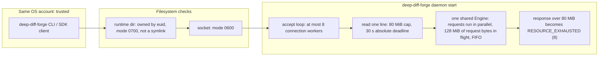

# Security Policy

Deep-Diff-Forge is a diff and code-review engine designed to process hostile
patches and source files. Untrusted input is a normal operating condition, not
an exceptional one. This policy documents the maintained security boundary,
the controls enforced by the repository, and the limits operators must account
for.

## Status 2026-11-11 (0.8.3 released)

- `v0.8.3` (2026-11-11 UTC, signed) is the latest release, a security release: v0.8.2 and earlier can review a change on a
  different file, or with a different mode or type, than `git apply` writes (F3 and F2 of the
  v0.8.2 rescore and a case found in the fix's review, [GHSA-rq5r-p3g9-phff](https://github.com/Louranicas/deep-diff-forge/security/advisories/GHSA-rq5r-p3g9-phff)).
  It also updates three dependencies, rustix among them (RUSTSEC-2026-0486; DDF calls none of
  the affected functions). Upgrade to 0.8.3.
- `v0.8.2` (2026-11-10, signed) was a security release: v0.8.1 and earlier
  can review a different file or mode than `git apply` writes (N1-N3 of the v0.8.1 rescore and F1-F2 of the rescore before the v0.8.2 tag,
  [GHSA-gp5v-m67f-gmgp](https://github.com/Louranicas/deep-diff-forge/security/advisories/GHSA-gp5v-m67f-gmgp), published 2026-11-10); upgrade to 0.8.2 or later. Cutting any later `v*` tag is
  the owner's decision. The published releases are `v0.1.0`, `v0.2.0`, `v0.3.0`, `v0.4.0`,
  `v0.5.0`, `v0.6.0`, `v0.7.0`, `v0.8.0`, `v0.8.1`, `v0.8.2` and `v0.8.3`. `0.2.1` was never tagged or published.
- The controls below describe the code on `main`. The `v0.2.0` binaries were
  built on 2026-06-24 and predate the SOL-1 hardening (2026-09-04), the review
  council work and the 2026-10-28 fixes listed under
  [Fixed on 2026-10-28](#fixed-on-2026-10-28).
- Declared scope: a local, single-user review tool (CLI, daemon, `rpc`, `mcp`,
  SDKs) on exactly four targets, shipped as GitHub release binaries:
  `x86_64-unknown-linux-gnu` and `aarch64-unknown-linux-gnu` (x86_64 built on
  Ubuntu 24.04, arm64 on Ubuntu 22.04 since v0.6.0; glibc 2.34 or newer, enforced
  by `scripts/check_glibc_floor.sh`), `aarch64-apple-darwin` and `x86_64-apple-darwin`.
  Every shipped binary is run in the release smoke test, the x86_64 macOS one under
  Rosetta 2. Not claimed: musl, Windows, other architectures, crates.io packages,
  or a daemon shared between users on one host
  ([supported platforms](README.md#supported-platforms)).
- Known limits are listed under [Residual risks](#residual-risks-and-non-goals).

## Reporting a vulnerability

Do not open a public issue for an unfixed vulnerability or include sensitive
repository content in a report.

- Preferred: submit a [private GitHub security advisory][report] using
  **Security → Report a vulnerability**.
- Include the affected version or commit, impact, prerequisites, and the
  smallest safe reproduction available.
- State whether the report concerns the CLI, daemon, parser, local learning
  store, release pipeline, or an official artifact.
- Remove credentials, proprietary source, and personal data from reproductions.

We target an acknowledgement within five business days. Confirmed
High/Critical issues are prioritized for a fix or documented mitigation. We
coordinate publication with the reporter and publish an advisory and patched
release when the fix is ready; these targets are not a service-level agreement.

[report]: https://github.com/Louranicas/deep-diff-forge/security/advisories/new

## Supported versions

Before 1.0, only the newest released minor line receives security fixes.
Fixes land on `main` first and reach users in the next tagged release.

| Version | State | Security fixes |
| --- | --- | --- |
| `main` | 0.8.3 and later changes, untagged | Land here first. |
| `v0.8.3` (2026-11-11 UTC) | Latest published release | Yes: the next release carries them. |
| `v0.8.2` (2026-11-10) | Published, superseded | No. It can show a change on a different file, or with a different mode or type, than `git apply` writes: a name left by a bare `diff --git` line before a binary line, a new file's mode overridden by `new mode`, or content under a mode Git reads as a submodule ([GHSA-rq5r-p3g9-phff](https://github.com/Louranicas/deep-diff-forge/security/advisories/GHSA-rq5r-p3g9-phff)); 0.8.3 fixes them. |
| `v0.8.1` (2026-11-08) | Published, superseded | No. It can review a different file or mode than `git apply` writes: a copy, a `---`/`+++` name with nothing after its first component, repeated mode headers, a header after a binary line, or a carriage return in a move name (N1-N3 of the v0.8.1 rescore and F1-F2 of the rescore before the v0.8.2 tag, [GHSA-gp5v-m67f-gmgp](https://github.com/Louranicas/deep-diff-forge/security/advisories/GHSA-gp5v-m67f-gmgp)); 0.8.2 fixes them. |
| `v0.8.0` (2026-11-07) | Published, superseded | No. It reviews a rename to a different destination than `git apply` writes when a non-header line comes between two `rename to` lines (F1 of the v0.8.0 rescore, high); 0.8.1 fixes it. |
| `v0.7.0` (2026-11-03) | Published, superseded | No. It lacks the 0.8.0 hunk-header fix (a header without its space hid a file that `git apply` wrote), the refusal of non-UTF-8 file names, the daemon's response deadline for slow readers and the bounds on child processes. |
| `v0.6.0` (2026-11-02) | Published, superseded | No. It lacks the 0.7.0 daemon read budget and request deadlines, the release workflow's tag-signature check and the DDF-FUZZ-PATCH-8 fix (a doubled slash in a `diff --git` name broke render stability). |
| `v0.5.0` (2026-10-31) | Published, superseded | No. It lacks the 0.6.0 Git-filter fixes (a `config.worktree` or checked-out submodule filter no longer runs during acquisition) and the escaping of every default-ignorable code point. |
| `v0.4.0` (2026-10-30) | Published, superseded | No. It lacks the 0.5.0 code-evidence fix (DDF-EVID-001) and the bidi/invisible-character sanitising of agent text. |
| `v0.3.0` (2026-10-29) | Published, superseded | No. It lacks the 0.4.0 daemon fixes (peer credentials, start lock). |
| `v0.2.0` (2026-06-24) | Published, superseded | No. It does not contain the fixes made since 2026-06-24. |
| `v0.1.0` (2026-06-22) | Published, superseded | No. |
| `0.2.1` | Never tagged or published | Not applicable. |

Use a tagged release for production automation. Reports against `main` are
welcome, but `main` can contain unreleased behavior.

## Scope and trust boundaries

The security scope includes first-party Rust crates, the optional Unix-domain
socket daemon, local learning receipts, command-line and terminal output,
repository automation, and artifacts published by this repository.

The following data is always treated as attacker-controlled:

- unified diffs, file names, paths, hunk headers, and line bodies;
- source bytes passed to syntax or semantic analysis;
- JSON/JSONL and JSON-RPC requests, identifiers, and parameters;
- agent annotations, labels, evidence, and claimed provenance;
- learning metadata supplied at the receipt boundary.

The operating-system kernel, effective user identity, process environment,
installed trust roots, and GitHub release infrastructure are trusted. The local
OS account is the daemon's isolation boundary: another process running as the
same effective user is not considered isolated from the daemon or its learning
store.

The daemon is local IPC, not a multi-tenant network service. It must not be
exposed through TCP forwarding, a shared container mount, or a socket directory
writable by another account. Windows named-pipe support and TCP listeners are
not implemented security boundaries.

## Enforced controls

### First-party memory safety

`unsafe_code = "forbid"` is compiler-enforced for every first-party workspace
crate and the separate fuzz package. This does not assert that the complete
third-party dependency graph contains no `unsafe`; native and low-level
dependencies are controlled through pinning, review, audit, and minimal feature
selection.

### Untrusted input and output

- Stdin, source files, daemon lines, responses, learning records, and patch
  structure are bounded before unbounded allocation or retention.
- Patch parsing rejects more than one million physical lines and more than
  64 MiB of input (`DEFAULT_LINE_BUDGET`, `DEFAULT_BYTE_BUDGET` in
  `crates/deep-diff-forge-patch/src/lib.rs`), preventing tiny lines from
  amplifying into an unbounded object graph.
- After a `GIT binary patch` header, the parser admits only lines of git's
  binary-body grammar until the next `diff --git`: `literal N`, `delta N`, the
  empty line that ends a hunk, or a data line whose length letter matches its
  base85 payload. Any other line is refused as `UnsupportedFormat` (exit 4).
  Before 2026-10-28 every later line went into the binary body, so a text change
  placed after a binary section was hidden from the review while `git apply`
  still applied it (`is_binary_body_line` and the regression test
  `a_text_change_after_a_binary_body_is_never_hidden_in_it` in
  `crates/deep-diff-forge-patch/src/parser.rs`).
- Human-facing terminal output passes through `core::display_safe`, which
  exposes ANSI/CSI/OSC controls, C0/C1 controls, carriage returns, DEL, bidi
  overrides/isolates, directional marks, zero-width characters, BOM and every
  other Unicode `Default_Ignorable_Code_Point` rather than executing, hiding or
  visually reordering them. Before 2026-11-01 the Mongolian free variation
  selectors (`U+180B`-`U+180D`, `U+180F`, which rustc accepts inside an
  identifier), the Khmer inherent vowels, the musical and shorthand format
  controls, the reserved default-ignorables and the interlinear annotation controls passed
  through raw and unflagged.
- Hand-built JSON/JSONL output uses the canonical `core::json_escape` path,
  including DEL and C1 escaping. Serde-built JSON (the `--outline` and `--hunks`
  views, `rpc`, MCP, the daemon socket, the review CLI, and the pretty-printed
  `findings verify`, `deploy doctor --json`, `eval --json` and `bench --json`
  documents) goes out through `core::json_line_safe`, which applies the same DEL,
  C1 and `U+2028`/`U+2029` escaping, and view pages are budgeted on that escaped
  text. Before 2026-11-01 `json_line_safe` escaped only the separators, so those
  views printed raw 8-bit CSI (`U+009B`) and OSC (`U+009D`) from patch paths,
  headings and lines, and the pretty-printed documents skipped it, so `findings
  verify` printed a finding's patch path with the raw CSI. A
  downstream program that decodes those JSON strings must apply its own
  terminal-safe rendering before displaying them.
- Annotation provenance is fail-closed: a claimed `source` is not trusted until
  evidence grounds it.

### Local daemon

The trust boundary is the OS account. Code: `crates/deep-diff-forge-daemon/src/`
(`serve.rs`, `security.rs`, `handler.rs`).



- The daemon is Unix-only and listens on a filesystem Unix-domain socket.
- Its managed runtime directory (`$XDG_RUNTIME_DIR/deep-diff-forge/`) is owned
  by the effective user with mode `0700`; its socket is mode `0600`
  (`SECURE_DIR_MODE`, `SECURE_SOCKET_MODE` in `security.rs`). There is no `/tmp`
  fallback when `$XDG_RUNTIME_DIR` is unset: the CLI exits 2.
- Explicit `--socket PATH` locations require an owner-private parent. A missing
  parent is created at `0700`; an existing parent is validated and never
  chmodded, so a `0755` parent is refused. Symlinks, wrong-owner directories,
  permissive directories and inode swaps fail closed. Shutdown removes only the
  socket inode that server created (`cleanup_owned_socket`).
- Before binding, `remove_stale_socket` (`serve.rs`) handles whatever is at the
  socket path. A non-socket file is never deleted; the start fails. A socket
  that accepts a connection belongs to a live daemon; the start fails with
  `AddrInUse` (exit 6) and the running daemon keeps its socket. Only a socket
  whose connect is refused (`ConnectionRefused`, a leftover from a daemon that
  is gone) is removed. Before 2026-10-28 a second `daemon start` deleted a live
  daemon's socket and orphaned it. Measured 2026-10-28 with the 0.3.0 debug
  build: second start exit 6; restart over a socket left by `kill -9` succeeds;
  regular file at the path refused, exit 6.
- JSON-RPC envelopes are shape-checked, including protocol version, method,
  identifier, and parameter types.
- Request and response lines are capped at 80 MiB (`MAX_REQUEST_BYTES`,
  `MAX_RESPONSE_BYTES`). An oversized request gets one `INVALID_REQUEST` error
  and the connection closes. A response over the cap is replaced by a
  `RESOURCE_EXHAUSTED` (8) error naming its size (`bounded_response`); before
  2026-10-28 the server sent it and the client failed. Since 2026-11-01 an error
  answer is held to the same cap, measured after `json_line_safe`, and an error
  message is cut at 4 KiB (`MAX_ERROR_MESSAGE_BYTES`) where it is built, so request
  text an error repeats cannot push it past the cap; the MCP server's tool and
  protocol errors are cut the same way. `deep-diff-forge rpc`
  uses the same `process_line` and caps over stdio.
- Each line read has a 30-second absolute deadline (`READ_TIMEOUT`), applied as
  the remaining time before every read, so slow byte-drip traffic cannot renew
  it. Writes have a 30-second timeout (`WRITE_TIMEOUT`).
- At most eight connections are served at once (`MAX_CONNECTIONS`). Beyond them, two
  control slots (`CONTROL_CONNECTIONS`) take one request each, of at most 4 KiB read within
  5 s, and answer only `daemon.health`, `daemon.status`, `daemon.metrics` and
  `daemon.shutdown` (anything else is refused `RESOURCE_EXHAUSTED`). A connection beyond those
  is accepted and closed at once, with no response; the CLI reports that as no answer (exit 6),
  not as no daemon. SIGTERM and SIGINT stop the daemon as `daemon stop` does. Workers share one
  engine and their requests run in parallel. Only the session table is locked, and
  only for bookkeeping; parsing, ranking and Git run outside it. The request bytes
  in flight are capped at 128 MiB (`MAX_IN_FLIGHT_BYTES`, `admission.rs`), first
  come, first served; a `review.change` weighs the 64 MiB patch budget, and a
  request heavier than the cap runs alone. A request that waits 30 s for its
  turn is answered `RESOURCE_EXHAUSTED` and gives up its place.
- Request lines being read and answered are capped across connections at 160 MiB
  (`MAX_READ_BYTES`, `admission.rs`, since 2026-11-03). Before, eight connections
  could each hold an 80 MiB line, and parse it, outside the in-flight budget. A
  line over the shared budget is answered `RESOURCE_EXHAUSTED` and its connection
  closed. Work on a socket request stops at its client's 30 s read deadline
  (`deadline.rs`), checked between stages, so a client that has given up does not
  hold a worker and admission weight.
- Sessions are LRU-bounded to 64 (`MAX_SESSIONS`) and their aggregate retained
  payload is capped at 128 MiB (`MAX_RETAINED_SESSION_BYTES`, `handler.rs`).
- A dispatch panic is caught per request. A panic while the session table was
  held empties the table and clears its poison on the next use; any other panic
  leaves every session in place. Later requests are served as before.

### Review council gate sandbox

Council quality gates run candidate code only inside a rootless Podman
container (`crates/deep-diff-forge-review/src/sandbox.rs`; design and threat
model: [`docs/REVIEW_COUNCIL.md`](docs/REVIEW_COUNCIL.md#gate-sandbox)). The
container is started with `--rm --pull=never --read-only --cap-drop=all
--security-opt=no-new-privileges --userns=keep-id --init --pids-limit=8192
--memory=32g --memory-swap=32g --log-driver=none`, all host CPUs but one,
`--network=none` unless the job is dependency vendoring, and a conmon
`--timeout` of the job's deadline plus 60 seconds. The candidate source, the
vendored dependencies and the Cargo home are mounted read-only; only the job's
scratch directory is writable. The controller removes the container by name and
proves it gone before reading anything it wrote.

The container runs as the controller's own `uid:gid`, taken from
`geteuid()`/`getegid()` (`operator()` in `sandbox.rs`). Before 2026-10-28 it was
read from `/proc/self` and fell back to `0:0`, so on a host without `/proc`
every gate ran as root inside the container. Gates refuse to run unless
`DDF_COUNCIL_GATE_IMAGE` names a local image.

### Local learning store

- Store directories and files must be owned by the effective user and remain
  owner-private (`0700` directories and `0600` files).
- Directory/file symlinks and inode replacement are rejected. New receipt files
  use exclusive creation.
- The store is capped at 64 MiB, individual JSONL records at 1 MiB, and retained
  records at 100,000.
- File identifiers must be redacted lowercase hexadecimal values; language and
  parser-version fields accept bounded token characters rather than paths.
- The stable FNV identifier is pseudonymous and dictionary-guessable, not a
  confidentiality primitive. Confidentiality comes from local access controls.
  Learning data is not uploaded by the project.

### Agent hooks

The hooks guard against an agent's honest mistakes and shortcuts: a credential it commits, a
check it silences, a policy it loosens. They are **not** a boundary against an agent that sets
out to evade them: it has a shell, so it can edit the settings, the session's state, or work
in a copy. That boundary is the judge on the pull request (forge-warden on the server). The
rule for every case below: an ordinary workflow must never end in a silent stop with unjudged
work; a deliberate evasion is made visible where that is cheap, and is otherwise a stated
limit.

`agent hook` runs inside an agent's session, on the agent's own change. **A stop prints nothing
only when every unit of the session (the uncommitted change, the staged change, each commit)
has a pass; everything else that is true at a stop is said at that stop, every time, in a
bounded form.** What it holds to:

- **The change is attacker-controlled, and so is everything read from it.** A hook message
  never repeats the text of a changed line. A path is shown quoted, with control characters
  escaped, cut at 120 characters, and the message says that paths are data. Rule text comes
  from the policy at the base commit and is escaped the same way.
- **The session cannot move what is judged.** The project and the commit its changes are
  measured from are fixed by the session's first hook and kept in its state: the directory
  the client names (`CLAUDE_PROJECT_DIR`), else the one recorded, else the hook input's
  `cwd`; and the commit `HEAD` named there. Before, both were read at every stop from things
  the session itself moves. A `cd` into a nested repository, another repository or a
  directory that was gone let the stop pass with no output, and so did committing the work;
  a committed policy change was the policy for the rest of the session. A stop now judges
  the project wherever the session's directory is, by the policy of the recorded commit. A
  linked working tree the session's directory is in is judged as well.
- **The unit that is judged is a commit, by its own change.** The session's first hook
  records, with the base, the id of every commit that something names then: every ref, the
  `HEAD` of every working tree, and the reflogs of those `HEAD`s and of the stash. A commit
  is the session's when a branch, a tag, the stash, a `HEAD` or one of those reflogs leads
  to it now and none of the recorded commits does. A stop has judged the uncommitted change
  of the working tree (against that tree's `HEAD`) and each commit of the session that no
  earlier stop judged, as the patch from its first parent to itself, the oldest first, as
  many as its time allows; the rest are counted as UNJUDGED and judged at later stops.
  Before, a stop judged for each ref the net patch from the base to its tip, over bounded
  lists of refs. A credential that was committed and then reverted left an empty net patch
  and a silent stop while the branch kept the commit; the untracked files of `git stash -u`
  and the older entries of the stash were in no net patch; four patches of sixteen tips in
  name order could leave out the session's own; a list of 4,096 refs dropped the stash of a
  repository with more. None of these has a bound or an order by name now: the recorded
  ids are a file of their own with no such limit, and no name of a ref is read or shown, so
  a name that is not UTF-8 or that somebody else chose cannot matter. A commit that only a
  remote-tracking ref names was fetched and is not the session's. A commit that is gone
  from every ref and every reflog read is not found; that is a stated limit.
- **What is staged is judged.** A stop judged the working tree and the commits; the index
  was in neither. A credential that was staged and then repaired or deleted in the working
  tree without `git add` was in no patch, the stop was silent, and the next plain
  `git commit` recorded it. The change the index holds against the tree's `HEAD` is a unit
  now ("Staged changes in" the path), judged when it is another change than the working
  tree's. Its entries are read with `git ls-files --stage` and written into an index of the
  scratch repository; the repository's own index is not written.
- **Which commits of others are judged.** A commit that was in the repository when the
  session began, named by any ref (remote-tracking ones included) or reflog, is not the
  session's, also when the session pulls it, merges it by fast-forward, rebases onto it or
  resets to it. One fetched during the session and brought onto a local branch is. The
  documents said that a pull or a merge always makes commits the session's; every message
  that names the range says the rule now, the advice after a tool call included.
- **A stop's message never loses what blocks.** It holds, in this order: every unit that
  blocks now, with its rules while there is room, then with the names of its rules (twenty
  more), then counted; every unit that got no verdict, named, and the
  count of commits that wait; new holds; what stands from before, as a count with three
  names once there are more than three. Twelve units used to be listed, the oldest first:
  with twelve failures standing, a commit that failed blocked the stop without being named,
  and one that got no verdict was not said. The last two parts give way first when the
  message is full, and it says how many it left out.
- **No verdict is never "done".** A commit that got no verdict was written down as not
  judgeable, said once, and then neither asked about nor named again: one transient failure
  of the judge on a commit with a credential made every later stop silent. Now only a
  verdict is an answer. A commit without one is named at every stop and asked about again,
  the commits never asked about first: at every stop for its first five attempts that
  count, then one such commit at each stop in turn, the one with the fewest attempts. It is
  never given up while the session lives: the cap of five used to end the asking, so a
  judge that failed on one patch five times while it answered for others left a commit
  with a credential UNJUDGED for good, and its failing verdict was never obtained. Only
  what the hook proves from the commit itself is final at once (a patch over the builder's
  size), and is named at every stop too. A shallow clone's edge is not such a thing: the
  clone can get the parent, so it is looked at again at every stop, and the commit is
  judged once the history is there (it was written down as final and stayed unjudged after
  `git fetch --unshallow`). What the judge holds and what stands are a line of every stop
  as well, each with the names of its rules: a hold first seen at a stop that blocked for
  something else was never shown again, and a rule the judge held for beside a rule that
  failed was shown at no stop. A verdict that fails keeps the rules it holds for, and a
  commit's answer keeps the names of its rules for the rest of the session.
- **A message is bounded and what blocks keeps its rule.** At most 9,000 characters, kept
  where the message is finished and not by what each part was allowed: the lines of every
  stop stay whole, what is above them gives way and says so, and a text over the bound is
  cut and ends with a line that says it was (the parts once added up to 9,005, and could
  to about 10,300, past where the client cuts). What
  blocks is shown the staged change first, then the uncommitted one, then the commits the
  newest first; a unit that does not fit whole is shown with each rule's name and first
  path, then with its rules' names alone, then counted. Before, a unit whose rules were
  longer than the room was shown with no rule, and 150 failing commits put the session's
  own past where the client cuts the message.
- **A staged failure is its own where the working tree does not have it.** The identity
  of a working tree's failure holds which unit it is in, so what is staged blocks for
  itself after the working tree was repaired. A staged failure whose every rule, signal,
  path and count is in the working tree's failure is that failure and no unit of its own:
  as a second identity it made a failure that stood block again after `git add -A` and one
  more edit of any file, every other turn.
- **A commit with no verdict never stops the judging of others.** When the chain gives
  verdicts and one patch is refused (a name that is not UTF-8, a size, a shallow clone's
  edge), that commit is said once by its id, remembered as not judgeable, and the next is
  asked about. Only a chain that gives no verdict ends the asking, for that stop, with
  nothing remembered. Before, such a commit was asked about first at every stop, and three
  of them ended the judging of every later commit for the session.
- **A hook that cannot keep its state does not block for good.** A failing commit cannot
  be repaired, and with a state that cannot be written it was judged, and blocked, at every
  stop. When, and only when, the state could not be kept, the client's `stop_hook_active`
  is honoured: the stop that follows a block is allowed, says FAIL STANDS and says why.
  The next turn blocks again, which is said each time.
- **A failing commit blocks once and stands; a failing uncommitted change blocks again when
  it comes back.** A failing commit always blocks at the stop that first judges it: the
  exception for one "committed as it is" after its failure had blocked is gone, because its
  match (rule, signal, path, count) let another credential in the same file stand without
  ever blocking. A commit is known by its id, so a branch switch or a new ref does not
  make its failure block again, and a later commit cannot make it pass. The failure of an
  uncommitted change is known by its rules, signals, paths and numbers of items, and is
  remembered with the working tree it is in. It is forgotten only by a stop that looked at
  that tree and found the change without it. Once it was remembered for the whole session,
  so a failure that was repaired and then brought back never blocked; then it was
  forgotten whenever its unit was absent from a stop, also when nothing had looked, so a
  failure in a linked working tree blocked again each time the session's directory left
  the tree and came back. A stop that does not look at a tree names it and says that a
  failure stands there.
- **One stop of a session at a time.** A stop holds a lock (`flock`) on a file beside the
  session's state from before it reads the state until it has written it. A second stop
  of the same session waits three seconds, then says UNJUDGED and that another stop is
  running. Two stops could otherwise write their lists and states across each other, after
  which the state named a list that was not in the file and every later stop was UNJUDGED.
  The lock is for a session that has a state file; advice hooks do not take it.
- **The project is a repository at a path.** It is recorded with the inode of its Git common
  directory and its top level. What stands at that path with another inode is not the
  project (a clean clone put there used to be judged in its place, in silence), and neither
  is the project once it was moved: the stop is UNJUDGED, says which, and names the remedy,
  a new session. The device number stood in the identity before and is left out: it is
  given at mount time, and a session resumed after a reboot was refused for good, with a
  reason that was not true.
- **The first stop of a session whose start was not recorded says so.** When no
  session-start hook recorded the project and the base, they were recorded by the first stop
  or by an advice hook before it (the hook after the tool call that commits always runs
  first), and nothing is known of what the session did before. That stop says that
  the session's start was not recorded and that work committed before was not judged,
  whatever the judge says of what is left (a pass or an empty change is allowed with that
  message; a fail, a hold and UNJUDGED carry it too), and every later stop of the session
  says it again, in one line: it stays true. A stop stays
  silent only where no project can be found at all: Git says there is no repository around
  the session's directory, the client names none, and none is recorded.
- **What the hooks do not judge, and what they name.** They judge the uncommitted and the
  staged change of the project's working tree and of a linked working tree the session's
  directory is in, and the session's commits. Another working tree of the project that has
  changes which are not committed is named as not judged, and so is one that was
  removed by hand (sixteen are looked at; how many more there are is said). Named the same way: another repository the
  session's directory is in at a stop, a submodule with changes that are not committed in
  it, a nested repository in the project's tree, which is left out of the patch (Git cannot
  even stage one that has no commit), and another working tree of the project that lies
  inside its tree (named as that). Each of these is said at every stop while it is true:
  in full the first time, afterwards in one line that counts such things and names the
  first three (five are said in full at one stop and a session remembers 32 as said in
  full; the others are in that line). Before, each was said once in a session, and a stop
  where every unit passed was then silent beside something known and not judged. None of
  them blocks. Not judged and not named, for the judge on
  the pull request: a commit that only a remote-tracking ref names; a commit that is gone
  from every ref and from the reflogs that are read (those of each working tree's `HEAD`
  and of the stash); a commit that was in the repository when the session began;
  and work in a copy. An agent can make a stop UNJUDGED by breaking what the judge needs (an
  unreadable file; a path marked skip-worktree): never a pass, always visible, and never a
  block. Advice after a tool call covers the project's tree only. "No repository" is read
  from Git's English message under `LC_ALL=C`; any other wording is a failure and is said.
  The cleanup of a killed hook's scratch directory needs `/proc`. The state file and the
  list of commits beside it are the agent's to edit, as below: whoever edits them can move
  the base or make a commit count as there before the session.
- **Neither the repository's configuration nor the user's shapes the patch.** The working
  tree is staged, and the patch diffed, in a new, empty Git directory that only borrows the
  object store: the repository's own configuration and its `info/attributes` are never read,
  so no filter it defines exists and making the patch runs no program the repository chose.
  Staging and the diff both run with system and user configuration off, no configuration
  passed down by a parent Git and no attributes file of the user or the system; the diff
  takes its attributes from the empty tree, with fixed options. A filter in the user's
  configuration used to run on every staged file, and the judge was given its output. One
  value of the user's is passed on by hand: `core.excludesFile`, the user's own ignore file,
  when it is an absolute path. What is read from under the Git directory is the object
  store, the list of paths in the index (a file added with `git add -f` is staged whatever
  an ignore rule says, as a commit would hold it) and `info/exclude` (which files are left
  out, copied up to 1 MiB). A `.gitattributes` in the working tree converts content as Git's
  built-in rules say, and is in the patch the judge reads. Tests plant a hostile
  configuration, an attribute that hides source as binary, a filter of the repository and
  one of the user, an `info/attributes` line and `core.autocrlf`, and require the same bytes
  and no run.
- **Nothing in the repository is written.** The index that is filled and the objects that are
  written are in a scratch directory under the Git common directory (`deep-diff-forge/`),
  removed when the hook ends; the repository's index, object store and configuration are only
  read. A scratch directory that a killed hook left (`tmp-<pid>`) is removed by the next hook
  once `/proc` says its process is gone: only a directory directly under `deep-diff-forge/`,
  never what a link of that name points at. Two hooks in different process-id namespaces
  that share one repository can take each other's process for gone; the hook that loses its
  directory then reports UNJUDGED, not a pass.
- **Up to three files per session, in the user's state directory.** `deep-diff-forge/hooks` under
  an absolute `$XDG_STATE_HOME`, else under `~/.local/state`. They are there, and not in
  the repository, so that they are found by the session's id alone: before the repository
  is found, and when Git cannot find it. The session id is hashed and never chooses a file
  name. The state file holds the project's top level and the inode of its Git directory,
  the commit the session began from (a full commit id, or that there was none), the keys of
  findings already said, the reasons already given for not running and the things a stop
  named (hashed), the failures of uncommitted changes that have blocked a stop (each as a
  SHA-256 and a count), and the SHA-256 and the length of each of the other two files. Every list is bounded when it is
  written, so the largest state is far under the 4 MiB a hook reads back. The second file
  is the list of commit ids that were named when the session began, one a line (up to a
  million; a repository that names more cannot be recorded, which is said). The third is
  the list of the session's commits that have their answer, one `id:outcome` a line in the
  order they got it, with no bound that makes one be forgotten (the state kept the last
  4,096, and what a forgotten one led to counted as judged, an unjudged ancestor included);
  the state names its first lines by digest and count, and what stands after them is not
  read. The reflogs are read with `git rev-list --walk-reflogs`, which prints ids alone: a
  user's `log.showSignature` made every session one that could not be recorded. A state file
  that is there and is not a state the hooks can read (a link, another kind of file, too
  large, another schema, a project that is not whole) is never read as "no state", and a
  list that is missing, is a link, or is not the text the state names by its SHA-256 and
  length is never read as another list: the stop is UNJUDGED with the reason and nothing is
  recorded over either. Before, a block with thousands of violations wrote a state the next
  hook would not read, and the session forgot its base. A state directory inside the
  project's working tree is refused the same way. When the state cannot be kept, a stop
  says so every time and the advice hook once, marked by an empty file beside the scratch
  directory.
- **Each directory of the hooks is a directory of its own.** `deep-diff-forge/` under the Git
  common directory and `deep-diff-forge/hooks` in the state directory are made with mode
  0700; when a symbolic link or a file stands at either the hook does not run and says so. A
  state file is opened without following a link, must be a regular file of at most 4 MiB
  (the list of commits beside it: 65 MiB), and is written to a new file of mode 0600 that
  is moved into place. These are checks by
  path: whoever can swap the directory between a check and a use can already write wherever
  this account can.
- **The policy is read from the commit the session began from**, never from the working tree
  and never from a later commit, and only when it is a regular file there.
- **A failure is never "nothing to judge".** Only two things are: no commit when the session
  began (and none since: nothing is judged then, and while the repository holds files
  every stop says that they are not judged), and no change. One more is silent because there is nothing to
  look at: Git ran and found no repository around a session that has no project recorded.
  Everything else is said. Git missing from `PATH`, Git refusing the repository for its
  owner, a session directory inside `.git` or gone with nothing recorded, a base commit that
  can no longer be read, an orphan branch in a repository that has commits, a first commit
  made after the session began, and a patch that cannot be made (Git fails, a file cannot be
  prepared, paths marked skip-worktree as in a sparse checkout) each make a stop UNJUDGED
  with the reason, make the start of a session say that stops will not be judged, and are
  told once per session by the advice hook. Before, each of these let a stop pass in
  silence. "No repository" is read from Git's own words in the `C` locale; any other failure
  of Git is a failure.
- **A hook exits 0, always.** Claude Code reads exit 2 from a `Stop` hook as a block with the
  hook's error stream as the reason. A command line the hook cannot read (an unknown, doubled
  or valueless option, no event, another client) used to end with exit 2, so a mistyped
  settings entry held every stop. It is said in the client's JSON now, with exit 0: the hook
  did not run, and for a stop UNJUDGED.
- **A stop has one deadline.** Git, the helper that hashes the rankers and every run of the
  judge, for every working tree, share 45 seconds; the client waits 60 and `agent doctor
  --gate` fails a registered timeout under 50. Each step is given the time that is left.
  Before, the steps' own limits added up to several minutes, and a client that ended the
  hook dropped its answer, which reads as a pass.
- **Text from the judge is data.** When a verdict fails or holds for something that is not a
  rule (an expired waiver, a note), the message repeats the judge's own words for it: at
  most twelve, each cut at 400 characters, escaped like every other text the hook did not
  write, and marked as the judge's words and not instructions. A note's path is shown as
  every path is.
- **`agent doctor --gate` reads a registered stop hook only in the form `agent setup --hooks`
  prints.** One program and its arguments, written with plain characters and single quotes:
  no comment, second command, pipe, redirection or substitution. The program word must be
  this binary's own absolute path, the word itself and not what it leads to: a shell runs
  `A=ddf agent …` as the program `agent`, and a link can be pointed elsewhere later. The
  judge must be named, by the absolute path the gate checked; the policy and the rankers
  must be the gate's. The entry is read whole: its type must be `command`, a timeout it sets
  must leave a stop its time, and `disableAllHooks` in the settings file that wins (the
  project's local file, the project's shared file, then the user's) fails the gate. The gate
  also makes the patch a stop would make, so a tree a stop cannot judge is found by it; it
  checks that the session-start hook and the hook after a tool call are registered for this
  program with no matcher that narrows them; and that the state directory can be used.
  Settings an administrator manages are not read.
- **The judge decides, by its exit code and its document together.** DDF starts
  `forge-warden` under a deadline and output caps. Exit 0, 7 or 8 is a verdict only with a
  whole `forge-warden.verdict.v2` document, checked member by member against the schema
  forge-warden ships (`cli/src/verdict_v2.rs`): every required member and nested member, its
  pattern or closed set of values, lists the schema says are never empty, the `exit` triple
  that belongs to the `verdict`, a `summary` that counts the `rules`; no key given twice at
  any depth. It must agree with the process exit, hold no rule stricter than the verdict,
  carry the SHA-256 of the policy, of the patch and of the ranker this hook gave, be on a
  ranking the judge produced, and be on a Git whose admission is `approved`. Open on purpose:
  members a later forge-warden adds, and a rule `kind` or note `code` this version does not
  know. A member the schema makes optional is checked when it is present. Not checked: the
  date the judge evaluated on (a verdict for the same policy, patch and ranker is the same
  verdict tomorrow).
- **A ranker is hashed under bounds.** To seal a verdict to the ranker it gave, the hook
  hashes each candidate in pieces: a regular file of at most 256 MiB. Listing the ranker
  directory and hashing are done by a helper the hook starts as a child (`agent hook
  seal-rankers`, not an event of a client) and kills when 8 seconds have passed, since a
  stalled file system can hold one read for as long as it likes. A candidate that is larger
  or not a regular file is not offered and is named with its reason; a helper that does not
  come back makes the stop UNJUDGED. A read the kernel will not interrupt even for a kill
  (a hard-mounted network file system that has gone away) is beyond this bound. A code
  without that, a code that is not a verdict, a missing judge or policy, or a ranker the
  policy does not admit is UNJUDGED: never a pass, and never a block. The seals bind an
  answer to its inputs; they do not authenticate the program.
- **Which program is the judge is decided at setup.** `agent setup --hooks` prints the judge
  it finds as an absolute `--judge PATH`. Without `--judge`, only directories of `PATH` named
  by an absolute path are searched. A judge inside the repository it would judge is refused.
  A directory outside the repository that a change can also write to is not detected: keep
  the judge where the session's tools cannot write.
- **What the state can and cannot do.** The state file holds the session's project and base,
  which findings were said and which failures have blocked. A removed file makes the next
  hook the session's first: the base becomes the commit `HEAD` names then, the first stop
  says that the start was not recorded, a finding can be said twice and a failure can block
  once more. A failure blocks once in a session: one that has blocked is said to stand at
  every later stop. A verdict is always fresh, so no
  state turns a judged fail into a pass; but whoever edits the file can move the base, and
  with it what is judged. A base in the file is believed only as a full commit id. "The same
  failure" is the rule, the signal, the path and the number of items the judge cites: a new
  item blocks again. A state that cannot be kept is said with the stop's decision.
- **Not a boundary:** the agent runs as the user. It can edit the settings that install the
  hooks, the state file, or the judge on `PATH`. The hooks guard against honest mistakes;
  CI running the judge in authority mode is the authority.

### Supply chain and releases

- Root and fuzz lockfiles are checked by strict `cargo audit --deny warnings`
  and `cargo deny` advisory, ban, license, and source policies. There are no
  advisory waivers.
- Tree-sitter crates, which execute native build scripts, are pinned exactly.
  The TUI disables unused default features.
- GitHub Actions are pinned to full commit SHAs (a test,
  `cli/tests/workflow_pins.rs`, fails on any other `uses:`), use least-privilege job
  permissions (in `release.yml` the compiling `build` matrix is read-only; only the tag-only
  `release` job, which runs no project code, holds write and OIDC grants; checked by
  `cli/tests/release_workflow.rs`), do not persist checkout credentials, and have bounded run times.
- `release.yml` runs on `v*` tags and on manual `workflow_dispatch`. A tag must
  exactly match the workspace version. Both runs repeat the full `ci.yml`
  quality workflow and a supply-chain gate, build four targets, run every
  binary (the x86_64 macOS one under Rosetta 2), hold the Linux ones to the
  glibc floor, and verify every archive's SHA-256. A ruleset makes `v*` tags immutable: once pushed, a release tag
  cannot be moved or deleted. Only a
  pushed `v*` tag attests, uploads and (when the owner opens it) publishes to
  crates.io; a dispatched run, from any ref including a tag, is a dry run that
  publishes nothing.
  See [`docs/RELEASE_AND_PUBLICATION.md`](docs/RELEASE_AND_PUBLICATION.md).
- Release archives, checksums, and the generated SPDX SBOM receive GitHub build
  provenance attestations on tag runs. Dependabot monitors both Cargo graphs, the Python
  client's build requirement and Actions. CodeQL (`codeql.yml`, security-extended queries) analyses the Rust code
  and the workflows on pull requests, on `main` and weekly; since 2026-11-02 both analyses,
  `codeql (rust)` and `codeql (actions)`, are required checks.
- crates.io publication is on hold by owner decision until the codebase is
  production-hardened. The `publish` job runs only on a tag and only when the
  repository variable `DDF_CRATES_IO` is `open`; a configured
  `CARGO_REGISTRY_TOKEN` alone does not lift the hold. It runs in the `release`
  environment, which only `v*` tags can deploy to, and an open gate without a
  token fails the job instead of passing without publishing. It would publish
  with that token; crates.io trusted publishing remains an account-level
  hardening step outside this repository. Since 2026-11-01 (owner decision) the
  `release` environment also has the owner as its required reviewer, so the job
  waits for the owner's approval, and its deployment policy admits only `v*`
  tags (measured with `gh api .../environments`). Only the `publish` job uses
  that environment; the build, attestation and GitHub Release upload do not
  wait for it. No crates.io release is recorded in
  [`EVIDENCE.md`](EVIDENCE.md) (not re-checked against crates.io in this
  refresh).
- **Secret scanning (owner decision, 2026-11-01).** GitHub secret scanning is on
  with push protection and the provider patterns. Non-provider patterns and
  validity checks are not available for this user-owned repository: the API
  accepts the change, but their status stays `disabled` (measured with
  `gh api repos/Louranicas/deep-diff-forge`, `security_and_analysis`), and GitHub
  documents validity checks for organisation repositories with Secret Protection.
  The compensating control is gitleaks: the required `secrets` CI job
  (`secret scan (gitleaks)`, full history) and the versioned pre-push hook
  `scripts/hooks/pre-push` (`just install-hooks`), which refuses a push when
  gitleaks finds a secret or is missing.
- CI and release toolchains are pinned (stable 1.99.1, `nightly-2026-10-25`),
  so a toolchain release cannot change a gate's result. The committed SBOM is
  reproducible: its namespace is content-addressed and `created` comes from the
  last `Cargo.lock` commit.

## Secure operation

1. Run the latest supported release as an unprivileged, dedicated OS account
   when processing mutually untrusted users' content.
2. Keep `$XDG_RUNTIME_DIR` owned by that account and inaccessible to group and
   others. For `--socket PATH`, pre-create an owner-private parent directory.
3. Start one daemon per socket path, from one supervisor. A second start exits 6
   and leaves the running daemon reachable, even when the two starts race: the
   start lock (`<socket>.lock`) is held from before the stale-socket probe until
   the daemon exits.
4. Do not publish, proxy, or bind-mount the daemon socket into a less-trusted
   environment.
5. Treat exported JSON and annotations as untrusted when another tool renders
   them. Never interpolate paths or labels into a shell command.
6. Protect learning-store backups and logs with the same access policy as the
   source repositories they describe.
7. Install from a tagged release or use `cargo install --locked`; retain the
   lockfile in reproducible deployments.

For a downloaded release, check its SHA-256 sidecar and verify its GitHub
attestation against `Louranicas/deep-diff-forge`. A checksum obtained from the
same untrusted location as an artifact detects corruption but is not, alone, an
independent authenticity proof.

## Reproducing the security gates

The authoritative gate is [`.github/workflows/ci.yml`](.github/workflows/ci.yml).
`just ci` runs [`scripts/ci_local.sh`](scripts/ci_local.sh), a step-for-step
replica of its `secrets`, `msrv`, `gate` and `supply-chain` jobs (checked by
`crates/deep-diff-forge-cli/tests/ci_replica.rs`, which also checks it runs on the
toolchains ci.yml pins; it needs gitleaks, Rust 1.99.1 with rustfmt and clippy, Rust 1.88.0,
cargo-deny and cargo-audit installed). It does not replay the review
controller evidence job (rootless Podman) or the diff-mutation job; run
`scripts/diff_mutation.sh origin/main` for the latter. The principal local
checks are:

```bash
cargo fmt --all --check
cargo check --workspace --locked
cargo clippy --workspace --all-targets --locked -- -D warnings
cargo clippy --workspace --all-targets --locked -- -D warnings -W clippy::pedantic
cargo test --workspace --locked
cargo check --locked --manifest-path fuzz/Cargo.toml --bins
cargo deny check
cargo deny --manifest-path fuzz/Cargo.toml --locked check
cargo audit --deny warnings
cargo audit --deny warnings --file fuzz/Cargo.lock
DDF_SOAK_SECONDS=10 python3 scripts/security/daemon_soak.py
python3 scripts/security/privacy_probe.py
```

CI verifies the committed SBOM against a fresh dependency-graph regeneration.
The release workflow repeats the supply-chain gate, regenerates the release
SBOM, and attests it before irreversible publication.

## Residual risks and non-goals

Known limits, first listed at 0.3.0 (production-readiness review, 2026-10-28); each closed item
says when it closed:

- **Closed in 0.4.0: one engine serialized daemon requests.** Every
  connection shared one `Mutex<Engine>`, so one slow request delayed all other
  clients. Requests now run in parallel under the 128 MiB in-flight cap above
  (EVIDENCE.md).
- **Closed in 0.4.0: the socket checks peer credentials.** The daemon reads
  each client's effective uid from the kernel (`SO_PEERCRED` on Linux,
  `getpeereid` on macOS and the BSDs; other platforms refuse every client) and
  drops a client that is not its own user, so a socket whose mode was loosened is
  still single-user. The CLI and both SDKs check the daemon's uid the same way
  before sending a request. Measured with a client and a daemon of a different
  uid (a user-namespace subordinate uid) in both directions (EVIDENCE.md).
- **Closed in 0.3.0: Git subprocesses have a time limit.** One deadline
  bounds every Git call of an acquisition: 120 s for the CLI's Git selections and
  30 s for `review.change`. A Git still running at the deadline is killed, and the
  acquisition fails with `TimedOut` (CLI exit 3). Before, `child.wait()` waited
  forever on a stalled filesystem or hook.
- **Hidden text is flagged, not filtered.** Lines and paths carrying bidi controls, invisible
  or control characters, and paths that traverse or name `.git`, get `hazards` in `review.v0`
  and the views, and the `hazardous_text` risk signal. The patch text itself is never rewritten.
  The flags are objective: no list of "instruction-like" words, so an unflagged line is not
  thereby safe.
- **A repository's own filters never run.** Git acquisition turns off every content filter
  (`clean`, `smudge`, `process`) that the repository's own configuration defines, so reviewing a
  repository someone handed you cannot run their code through `.gitattributes`. "Own" is every
  scope Git does not call protected: `local` (`.git/config`), `worktree` (`config.worktree`,
  read once `extensions.worktreeConfig` is set) and whatever they include. Before 2026-10-31 only
  `.git/config` was listed, so a filter in `config.worktree` still ran and its output was reviewed
  in place of the file (`a_repository_worktree_config_filter_never_runs`). A repository filter
  whose name is not UTF-8 refuses the acquisition (`InvalidSelection`) on every platform:
  decoding it lossily named another filter, and on macOS `git config --get-regexp` never listed
  it, so it ran. The listing now reads every key and picks the `filter.` ones itself
  (`a_repository_filter_with_a_non_utf8_name_never_runs`, measured on the macOS CI job). A
  checked-out submodule is part of the repository too: until 2026-11-01 the working-tree diff
  (`--ignore-submodules=none`) ran `git status` inside each submodule to see whether it was
  dirty, which read the submodule's own configuration (`.git/modules/<name>/config`) and
  `.gitattributes` and ran its clean filter. Acquisition now passes `--ignore-submodules=dirty`,
  which compares only the commit each submodule records and never runs Git inside it
  (`a_submodule_filter_never_runs_and_its_commit_change_is_captured`); a submodule's uncommitted
  changes are therefore not captured.
- **The user's own Git configuration is trusted for filters only (decided 2026-10-31).** Filters
  from Git's protected scopes (global `~/.gitconfig` or `$XDG_CONFIG_HOME/git/config`, system
  `/etc/gitconfig`, `-c` and the caller's `GIT_CONFIG_COUNT`/`KEY`/`VALUE`, which DDF's own
  entries are numbered after rather than replacing; `a_caller_git_config_env_filter_still_runs`)
  stay on. Whoever can write those files already runs code as the user without Git (the
  same-account boundary above, and Git's own model in git-config(1), "Protected
  configuration"), and a filter there such as Git LFS defines what the repository stores:
  turning it off would show an LFS file's raw bytes against its committed pointer, a change
  `git add` would never record. A hostile repository can still choose, through
  `.gitattributes`, which of the user's filters reads which file, as any `git status` in it
  would. Nothing else in any scope runs: fsmonitor, the hooks path, an external diff, a diff
  driver's `textconv` or `command`, and transports are overridden on the command line or by flag,
  which no configuration file outranks. Measured with planted global and system files, set
  directly and through `include.path` and `includeIf`
  (`protected_config_keeps_its_filters_and_runs_nothing_else`): only the user's filter ran and the
  capture was byte for byte the one taken without the planted programs. The review of an LFS file
  is a review of its pointer, not of the object it names.
- **A file pair is compared through Git, outside any repository (since 0.6.0).**
  `deep-diff-forge <old> <new>` refuses a path that is itself a symbolic link, a directory or a
  special file, and two files over the 64 MiB budget, then runs `git diff --no-index` with the
  acquisition's fixed argv and environment, from `/`, with `core.attributesFile=/dev/null`,
  `GIT_ATTR_NOSYSTEM=1`, `core.autocrlf=false`, `--no-ext-diff` and `--no-textconv`
  (`deep_diff_forge_patch::diff_files`), so neither a repository around the files nor the user's
  attributes chooses a filter or changes the bytes (`cli/tests/file_pair.rs`). The check and
  Git's read are separate steps: a writer racing them can change what is compared, so compare
  files you control. A file that vanishes in between is an error, never "unchanged".
- **Tags before v0.6.0 are not signed.** v0.6.0 and later are SSH-signed and verify with
  `git -c gpg.ssh.allowedSignersFile=.github/allowed_signers tag -v vX.Y.Z`
  ([release](docs/RELEASE_AND_PUBLICATION.md#signed-tags)). `v0.2.0` to `v0.5.0` are unsigned
  annotated tags and `v0.1.0` a lightweight tag. A tag ruleset makes every tag immutable, and
  the checksums and build provenance identify the artifacts.
- **Repository reads are opt-in (`review.change`).** The daemon, `rpc` and `mcp`
  read Git only for a repository whose canonical path and Git top level are both
  under a root the operator named with `--allow-repo`, and so must its Git directory and common
  directory (a `.git` file cannot point outside); a repository whose object store borrows
  another's (`objects/info/alternates`) is refused. Without a root they read none.
  The roots are an operator decision: any client of that daemon or MCP server can
  read every change under them, though never write anything.
- **Closed in 0.4.0: two `daemon start`s cannot race.** Before, between
  `remove_stale_socket`'s probe and the bind, a second start could remove the
  first's fresh socket and bind its own, leaving the first running but
  unreachable. Each start now takes a non-blocking exclusive `flock` on
  `<socket>.lock` (opened without following symlinks, a regular file owned by
  the effective user) before the probe and holds it until the daemon has exited
  and removed its socket. A start that finds the lock held exits 6.
- **Closed in 0.4.0: macOS tests did not run on pull requests.** The `macos`
  CI job now runs on every event, each pull request included, and `macOS tests`
  is a required check.
- **Closed on Linux 2026-10-31, open on macOS: the TUI's live terminal path was untested.**
  The event loop and terminal restore are driven by scripted input (keys, bursts, resizes,
  mouse, failing or ending input, a panic) in `crates/deep-diff-forge-tui/src/run.rs`, and
  `cli/tests/review_tty.rs` runs bare `review` in a pseudo-terminal (Python's `pty`): alternate
  screen and mouse capture on, the cockpit drawn, `q` exits 0, both restored. Measured on
  Linux. On macOS, crossterm's default key reader cannot wait on `/dev/tty` (kqueue refuses
  it, crossterm-rs/crossterm#500), and `review` reads keys there because its patch is on
  stdin, so the tui crate turns on crossterm's `use-dev-tty` reader for macOS only. Measured:
  crossterm 0.29.0 with that feature type-checks for `aarch64-apple-darwin` (the whole
  workspace cannot be cross-checked here: tree-sitter's C build needs the macOS SDK), and the
  same reader passes the pty test on Linux with the feature turned on for that run.
  Interactive `review` on macOS stays open until the `macOS tests` job is seen passing it.
- **The review council trial is undesigned.** The council is used on this
  repository; no controlled trial of its review quality exists.

- Resource caps limit individual operations and retained state; they are not a
  CPU or process sandbox. A permitted local client can temporarily occupy all
  eight daemon workers, and hostile syntax input still consumes bounded compute.
- Owner-only permissions do not protect against another compromised process
  running as the same OS user, including one that replaces an existing socket
  path; nor do they protect against a compromised kernel or administrator.
- Tree-sitter parsers and transitive dependencies can contain native or `unsafe`
  implementation code even though first-party crates forbid it.
- Pseudonymous file identifiers can be guessed from a small candidate set.
- The project does not claim isolation suitable for hosting unrelated tenants,
  cryptographic secrecy for review content, or safe display by downstream tools
  that bypass its rendering APIs.

## Hardening provenance

The current posture follows these review cycles:

- **S1008412** — eight-dimension STRIDE audit and Trojan-Source/bidi defence.
- **S1008443** — patch-truth, daemon fail-closed behavior, bounded sessions, and
  CI/release supply-chain review.
- **S1008452** — unified JSON/JSONL escaping and C1/DEL coverage.
- **SOL-1 (2026-09-04)** — removed advisory waivers; bounded daemon concurrency,
  deadlines, and aggregate memory; added inode-safe local storage and receipt
  privacy; and closed non-tag release publication. Full tests, strict lint/docs,
  fuzz compilation, RustSec/cargo-deny, privacy probing, and hostile daemon soak
  passed at completion.
- **Review council r4–r18 (2026-10-25 to 2026-10-26)** — council evidence
  gates run on a sealed snapshot in a rootless Podman sandbox (image by ID,
  no network except dependency vendoring, read-only root and source, no
  capabilities, `no-new-privileges`, the operator's own uid); a 12-probe
  planted-breach suite runs in CI on GitHub-hosted runners; the diff-scoped
  mutation gate ignores the candidate's cargo-mutants config, and an exemption
  oracle refuses code hidden from mutation by anything but `#[cfg(test)]`.
  Threat model, controls and residual risks:
  [`docs/REVIEW_COUNCIL.md`](docs/REVIEW_COUNCIL.md#gate-sandbox). Evidence:
  [`EVIDENCE.md`](EVIDENCE.md#review-council-and-ci-2026-10-26).

### Fixed on 2026-10-28

PRs #21 to #23, released in `v0.3.0` (2026-10-29):

- text change hidden after a `GIT binary patch` body (strict base85 grammar, else
  exit 4);
- gate containers ran as `0:0` on hosts without `/proc` (now `geteuid`/`getegid`);
- quadratic patch-metadata parsing (1M lines: 139 s before, 0.20 s after,
  measured);
- a second `daemon start` orphaned the first (now refused with `AddrInUse`);
- the server sent responses over the 80 MiB cap (now `RESOURCE_EXHAUSTED`);
- macOS `SO_RCVTIMEO` EINVAL after a peer disconnect.

Status of the 2026-10-26 open items, as of 2026-10-28: the MCP server ships
read-only (tools `review_patch`, `rank_patch`, `explain_exit_code`,
`exit_code_registry`; no write tool); CI is pinned to `ubuntu-26.04` and the
rootless-Podman step was re-measured there on 2026-10-27; the pinned actions
are Node 24 builds.

Open security-relevant work (2026-10-26, kept as written): council r18 triage; an MCP server
(slice D) must stay read-only by default with each write tool opt-in; the
`ubuntu-latest` move to Ubuntu 26 needs the rootless-Podman CI step
re-measured; and Node 20 actions are deprecated.
