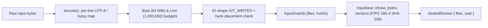
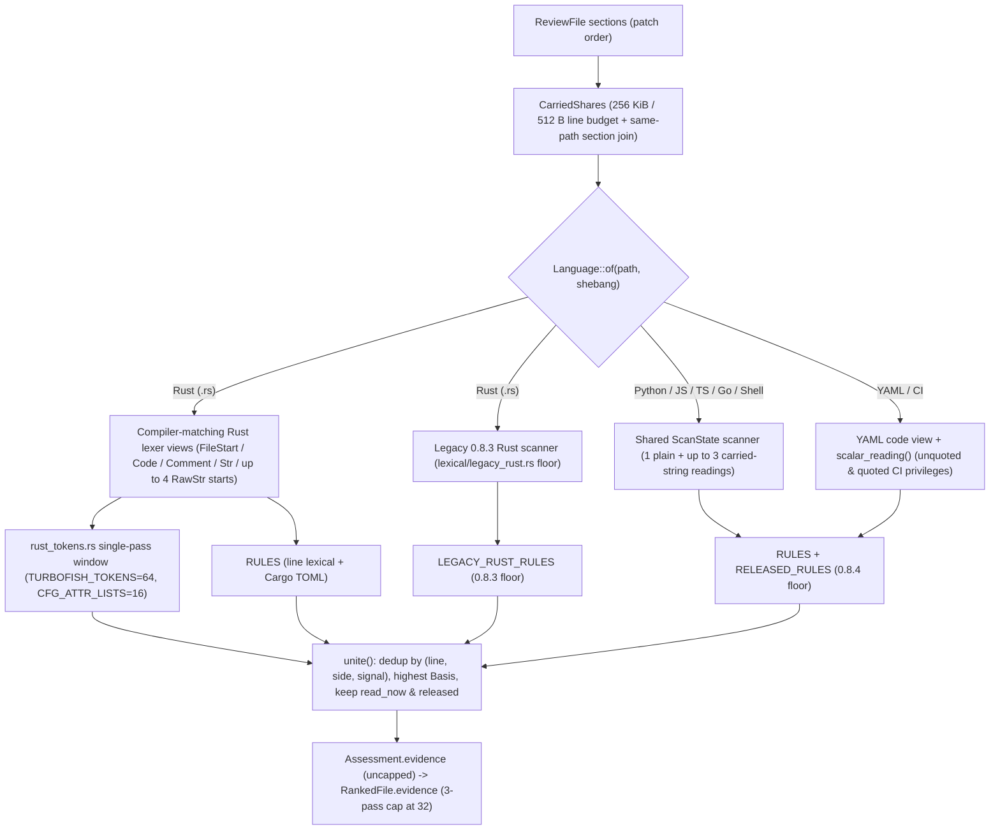
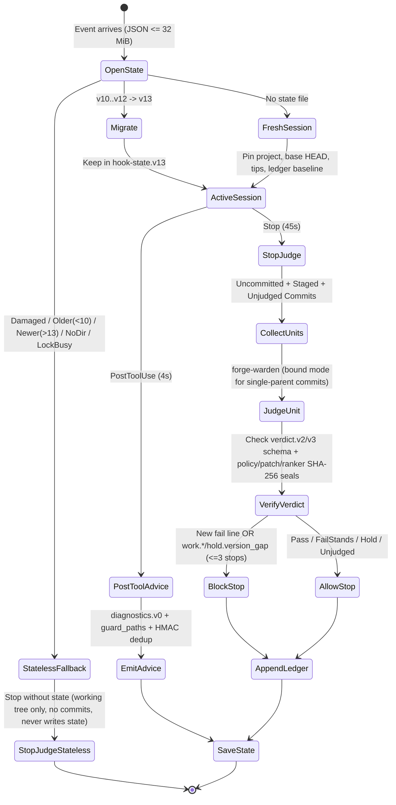
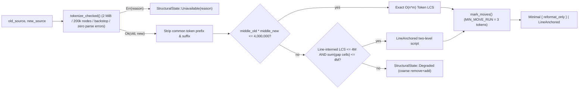

# Algorithms, Heuristics, and Execution Invariants (`v0.11.0`)

This document is the code-verified reference for every shipped algorithm, heuristic, scoring formula, parser grammar, state machine, and bounded-work invariant in Deep-Diff-Forge `v0.11.0` (`main`). Every constant, weight, threshold, and complexity bound below is taken directly from the Rust workspace sources (`Rust 2024`, MSRV `1.88`, `#![forbid(unsafe_code)]`).

> **Implementation status key**
> - **Shipped & wired**: live in the `deep-diff-forge` CLI, daemon (protocol 3), MCP server (9 tools), and Rust/Python SDKs.
> - **Library-implemented (unwired)**: implemented and unit-tested inside a workspace crate, not yet invoked by CLI commands or daemon RPCs.
> - **Design / withdrawn**: historical target designs or explicitly withdrawn surfaces (`chain`, `cluster`, `loom` subcommands).

Related references: [Risk ranking](reference/risk-ranking.md) · [Diagnostics](reference/diagnostics.md) · [Agent hooks](reference/agent-hooks.md) · [Output and exit codes](reference/output-and-exit-codes.md) · [Evaluation and benchmarks](reference/evaluation.md) · [Patch conformance](../crates/deep-diff-forge-patch/CONFORMANCE.md) · [Learning loop](LEARNING_LOOP.md) · [Performance and novelty](PERFORMANCE_AND_NOVELTY.md).

---

## 1. 42-Shape Strict Git Patch Conformance & `judge_patch`

**Status:** Shipped & wired (`crates/deep-diff-forge-patch/src/{lib,parser,guards,sealed,git_raw,git_acquire,judge_patch}.rs`, `crates/deep-diff-forge-core/src/seal.rs`).

### 1.1 Single Sealed-Ingestion Path & Budgets

Every surface (CLI, daemon, MCP, SDK) ingests untrusted patch bytes through `SealedReview::new` (`patch/src/sealed.rs`), enforcing one immutable pipeline: decode → parse → input guards → SHA-256 seal over the **exact original bytes** before any normalization.

| Guard / Constant | Source | Value | Failure Outcome |
| --- | --- | --- | --- |
| `DEFAULT_BYTE_BUDGET` | `patch/src/lib.rs` | `64 MiB` (`67,108,864` B) | `PatchParseError::BudgetExceeded` (exit `4`) |
| `DEFAULT_LINE_BUDGET` | `patch/src/lib.rs` | `1,000,000` physical lines | `PatchParseError::LineBudgetExceeded` (exit `4`) |
| `ERROR_EXCERPT_BYTES` | `patch/src/lib.rs` | `120` bytes | Bounds offending-line excerpts; `without_input()` omits patch text entirely on model-facing surfaces |
| `LossyHeader` | `patch/src/lib.rs` | Non-UTF-8 byte in any header/path/mode/hunk line | `PatchParseError::LossyHeader` (exit `3` `io`; non-UTF-8 hunk body lines are decoded lossily and marked per-line via `PatchLine::lossy` and `PatchTwin::lossy_lines`) |
| `InputGuards` | `patch/src/guards.rs` | No `Default` impl; explicit `{ files: bool, hunks: bool }` | Checked in order: `files` (`0 files`), then `hunks` (`has_reviewable_hunks`, requiring at least one `Added` or `Removed` line) → exit `7` |
| Empty / prose `--stdin-patch` | `cli/src/main.rs` | 0 sections without `--allow-empty` | Refused with exit `4` (`no_patch_in_input`), matching `git apply` |
| `InputSeal` | `core/src/seal.rs` | Pure-Rust FIPS 180-4 `sha256` / streaming `Sha256` (64-byte block buffer) + RFC 2104 `hmac_sha256` | Lowercase 64-hex `input_sha256` over raw bytes + `tool.name` / `tool.version` |

`PatchParseError` defines **21 `#[non_exhaustive]` variants**. Every variant maps to exit `4` (`invalid_input`) except `LossyHeader`, which maps to exit `3` (`io`), matching `GitAcquireError::NonUtf8Path`.

### 1.2 42-Shape `GIT_WRITES` Accept-List & Hunk Anchoring

DDF's conformance invariant (`CONFORMANCE.md`) is calibrated against Git 2.56 (`apply.c` and `diff.c`): for every patch DDF accepts, plain `git apply` in default configuration either refuses the whole patch (writing nothing) or writes the exact paths, types, modes, and line changes shown by DDF.

1. **42 accepted `diff --git` header shapes (`GIT_WRITES` in `patch/src/parser.rs`):**
   - **4 creation shapes** (`new file mode`, `index`, followed by `---/+++`, `Binary files`, `GIT binary patch`, or empty body).
   - **4 deletion shapes** (`deleted file mode`, `index`, followed by `---/+++`, `Binary files`, `GIT binary patch`, or empty body).
   - **5 metadata-only shapes without `index` or body** (mode change, pure rename, pure copy, and mode+rename/copy).
   - **5 metadata-only shapes with `index` and no body** (rename, copy, or mode change whose hunks were hidden by `-w`, `-b`, `-I`, or textconv).
   - **24 content shapes with `index` and body** (in-place modify, rename, copy, rewrite `-B` with `dissimilarity index`, with or without `old mode`/`new mode`, paired with `---/+++`, `Binary files`, or `GIT binary patch`).
   - **Optional omissions:** `Header::optional()` permits omitting `similarity index`, `dissimilarity index`, or `index` (`Index` / `IndexMode`), **except** a binary marker (`Binary files` / `GIT binary patch`) immediately after `diff --git` is always refused.
   - **Strict value grammar:** Only Git's four canonical modes (`GIT_MODES = ["100644", "100755", "120000", "160000"]`), `1..=64` lowercase hex digits in `index A..B`, `0..=100%` integer scores, LF-only binary markers (CR rejected), and `Files … differ` rejected (`HeaderNotWrittenByGit`).
2. **Unanchored `-U0` hunk refusal (`HunkPlacedElsewhere`):**
   - Plain `git apply` places any hunk lacking trailing context at EOF (`match_end`) and any hunk at old line `0` or `1` at BOF (`match_beginning`), without searching elsewhere.
   - DDF therefore refuses: (a) any hunk with `leading_context == 0 && trailing_context == 0 && old_start > 1`, and (b) any hunk following a hunk that had `trailing_context == 0` (except consecutive creation hunks starting at `old_start == 0 && old_count == 0`, which Git refuses whole).
   - DDF's own Git acquisition always forces `-U3` regardless of `diff.context`.
3. **Partial-write refusal (`GitCannotWrite`) & Path Reuse (`PathInSeveralSections`):**
   - Refuses symlinks whose target is empty, contains NUL, exceeds 4,095 bytes, or lives in a binary patch body, and refuses file/directory path collisions (including copy sources).
   - Refuses multi-section reuse of one path (`PathInSeveralSections`) **except** the two orders plain `git apply` executes sequentially: an in-place change after an earlier section that wrote the path, and `new file` after `deleted file` (type change). Same-section self-rename is refused.
   - Traditional `---`/`+++` diffs (`diff -u`) remain accepted; open creations (`@@ -0,0 +1,N @@` without `/dev/null`) are classified as `added` (`v0.11.0`), while open deletions stay `modified`.

### 1.3 Native Git Acquisition, `diff_suppressed` Re-Read, & `judge_patch`

- **Raw-to-Patch Pairing (`patch/src/git_raw.rs`):** Runs `git diff --raw -z --patch -U3 --binary --full-index --no-abbrev --no-textconv --src-prefix=a/ --dst-prefix=b/ --no-relative --submodule=short --ignore-submodules=dirty` with `--no-optional-locks -c core.quotePath=false -c core.hooksPath=/dev/null -c diff.external= -c core.fsmonitor=false`. Every NUL-delimited raw record is paired 1:1 with its `diff --git` block (2 blocks for `TypeChanged`); any count, mode, rename/copy, or object-ID mismatch fails closed with `CountMismatch` or `IdentityMismatch`. Non-UTF-8 paths fail with `NonUtf8Path`. All repository-defined (`local` / `worktree` / non-protected scope) `filter.<name>.{clean,smudge,process,required}` filters are neutralized via `GIT_CONFIG_*` env vars before diffing. Default timeout: `DEFAULT_GIT_TIME_LIMIT = 120 s`.
- **Binary Source Re-Read (`read_binary_again` in `patch/src/git_acquire.rs`, closing DDF-2026-006):**
  - Every change Git reports as binary is queried with `git check-attr -z diff` and re-read with `git diff --text` within the remaining byte and time budgets.
  - Causes (`DiffSuppression`): `attribute` (`-diff` or custom diff driver), `content` (NUL byte), `encoding` (UTF-16/UTF-32 detected via BOMs `\xff\xfe`, `\xfe\xff`, `\0\0\xfe\xff` or periodic 2/4-byte NUL alternation across lines ≥ 4 bytes in `wide_encoding`), or `unread` (budget/time cutoff or failed second reading).
  - **Stray-byte source re-read (`stray_text`):** When a NUL-triggered binary file's `--text` reading is not valid UTF-8 and not wide-encoded, DDF counts "odd bytes" (UTF-8 replacement chars or C0 controls excluding `\t`, `\r`, `\x0c`) across context and added lines. If `odd * 1024 <= STRAY_PER_KIB * shown` (`STRAY_PER_KIB = 128`, i.e., ≤ 12.5% odd bytes — measured binaries are 329–902/KiB vs 1.7–54/KiB for source files with up to 128 stray bytes), lossily decoded hunks are attached to `PatchTwin::stray_text` exclusively for code-evidence scanning without altering patch bytes. If evidence is found or the path has a known source language, `diff_suppressed` (+5) is raised.
- **Working-Tree `judge_patch` (`patch/src/judge_patch.rs`):** Produces byte-identical patches to `forge-warden`'s `make_patch.sh` without mutating the user's repository. Creates a bare scratch repo (`judge.git`) borrowing the object store via `objects/info/alternates` and copying `info/exclude` (cap `EXCLUDE_CAP = 1 MiB`), runs with `ISOLATED` env (`GIT_CONFIG_NOSYSTEM=1`, `GIT_CONFIG_GLOBAL=/dev/null`, `GIT_ATTR_NOSYSTEM=1`, `core.attributesFile=/dev/null`, `core.commitGraph=false`, `core.multiPackIndex=false`, carrying over only absolute `core.excludesFile`), excludes nested Git repositories (reporting them in `JudgePatch::nested`), refuses sparse `skip-worktree` indices (`INDEX_LISTING_CAP = 64 MiB`, `JudgePatchError::SkipWorktree`) and unmerged conflicts (`JudgePatchError::Unmerged`), and diffs with `--binary --no-renames --full-index --submodule=short --ignore-submodules=none`.

---

## 2. Dual-Reader Token & Lexical Code-View Engine

**Status:** Shipped & wired (`crates/deep-diff-forge-graph/src/{lexical.rs,lexical/legacy_rust.rs,rust_tokens.rs,evidence.rs,guard_paths.rs}`).

Code evidence reads only the patch lines (never external files) and reports findings with `basis: "lexical"` (single-line token) or `basis: "hunk"` (multi-line token sequence or handler within a hunk/section). **Tree-sitter was deliberately removed from the evidence path in `v0.9.0`–`v0.11.0`** because grammar/compiler divergences and super-linear error recovery (e.g., 8 KB of `&)` taking 15 s) could not be bounded reliably; `deep-diff-forge-graph` depends only on `deep-diff-forge-core` (not `syntax`).

### 2.1 Language Detection & Dual-Reader Architecture

- **Supported languages (`Language::of` in `graph/src/lexical.rs`):** `Rust` (`.rs`), `Python` (`.py`, `.pyi`), `JavaScript` (`.js`, `.mjs`, `.cjs`, `.jsx`, `.ts`, `.mts`, `.cts`, `.tsx`), `Go` (`.go`), `Shell` (`.sh`, `.bash`, `.zsh`, `.mk`, `Dockerfile`, `Dockerfile.*`, `Makefile`), `Yaml` (`.yml`, `.yaml`). Extensionless files fall back to line-1 shebang detection (`sh`, `bash`, `zsh`, `dash`, `ksh`, `python*`, `node`, `deno`, `bun`).
- **Non-Rust shared lexical scanner (`lexical.rs`):**
  - Blanks comments (`//`, `/* */`, `#`) and string contents while preserving executable interpolations (`$(…)`, `${…}`, backticks in shell `"…"`; `${…}` in JS template literals; `{…}` in single-line Python `f`/`t`-strings).
  - Carries block comments, Python triple quotes, JS regex/division context (`js_last`), and open top-level strings across lines in `ScanState` (`1` plain reading + up to `MORE_READINGS = 3` distinct carried-string readings = at most 4 active readings per line). Because the plain reading is never dropped, a misread quote cannot hide code found by a non-carrying scan.
- **Rust dual-reader + whole-side multi-start views (`lexical.rs`, `lexical/legacy_rust.rs`, `rust_tokens.rs`, `evidence.rs`):**
  1. **Compiler-matching Rust lexer (`lexical.rs` `rust` module):** Tracks nested `/* /* */ */` block comments, character/byte literals with arbitrary escapes, lifetimes/labels, raw strings (`r#"…"#`, `br#"…"#`, `cr#"…"#`), raw identifiers, and Unicode whitespace (`rust_white`: ASCII whitespace plus `U+0085`, `U+200E`, `U+200F`, `U+2028`, `U+2029`).
  2. **Multiple whole-side starts for fragments (`further_starts` in `evidence.rs`):** A Rust hunk side that does not provably begin at file line 1 is read from `Code`, plus: `FileStart` (if line 1 is a shebang), `Comment` (inside 1 block comment), `Str` (if the `Code` reading carries state across a line end), and up to `RAW_STARTS = 4` `RawStr(hashes)` readings chosen from strictly increasing `#`-count records after `"` (`quote_hash_records`). No two readings' bytes are ever mixed; their findings are merged via `unite()`.
  3. **Token-level Rust integrity reader (`rust_tokens.rs`):** Single-pass streaming tokenizer over each whole-side code view using a fixed sliding window (`TURBOFISH_TOKENS = 64`, `AHEAD = 72`, `BEHIND = 72`, `SLIDE = 1024`, `CFG_ATTR_LISTS = 16`, 49 recognized `WORDS`). Covers **9 `READ` signals**: `process_spawn`, `network_fetch`, `check_suppressed`, `test_removed` (old side only), `test_skipped`, `trivial_assert`, `stub_added`, `error_swallowed`, and `panic_path_added`. Accumulates directly into per-line `Found` slots (`OnLine = [Option<(Basis, bool, u8)>; 9]`) with zero sorting and bounded memory (eliminating a 97 MiB blowup on 16 MiB repeated lines).
  4. **Monotonic `v0.8.3` / `v0.8.4` floor (`legacy_rust.rs`, `LEGACY_RUST_RULES`, `RELEASED_RULES`):** Every Rust hunk is also scanned with the frozen `v0.8.3` scanner and rules, and every non-Rust hunk with `RELEASED_RULES`, marking items with `Evidence::released` and `Evidence::read_now`. Items found *only* by the legacy floor get `read_now = false` (`reading: "floor_only"`, `audience: "person"` in `diagnostics.v0`), guaranteeing no regression against released versions while preventing false agent advice.
- **Multi-section same-path merging & carried budget (`CarriedShares` in `evidence.rs`):**
  - Consecutive compatible sections naming the same path (creation → modify, modify → modify, delete → create → modify) are read together as one logical file so constructs split across sections are still detected, and each hit is attributed back to the section owning the line.
  - Multi-hunk created files and multi-section merges share a patch-wide carried-reading budget: `CARRIED_BYTES = 256 KiB` (`262,144` bytes) and `CARRIED_LINE_BYTES = 512` bytes per line. Past either bound, remaining hunks/sections are read individually in `O(n)`.

### 2.2 Linear-Time Security & DoS Guards

| Advisory / Issue | Mechanism & Source | Bound / Behavior |
| --- | --- | --- |
| **DDF-2026-003** (quadratic JS long-word DoS) | `ends_with_operand_keyword` (`lexical.rs`) | Bounds backward scan to `JS_OPERAND_KEYWORD_MAX + 1` bytes (`10 + 1 = 11` bytes, longest keyword `"instanceof"`). Turns 200,000-byte single-word line from ~18 s (`O(n²)`) to linear `O(n)`. |
| **DDF-2026-003** (quadratic repeated secret prefix) | `looks_like_secret` (`evidence.rs`) | Uses `.take(min).take_while(|b| ok(**b)).count()` instead of walking to the end of the run on each `match_indices(prefix)` hit. Prevents `xAKIAAKIA…` quadratic amplification (`O(n)`). |
| **DDF-2026-005** (quoted CI privilege bypass) | `scalar_reading` (`lexical.rs`) + `scalar_views` (`evidence.rs`) | Single-pass `O(n)` YAML pass unquoting simple single/double-quoted scalars and normalizing whitespace around `:` (`"contents": "write"` → `contents: write`, `'pull_request_target'` → `pull_request_target`), united with the raw YAML code view. |
| **DDF-2026-007** (GitLab & fine-grained GitHub tokens) | `SECRET_PREFIXES` (`evidence.rs`, 18 prefixes) | Scans raw added lines (including strings and comments) for PEM `-----BEGIN…PRIVATE KEY` plus 18 fixed-prefix credentials: `AKIA` (16), `ghp_`/`gho_`/`ghs_`/`ghu_`/`ghr_` (36), `xoxb-`/`xoxp-`/`xoxa-`/`xoxr-` (10), `sk_live_` (16), plus 0.10.0 additions `glpat-` (20), `gldt-` (20), `glrt-` (20), `glptt-` (40), `glcbt-` (20), `gloas-` (64), and `github_pat_` (82). Secret text is never copied into output. |
| Cargo TOML lint & build-hook scanning (`v0.11.0`) | `toml_strings` (`lexical.rs`), `Match::LintOff`, `Match::Builds` (`evidence.rs`) | Single-pass TOML string decoder (including `\uXXXX` / `\UXXXXXXXX` escapes) detecting `[lints]` allowances / `-A` flags (`check_suppressed`) and `build = …` / `proc-macro = true` (`build_hook`) in `Cargo.toml` and `.cargo/config[.toml]`. |

### 2.3 Integrity Signals (`v0.9.0`–`v0.11.0`)

| Signal | Rust (`rust_tokens.rs` / `RULES`) | Non-Rust (`RULES`) | Special Semantics |
| --- | --- | --- | --- |
| `test_skipped` | `#[ignore]`, `#[ignore = …]`, `#[ignore(…)]`, `#[cfg_attr(…, ignore)]`, `#[cfg(any())]`, `#[cfg(not(test))]`, `#![cfg(…)]` in test files/modules | Python `pytest.mark.skip*`/`xfail`/`pytest.skip(`/`unittest.skip*`/`self.skipTest(`; JS `it/test/describe.skip`/`skipIf`/`todo`/`xit`/`xtest`/`xdescribe`; Go `t.Skip*(` | `weakens_a_test() == true` (full weight even on test paths) |
| `trivial_assert` | `assert!(true)`, `debug_assert!(true)`, `assert_eq!(x, x)`, `assert!(1 == 1)`, `assert_ne!(1, 2)`, etc. (token-operand comparison; excludes same call both sides & `NAN`) | Python `assert True$` (statement-ended only), `self.assertTrue(True)`; JS `expect(true).toBe/toEqual(true)`, `assert(true)`, `assert.ok(true)` | `weakens_a_test() == true` (full weight on test paths) |
| `stub_added` | `todo!(…)`, `unimplemented!(…)` | Python `raise NotImplementedError` | Standard evidence (halved on test paths) |
| `error_swallowed` | `Err(_) => {}`, `Err(_) => ()`, `let _ = <std Result call>` | Go `_ = err`, empty `if err != nil {}`; Python `except…: pass/…`; JS empty `catch {}` / `.catch(() => {})` (`Match::EmptyHandler` reads next line → `Basis::Hunk`) | Standard evidence |
| `panic_path_added` | `.unwrap()`, `.expect(…)`, path-qualified `Result`/`Option::unwrap`/`expect`, `panic!(…)`, `unreachable!(…)` | None (Rust only; non-Rust forms declared as eval misses) | Carries `test_likely: bool` hint (never withdraws signal) and `PanicForms` case (`call` vs `panic_macro`) for tailored `diagnostics.v0` repairs |
| `diff_suppressed` | File-level `RiskSignal` (all languages) | File-level `RiskSignal` (all languages) | Weight `+5`; cause in `{attribute, content, encoding, unread}`; also triggered by `stray_text` on source paths or when stray text yields evidence |

### 2.4 Guard-File Classifier (`graph/src/guard_paths.rs`)

Matches whole path components (stripping empty and `.` components) to classify files that govern how code is judged or checked:

- **`Policy`**: matches the session's `--policy` path (`warden.toml` by default).
- **`GitAttributes`**: `.gitattributes` in any directory.
- **`CiWorkflow`**: `.gitlab-ci.yml`, `.circleci/config.yml` at repo top, or any file under `.github/workflows/`, `.forgejo/workflows/`, `.gitea/workflows/`.
- **`LintConfig`**: `clippy.toml`, `.clippy.toml`, `rustfmt.toml`, `.rustfmt.toml`, `deny.toml`, `ruff.toml`, `.ruff.toml`, `.flake8`, `.pylintrc`, `.eslintrc*`, `eslint.config.{js,mjs,cjs}`, `.golangci.{yml,yaml}` in any directory; `.pre-commit-config.yaml`, `.cargo/config[.toml]` at repo top.
- **`HookSettings`**: `.claude/settings.json`, `.claude/settings.local.json` at repo top.

---

## 3. 27-Signal Additive Risk Scoring & Canonical Ranking

**Status:** Shipped & wired (`crates/deep-diff-forge-graph/src/{vocabulary,risk,rank,lib}.rs`).

### 3.1 Exact Scoring Formula

Every `ReviewFile` receives a deterministic, additive integer score (`u32`) computed in `risk::assess_file_marked`:

$$\text{score}(f) = 1 + \text{source\_bonus}(f) + \sum_{s \in \text{path\_signals}(f)} w(s) + \sum_{e \in \text{distinct\_evidence}(f)} w_{\text{eff}}(e, f)$$

Where:
1. **Base weight:** Always `1` (no reviewable file ever scores `0`).
2. **Generated / vendored fast path (`is_generated_or_vendored`):** Matches path segments `vendor`, `node_modules`, `target`, `generated`, `dist`, or suffixes `.min.js`, `.pb.rs`, `.pb.go`. Emits `generated_or_vendored` (`+0`), withholds `source_bonus`, `public_api_surface`, `config_or_lockfile`, `large_change`, and `many_hunks`, **but preserves** `status_weight` (`new_file`/`deleted_file`/`binary_change`), `diff_suppressed`, `hazardous_text`, `mode_weight` (`symlink_change`/`executable_bit`), and **full-weight code evidence** (a path can never hide dangerous code).
3. **Primary-source bonus:** `+1` if not generated/vendored, not `is_test(path)`, and not `is_config_or_lockfile(path)`.
4. **Test-path evidence discounting (`is_test`):** Matches `/tests/`, `tests/` prefix, `/test/`, or basename containing `_test.` or `.test.`. For each distinct `EvidenceSignal` $e$:
   - If `e.weakens_a_test()` (`test_removed`, `test_skipped`, `trivial_assert`): $w_{\text{eff}} = w(e)$ (full weight).
   - Otherwise on a test path: $w_{\text{eff}} = \lceil w(e) / 2 \rceil$ (`weight().div_ceil(2)`).
   - Each signal adds its weight **at most once per file** regardless of occurrence count.

### 3.2 Complete 27-Signal Weight & Vocabulary Table

#### Path & Shape Signals (13 variants of `RiskSignal`, `PATH_SIGNALS`)

| # | Label | Class | Weight | Trigger Rule |
| ---: | --- | --- | ---: | --- |
| 1 | `public_api_surface` | `shape` | `5` | Basename `lib.rs` or `mod.rs`, or path contains `/api/` (withheld if generated/vendored) |
| 2 | `new_file` | `shape` | `2` | `FileStatus::Added` or binary section with `new file mode ` header |
| 3 | `deleted_file` | `shape` | `3` | `FileStatus::Deleted` or binary section with `deleted file mode ` header |
| 4 | `binary_change` | `shape` | `1` | `patch_twin.is_binary()` |
| 5 | `diff_suppressed` | `security` | `5` | `patch_twin.diff_suppressed.is_some()` or `stray_text` with evidence or known source language |
| 6 | `large_change` | `shape` | `3` | `added + removed >= LARGE_CHANGE_LINES` (`80`) (withheld if generated/vendored) |
| 7 | `many_hunks` | `shape` | `2` | `hunks.len() >= MANY_HUNKS` (`5`) (withheld if generated/vendored) |
| 8 | `config_or_lockfile` | `shape` | `1` | Basename in `Cargo.{toml,lock}`, `package.json`, `package-lock.json`, `deny.toml`, `rustfmt.toml`, or ext in `toml`, `yaml`, `yml`, `ini`, `cfg`, `lock` (not test/generated) |
| 9 | `test_only` | `shape` | `0` | `is_test(path)` (withholds primary-source bonus) |
| 10 | `generated_or_vendored` | `shape` | `0` | `is_generated_or_vendored(path)` (withholds source/path/size bonuses) |
| 11 | `hazardous_text` | `security` | `3` | Bidi control, invisible, or control char in path or changed (`Added`/`Removed`) line, or path traversal / `.git` component (checked on `file.path`, `rename from`, `copy from`) |
| 12 | `symlink_change` | `security` | `3` | Old or new mode has file-type bits `0o120_000` |
| 13 | `executable_bit` | `security` | `2` | New mode is regular (`0o100_000`) with `0o111` execute bit set, while old mode was not |

#### Code-Evidence Signals (14 variants of `EvidenceSignal`, `EvidenceSignal::ALL`)

| # | Label | Class | Weight | Test-Path Weight | Sides | Basis |
| ---: | --- | --- | ---: | ---: | --- | --- |
| 14 | `unsafe_added` | `security` | `4` | `2` | `new` | `lexical` |
| 15 | `process_spawn` | `security` | `4` | `2` | `new` | `lexical`, `hunk` |
| 16 | `network_fetch` | `security` | `3` | `2` | `new` | `lexical`, `hunk` |
| 17 | `dynamic_eval` | `security` | `4` | `2` | `new` | `lexical` |
| 18 | `ci_privilege` | `security` | `4` | `2` | `new` | `lexical` |
| 19 | `build_hook` | `security` | `3` | `2` | `new` | `lexical` |
| 20 | `secret_like` | `security` | `5` | `3` | `new` | `lexical` |
| 21 | `check_suppressed` | `integrity` | `2` | `1` | `new` | `lexical`, `hunk` |
| 22 | `test_removed` | `integrity` | `3` | `3` (full) | `old` | `lexical`, `hunk` |
| 23 | `test_skipped` | `integrity` | `3` | `3` (full) | `new` | `lexical`, `hunk` |
| 24 | `trivial_assert` | `integrity` | `3` | `3` (full) | `new` | `lexical`, `hunk` |
| 25 | `stub_added` | `integrity` | `3` | `2` | `new` | `lexical`, `hunk` |
| 26 | `error_swallowed` | `integrity` | `3` | `2` | `new` | `lexical`, `hunk` |
| 27 | `panic_path_added` | `integrity` | `3` | `2` | `new` | `lexical`, `hunk` |

### 3.3 Ranking Order, 3-Pass Evidence Cap, & `tool.scorer_sha256`

- **Deterministic tie-breaker (`rank::sort_ranked`):** Descending `score`, then ascending lexicographical `path` (`b.score.cmp(&a.score).then_with(|| a.path.cmp(&b.path))`).
- **3-Pass Bounded Evidence List (`rank::listed`, `MAX_EVIDENCE_PER_FILE = 32`):** Scores and `signals[]` always reflect **all** uncapped evidence. When a file has `> 32` items, `evidence_truncated = true` and `32` items are selected while preserving file order:
  1. First, all `Evidence::released` items (matching `v0.8.3` output so newer signals never evict previously reported items).
  2. Second, the first occurrence of each remaining unrepresented `EvidenceSignal`, ordered by descending `EvidenceSignal::weight()` then `EvidenceSignal::ALL` order (so 40 panic paths cannot hide 1 stub).
  3. Third, remaining items in file order until 32 slots are filled.
- **Canonical `rank.v0` & `tool.scorer_sha256` (`graph/src/lib.rs`):** One renderer (`RankDocument::to_json`) emits canonical 2-space indented JSON shared byte-for-byte by CLI, daemon (`diff.rank`), `rpc`, and MCP (`rank_patch`). `tool.scorer_sha256` is computed at compile time by `graph/build.rs` as the SHA-256 of every `.rs` source file under `crates/deep-diff-forge-graph/src/` except `lib.rs` (LF-normalized, framed as `<rel_path>\0<byte_len>\0<bytes>` in sorted order), ensuring any change to weights, rules, secret prefixes, or readers moves the scorer digest.

---

## 4. Diagnostics Engine & Byte-Exact Paging

**Status:** Shipped & wired (`crates/deep-diff-forge-graph/src/diagnostics.rs`, `crates/deep-diff-forge-daemon/src/{pages,views}.rs`, `crates/deep-diff-forge-cli/src/fail_on.rs`).

### 4.1 `diagnostics.v0` Taxonomy, Keys, & Case-Filtered Repairs

Built purely from `rank.v0` (never echoing changed-line text; paths are escaped with `safe()` turning bidi/invisible/control characters into `\uXXXX`):

- **42 pinned codes (`fixtures/diagnostics/codes.v0.txt`, `code_of`):** Every signal has `<label>@file` (27 codes); all 14 `EvidenceSignal`s plus `hazardous_text` also have `<label>@line` (15 codes) → `27 + 15 = 42` codes.
- **Per-file emission order:** (1) `@line` diagnostics for `file.evidence`, (2) `hazardous_text@line` for up to `MAX_EVIDENCE_PER_FILE - file.evidence.len()` hazardous lines (recording truncated files in `cut[]` with `rows_kept`), (3) `@file` diagnostics for every signal in `file.signals` not already located by a line diagnostic.
- **Deterministic diagnostic key:**
  $$\text{key} = \text{SHA-256}(\texttt{"ddf-diagnostic-v0\textbackslash 0"} \mathbin{\|} \text{input\_sha256} \mathbin{\|} \texttt{\textbackslash 0} \mathbin{\|} \text{path} \mathbin{\|} \texttt{\textbackslash 0} \mathbin{\|} \text{label} \mathbin{\|} \texttt{\textbackslash 0} \mathbin{\|} \text{anchor} \mathbin{\|} \texttt{\textbackslash 0} \mathbin{\|} \text{side} \mathbin{\|} \texttt{\textbackslash 0} \mathbin{\|} \text{line} \mathbin{\|} \texttt{\textbackslash 0} \mathbin{\|} \text{occurrence})$$
  where `occurrence` (`0, 1, …`) disambiguates identical `(path, label, anchor, side, line)` rows (e.g., across multiple sections of one path).
- **Audience & case-filtered repairs:** Diagnostics with `current == true` emit `reading: "current"`, `audience: "agent"`, and populate `repairs[]` / `not_accepted[]` (only witness-backed agent entries) filtered by `Remedy::answers(id, case)` for multi-case signals:
  - `hazardous_text`: `bidi_control`, `invisible`, `control`, `path_traversal`, `git_internal`.
  - `diff_suppressed`: `attribute`, `content`, `encoding`, `unread`.
  - `panic_path_added@line`: `call` (`unwrap`/`expect`), `panic_macro` (`panic!`/`unreachable!`), plus `test_likely: bool`.
  - `floor_only` items emit `audience: "person"` with empty `repairs` and `not_accepted`.
- **`--fail-on LIST` gating (`cli/src/fail_on.rs`):** Accepts comma-separated classes (`security`, `integrity`, `shape`) or any of the 27 signal labels (unknown/empty tokens exit `2`). Evaluates against `RankedFile::signals` (never the capped `evidence[]`) and `evidence_truncated` **before** printing the document, naming up to `FILES_NAMED = 32` files per reason (`cli/src/fail_on.rs`) and queuing exit `7` (`fail_on_label`, `fail_on_truncated`) through the unified refusal door (`cli/src/refusal.rs`).

### 4.2 Byte-Exact Paging & View Projection

| Surface / Module | Budget Bounds | Cursor & Framing Mechanism |
| --- | --- | --- |
| `diff.diagnostics` (`daemon/src/pages.rs`) | `MIN_PAGE_BYTES = 4,096` to `MAX_MAX_BYTES = 16 MiB` (`HEADER_BOUND = 960` B) | Builds canonical `diagnostics.v0` once, measures exact emitted byte size after `json_line_safe` + `escape_hidden` (escaping bidi/invisible chars), packs whole diagnostics + first-occurrence `cut` entries + deduplicated `texts` entries strictly within `max_bytes`. Cursor format: `dg0.<input_sha256[..16]>.<scorer_sha256[..16]>.<index>` (rejects mismatched patch, engine, or non-canonical index). Every page carries `page.document_sha256`. |
| `review.outline` & `review.hunks` (`daemon/src/views.rs`) | `MIN_MAX_BYTES = 1,024`, `DEFAULT_MAX_BYTES = 64 KiB`, `MAX_MAX_BYTES = 16 MiB`; `ENVELOPE_BYTES = 512`; `SECTION_VIEW_BYTES = 256`; `ECHO_BYTES = 1,024` | Lazy per-file `OnceCell` `Scans` cache ensures each file is scored at most once per request. Hunks larger than one page split at whole-line boundaries, never mid-line. |
| Wrapper re-encoding fit (`views::fit_emitted`) | Up to `FIT_ATTEMPTS = 8` iterations | Starts at `inner = (max_bytes / copies.max(1)).clamp(MIN_MAX_BYTES, max_bytes)`. If the wrapped/pretty-printed output exceeds `max_bytes`, shrinks `inner = min(inner * max_bytes / size, inner - inner / 4).max(MIN_MAX_BYTES)` so CLI/MCP wrappers honor `--max-bytes` strictly. |

---

## 5. Agent Hook State Machine (`v13`), Keyed History, & Project Frontier Ledger

**Status:** Shipped & wired (`crates/deep-diff-forge-cli/src/{hook,hook_run,ledger,verdict_v2,reason,agent_check,doctor,refusal}.rs`, `crates/deep-diff-forge-core/src/{seal,exit}.rs`).

### 5.1 Lifecycle, Deadlines, & Never-Fail-Client Invariant

`deep-diff-forge agent hook <session-start|post-tool|stop> --client claude` always exits `0` (never exit `2`, which Claude Code treats as a stop block on usage errors). Every hook shares a single monotonic `Deadline` across all Git, hashing, and judge subprocesses:

| Event | Shared Deadline | Input / Memory Caps | Behavior |
| --- | --- | --- | --- |
| `SessionStart` | `START_LIMIT = 8 s` | `INPUT_CAP = 32 MiB` (drains up to `INPUT_DROPPED = 1 GiB`) | Pins project root, base commit (`HEAD`), initial named tips, and records project baseline / `start` in the ledger. |
| `PostToolUse` | `ADVICE_LIMIT = 4 s` | `REPORTED_CAP = 5,000`, `GUARDS_CAP = 64`, `NOTICED_CAP = 32`, `MAX_FINDINGS = 20`, `GUARDS_SHOWN = 8`, `PATH_SHOWN = 120`, `MESSAGE_CAP = 6,000` chars | Runs `diagnostics.v0` + `guard_paths::guard_file` on working tree vs base; emits fresh agent-audience findings and guard-file notices without repeating changed-line text. |
| `Stop` | `STOP_LIMIT = 45 s` (`STOP_TIMEOUT_NEEDED = 50 s`; judge cap `JUDGE_TIME = 30 s`, stdout `4 MiB`, stderr `64 KiB`) | `BLOCKED_CAP = 2,048`, `RANKERS_TRIED = 8` | Judges every unit (uncommitted tree, staged tree, and unjudged single-parent commits in the session/frontier) via `forge-warden`, verifying `verdict.v2`/`v3` seals and blocking only on new failures or first-occurrence `work.*`/`hold.version_gap` causes (capped at 3 stops). |
| `agent doctor --gate` | `GATE_LIMIT = 120 s` | — | End-to-end gate check including `diagnostics_parity` between hook advice and `diagnostics.v0`. |

### 5.2 Strict `hook-state.v13` Schema, Migrations, & RFC 2104 Keyed History

- **Schema window (`hook_run.rs`):** Current `STATE_SCHEMA = "deep-diff-forge.hook-state.v13"` (`STATE_OWN = 13`), minimum accepted `STATE_FLOOR = 10` (`v0.9.0`–`v0.10.0`). Strict non-destructive policy:
  - `v10 → v11` (`from_v10`): identical structure (v11 adds structured one-shot hold lines in `blocked`).
  - `v11 → v12` (`from_v11`): clears `reported`, `noticed`, `blocked` and resets `key_id = ""` because unkeyed digests cannot be converted to HMAC-SHA-256 without original text (fails safe: may re-notify/re-block, never suppresses).
  - `v12 → v13` (`from_v12`): initializes `guards = []` for guard-file change tracking.
  - Schemas `< 10` (`StateOlder`), `> 13` (`StateNewer`), or corrupt JSON (`StateDamaged`) are **never overwritten**; a `Stop` hook falls back to **stateless judging** (`Session::in_memory`, `Tips::Stateless`), judging the current working tree against `HEAD` without reading/writing state or judging commits.
- **HMAC-SHA-256 Keyed History (`hook.rs`, `core/src/seal.rs`):**
  - Every remembered digest (`finding`, failing line, noticed reason, guard-file change) is computed as `HMAC-SHA-256(key_32B, tag || 0x00 || bytes)` where `key_32B` is stored in a user-private key file in the hook state dir (`$XDG_STATE_HOME/deep-diff-forge/hooks` or `~/.local/state/deep-diff-forge/hooks`) and identified by `key_id = sha256("ddf-hook-key\0" || key)[..16]`.
  - A leaked state file without the key cannot confirm guessed source lines, rules, or paths.

### 5.3 Single-Parent Commit Bound-Mode Judging, Verdict Validation, & Project Ledger

- **Bound-Mode Commit Judging (`hook_run.rs`):** When the judge (`forge-warden`) supports `--repo` (probed once via `takes_bound_mode`), each single-parent commit is judged in bound mode (`--repo <git_common_dir> --base <parent> --head <commit>`) so the judge generates its own diff directly from the repository object store. `claims_of` verifies `seals.claims.verified == true` and exact `base`/`head` match.
- **Strict Verdict Verification (`cli/src/verdict_v2.rs`):** Validates both `forge-warden.verdict.v2` and `forge-warden.verdict.v3` member-by-member: `verdict`/`exit` triple consistency (`pass`/0, `fail`/7, `hold`/8), all 64-hex SHA-256 seals (`policy_sha256`, `rank_sha256`, `patch_sha256`, `ranked_by.sha256`, `git`), v3 `builtin:<rule-id>` unwaivable holds, violation citations, and summary counts.
- **Project Frontier Ledger (`cli/src/ledger.rs`):**
  - Stored at `<git-common-dir>/deep-diff-forge/ledger.jsonl` (`VERSION = 1`, `O_APPEND | O_NOFOLLOW | O_NONBLOCK`, mode `0600`, exclusive `flock`). Never stores patch text or judge prose — uncommitted/staged tree digests are salted with a 32-byte random `ledger.salt` (`sha256(salt || "\0tree\0" || patch_sha256)[..32]`).
  - Record kinds: `baseline` (up to `BASELINE_TIPS = 100,000` initial commit tips + `tips_sha256`), `start` (session start tree + base), `check` (`agent check --session` runs), and `stop` (per-unit outcome, one of **50 `ReasonClass` codes** in `cli/src/reason.rs`, seals, `blocked_turns`, and `agent_checks` count read from the last `TAIL = 1 MiB`).
  - `agent verify-branch BASE..HEAD` reads up to `WHOLE = 64 MiB` of the ledger and verifies every commit in the range has a `pass` or clearance record, else exits `7` (`branch_unverified`).
- **Unified Exit-7 Reason-Class Registry (`core/src/exit.rs`, `cli/src/refusal.rs`):** All **11 engine exit-7 refusal classes** (`require_files`, `require_hunks`, `require_findings`, `require_all`, `eval_failed`, `chain_not_ready`, `fail_on_label`, `fail_on_truncated`, `require_pass_no_unit`, `require_pass_not_pass`, `branch_unverified`) print `refused: <text> (<tag>)` on stderr (no input text) and preserve exit `7` even when a downstream reader closes stdout early (closing DDF-2026-010/011).

---

## 6. Budgeted Syntax Analysis & Token-Level Structural Diff

**Status:** Shipped & wired for `semantic`, `highlight`, `structural`, and `analyze` subcommands (`crates/deep-diff-forge-syntax/src/{lib,analyze,highlight,language,structural}.rs`). Not used by `graph` risk/evidence scoring.

### 6.1 Tree-Sitter Rust Parser & Multi-Dimensional Budgets

Only `Language::Rust` (`tree-sitter-rust`) has a compiled grammar; all other languages return `FallbackReason::UnsupportedLanguage`. Three independent guards bound every parse:

1. **Pre-parse byte budget:** `DEFAULT_BYTE_BUDGET = 2 MiB` (`2,097,152` bytes) → `FallbackReason::ByteBudgetExceeded`.
2. **Cooperative wall-clock backstop (`backstop_for` in `syntax/src/lib.rs`):**
   $$\text{deadline}(B) = 1\text{ s} + 5\text{ ms} \times \lfloor B / 1024 \rfloor$$
   Checked via tree-sitter's `progress_callback` (`ControlFlow::Break`) → `FallbackReason::TimeBudgetExceeded`. Ordinary Rust parses at ~`0.29 ms/KiB` in release builds (~17× headroom); a hostile 455 KiB token soup that ran 125 s is cut at ~3 s.
3. **Post-parse node budget:** `DEFAULT_NODE_BUDGET = 200,000` nodes (`root.descendant_count()` in `analyze.rs`, iterative stack count in `structural.rs`) → `FallbackReason::NodeBudgetExceeded`. Error counting (`count_errors`) and leaf tokenization use iterative traversals (`TreeCursor` / explicit stack) so deep trees cannot overflow the call stack.

**Top-level symbol extraction (`analyze::extract_symbols`):** Maps direct named children of the root node across 11 Rust item kinds (`function`, `struct`, `enum`, `trait`, `impl`, `module`, `const`, `static`, `type`, `union`, `macro`) with byte and 1-based line spans; `enclosing_symbol` selects the smallest enclosing span.

### 6.2 Token-Level Structural Diff (`syntax/src/structural.rs`)

Compares tree-sitter leaf token streams (dropping layout whitespace while keeping comments — with line-ending/trailing-space normalization via `comment_token` — and string/raw-string literals as whole atomic tokens so rewritten `// SAFETY:` comments or whitespace inside literals never falsely report `reformat_only`).

- **State machine (`StructuralState`):** `Unavailable(FallbackReason)` | `Degraded` | `LineAnchored` | `Minimal { reformat_only: bool }`. Never turns a failed or degraded parse into `reformat_only: true`.
- **Two-level budgeted LCS (`LCS_CELL_BUDGET = 4,000,000`):** Strips common prefix/suffix first; runs exact DP if `(old_mid * new_mid) <= 4,000,000`; otherwise interns lines by their token vectors, runs line-level LCS (`<= 4,000,000` cells) to find anchor lines, and runs token LCS on each gap while cumulative `spent <= 4,000,000` (total DP work strictly ≤ `2 × LCS_CELL_BUDGET`). Falls back to `coarse_diff` (`Degraded`) if exceeded.
- **Linear-time moved-block detection (`mark_moves`, `MIN_MOVE_RUN = 3`):** Indexes contiguous insert runs of length `≥ 3` tokens in a `HashMap<Vec<&str>, VecDeque<(usize, usize)>>` and matches each contiguous delete run of length `≥ 3` against the earliest unused identical insert run in `O(runs)` time, reclassifying both runs as `ChangeKind::Moved`.

---

## 7. Bounded Parallel Cluster Sharding

**Status:** Shipped & wired behind `--cluster [--parallel serial|auto|N]` (`crates/deep-diff-forge-cluster/src/{cluster,scheduler}.rs`). Top-level `cluster` subcommand is withdrawn (exit `2`).

1. **Worker bound (`scheduler::resolve_workers`):**
   - `Parallelism::Serial` → `1`
   - `Parallelism::Auto` → `available_parallelism()` (fallback `1`)
   - `Parallelism::Fixed(n)` → `n.min(cpu_count * MAX_FIXED_WORKERS_CPU_MULTIPLE).max(1)` where `MAX_FIXED_WORKERS_CPU_MULTIPLE = 4` (prevents `--parallel 65535` thread explosion).
   - Always clamped to `1..=items.max(1)`.
2. **Balanced contiguous sharding (`contiguous_chunks`):** Splits `n` files across `w` workers into contiguous index ranges of size `⌊n/w⌋ + 1` (first `n % w` workers) and `⌊n/w⌋` (remaining workers).
3. **Pre-computed patch shares & deterministic join (`run_risk_cluster`):**
   - Computes `CarriedShares::of(files)` once on the main thread before spawning workers so cross-section/carried-reading budgets never depend on shard boundaries.
   - Spawns scoped OS threads via `std::thread::scope` (no `rayon` or `tokio`), scoring each chunk with `RankedFile::scored_in_patch`. A panicking worker re-propagates via `std::panic::resume_unwind` (never silently returning a truncated review).
   - Flattens chunks in input order and applies `apply_join`: `RankedReviewOrder` sorts by descending score then ascending path (`sort_ranked`), yielding bit-identical output for every worker count (`serial`, `auto`, `fixed:N`). `DeterministicInputOrder` and `AsReadyWithStableIds` preserve input order in the batch scheduler.
   - Emits `ClusterReceipt` (`dimensions: ["patch", "risk"]`, `parallelism`, `join_policy`, `file_count`, `worker_count`).

---

## 8. Local Learning Algorithms & Privacy Controls

**Status:** Split between **shipped & wired** (`learn record --stdin`, `learn status [--json]`, TUI `learning` palette) and **library-implemented (unwired)** learners in `crates/deep-diff-forge-learning/src/*.rs`.

### 8.1 Pseudonymous Identity & Hardened Local Receipt Store (Shipped & Wired)

- **FNV-1a `RedactedId` (`learning/src/util.rs`):** 64-bit FNV-1a (`FNV_OFFSET = 0xcbf2_9ce4_8422_2325`, `FNV_PRIME = 0x0000_0100_0000_01b3`) formatted as 16 lowercase hex chars. `RedactedId` validates `16..=64` lowercase hex characters at deserialization (`TryFrom<String>`), making it structurally impossible for `StrategyReceipt` to hold a file path. Because FNV-1a is unkeyed and not one-way against dictionary guesses, confidentiality rests on owner-only filesystem permissions.
- **Storage & Validation (`learning/src/store.rs`, `receipt.rs`):**
  - Path: `$XDG_STATE_HOME/deep-diff-forge/learning/receipts/strategy.jsonl` (else `$HOME/.local/state/…`; empty or relative env vars are ignored per XDG spec).
  - Security: Directories enforced `0700`, regular non-symlink files enforced `0600`, effective UID + `(dev, ino)` verified between `lstat` and open to close TOCTOU swap windows.
  - Budgets: `MAX_RECEIPTS_BYTES = 64 MiB`, `MAX_RECEIPT_LINE_BYTES = 1 MiB`, `MAX_RECEIPTS = 100,000`.
  - Validation (`validate_receipt_for_storage`): `language` (`1..=64` B) and `parser_version` (`1..=128` B) restricted to `[A-Za-z0-9._-+@]`; `outcome == Revisited && !revisited` refused; `from_stored_json` refuses any extra JSON key on load (e.g., hand-edited `"path"`). Missing newline at EOF is repaired before append.

### 8.2 Strategy Scoring & `TrustPolicy` (Shipped & Wired via `learn status`)

For each strategy $s \in \{\texttt{patch}, \texttt{syntax}, \texttt{hybrid}\}$ over $N$ receipts (`learning/src/score.rs`):

- $\text{acceptance\_rate} = \text{accepted} / \text{decided}$ (where $\text{decided} = \text{accepted} + \text{rejected}$; `0.0` if $\text{decided} = 0$)
- $\text{helpful\_rate} = |\{r : r.\text{outcome} = \text{Accepted} \land \neg r.\text{revisited}\}| / N$
- $\text{fallback\_rate} = |\{r : r.\text{fallback}.\text{is\_some}()\}| / N$
- $\text{revisit\_rate} = |\{r : r.\text{revisited}\}| / N$
- $\text{cache\_hit\_rate} = |\{r : r.\text{cache} = \text{Hit}\}| / N$
- $\text{mean\_elapsed\_ms} = (\text{saturating\_sum}(r.\text{elapsed\_ms})) / N$

A strategy earns trust (`earns_trust`) iff all six `TrustPolicy::default()` bars hold (note `min_samples.max(1)` prevents zero-sample trust even under lenient policies):

| Threshold | Default | Condition |
| --- | ---: | --- |
| `min_samples` | `20` | `samples >= min_samples.max(1)` |
| `min_acceptance_rate` | `0.70` | `acceptance_rate >= 0.70` |
| `min_helpful_rate` | `0.50` | `helpful_rate >= 0.50` |
| `max_fallback_rate` | `0.30` | `fallback_rate <= 0.30` |
| `max_revisit_rate` | `0.25` | `revisit_rate <= 0.25` |
| `max_mean_elapsed_ms` | `250.0` | `mean_elapsed_ms <= 250.0` |

`best_trusted` selects the trusted strategy maximizing `helpful_rate`, breaking ties toward lower `mean_elapsed_ms`, then `Strategy::all()` order.

### 8.3 Library-Implemented Learners & Promotion Gate (Not Yet Wired into CLI/Daemon)

The following algorithms are implemented and unit-tested in `deep-diff-forge-learning`, but **no CLI command or daemon method calls them in `v0.11.0`** (learned outputs do not alter engine defaults):

1. **`PlannerLearner` (`learning/src/planner.rs`):**
   - Inputs: `PlannerObservation { file_bytes, language, diff_lines, generated_or_vendor, previous_fallback, semantic_usefulness (0..=100) }`.
   - Constants: `LARGE_FILE_BYTES = 256 KiB`, `USEFUL_SEMANTIC = 70`. Budget profiles: `Lean` (`5,000` nodes), `Standard` (`20,000` nodes), `Generous` (`80,000` nodes).
   - Hard overrides (regardless of learned `trusted_default`): `generated_or_vendor` → `(Patch, Lean, cache_priority=5)`; prior `ByteBudget`/`NodeBudget`/`TimeBudget` fallback → `(Patch, Lean, cache_priority=20)`.
   - Otherwise: budget is `Standard` (`file_bytes >= 256 KiB` & useful ≥ 70), `Lean` (`>= 256 KiB` & `< 70`), `Generous` (`< 256 KiB` & `>= 70`), or `Standard` (`< 256 KiB` & `< 70`). Strategy is `trusted_default.unwrap_or(if useful >= 70 { Syntax } else { Hybrid })`. `cache_priority = (diff_lines / 10).min(90).max(30)`.
2. **`RankingWeights::fit_weights` (`learning/src/ranking.rs`):**
   - Supervision target: `realized_risk = caused_fix || correlated_test_failure`. Wide fan-out threshold: `WIDE_FANOUT = 5` (`dependency_fanout > 5`).
   - Fits empirical conditional probabilities $w_k = \text{clamp}(P(\text{realized\_risk} \mid k), 0, 1)$ for $k \in \{\texttt{revisited}, \texttt{public\_api\_touch}, \texttt{wide\_fanout}\}$, keeping neutral prior `0.5` for any signal absent from observations.
   - `score(obs)` averages the learned weights of signals present (`0.0` if none fire); `needs_human_first(obs, threshold)` checks `score(obs) >= threshold`.
3. **`AnnotationTrust::fit_trust` (`learning/src/annotation.rs`):**
   - `is_clean_win = (evidence_spans > 0) && accepted && !contradicted && !reviewer_override`.
   - $\text{source\_quality} = \text{clamp}(\text{clean\_wins}/N - \text{contradictions}/N, 0.0, 1.0)$.
   - Tier thresholds (`MIN_GROUNDED_WINS = 3`, `PROVISIONAL_QUALITY = 0.50`, `TRUSTED_QUALITY = 0.80`): `< 3` clean wins → `Untrusted` (prominence `10`); else `>= 0.80` → `Trusted` (`90`); else `>= 0.50` → `Provisional` (`50`); else `Untrusted` (`10`). Structurally enforces *untrusted until grounded*.
4. **`evaluate_promotion` & `PromotionPolicy` (`learning/src/promote.rs`):**
   - Defaults: `max_benchmark_regression = 0.05` (5%), `max_fallback_rate_delta = 0.01` (+1 percentage point), `min_supporting_receipts = 50`.
   - Fails closed on any non-finite (`NaN`/`±∞`) metric or negative policy tolerance, then accumulates **all** blocking reasons without short-circuiting across: unintended corpus regression (`corpus_regression_delta > 0 && !regressions_intentional`), benchmark regression budget, fallback-rate delta budget, `ranking_improvement_supported`, `supporting_receipts`, and `human_inspectable`. Promotes iff `blocking_reasons.is_empty()`.
