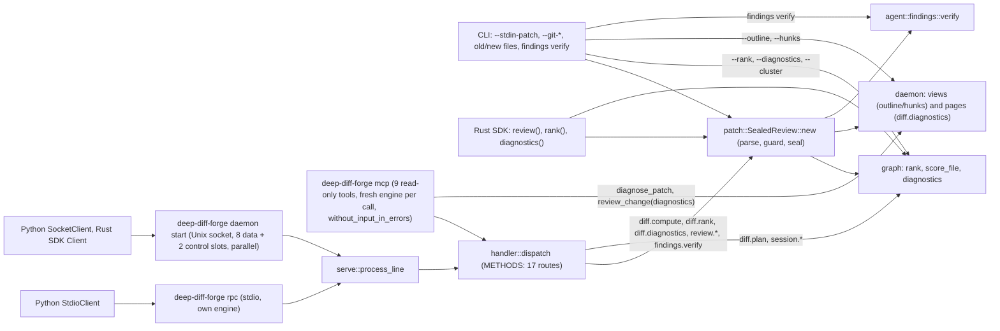

# API And IPC Schematic

This document maps the library crates, the command surface, the JSON-RPC
methods, the MCP tools, the SDKs, filesystem state and the Unix-domain socket
locations. Each section states whether it describes what ships in `v0.11.0` or
a planned design.

## Status (v0.11.0)

- **Ships in `v0.11.0`:**
  - The CLI (`deep-diff-forge`), including `--stdin-patch`, structured Git
    selections (`--git-working-tree`, `--git-staged`, `--git-range A..B`),
    direct two-file comparison (`deep-diff-forge <old> <new>`), `--diagnostics`,
    `--rank`, `--outline`, `--hunks`, `--fail-on LIST`, `findings verify`,
    `agent {setup,doctor,check,verify-branch,hook}`, `bench`, `eval`,
    `envelope`, `schema`, `explain`, `review`, `council`, `learn` and `deploy`.
  - The optional Unix-socket daemon (`deep-diff-forge daemon`) speaking
    newline-delimited JSON-RPC 2.0, **engine protocol 3** (`PROTOCOL_VERSION = 3`;
    protocols 0, 1 and 2 still negotiate), with **17 JSON-RPC methods**.
  - `deep-diff-forge rpc` (the same 17-method protocol over stdio, no daemon).
  - `deep-diff-forge mcp` (a dual-era read-only MCP stdio server exposing
    **9 read-only tools** with unified invisible-character escaping and
    parse failures that never echo patch text).
  - The Rust SDK crate `deep-diff-forge-sdk` and the zero-dependency Python SDK
    `sdk/python/deep_diff_forge.py` (both supporting engine protocol 3
    `diff.diagnostics` paging with `ProtocolTooOld` detection).
- **Withdrawn** (refused with exit 2 and a replacement): `chain`, `cluster`, `loom`.
- **Not implemented:** every command, method or notification in the planned
  tables below.

## Design Rule

The core API is library-first. Every surface that emits a sealed document runs
the same parse → guard → seal path (`deep_diff_forge_patch::SealedReview::new`):

- **`deep-diff-forge.review.v0`:** CLI `--json`, daemon `diff.compute`, `rpc`,
  MCP `review_patch` and Rust SDK `review` all produce the same document for the
  same patch bytes.
- **`deep-diff-forge.rank.v0`:** CLI `--rank --json`, daemon `diff.rank` (and
  Python SDK `rank_patch`) and MCP `rank_patch` share one canonical byte form
  (with `tool.scorer_sha256`): `--rank --json` prints it, `diff.rank` carries it
  in `canonical_json`, and MCP `rank_patch` puts it in its text copy (with
  hidden characters `\u`-escaped) and parsed value in `structuredContent`.
- **`deep-diff-forge.diagnostics.v0`:** CLI `--diagnostics --json`, daemon
  `diff.diagnostics` (paged, carrying `page.document_sha256` of the canonical
  bytes), MCP `diagnose_patch` and `review_change` (`view: "diagnostics"`),
  Rust SDK `diagnostics(&Review)` / `Client::diagnostics` and Python SDK
  `diagnostics_patch` all agree on the exact bytes of one diagnostics document.
- `--jsonl`, `diff.plan`, `session.open` and the `review` cockpit use the same
  strict parser without the seal. The daemon is optional; no command needs it.

## One Engine, Several Front Doors

Verified from source: `crates/deep-diff-forge-daemon/src/serve.rs`
(`process_line`, `run_server`), `crates/deep-diff-forge-daemon/src/handler.rs`
(`dispatch`, `METHODS`), `crates/deep-diff-forge-daemon/src/{pages.rs,views.rs}`,
`crates/deep-diff-forge-cli/src/{main.rs,rpc.rs,mcp.rs}`,
`crates/deep-diff-forge-sdk/src/{lib.rs,diagnostics.rs}` and
`sdk/python/deep_diff_forge.py`.



- `review_patch` (MCP) calls `diff.compute`; `rank_patch` calls `diff.rank`;
  `verify_findings` calls `findings.verify`; `review_outline` and `review_hunks`
  call `review.outline` and `review.hunks`; `diagnose_patch` and `review_change`
  (`view: "diagnostics"`) call the daemon's diagnostics pager (`pages::page`)
  directly in-process (`mcp.rs`).
- Every MCP tool runs an engine built with `Engine::new().without_input_in_errors()`
  (and `diagnose_patch` calls `PatchParseError::without_input()` directly), so no
  MCP parse error echoes text from the patch.
- `diff.plan` and `session.open` parse with `deep_diff_forge_patch::parse` and
  rank with `deep_diff_forge_graph::rank`; they take no input guards.
- `--cluster` scores files through `deep-diff-forge-cluster` (`run_risk_cluster`,
  which calls `graph::score_file`).
- The daemon admits up to 8 concurrent data connections (plus 2 control slots
  for `daemon.health`, `daemon.status`, `daemon.metrics`, `daemon.shutdown`) and
  runs requests in parallel under a 128 MiB in-flight admission cap, first come,
  first served (`serve.rs` `MAX_CONNECTIONS`, `CONTROL_CONNECTIONS`; `admission.rs`
  `MAX_IN_FLIGHT_BYTES`, `MAX_READ_BYTES`). Only the session table is locked, and
  only for bookkeeping.

## Library Crates (shipped)

The workspace holds **15 crates** (14 published plus dev-only `deep-diff-forge-testkit`).
The internal dependency edges are listed in [`crate-edges.txt`](crate-edges.txt)
and enforced by `crates/deep-diff-forge-cli/tests/crate_edges.rs`.

| Crate | Main modules | Responsibility |
| --- | --- | --- |
| `deep-diff-forge-core` | `lib.rs`, `exit.rs`, `seal.rs`, `snapshot.rs`, `git.rs`, `deploy.rs`, `release.rs`, `process.rs` | Review model, execution dimensions, exit-code & exit-7 refusal registry, SHA-256 / HMAC-SHA-256 seals, deployment posture. |
| `deep-diff-forge-patch` | `parser.rs`, `guards.rs`, `sealed.rs`, `json.rs`, `render.rs`, `decode.rs`, `git_acquire.rs`, `git_raw.rs`, `judge_patch.rs`, `paths.rs` | Strict 42-shape Git patch parser under byte/line budgets, input guards, sealed review, `review.v0` JSON, structured Git acquisition and judge patch builder. |
| `deep-diff-forge-projection` | `inline.rs`, `side_by_side.rs`, `notes.rs`, `width.rs` | Inline and side-by-side rendering, notes and display width. |
| `deep-diff-forge-pipeline` | `stages.rs`, `jsonl.rs`, `review.rs` | `ChainStage` trait, `IngestStage` / `RenderStage`, JSONL events, `analysis.v1` bundles. |
| `deep-diff-forge-syntax` | `language.rs`, `analyze.rs`, `highlight.rs`, `structural.rs` | Tree-sitter Rust symbols, budgeted AST, terminal-safe highlighting, token-level structural diff. |
| `deep-diff-forge-graph` | `rank.rs`, `risk.rs`, `vocabulary.rs`, `diagnostics.rs`, `evidence.rs`, `lexical.rs`, `rust_tokens.rs`, `guard_paths.rs`, `unplaced.rs` | 27-signal risk scoring, token-level Rust & lexical code evidence, `scorer_sha256`, deterministic `rank.v0` ranking and `diagnostics.v0` builder. |
| `deep-diff-forge-agent` | `anchor.rs`, `evidence.rs`, `findings.rs`, `store.rs` | Agent annotation protocol, anchor validation and `findings.v0` verifier. |
| `deep-diff-forge-cluster` | `cluster.rs`, `scheduler.rs` | Bounded `std::thread::scope` parallel lanes (patch + risk) with deterministic join. |
| `deep-diff-forge-learning` | `receipt.rs`, `store.rs`, `score.rs`, `planner.rs`, `ranking.rs`, `annotation.rs`, `promote.rs` | Local-only L9 learning store and strategy scoring/learners. |
| `deep-diff-forge-daemon` | `protocol.rs`, `handler.rs`, `serve.rs`, `security.rs`, `admission.rs`, `deadline.rs`, `views.rs`, `pages.rs`, `metrics.rs`, `exposition.rs`, `log.rs`, `inspect.rs` | JSON-RPC 2.0 framing (protocol 3, 17 methods), dispatcher, UDS server, socket/peer security, in-flight & read-byte admission, cooperative deadlines, outline/hunks/diagnostics paging, metrics & Prometheus text exposition, structured logs, read-only location checks for `deploy doctor`. |
| `deep-diff-forge-tui` | `run.rs`, `ui.rs`, `state.rs` and others | Interactive review cockpit (`review`). |
| `deep-diff-forge-review` | `cli.rs`, `execution.rs`, `sandbox.rs`, `journal.rs`, `mutation_scope.rs`, `tuicr.rs` and others | Adversarial review council (`council …` subcommands) with journal recovery and tuicr interop. |
| `deep-diff-forge-sdk` | `lib.rs`, `diagnostics.rs` | Stable Rust facade (`review`, `rank`, `diagnostics`, `exit`, Unix `Client`; see [SDKs](#sdks)). |
| `deep-diff-forge-cli` | `main.rs`, `args.rs`, `git_input.rs`, `file_pair.rs`, `analysis.rs`, `contract.rs`, `fail_on.rs`, `refusal.rs`, `regular.rs`, `diagnostics_text.rs`, `mcp.rs`, `rpc.rs`, `bench.rs`, `eval.rs`, `agent.rs`, `agent_check.rs`, `doctor.rs`, `hook.rs`, `hook_run.rs`, `ledger.rs`, `reason.rs`, `verdict_v2.rs`, `textfile.rs` | The `deep-diff-forge` binary. |
| `deep-diff-forge-testkit` | `lib.rs` | Dev-only `Scratch` and test helpers (not published). |

Planned, not created: a dedicated Git workspace crate and a planner crate. The loom crate is withdrawn.

## CLI Command Surface (shipped)

This is the usage block of `deep-diff-forge --help` at `v0.11.0` (from `COMMANDS`
in `crates/deep-diff-forge-cli/src/main.rs`):

```text
deep-diff-forge --help
deep-diff-forge --version
deep-diff-forge --self-test
deep-diff-forge doctor
deep-diff-forge deploy {status|release|doctor} [--json] [--socket PATH]
deep-diff-forge bench [--quick] [--workload NAME]... [--json]
deep-diff-forge eval [--corpus DIR] [--json]
deep-diff-forge findings verify --findings FILE [--require-all] [--require-findings] [--require-files] [--require-hunks]
deep-diff-forge semantic <path> [--json]
deep-diff-forge highlight <path> [--color|--no-color]
deep-diff-forge council <example|prepare|review|gate|status|import|export-tuicr|import-tuicr>
deep-diff-forge analyze <patch-file> <base-directory> <candidate-directory>
deep-diff-forge structural <old> <new> [--json]
deep-diff-forge review [--probe [--cols N] [--rows N]] [--side] [--palette | --cmd NAME] [--findings FILE]
deep-diff-forge daemon {path|start [--foreground] [--allow-repo PATH]... [--log-format text|json]|health|status|metrics [--format json|prometheus] [--out PATH]|stop} [--socket PATH]
deep-diff-forge learn {status|record --stdin} [--json]
deep-diff-forge <old> <new> [<--stdin-patch output flags but --allow-empty>]
deep-diff-forge --stdin-patch [--json | --jsonl | --rank [--fail-on LIST] | --diagnostics [--fail-on LIST] | --cluster [--parallel serial|auto|N] | --layout inline|side-by-side | --outline | --hunks [--address A]... [--path P]...] [--max-bytes N] [--cursor C] [--require-files] [--require-hunks] [--allow-empty]
deep-diff-forge {--git-working-tree [--include-untracked] | --git-staged | --git-range A..B} [--repo PATH] [--acquisition-json | <--stdin-patch output flags>]
deep-diff-forge agent {setup --client claude|codex [--allow-repo PATH]... [--hooks [--judge PATH] [--policy NAME] [--ranker-dir DIR]] [--json] | doctor [--gate [--judge PATH] [--policy NAME] [--ranker-dir DIR]] [--json] | check [--session ID | --base REV] [--range A..B] [--judge PATH] [--policy NAME] [--ranker-dir DIR] [--require-pass] [--json] | verify-branch BASE..HEAD [--json] | hook session-start|post-tool|stop --client claude [--judge PATH] [--policy NAME] [--ranker-dir DIR]}
# internal, started by the stop hook itself: agent hook seal-rankers [--ranker-dir DIR]
#   prints one JSON list of {"path", "sha256"} or {"path", "refused"} for the candidate rankers
deep-diff-forge mcp [--allow-repo PATH]...
deep-diff-forge rpc [--allow-repo PATH]...
deep-diff-forge envelope -- <command> [args…]
deep-diff-forge schema [result|exit-codes|signals|diagnostics]
deep-diff-forge explain {<code> [--family engine|council] | signal <label> [--audience agent|person]} [--json]
deep-diff-forge claude-code-contract
deep-diff-forge chain-contract
deep-diff-forge cluster-contract
deep-diff-forge loom-contract
```

### Planned commands (not implemented)

Each of these exits 2: `--git` and `cache` as `unknown command`; `--dir a b` as
a usage error from the two-file parser (`unexpected argument`), since directories
are out of scope for `<old> <new>`. `chain`, `cluster` and `loom` are withdrawn
(refused with exit 2 and their replacement).

```text
deep-diff-forge --git                       # today: --git-working-tree | --git-staged | --git-range
deep-diff-forge --dir <old-dir> <new-dir>
deep-diff-forge cache status | cache prune
```

Every file the CLI reads by a name you give it is opened without blocking and is
read only if it is a regular file. That covers `--findings FILE`, the source
files of `structural`, `semantic` and `highlight`, analysis patch and source
files, and the eval corpus's `MANIFEST.json`. A FIFO, directory, device or
socket is refused at once instead of being waited on, with exit 4
(`crates/deep-diff-forge-cli/src/regular.rs`). The rule is the same in every
command, `<old> <new>` included: a path that cannot be read (missing, no
permission) is exit 3 and may work later; a path that exists but is not a
regular file is exit 4, and stays so until the input changes.

## CLI Compatibility Contracts

| Integration | Status | Contract |
| --- | --- | --- |
| CI and scripts | shipped | Exit codes and exit-7 reason classes from the registry (`schema exit-codes`); JSON on stdout; diagnostics on stderr. |
| Agent tools | shipped | `--json` (`review.v0`, `rank.v0`, `diagnostics.v0`, `cluster.v0`, `findings.v0`), `--outline` / `--hunks`, `--jsonl` (`diff.file` events), `envelope` (`ddf.result.v1`), `mcp` (9 tools), `agent {setup,doctor,check,verify-branch,hook}` (state `hook-state.v13`). |
| Claude Code | shipped | `claude-code-contract`; machine commands need no TTY; `agent setup --client claude --hooks`; see [CLAUDE_CODE_BASH_CLI.md](CLAUDE_CODE_BASH_CLI.md). |
| Bash | shipped | See [BASH_API_CONTRACTS.md](BASH_API_CONTRACTS.md). |
| Unix filters | partly shipped | Explicit stdin modes (`--stdin-patch`, `learn record --stdin`, `findings verify`). Withdrawn (`chain-contract`): the `rank`, `annotate` and `render` subcommands, served by flags. `ingest` and `plan` are not built and have no owner. |
| Cluster runners | shipped as a mode | `--cluster` emits a receipt and a deterministic join over the patch and risk dimensions. Withdrawn (`cluster-contract`): the `cluster` subcommand and the other lanes; lane manifests and replay are design history. |
| `GIT_EXTERNAL_DIFF` | planned | 7-arg and 9-arg external diff invocation. Not implemented. |
| `git difftool` | planned | Old/new file paths and labels. Not implemented. |
| Pager | planned | No pager or ANSI mode for `--stdin-patch`; it prints plain text. |

## JSON-RPC Methods (protocol 3)

The daemon and `rpc` speak newline-delimited JSON-RPC 2.0 (`PROTOCOL_VERSION = 3`
in `crates/deep-diff-forge-daemon/src/protocol.rs`; release 0.10.0 shipped
protocol 2). `engine.methods` is the authoritative list. `METHODS` in
`handler.rs` is the only route into the dispatcher, and a test keeps the two in
step. Unknown parameters on any method are refused with `-32602` (`INVALID_PARAMS`).

Protocol versions are additive: a client may pass `{"protocol": N}` to
`engine.initialize` for any integer `N` from 0 to 3, and the answer lists that
version's methods (for example, `protocol: 2` omits `diff.diagnostics`). A newer
or non-integer version is refused with domain error `2` (`PROTOCOL_UNSUPPORTED`).

On the daemon, `rpc`, MCP and SDK surfaces, patch text containing no file
sections produces an empty review/ranking/diagnostics rather than an error
unless `require_files` or `require_hunks` is set (error `7`); on the CLI,
`--stdin-patch` refuses empty/prose input with exit `4` (`no_patch_in_input`)
unless `--allow-empty` is passed.

| Method | Params | Result | Since |
| --- | --- | --- | --- |
| `engine.initialize` | `protocol?: integer` | `{server, version, protocol, methods}` | 0 |
| `engine.methods` | — | `{protocol, methods: [{name, params, result, since}]}` | 1 |
| `daemon.health` | — | `{status, version, pid, sessions, retained_bytes, cache_entries, protocol}` | 0 |
| `daemon.status` | — | `{running, uptime_secs, sessions, version, protocol}` | 0 |
| `daemon.shutdown` | — | `{stopping}`; on the daemon socket, requests in progress are answered first (up to 30 s) and a request read afterwards is refused with error 8 (`rpc` serves one stdio stream and ends) | 0 |
| `diff.plan` | `patch: string` | `[ranked file]` (unsealed) | 0 |
| `diff.compute` | `patch: string, require_files?: boolean, require_hunks?: boolean` | the `deep-diff-forge.review.v0` document `--stdin-patch --json` prints for the same patch | 1 |
| `diff.rank` | `patch: string, require_files?: boolean, require_hunks?: boolean` | the `deep-diff-forge.rank.v0` document `--stdin-patch --rank --json` prints for the same patch (with each file's code `evidence`, below), as its JSON value plus `canonical_json`: a string holding the exact bytes the CLI prints, final newline included. Because the answer carries the document twice, it reaches the 80 MiB line cap (error 8) at under half the ranking size of compact-only form | 1 |
| `review.outline` | `patch: string, require_files?: boolean, require_hunks?: boolean, max_bytes?: integer, cursor?: string` | `deep-diff-forge.review-outline.v0`: files in review-risk order with their hunks' addresses, ranges, `@@` headings (at most 256 bytes, `section_truncated: true` if cut) and counts, no line text; `max_bytes` 1,024–16,777,216 (default 65,536); `next_cursor` continues | 1 |
| `review.hunks` | `patch: string, require_files?: boolean, require_hunks?: boolean, addresses?: [string], paths?: [string], max_bytes?: integer, cursor?: string` | `deep-diff-forge.review-hunks.v0`: the chosen hunks verbatim (`addresses` or `paths`, not both, or all), continued at a line (`complete: false` until the hunk's last page); `max_bytes` 1,024–16,777,216 (default 65,536). A path selects every section of that path, an address every hunk with it; a repeated name selects its hunks once in order of first mention; headings capped at 256 bytes (`section_truncated: true`) | 1 |
| `review.change` | `repo: string, selection: "staged"\|"working_tree"\|"range", range?: "A..B", include_untracked?: boolean, view?: "outline"\|"hunks"\|"review"\|"rank", require_files?: boolean, require_hunks?: boolean, addresses?: [string], paths?: [string], max_bytes?: integer, cursor?: string` | that view (`outline` default) of the change Git returns, sealed over Git's exact bytes, with an `acquisition` member (`repo`, `selection`, `base`, `target`, `include_untracked`, `omitted_untracked`); only under an `--allow-repo` root (canonical path, top level, `git_dir` and `common_dir` all inside allowed roots; `objects/info/alternates` refused); Git stopped after 30 s; Git failure is error 3; non-UTF-8 Git header is error 4 | 1 |
| `session.open` | `patch: string` | `{session, files}` (up to 64 retained sessions and 128 MiB aggregate payload; LRU evicted) | 0 |
| `session.snapshot` | `session: string` | `[ranked file]` (refreshes LRU tick; ranks outside the session lock) | 0 |
| `session.close` | `session: string` | `{closed}` | 0 |
| `daemon.metrics` | — | `deep-diff-forge.daemon-metrics.v0`: requests, errors and 24-bucket log₂ latency per method; admission, connection and engine counters since start ([operations](OPERATIONS_AND_DAEMON.md#observability)) | 2 |
| `findings.verify` | `patch: string, findings: [object], require_files?: boolean, require_hunks?: boolean` | `deep-diff-forge.findings.v0`: each finding accepted (anchor, address and line checked against the sealed review, body sanitised) or refused with a reason; `claim_verified` is always `false` | 2 |
| `diff.diagnostics` | `patch: string, require_files?: boolean, require_hunks?: boolean, max_bytes?: integer, cursor?: string` | one page of the `deep-diff-forge.diagnostics.v0` document `--stdin-patch --diagnostics --json` prints for the same patch: whole diagnostics within `max_bytes` (`MIN_PAGE_BYTES = 4,096` to `MAX_MAX_BYTES = 16,777,216`, default 65,536, measured as emitted after `escape_hidden`), each cut file's `cut` entry traveling with its first diagnostic, the `texts` named on that page, and `page {first, count, total, next_cursor, document_sha256}` (SHA-256 of the whole canonical document). Cursor format: `dg0.<input_sha256[..16]>.<scorer_sha256[..16]>.<index>` ([paging](reference/diagnostics.md#paging)). Parse failures never echo patch text (`PatchParseError::without_input`) | 3 |

`cache_entries` is always `0`: there is no response cache (`handler.rs`, decision
D-03).

**Parity:** `diff.compute`, `diff.rank` and `diff.diagnostics` share the parser,
input seal, renderer and `InputGuards` with the CLI. `agent doctor` verifies
live in-process parity across CLI, daemon dispatcher and MCP for `review.v0`,
`rank.v0` (byte-identical `canonical_json`), `diagnostics.v0` (`document_sha256`
and page bytes) and views; `crates/deep-diff-forge-cli/tests/daemon_parity.rs`
and `tests/protocol_compat.rs` pin parity and protocol compatibility.

### Error codes

Standard JSON-RPC codes (`protocol.rs`): `-32700` parse error, `-32600` invalid
request, `-32601` method not found, `-32602` invalid params, `-32603` internal
error. Domain codes:

| Domain error | Constant | Meaning | CLI exit (engine family) |
| --- | --- | --- | --- |
| `1` | `SESSION_NOT_FOUND` | No such session | — |
| `2` | `PROTOCOL_UNSUPPORTED` | Protocol version not supported (valid: integer `0..=3`) | — |
| `3` | `GIT_FAILED` | Git failed (`review.change`), or a raw patch header that is not UTF-8 (`patch parse failed: header line N is not UTF-8 …`) | `3` (`io`) |
| `4` | `PATCH_PARSE_FAILED` | Patch parse failed, or a non-UTF-8 file name in Git output (`review.change`) | `4` (`invalid_input`) |
| `7` | `INPUT_CONTRACT_REFUSED` | Input contract refused (`refused: …`, from `require_files` / `require_hunks`) | `7` (`input_contract_refused`) |
| `8` | `RESOURCE_EXHAUSTED` | Resource budget exceeded: session over retained-payload budget (128 MiB), no free session id, response over 80 MiB, findings over 8 MiB, daemon busy (no admission within 30 s), read budget full (160 MiB), request past client 30 s execution deadline, daemon shutting down, or a non-control method on a control slot ("connection limit") | — |

The Rust SDK maps domain errors `3`, `4` and `7` to CLI exits `3`, `4` and `7`,
and any other RPC, transport, protocol or paging error to `6` (`Error::exit_code`).
A parse refusal takes its code from `PatchParseError::exit_code`, the single
source for the CLI, daemon and SDK.

### Planned methods (not implemented)

None of these is dispatched; a call returns `-32601`.

| Method | Purpose |
| --- | --- |
| `session.subscribe` | Subscribe to progressive updates. |
| `session.setToggles` | Update projection toggles without mutating patch truth. |
| `session.setBudgets` | Adjust byte, node and time budgets. |
| `pipeline.run` | Run a declared chain manifest. |
| `cluster.run` | Run dimensional lanes with explicit budgets and join policy. |
| `loom.plan` / `loom.gate` | Loom assimilation plans and gates (withdrawn). |
| `projection.render` | Render inline, side-by-side, JSON or compact output. |
| `annotation.add` / `annotation.resolve` | Human or agent annotations. |
| `approval.record` | Record a reviewer decision. |
| `cache.status` / `cache.prune` | Inspect or prune a cache (no cache exists). |

Planned extensions of shipped methods: `session.open` from Git, a file pair or a
directory pair (today it takes a `patch` string only), and feature negotiation in
`engine.initialize` beyond the protocol number.

### Server notifications (planned, not implemented)

The daemon sends no notifications; every message it sends answers a request.
Planned: `session/opened`, `session/progress`, `diff/fileUpdated`,
`graph/rankUpdated`, `pipeline/stageCompleted`, `cluster/laneCompleted`,
`annotation/added`, `approval/changed`, `cache/updated`, `error/recoverable`.

## MCP Tools (shipped)

`deep-diff-forge mcp [--allow-repo PATH]...` serves **9 read-only MCP tools**
over stdio, one JSON-RPC message per line (`crates/deep-diff-forge-cli/src/mcp.rs`).

- **Modern clients** (specification `2026-07-28`) send
  `io.modelcontextprotocol/protocolVersion` and
  `io.modelcontextprotocol/clientCapabilities` in each request's `_meta`, and may
  call `server/discover`. Modern responses carry `resultType: "complete"` and
  `_meta["io.modelcontextprotocol/serverInfo"]`.
- **Legacy clients** (`2025-11-25`, `2025-06-18`, `2025-03-26`) use `initialize`.
- **Methods:** `initialize`, `server/discover` (modern only), `ping`,
  `tools/list`, `tools/call`. Unsupported protocol versions return `-32022`.
- **Request line cap:** `LINE_CAP` = 64 MiB patch budget + 1 MiB (65 MiB).
- **Unified invisible-character escaping (`safe_text`):** every line the server
  writes, every tool's text copy and every error message escapes every bidi
  control, invisible character (`Default_Ignorable_Code_Point` + interlinear
  annotation controls), control character other than LF and tab, and Unicode
  line/paragraph separator (`U+2028`/`U+2029`) as `\uXXXX` (surrogate pairs
  above `U+FFFF`). Text copies stay valid JSON parsing to the same value.
- **No patch text echoed on parse failures:** every tool runs with
  `without_input_in_errors()` / `PatchParseError::without_input()`, reporting
  what failed and the line number without quoting patch lines.

| Tool | Arguments | Backed by / Budget |
| --- | --- | --- |
| `review_patch` | `patch`, `require_files?`, `require_hunks?`, `detail?` (`auto`\|`summary`), `paths?` | `diff.compute`; full `review.v0` up to `REVIEW_FULL_CAP` (256 KiB), else `deep-diff-forge.review-summary.v0` (up to `SUMMARY_FILE_LIMIT` = 1,000 files, same seal) |
| `rank_patch` | `patch`, `require_files?`, `require_hunks?` | `diff.rank`: sealed `rank.v0` (text copy is canonical `--rank --json` bytes escaped via `safe_text`, `structuredContent` is its value); canonical bytes over 256 KiB return `deep-diff-forge.rank-summary.v0` with the same seal |
| `review_outline` | `patch`, `require_files?`, `require_hunks?`, `max_bytes?`, `cursor?` | `review.outline`; `max_bytes` 2,048–33,554,432 (default 32,768) counts the whole tool result as written (both `structuredContent` and escaped text copy) via `fit_emitted` |
| `review_hunks` | `patch`, `require_files?`, `require_hunks?`, `addresses?`, `paths?`, `max_bytes?`, `cursor?` | `review.hunks`, budgeted the same way (`addresses` and `paths` are mutually exclusive) |
| `diagnose_patch` | `patch`, `require_files?`, `require_hunks?`, `max_bytes?`, `cursor?` | in-process daemon diagnostics pager (`pages::page`); returns one page of `deep-diff-forge.diagnostics.v0` with `page.document_sha256` and `page.next_cursor`; `max_bytes` 12,364–33,554,432 (`3 * 4,096 + 76`, default 32,768) counts the whole tool result as written, both copies |
| `review_change` | `repo`, `selection` (`staged`\|`working_tree`\|`range`), `range?`, `include_untracked?`, `view?` (`outline`\|`hunks`\|`diagnostics`), `require_files?`, `require_hunks?`, `addresses?`, `paths?`, `max_bytes?`, `cursor?` | `review.change` (or `change_review` + diagnostics pager for `view: "diagnostics"`), only under `--allow-repo PATH` roots; Git stopped after 30 s; adds `acquisition` member (`omitted_untracked`, `base`, `target`) |
| `verify_findings` | `patch`, `findings` (array of `finding.v0`, max 10,000), `require_files?`, `require_hunks?` | `findings.verify` -> `deep-diff-forge.findings.v0` (`claim_verified: false`) |
| `explain_exit_code` | `code`, `family?` (`engine`\|`council`) | exit-code registry (`engine` code 7 includes the 11 `refusals` classes) |
| `exit_code_registry` | — (no properties allowed) | full exit-code registry (`codes` + engine exit-7 `refusals`) |

Every tool is annotated `{"readOnlyHint": true, "destructiveHint": false, "idempotentHint": true, "openWorldHint": false}` and declares an `outputSchema`. Bad
or missing arguments, unknown arguments (`additionalProperties: false`), a parse
failure or a refused contract return a tool result with `isError: true` so a
model can correct its input; an unknown tool or malformed JSON-RPC is a JSON-RPC
error.

## SDKs

**Rust (`crates/deep-diff-forge-sdk`):**

- **In-process API (all platforms):**
  - `review(patch: &str, guards: Guards) -> Result<Review, Error>`
  - `rank(review: &Review) -> Vec<RankedFile>`
  - `diagnostics(review: &Review) -> Diagnostics` (`deep-diff-forge.diagnostics.v0`, `judge.state == "unknown"`)
  - `Review::{files(&self) -> &[ReviewFile], seal(&self) -> &InputSeal, to_json(&self) -> String}`
  - `Guards::{none(), all(), require_files(self), require_hunks(self)}`
  - `Diagnostics::{from_json(text: &str) -> Result<Self, Error>, to_json(&self) -> &str}`, plus `#[non_exhaustive]` structs `DiagnosticsTool`, `DiagnosticsJudge`, `DiagnosticsCounts`, `CutFile`, `Diagnostic`, constants `DIAGNOSTICS_SCHEMA` and `MAX_NAMED_MEMBERS` (8)
  - Re-exports: `exit`, `InputSeal`, `ReviewFile`, `RankedFile`
- **Daemon client (Unix only):**
  - `Client::at(socket: &Path)`
  - `Client::call(&self, method: &str, params: &Value) -> Result<Value, Error>`
  - `Client::diagnostics(&self, patch: &str, guards: Guards, max_bytes: Option<usize>) -> Result<Diagnostics, Error>` — negotiates `engine.initialize` at protocol 3, follows `dg0` cursors, rejects protocol < 3 with `Error::ProtocolTooOld { daemon, needed: 3, method: "diff.diagnostics" }`, rejects unknown future `v0` fields with `Error::UnknownMembers`, and verifies rebuilt canonical bytes against `page.document_sha256` (otherwise `Error::Document`).
- **Errors:** `Error` is `#[non_exhaustive]` with variants `Parse`, `Refused`,
  `Rpc`, `Transport`, `ProtocolTooOld`, `UnknownMembers`, `Document`, and maps to
  CLI exit codes via `Error::exit_code()`. `crates/deep-diff-forge-sdk/tests/api.rs`
  pins the public signatures.

**Python (`sdk/python/deep_diff_forge.py`, standard library only, Python ≥ 3.9;
installable with `python3 -m pip install ./sdk/python`, package
`deep-diff-forge` `0.11.0`, not on PyPI):**

- **Clients:** `StdioClient(command=("deep-diff-forge", "rpc"), timeout=30.0)`
  and `SocketClient(path, timeout=30.0)`.
- **Methods (both clients):**
  - `call(method, **params)` — invoke any of the 17 daemon JSON-RPC methods (such as `review.outline`, `review.hunks`, `review.change`, `daemon.health`, `daemon.metrics`, `session.*`).
  - `review_patch(patch, require_files=False, require_hunks=False)` (`diff.compute`).
  - `rank_patch(patch, require_files=False, require_hunks=False)` (`diff.rank`; `canonical_json` holds the exact `--rank --json` bytes, newline included).
  - `diagnostics_patch(patch, require_files=False, require_hunks=False, max_bytes=None)` (`diff.diagnostics`, protocol 3: returns `Diagnostics`, a `dict` subclass with `canonical_bytes`, verified against `page.document_sha256`).
  - `verify_findings(patch, findings, require_files=False, require_hunks=False)` (`findings.verify`, protocol 2+).
  - `methods()` (`engine.methods` -> `methods` list).
- **Exceptions:** `RpcError(code, message)`, `ProtocolTooOld(daemon, needed, method)`,
  `TransportError`, `PagingError(pages, problem)` (subclass of `TransportError`),
  `UnknownMembers(pages, members)` (subclass of `PagingError`).
- **Transport safety:** `StdioClient`'s `timeout` covers the full exchange
  (write and read); on expiry, invalid JSON / excessive nesting (`RecursionError`),
  oversized answer (> `MAX_REQUEST_BYTES` = 80 MiB counting newline), or an early
  answer before the whole request was consumed, the child is killed. A lone
  surrogate raises `ValueError` before sending (naming the finding index in
  `verify_findings`). `SocketClient` enforces one whole-call deadline and verifies
  the daemon's peer UID (`SO_PEERCRED` on Linux, `LOCAL_PEERCRED` on macOS) before
  sending. See [`sdk/python/README.md`](../sdk/python/README.md).

## Unix Domain Socket Locations

| Platform | Socket path or status |
| --- | --- |
| Unix with `$XDG_RUNTIME_DIR` | `$XDG_RUNTIME_DIR/deep-diff-forge/deep-diff-forge.sock` |
| Unix without `$XDG_RUNTIME_DIR` (unset or relative) | Fails closed with exit 2: pass `--socket PATH`; there is no `/tmp` fallback |
| Socket path ≥ 108 bytes | Refused by `daemon path` and `daemon start` with exit 2 (`sun_path` limit) |
| Windows | Daemon unsupported; no named-pipe or TCP listener |

`deep-diff-forge daemon path` prints the resolved socket. The managed runtime
directory is created with mode `0700` and checked against the effective user.
The socket is mode `0600`. An explicit `--socket` path creates a missing parent
at `0700`, but refuses an existing parent that is permissive, wrong-owner or a
symlink, and never re-permissions it (`serve.rs`, `bind_explicit`).

## Socket Lifecycle (shipped)

```mermaid
sequenceDiagram
    participant Client
    participant Server as daemon start
    participant Engine as engine (shared, parallel)

    Server->>Server: flock socket.lock; refuse live socket or non-socket, remove stale socket
    Client->>Server: connect (SO_PEERCRED/getpeereid UID check; 8 data + 2 control slots)
    loop each request line (at most 80 MiB, 30 s deadline, 160 MiB shared read budget)
        Client->>Server: JSON-RPC request
        Server->>Engine: admit within 128 MiB in-flight budget, dispatch METHODS entry
        Engine-->>Server: result or RpcError (cooperative 30 s execution deadline)
        Server-->>Client: response (non-blocking 30 s write limit; over 80 MiB -> error 8)
    end
    Client->>Server: daemon.shutdown (or SIGTERM / SIGINT)
    Server-->>Client: {"stopping": true}
    Server->>Server: unlink owned socket, drain in-progress requests (up to 30 s), release lock
```

There is no cache. `daemon start` holds an exclusive lock on `<socket>.lock`
while it runs (see [Socket Security Rules](#socket-security-rules)) and always
runs in the foreground; a supervisor owns the process. A client may call
`engine.initialize` first but does not have to.

## Socket Security Rules

- Bind only to filesystem paths in owner-private runtime directories.
- Reject group/other-accessible or wrong-owner parents; sticky-bit directories
  are not an exception.
- Refuse symlinks and non-socket files at the socket path. Remove a stale socket
  only when it is verifiably a socket and nothing answers on it; a live daemon's
  socket is refused with `AddrInUse`.
- Keep the socket local to one OS user; do not forward or bind-mount it across a
  trust boundary. Both ends check the other's effective UID from the kernel
  (`SO_PEERCRED` on Linux/Android, `getpeereid` on macOS/BSDs): the daemon drops
  a client of another user, and clients refuse a daemon of another user before
  sending.
- One daemon per socket: `daemon start` holds an exclusive `flock` on
  `<socket>.lock` from before the stale-socket probe until it exits.
- Treat request fields and agent annotations as untrusted input.
- Limits (`serve.rs`, `handler.rs`, `admission.rs`, `deadline.rs`): 80 MiB
  request and response lines counting the newline (errors too, with error
  messages cut at `MAX_ERROR_MESSAGE_BYTES = 4,096` bytes across daemon and MCP),
  160 MiB shared read budget (`MAX_READ_BYTES`) across data connections, 128 MiB
  in-flight work cap (`MAX_IN_FLIGHT_BYTES`), 30-second absolute read deadline
  per line, 30-second cooperative execution deadline, 30-second non-blocking
  response write deadline (`RESPONSE_WRITE_LIMIT`), 8 concurrent data connections
  plus 2 control slots (4 KiB / 5 s read cap), 64 retained sessions (LRU evicted)
  and a 128 MiB aggregate retained session-payload budget.

See [`SECURITY.md`](../SECURITY.md) for the maintained threat model, operational
requirements and residual risks.

## Filesystem State Locations

| State | Location | Status |
| --- | --- | --- |
| Runtime socket & lock | `$XDG_RUNTIME_DIR/deep-diff-forge/deep-diff-forge.sock` (`<socket>.lock`) | shipped |
| Learning store | `$XDG_STATE_HOME/deep-diff-forge/learning/`, else `~/.local/state/deep-diff-forge/learning/` | shipped |
| Hook session state (`hook-state.v13`) | `$XDG_STATE_HOME/deep-diff-forge/hooks/`, else `~/.local/state/deep-diff-forge/hooks/` | shipped |
| Project outcome ledger (`v: 1`) | `<git-common-dir>/deep-diff-forge/ledger.jsonl` (typically `.git/deep-diff-forge/ledger.jsonl`, mode `0600`, plus `ledger.salt`) | shipped |
| Cache directory | `$XDG_CACHE_HOME/deep-diff-forge/`, else `~/.cache/deep-diff-forge/` | `doctor` reports it; nothing is written there today |
| Config | `$XDG_CONFIG_HOME/deep-diff-forge/config.toml` | planned; no config file is read |
| Daemon session journal, logs | `$XDG_STATE_HOME/deep-diff-forge/{sessions,logs}/` | planned; daemon sessions live in memory only |

## Cache Key Schematic (planned, not implemented)

```text
cache-key =
  repo-id +
  file-path +
  object-id-or-content-hash +
  language-id +
  parser-version +
  engine-version +
  planner-budget-profile
```

Planned entries: decoded text metadata, line index, syntax tree summary,
semantic node fingerprints, generated/vendor classification, previous fallback
reason.

## Protocol Versioning & Schemas

In `v0.11.0`, `engine.protocol = 3` (`protocol.rs`, `PROTOCOL_VERSION = 3`;
0, 1 and 2 still negotiate), negotiated through `engine.initialize`. Documents
carry their own versioned schema names:

| Schema | Surface | Notes |
| --- | --- | --- |
| `deep-diff-forge.review.v0` | `--stdin-patch --json`, `--git-* --json`, `<old> <new> --json`, `diff.compute`, MCP `review_patch` | Sealed review (files, hunks, lines, addresses, hazards, `old_path`) |
| `deep-diff-forge.rank.v0` | `--rank --json`, `diff.rank`, MCP `rank_patch` | Sealed risk ranking with `tool.scorer_sha256`, signals, code `evidence` and `diff_suppressed`; one canonical byte form |
| `deep-diff-forge.diagnostics.v0` | `--diagnostics --json`, `diff.diagnostics`, MCP `diagnose_patch` / `review_change(diagnostics)`, SDKs | Every ranking label located (`<label>@line` or `<label>@file`) with `cases`, `repairs`, `not_accepted`, `texts`; JSON Schema via `schema diagnostics` |
| `deep-diff-forge.finding.v0` / `deep-diff-forge.findings.v0` | `findings verify`, `findings.verify`, MCP `verify_findings` | Agent finding input & verified verdict (`claim_verified: false`) |
| `deep-diff-forge.review-outline.v0` / `deep-diff-forge.review-hunks.v0` | `--outline`, `--hunks`, `review.outline`, `review.hunks`, `review.change`, MCP | Budgeted, cursor-paged review views |
| `deep-diff-forge.review-summary.v0` / `deep-diff-forge.rank-summary.v0` | MCP `review_patch` / `rank_patch` over 256 KiB | Bounded MCP summaries with the same seal |
| `deep-diff-forge.daemon-metrics.v0` | `daemon metrics`, `daemon.metrics` | Runtime counters & 24-bucket latency histograms (`--format prometheus` renders text 0.0.4) |
| `deep-diff-forge.hook-state.v13` | `agent hook {session-start,post-tool,stop}` | Per-session hook state (`STATE_OWN = 13`, `STATE_FLOOR = 10`, HMAC-SHA-256 keyed history, guard-file tracking) |
| `deep-diff-forge.agent-{setup,doctor,check,verify-branch}.v0` | `agent {setup,doctor,check,verify-branch} --json` | Agent integration & branch verification documents |
| `ddf.result.v1` / `ddf.exit-codes.v1` | `envelope`, `schema result`, `schema exit-codes` | Command envelope and exit-code + exit-7 refusal registry |
| `deep-diff-forge.signals.v0` / `deep-diff-forge.signal-explain.v0` | `schema signals`, `explain signal <label> --json` | 27-signal vocabulary and per-signal remedy/substitute explanations |

What may change within a `v0` schema name: new members (present only when they
apply, such as `hazards` and `old_path`), new enum values, and a different value
for the same input when that fixes a value that misreported what Git does. A fix
of that kind is listed under `### Changed` in the [release notes](release-notes/README.md),
with the inputs it affects. Removing or renaming a member, or changing a
member's type, needs a new schema name.

`old_path`: in `review.v0` files and `diff.file` JSONL events, the path a
`renamed` or `copied` file takes its content from. It is absent for every other
file. Its hazards count in the file's `hazards`. The rename headers in `metadata`
may be ones DDF records for an implied move (DDF-HUNT-PATCH-6), not lines from
the input.

Where Git places a hunk (no member states it; the hunk's lines settle it,
`CONFORMANCE.md`): `old_start` 0 or 1: at the start of the file; last line not
context: at the end (both: the whole file); else Git's search outward from
`new_start` over lines no earlier hunk of the same section wrote (a later section
for the same path starts from the earlier one's result, nothing skipped).
`old_start`, `old_lines`, `new_start` and `new_lines` are documented as the
patch's own claim (no member marks it). In `review-outline.v0` they come without
lines (only the start anchor shows there): fetch the lines with `review.hunks`;
a hunk split across pages carries `complete: false` on each page but its last,
which has `complete: true` and the hunk's last line.

Planned: separate version numbers for the model, the projection and agent
annotations.

## Deployment Link

- Framework: [Codebase Deployment Framework](DEPLOYMENT_FRAMEWORK.md)

## Verified findings (`deep-diff-forge.findings.v0`)

- **Input.** One `deep-diff-forge.finding.v0` object per finding.
  - Required: `agent`, `severity` (`info`, `low`, `medium`, `high`, `critical`),
    `title` (at most 200 characters) and `body` (at most 4,096).
  - An anchor: `address`, or `path` with an optional `line` (an integer from 1)
    and `side` (`new`, the default, or `old`).
  - Optional: `review` (the `input_sha256` the agent reviewed), `id`, `model`,
    `evidence` (at most 16 strings of 500 characters), and `schema` (if present,
    it must name `deep-diff-forge.finding.v0`).
  - Any other field is `malformed`. The CLI reads JSONL; blank lines are skipped
    and not counted. The daemon, `rpc` and MCP take an array.
- **Output.**
  - `schema`, `input_sha256` (the patch), `findings_sha256` and `tool`.
  - `claim_verified: false`.
  - `counts {accepted, refused, over_limit}`.
  - `accepted[]`: `index`, `source: "agent"`, `agent`, `severity`, `title`,
    `body` (sanitised), `path`, `anchor` (`address`, `line` or `file`),
    `address` (or `null` for a file-level finding), `evidence`, an optional
    `line {side, number, kind, text}` (the review's own kind and text, escaped
    and cut to 200 bytes), and optional `model` and `id`.
  - `refused[]`: `index`, `reason`, and an `excerpt` of the input, escaped and
    cut to 120 bytes.
- **Refusal reasons:** `malformed`, `stale_review`, `unknown_path`,
  `unknown_address`, `line_outside_hunk`, `duplicate` and `too_long`.
- **Limits.** 10,000 findings per call (`MAX_FINDINGS`; the rest are `over_limit`)
  and 8 MiB (`MAX_FINDINGS_BYTES`):
  - the CLI exits 4 on an oversized file or non-regular file;
  - the daemon answers `RESOURCE_EXHAUSTED` (8) when the array's JSONL is over 8 MiB.
- **CLI exits:** 0; 7 with `--require-all` when any finding is refused or over
  the limit (`require_all`), with `--require-findings` when the file holds no
  findings (`require_findings`; `--require-all` alone holds for an empty file, so
  a gate that needs an agent's findings adds both), or when `--require-files` /
  `--require-hunks` refuse the patch; 4 for a patch that does not parse, a
  non-regular file, or a findings file over 8 MiB; 3 when the file cannot be read
  or is not UTF-8; 2 on a usage error.
- **Implementation.** `deep-diff-forge-agent::findings` is the one verifier: the
  CLI, the daemon (so `rpc` and MCP), the cockpit (`review --findings`) and the
  `findings_verify` fuzz target all call it.

## Code evidence in `rank.v0` and the outline

Additive members, so the schema names stay `v0`. They are present only when found,
as `hazards` is.

- `rank.v0` `ranked[i].evidence`: up to 32 items (`MAX_EVIDENCE_PER_FILE`)
  `{"signal", "address", "side", "line", "basis"}`.
  - `signal` is one of the 14 evidence signals: `unsafe_added`, `process_spawn`,
    `network_fetch`, `dynamic_eval`, `ci_privilege`, `build_hook`, `secret_like`,
    `check_suppressed`, `test_removed`, `test_skipped`, `trivial_assert`,
    `stub_added`, `error_swallowed` and `panic_path_added`. The list grows: a
    client must accept a label it does not know.
  - `address` is the hunk's address: the same value the outline and `review.hunks`
    use.
  - `side` is `new` (an added line) or `old` (a removed line), and `line` is that
    line's number on that side.
  - `basis` says how the item was found, as the highest rung that found it:
    `lexical` (tokens on the one changed line) or `hunk` (tokens read across the
    lines of one side of the hunk: an error handler with its empty body on the
    next line, and in Rust a panic path, a trivial assertion, a stub, a skipped
    or a removed test whose tokens stand on several lines). The list of values
    grows: a client must accept a value it does not know and may treat it as at
    least `lexical`.
  - `test_likely: true` is present on a `panic_path_added` item when the hunk
    shows the call inside the braces of an item whose attribute spells a test
    (`#[test]`, a path ending in `::test`, `#[rstest]`, exactly `#[cfg(test)]`).
    It is a hint for a reader and never proof: the signal, the score and what a
    judge reads are the same with and without it. The member is absent otherwise.
    No `panic_path_added` item is withdrawn as test code.
  - Items are ordered by hunk, then line, then signal. `evidence_truncated: true`
    follows when more than 32 were found; the score counts all of them. Each
    signal also appears in `signals`.
  - `diff_suppressed: "attribute"`, `"content"`, `"encoding"` or `"unread"`
    follows (Git input only) when Git gave the file's change as binary and the
    acquisition read it again as text: a `diff` attribute unset or naming a
    driver for the path (also when the text cannot be read back), Git's own
    content check (a NUL byte), or a UTF-16 or UTF-32 file (labelled, not
    decoded); `"unread"` when no attribute label covers it and its second reading
    was cut off by the byte budget or the time limit, failed, or came back as
    valid UTF-8 and was not used for any reason (the file stays a binary change);
    only a second reading that succeeded and is not UTF-8 leaves a binary change
    unlabelled. The file then carries the signal `diff_suppressed` (+5). The
    member is absent otherwise; the same member marks the change in
    `git-acquisition.v0`.
  - At the bound of 32 items per file, the list preserves every item the 0.8.3
    floor reading finds first, then the first item of every signal not yet listed
    (heavier signal first), then the remaining items in order (with created-file
    carried readings bounded at 256 KiB per patch, lines ≤ 512 bytes). The CLI,
    daemon and MCP take the list from the same function.
  - Monotonicity floor against 0.8.3: for every patch, the signals, score and
    listed items (at the 32-per-file bound) are at least those of 0.8.3, and time
    and memory stay linear in the patch (see [0.8.4 notes](release-notes/0.8.4.md)).
- `review-outline.v0` and `review-hunks.v0` hunk heads: `evidence`, the distinct
  signal labels in that hunk. It comes from the same scan as `rank`, so the two
  never disagree.
- The CLI (`--rank --json`, `--diagnostics --json`, `--outline`), the daemon
  (`diff.rank`, `diff.diagnostics`, `review.outline`, `review.hunks`,
  `session.snapshot`, `diff.plan`), `rpc`, MCP (`rank_patch`, `diagnose_patch`,
  `review_outline`, `review_change`) and the cockpit read one implementation
  (`deep-diff-forge-graph`).
