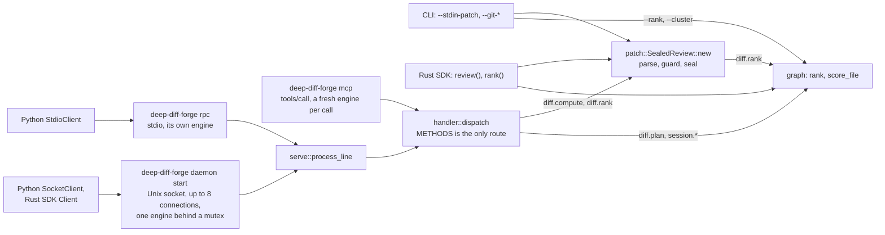
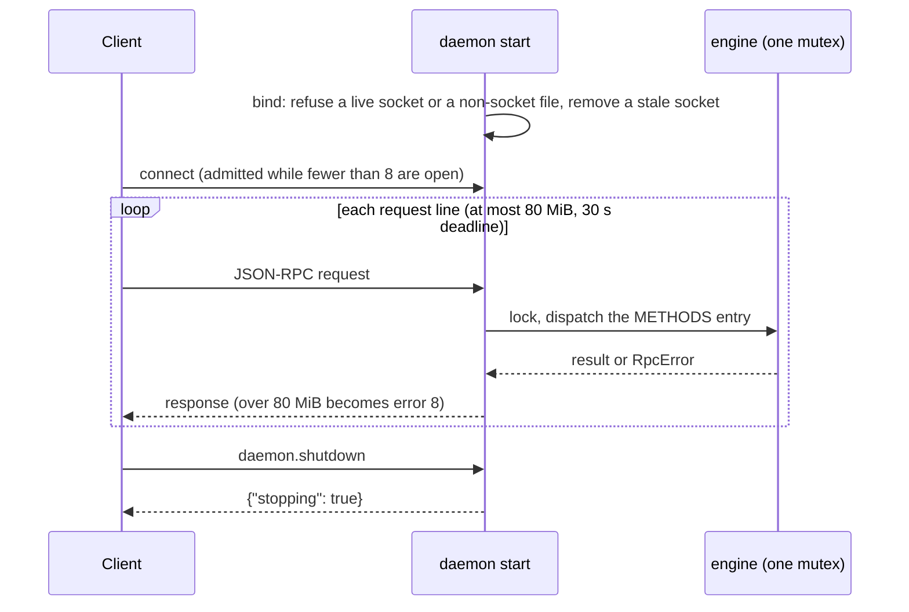

# API And IPC Schematic

This document maps the library crates, the command surface, the JSON-RPC
methods, the MCP tools, the SDKs and the Unix-domain socket locations. Each
section says whether it describes what ships today or a planned design.

## Status 2026-10-28 (0.3.0)

- **Ships today:** the CLI, the optional Unix-socket daemon (JSON-RPC 2.0,
  protocol 1), `rpc` (the same protocol over stdio, no daemon), `mcp` (a
  read-only MCP stdio server), `envelope` / `schema` / `explain`, the Rust SDK
  crate `deep-diff-forge-sdk` and the Python SDK `sdk/python/deep_diff_forge.py`.
- **Not implemented** (refused with exit 2 today): `deep-diff-forge <old> <new>`,
  `chain`, `cluster`, `loom`, and every command or method in the planned tables
  below.
- Earlier versions of this page listed crates that do not exist
  (`deep-diff-forge-git`, `-planner`, `-loom`) and a socket lifecycle with a lock,
  a cache and notifications that the daemon does not have. Those are corrected
  below; the planned items are kept and labelled as planned.

## Design Rule

The core API is library-first. Every surface that emits a `review.v0` document
calls the same parse → guard → seal path (`deep_diff_forge_patch::SealedReview::new`):
the CLI's `--json`, the daemon's `diff.compute`, `rpc`, the MCP `review_patch` tool
and the Rust SDK's `review`. A patch gets the same document from each. Ranking is
sealed the same way: the CLI's `--rank --json`, the daemon's `diff.rank` and the MCP
`rank_patch` tool return one `deep-diff-forge.rank.v0` document. `--jsonl`,
`diff.plan`, `session.open` and the cockpit use the same strict parser without the
seal. The daemon is optional; no command needs it.

## One Engine, Several Front Doors

Measured from the code: `crates/deep-diff-forge-daemon/src/serve.rs`
(`process_line`, `run_server`), `crates/deep-diff-forge-daemon/src/handler.rs`
(`dispatch`, `METHODS`), `crates/deep-diff-forge-cli/src/{main.rs,rpc.rs,mcp.rs}`
and `crates/deep-diff-forge-sdk/src/lib.rs`.



- `review_patch` (MCP) calls `diff.compute`; `rank_patch` calls `diff.rank`
  (`mcp.rs`, `daemon_value`). Before the 2026-10-28 circle fixes, `rank_patch` called
  `diff.plan` and returned its bare array, which the MCP tools specification does not
  allow as `structuredContent` and which carried no seal.
- `diff.plan` and `session.open` parse with `deep_diff_forge_patch::parse` and
  rank with `deep_diff_forge_graph::rank`; they take no input guards.
- `--cluster` scores files through `deep-diff-forge-cluster` (`run_risk_cluster`,
  which calls `graph::score_file`).
- The daemon admits up to eight connections but serves them with one engine
  behind a mutex, so requests run one at a time (`serve.rs`, `MAX_CONNECTIONS`,
  `process_line`).

## Library Crates (shipped)

The internal dependency edges are listed in [`crate-edges.txt`](crate-edges.txt)
and checked by `crates/deep-diff-forge-cli/tests/crate_edges.rs`.

| Crate | Main modules | Responsibility |
| --- | --- | --- |
| `deep-diff-forge-core` | `lib.rs`, `exit.rs`, `seal.rs`, `snapshot.rs`, `git.rs`, `deploy.rs`, `release.rs` | Review model, execution dimensions, exit-code registry, input seal, deployment posture. |
| `deep-diff-forge-patch` | `parser.rs`, `guards.rs`, `sealed.rs`, `json.rs`, `render.rs`, `decode.rs`, `git_acquire.rs`, `git_raw.rs`, `paths.rs` | Patch parsing under byte/line budgets, input guards, the sealed review, `review.v0` JSON, structured Git acquisition. |
| `deep-diff-forge-projection` | `inline.rs`, `side_by_side.rs`, `width.rs` | Inline and side-by-side rendering. |
| `deep-diff-forge-pipeline` | `stages.rs`, `jsonl.rs`, `review.rs` | `ChainStage` trait, `IngestStage` / `RenderStage`, JSONL events, `analysis.v1` bundles. |
| `deep-diff-forge-syntax` | `language.rs`, `analyze.rs`, `highlight.rs`, `structural.rs` | Tree-sitter symbols, highlighting, structural diff. |
| `deep-diff-forge-graph` | `rank.rs`, `risk.rs` | Risk signals and deterministic ranking. |
| `deep-diff-forge-agent` | `anchor.rs`, `evidence.rs`, `store.rs` | Agent annotation protocol. |
| `deep-diff-forge-cluster` | `cluster.rs`, `scheduler.rs` | Bounded parallel lanes (patch + risk) with a deterministic join. |
| `deep-diff-forge-learning` | `receipt.rs`, `store.rs`, `score.rs`, `planner.rs`, `ranking.rs`, `annotation.rs`, `promote.rs` | Local-only L9 learning store. |
| `deep-diff-forge-daemon` | `protocol.rs`, `handler.rs`, `serve.rs`, `security.rs` | JSON-RPC framing, dispatcher, socket server, socket security. |
| `deep-diff-forge-tui` | `run.rs`, `ui.rs`, `state.rs` and others | Interactive review cockpit. |
| `deep-diff-forge-review` | `cli.rs`, `execution.rs`, `sandbox.rs`, `tuicr.rs` and others | Review council (`council …` subcommands). |
| `deep-diff-forge-sdk` | `lib.rs` | Stable Rust facade (see [SDKs](#sdks)). |
| `deep-diff-forge-cli` | `main.rs`, `args.rs`, `git_input.rs`, `analysis.rs`, `contract.rs`, `mcp.rs`, `rpc.rs` | The `deep-diff-forge` binary. |

Planned, not created: a Git workspace crate, a planner crate and a loom crate.

## CLI Command Surface (shipped)

This is the usage block of `deep-diff-forge --help` at 0.3.0:

```text
deep-diff-forge --help
deep-diff-forge --version
deep-diff-forge --self-test
deep-diff-forge doctor
deep-diff-forge deploy {status|release} [--json]
deep-diff-forge semantic <path> [--json]
deep-diff-forge highlight <path> [--color|--no-color]
deep-diff-forge council <example|prepare|review|gate|status|import|export-tuicr|import-tuicr>
deep-diff-forge analyze <patch-file> <base-directory> <candidate-directory>
deep-diff-forge structural <old> <new> [--json]
deep-diff-forge review [--probe [--cols N] [--rows N]] [--side] [--palette | --cmd NAME]
deep-diff-forge daemon {path|start [--foreground]|health|status|stop} [--socket PATH]
deep-diff-forge learn {status|record --stdin} [--json]
deep-diff-forge --stdin-patch [--json | --jsonl | --rank | --cluster [--parallel N] | --layout inline|side-by-side] [--require-files] [--require-hunks]
deep-diff-forge {--git-working-tree [--include-untracked] | --git-staged | --git-range A..B} [--repo PATH] [--acquisition-json | <--stdin-patch output flags>]
deep-diff-forge mcp
deep-diff-forge rpc
deep-diff-forge envelope -- <command> [args…]
deep-diff-forge schema [result|exit-codes]
deep-diff-forge explain <code> [--family engine|council] [--json]
deep-diff-forge claude-code-contract
deep-diff-forge chain-contract
deep-diff-forge cluster-contract
deep-diff-forge loom-contract
```

### Planned commands (not implemented)

Each of these exits 2 (`unknown command`) today:

```text
deep-diff-forge <old> <new>
deep-diff-forge --git                       # today: --git-working-tree | --git-staged | --git-range
deep-diff-forge --dir <old-dir> <new-dir>
deep-diff-forge cache status | cache prune
deep-diff-forge chain
deep-diff-forge cluster                     # today: --stdin-patch --cluster
deep-diff-forge loom plan | loom gate | loom receipt
```

## CLI Compatibility Contracts

| Integration | Status | Contract |
| --- | --- | --- |
| CI and scripts | shipped | Exit codes from the registry (`schema exit-codes`); JSON on stdout; diagnostics on stderr. |
| Agent tools | shipped | `--json` (`review.v0`, `rank.v0`, `cluster.v0`), `--jsonl` (`diff.file` events), `envelope` (`ddf.result.v1`), `mcp`. |
| Claude Code | shipped | `claude-code-contract`; machine commands need no TTY; see [CLAUDE_CODE_BASH_CLI.md](CLAUDE_CODE_BASH_CLI.md). |
| Bash | shipped | See [BASH_API_CONTRACTS.md](BASH_API_CONTRACTS.md). |
| Unix filters | partly shipped | Explicit stdin modes (`--stdin-patch`, `learn record --stdin`); the filter subcommands (`ingest`, `plan`, `rank`, `render`) are planned. |
| Cluster runners | partly shipped | `--cluster` emits a receipt and a deterministic join; lane manifests and replay are planned. |
| `GIT_EXTERNAL_DIFF` | planned | 7-arg and 9-arg external diff invocation. Not implemented. |
| `git difftool` | planned | Old/new file paths and labels. Not implemented. |
| Pager | planned | No pager or ANSI mode for `--stdin-patch`; it prints plain text. |

## JSON-RPC Methods (shipped, protocol 1)

The daemon and `rpc` speak newline-delimited JSON-RPC 2.0. `engine.methods` is
the authoritative list. `METHODS` in `handler.rs` is the only route into the
dispatcher, and a test keeps the two in step. Protocol versions are additive: a
client may pass `{"protocol": N}` to `engine.initialize` for any integer N from 0
to 1, and the answer lists that version's methods. A newer or non-integer
version is refused with domain error 2.

| Method | Params | Result | Since |
| --- | --- | --- | --- |
| `engine.initialize` | `protocol?: integer` | `{server, version, protocol, methods}` | 0 |
| `engine.methods` | — | `{protocol, methods: [{name, params, result, since}]}` | 1 |
| `daemon.health` | — | `{status, version, pid, sessions, retained_bytes, cache_entries, protocol}` | 0 |
| `daemon.status` | — | `{running, uptime_secs, sessions, version, protocol}` | 0 |
| `daemon.shutdown` | — | `{stopping}` | 0 |
| `diff.plan` | `patch: string` | `[ranked file]` | 0 |
| `diff.compute` | `patch: string, require_files?: boolean, require_hunks?: boolean` | the `deep-diff-forge.review.v0` document `--stdin-patch --json` prints for the same patch | 1 |
| `diff.rank` | `patch: string, require_files?: boolean, require_hunks?: boolean` | the `deep-diff-forge.rank.v0` document `--stdin-patch --rank --json` prints for the same patch | 1 |
| `review.outline` | `patch: string, require_files?, require_hunks?, max_bytes?: integer, cursor?: string` | `deep-diff-forge.review-outline.v0`: files in review-risk order with their hunks' addresses, ranges, `@@` headings and counts, no line text; `next_cursor` continues | 1 |
| `review.hunks` | `patch: string, require_files?, require_hunks?, addresses?: [string], paths?: [string], max_bytes?, cursor?` | `deep-diff-forge.review-hunks.v0`: the chosen hunks verbatim, continued at a line when one is too long for the page. A path selects every section of that path, an address every hunk with it; a view carries at most 256 bytes of an `@@` heading (`section_truncated: true`) | 1 |
| `review.change` | `repo: string, selection: staged\|working_tree\|range, range?: A..B, include_untracked?, view?: outline\|hunks\|review\|rank`, plus the view's params | that view of the change Git returns, sealed over Git's bytes, with an `acquisition` member; only under an `--allow-repo` root, Git stopped after 30 s; Git failure is error 3 | 1 |
| `session.open` | `patch: string` | `{session, files}` | 0 |
| `session.snapshot` | `session: string` | `[ranked file]` | 0 |
| `session.close` | `session: string` | `{closed}` | 0 |

`cache_entries` is always 0: there is no response cache (`handler.rs`, decision
D-03).

**Parity:** `diff.compute` and the CLI share the parser, the input seal, the
JSON projection and one input-contract predicate (`deep_diff_forge_patch::InputGuards`).
`crates/deep-diff-forge-cli/tests/daemon_parity.rs` feeds six fixtures under all
four guard combinations to both surfaces and requires the same document as a
JSON value (key order is not part of the contract), the same refusal text, or
the same parse-failure text.

### Error codes

Standard JSON-RPC codes (`protocol.rs`): -32700 parse error, -32600 invalid
request, -32601 method not found, -32602 invalid params, -32603 internal error.
Domain codes:

| Domain error | Meaning | CLI exit (engine family) |
| --- | --- | --- |
| 1 | No such session | — |
| 2 | Protocol not supported | — |
| 4 | Patch parse failed | 4 (`invalid_input`) |
| 7 | Input contract refused (`refused: …`) | 7 (`input_contract_refused`) |
| 8 | Resource budget exceeded: a session over the retained-payload budget, or a response over 80 MiB | — |

The Rust SDK maps domain errors 4 and 7 to CLI exits 4 and 7, and any other RPC
or transport error to 6 (`Error::exit_code`).

### Planned methods (not implemented)

None of these is dispatched; a call returns -32601.

| Method | Purpose |
| --- | --- |
| `session.subscribe` | Subscribe to progressive updates. |
| `session.setToggles` | Update projection toggles without mutating patch truth. |
| `session.setBudgets` | Adjust byte, node and time budgets. |
| `pipeline.run` | Run a declared chain manifest. |
| `cluster.run` | Run dimensional lanes with explicit budgets and join policy. |
| `loom.plan` / `loom.gate` | Loom assimilation plans and gates. |
| `projection.render` | Render inline, side-by-side, JSON or compact output. |
| `annotation.add` / `annotation.resolve` | Human or agent annotations. |
| `approval.record` | Record a reviewer decision. |
| `cache.status` / `cache.prune` | Inspect or prune a cache (no cache exists today). |

Planned extensions of shipped methods: `session.open` from Git, a file pair or a
directory pair (today it takes a `patch` string only), and feature negotiation in
`engine.initialize` beyond the protocol number.

### Server notifications (planned, not implemented)

The daemon sends no notifications; every message it sends answers a request.
Planned: `session/opened`, `session/progress`, `diff/fileUpdated`,
`graph/rankUpdated`, `pipeline/stageCompleted`, `cluster/laneCompleted`,
`loom/phaseCompleted`, `annotation/added`, `approval/changed`, `cache/updated`,
`error/recoverable`.

## MCP Tools (shipped)

`deep-diff-forge mcp` serves read-only MCP tools over stdio, one JSON-RPC
message per line (`crates/deep-diff-forge-cli/src/mcp.rs`).

- Modern clients (specification 2026-07-28) send
  `io.modelcontextprotocol/protocolVersion` and client capabilities in each
  request's `_meta`, and may call `server/discover`.
- Legacy clients (2025-11-25, 2025-06-18, 2025-03-26) use `initialize`.
- Methods: `initialize`, `server/discover` (modern only), `ping`, `tools/list`,
  `tools/call`.
- A request line is capped at the 64 MiB patch budget plus 1 MiB (`LINE_CAP`).

| Tool | Arguments | Backed by |
| --- | --- | --- |
| `review_patch` | `patch`, `detail?` (`auto` or `summary`), `paths?`, `require_files?`, `require_hunks?` | `diff.compute`; a review over 256 KiB returns `deep-diff-forge.review-summary.v0` |
| `rank_patch` | `patch`, `require_files?`, `require_hunks?` | `diff.rank`: the sealed `rank.v0` document; a ranking over 256 KiB returns `deep-diff-forge.rank-summary.v0` with the same seal |
| `review_outline` | `patch`, `require_files?`, `require_hunks?`, `max_bytes?`, `cursor?` | `review.outline`; `max_bytes` (2 KiB–32 MiB, default 32 KiB) covers the whole answer, both copies: the view starts at half and is re-paged smaller while the escaped text copy still pushes the answer over |
| `review_hunks` | `patch`, `addresses?` or `paths?`, `require_files?`, `require_hunks?`, `max_bytes?`, `cursor?` | `review.hunks`, budgeted the same way |
| `review_change` | `repo`, `selection`, `range?`, `include_untracked?`, `view?` (`outline` or `hunks`), and that view's arguments | `review.change`, only when the server was started with `mcp --allow-repo PATH`; budgeted the same way |
| `explain_exit_code` | `code`, `family?` (`engine` or `council`) | the exit-code registry |
| `exit_code_registry` | — | the exit-code registry |

Every tool is annotated `readOnlyHint: true`. Bad or missing arguments, a parse
failure or a refused contract is a tool result with `isError: true`, so a model
can correct its input; an unknown tool or malformed JSON-RPC is a JSON-RPC error.

## SDKs

**Rust (`crates/deep-diff-forge-sdk`):** `review(patch, Guards) -> Result<Review, Error>`,
`rank(&Review) -> Vec<RankedFile>`, `Review::to_json()` (the `review.v0`
document), `Review::files()`, `Review::seal()`, `Guards::{none, all,
require_files, require_hunks}`, the `exit` registry re-export, and, on Unix only,
`Client::at(socket).call(method, &params)`. `Error` is `#[non_exhaustive]`
(`Parse`, `Refused`, `Rpc`, `Transport`). `crates/deep-diff-forge-sdk/tests/api.rs`
pins the public signatures.

**Python (`sdk/python/deep_diff_forge.py`, standard library only):**
`StdioClient(command=("deep-diff-forge", "rpc"), timeout=30.0)` and
`SocketClient(path, timeout=30.0)`, each with `call(method, **params)`,
`review_patch(patch, require_files=False, require_hunks=False)` and `methods()`.
A JSON-RPC error raises `RpcError` (with the daemon's `code`); a transport
failure raises `TransportError`.

## Unix Domain Socket Locations

| Platform | Socket path or status |
| --- | --- |
| Unix with `$XDG_RUNTIME_DIR` | `$XDG_RUNTIME_DIR/deep-diff-forge/deep-diff-forge.sock` |
| Unix without `$XDG_RUNTIME_DIR` | Fails closed with exit 2: pass `--socket PATH`; there is no `/tmp` fallback |
| Windows | Daemon unsupported; no named-pipe or TCP listener |

`deep-diff-forge daemon path` prints the resolved socket. The managed runtime
directory is created with mode `0700` and checked against the effective user.
The socket is mode `0600`. An explicit `--socket` path creates a missing parent
at `0700`, but refuses an existing parent that is permissive, wrong-owner or a
symlink, and never re-permissions it (`serve.rs`, `bind_explicit`).

## Socket Lifecycle (shipped)



There is no daemon lock file and no cache. `daemon start` always runs in the
foreground; a supervisor owns the process. A client may call `engine.initialize`
first but does not have to.

## Socket Security Rules

- Bind only to filesystem paths in owner-private runtime directories.
- Reject group/other-accessible or wrong-owner parents; sticky-bit directories
  are not an exception.
- Refuse symlinks and non-socket files at the socket path. Remove a stale socket
  only when it is verifiably a socket and nothing answers on it; a live daemon's
  socket is refused with `AddrInUse`.
- Keep the socket local to one OS user; do not forward or bind-mount it across a
  trust boundary. There is no peer-credential check: the `0700`/`0600` modes are
  the access control.
- Treat request fields and agent annotations as untrusted input.
- Limits (`serve.rs`, `handler.rs`): 80 MiB request and response lines, a
  30-second absolute read deadline per line, a 30-second write timeout, eight
  concurrent connections, 64 retained sessions (least recently used evicted
  first), and a 128 MiB aggregate retained session-payload budget.

See [`SECURITY.md`](../SECURITY.md) for the maintained threat model, operational
requirements and residual risks.

## Filesystem State Locations

| State | Location | Status |
| --- | --- | --- |
| Runtime socket | `$XDG_RUNTIME_DIR/deep-diff-forge/deep-diff-forge.sock` | shipped |
| Learning store | `$XDG_STATE_HOME/deep-diff-forge/learning/`, else `~/.local/state/deep-diff-forge/learning/` | shipped |
| Cache directory | `$XDG_CACHE_HOME/deep-diff-forge/`, else `~/.cache/deep-diff-forge/` | `doctor` reports it; nothing is written there today |
| Config | `$XDG_CONFIG_HOME/deep-diff-forge/config.toml` | planned; no config file is read |
| Session journal, logs | `$XDG_STATE_HOME/deep-diff-forge/{sessions,logs}/` | planned; sessions live in daemon memory only |

## Cache Key Schematic (planned, not implemented)

```text
cache-key =
  repo-id +
  file-path +
  object-id-or-content-hash +
  language-id +
  parser-version +
  engine-version +
  planner-budget-profile
```

Planned entries: decoded text metadata, line index, syntax tree summary,
semantic node fingerprints, generated/vendor classification, previous fallback
reason.

## Protocol Versioning

Shipped: `engine.protocol = 1` (`protocol.rs`, `PROTOCOL_VERSION`), negotiated
through `engine.initialize` as described above. Documents carry their own schema
names (`deep-diff-forge.review.v0`, `ddf.result.v1` and so on).

Planned: separate version numbers for the model, the projection and agent
annotations.

## Deployment Link

- Framework: [Codebase Deployment Framework](DEPLOYMENT_FRAMEWORK.md)
