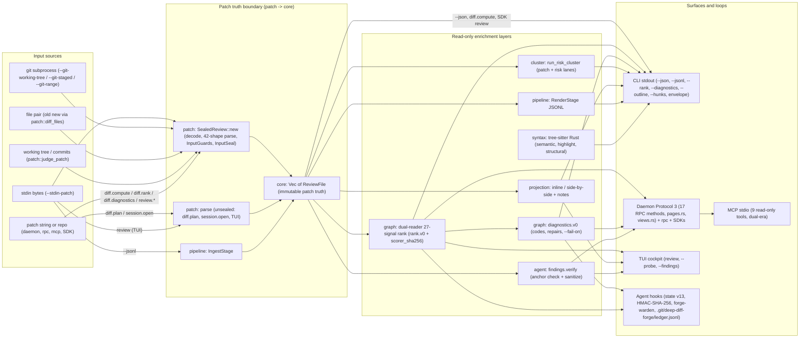

# Architecture

> **Two parts.** The first sections — [Crates as built (v0.11.0)](#crates-as-built-v0110),
> [Data flow as built (v0.11.0)](#data-flow-as-built-v0110), and the subsystem notes that follow —
> describe the code shipped on `main` at **`v0.11.0`** (Rust 2024 edition, MSRV 1.88,
> `#![forbid(unsafe_code)]`). Everything from [Layers](#layers) down is **historical target
> design, not a description of the code** (anchor E-01, 2026-10-27): crates, commands and caches
> named there may not exist. The crate list that a test holds equal to `cargo metadata` is
> generated in [Current crates and edges](SCHEMATICS.md#current-crates-and-edges) from
> [`docs/crate-edges.txt`](crate-edges.txt).
>
> **Status `v0.11.0`.** Shipped: **15 workspace crates** (**14 published** plus the dev-only,
> unpublished `deep-diff-forge-testkit`), 42-shape Git header conformance and `judge_patch`,
> dual-reader 27-signal risk ranking (`rank.v0` with `tool.scorer_sha256`) and `diagnostics.v0`,
> agent hooks (`hook-state.v13`, RFC 2104 HMAC-SHA-256 keyed history, `.git/deep-diff-forge/`
> ledger, `forge-warden` verdict v2/v3 loop), daemon Engine Protocol 3 (17 JSON-RPC methods),
> dual-era stdio MCP (9 read-only tools), Rust and Python SDKs, local learning receipts,
> interactive TUI cockpit, adversarial review council (with append-only `decisions.jsonl`
> recovery), 73-case `eval` corpus, `bench`, and 18 libFuzzer targets. Planned, unowned: the
> `git`, `planner`, `ui-model` and `fixtures` crates, a shared cache, subscriptions, directory
> pairs. Withdrawn 2026-10-31: the `loom` crate and the `chain`, `cluster` and `loom`
> subcommands (refused with exit 2).

<a id="crates-as-built-030"></a>
## Crates as built (v0.11.0)

Fifteen crates under `crates/`, each named `deep-diff-forge-<name>`: **14 published crates** plus
the dev-only, unpublished **`testkit`** crate. The graph below is drawn directly from
[`docs/crate-edges.txt`](crate-edges.txt), which
`crates/deep-diff-forge-cli/tests/crate_edges.rs` verifies against `cargo metadata`. An arrow
points from a crate to a crate it depends on. Solid arrows are normal dependencies (42 edges);
`sdk --> daemon` is a normal dependency only on Unix targets
(`[target.'cfg(unix)'.dependencies]` in `crates/deep-diff-forge-sdk/Cargo.toml`). Dashed arrows
labelled `dev` are test-only dependencies (10 edges); they do not license a normal edge.

```mermaid
flowchart TB
    cli["cli"]
    tui["tui"]
    sdk["sdk"]
    review["review"]
    pipeline["pipeline"]
    cluster["cluster"]
    daemon["daemon"]
    agent["agent"]
    learning["learning"]
    graph["graph"]
    projection["projection"]
    syntax["syntax"]
    patch["patch"]
    core["core"]
    testkit["testkit (dev-only)"]

    cli --> agent
    cli --> cluster
    cli --> core
    cli --> daemon
    cli --> graph
    cli --> learning
    cli --> patch
    cli --> pipeline
    cli --> projection
    cli --> review
    cli --> syntax
    cli --> tui

    tui --> agent
    tui --> cluster
    tui --> core
    tui --> daemon
    tui --> graph
    tui --> learning
    tui --> patch
    tui --> projection
    tui --> syntax

    sdk --> core
    sdk -- "cfg(unix)" --> daemon
    sdk --> graph
    sdk --> patch

    review --> core

    pipeline --> core
    pipeline --> graph
    pipeline --> patch
    pipeline --> projection
    pipeline --> syntax

    cluster --> core
    cluster --> graph

    daemon --> agent
    daemon --> core
    daemon --> graph
    daemon --> patch

    agent --> core
    graph --> core
    patch --> core
    projection --> core
    syntax --> core

    agent -. "dev" .-> patch
    cluster -. "dev" .-> patch
    graph -. "dev" .-> patch
    projection -. "dev" .-> patch
    cli -. "dev" .-> testkit
    daemon -. "dev" .-> testkit
    learning -. "dev" .-> testkit
    patch -. "dev" .-> testkit
    review -. "dev" .-> testkit
    sdk -. "dev" .-> testkit
```

Key structural invariants enforced by `docs/crate-edges.txt`:

- `core` and `testkit` have no workspace dependencies. `learning` has no normal workspace
  dependencies (only `testkit [dev]`) and is consumed only by `cli` and `tui`.
- `graph` depends **only on `core`** in normal dependencies (`patch` is dev-only). It does **not**
  depend on `syntax`: code evidence in `graph` uses its own linear-time lexical and Rust token
  readers (`rust_tokens.rs`, `lexical.rs`), keeping ranking independent of tree-sitter.
- `testkit` is path-only in `Cargo.toml` (`publish = false`) and is permitted strictly as a
  `dev-dependency`.
- No crate named `git`, `planner`, `loom`, `ui-model` or `fixtures` exists; those appear below
  only in the historical target-design sections.

| Crate | Published | Role at `v0.11.0` (verified from crate `src/`) |
| --- | --- | --- |
| `core` | Yes | Pure vocabulary (`ReviewFile`, hunks, anchors), `InputSeal` with zero-dep FIPS 180-4 SHA-256 and RFC 2104 HMAC-SHA-256 (`seal.rs`, compiled with `opt-level = 3` in dev), exit-code and exit-7 reason-class registry (`exit.rs`), terminal/JSON safety (`util.rs`), deploy/release/process/snapshot types. |
| `patch` | Yes | 42-shape strict Git header conformance parser (`parser.rs`, `CONFORMANCE.md`), `SealedReview`, `InputGuards`, Git acquisition via `--raw -z` with stray-byte binary source re-read (`diff_suppressed`, `git_acquire.rs`, `git_raw.rs`), `<old> <new>` file-pair diff (`diff_files`), scratch-dir `judge_patch` (`judge_patch.rs`), apply-able renderer, `review.v0` JSON. |
| `projection` | Yes | Renderer-neutral inline and side-by-side rows and text, `\` note rows for lossy/invisible differences (`notes.rs`), terminal grapheme cell-width calculation (`width.rs`). |
| `pipeline` | Yes | `IngestStage` and `RenderStage` (`--jsonl` event stream), and the shared source-pair review service behind `analyze` (`review.rs`). |
| `syntax` | Yes | Tree-sitter Rust parser with pre-parse byte cap (`2 MiB`), post-parse node cap (`200,000`), and cooperative wall-clock backstop (`1 s + 5 ms/KiB`), top-level symbols, terminal-safe ANSI highlight, token-level `structural_diff` (reformat/move detection). |
| `graph` | Yes | Deterministic 27-signal risk ranking (13 path/file `RiskSignal` + 14 `EvidenceSignal`), dual-reader code-view engine (`rust_tokens.rs` linear token reader + `lexical.rs` / `lexical/legacy_rust.rs` multi-language scanner with linear-time DoS guards), `guard_paths.rs`, canonical `rank.v0` with build-time `tool.scorer_sha256`, and `diagnostics.v0` (`diagnostics.rs`, `vocabulary.rs`). |
| `agent` | Yes | Annotation provenance, grounding classification, body sanitization (`MAX_BODY_LEN = 4096`), anchor validation, `findings.rs` (`finding.v0` to `findings.v0`, `claim_verified: false`), in-memory `AnnotationStore`. |
| `cluster` | Yes | Bounded `std::thread::scope` parallel `patch` and `risk` lanes over contiguous shards, deterministic `ranked-review-order` join, and structured `ClusterReceipt`. |
| `learning` | Yes | Local-only receipt store under `$XDG_STATE_HOME/deep-diff-forge/learning/receipts/strategy.jsonl` (`0700`/`0600`, FNV-1a `RedactedId`), `TrustPolicy` scoring (`learn record|status`), plus library-implemented learners (`PlannerLearner`, `RankingWeights`, `AnnotationTrust`, `PromotionPolicy`). |
| `daemon` | Yes | Unix-socket JSON-RPC 2.0 server and shared `dispatch` (`PROTOCOL_VERSION = 3`, 17 methods, `MAX_CONNECTIONS = 8` data + `CONTROL_CONNECTIONS = 2` reserved control slots, `160 MiB` shared read budget, `128 MiB` FIFO in-flight admission cap, 64 LRU sessions / `128 MiB` retained cap, `cache_entries: 0`, byte-exact paging `pages.rs` and views `views.rs`, JSON/Prometheus metrics, peer UID security). Refuses non-Unix builds. |
| `review` | Yes | Adversarial review council: sealed snapshots, 6 reviewer slots across 2 rounds (`independent`, `challenge`), 8 rootless Podman evidence gates, `mutation_scope.rs`, `tuicr.rs` interop, append-only hash-chained `decisions.jsonl` with checkpoint fault recovery (`journal.rs`, council exit 3 `recorded_incomplete`). |
| `tui` | Yes | Interactive review cockpit (`ratatui`/`crossterm`): ranked tree, inline/side-by-side diff pane, fold/notes/theme toggles, command palette, mouse + keyboard, verified `--findings`, headless `TestBackend` (`--probe`). |
| `sdk` | Yes | Stable Rust facade: `review`, `rank`, `diagnostics`, `exit`, and Unix-only daemon `Client` (including `Client::diagnostics` page reassembly with `ProtocolTooOld`, `UnknownMembers`, and `Document` checks). |
| `cli` | Yes | The `deep-diff-forge` binary: patch/Git/file-pair ingestion, `--diagnostics`/`--rank` with `--fail-on`, `--outline`/`--hunks`, `review`, `semantic`/`highlight`/`structural`/`analyze`, `daemon`, `rpc`, `mcp` (9 read-only tools), `envelope`, `schema`, `explain`, `findings verify`, `agent {setup,doctor,check,verify-branch,hook}` (state v13, HMAC-SHA-256, project ledger), `learn`, `eval` (73 cases), `bench`, `council`, `deploy`. |
| `testkit` | No (`dev`) | Workspace test-only helper providing RAII owner-private (`0700`) `Scratch` temp directories; the single allowed caller of `std::env::temp_dir()`. |

<a id="data-flow-as-built-030"></a>
## Data flow as built (v0.11.0)

Every review surface reaches the same core model, a `Vec<ReviewFile>` from `deep-diff-forge-core`.
The sealed path is `SealedReview::new` in `crates/deep-diff-forge-patch/src/sealed.rs`: read up to
the 64 MiB byte budget (and 1,000,000-line structural budget), decode lossily per file, parse
against the 42-shape Git header accept-list (`GIT_WRITES` in `patch/src/parser.rs`), enforce
`InputGuards`, and seal the exact raw input bytes with `InputSeal` (SHA-256 plus tool version). A
seal cannot be paired with files parsed from other bytes.



### Subsystem architecture (as built at v0.11.0)

1. **Ingestion, 42-shape conformance, and `judge_patch` (`deep-diff-forge-patch`):**
   - `parser.rs` accepts only the 42 header shapes Git's own `diff.c` writes (`GIT_WRITES` in
     `CONFORMANCE.md`), refusing forged or ambiguous shapes (`HeaderNotWrittenByGit`), unanchored
     `-U0` hunks (`HunkPlacedElsewhere`), and unapply-able symlink/file-directory conflicts
     (`GitCannotWrite`) with exit 4.
   - `--stdin-patch` refuses empty or prose input with exit 4 (`no_patch_in_input`) unless
     `--allow-empty` is passed; explicit `--require-files` / `--require-hunks` guards are checked
     first and exit 7 (`require_files`, `require_hunks`).
   - `git_acquire.rs` acquires structured Git changes via NUL-delimited `--raw -z` records and
     re-reads stray-byte or `-diff`-suppressed text files as text, marking them `diff_suppressed`
     (closing DDF-2026-006).
   - `<old> <new>` (`cli/src/file_pair.rs`) runs `patch::diff_files` (`git diff --no-index` from
     `/` on two regular files) and feeds the bytes through `SealedReview`.
   - `judge_patch.rs` builds a working-tree patch against a base commit inside an isolated scratch
     Git directory that borrows only the repository's object store and `info/exclude`, reading no
     user/system/repo Git config or filters, matching `forge-warden`'s patch maker byte-for-byte.

2. **Dual-reader 27-signal risk and diagnostics engine (`deep-diff-forge-graph`):**
   - Evaluates **27 signals** per file: **13 path/file `RiskSignal`** entries (`public_api_surface`,
     `new_file`, `deleted_file`, `binary_change`, `diff_suppressed`, `large_change`, `many_hunks`,
     `config_or_lockfile`, `test_only`, `generated_or_vendored`, `hazardous_text`,
     `symlink_change`, `executable_bit`) plus **14 `EvidenceSignal`** entries (`unsafe_added`,
     `process_spawn`, `network_fetch`, `dynamic_eval`, `ci_privilege`, `build_hook`, `secret_like`,
     `check_suppressed`, `test_removed`, `test_skipped`, `trivial_assert`, `stub_added`,
     `error_swallowed`, `panic_path_added`).
   - Code evidence uses two cooperating readers over hunk lines without tree-sitter:
     `rust_tokens.rs` performs single-pass linear token matching over Rust hunk code views, while
     `lexical.rs` (plus `lexical/legacy_rust.rs`) blanks comments and strings for Rust, Python,
     JavaScript/TypeScript, Go, Shell, and YAML with linear-time long-word and secret-prefix bounds
     (fixing DDF-2026-003). Multi-section patches for the same path are merged before scoring.
   - `RankDocument::to_json` produces the canonical `deep-diff-forge.rank.v0` bytes shared across
     CLI, daemon `diff.rank`, `rpc`, and MCP `rank_patch`, stamped with build-time
     `tool.scorer_sha256`.
   - `diagnostics.rs` and `vocabulary.rs` turn a ranking into `deep-diff-forge.diagnostics.v0`,
     emitting deterministic `<label>@line` and `<label>@file` codes (pinned in
     `fixtures/diagnostics/codes.v0.txt`), case-specific repair IDs, and audience tags (`agent` vs
     `person`), feeding `--diagnostics`, `--fail-on` (exit 7), daemon `diff.diagnostics`, MCP
     `diagnose_patch`, and post-tool hook advice.

3. **Agent hooks, state v13, HMAC-SHA-256 keyed history, and project ledger (`cli/src/{agent,agent_check,hook,hook_run,ledger,reason,verdict_v2}.rs`):**
   - `hook.rs` is pure decision logic; `hook_run.rs` performs I/O under bounded wall-clock budgets
     (`4 s` post-tool advice, `8 s` session-start, stop budget bounded to fit Claude Code's 60 s
     wait) and always exits 0 to the client (never exit 2) so infrastructure errors report visibly
     rather than silently blocking.
   - Per-session state lives under `$XDG_STATE_HOME/deep-diff-forge/hooks/` with schema
     `deep-diff-forge.hook-state.v13` and a strict version/migration policy. Every remembered text
     digest (finding, failing line, noticed cause) is an RFC 2104 HMAC-SHA-256 keyed digest
     (`core::hmac_sha256_hex`) derived from a 32-byte user key file.
   - Post-tool advice sources findings from `diagnostics.v0` and tracks guard-file edits. Stop
     judging evaluates units individually (uncommitted tree via `judge_patch`, staged tree when
     distinct, each new single-parent commit of the session and any unjudged frontier commits),
     validating `forge-warden.verdict.v2` and `forge-warden.verdict.v3` documents member-by-member
     (`verdict_v2.rs`), with stateless fallback judging when state cannot be opened.
   - Outcomes are appended to `<git-common-dir>/deep-diff-forge/ledger.jsonl` (`O_APPEND`, `flock`,
     mode `0600`, salted digests for uncommitted trees) with 50 exhaustive hook reason classes
     (`reason.rs`). `agent check`, `agent verify-branch BASE..HEAD`, `agent setup --hooks`, and
     `agent doctor --gate` (including `diagnostics_parity`) inspect and verify the chain.
   - All engine exit-7 refusals leave through one door (`cli/src/refusal.rs`) emitting registered
     `refused: <text> (<tag>)` reason classes from `core::exit::REFUSALS` and preserving pending
     verdict refusals even on broken stdout (DDF-2026-010/011).

4. **Daemon Protocol 3, 9 MCP tools, and Rust/Python SDKs (`daemon`, `cli/src/{rpc,mcp}.rs`, `sdk`, `sdk/python`):**
   - `deep-diff-forge-daemon` serves **17 JSON-RPC 2.0 methods** under `PROTOCOL_VERSION = 3`
     (`engine.initialize`, `engine.methods`, `daemon.health`, `daemon.status`, `daemon.shutdown`,
     `daemon.metrics`, `diff.plan`, `diff.compute`, `diff.rank`, `diff.diagnostics`,
     `review.outline`, `review.hunks`, `review.change`, `findings.verify`, `session.open`,
     `session.snapshot`, `session.close`).
   - Socket listener enforces owner-private directories/sockets (`0700`/`0600`) and peer UID checks,
     caps concurrency at `MAX_CONNECTIONS = 8` data slots plus `CONTROL_CONNECTIONS = 2` reserved
     control slots (for `daemon.health`, `daemon.status`, `daemon.metrics`, and `daemon.shutdown`),
     bounds buffering with `MAX_READ_BYTES = 160 MiB` and `MAX_IN_FLIGHT_BYTES = 128 MiB` FIFO
     admission (`30 s` wait), retains at most `64` LRU sessions / `128 MiB` heap
     (`cache_entries: 0`, decision D-03), and exposes JSON and Prometheus metrics
     (`exposition.rs`).
   - `deep-diff-forge rpc` calls the same in-process `handler::dispatch`. The dual-era stdio MCP
     server (`deep-diff-forge mcp`, `2026-07-28` stateless modern + legacy
     `2025-11-25`/`2025-06-18`/`2025-03-26` `initialize` handshake) serves **9 read-only tools**:
     `review_patch`, `rank_patch`, `verify_findings`, `review_outline`, `review_hunks`, and
     non-diagnostics `review_change` (scoped by `--allow-repo`) call `handler::dispatch`;
     `diagnose_patch` and `review_change(view="diagnostics")` invoke `daemon::pages::page` /
     `change_review` directly; and `explain_exit_code` / `exit_code_registry` read `core::exit`
     directly — all with byte-exact paging (`pages.rs`/`views.rs`), unified invisible-character
     escaping, and parse failures worded without echoing patch text.
   - `deep-diff-forge-sdk` (Rust) and `sdk/python/deep_diff_forge.py` (zero-dependency Python
     stdlib, `StdioClient` + `SocketClient`) expose `review`, `rank`, and paged `diagnostics` with
     `ProtocolTooOld`, `UnknownMembers`, and `Document`/`PagingError` integrity checks against
     `document_sha256`.

5. **Learning, TUI, Review Council, Evaluation, and Benchmarking:**
   - **Learning (`deep-diff-forge-learning`):** `learn record` and `learn status` persist redacted
     JSONL strategy receipts locally (`0700`/`0600`, 64 MiB cap) and evaluate `TrustPolicy`. The
     crate also implements `PlannerLearner`, `RankingWeights::fit_weights`,
     `AnnotationTrust::fit_trust`, and `evaluate_promotion` (`PromotionPolicy`) as library APIs not
     yet wired into CLI/daemon defaults.
   - **TUI (`deep-diff-forge-tui`):** `review` reads stdin, ranks the file tree via `graph`, renders
     inline/side-by-side panes via `projection`, overlays engine notes and verified `--findings`
     from `agent::findings`, and supports headless rendering (`--probe`).
   - **Review council (`deep-diff-forge-review`):** `council` runs 6 reviewer slots over 2 rounds
     (`independent`, `challenge`) and 8 evidence gates (`format`, `check`, `clippy`, `pedantic`,
     `tests`, `antipatterns`, `fuzz`, `mutation`) inside rootless Podman (`--network none`,
     read-only `/src`, `/vendor`, `/cargo-home`, writable `/work`). Human dispositions from `tuicr`
     append to hash-chained `decisions.jsonl` with create-new checkpoints and fault recovery
     (`reconcile`, council exit 3 `recorded_incomplete`, DDF-2026-004).
   - **Evaluation & Benchmarking (`cli/src/{eval,bench}.rs`):** `eval` verifies SHA-256 integrity
     and scores **73 labelled cases** in `fixtures/eval/MANIFEST.json` (plus declared misses tracked
     without inflating metrics); `bench` times deterministic generated workloads (`bench.v0`).

Not built: a planner that chooses strategies dynamically, a shared content-addressed cache
(`cache_entries: 0`, decision D-03), daemon push subscriptions, and directory-pair input. The
`chain`, `cluster` and `loom` top-level subcommands were withdrawn on 2026-10-31 and are refused
with exit 2 (see `deep-diff-forge --help`, "WITHDRAWN").

## Platform scope (decision D-05, 2026-10-27)

Deep-Diff-Forge targets Linux and macOS. Windows is not a goal: the daemon uses Unix-domain
sockets and refuses to compile elsewhere (`deep-diff-forge-daemon/src/lib.rs`, `compile_error!`),
and the CLI and TUI depend on it unconditionally. The crates are not split to make a Windows build
possible; library crates that happen to build on Windows (`core`, `patch`, `graph`, `learning`,
non-client `sdk`) are not tested or released there.

## Source headers (decision E-05, 2026-10-27)

Some files open with `// DDF integration` (the finding IDs), `// Design/status` (a design
section) and `// Module index: <document>#<heading>` lines. The module index line names the
section of a document in this repository that lists the file: the module lists of
[RECOMMENDATION_INTEGRATION](RECOMMENDATION_INTEGRATION.md) and [REVIEW_COUNCIL](REVIEW_COUNCIL.md),
else [Crates as built](#crates-as-built-v0110) (the historical `#crates-as-built-030` anchor is
preserved for compatibility). Until 2026-11-22 that line was a `// Module vault note` link into the
maintainer's private note store, which no reader of the repository could open; the links were
replaced in place, and the contract test `no_tracked_file_links_the_private_vault` keeps private
links out of every tracked file. The headers are optional and not enforced. Add a
`// Module index:` line when a document section lists the file; never link a private note.

## Layers

Historical target design (anchor E-01, 2026-10-27). Of these layers, the input, patch truth,
semantic (Rust only, symbols and token-level structural diff), review graph (27-signal risk
ranking, dual-reader code evidence, and `diagnostics.v0`), projection (inline and side-by-side),
and pipeline (ingest, render, and `analyze`) layers exist; see
[Crates as built (v0.11.0)](#crates-as-built-v0110). The planner and loom layers do not exist.

1. **Input Layer**
   Reads Git state, patch files, file pairs, directories, stdin streams, and future forge APIs.

2. **Patch Truth Layer**
   Produces canonical apply-able patch data:
   paths, modes, renames, hunk headers, old/new line numbers, additions, removals, context, and metadata.

3. **Semantic Layer**
   Parses supported languages, builds syntax trees, computes structural matches, detects moved or reformatted code, and emits semantic spans.

4. **Planner Layer**
   Chooses strategies per file and region:
   line, word, syntax, moved-block, binary, generated-file, or fallback.

5. **Review Graph Layer**
   Connects files, hunks, symbols, tests, risk signals, ownership, comments, agent notes, and commands.

6. **Projection Layer**
   Converts the core model into side-by-side, inline, stacked, JSON, TUI, desktop, web, and agent API views.

7. **Pipeline Layer**
   Runs chainable command stages: ingest, plan, rank, annotate, render, chain, and cluster.

8. **Loom Layer**
   Assimilates exemplar lessons and feature proposals into Rust crate plans, fixtures, gates, and receipts.

## Core Principle

Patch truth and semantic truth are separate but synchronized.

The patch twin answers: "What exact text can be applied?"

The semantic twin answers: "What code meaning changed?"

The projection layer joins them through stable anchors:

- file identity
- old/new byte ranges
- old/new line ranges
- syntax node identities
- hunk ids
- semantic span ids

## Crate Plan

Built at `v0.11.0`: 14 published crates (`core`, `patch`, `projection`, `pipeline`, `syntax`,
`graph`, `agent`, `tui`, `cluster`, `learning`, `daemon`, `review`, `sdk`, `cli`) plus the dev-only
`testkit` crate (see [Crates as built (v0.11.0)](#crates-as-built-v0110)).

Target only, not built:

- `deep-diff-forge-git`: a Git adapter crate. Git input today is `patch::acquire_git`,
  `patch::diff_files`, and `patch::judge_patch`, which run the `git` program; there is no `gix`
  dependency.
- `deep-diff-forge-planner`: per-file and per-region strategy selection.
- `deep-diff-forge-ui-model`: renderer-neutral layout and interaction model.
- `deep-diff-forge-loom`: withdrawn 2026-10-31.

Parts of the original plan that the built crates do not do yet: `pipeline` has no chain manifest
runner or plan/rank/annotate stages; `cluster` runs only the `patch` and `risk` dimensions;
`daemon` has LRU sessions but no shared cache (`cache_entries: 0`) and no multi-client push
subscriptions.

## Schematics

Detailed diagrams and API maps:

- [SCHEMATICS.md](SCHEMATICS.md)
- [API_AND_IPC.md](API_AND_IPC.md)
- [CHAINING_AND_CLUSTERING.md](CHAINING_AND_CLUSTERING.md)
- [DIMENSIONAL_EXECUTION_MODEL.md](DIMENSIONAL_EXECUTION_MODEL.md)
- [DEEP_DIFF_FORGE_LOOM.md](DEEP_DIFF_FORGE_LOOM.md)
- [RUST_IMPLEMENTATION_STRATEGY.md](RUST_IMPLEMENTATION_STRATEGY.md)
- [MODULE_STRUCTURE_PLAN.md](MODULE_STRUCTURE_PLAN.md)
- [PERFORMANCE_AND_NOVELTY.md](PERFORMANCE_AND_NOVELTY.md)

## Non-Goals

- Do not replace Git.
- Do not make non-apply-able semantic output the canonical patch.
- Do not trust AI annotations without provenance.
- Do not require a desktop app for the engine to be useful.

## Deployment Link

- Framework: [Codebase Deployment Framework](DEPLOYMENT_FRAMEWORK.md)

## Review integration route

[Implementation status and delivery gates](RECOMMENDATION_INTEGRATION.md#remaining-module-routes). This route records planned and evaluation-dependent work without claiming it is implemented.

## Captured multi-provider review controller

`deep-diff-forge-review` depends inward on core vocabulary and the canonical changed-source digest. It admits shared-service analysis artifacts and emits review, verification, and `tuicr` decision-journal artifacts through the CLI (`council`). Existing daemon and TUI routes are not yet migrated. [Full implemented workflow, interfaces and limits](REVIEW_COUNCIL.md).
