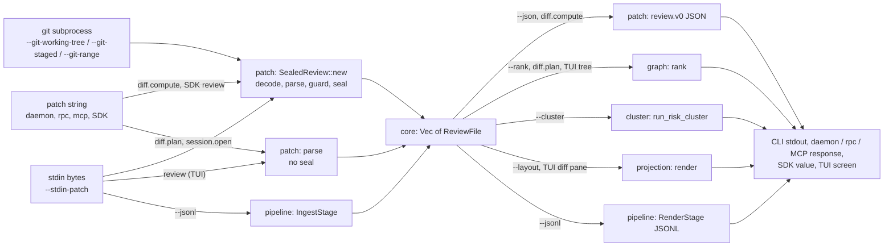

# Architecture

> **Two parts.** The first two sections, [Crates as built](#crates-as-built-030) and
> [Data flow as built](#data-flow-as-built-030), describe the code at 0.3.0, with later changes
> on `main` marked by date (the cli and daemon edges to `agent`, `RankedFile::scored` and daemon
> protocol 2 arrived on 2026-10-30, after v0.4.0). Everything from
> [Layers](#layers) down is **target design, not a description of the code** (anchor E-01,
> 2026-10-27): crates, commands and caches named there may not exist. The crate list that a test
> holds equal to `cargo metadata` is generated in
> [Current crates and edges](SCHEMATICS.md#current-crates-and-edges) from
> [`docs/crate-edges.txt`](crate-edges.txt).

## Crates as built (0.3.0)

Fourteen crates under `crates/`, each named `deep-diff-forge-<name>`. The graph below is drawn
from [`docs/crate-edges.txt`](crate-edges.txt), which
`crates/deep-diff-forge-cli/tests/crate_edges.rs` checks against `cargo metadata`. An arrow points
from a crate to a crate it depends on. Solid arrows are normal dependencies. `sdk → daemon` is a
normal dependency only on Unix targets (`[target.'cfg(unix)'.dependencies]` in
`crates/deep-diff-forge-sdk/Cargo.toml`). Dashed arrows labelled `dev` are test-only
dependencies; they do not license a normal edge.

```mermaid
flowchart TB
    cli
    tui
    sdk
    review
    pipeline
    cluster
    daemon
    agent
    learning
    graph
    projection
    syntax
    patch
    core

    cli --> agent
    cli --> cluster
    cli --> core
    cli --> daemon
    cli --> graph
    cli --> learning
    cli --> patch
    cli --> pipeline
    cli --> projection
    cli --> review
    cli --> syntax
    cli --> tui
    tui --> agent
    tui --> cluster
    tui --> core
    tui --> daemon
    tui --> graph
    tui --> learning
    tui --> patch
    tui --> projection
    tui --> syntax
    sdk --> core
    sdk -- "cfg(unix)" --> daemon
    sdk --> graph
    sdk --> patch
    review --> core
    pipeline --> core
    pipeline --> graph
    pipeline --> patch
    pipeline --> projection
    pipeline --> syntax
    cluster --> core
    cluster --> graph
    daemon --> agent
    daemon --> core
    daemon --> graph
    daemon --> patch
    agent --> core
    graph --> core
    patch --> core
    projection --> core
    syntax --> core
    agent -. dev .-> patch
    cluster -. dev .-> patch
    graph -. dev .-> patch
    projection -. dev .-> patch
```

`core` and `learning` have no workspace dependencies. `learning` is used by `cli` and `tui`
only. No crate named `git`, `planner`, `loom`, `ui-model` or `fixtures` exists; those appear
below only as target design.

| Crate | Role at 0.3.0 (from its `lib.rs` docs) |
| --- | --- |
| `core` | Shared model (`ReviewFile`, hunks, lines), `InputSeal`, exit-code registry, deploy and release vocabulary. |
| `patch` | Unified and Git patch parser, renderer, input guards, `SealedReview`, Git acquisition through the `git` program. |
| `projection` | Inline and side-by-side rows and text. |
| `pipeline` | `IngestStage` and `RenderStage` (used by `--jsonl`), and the shared source-pair review service behind `analyze`. |
| `syntax` | Tree-sitter (Rust grammar only), symbols, highlighting, token-level structural diff. |
| `graph` | Deterministic risk ranking of files from patch facts. |
| `cluster` | Bounded `std::thread::scope` lanes over contiguous shards, with a join policy and a receipt. |
| `agent` | Annotation grounding, sources, sanitising and anchor validation; an in-memory store. |
| `learning` | Local-only strategy receipts, scoring and promotion rules. |
| `daemon` | Unix-socket JSON-RPC 2.0 server and client (protocol 1 at 0.3.0 and 0.4.0; protocol 2 on `main` since 2026-10-30, adding `daemon.metrics` and `findings.verify`). Refuses to build on non-Unix targets. |
| `review` | Review roster, adversarial council, gates and tuicr interop ([REVIEW_COUNCIL.md](REVIEW_COUNCIL.md)). |
| `tui` | `review` terminal UI (ratatui, crossterm). |
| `sdk` | Rust facade: `review`, `rank`, `exit`, and a Unix-only daemon `Client`. |
| `cli` | The `deep-diff-forge` binary, including `rpc`, `mcp`, `envelope`, `schema` and `explain`. |

## Data flow as built (0.3.0)

Every surface reaches the same model, a `Vec<ReviewFile>` from `deep-diff-forge-core`. The sealed
path is `SealedReview::new` in `crates/deep-diff-forge-patch/src/sealed.rs`: decode the bytes,
parse, refuse if the caller's `InputGuards` fail, then seal the same bytes (`InputSeal`: SHA-256
plus the tool version). A seal cannot be paired with files parsed from other bytes.



Evidence (code at 0.3.0):

- CLI `--stdin-patch` (except `--jsonl`) and the Git selections both end in `emit_review`, which
  takes a `SealedReview` (`crates/deep-diff-forge-cli/src/main.rs`, `stdin_patch`,
  `sealed_review_or_exit`, `emit_review`; `crates/deep-diff-forge-cli/src/git_input.rs`).
- `--jsonl` runs `IngestStage` then `RenderStage`; a lossily decoded input emits the same events
  from the parsed files instead (`stdin_patch`).
- Daemon `diff.compute` uses `SealedReview::new`; `diff.plan` and `session.open` call
  `deep_diff_forge_patch::parse` and are unsealed (`crates/deep-diff-forge-daemon/src/handler.rs`,
  `compute`, `parse_patch_param`). `rpc` and `mcp` call the same `dispatch` in-process
  (`crates/deep-diff-forge-cli/src/rpc.rs`, `crates/deep-diff-forge-cli/src/mcp.rs`): MCP
  `review_patch` is `diff.compute`, `rank_patch` is `diff.plan`.
- SDK `review` wraps `SealedReview::new`; SDK `rank` is `graph::rank`
  (`crates/deep-diff-forge-sdk/src/lib.rs`).
- `review` (TUI) reads stdin, parses, and builds `ReviewApp`; its file tree is ranked by
  `graph`, and its notes are the engine's own findings (`engine_annotations`), not external
  agent input.
- `--cluster` places files with `graph::RankedFile::scored` (score, signals and code evidence)
  in `cluster` lanes and joins by `ranked-review-order`; its receipt lists the `patch` and
  `risk` dimensions (measured: `deep-diff-forge --stdin-patch --cluster --json`).

Not built: a planner that chooses strategies, a shared cache (the daemon reports
`cache_entries: 0`, decision D-03), daemon subscriptions, and the `chain`, `cluster`, `loom` and
`<old> <new>` commands (refused today; see `deep-diff-forge --help`).

## Platform scope (decision D-05, 2026-10-27)

Deep-Diff-Forge targets Linux and macOS. Windows is not a goal: the daemon uses Unix-domain
sockets and refuses to compile elsewhere (`deep-diff-forge-daemon/src/lib.rs`, `compile_error!`),
and the CLI and TUI depend on it unconditionally. The crates are not split to make a Windows build
possible; library crates that happen to build on Windows (`patch`, `learning`) are not tested or
released there.

## Source headers (decision E-05, 2026-10-27)

Some files open with `// DDF integration`, `// Design/status` and `// Module vault note` lines that
link to a design section and to the maintainer's local Obsidian vault (65 of 120 Rust files on
2026-10-27; all 79 links resolved). The `obsidian://` links open only in the owner's local
vault, not for other readers. They are optional and not enforced: CI cannot see the vault, so
a scan could check only that a header is present, which would push headers onto files with no note
to link. Add one when a vault note exists for the file; never add a link to a note that does not.

## Layers

Target design. Of these layers, the patch truth, semantic (Rust only, symbols and token-level
structural diff), review graph (file-level risk ranking), projection, and pipeline (ingest and
render only) layers exist in part; see [Crates as built](#crates-as-built-030). The planner and
loom layers do not exist.

1. **Input Layer**
   Reads Git state, patch files, file pairs, directories, stdin streams, and future forge APIs.

2. **Patch Truth Layer**
   Produces canonical apply-able patch data:
   paths, modes, renames, hunk headers, old/new line numbers, additions, removals, context, and metadata.

3. **Semantic Layer**
   Parses supported languages, builds syntax trees, computes structural matches, detects moved or reformatted code, and emits semantic spans.

4. **Planner Layer**
   Chooses strategies per file and region:
   line, word, syntax, moved-block, binary, generated-file, or fallback.

5. **Review Graph Layer**
   Connects files, hunks, symbols, tests, risk signals, ownership, comments, agent notes, and commands.

6. **Projection Layer**
   Converts the core model into side-by-side, inline, stacked, JSON, TUI, desktop, web, and agent API views.

7. **Pipeline Layer**
   Runs chainable command stages: ingest, plan, rank, annotate, render, chain, and cluster.

8. **Loom Layer**
   Assimilates exemplar lessons and feature proposals into Rust crate plans, fixtures, gates, and receipts.

## Core Principle

Patch truth and semantic truth are separate but synchronized.

The patch twin answers: "What exact text can be applied?"

The semantic twin answers: "What code meaning changed?"

The projection layer joins them through stable anchors:

- file identity
- old/new byte ranges
- old/new line ranges
- syntax node identities
- hunk ids
- semantic span ids

## Crate Plan

Built at 0.3.0: `core`, `patch`, `projection`, `pipeline`, `syntax`, `graph`, `agent`, `tui`,
`cluster`, `learning`, `daemon`, `review`, `sdk`, `cli` (see [Crates as built](#crates-as-built-030)).

Target only, not built:

- `deep-diff-forge-git`: a Git adapter crate. Git input today is `patch::acquire_git`, which runs
  the `git` program; there is no `gix` dependency.
- `deep-diff-forge-planner`: per-file and per-region strategy selection.
- `deep-diff-forge-ui-model`: renderer-neutral layout and interaction model.
- `deep-diff-forge-loom`: controlled assimilation plans, fixtures, gates, and receipts.

Parts of the original plan that the built crates do not do yet: `pipeline` has no chain
manifest runner or plan/rank/annotate stages; `cluster` runs only the patch and risk dimensions;
`daemon` has sessions but no shared cache and no multi-client subscriptions.

## Schematics

Detailed diagrams and API maps (most are target design; each says what exists today):

- [SCHEMATICS.md](SCHEMATICS.md)
- [API_AND_IPC.md](API_AND_IPC.md)
- [CHAINING_AND_CLUSTERING.md](CHAINING_AND_CLUSTERING.md)
- [DIMENSIONAL_EXECUTION_MODEL.md](DIMENSIONAL_EXECUTION_MODEL.md)
- [DEEP_DIFF_FORGE_LOOM.md](DEEP_DIFF_FORGE_LOOM.md)
- [RUST_IMPLEMENTATION_STRATEGY.md](RUST_IMPLEMENTATION_STRATEGY.md)
- [MODULE_STRUCTURE_PLAN.md](MODULE_STRUCTURE_PLAN.md)
- [PERFORMANCE_AND_NOVELTY.md](PERFORMANCE_AND_NOVELTY.md)

## Non-Goals

- Do not replace Git.
- Do not make non-apply-able semantic output the canonical patch.
- Do not trust AI annotations without provenance.
- Do not require a desktop app for the engine to be useful.

## Deployment Link

- Framework: [Codebase Deployment Framework](DEPLOYMENT_FRAMEWORK.md)


## Review integration route

[Implementation status and delivery gates](RECOMMENDATION_INTEGRATION.md#remaining-module-routes) ↔ [Module vault note](obsidian://open?vault=deep-diff-forge.vault&file=Implementation%2FModules%2Fdocs--ARCHITECTURE) (owner's local vault). This route records planned and evaluation-dependent work without claiming it is implemented.


## Captured multi-provider review controller

`deep-diff-forge-review` depends inward on core vocabulary and the canonical changed-source digest. It admits shared-service analysis artifacts and emits review/verification artifacts through the CLI. Existing daemon and TUI routes are not yet migrated. [Full implemented workflow, interfaces and limits](REVIEW_COUNCIL.md) ↔ [Vault](obsidian://open?vault=deep-diff-forge.vault&file=Implementation%2FReview%20Council) (owner's local vault).
