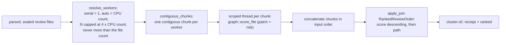
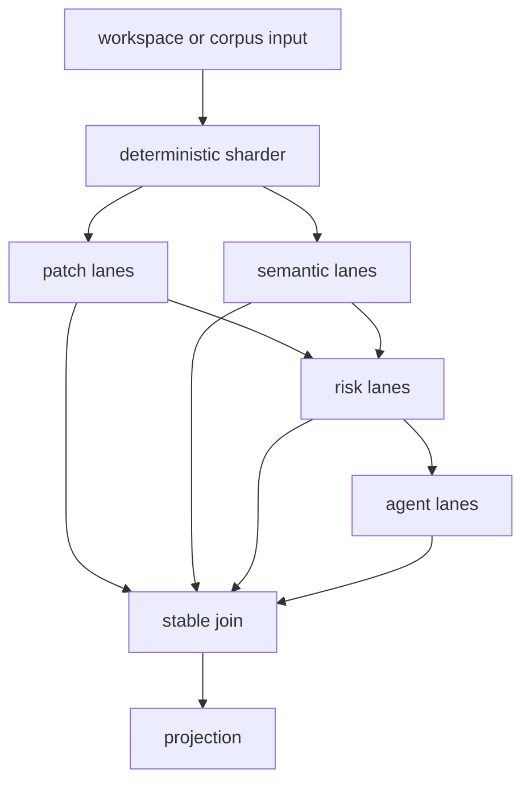

# Chaining And Clustered Execution

Deep-Diff-Forge commands must be useful as Unix filters before they become
interactive applications. Every non-interactive command is designed to compose
with Bash, Claude Code, CI, and other command runners.

## Status 2026-10-31

The `chain` and `cluster` subcommands are **withdrawn** and refused with exit 2 and their
replacement. Chaining is shell composition of single commands that each honour
`chain-contract`; clustering is the `--cluster` mode of `--stdin-patch`, the Git selections and
`<old> <new>`. `chain-contract` and `cluster-contract` now list only shipped modes, and a test
runs each one (`cli/tests/file_pair.rs`). The manifest and the extra dimensions below are kept
as design history, not as plans anyone owns.

## Status 2026-10-28 (0.3.0)

Most of this page is a target design. What ships today:

- **Chaining:** single commands that read stdin explicitly (`--stdin-patch`,
  `learn record --stdin`) and write one JSON document (`--json`) or one event
  per line (`--jsonl`). Internally `--jsonl` runs a two-stage pipeline
  (`IngestStage` → `RenderStage::jsonl()`, `crates/deep-diff-forge-pipeline`).
- **Clustering:** `--cluster [--parallel serial|auto|N]` on `--stdin-patch` and
  on the Git selections. It runs the patch and risk dimensions over the files
  with bounded threads, joins in ranked review order, and prints a receipt
  (`deep-diff-forge.cluster.v0` with `--json`).
- **Not implemented** (exit 2 today): the `ingest`, `plan`, `rank`, `annotate`,
  `render`, `chain` and `cluster` subcommands, chain manifests, corpus runs,
  `--dimensions`, `--budget`, `--receipt` and `--ranked`.

## Goals

- Make every machine command pipe-safe.
- Support single-process pipelines without the daemon.
- Support optional clustered execution for large repos and corpora.
- Preserve deterministic output under parallel execution.
- Keep patch truth canonical across every chain stage.

## Command Families

| Family | Command | Status | Today |
| --- | --- | --- | --- |
| Ingest | `deep-diff-forge ingest` | planned | `--stdin-patch` or `--git-working-tree` / `--git-staged` / `--git-range` |
| Plan | `deep-diff-forge plan` | planned | the per-file `strategy` field of `review.v0` |
| Rank | `deep-diff-forge rank` | planned | `--rank` (`rank.v0`) |
| Annotate | `deep-diff-forge annotate` | planned | none on the CLI |
| Render | `deep-diff-forge render` | planned | `--layout inline\|side-by-side`, `review --probe` |
| Chain | `deep-diff-forge chain` | withdrawn | the shell joins single commands |
| Cluster | `deep-diff-forge cluster` | withdrawn | `--cluster [--parallel N]` |

## Pipe Contracts

```text
stdin   = input only for --stdin-patch, learn record --stdin, findings verify and review (the patch), and rpc and mcp (their protocol)
stdout  = primary output only
stderr  = diagnostics and warnings
status  = an exit code from the registry (deep-diff-forge schema exit-codes)
format  = a schema name in every JSON document
```

Rules:

- `--json` emits one complete JSON document and is never mixed with events.
- `--jsonl` emits one event per line (`{"event":"diff.file",…}`). Today the
  events carry no `schema` field, and the whole output is written when the run
  ends.
- A closed stdout (`| head`) ends the command cleanly with exit 0; the reader
  keeps what it read. Any other write failure, including one in output that does
  not end in a newline, exits 3 (io).
- Stdin is never consumed by accident: only the commands above read it.
- Target: default human output uses ANSI only when stdout is a TTY (today only
  `highlight` colours); large outputs flush by file, hunk or event boundary.

## Chain Examples

### Shipped

```bash
# Machine-readable workspace review.
deep-diff-forge --git-working-tree --include-untracked --json

# One stage per command, joined by the shell.
git diff | deep-diff-forge --stdin-patch --jsonl | jq -c 'select(.hunks > 3)'

# CI gate that fails on a broken contract or an empty change.
set -euo pipefail
deep-diff-forge chain-contract
deep-diff-forge --git-range "origin/main..HEAD" --json --require-files --require-hunks > review.json
deep-diff-forge --git-range "origin/main..HEAD" --rank --json > rank.json
```

### Planned (not implemented)

```bash
deep-diff-forge ingest --git --jsonl \
  | deep-diff-forge plan --stdin --jsonl \
  | deep-diff-forge rank --stdin --json \
  | deep-diff-forge render --stdin --plain

deep-diff-forge ingest --git --jsonl \
  | deep-diff-forge annotate --stdin --agent claude-code --jsonl \
  | deep-diff-forge render --stdin --compact
```

## Chain Manifest (planned, not implemented)

`deep-diff-forge chain` would accept an explicit manifest when pipelines need to
be reproducible.

```toml
schema = "deep-diff-forge.chain.v0"
name = "claude-fast-review"

[[stage]]
id = "ingest"
command = "ingest"
input = "git"
output = "jsonl"

[[stage]]
id = "plan"
command = "plan"
input = "jsonl"
output = "jsonl"
budget = "fast"

[[stage]]
id = "rank"
command = "rank"
input = "jsonl"
output = "json"
join = "ranked-review-order"
```

## Cluster Model

Cluster execution is a scheduler, not a different engine. It splits work into
lanes, runs lanes in parallel, and rejoins records deterministically.

### Shipped: `--cluster`

Measured from `crates/deep-diff-forge-cluster/src/{cluster.rs,scheduler.rs}`
(`run_risk_cluster`, `run_lane`, `apply_join`, `resolve_workers`):



The receipt records `dimensions` (`patch`, `risk`), `parallelism` (`serial`,
`auto` or `fixed:N`), `workers`, `join_policy` and `file_count`. The output is
the same for any worker count; a panicking lane aborts the run rather than
returning a short result. `--parallel` takes `serial`, `auto` or a
worker count from 1; anything else is a usage error, exit 2 (`parse_parallelism`
in `main.rs`).

### Target: dimensional lanes (planned)

The core model already names eight dimensions (`ExecutionDimension`: patch,
semantic, risk, agent, runtime, storage, history, presentation) and three join
policies (`JoinPolicy`: deterministic input order, ranked review order, as-ready
with stable ids). Only patch and risk lanes run today.



## Cluster Commands

### Shipped

```bash
# Auto parallelism on the current machine.
git diff | deep-diff-forge --stdin-patch --cluster --json

# Bounded parallelism for CI runners.
deep-diff-forge --git-range "origin/main..HEAD" --cluster --parallel 4 --json
```

### Planned (not implemented)

```bash
deep-diff-forge cluster --git --dimensions patch,semantic,risk --parallel auto --jsonl
deep-diff-forge cluster --git --parallel 4 --budget balanced --json
deep-diff-forge cluster \
  --corpus <corpus-dir>/manifest.toml \
  --dimensions patch,semantic,history \
  --parallel auto \
  --receipt ./receipts/corpus-run.json
```

## Determinism Rules

| Rule | Requirement | Status |
| --- | --- | --- |
| Stable IDs | File, hunk, span, annotation and lane IDs are content-derived or manifest-derived. | partial: files are keyed by path, hunks by a per-file index; spans, annotations and lanes have no CLI ids yet |
| Stable joins | Default join order is deterministic input order. | the join policy exists; `--cluster` always uses ranked review order |
| Explicit ranking | Ranked order is requested with a flag or a rank stage. | `--rank` and `--cluster` rank; `--ranked` is planned |
| Bounded memory | Lanes stream by file and never require the whole repo in memory. | planned; input is read whole up to the 64 MiB patch budget |
| Receipt first | Cluster runs emit a receipt with dimensions, budgets, versions and skipped lanes. | partial: dimensions, parallelism, workers, join policy and file count; no budgets or skipped lanes |

## Rust Execution Strategy

Shipped: the cluster scheduler uses `std::thread::scope`, and the daemon is a
std `UnixListener` server with one thread per connection. The workspace depends
on neither `rayon` nor `tokio`. CLI one-shot mode stays synchronous until async
has a measured benefit.

The shipped stage trait (`crates/deep-diff-forge-pipeline/src/lib.rs`) is
small:

```rust
pub trait ChainStage {
    fn name(&self) -> &'static str;
    fn run(&self, input: PipelineData) -> Result<PipelineData, PipelineError>;
}
```

`PipelineData` is `Patch(String)`, `Review(Vec<ReviewFile>)` or
`Rendered(String)`. A lane trait is planned; today a lane is a closure passed to
`run_lane`.

Remote distributed execution is out of scope until local receipts, replay and
failure semantics are boring and testable.

## Deployment Link

- Framework: [Codebase Deployment Framework](DEPLOYMENT_FRAMEWORK.md)
