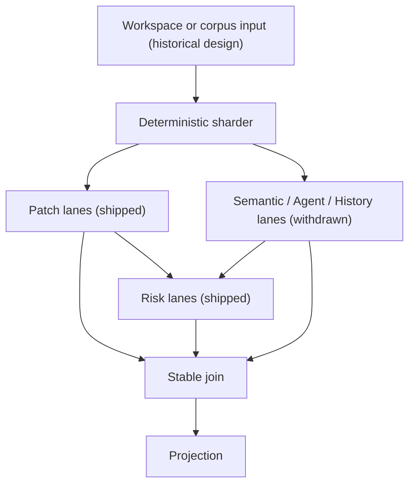

# Chaining And Clustered Execution

Deep-Diff-Forge commands are designed as composable Unix filters first and interactive applications second. Every non-interactive machine command composes cleanly with Bash (`set -euo pipefail`), Claude Code, CI runners, and other orchestrators.

> **Status (`v0.11.0`, 2026-11-27).**
> - **Shipped & wired:** Shell composition of single commands honoring `chain-contract` (`--stdin-patch`, `--git-*`, `<old> <new>`, `--json`, `--jsonl`, `--rank`, `--diagnostics`, `--fail-on`, `--outline`, `--hunks`, `findings verify`, `envelope`, `learn record --stdin`), backed internally by `crates/deep-diff-forge-pipeline` (`IngestStage` → `RenderStage`). In-process parallel risk scoring ships via `--cluster [--parallel serial|auto|N]` (`crates/deep-diff-forge-cluster`) over the **`patch` and `risk`** dimensions with pre-computed `CarriedShares` and deterministic `ranked-review-order` join.
> - **Withdrawn (refused with exit `2` naming replacement):** Top-level `chain`, `cluster`, and `loom` subcommands (`WITHDRAWN` in `crates/deep-diff-forge-cli/src/main.rs`), plus the `rank`, `annotate`, and `render` subcommands, chain manifests, and the `semantic`, `agent`, `runtime`, `storage`, `history`, and `presentation` cluster lanes (`chain-contract`, `cluster-contract`).
> - **Not built, unowned:** `ingest` and `plan` as standalone subcommands. Nothing is on hold.

For the exact sharding math, worker cap, and cross-section `CarriedShares` invariant, see [Algorithms, Heuristics, and Execution Invariants — Section 7 (Bounded Parallel Cluster Sharding)](ALGORITHMS_AND_HEURISTICS.md#7-bounded-parallel-cluster-sharding).

---

## Goals

- Make every machine command pipe-safe and deterministic.
- Support single-process pipelines without requiring the daemon.
- Support bounded in-process parallel execution for large diffs.
- Preserve bit-identical output across any worker count (`serial`, `auto`, `fixed:N`).
- Keep patch truth canonical and immutable across every stage and lane.

## Command Families (`v0.11.0`)

| Family | Historical Name | Status | `v0.11.0` Shipped Equivalent |
| --- | --- | --- | --- |
| Ingest | `deep-diff-forge ingest` | not built (unowned) | `--stdin-patch`, `--git-working-tree`, `--git-staged`, `--git-range A..B`, `<old> <new>` |
| Plan | `deep-diff-forge plan` | not built (unowned) | Per-file `strategy` field in `review.v0`; daemon `diff.plan` |
| Rank | `deep-diff-forge rank` | **withdrawn** | `--rank [--fail-on LIST] [--json]` (`rank.v0`) |
| Diagnostics | — | **shipped (`v0.11.0`)** | `--diagnostics [--fail-on LIST] [--json]` (`diagnostics.v0`) |
| Annotate | `deep-diff-forge annotate` | **withdrawn** | `findings verify --findings FILE [--require-all] [--require-findings]` (`findings.v0`) |
| Render | `deep-diff-forge render` | **withdrawn** | `--layout inline\|side-by-side`, `--outline`, `--hunks`, `review --probe` |
| Chain | `deep-diff-forge chain` | **withdrawn (exit 2)** | Shell pipes joining single commands (`deep-diff-forge chain-contract`) |
| Cluster | `deep-diff-forge cluster` | **withdrawn (exit 2)** | `--cluster [--parallel serial\|auto\|N] [--json]` (`deep-diff-forge cluster-contract`) |

## Pipe Contracts (`chain-contract v0`)

```text
stdin   = read ONLY by --stdin-patch, learn record --stdin, findings verify, review (patch), rpc, and mcp
stdout  = primary machine or human output only
stderr  = diagnostics, warnings, and exit-7 refusal reason lines
status  = exit code from the registry (`deep-diff-forge schema exit-codes`)
format  = explicit `schema` in every JSON document; explicit `event` in every JSONL record
```

Verified guarantees (`cli/src/main.rs::chain_contract`, `cli/src/refusal.rs`):

- `--json` emits one complete JSON document and is never mixed with JSONL events.
- `--jsonl` runs the two-stage pipeline (`IngestStage` → `RenderStage::jsonl()` in `deep-diff-forge-pipeline`) and emits one `{"event":"diff.file",…}` record per line once the run completes.
- **Closed-stdout semantics:** A closed stdout pipe (`| head`) exits `0` on normal commands while preserving what the reader read; **verdict refusals (`--fail-on`, `eval`, `agent check`, `agent verify-branch`) preserve exit `7`** even if stdout closes early (closing DDF-2026-010/011). Any other write failure exits `3` (`io`).
- **Empty stdin:** `--stdin-patch` with zero file sections (empty or prose) exits `4` (`no_patch_in_input`) unless `--allow-empty` is passed; Git selections and `<old> <new>` return zero files cleanly.
- Stdin is never consumed accidentally by commands outside the explicit list above.

---

## Chain Examples

### Shipped (`v0.11.0`)

```bash
# Machine-readable workspace review (sealed review.v0).
deep-diff-forge --git-working-tree --include-untracked --json

# Stream per-file events into jq.
git diff | deep-diff-forge --stdin-patch --jsonl | jq -c 'select(.hunks > 3)'

# CI gate: verify contracts, fail on security/integrity signals or truncated evidence.
set -euo pipefail
deep-diff-forge chain-contract
deep-diff-forge --git-range "origin/main..HEAD" --json --require-files --require-hunks > review.json
deep-diff-forge --git-range "origin/main..HEAD" --rank --fail-on security,integrity --json > rank.json
deep-diff-forge --git-range "origin/main..HEAD" --diagnostics --json > diagnostics.json
```

### Historical Target Design (Withdrawn — Not Built)

> Kept for design history only; `chain`, `rank`, `annotate`, and `render` subcommands are withdrawn.

```bash
deep-diff-forge ingest --git --jsonl \
  | deep-diff-forge plan --stdin --jsonl \
  | deep-diff-forge rank --stdin --json \
  | deep-diff-forge render --stdin --plain
```

```toml
# Withdrawn 2026-10-31 (design history): chain manifest schema
schema = "deep-diff-forge.chain.v0"
name = "claude-fast-review"

[[stage]]
id = "ingest"
command = "ingest"
input = "git"
output = "jsonl"

[[stage]]
id = "rank"
command = "rank"
input = "jsonl"
output = "json"
join = "ranked-review-order"
```

---

## Cluster Model

Cluster execution is an in-process scheduler (`deep-diff-forge-cluster`), not a separate engine and not daemon-dependent.

### Shipped: `--cluster` (`v0.11.0`)

Verified from `crates/deep-diff-forge-cluster/src/{cluster.rs,scheduler.rs}` (`run_risk_cluster`, `run_lane`, `contiguous_chunks`, `resolve_workers`, `apply_join`):

```mermaid
flowchart LR
    Files["Parsed, sealed ReviewFile slice"]
    Shares["CarriedShares::of(files) (pre-computed once across full patch)"]
    Workers["resolve_workers: serial=1, auto=CPUs, fixed:N capped at 4x CPUs & file_count"]
    Chunks["contiguous_chunks: balanced ranges (n/w + 1, n/w)"]
    Lane["std::thread::scope per chunk: RankedFile::scored_in_patch (patch + risk)"]
    Concat["Concatenate chunks in input order (panic unwinds, never truncates)"]
    Join["apply_join RankedReviewOrder: score desc, then path asc"]
    Out["cluster.v0: input_sha256 + receipt + ranked"]

    Files --> Shares --> Workers --> Chunks --> Lane --> Concat --> Join --> Out
```



- **Cross-section determinism:** Pre-computing `CarriedShares::of(files)` before spawning threads guarantees that multi-hunk created files and multi-section same-path merges receive identical carried-reading shares regardless of shard boundaries or worker count.
- **Receipt (`deep-diff-forge.cluster.v0`):** Records `input_sha256`, `tool`, `receipt` (`dimensions: ["patch", "risk"]`, `parallelism`, `workers`, `join_policy: "ranked-review-order"`, `file_count`), and `ranked` (using `graph::entry_json(rf, false)`).
- **Flag validation:** `--parallel` accepts `serial`, `auto`, or an integer `>= 1`; any other value exits `2` (`usage`). Available on `--stdin-patch`, `--git-working-tree`, `--git-staged`, `--git-range`, and `<old> <new>`.

```bash
# Auto parallelism on the current machine.
git diff | deep-diff-forge --stdin-patch --cluster --json

# Bounded parallelism for CI runners.
deep-diff-forge --git-range "origin/main..HEAD" --cluster --parallel 4 --json

# Direct file pair in clustered mode.
deep-diff-forge old.rs new.rs --cluster --parallel 2 --json
```

### Historical Target Design: Multi-Dimensional Lanes (Withdrawn 2026-10-31)

`deep-diff-forge-core` retains the eight-variant `ExecutionDimension` enum (`patch`, `semantic`, `risk`, `agent`, `runtime`, `storage`, `history`, `presentation`) and three-variant `JoinPolicy` enum (`deterministic-input-order`, `ranked-review-order`, `as-ready-with-stable-ids`), but only `patch` and `risk` lanes ship; the remaining six lanes and top-level `cluster` subcommand are withdrawn.



---

## Determinism Rules (`v0.11.0`)

| Rule | Requirement | `v0.11.0` Status |
| --- | --- | --- |
| Stable IDs | Content- or patch-derived IDs | **Shipped for files, hunks & diagnostics:** files keyed by path, hunks by `HunkId` + SHA-256 `PatchHunk::address`, diagnostics by SHA-256 `Diagnostic::key`; no lane IDs |
| Stable joins | Deterministic order independent of thread scheduling | **Shipped:** `run_lane` concatenates chunks in input order; `--cluster` always joins with `ranked-review-order` (score desc, path asc) |
| Explicit ranking | Ranked order requested via flag | **Shipped:** `--rank` and `--cluster` rank; `--diagnostics` emits in rank order |
| Bounded memory | Prevent OOM on huge inputs | **Shipped via budgets:** whole patch capped at `64 MiB` / `1,000,000` lines; carried reading capped at `256 KiB` / `512` B line (not streaming) |
| Receipt first | Cluster runs emit a structured receipt | **Shipped:** `receipt` carries `dimensions`, `parallelism`, `workers`, `join_policy`, `file_count` |

## Rust Execution Strategy (`v0.11.0`)

- **Zero async runtime / thread-pool bloat:** `deep-diff-forge-cluster` uses `std::thread::scope`, and `deep-diff-forge-daemon` uses `std::os::unix::net::UnixListener` with one thread per connection under a `128 MiB` FCFS admission gate (`MAX_CONNECTIONS = 8`, `CONTROL_CONNECTIONS = 2`). Neither `rayon` nor `tokio` is a dependency anywhere in the 15-crate workspace.
- **Pipeline crate (`crates/deep-diff-forge-pipeline/src/{lib,stages,jsonl,review}.rs`):**
  ```rust
  pub trait ChainStage {
      fn name(&self) -> &'static str;
      fn run(&self, input: PipelineData) -> Result<PipelineData, PipelineError>;
  }
  ```
  `PipelineData` has three variants: `Patch(String)`, `Review(Vec<ReviewFile>)`, and `Rendered(String)`. `IngestStage` parses patches; `RenderStage` renders `Json`, `Jsonl`, `Inline`, or `SideBySide`; `pipeline::review` drives source-pair `analyze`.
- Remote distributed execution remains explicitly out of scope.

## Deployment Link

- Framework: [Codebase Deployment Framework](DEPLOYMENT_FRAMEWORK.md)
- Dimensional Model: [Dimensional Execution Model](DIMENSIONAL_EXECUTION_MODEL.md)
