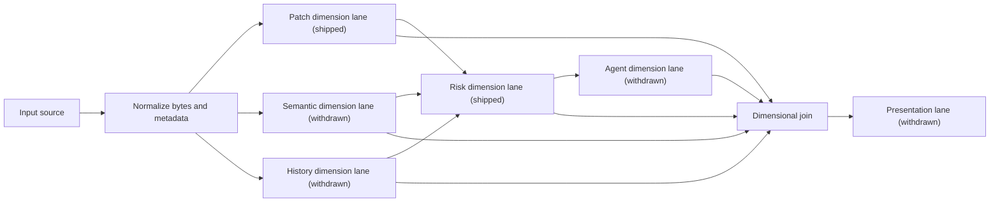

# Dimensional Execution Model

Deep-Diff-Forge models a diff as a set of synchronized dimensions: independently computable views of the same change, joined through stable anchors so parallelism never compromises patch truth.

> **Status (`v0.11.0`, 2026-11-27).**
> - **Shipped & wired:** The **`patch`** and **`risk`** dimensions behind `--cluster [--parallel serial|auto|N]` (`crates/deep-diff-forge-cluster::run_risk_cluster` + `scheduler::run_lane`) and the core vocabulary (`ExecutionDimension`, `Parallelism`, `JoinPolicy`, `StreamContract`) in `crates/deep-diff-forge-core`. Separate non-clustered shipped surfaces also deliver **semantic** (`syntax` / `structural` / `analyze`), **agent** (`findings verify`, `agent hook` v13, `diagnostics.v0`), **runtime** (daemon protocol 3, `daemon.metrics`), **storage** (learning JSONL store, project frontier ledger), and **presentation** (`projection`, `tui`, paged views) outside the cluster lane runner.
> - **Withdrawn (`cluster-contract`, 2026-10-31):** The top-level `deep-diff-forge cluster` subcommand (exits `2` naming `--cluster`) and the `semantic`, `agent`, `runtime`, `storage`, `history`, and `presentation` cluster lanes.
> - **Historical target design (not built, unowned):** Lane states, planner budget profiles (`fast`/`balanced`/`deep`/`corpus`), `deep-diff-forge.dimension-receipt.v0`, and daemon lane caching/subscriptions. Nothing is on hold.

See [Algorithms, Heuristics, and Execution Invariants](ALGORITHMS_AND_HEURISTICS.md) for the exact shipped algorithms, [Chaining and Clustered Execution](CHAINING_AND_CLUSTERING.md) for `--cluster` wiring, and [Reference Index](reference/README.md) for shipped CLI/daemon/MCP contracts.

---

## What Exists in `v0.11.0`

- **Vocabulary in `deep-diff-forge-core`:** `ExecutionDimension` (all eight dimensions in the table below), `Parallelism` (`serial`, `auto`, `fixed:N`), `JoinPolicy` (the three policies below), and `StreamContract`. There is no lane-state enum and no planner budget-profile type in `core` (an unwired `BudgetProfile` enum exists in `deep-diff-forge-learning::planner`).
- **One cluster runner (`crates/deep-diff-forge-cluster`):** `run_risk_cluster` pre-computes patch-wide `CarriedShares::of(files)` once, splits files into balanced contiguous chunks across bounded `std::thread::scope` workers (`fixed:N` capped at `4 × CPU count`, never more than file count), scores each file with `graph::RankedFile::scored_in_patch` (27-signal risk + dual-reader code evidence), and joins deterministically. Its receipt names the `patch` and `risk` dimensions only.
- **CLI (`--cluster`):** `--stdin-patch`, `--git-working-tree`, `--git-staged`, `--git-range A..B`, and `<old> <new>` all accept `--cluster [--parallel serial|auto|N] [--json]`, always joining by `ranked-review-order` (descending score, then ascending path). The JSON document is `deep-diff-forge.cluster.v0` with `input_sha256`, `tool`, `receipt` (`dimensions`, `parallelism`, `workers`, `join_policy`, `file_count`), and `ranked`.
- **Join policies:** `apply_join` implements `ranked-review-order` (`graph::sort_ranked`); `deterministic-input-order` and `as-ready-with-stable-ids` both preserve input order in this batch scheduler (no asynchronous as-ready streaming).
- **Shipped capabilities outside cluster lanes:** Semantic Rust AST/structural diffing (`deep-diff-forge-syntax`), verified agent findings (`deep-diff-forge-agent`), `diagnostics.v0` & byte-exact paging (`graph`, `daemon`), agent hook v13 + project ledger (`cli`), and local learning receipts (`deep-diff-forge-learning`) all ship in `v0.11.0` as direct commands/RPCs rather than dimensional cluster lanes.
- **Not built / withdrawn:** Multi-dimensional cluster lanes beyond `patch` + `risk`; lane states; `deep-diff-forge.dimension-receipt.v0`; daemon lane caching (`cache_entries: 0`) and subscriptions; the top-level `cluster` subcommand (exit `2`).

---

## Dimensions (Core Vocabulary & Shipped Mapping)

| Dimension | Purpose | `v0.11.0` Reality |
| --- | --- | --- |
| `patch` | Canonical apply-able change (`PatchTwin`, hunks, line anchors). | **Shipped (core + cluster lane)** (`deep-diff-forge-patch`, 42-shape conformance) |
| `risk` | Review priority, 27 signals, dual-reader code evidence, `diagnostics.v0`. | **Shipped (core + cluster lane)** (`deep-diff-forge-graph`) |
| `semantic` | Tree-sitter Rust AST symbols, highlighting, token-level `structural_diff`. | **Shipped outside cluster lanes** (`deep-diff-forge-syntax`; cluster lane withdrawn) |
| `agent` | Verified agent findings (`findings.v0`) and agent hook loop (`v13`). | **Shipped outside cluster lanes** (`deep-diff-forge-agent`, `cli::hook*`; cluster lane withdrawn) |
| `runtime` | Unix-socket daemon (protocol 3), admission caps, lock-free metrics. | **Shipped outside cluster lanes** (`deep-diff-forge-daemon`; cluster lane withdrawn) |
| `storage` | Owner-private learning JSONL receipts, project frontier ledger, council journal. | **Shipped outside cluster lanes** (`learning`, `cli::ledger`, `review`; cluster lane withdrawn) |
| `history` | Git ancestry (`git-range`, `agent verify-branch`) and prior review memory. | **Partial outside cluster lanes** (no historical churn/similarity lane; cluster lane withdrawn) |
| `presentation` | Inline, side-by-side, TUI cockpit, JSON/JSONL, byte-exact paged views. | **Shipped outside cluster lanes** (`projection`, `tui`, `daemon::views/pages`; cluster lane withdrawn) |

## Anchor Map

Every shipped surface joins through stable patch-derived anchors (`file.path`, `HunkId`, content-addressed SHA-256 `PatchHunk::address`, line numbers, and SHA-256 `Diagnostic::key`):

```text
file (path, InputSeal.input_sha256)
  hunk (HunkId, SHA-256 address)
    patch-line (side, old_line / new_line)
    evidence / diagnostic (code, side, line, SHA-256 Diagnostic::key)
    verified-finding (address or path+line, claim_verified: false)
    semantic-symbol / token (Rust source-pair analysis only)
```

Patch truth is authoritative for apply-ability. Every other view is derived and may be absent or degraded without altering patch truth.

---

## Historical Target Design (Not Built / Withdrawn Lanes)

> The diagrams, lane states, budget profiles, and `dimension-receipt.v0` schema below are preserved as **design history**; the extra cluster lanes were withdrawn on 2026-10-31.

### Execution Lanes (Target Design)



### Lane States (Not Built)

| State | Meaning |
| --- | --- |
| `pending` | The lane has not started. |
| `running` | Work is active. |
| `ready` | Output is available. |
| `partial` | Output is available with fallback records. |
| `skipped` | Lane was disabled by budget, input kind, or command flags. |
| `failed-recoverable` | Patch truth remains available and the failure is recorded. |
| `failed-hard` | The command cannot produce a valid requested output. |

### Planner Budget Profiles (Not Built in Core)

| Profile | Patch | Semantic | Risk | Agent |
| --- | --- | --- | --- | --- |
| `fast` | required | small files only | deterministic cheap signals | disabled unless requested |
| `balanced` | required | budgeted supported languages | graph rank | grounded notes only |
| `deep` | required | expanded syntax and move search | history and ownership | full evidence pass |
| `corpus` | required | benchmark profile | aggregate signals | disabled by default |

### Join Policies (`deep-diff-forge-core::JoinPolicy`)

| Policy | Intended Use Case | `v0.11.0` Behavior |
| --- | --- | --- |
| `deterministic-input-order` | Default JSON, JSONL, and CI output. | Preserves input order in `cluster::apply_join`. |
| `ranked-review-order` | Human review stream and agent triage. | Used by `--cluster` (`graph::sort_ranked`: score desc, path asc). |
| `as-ready-with-stable-ids` | Progress UI, daemon subscriptions, corpus runs. | Collapses to input order in batch scheduler. |

### Dimensional Receipts (Target Schema — Not Built)

> Built today: the `receipt` object inside `deep-diff-forge.cluster.v0` (`dimensions`, `parallelism`, `workers`, `join_policy`, `file_count`).

```json
{
  "schema": "deep-diff-forge.dimension-receipt.v0",
  "engine_version": "0.1.0",
  "input": "git",
  "dimensions": ["patch", "semantic", "risk"],
  "join_policy": "deterministic-input-order",
  "parallelism": "auto",
  "fallbacks": [],
  "started_at": "2026-06-21T00:00:00Z",
  "finished_at": "2026-06-21T00:00:01Z"
}
```

---

## Rust Crate Boundary (`v0.11.0`)

| Crate | `v0.11.0` Responsibility |
| --- | --- |
| `deep-diff-forge-core` | Pure vocabulary (`ExecutionDimension`, `Parallelism`, `JoinPolicy`, `ReviewFile`, `InputSeal`, SHA-256/HMAC, exit registry). |
| `deep-diff-forge-pipeline` | `ChainStage`, `IngestStage`, `RenderStage` (`--jsonl`), source-pair `analyze`. |
| `deep-diff-forge-cluster` | `std::thread::scope` contiguous sharding, parallel `patch` + `risk` scoring with pre-computed `CarriedShares`, deterministic join & `ClusterReceipt`. |
| `deep-diff-forge-daemon` | Protocol 3 Unix-socket server (17 methods, `128 MiB` FCFS admission, lock-free metrics, byte-exact paging; `cache_entries: 0`, no lane subscriptions). |

`unsafe_code = "forbid"` is compiler-enforced across the entire workspace (`Cargo.toml`).

## Deployment Link

- Framework: [Codebase Deployment Framework](DEPLOYMENT_FRAMEWORK.md)
