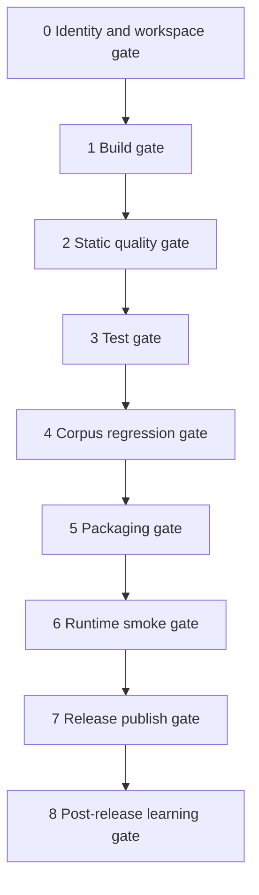

# End To End Deployment Specification

This document defines the deployment spine for Deep-Diff-Forge from local development through public release, daemon rollout, and post-release learning.

## Status 2026-10-28 (0.3.0)

The gate sequence below is the design. What runs today:

- Gates 0 to 4 and 6 run on every pull request in `.github/workflows/ci.yml`,
  and locally in one command: `just ci` ([`scripts/ci_local.sh`](../scripts/ci_local.sh))
  replicates the `secrets`, `msrv`, `gate` and `supply-chain` jobs step for
  step. Pedantic clippy is already mandatory there. Diff-scoped mutation
  ([`scripts/diff_mutation.sh`](../scripts/diff_mutation.sh)) and the
  rootless-Podman planted-breach suite also gate every pull request.
- Gates 5 to 7 run in `.github/workflows/release.yml` on a `v*` tag, or as a
  dry run on `workflow_dispatch` that publishes nothing. Details:
  [Release And Publication](RELEASE_AND_PUBLICATION.md#github-actions).
- Gate 4's snapshot directories (`fixtures/expected/...`) do not exist. The
  fixtures today are `fixtures/patch/*.patch` (with `fixtures/patch/regressions/`)
  and `fixtures/council/`; fuzz seeds live in `fuzz/seeds/`.
- Gate 8 has no tooling; nothing writes `reports/releases/`.
- Version 0.3.0 is tagged `v0.3.0` (2026-10-29). Published releases: `v0.1.0`, `v0.2.0`, `v0.3.0`. crates.io
  is on hold (`DDF_CRATES_IO`).
- The local remote-tracking refs (last fetch, 2026-10-28) show GitLab `main` at
  `2f03f40`, the same commit as GitHub `main`; the 2026-10-26 instruction not to
  push GitLab `main` below is superseded.
- Release artifacts are not signed. Integrity is a SHA-256 file per archive plus
  GitHub build-provenance attestations.

## Deployment Philosophy

Deep-Diff-Forge deploys through gates, not hope.

The deployment model borrows three corpus patterns:

- From the 10TB migration runbook: identity gates, reversible phases, verification sentinels, and explicit destructive boundaries.
- From the Habitat service roster: clear service identity, health endpoints, dependency batches, and UDS-first service citizens where TCP is unnecessary.
- From no-mistakes: isolated validation before upstream publication, clean PRs, and no-green-without-receipt.

## Release Targets

| Target | Artifact | First-class? | Notes |
| --- | --- | --- | --- |
| CLI | `deep-diff-forge` binary | Yes | Pager-compatible and CI-compatible. |
| Library | Rust crates | Yes | Core model and optional engine crates. |
| TUI | `deep-diff-forge review` | Yes | Interactive terminal review. |
| Daemon | `deep-diff-forge daemon` | Yes, opt-in | UDS-first shared cache and session service. |
| Desktop/IDE adapters | Adapter crates | Later | Renderer-neutral projection layer feeds them. |
| Containers | OCI image | Later | Useful for CI review services, not required locally. |

## Environment Matrix

| Environment | Purpose | Transport | Persistence | Gate level |
| --- | --- | --- | --- | --- |
| Local dev | Fast iteration | In-process or CLI | Repo-local `target/` | Check + tests |
| Local review | Real user workflow | CLI/TUI | XDG cache/state | Check + TUI smoke |
| Daemon dev | IPC and cache validation | UDS | XDG runtime/cache/state | Check + IPC smoke |
| CI | Repeatable validation | CLI only | Ephemeral | Full gate |
| Release | Checksummed, attested artifacts | CLI/daemon | Packaged defaults | Full gate + receipts |
| Habitat deployment | Long-running service citizen | UDS only by default | XDG state/cache | Full gate + health |

## Phase Gates



### Gate 0: Identity And Workspace

Checks:

- Current repo basename is `deep-diff-forge`.
- Git branch is intentional.
- Working tree is clean or all dirty files are explicitly included.
- Remotes are known: GitHub and, when credentials exist, GitLab.
- Build output stays in repo-local `target/`, never an accidental read-only global target directory.

Command skeleton:

```bash
git status --short --branch
git remote -v
CARGO_TARGET_DIR=target cargo metadata --no-deps >/dev/null
```

### Gate 1: Build

```bash
CARGO_TARGET_DIR=target cargo check --workspace
```

CI adds `--locked` (`cargo check --workspace --locked`) and checks the declared
MSRV with Rust 1.88.0 (`cargo check --workspace --all-targets --locked`).
Release builds (`cargo build --release --locked -p deep-diff-forge-cli --target <triple>`)
run in `release.yml`.

### Gate 2: Static Quality

```bash
cargo fmt --all --check
CARGO_TARGET_DIR=target cargo clippy --workspace --all-targets -- -D warnings
```

Pedantic mode is mandatory in CI (`deploy gate-feature` job, with `--locked`;
also for the patch crate without default features and for the fuzz crate):

```bash
CARGO_TARGET_DIR=target cargo clippy --workspace --all-targets -- -D warnings -W clippy::pedantic
```

### Gate 3: Tests

```bash
CARGO_TARGET_DIR=target cargo test --workspace --locked
```

Expected test classes:

- patch parser fixtures
- semantic fallback fixtures
- projection snapshots
- daemon socket lifecycle tests
- cache key stability tests
- agent annotation grounding tests

### Gate 4: Corpus Regression

The corpus gate uses fixtures inspired by Difftastic's sample-file regression model.

Required fixture classes:

- exact line edits
- word-only edits
- reformat-only edits
- moved function
- renamed symbol
- malformed syntax
- unsupported language
- large file fallback
- generated file suppression
- binary diff
- rename and mode changes
- no-newline metadata
- grounded agent annotation
- ungrounded agent annotation

Output snapshots (target layout; these directories do not exist yet):

```text
fixtures/expected/inline/
fixtures/expected/side-by-side/
fixtures/expected/json/
fixtures/expected/review-graph/
```

### Gate 5: Packaging

First release forms:

```bash
cargo package --workspace --allow-dirty
CARGO_TARGET_DIR=target cargo build -p deep-diff-forge-cli --release --locked
```

`just publish-dry-run` runs `cargo publish --dry-run` for the core and learning
crates only (the others need their upstream crates on crates.io first).

Release forms, with their state on 2026-10-28:

- GitHub Release assets: built by `release.yml` on a tag
- GitLab Release assets: not produced
- crates.io publish: on hold (`DDF_CRATES_IO`)
- cargo-binstall metadata: not configured
- Linux tarball (`x86_64-unknown-linux-gnu`): built by `release.yml`
- macOS tarballs (`x86_64-apple-darwin`, `aarch64-apple-darwin`): built by `release.yml`
- optional DEB/RPM after daemon/systemd assets exist: not produced

### Gate 6: Runtime Smoke

CLI:

```bash
target/release/deep-diff-forge --version
target/release/deep-diff-forge --help
target/release/deep-diff-forge --self-test
```

Daemon:

`daemon start` blocks in the foreground, so a smoke runs it in the background.
The path below is the default one, so the other commands need no `--socket`:

```bash
deep-diff-forge daemon start --foreground --socket "$XDG_RUNTIME_DIR/deep-diff-forge/deep-diff-forge.sock" &
deep-diff-forge daemon status
deep-diff-forge daemon stop
```

The daemon smoke must assert:

- socket parent mode is `0700`
- socket mode is `0600` where supported
- owner is current UID
- stale sockets are detected and handled: a live socket is refused
  (`AddrInUse`, exit 6), a socket whose connect is refused is replaced, a
  non-socket file is never deleted
- JSON-RPC `engine.initialize` and `daemon.health` pass

The unit tests in `crates/deep-diff-forge-daemon/src/serve.rs` and
`security.rs`, the CLI tests in `crates/deep-diff-forge-cli/tests/daemon.rs`,
and the hostile soak (`scripts/security/daemon_soak.py`, 10 s in CI) cover
these. Before its timed loop the soak sends a request of exactly 80 MiB (served) and one byte
more (refused), holds all 8 connection slots and checks a ninth is closed unanswered and that
the daemon serves again once they leave, then runs 32 concurrent clients and checks every
answer is a valid response (measured 2026-10-29: 504 served, 296 closed at the limit, RSS
7,532 KiB). Each was also checked by hand on 2026-10-28 with the 0.3.0 debug build
(`engine.initialize` over `deep-diff-forge rpc`, the rest against a live
daemon).

### Gate 7: Publish

Publishing order:

1. Commit release changes.
2. Tag `vX.Y.Z`.
3. Push to GitHub.
4. Push to GitLab when credentials/project exist.
5. Create release assets.
6. Publish crates only after release artifacts pass smoke.

`main` changes only through a merged pull request, and GitLab `main` is fast-forwarded to
GitHub's. The tag is the owner's act, and one recipe validates and pushes it to both remotes:

```bash
just release-tag X.Y.Z   # version check, clean tree, gate-release, then push vX.Y.Z to origin and gitlab
```

Current status (2026-10-26, kept as written; see the 2026-10-28 status at the
top for what changed):

- **Do not push GitLab `main`.** It has diverged from GitHub `main` and must be
  reconciled first; branch pushes are unaffected.
- **crates.io (step 6) is on hold** until the codebase is production-ready and
  its documentation is current. A configured token does not lift the hold.
- Changes reach GitHub `main` through staged pull requests merged as merge
  commits (stage A, PR #3; stage B, PR #4; stage C, PR #5), each passing all
  five required checks first. Ruleset 25868121 enforces this on `main`: no direct
  push, no force push, no bypass. `main` CI is green at run 40274253094; see
  [`EVIDENCE.md`](../EVIDENCE.md#review-council-and-ci-2026-10-26).
- Gates 2 and 3 are additionally covered for review-council runs by the eight
  sandboxed evidence gates ([review council](REVIEW_COUNCIL.md#gate-sandbox)).
- Before the next release, the CLI/SDK/MCP slices A–D
  ([roadmap](ROADMAP.md#status-2026-10-26)) and the measured move to Ubuntu 26
  were open; both are done (2026-10-27). CI runs on `ubuntu-26.04`, and the Linux
  release binary is built on `ubuntu-24.04` so it runs on older distributions.

### Gate 8: Post-Release Learning

After release, record:

- compile time
- binary size
- benchmark deltas
- parse fallback rate
- cache hit rate
- crash or panic reports
- review graph ranking accuracy
- user toggles used most often
- ungrounded agent annotation rate

Receipts live under (target; nothing writes this directory yet):

```text
reports/releases/YYYY-MM-DD-vX.Y.Z/
```

## Rollback Model

Rollback is deliberately boring:

- CLI release: restore previous binary asset.
- Crate release: yank only if the release is broken or dangerous.
- Daemon service: stop daemon, remove socket, restore previous binary.
- Cache schema: cache entries are versioned; incompatible entries are ignored, not migrated in place.

## Deployment Receipts

Every serious deployment produces a receipt. Today only `just receipt-bootstrap`
writes one, with `manifest.txt`, `status.txt`, `gate-bootstrap.txt`,
`zellij.txt`, `habitat.txt` and `summary.json`; the fuller layout is the target:

```text
reports/deployments/<timestamp>/
  manifest.txt
  git.txt
  cargo-check.txt
  clippy.txt
  tests.txt
  corpus-regression.txt
  package.txt
  smoke.txt
  release.txt
```

No deployment is green without a receipt directory.

## Deployment Link

- Framework: [Codebase Deployment Framework](DEPLOYMENT_FRAMEWORK.md)
