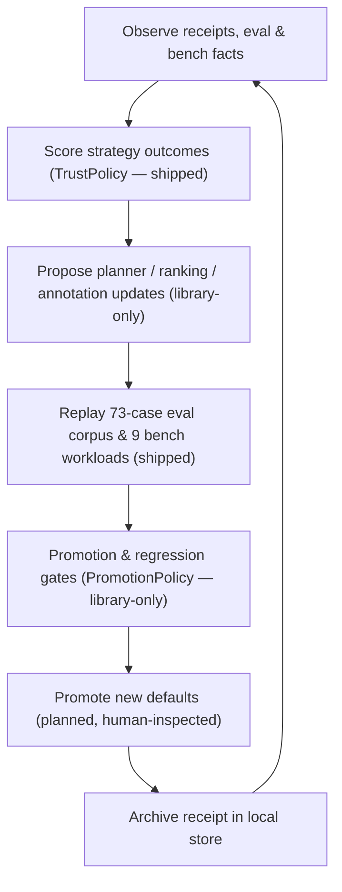

# Learning Loop Specification

Deep-Diff-Forge improves through measured review outcomes, not vague preference.

> **Status (`v0.11.0`, 2026-11-27).**
> - **Shipped & wired in CLI/TUI:** Local receipt ingestion (`deep-diff-forge learn record --stdin`), validation, owner-private JSONL storage, strategy scoring, and `TrustPolicy` evaluation (`deep-diff-forge learn status [--json]`, schema `deep-diff-forge.learning.v0`; also surfaced in the TUI `learning` palette). Independent evaluation and benchmarking gates also ship via `deep-diff-forge eval` (**73 labelled cases** + **155 declared misses/false-positives** including **46 non-Rust integrity forms** declared in `v0.11.0`, `fixtures/eval/MANIFEST.json`) and `deep-diff-forge bench` (**9 deterministic workloads** + required PR base-vs-head job via `scripts/bench_compare.py`).
> - **Implemented in `deep-diff-forge-learning` (library-only, not yet wired into CLI/daemon):** `PlannerLearner`, `RankingWeights::fit_weights`, `AnnotationTrust::fit_trust`, and `evaluate_promotion` / `PromotionPolicy`. Learned values do not alter engine defaults in `v0.11.0`.
> - **Planned, unowned:** Automatic receipt emission during reviews, `learn record` ingesting `bench.v0` or `eval.v0` receipts directly, persisted learner outputs (`planner/`, `ranking/`, `annotations/`), and live learned weights in `deep-diff-forge-graph`. Nothing is withdrawn or on hold.

For exact formulas, thresholds, and source-module references, see [Algorithms, Heuristics, and Execution Invariants — Section 8 (Local Learning Algorithms)](ALGORITHMS_AND_HEURISTICS.md#8-local-learning-algorithms--privacy-controls) and [Benchmarks and Evaluation Reference](reference/evaluation.md).

---

## What Ships in `v0.11.0`

Verified from `crates/deep-diff-forge-learning/src/{lib,receipt,store,score,planner,ranking,annotation,promote,util,error}.rs`, `crates/deep-diff-forge-cli/src/{main,eval,bench}.rs`, and `crates/deep-diff-forge-cli/tests/eval.rs`:

- **Manual receipt ingestion (`learn record --stdin`):** Reads one compact JSON `StrategyReceipt` from stdin, validates it, and appends it as a single line to the local JSONL store. No review command emits receipts automatically; an agent or script supplies them.
- **Strategy scoring & trust (`learn status [--json]`):** Loads the receipt store, computes per-strategy `StrategyScore` metrics across `patch`, `syntax`, and `hybrid`, evaluates `TrustPolicy::default()`, and prints the trusted default (if any) under schema `deep-diff-forge.learning.v0`. The TUI's `learning` palette reads the same report.
- **Library-only learners (unwired):** `PlannerLearner` (`planner.rs`), `RankingWeights::fit_weights` (`ranking.rs`), `AnnotationTrust::fit_trust` (`annotation.rs`), and `evaluate_promotion` (`promote.rs`) are implemented and unit-tested in `deep-diff-forge-learning`, but no CLI subcommand or daemon RPC calls them yet.
- **Strict pre-storage & load-time validation (`store::validate_receipt_for_storage`, `receipt::from_stored_json`):**
  - `file_hash` is a `RedactedId` (`util.rs`): 16 to 64 lowercase hexadecimal characters (`0-9a-f`), enforced at deserialization (`TryFrom<String>`), so a `StrategyReceipt` cannot carry a raw file path. `redacted_id(path)` computes a 16-hex 64-bit FNV-1a token (`0xcbf29ce484222325` / `0x100000001b3`).
  - `language` (`1..=64` bytes) and `parser_version` (`1..=128` bytes) must contain only ASCII alphanumeric characters and `. _ - + @`.
  - Self-contradicting receipts (`outcome == "revisited"` with `revisited: false`) are refused on both append and load.
  - On load (`from_stored_json`), every line must contain **only** known receipt fields; an extra key such as `"path"` is refused with the offending line number (`learn record` drops unknown keys on deserialization and never writes them). One corrupt or invalid line fails `load_receipts` with exit `3`.
- **Exit codes:** Unparseable or invalid receipts exit `4` (`invalid_input`). Store resolution, permission, size-cap, or I/O failures exit `3` (`io`).
- **Hardened local store (`store.rs`):**
  - Path: `$XDG_STATE_HOME/deep-diff-forge/learning/receipts/strategy.jsonl` (fallback `$HOME/.local/state/deep-diff-forge/learning/receipts/strategy.jsonl`). Empty or relative values of either variable are ignored per XDG spec so the store never lands inside a working tree.
  - Security: `learning/` and `receipts/` are enforced `0700` on Unix, owned by the effective UID, non-symlink, with `(dev, ino)` verified between `lstat` and open; `strategy.jsonl` is created `0600`, regular, non-symlink, and refused if group/world-accessible (`mode & 0o077 != 0`).
  - Budgets: `MAX_RECEIPTS_BYTES = 64 MiB`, `MAX_RECEIPT_LINE_BYTES = 1 MiB` (newline inclusive), `MAX_RECEIPTS = 100,000` records loaded/counted.
  - Torn-write safety: Missing stores read as empty (`0` receipts). If an existing non-empty store does not end with `\n`, `append_receipt` prepends `\n` before appending so records never merge onto one line.

---

## Evaluation & Benchmark Workflows (`eval` & `bench` in `v0.11.0`)

Although `learn record` does not yet ingest `eval.v0` or `bench.v0` receipts automatically, both measurement loops are shipped and CI-gated in `v0.11.0`:

### Corpus Evaluation (`deep-diff-forge eval [--corpus DIR] [--json]`)

Scores the engine against `fixtures/eval/MANIFEST.json`, emitting `deep-diff-forge.eval.v0` with per-metric tallies (parts per million), `by_signal` and `by_language` breakdowns, and the manifest SHA-256. The corpus refuses missing origins, duplicate IDs, unknown fields, orphan files, symlinks, hash mismatches, or files exceeding `FILE_BYTES = 8 MiB` / `CORPUS_BYTES = 64 MiB`.

In `v0.11.0`, the committed corpus contains **73 cases** (`14` ranking, `56` evidence, `3` findings) and **155 declared limits** (`127` evidence `known_miss`, `25` evidence `known_false_positive`, `3` ranking `known_miss` — including the **46 non-Rust integrity forms** declared in `v0.11.0` across Python, JS/TS, Go, Shell, YAML, Dockerfile, and Makefile). Declared misses count as wrong in their metrics (they never inflate scores) and fail the gate once fixed so floors ratchet strictly upward.

| Metric (`cli/tests/eval.rs`) | Measured (`v0.11.0`) | Gate Floor (ppm) | Notes |
| --- | ---: | ---: | --- |
| Ranking pairs (`must_outrank`) | `12 / 15` (80.0%) | `800,000` | 3 declared ranking misses |
| Evidence precision | `233 / 258` (90.3%) | `903,100` | 25 declared false positives |
| Evidence recall | `233 / 360` (64.7%) | `647,222` | 127 declared misses (incl. 46 non-Rust integrity forms) |
| Expected evidence found count | `233` | `EVIDENCE_FOUND_FLOOR = 233` | Prevents growing denominators from hiding lost detections |
| Findings verdicts | `33 / 33` (100.0%) | `1,000,000` | 0 declared misses |

Minimum corpus gate invariants in `cli/tests/eval.rs`: `MIN_CASES = 30`, `MIN_CASES_PER_KIND = 3`. Any undeclared miss, undeclared false positive, or parser refusal exits `7` (`eval_failed`).

### Deterministic Benchmarking (`deep-diff-forge bench [--quick] [--json] [--workload NAME]`)

Runs **9 deterministic generated workloads** (`parse_seal`, `rank_with_evidence`, `rank_long_line`, `rank_many_fragments`, `outline_page`, `findings_verify`, `findings_by_address`, `structural_rust`, `daemon_parallel`) with 1 warm-up + 15 repetitions (`5` with `--quick`), emitting `deep-diff-forge.bench.v0` with host/profile fingerprint and per-workload input SHA-256. `scripts/bench_compare.py` compares same-machine receipts and fails when head is `> 25%` **and** `> 200,000 ns` slower; a required PR CI job alternates merge-base and head builds three times on the same runner.

---

## Purpose & Scope

The learning loop is designed to tune:

- planner strategy selection
- semantic fallback thresholds
- review graph ranking
- generated/vendor detection
- annotation grounding quality
- UI default toggles
- cache policy

**Hard invariant:** The learning loop never mutates patch truth.

## Evidence Sources

| Source | Signal | `v0.11.0` Status |
| --- | --- | --- |
| Corpus regression (`eval`) | Output drift, parser refusals (`fixtures/eval-refused-by-parser/`), ranking/evidence/findings drift | **Shipped & CI-gated** (73 cases, 155 declared limits) |
| Benchmarks (`bench`) | Latency (min/median/p95 ns), throughput (B/s), parallel daemon contention | **Shipped & CI-gated** (9 workloads, `bench_compare.py`) |
| Strategy receipts (`learn`) | Accepted, rejected, skipped, revisited outcomes; fallback reasons; elapsed ms; cache state | **Shipped (manual stdin)** via `learn record\|status` |
| Agent annotations | Grounded, ungrounded, contradicted, accepted, reviewer override | **Library-implemented** (`learning::annotation`, unwired); live verification via `findings verify` |
| CI gates | Check, clippy, tests, mutation testing, fuzzing (18 targets), `contract_matrix.sh` | **Shipped** |
| Runtime telemetry | Daemon metrics (`daemon.metrics`, Prometheus textfile), hook project ledger (`ledger.jsonl`) | **Shipped** |
| Release receipts | Signed `RELEASE-MANIFEST.json`, `tool.scorer_sha256` provenance | **Shipped** |

## Loop Topology (Target Architecture)



---

## Learning Units (Library-Implemented vs Target Design)

All three learning units below exist in `crates/deep-diff-forge-learning/src/` and are unit-tested, but are **not yet wired** into the CLI or daemon. Full formulas are documented in [ALGORITHMS_AND_HEURISTICS.md §8.3](ALGORITHMS_AND_HEURISTICS.md#83-library-implemented-learners--promotion-gate-not-yet-wired-into-clidaemon).

### 1. Planner Learning (`learning/src/planner.rs`)

- **Implemented inputs (`PlannerObservation`):** `file_bytes`, `language`, `diff_lines`, `generated_or_vendor`, `previous_fallback`, `semantic_usefulness` (`0..=100`). *(Target design also envisioned `parser_version` and `syntax_node_count`.)*
- **Implemented outputs (`PlannerRecommendation`):** `preferred_strategy` (`patch` | `syntax` | `hybrid`), `budget_profile` (`lean` = 5,000 nodes, `standard` = 20,000 nodes, `generous` = 80,000 nodes), `fallback_threshold_nodes`, and `cache_priority` (`0..=100`).
- **Behavior:** Hard rules always force `(Patch, Lean)` for `generated_or_vendor` (`cache_priority = 5`) and prior budget fallbacks (`ByteBudget` | `NodeBudget` | `TimeBudget`, `cache_priority = 20`). Otherwise uses `LARGE_FILE_BYTES = 256 KiB` and `USEFUL_SEMANTIC = 70` to pick the budget profile, prefers `trusted_default` if receipts earned one (else `Syntax` when useful ≥ 70, `Hybrid` otherwise), and scales `cache_priority = clamp(diff_lines / 10, 30, 90)`.

### 2. Ranking Learning (`learning/src/ranking.rs`)

- **Implemented inputs (`RankingObservation`):** `reviewed_first`, `revisited`, `approved_without_changes`, `caused_fix`, `correlated_test_failure`, `public_api_touch`, `dependency_fanout` (`WIDE_FANOUT = 5`, wide when `> 5`).
- **Implemented outputs (`RankingWeights`):** Fitted conditional risk probabilities `P(caused_fix || correlated_test_failure | signal)` in `[0.0, 1.0]` for `revisited`, `public_api_touch`, and `wide_fanout` (neutral prior `0.5` when unseen), plus `score(obs)` (mean of present signal weights) and `needs_human_first(obs, threshold)`.

### 3. Annotation Learning (`learning/src/annotation.rs`)

- **Implemented inputs (`AnnotationObservation`):** `evidence_spans`, `accepted`, `rejected`, `contradicted`, `reviewer_override`.
- **Implemented outputs (`AnnotationTrust`):** `source_quality = clamp(clean_win_rate - contradiction_rate, 0.0, 1.0)` (where `is_clean_win` requires `evidence_spans > 0 && accepted && !contradicted && !reviewer_override`), `tier` (`untrusted` < 3 clean wins or `< 0.50`, `provisional` `>= 0.50`, `trusted` `>= 0.80`), and `display_prominence` (`10` / `50` / `90`).

---

## Receipt Schema, Scoring Model, & Promotion Gate

### Strategy Receipt (`StrategyReceipt`, Shipped & Wired)

One JSON object per line (all enum values `snake_case`):

```json
{"file_hash":"deadbeefdeadbeef","language":"rust","parser_version":"tree-sitter-rust-0.24","strategy":"syntax","fallback":null,"elapsed_ms":12,"bytes":18420,"nodes":2840,"cache":"hit","outcome":"accepted","revisited":false}
```

- `strategy`: `patch` | `syntax` | `hybrid`
- `fallback`: `null` | `byte_budget` | `node_budget` | `parse_errors` | `time_budget` | `unsupported`
- `cache`: `hit` | `miss` | `cold` | `bypass`
- `outcome`: `accepted` | `rejected` | `skipped` | `revisited` | `pending`

### Strategy Trust Thresholds (`score::TrustPolicy::default`, Shipped & Wired)

A strategy earns trust in `learn status` only when all six thresholds clear:

- `samples >= 20` (and always `>= 1` even if `min_samples: 0`)
- `acceptance_rate >= 0.70` (over decided outcomes: `accepted / (accepted + rejected)`)
- `helpful_rate >= 0.50` (`accepted && !revisited` over all samples)
- `fallback_rate <= 0.30`
- `revisit_rate <= 0.25`
- `mean_elapsed_ms <= 250.0` (using saturating summation)

Ties among trusted strategies break by highest `helpful_rate`, then lowest `mean_elapsed_ms`, then `Strategy::all()` order.

### Promotion Gate (`promote::evaluate_promotion`, Library-Implemented)

`PromotionPolicy::default()` blocks promotion unless all rules hold (accumulating every blocking reason without short-circuiting, and failing closed on non-finite floats or negative tolerances):

- `corpus_regression_delta <= 0` or `regressions_intentional == true`
- `benchmark_regression <= 0.05` (≤ 5% slower)
- `fallback_rate_delta <= 0.01` (≤ +1 percentage point)
- `ranking_improvement_supported == true`
- `supporting_receipts >= 50`
- `human_inspectable == true`

---

## Storage & Repository Fixtures (`v0.11.0`)

### Local Machine Learning Store (Shipped)

```text
$XDG_STATE_HOME/deep-diff-forge/learning/   # (0700, owner-only, non-symlink)
  receipts/                                 # (0700, owner-only, non-symlink)
    strategy.jsonl                          # (0600, <= 64 MiB, <= 1 MiB/line, <= 100,000 records)
```

The planned `planner/`, `ranking/`, and `annotations/` subdirectories are not yet created; nothing persists learner outputs today.

### Committed Repository Fixtures (`fixtures/`, `v0.11.0`)

As of `v0.11.0`, the repository ships **7 fixture directories** under `fixtures/`:

```text
fixtures/
  corpus/                   # compare-v1.sha256 comparison corpus digest
  council/                  # analysis.json review-council contract fixture
  diagnostics/              # codes.v0.txt (42 pinned codes), ids.v0.txt, projection/, witness/
  eval/                     # MANIFEST.json (73 cases, 155 declared limits) + evidence/, findings/, ranking/
  eval-refused-by-parser/   # REASONS.tsv + 16 sections refused by 42-shape / -U0 parser rules
  patch/                    # basic, binary, binary_literal_delta, delete/new/rename, format-patch/, latin1, regressions/
  protocol/                 # v2-requests.txt, v2-transcript.jsonl (daemon backward-compat wire transcripts)
```

Large historical corpora and benchmark archives remain outside the Git tree (e.g., on the operator workstation's 10 TB disk; see [Storage and 10 TB Corpus](STORAGE_AND_10TB_CORPUS.md)) so clones and CI stay fast.

---

## Privacy and Safety

- Never upload source snippets or receipts by default; the learning store is strictly local.
- Receipts never store paths or code: `file_hash` is a `RedactedId` (16-hex FNV-1a token). Because FNV-1a is unkeyed and vulnerable to dictionary testing, confidentiality relies on the owner-only `0700`/`0600` local store (unlike agent hook state, which uses keyed RFC 2104 HMAC-SHA-256).
- Agent annotations remain untrusted until grounded (`evidence_spans > 0`, `claim_verified: false` in `findings.v0`).
- Every trust or promotion decision is explainable through explicit thresholds and inspectable receipts.

## Deployment Link

- Framework: [Codebase Deployment Framework](DEPLOYMENT_FRAMEWORK.md)
- Deep-Dive Algorithms: [Algorithms, Heuristics, and Execution Invariants](ALGORITHMS_AND_HEURISTICS.md)
