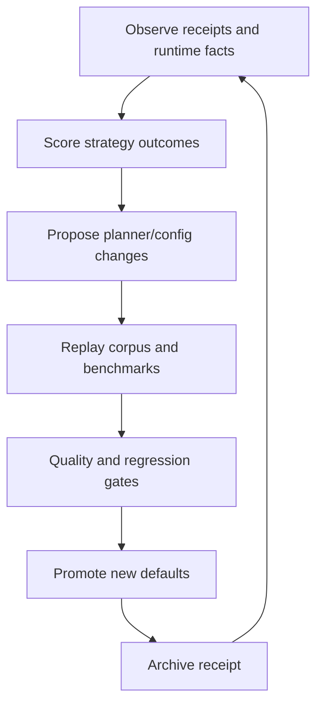

# Learning Loop Specification

Deep-Diff-Forge improves through measured review outcomes, not vague preference.

## Status 2026-10-28 (0.3.0)

The sections after this one mix the built loop with target design. What exists, from
`crates/deep-diff-forge-learning` and `crates/deep-diff-forge-cli/src/main.rs`:

- **Receipts in, by hand only.** `deep-diff-forge learn record --stdin` reads one JSON
  `StrategyReceipt` and appends it. No review command emits receipts by itself; an agent or
  script must feed them.
- **Scores out.** `deep-diff-forge learn status [--json]` prints per-strategy scores and the
  trusted default, if any (schema `deep-diff-forge.learning.v0`). The TUI's `learning` palette
  command reads the same report.
- **Library only.** The planner, ranking and annotation learners and `evaluate_promotion` exist
  as library functions. Nothing in the CLI, daemon or ranking calls them, so learned values do
  not change any default today.
- **Validation before storage** (`store::validate_receipt_for_storage`): `language` must be a
  token of 1 to 64 bytes and `parser_version` of 1 to 128 bytes, each from `A-Z a-z 0-9 . _ - +
  @`; an `outcome` of `revisited` with `revisited: false` is refused. `file_hash` must be 16 to
  64 lowercase hex characters (`RedactedId`), so a receipt cannot carry a path.
- **Exit codes.** A receipt that fails to parse or fails validation exits 4 (`invalid_input`):
  it would fail again on retry. A store that cannot be resolved, read or written exits 3 (`io`).
  Measured with the 0.3.0 binary: a `parser_version` containing a space exits 4 with
  `invalid receipt: parser_version must be a bounded identifier token`.
- **Store.** One file, `$XDG_STATE_HOME/deep-diff-forge/learning/receipts/strategy.jsonl`
  (else `$HOME/.local/state/deep-diff-forge/learning/...`; a relative value of either is
  invalid under the XDG spec and ignored, so the store never lands under the working
  directory). The `learning/` and `receipts/`
  directories are made `0700` and must be owned by the effective user and not be symlinks; the
  file is a regular, non-symlink file (measured: `0600`). Limits: 64 MiB store, 1 MiB per
  record, 100,000 records loaded. A missing store reads as "no data yet". An append to a store
  whose last byte is not a newline (a torn write, a hand edit) writes one first, so the new
  receipt is its own line. On load, every line must parse, pass the checks above and hold only
  receipt fields (an extra key such as `path` is refused, naming the line; `learn record` drops
  extra keys and never writes them); one bad line fails the load with exit 3.

## Purpose

The learning loop tunes:

- planner strategy selection
- semantic fallback thresholds
- review graph ranking
- generated/vendor detection
- annotation grounding quality
- UI default toggles
- cache policy

It never mutates patch truth.

## Evidence Sources

| Source | Signal |
| --- | --- |
| Corpus regression | Output drift, parser failures, ranking drift. |
| Benchmarks | Latency, memory, cache hit rate, graph expansion cost. |
| User review decisions | Approved, rejected, skipped, revisited hunks. |
| Agent annotations | Grounded, ungrounded, contradicted, accepted. |
| CI gates | Check, clippy, tests, packaging, smoke. |
| Runtime telemetry | Fallback reasons, daemon health, socket errors. |
| Release receipts | Before/after comparison across versions. |

## Loop Topology



## Learning Units

Target inputs and outputs. The built observation types are narrower: `PlannerObservation` has
`file_bytes`, `language`, `diff_lines`, `generated_or_vendor`, `previous_fallback` and
`semantic_usefulness`, and recommends a strategy, a budget profile (`lean`, `standard`,
`generous`), a node fallback threshold and a cache priority. `RankingWeights` fits `revisited`,
`public_api_touch` and `wide_fanout`. `AnnotationTrust` gives a tier (`untrusted`,
`provisional`, `trusted`), a source quality and a display prominence.

### Planner Learning

Input:

- file size
- language
- parser version
- syntax node count
- diff size
- generated/vendor classification
- previous fallback reason
- semantic usefulness score

Output:

- preferred strategy
- budget profile
- fallback threshold
- cache priority

### Ranking Learning

Input:

- hunk reviewed first
- hunk revisited
- hunk approved without changes
- hunk caused fix
- hunk correlated with test failure
- public API touch
- ownership and dependency fan-out

Output:

- risk ranking weights
- review stream order
- "needs human first" label

### Annotation Learning

Input:

- evidence span count
- claim accepted/rejected
- contradiction with tests or source
- reviewer override

Output:

- annotation trust tier
- agent source quality score
- display prominence

## Scoring Model

Every strategy decision gets a receipt. The built form is one JSON object per line
(`StrategyReceipt`; enum values are snake_case):

```json
{"file_hash":"deadbeefdeadbeef","language":"rust","parser_version":"tree-sitter-rust-0.24","strategy":"syntax","fallback":null,"elapsed_ms":12,"bytes":18420,"nodes":2840,"cache":"hit","outcome":"accepted","revisited":false}
```

`strategy` is `patch`, `syntax` or `hybrid`; `fallback` is null or `byte_budget`, `node_budget`,
`parse_errors`, `time_budget`, `unsupported`; `cache` is `hit`, `miss`, `cold` or `bypass`;
`outcome` is `accepted`, `rejected`, `skipped`, `revisited` or `pending`.

A strategy earns trust when it is (built thresholds, `score::TrustPolicy::default`: at least 20
samples, acceptance at least 0.70, helpful at least 0.50, fallback at most 0.30, revisit at most
0.25, mean time at most 250 ms):

- fast enough
- stable across reruns
- helpful to reviewers
- not hiding patch truth
- not producing misleading semantic spans

## Promotion Rules

No learned default is promoted unless (built as `promote::evaluate_promotion`, library only;
defaults: benchmark regression at most 5%, fallback-rate rise at most 0.01, at least 50
supporting receipts):

- corpus regression is unchanged or intentionally updated
- benchmark regression is within budget
- fallback rate does not worsen materially
- ranking improvement is supported by receipts
- a human can inspect the change

## Storage

Local learning data, as built:

```text
$XDG_STATE_HOME/deep-diff-forge/learning/
  receipts/
    strategy.jsonl
```

The `planner/`, `ranking/` and `annotations/` directories of the original design are not
created; nothing persists learner output.

Repository learning fixtures (target; at 0.3.0 the repository has `fixtures/patch/` and
`fixtures/council/` only, and no `benchmarks/` or `reports/`):

```text
fixtures/
  corpus/
  expected/
  regressions/
benchmarks/
reports/
```

The operator workstation's 10TB disk can store large historical corpora and benchmark archives, but repo-local fixtures must remain small enough for normal clone and CI.

## Privacy And Safety

- Do not upload source snippets by default.
- Prefer hashes, counts, timings, and local-only receipts.
- Receipts carry no paths at all: `file_hash` is a pseudonymous FNV-1a token, which is not
  one-way, so confidentiality rests on the owner-only store.
- Agent annotations are untrusted until grounded.
- Learned behavior must be explainable through receipts.

## Deployment Link

- Framework: [Codebase Deployment Framework](DEPLOYMENT_FRAMEWORK.md)
