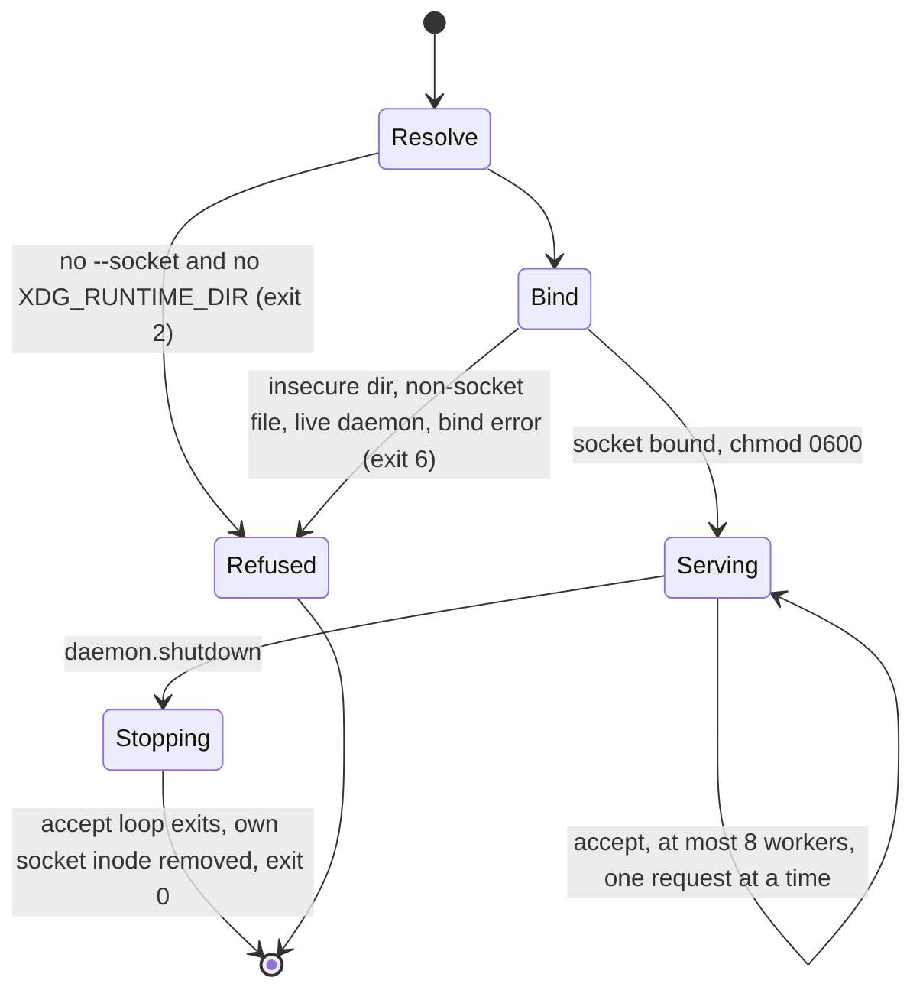
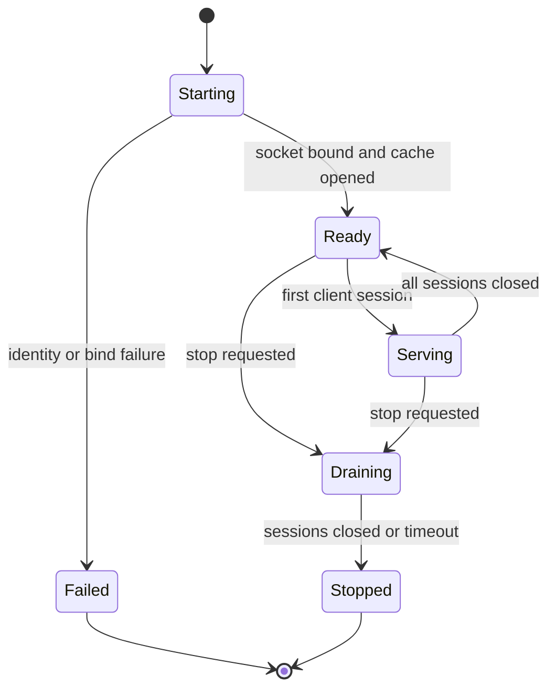

# Operations And Daemon Specification

## Status 2026-10-28 (0.3.0)

What exists today, checked against `crates/deep-diff-forge-daemon/src/` and the
0.3.0 debug binary:

- `deep-diff-forge daemon {path|start [--foreground]|health|status|stop} [--socket PATH]`.
  `start` always serves in the foreground; a supervisor owns the process.
  `--foreground` is accepted only with `start` (elsewhere: exit 2).
- One Unix socket, JSON-RPC 2.0, protocol 1. Methods (`engine.methods`):
  `engine.initialize`, `engine.methods`, `daemon.health`, `daemon.status`,
  `daemon.shutdown`, `diff.plan`, `diff.compute`, `session.open`,
  `session.snapshot`, `session.close`. `deep-diff-forge rpc` speaks the same
  protocol over stdio without a daemon.
- At most eight connections, all served by one engine behind one mutex, so
  requests run one at a time. Line cap 80 MiB each way; a response over it
  becomes `RESOURCE_EXHAUSTED` (8). 30-second absolute read deadline per line.
- A second `start` at a live socket is refused (`AddrInUse`, exit 6); a stale
  socket (connect refused) is replaced; a non-socket file is never deleted.
- Not implemented: any cache (`cache_entries` is always 0), the `cache`
  command, subscriptions, a draining state, structured logs and metrics, a
  shipped systemd unit, TCP and Windows named pipes.

Sections below that describe those are target design and say so. The security
boundary is authoritative in [`SECURITY.md`](../SECURITY.md#local-daemon).

The daemon is optional. Deep-Diff-Forge must remain useful as a CLI and library without it.

This document includes planned operational surface area. The implemented
security boundary is authoritative in [`SECURITY.md`](../SECURITY.md); items
described as future or planned are not current guarantees.

The daemon exists for top-tail latency and coordination:

- shared AST cache
- shared line-index cache
- multi-client review sessions
- agent annotation subscriptions
- long-running corpus indexing

## Service Identity

| Field | Value |
| --- | --- |
| Service id | `deep-diff-forge` |
| Binary | `deep-diff-forge` |
| Daemon subcommand | `deep-diff-forge daemon` |
| Default transport | Unix domain socket |
| TCP transport | Not implemented |
| Health method | `daemon.health` |
| Status method | `daemon.status` |

## Socket Locations

| Platform | Path or status |
| --- | --- |
| Unix with `$XDG_RUNTIME_DIR` | `$XDG_RUNTIME_DIR/deep-diff-forge/deep-diff-forge.sock` |
| Unix without `$XDG_RUNTIME_DIR` | Fails closed — pass `--socket PATH`; there is no `/tmp` fallback |
| Windows | Daemon unsupported; no named-pipe implementation |

## Daemon Lifecycle (implemented)



`run_server` in `serve.rs`: after `daemon.shutdown` the worker opens a wakeup
connection so the blocked `accept` returns, the loop exits, and
`cleanup_owned_socket` removes the socket only if its device and inode still
match the one bound. There is no drain step: the process exits when the loop
returns.

## Daemon State Machine (target design)

Not implemented: there is no cache and no draining state.



## Startup Gates

The implemented daemon refuses startup unless:

- a secure runtime base is available or an explicit socket path is supplied;
- the socket parent exists as, or can be created as, an effective-user-owned
  non-symlink directory with mode `0700`;
- an existing socket path is either absent or verifiably a socket rather than a
  symlink, regular file, or directory; and
- the newly bound socket can be restricted to mode `0600`.

An existing socket is probed before it is replaced (`remove_stale_socket` in
`serve.rs`): if a daemon accepts the connection, the start fails with
`AddrInUse` (exit 6) and the running daemon is untouched; only a socket whose
connect is refused is removed. Measured 2026-10-28: second start exit 6;
restart over a socket left by `kill -9` succeeds.

The probe, the removal and the bind run under the start lock: a non-blocking
exclusive `flock` on `<socket>.lock` beside the socket, held until the daemon
has exited and removed its socket. A start that finds the lock held exits 6
(`AddrInUse`, "another daemon is running or starting on this socket"), so two
racing starts can no longer orphan a daemon. The kernel releases the lock of a
daemon that crashed, and the lock file is never deleted. Measured 2026-10-30:
eight starts racing over a stale socket gave one daemon and seven exits 6.

Every accepted connection is checked for its peer's effective uid
(`SO_PEERCRED` on Linux, `getpeereid` on macOS) and dropped unless it is the
daemon's own user; the daemon logs `refused a connection: the peer runs as uid
N, not uid M`. The CLI (`daemon health|status|stop`) and the SDK clients check
the daemon's uid the same way and refuse a daemon of another user with
`cannot use the daemon at PATH` (exit 6).

## Health RPC

Request:

```json
{"jsonrpc":"2.0","id":1,"method":"daemon.health","params":{}}
```

Response:

```json
{
  "jsonrpc": "2.0",
  "id": 1,
  "result": {
    "status": "ok",
    "version": "0.3.0",
    "pid": 12345,
    "sessions": 0,
    "retained_bytes": 0,
    "cache_entries": 0,
    "protocol": 1
  }
}
```

`cache_entries` is reserved: the daemon keeps no response cache, so it is always `0`, a true
count of an empty cache rather than a measurement. It stays in the result so protocol-1
clients that read it keep working; a cache, if one is ever added, reports its real size here
(decision D-03, 2026-10-27).

## Status RPC

Implemented: `daemon.status` returns `{running, uptime_secs, sessions, version,
protocol}`, for example
`{"protocol":1,"running":true,"sessions":0,"uptime_secs":0,"version":"0.3.0"}`
(measured 2026-10-28).

Target design, not implemented: status reports should also include:

- protocol versions
- uptime
- active sessions
- cache generations
- cache hit/miss counters
- fallback counters by reason
- last recoverable error
- feature flags

## systemd User Unit

Example only; no unit file ships in the repository. `daemon start` already runs
in the foreground, so `Type=simple` fits. Untested in this form:

```ini
[Unit]
Description=Deep-Diff-Forge local review daemon
After=default.target

[Service]
Type=simple
ExecStart=%h/.local/bin/deep-diff-forge daemon start --foreground
ExecStop=%h/.local/bin/deep-diff-forge daemon stop
Restart=on-failure
RestartSec=2
NoNewPrivileges=true
PrivateTmp=true
ProtectSystem=strict
ProtectHome=read-only
ReadWritePaths=%h/.cache/deep-diff-forge %h/.local/state/deep-diff-forge %t/deep-diff-forge

[Install]
WantedBy=default.target
```

## Operational Commands

Implemented (each takes an optional `--socket PATH`):

```bash
deep-diff-forge daemon path
deep-diff-forge daemon start            # serves in the foreground
deep-diff-forge daemon start --foreground
deep-diff-forge daemon status
deep-diff-forge daemon health
deep-diff-forge daemon stop             # sends daemon.shutdown
```

`health`, `status` and `stop` exit 6 when no daemon answers.

## Deploy Doctor

Unreleased (2026-10-30). `deep-diff-forge deploy doctor [--json] [--socket PATH]` checks that this
machine can run the daemon and Git inputs, and changes nothing. The daemon checks
(`deep_diff_forge_daemon::inspect`) apply the daemon's own start rules, so a failure here is a
`daemon start` or client that would fail too; it never takes the start lock, which would make a
concurrent start fail.

| Check | ok | warn | fail |
| --- | --- | --- | --- |
| `binary` | always; names the version | | |
| `socket` | the socket path resolved | `$XDG_RUNTIME_DIR` unset and no `--socket` (the next three are skipped) | |
| `socket_dir` | absent (a start creates it `0700`), or owner-private | | a symlink, not a directory, another owner, or group/other access |
| `daemon` | not running, or a daemon of this version answered `daemon.health` | a stale socket (the next start replaces it), or a daemon of another version | a daemon this user may not use, a non-socket file at the path, or no usable answer |
| `start_lock` | absent, or a regular file owned by this user | | a symlink, not a regular file, or another owner |
| `git` | `git version` answered within 10 s, run the way an acquisition runs Git | Git missing, failing or stalled: the `--git-*` inputs and `review.change` cannot work | |

Exit 0 when no check fails, warnings included; 6 (`DAEMON_OR_TERMINAL`) when one does. `--json`
prints `deep-diff-forge.deploy-doctor.v0`: `{schema, version, healthy, checks: [{name, state,
detail}]}`.

Target design, not implemented (`cache` is refused today, exit 2):

```bash
deep-diff-forge cache status
deep-diff-forge cache prune --older-than 30d
deep-diff-forge cache prune --max-size 20GiB
```

## Failure Handling

| Failure | Required behavior | Today |
| --- | --- | --- |
| Existing socket | In an owner-private parent, replace only a stale socket; never a live one or a non-socket file. | Implemented: live socket refused with `AddrInUse`, non-socket refused, stale socket removed. |
| Cache decode failure | Ignore entry, record fallback, continue. | No cache exists. |
| Parser panic | Catch at worker boundary, mark semantic fallback. | A dispatch panic is caught per request and answered `INTERNAL_ERROR`; sessions are reset and the mutex poison cleared. |
| Oversized payload | Reject with structured error. | Request over 80 MiB: `INVALID_REQUEST`, then the connection closes. Response over 80 MiB: `RESOURCE_EXHAUSTED` (8). |
| Client disconnect | Cancel session subscription, keep shared cache. | No subscriptions or cache; the worker ends and frees its slot. |
| Out of budget | Preserve patch twin and record semantic fallback. | Patch input over its byte or line budget is refused (exit 4 on the CLI). |
| Ninth connection | Apply backpressure. | Accepted and closed at once, with no response. |

## Observability

Target design, not implemented. Today the daemon writes only connection and
worker-spawn errors to stderr; there are no log levels and no metrics.

Log levels:

- `error`: data loss, daemon crash, failed startup
- `warn`: fallback, cache corruption, rejected socket
- `info`: session open/close, cache generation, release version
- `debug`: planner decisions
- `trace`: parser details

Metrics:

- `ddf_sessions_open`
- `ddf_files_planned_total`
- `ddf_semantic_fallback_total{reason}`
- `ddf_cache_hit_total{kind}`
- `ddf_cache_miss_total{kind}`
- `ddf_projection_latency_ms{mode}`
- `ddf_review_rank_latency_ms`

## Habitat Deployment Cut

If adopted as a local service citizen, Deep-Diff-Forge should be UDS-only at first.

Service row:

| Service | ID | Port | Health | Notes |
| --- | --- | --- | --- | --- |
| Deep-Diff-Forge | `deep-diff-forge` | UDS | `daemon.health` | Review daemon, AST cache, agent annotations, no TCP by default. |

## Resource Requirements

Measured 2026-10-27 on a 16-core Fedora Kinoite host (release build of `db65391`); single runs,
not distributions, so they are sizing guides, not limits. The caps themselves are enforced in code
and listed in the Capacity Map (owner's local vault).

| Request | Input | Peak RSS | Time |
| --- | --- | --- | --- |
| CLI review JSON | 930k-line, 30 MB patch | 217 MB | 0.63 s |
| CLI `--rank --json` | same | 120 MB | 0.36 s |
| `rpc` `diff.compute` | same | 1.07 GB | — |
| MCP `review_patch` | same | 1.77 GB (before the A-07 output cap) | — |
| MCP `review_patch` | 64 MiB, the inbound cap | about 1 GB | — |

Deployment needs that follow:

- **Memory:** plan for about 1.1 GB per maximum-size `rpc` or MCP request, and about 250 MB for
  the CLI. The daemon admits at most eight connections but runs one request at a time, so its
  peak is about one maximum-size request plus up to eight buffered request lines of up to 80 MiB
  and at most 128 MiB of retained sessions (inferred from the caps, not measured); size the host
  or keep patches well under the cap.
- **`/tmp` inodes:** parallel council and mutation runs create many small files. The host's `/tmp`
  tmpfs has a 1,048,576-inode limit, which an 8-way stress run reached on 2026-10-26. Point
  `TMPDIR` at a disk-backed directory for heavy parallel work.
- **Output:** MCP answers stay bounded by `REVIEW_FULL_CAP` (256 KiB per value) for both
  `review_patch` and `rank_patch`. `rpc` and socket `diff.compute` answers grow with the patch
  (about 2.7× its size, measured 2026-10-27) up to the 80 MiB line cap; a larger answer is
  replaced by a `RESOURCE_EXHAUSTED` (8) error since 2026-10-28. Use `diff.plan` or a smaller
  patch.

## Deployment Link

- Framework: [Codebase Deployment Framework](DEPLOYMENT_FRAMEWORK.md)
