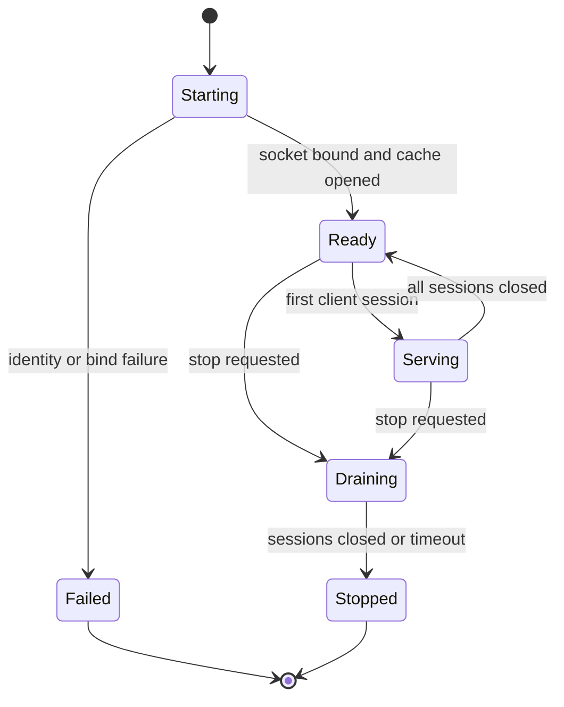

# Operations And Daemon Specification

## Status (v0.11.0)

Verified against `crates/deep-diff-forge-daemon/src/`,
`crates/deep-diff-forge-cli/src/{main,doctor,textfile}.rs`, and `contrib/` at
`v0.11.0`:

- `deep-diff-forge daemon {path|start [--foreground] [--allow-repo PATH]... [--log-format text|json]|health|status|metrics [--format json|prometheus] [--out PATH]|stop} [--socket PATH]`.
  `start` always serves in the foreground; a supervisor owns the process.
  `--foreground` is accepted only with `start` (elsewhere: exit 2).
- One Unix domain socket, JSON-RPC 2.0, **engine protocol 3**
  (`PROTOCOL_VERSION = 3`; protocols 0, 1 and 2 still negotiate). All **17
  methods** (`engine.methods`): `engine.initialize`, `engine.methods`,
  `daemon.health`, `daemon.status`, `daemon.shutdown`, `diff.plan`,
  `diff.compute`, `diff.rank`, `review.outline`, `review.hunks`, `review.change`,
  `session.open`, `session.snapshot`, `session.close`, `daemon.metrics`
  (protocol 2), `findings.verify` (protocol 2) and `diff.diagnostics` (protocol
  3). `deep-diff-forge rpc` speaks the same protocol over stdio without a daemon.
- At most 8 concurrent data connections (`MAX_CONNECTIONS = 8`) plus 2 control
  slots (`CONTROL_CONNECTIONS = 2`), running requests in parallel under a
  128 MiB in-flight work cap (`MAX_IN_FLIGHT_BYTES`) and a 160 MiB shared
  request-line read budget (`MAX_READ_BYTES`; see [Concurrency](#concurrency)).
  Line cap 80 MiB (`MAX_REQUEST_BYTES` / `MAX_RESPONSE_BYTES`, newline counted)
  each way; a response over it becomes `RESOURCE_EXHAUSTED` (8). 30-second
  absolute read deadline per line, 30-second cooperative execution deadline, and
  30-second non-blocking response write deadline.
- A second `start` at a live socket is refused (`AddrInUse`, exit 6) under an
  exclusive `flock` on `<socket>.lock`; a stale socket (connect refused) is
  replaced; a non-socket file or symlink is never deleted.
- A stop drains cleanly (`daemon stop`, `SIGTERM` or `SIGINT`): in-progress
  requests are answered first for up to 30 s (`DRAIN_WAIT`), and `daemon stop`
  waits up to 35 s (`STOP_WAIT`) until the daemon exits
  ([lifecycle](#daemon-lifecycle-implemented)). With nothing in progress it
  returns within a second, even when idle clients hold every data and control
  slot. A second signal during the drain exits immediately with `128 + signal`
  (143 for SIGTERM, 130 for SIGINT). Per-user systemd units and a macOS launchd
  agent ship in `contrib/` ([running as a service](#running-as-a-service)).
- Not implemented: any response cache (`cache_entries` is always `0`), the
  `cache` command, server-push subscriptions, log levels other than `warn` and
  `info`, TCP and Windows named pipes. Runtime metrics (`daemon.metrics`),
  structured JSON log lines (`--log-format json`), and Prometheus textfile
  export (`daemon metrics --format prometheus --out PATH`) all ship
  ([observability](#observability),
  [exporting metrics](#exporting-metrics-to-prometheus)).

Sections below that describe unbuilt capabilities are target design and say so.
The security boundary is authoritative in [`SECURITY.md`](../SECURITY.md#local-daemon).

The daemon is optional. Deep-Diff-Forge remains useful as a CLI and library
without it.

This document includes planned operational surface area. The implemented
security boundary is authoritative in [`SECURITY.md`](../SECURITY.md); items
described as future or planned are not current guarantees.

Target design goals for future daemon expansion:

- shared AST cache
- shared line-index cache
- multi-client review sessions
- agent annotation subscriptions
- long-running corpus indexing

## Service Identity

| Field | Value |
| --- | --- |
| Service id | `deep-diff-forge` |
| Binary | `deep-diff-forge` |
| Daemon subcommand | `deep-diff-forge daemon` |
| Engine protocol | `3` (protocols `0..=3` negotiate) |
| Default transport | Unix domain socket |
| TCP transport | Not implemented |
| Health method | `daemon.health` |
| Status method | `daemon.status` |
| Metrics method | `daemon.metrics` |

## Socket Locations

| Platform | Path or status |
| --- | --- |
| Unix with `$XDG_RUNTIME_DIR` | `$XDG_RUNTIME_DIR/deep-diff-forge/deep-diff-forge.sock` |
| Unix without `$XDG_RUNTIME_DIR` (unset, empty or relative) | Fails closed with exit 2 — pass `--socket PATH`; there is no `/tmp` fallback |
| A path of 108 bytes or more | Refused by `daemon path` and `daemon start` with exit 2: Linux holds a socket path and its NUL in 108 bytes (`sun_path`) |
| Windows | Daemon unsupported; no named-pipe implementation |

## Daemon Lifecycle (implemented)

```mermaid
stateDiagram-v2
    [*] --> Resolve
    Resolve --> Refused: no --socket and no XDG_RUNTIME_DIR, or path >= 108 B (exit 2)
    Resolve --> Bind
    Bind --> Refused: insecure dir, non-socket file, live daemon, lock held, bind error (exit 6)
    Bind --> Serving: start lock held, socket bound, chmod 0600
    Serving --> Serving: accept, 8 data + 2 control slots, parallel within 128 MiB in flight
    Serving --> Draining: daemon.shutdown / SIGTERM / SIGINT
    Draining --> Draining: requests in progress answered; new request refused (8); 2nd signal -> 128+sig
    Draining --> [*]: all answered or 30 s passed, owned socket unlinked, start lock released, exit 0
    Refused --> [*]
```

`run_server` in `serve.rs`: after `daemon.shutdown` (or `SIGTERM`/`SIGINT`) the
server wakes the blocked `accept` loop (stopping even if its socket file was
removed externally), `cleanup_owned_socket` removes the socket only if its
device and inode still match the one bound, and the listener is closed so no new
connection can arrive and queued ones are refused at once. Then the drain runs:
the server waits up to 30 s (`DRAIN_WAIT`, matching a client's read deadline)
for every request in progress (`Answering`). A request counts from its first
byte until its response is flushed, so neither a request still being sent nor an
answer being written is cut off. An idle connection is not waited for. A request
read after shutdown starts is refused with `RESOURCE_EXHAUSTED` (8), "the daemon
is shutting down". The log records `shutdown_drained` (`info`, when requests were
in progress) or `shutdown_drain_timeout` (`warn`). The start lock is released
last.

`daemon stop` opens the start lock (`SocketLocation::stop_waiter`, resolving a
symlinked socket path while it still exists), sends `daemon.shutdown`, then
waits up to 35 s (`STOP_WAIT`) for the lock to be free: it returns once the
daemon has exited, so a `daemon start` right after it does not find the old
daemon in the way. If the daemon has not exited by then, `stop` exits 6.

Measured under systemd (`contrib/systemd/deep-diff-forge.service`, user
manager): a `diff.compute` of a 300,000-line patch (10.4 MB request, 27.7 MB
answer) in progress when `systemctl --user stop` ran was answered in full; the
stop returned 0 after 1.43 s; the journal recorded `shutdown_drained` at `info`.
A client that stops reading holds the drain to its 30 s limit
(`shutdown_drain_timeout`), after which the answer is cut off.

## Daemon State Machine (target design)

Not implemented: there is no response cache. (Graceful drain on stop is
implemented; see [Daemon Lifecycle (implemented)](#daemon-lifecycle-implemented).)



## Startup Gates

The implemented daemon refuses startup unless:

- a secure runtime base (`$XDG_RUNTIME_DIR`, absolute) is available or an
  explicit `--socket PATH` is supplied, and the resolved path is shorter than
  108 bytes;
- the socket parent exists as, or can be created as, an effective-user-owned
  non-symlink directory with mode `0700` (`SECURE_DIR_MODE`; an existing parent
  of an explicit `--socket` is validated with `validate_private_dir` and never
  re-permissioned);
- an existing socket path is either absent or verifiably a socket rather than a
  symlink, regular file, or directory; and
- the newly bound socket can be restricted to mode `0600` (`SECURE_SOCKET_MODE`).

An existing socket is probed before it is replaced (`remove_stale_socket` in
`serve.rs`): if a daemon accepts the connection, startup fails with `AddrInUse`
(exit 6) and the running daemon is untouched; only a socket whose connect is
refused is removed.

The probe, removal and bind run under the start lock: a non-blocking exclusive
`flock` on `<socket>.lock` beside the socket (`BoundListener`), held until the
daemon has exited and removed its socket. A start that finds the lock held exits
6 (`AddrInUse`, "another daemon is running or starting on this socket"), so
racing starts cannot orphan a daemon. The kernel releases the lock of a crashed
daemon, and the lock file itself is never deleted.

Every accepted connection is checked for its peer's effective UID (`SO_PEERCRED`
on Linux/Android, `getpeereid` on macOS/BSDs; other platforms fail closed with
`Unsupported`) and dropped unless it matches the daemon's own user; the daemon
logs `refused a connection: the peer runs as uid N, not uid M`. The CLI
(`daemon health|status|metrics|stop`), the Rust SDK `Client`, and the Python SDK
`SocketClient` check the daemon's UID the same way and refuse a daemon of
another user before sending anything (CLI exit 6: `cannot use the daemon at PATH`).

## Concurrency

- **Requests run in parallel.** Each of the 8 data connection workers serves its
  own requests through one shared `Engine` (`&Engine`; a compile-time `Send + Sync`
  assertion in `handler.rs` enforces thread safety).
- **Only the session table is locked, and only for bookkeeping** (`handler.rs`
  `Sessions`): opening, touching and closing a session. A patch is parsed and
  its retained size estimated (`estimated_session_bytes`) before the lock is
  taken, and a snapshot is ranked after the lock is released from a shared
  `Arc<Vec<ReviewFile>>`. `diff.*`, `review.*`, `findings.verify` and `engine.*`
  never lock the session table.
- **Admission caps the work in flight** (`admission.rs`). Each request is
  weighed before it runs: by its line length (`Work::Request`), or by
  `max(line_bytes, 64 MiB)` for `review.change` (`Work::GitAcquisition`), whose
  Git output can exceed its request line. Running requests stay within
  `MAX_IN_FLIGHT_BYTES` (128 MiB). Admission is first come, first served, so a
  waiting heavy request is never overtaken by lighter ones, and a request
  heavier than the cap runs alone rather than being refused. A `Permit` is
  returned on drop, panics included.
- **No request waits forever.** One whose turn has not come within 30 s
  (`ADMISSION_WAIT`, matching the client read deadline) is answered
  `RESOURCE_EXHAUSTED` (8), "the daemon is busy", and abandons its ticket so
  requests behind it proceed.
- **Lines being read share one byte budget** (`admission.rs` `ReadBudget`).
  Every data connection reserves each chunk of its request line before buffering
  it and releases the reservation once the response is written. The aggregate
  across connections stays within `MAX_READ_BYTES` (160 MiB — room for two
  maximum-size 80 MiB lines). A line that exceeds the budget is answered
  `RESOURCE_EXHAUSTED` (8) and its connection is closed. Control connections
  (at most 4 KiB) are exempt from `ReadBudget`.
- **Cooperative execution deadline** (`deadline.rs`). A socket client stops
  reading 30 s after sending its request (`READ_TIMEOUT`), so the daemon runs
  each socket request within that deadline and calls `deadline::check()` before
  dispatch and after each heavy stage (parse, Git acquisition, foreign-Git-dir
  check, session snapshot). Past the deadline, the request ends with
  `RESOURCE_EXHAUSTED` (8), "the request ran past its client's 30 s read
  deadline and was stopped", releasing its worker and admission permit. A stage
  already running finishes first, bounded by its own input/time budget. Stdio
  `rpc` and `mcp` have no socket client deadline and are not cut.
- **Non-blocking response write deadline** (`serve.rs` `write_line_within`).
  Each response line has `RESPONSE_WRITE_LIMIT` (30 s) from first byte to
  completion using non-blocking writes and `poll` bounded by remaining time, so
  a slow-reading client cannot extend the deadline by reading a trickle.
- **Bounded session table loops:** at most one LRU eviction per held session
  (cap `MAX_SESSIONS = 64`, `MAX_RETAINED_SESSION_BYTES = 128 MiB`) and at most
  `MAX_SESSIONS + 1` candidate IDs, preventing spin faults.
- **Panics.** A dispatch panic is caught per request (`catch_unwind`), counted
  in `daemon.metrics`, and answered `INTERNAL_ERROR` (-32603). Only a panic
  while the session table lock was held empties the table and clears its poison
  on next use (keeping PID, start time and session-ID counter so no ID is
  reused); a panic anywhere else leaves all sessions intact.
- `deep-diff-forge rpc` (stdio) and `deep-diff-forge mcp` serve one request at a
  time on one stream by design.

## Health RPC

Request:

```json
{"jsonrpc":"2.0","id":1,"method":"daemon.health","params":{}}
```

Response:

```json
{
  "jsonrpc": "2.0",
  "id": 1,
  "result": {
    "status": "ok",
    "version": "0.11.0",
    "pid": 12345,
    "sessions": 0,
    "retained_bytes": 0,
    "cache_entries": 0,
    "protocol": 3
  }
}
```

`cache_entries` is reserved: the daemon keeps no response cache, so it is always
`0`, a true count of an empty cache rather than a measurement. It stays in the
result so older clients that read it keep working; a cache, if ever added, would
report its real size here (decision D-03).

## Status RPC

Implemented: `daemon.status` returns `{running, uptime_secs, sessions, version,
protocol}`, for example:

```json
{"running":true,"uptime_secs":42,"sessions":0,"version":"0.11.0","protocol":3}
```

Target design, not implemented: status reports could also include:

- supported protocol versions
- cache generations and hit/miss counters
- fallback counters by reason
- last recoverable error
- feature flags

## Running as a service

Per-user service definitions ship in `contrib/`. `crates/deep-diff-forge-cli/tests/service_units.rs`
keeps them aligned with the CLI flags and verifies that their stop timeout
exceeds `daemon stop`'s `STOP_WAIT` (35 s).

- **systemd** (`contrib/systemd/deep-diff-forge.service`): `Type=simple`,
  `ExecStart=%h/.local/bin/deep-diff-forge daemon start --log-format json`,
  `ExecStop=-%h/.local/bin/deep-diff-forge daemon stop` (the leading `-` prevents
  a manual shell `daemon stop` from marking the unit failed when systemd runs
  `ExecStop` and sees exit 6), `TimeoutStopSec=40`, `Restart=on-failure`,
  `RestartSec=2`, and user-manager sandboxing (`NoNewPrivileges=yes`,
  `LockPersonality=yes`, `MemoryDenyWriteExecute=yes`, `RestrictRealtime=yes`,
  `SystemCallArchitectures=native`). Install:

  ```bash
  cp contrib/systemd/deep-diff-forge.service ~/.config/systemd/user/
  systemctl --user daemon-reload && systemctl --user enable --now deep-diff-forge
  journalctl --user -u deep-diff-forge    # structured JSON log lines
  ```

- **launchd** (`contrib/launchd/dev.deep-diff-forge.daemon.plist`): `RunAtLoad`,
  restarted only on failure (`KeepAlive` → `SuccessfulExit: false`),
  `ThrottleInterval` 2, `ExitTimeOut` 40, `StandardErrorPath` at
  `~/Library/Logs/deep-diff-forge.log`. macOS sets no `XDG_RUNTIME_DIR`, so the
  agent exports `~/.local/run` (created `0700`), and shells talking to the daemon
  export the same `XDG_RUNTIME_DIR`. Replace `/Users/YOU` and load with:

  ```bash
  mkdir -m 700 -p ~/.local/run
  cp contrib/launchd/dev.deep-diff-forge.daemon.plist ~/Library/LaunchAgents/
  launchctl bootstrap gui/$(id -u) ~/Library/LaunchAgents/dev.deep-diff-forge.daemon.plist
  ```

  Stop with `deep-diff-forge daemon stop` or `launchctl bootout` (which sends
  `SIGTERM`, handled identically to `daemon stop`: stops accepting, removes the
  owned socket, drains in-progress answers up to 30 s, and exits 0; a second
  signal exits immediately with `128 + signal`). `scripts/launchd_smoke.sh`
  exercises the launchd lifecycle in macOS CI.

## Operational Commands

Implemented (each takes an optional `--socket PATH`):

```bash
deep-diff-forge daemon path
deep-diff-forge daemon start            # serves in the foreground
deep-diff-forge daemon start --foreground
deep-diff-forge daemon start --allow-repo PATH --log-format json
deep-diff-forge daemon status
deep-diff-forge daemon health
deep-diff-forge daemon metrics          # daemon.metrics (protocol 2+, JSON)
deep-diff-forge daemon metrics --format prometheus [--out PATH.prom]
deep-diff-forge daemon stop             # daemon.shutdown, then waits for exit (up to 35 s)
```

`health`, `status`, `metrics` and `stop` exit 6 when no daemon answers.

## Deploy Doctor

`deep-diff-forge deploy doctor [--json] [--socket PATH]` checks that this
machine can run the daemon and Git inputs, and changes nothing. The daemon checks
(`deep_diff_forge_daemon::inspect`) apply the daemon's own start rules, so a
failure here is a `daemon start` or client that would fail too; it never takes
the start lock, which would cause a concurrent start to fail.

| Check | `ok` | `warn` | `fail` |
| --- | --- | --- | --- |
| `binary` | always; names the version | | |
| `socket` | the socket path resolved | `$XDG_RUNTIME_DIR` unset/relative and no `--socket` (the next three checks are skipped) | |
| `socket_dir` | absent (a start creates it `0700`), or owner-private | | a symlink, not a directory, another owner, or group/other access |
| `daemon` | not running, or a daemon of this version answered `daemon.health` with zero trouble counters | a stale socket (next start replaces it), a daemon of another version, or nonzero panics/busy/session_resets in `daemon.metrics` | a daemon this user may not use (`Foreign`), a non-socket file at the path, or no usable answer |
| `start_lock` | absent, or a regular file owned by this user | | a symlink, not a regular file, or another owner |
| `git` | `git version` answered within 10 s (`GIT_LIMIT`), run as an acquisition runs Git | Git missing, failing or stalled: `--git-*` inputs and `review.change` cannot work | |

Exit `0` when no check fails (warnings included); `6` (`DAEMON_OR_TERMINAL`)
when any check fails. `--json` prints `deep-diff-forge.deploy-doctor.v0`:
`{schema, version, healthy, checks: [{name, state, detail}]}`.

Target design, not implemented (`cache` is refused with exit 2):

```bash
deep-diff-forge cache status
deep-diff-forge cache prune --older-than 30d
deep-diff-forge cache prune --max-size 20GiB
```

## Failure Handling

| Failure | Required behavior | Implemented in v0.11.0 |
| --- | --- | --- |
| Existing socket | In an owner-private parent, replace only a stale socket; never a live one or a non-socket file. | Live socket refused with `AddrInUse` (under `<socket>.lock`), non-socket and symlink refused, stale socket removed. |
| Cache decode failure | Ignore entry, record fallback, continue. | No cache exists. |
| Handler panic | Catch at worker boundary, isolate impact. | Dispatch panic caught per request, counted in `daemon.metrics` (`engine.panics`) and answered `INTERNAL_ERROR` (-32603); only a panic while the session lock was held empties the table (`engine.session_resets`) and clears poison, otherwise sessions stay intact. |
| Oversized payload | Reject with structured error. | Request over 80 MiB (`MAX_REQUEST_BYTES`, newline counted): `INVALID_REQUEST` (-32600), connection closes. Response over 80 MiB (errors included, measured after `json_line_safe` + newline): `RESOURCE_EXHAUSTED` (8). Error messages are cut at 4 KiB (`MAX_ERROR_MESSAGE_BYTES = 4,096`) on both daemon and MCP. |
| Client disconnect / slow reader | Cancel work, release slot. | Worker ends on disconnect and frees its slot and read reservation; slow readers hit the 30 s non-blocking `RESPONSE_WRITE_LIMIT` and are closed. |
| Out of budget | Preserve patch truth / fail closed. | Patch input over 64 MiB byte budget or parser line budget is refused (`PATCH_PARSE_FAILED` 4 on daemon, exit 4 on CLI). |
| Connection saturation (9th+ connection) | Apply backpressure without blocking operators. | Beyond the 8 data slots (`MAX_CONNECTIONS`), 2 control slots (`CONTROL_CONNECTIONS`) accept one request of at most 4 KiB (`CONTROL_REQUEST_BYTES`) within 5 s (`CONTROL_READ_TIMEOUT`). `daemon.health`, `daemon.status`, `daemon.metrics` and `daemon.shutdown` are answered; any other method is refused `RESOURCE_EXHAUSTED` (8) with "connection limit", then the connection closes. If both control slots are also held, an incoming connection gets 250 ms (`FULL_READ_TIMEOUT`) to send `daemon.shutdown` (answered in the accept loop itself); anything else is closed unanswered and the CLI reports `no answer from the daemon at PATH (it may be at its connection limit; retry)` (exit 6). `SIGTERM` / `SIGINT` always stop the daemon cleanly. |

## Observability

Implemented:

- **`daemon.metrics`** (protocol 2+; `deep-diff-forge daemon metrics`) returns
  `deep-diff-forge.daemon-metrics.v0`, counted since the daemon started
  (`metrics.rs`).
  - **Per method that was called:** `requests`, `errors` by RPC code
    (`parse_error`, `invalid_request`, `method_not_found`, `invalid_params`,
    `internal_error`, `protocol_unsupported`, `patch_parse_failed`,
    `session_not_found`, `input_contract_refused`, `resource_exhausted`,
    `git_failed`, `other`) and `latency_us`. Latency is a histogram of 24 log₂
    buckets (`LATENCY_BUCKETS = 24`; bucket *i* for `0..=22` holds requests
    taking under `2^i` µs, and the open last bucket `i = 23` holds requests of
    ≥ 2²² µs / ~4.19 s), plus `p50_at_most`, `p95_at_most` and `p99_at_most`
    (bucket upper bounds; `null` means ≥ 2²² µs / ~4.19 s). Unknown methods, unparsable lines, and pre-parse refusals
    (non-UTF-8, > 80 MiB, or sent during shutdown) count under `(unknown)`.
  - **`admission`:** `admitted`, `waited`, `wait_us`, `busy` (refused after
    the 30 s admission wait), `peak_in_flight_bytes` and `peak_running`.
  - **`connections`:** `accepted`, `refused_at_limit`, `refused_peer` (another
    user), and `errors` (read deadline, reset, or client disconnect before
    answer).
  - **`engine`:** `panics` (contained), `session_resets`, `sessions_opened`,
    `sessions_closed`, `sessions_evicted` and `peak_retained_bytes`.
  - **Recording cost:** every counter is an `AtomicU64` updated with relaxed
    operations — zero locks on the parallel request path. Counters live for the
    process lifetime.
- **`deploy doctor`** reads `daemon.metrics` from a live daemon and warns (exit
  0) on contained panics, busy refusals or session-table resets with their
  counts. A protocol-1 daemon without `daemon.metrics` is reported without them.
- **`daemon start --log-format json`** writes each stderr log line as one JSON
  object (`{"ts_ms", "level", "event", "message"}`). Events:
  `connection_refused`, `connection_error`, `worker_spawn_failed` and
  `shutdown_drain_timeout` (`warn`), and `shutdown_drained` (`info`,
  `log::INFO_EVENTS`). The default (`text`) writes
  `deep-diff-forge daemon: <message>`. Both render through `log.rs`.

Not implemented: log levels other than `warn` and `info`, `info` events for
session open/close, and any TCP/HTTP scrape listener (metrics export uses the
Prometheus textfile collector instead).

Original target design (not implemented):

- Log levels: `error`, `warn`, `info`, `debug`, `trace`
- Additional cache/planner metrics: `ddf_sessions_open`,
  `ddf_files_planned_total`, `ddf_semantic_fallback_total{reason}`,
  `ddf_cache_hit_total{kind}`, `ddf_cache_miss_total{kind}`,
  `ddf_projection_latency_ms{mode}`, `ddf_review_rank_latency_ms`

## Exporting metrics to Prometheus

`deep-diff-forge daemon metrics --format prometheus` prints the `daemon.metrics`
answer in [Prometheus text exposition format](https://prometheus.io/docs/instrumenting/exposition_formats/)
(version 0.0.4), and `--out PATH` writes it atomically for
[node_exporter's textfile collector](https://github.com/prometheus/node_exporter#textfile-collector).
The daemon adds no network listener: the CLI queries the Unix socket and renders
the JSON response (`exposition.rs`), so JSON (`--format json`, default) and
Prometheus outputs cannot disagree.

| Family | Type | From `daemon-metrics.v0` |
| --- | --- | --- |
| `ddf_daemon_build_info{version}` | gauge, always `1` | `version` |
| `ddf_daemon_uptime_seconds` | gauge | `uptime_secs` |
| `ddf_daemon_requests_total{method}` | counter | `methods.*.requests` |
| `ddf_daemon_request_errors_total{method,error}` | counter | `methods.*.errors` |
| `ddf_daemon_request_duration_seconds{method}` | histogram (`_bucket`, `_count`) | `methods.*.latency_us.buckets` |
| `ddf_daemon_admitted_total`, `ddf_daemon_admission_waits_total`, `ddf_daemon_admission_wait_seconds_total`, `ddf_daemon_busy_refusals_total` | counter | `admission.admitted`, `waited`, `wait_us`, `busy` |
| `ddf_daemon_peak_in_flight_bytes`, `ddf_daemon_peak_running_requests` | gauge | `admission.peak_in_flight_bytes`, `peak_running` |
| `ddf_daemon_connections_accepted_total`, `ddf_daemon_connection_errors_total` | counter | `connections.accepted`, `errors` |
| `ddf_daemon_connections_refused_total{reason="at_limit"\|"peer"}` | counter | `connections.refused_at_limit`, `refused_peer` |
| `ddf_daemon_panics_total`, `ddf_daemon_session_resets_total`, `ddf_daemon_sessions_{opened,closed,evicted}_total` | counter | `engine.*` |
| `ddf_daemon_peak_retained_bytes` | gauge | `engine.peak_retained_bytes` |

Key properties:

- **Format 0.0.4, not OpenMetrics:** no `# EOF` line and no sample timestamps
  (required by node_exporter's textfile collector).
- **Seconds in units:** latency buckets and admission wait convert microseconds
  to exact decimals of seconds (`le` bounds from `0.000001` to `4.194304`, then
  `+Inf`, cumulative).
- **No `_sum`:** only `_bucket` and `_count` are emitted (use
  `histogram_quantile`, not `_sum / _count`).
- **Counters reset on daemon restart** (`rate()` handles resets). Uncalled
  methods and empty error families are omitted.
- **Fail closed:** missing fields or an RPC error (e.g. a protocol-1 daemon)
  exit `6` without writing `--out`. Label values are escaped (`\\`, `\"`, `\n`).
- **Atomic replacement (`textfile.rs`):** written to an exclusively created
  `.NAME.PID.N.tmp` in the target directory (never `.prom`), fsynced, chmodded
  to `0644` regardless of umask, and renamed over `PATH`. Existing symlinks or
  non-regular files at `PATH` are refused (exit `3`) and left untouched. If no
  daemon answers (exit `6`), the prior `.prom` file stays intact so staleness
  alerts fire on its mtime.

Systemd timer recipe (`contrib/systemd/deep-diff-forge-metrics.{service,timer}`,
firing every 15 s with `AccuracySec=1s` and `After=deep-diff-forge.service`):

```bash
# node_exporter reads this directory: --collector.textfile.directory=/var/lib/node_exporter/textfile_collector
sudo install -d -o "$USER" -m 0755 /var/lib/node_exporter/textfile_collector
cp contrib/systemd/deep-diff-forge-metrics.{service,timer} ~/.config/systemd/user/
systemctl --user daemon-reload
systemctl --user enable --now deep-diff-forge-metrics.timer
```

Or from cron (pass `--socket` from `deep-diff-forge daemon path`, since cron
sets no `XDG_RUNTIME_DIR`):

```cron
* * * * * deep-diff-forge daemon metrics --socket /run/user/1000/deep-diff-forge/deep-diff-forge.sock --format prometheus --out /var/lib/node_exporter/textfile_collector/deep-diff-forge.prom
```

Example PromQL queries:

```promql
histogram_quantile(0.99, sum by (le, method) (rate(ddf_daemon_request_duration_seconds_bucket[5m])))
increase(ddf_daemon_panics_total[1h]) > 0
time() - node_textfile_mtime_seconds{file=~".*deep-diff-forge.prom"} > 180
```

## Habitat Deployment Cut

If adopted as a local service citizen, Deep-Diff-Forge is UDS-only:

| Service | ID | Port | Health | Notes |
| --- | --- | --- | --- | --- |
| Deep-Diff-Forge | `deep-diff-forge` | UDS | `daemon.health` | Review daemon, protocol 3, 17 JSON-RPC methods, no TCP. |

## Resource Requirements

Measured baseline on a 16-core Linux host (release build; sizing guide, not a
hard guarantee — hard caps are enforced in code):

| Request | Input | Peak RSS | Time |
| --- | --- | --- | --- |
| CLI review JSON | 930k-line, 30 MB patch | 217 MB | 0.63 s |
| CLI `--rank --json` | same | 120 MB | 0.36 s |
| `rpc` `diff.compute` | same | 1.07 GB | — |
| MCP `review_patch` | 64 MiB (inbound patch budget) | ~1 GB | — |

Deployment sizing notes:

- **Memory:** plan for ~1.1 GB per maximum-size `rpc` or MCP request and ~250 MB
  for CLI runs. Under the 128 MiB in-flight cap (`MAX_IN_FLIGHT_BYTES`), up to
  two 64 MiB requests run concurrently (~2.2 GB), plus up to 160 MiB of buffered
  request lines (`MAX_READ_BYTES`) and up to 128 MiB of retained sessions
  (`MAX_RETAINED_SESSION_BYTES`).
- **`/tmp` inodes:** heavy parallel council or mutation runs create many small
  files; set `TMPDIR` to a disk-backed directory if `/tmp` tmpfs inode limits
  are tight.
- **Output bounds:** MCP `review_patch` and `rank_patch` cap full responses at
  `REVIEW_FULL_CAP` (256 KiB), switching to summaries above it; `review_outline`,
  `review_hunks`, `diagnose_patch` and `review_change` page within `max_bytes`.
  Daemon and `rpc` response lines cap at 80 MiB (`RESOURCE_EXHAUSTED` 8 above).

## Deployment Link

- Framework: [Codebase Deployment Framework](DEPLOYMENT_FRAMEWORK.md)
