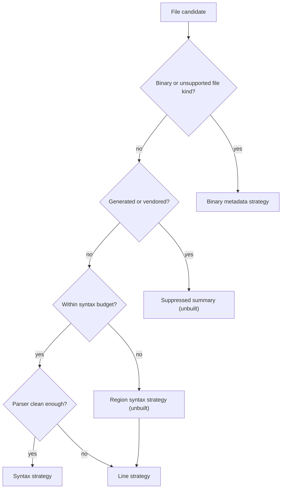

# Performance And Novelty Design

This document records both the **shipped `v0.11.0` performance invariants, budgets, and benchmarks** and the **target-design concepts** that motivate Deep-Diff-Forge's architecture.

> **Status (`v0.11.0`, 2026-11-27).**
> - **Shipped & wired:** Every budget and admission cap in the table below (patch, graph/lexical, syntax, daemon protocol 3, MCP, learning store, agent hooks), linear-time lexical & secret-prefix DoS guards (closing DDF-2026-003), release `codegen-units = 1` + dev `core` `opt-level = 3`, `deep-diff-forge bench` (**9 deterministic workloads** + required PR base-vs-head gate via `scripts/bench_compare.py`), bounded `--cluster` parallelism (`std::thread::scope`), and the zero-cache parallel daemon (`128 MiB` in-flight cap, `8` worker + `2` control connections, lock-free `AtomicU64` metrics).
> - **Target design (not built, unowned):** Adaptive per-file planner, region syntax strategies, word diff, progressive rendering, shared AST/line-index cache (`daemon` reports `cache_entries: 0`), and arena allocation. Nothing is withdrawn or on hold.

See [Algorithms, Heuristics, and Execution Invariants](ALGORITHMS_AND_HEURISTICS.md) for full algorithmic derivations and [Benchmarks and Evaluation](reference/evaluation.md) for current benchmark/eval CLI usage.

---

## What Ships in `v0.11.0`

### Resource & Admission Budgets (Source-Verified)

| Budget / Cap | Source Constant | Value | Enforcement / Failure Behavior |
| --- | --- | --- | --- |
| Patch bytes | `patch::DEFAULT_BYTE_BUDGET` | `64 MiB` (`67,108,864` B) | Pre-parse guard → `PatchParseError::BudgetExceeded` (exit `4`) |
| Patch lines | `patch::DEFAULT_LINE_BUDGET` | `1,000,000` physical lines | Structural amplification guard → `LineBudgetExceeded` (exit `4`) |
| Git acquisition timeout | `patch::DEFAULT_GIT_TIME_LIMIT` | `120 s` | Monotonic deadline across all Git subprocesses → `GitAcquireError::TimedOut` |
| Carried cross-hunk/section reading | `graph::evidence::CARRIED_BYTES`, `CARRIED_LINE_BYTES` | `256 KiB` per patch, `512` B per line | Patch-wide shared budget; hunks/sections past either cap fall back to per-hunk `O(n)` scanning |
| Rust token window & `cfg_attr` nesting | `graph::rust_tokens::{TURBOFISH_TOKENS, CFG_ATTR_LISTS}` | `64` tokens (`AHEAD`/`BEHIND` = `72`, `SLIDE` = `1024`), `16` nested lists | Single-pass streaming tokenizer; fixed window + per-line `Found` slots (zero sorting) |
| Per-file evidence list | `graph::MAX_EVIDENCE_PER_FILE` | `32` items | Score counts all items; 3-pass selector bounds output & sets `evidence_truncated: true` |
| Syntax source bytes | `syntax::analyze::DEFAULT_BYTE_BUDGET` | `2 MiB` (`2,097,152` B) | Pre-parse guard → `FallbackReason::ByteBudgetExceeded` |
| Syntax AST nodes | `syntax::analyze::DEFAULT_NODE_BUDGET` | `200,000` nodes | Post-parse cap (iterative `TreeCursor`/stack walk) → `NodeBudgetExceeded` |
| Syntax parse wall-clock backstop | `syntax::backstop_for` | `1 s + 5 ms / KiB` | Cooperative tree-sitter `progress_callback` cancel → `TimeBudgetExceeded` |
| Structural diff LCS table | `syntax::structural::LCS_CELL_BUDGET` | `4,000,000` cells | Exact token LCS → line-anchored two-level LCS (≤ `2×` budget) → `Degraded` coarse diff |
| Daemon line (request & response) | `daemon::serve::MAX_REQUEST_BYTES` / `MAX_RESPONSE_BYTES` | `80 MiB` (`83,886,080` B, newline incl.) | Oversized requests/answers refused with `RESOURCE_EXHAUSTED` |
| Daemon concurrency & admission | `daemon::serve::{MAX_CONNECTIONS, CONTROL_CONNECTIONS}`, `daemon::admission::{MAX_IN_FLIGHT_BYTES, ADMISSION_WAIT}` | `8` worker conns (+ `2` control conns), `128 MiB` in-flight, `30 s` FIFO wait | Zero-cache (`cache_entries: 0`); FCFS ticket queue prevents starvation; waits > 30 s return `Busy` |
| Daemon retained sessions | `daemon::handler::{MAX_SESSIONS, MAX_RETAINED_SESSION_BYTES}` | `64` sessions, `128 MiB` total | Bounded LRU/eviction; no unbounded retention |
| Paged views & diagnostics | `daemon::views::{MIN_MAX_BYTES, DEFAULT_MAX_BYTES, MAX_MAX_BYTES}`, `daemon::pages::MIN_PAGE_BYTES` | Views `1 KiB..=16 MiB` (default `64 KiB`); `diff.diagnostics` `4 KiB..=16 MiB` | Byte-exact packing + `fit_emitted` (`FIT_ATTEMPTS = 8`) for wrapped CLI/MCP answers |
| MCP full review/rank cap | `cli::mcp::REVIEW_FULL_CAP` | `256 KiB` (`SUMMARY_FILE_LIMIT = 1,000`) | Responses above 256 KiB degrade to a summary document |
| Findings verify file & count | `agent::findings` / CLI | `8 MiB` file, `10,000` findings | Excess counted in `counts.over_limit`; exit `4` over 8 MiB |
| Eval corpus caps | `cli::eval::{FILE_BYTES, CORPUS_BYTES}` | `8 MiB` per file, `64 MiB` total | Regular files only (no symlinks/FIFOs) |
| Learning receipt store | `learning::store::{MAX_RECEIPTS_BYTES, MAX_RECEIPT_LINE_BYTES, MAX_RECEIPTS}` | `64 MiB` store, `1 MiB`/line, `100,000` records | Inclusive caps enforced on append and read |
| Hook budgets | `cli::hook_run` | `SessionStart` `8 s`, `PostToolUse` `4 s`, `Stop` `45 s`, stdin `32 MiB` | Shared monotonic `Deadline` across Git, hashing, and judge; bounded state sets (`5,000` reported, `2,048` blocked, `64` guards) |

### Linear-Time Hardening & Build-Profile Optimizations (`v0.9.0`–`v0.11.0`)

1. **Quadratic DoS elimination in lexical & secret scanning (DDF-2026-003):**
   - `graph/src/lexical.rs` (`ends_with_operand_keyword`): bounds backward keyword inspection to `JS_OPERAND_KEYWORD_MAX + 1 = 11` bytes (`"instanceof"`), turning a 200,000-byte single-word JS line from **~18 s (`O(n²)`)** in `v0.8.3` to linear `O(n)`.
   - `graph/src/evidence.rs` (`looks_like_secret`): checks `.take(min).take_while(ok)` on each prefix hit rather than scanning to the end of the run, eliminating quadratic amplification on repeated prefixes (`xAKIAAKIA…`).
   - `graph/src/rust_tokens.rs`: replaced tree-sitter in the evidence path with a single-pass streaming token window accumulating directly into fixed per-line `Found` slots (`OnLine`), eliminating both super-linear parser error recovery (8 KB of `&)` took **15 s**) and unsorted match accumulation (16 MiB repeated lines dropped from **97 MiB** peak match buffer to bounded answer slots).
   - `daemon/src/views.rs` (`Scans`): memoizes per-file `FileKinds`, `joined_hunks`, and `assess_file_in_patch` via `OnceCell`, eliminating quadratic per-hunk rescanning (a 2,768-hunk page dropped from **26 s** to **0.3 s**).
2. **Deterministic release & dev build profiles (`Cargo.toml`):**
   - `[profile.release] codegen-units = 1`: eliminates LLVM codegen-split variance across unrelated edits (on PR #101, default 16 CGUs caused a 1.27× `parse_seal` slowdown with zero parser changes; 1 CGU brought base and head within **1.01×** and improved release reproducibility).
   - `[profile.dev.package.deep-diff-forge-core] opt-level = 3`: optimizes pure-Rust FIPS 180-4 SHA-256 and RFC 2104 HMAC-SHA-256 even in debug builds — hashing a ~90 MB debug binary during stop-hook ranker sealing dropped from **~7 s per stop** (2 min test suite) to **~1 s** total.
3. **Zero-cache parallel daemon & lock-free metrics (`daemon/src/{admission,metrics,serve}.rs`):**
   - Requests execute concurrently (one thread per connection, up to `8` worker connections + `2` control connections) bounded by `MAX_IN_FLIGHT_BYTES = 128 MiB` FCFS admission.
   - `daemon.metrics` records per-method counts, error codes, log₂ microsecond latency histograms, admission waits, and session/panic counters using lock-free `AtomicU64` counters (measured overhead < 1% on `daemon_parallel`).
   - `cache_entries` remains `0`: no cross-request AST or line-index cache is built.
4. **Bounded in-process cluster parallelism (`cluster/src/{cluster,scheduler}.rs`):**
   - `--cluster [--parallel serial|auto|N]` pre-computes `CarriedShares::of(files)` once, shards files into balanced contiguous ranges, scores them on `std::thread::scope` threads (fixed worker cap `4 × CPU count`), and rejoins deterministically in ranked review order. Neither `rayon` nor `tokio` is in the dependency graph.

### Benchmark Workloads (`cli/src/bench.rs`) & Historical Measurements

`deep-diff-forge bench [--quick] [--json]` times **9 deterministic, zero-I/O workloads** (1 warm-up + 15 repetitions, or 5 with `--quick`):

| Workload | Input Shape | What It Guards |
| --- | --- | --- |
| `parse_seal` | 200 files × 4 hunks × 20 changed lines | Strict 42-shape parser + `InputSeal` SHA-256 |
| `rank_with_evidence` | Same 200-file patch (parsed once) | 27-signal risk + dual-reader evidence ranking |
| `rank_long_line` | Single 4 MiB Rust added line of near-miss keywords | Per-byte worst-case linear-time lexical/token bound (measured 60 MiB line in ~1.9 s release) |
| `rank_many_fragments` | 64 new Rust files × ~60 KB line (30,000 `a+` terms each, ~3.8 MB) | High token-density streaming throughput |
| `outline_page` | 200-file sealed review, default 64 KiB page | Lazy `Scans` + byte-budgeted outline projection |
| `findings_verify` | 50-file patch + path/line findings (every 10th line) | Path/line anchor verification & sanitization |
| `findings_by_address` | 100-file patch + 5 findings per hunk by SHA-256 address | Indexed hunk-address lookup (reduced from 3,560 ms to 33 ms) |
| `structural_rust` | 400 Rust functions (1/5 edited, 1/3 reformatted) | Tree-sitter leaf tokenization + budgeted LCS + move detection |
| `daemon_parallel` | 40-file patch, 4 threads × 4 `diff.rank` RPCs on 1 `Engine` | Admission queue + lock-free metrics contention |

**Recorded milestone measurements (release builds):**
- **Metadata parser (2026-10-28, PR #21–#23):** 1M-line patch metadata parsing reduced from **139 s** to **0.20 s** after removing a quadratic step.
- **Syntax backstop (`syntax/src/lib.rs`):** Ordinary Rust parses at ~**0.29 ms/KiB** (1.9 MB in 0.55 s); hostile 455 KiB token soup cut at **~3 s** instead of **125 s**.
- **TUI viewport rendering (2026-11-01, 120×24 tmux, 900k-line patch):** Building/painting visible rows only cut keypress latency from **7.2 s** (1.3 GB RAM) to **12–24 ms** (197 MB RAM); first wrapped frame takes **0.18 s**.

---

## Target Design (Unbuilt / Future Exploration)

> The sections below describe **planned, unowned** architectural directions from the original design. None of the adaptive planner, region syntax strategies, word diff, progressive rendering, arena allocation, or shared AST cache below is wired in `v0.11.0`.

### Performance Targets

| Case | Target behavior |
| --- | --- |
| Small file pair | Complete patch and semantic diff in one synchronous pass. |
| Medium repo diff | Show patch-first review stream quickly, fill semantic spans progressively. |
| Large generated file | Detect, suppress or summarize, never freeze the review. *(Shipped in `v0.11.0`: path/size bonuses withheld, base + status + security/code evidence preserved; no summarization.)* |
| Parser failure | Fall back to text diff with explicit reason. *(Shipped in `syntax` via `ParseStatus::Fallback`.)* |
| Huge syntax graph | Stop by node/time budget, preserve patch twin, mark semantic fallback. *(Shipped in `syntax`.)* |
| Repeated review | Reuse AST and line-index cache across sessions. *(Not built; `cache_entries: 0`.)* |

### Adaptive Strategy Ladder (Target Design)

### Progressive Rendering (Target Design)

1. File list and status.
2. Patch twins.
3. Side-by-side rows.
4. Syntax highlighting.
5. Semantic spans.
6. Review graph risk ranking.
7. Agent annotations and evidence links.

### Novel Pillars: Shipped vs Target

1. **Semantic Patch Twin:** Patch truth is strictly canonical and immutable (`SealedReview`, `CapturedPatch`); `syntax` operates on source files without mutating patch truth. Synchronized cross-toggle AST-node anchors remain target design.
2. **Review Intelligence Graph:** **Shipped** as the 27-signal deterministic additive ranker (`graph`) with dual-reader lexical/token evidence and `diagnostics.v0`. Dependency fan-out and historical-churn signals remain target design (unwired prototype in `learning::ranking`).
3. **Adaptive Diff Planner:** **Not built** in CLI/daemon (parser sets `Binary` or `Line` only; unwired `PlannerLearner` exists in `deep-diff-forge-learning`). Reformat-only and moved-block detection ship in `syntax::structural_diff` (`structural` / `analyze` subcommands).
4. **Grounded Agent Layer:** **Shipped** via `findings verify` / `findings.verify` / MCP `verify_findings` (`agent::findings`, `claim_verified: false`, sanitized bodies, refusal taxonomy) and `agent hook` (`v13` + `forge-warden`).
5. **Shared AST Cache Daemon:** **Not built** — the `v0.11.0` Unix-socket daemon holds bounded sessions only (`cache_entries: 0`).

### Implementation Techniques

| Technique | Use | `v0.11.0` Status |
| --- | --- | --- |
| Content fingerprints | Input/scorer/diagnostic SHA-256 sealing & provenance | **Shipped** (`core::seal`, `graph::scorer_sha256`) |
| Parallel file scoring | Deterministic `std::thread::scope` sharding | **Shipped** (`cluster` + parallel daemon requests) |
| Conservative fallback | Never hide patch truth or misclassify failed parses | **Shipped** (`patch`, `syntax`, `graph`) |
| Snapshot journals | Reproducible review & council sessions | **Shipped** (`review::journal`, `daemon` sessions, `cli::ledger`) |
| Arena allocation | Fast syntax graph construction/disposal | Target design |
| Incremental projection | Progressive UI streaming before semantic passes end | Target design |

## Deployment Link

- Framework: [Codebase Deployment Framework](DEPLOYMENT_FRAMEWORK.md)
- Review integration route: [Implementation status and delivery gates](RECOMMENDATION_INTEGRATION.md#remaining-module-routes)
