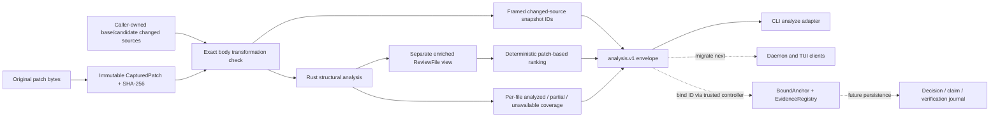

# Recommendation integration — 2026-10-25

## Status 2026-10-28 (0.3.0)

**Kind:** append-only ledger of the 60 tuicr findings DDF-R00–R59, dated 2026-10-25 against base `1b39d66` (0.2.1). The entries below are not rewritten. Their status labels (19 Implemented, 10 Partial foundation, 20 Planned, 6 Evaluation required, 4 Preserved, 1 partially implemented) are as of 2026-10-25.

**What changed:**

- The sentence "This branch is local; it has not been merged, pushed, released or published" is no longer true. `codex/assimilate-review-20261025` is an ancestor of `main` at `2f03f40` (measured: `git merge-base --is-ancestor`). It reached `main` through later merges. It was not released on its own; the published GitHub releases are `v0.1.0` and `v0.2.0`, and 0.3.0 is untagged.
- Still true at 0.3.0: the daemon and TUI do not use the analysis service. The daemon's `engine.methods` lists no analysis method (`daemon.*`, `diff.compute`, `diff.plan`, `session.*`, `engine.*` only; measured with the binary). `analyze <patch> <base-dir> <cand-dir>` is a CLI command only.
- Findings implemented after 2026-10-25 are recorded in [`CHANGELOG.md`](../CHANGELOG.md) and [`EVIDENCE.md`](../EVIDENCE.md), not here.
- **Links.** Every `obsidian://` link in this ledger opens the owner's local vault and does not resolve on GitHub. "Local verification evidence" is a directory on the operator workstation.

Current docs: [architecture](ARCHITECTURE.md), [API and IPC](API_AND_IPC.md), [review council](REVIEW_COUNCIL.md), [roadmap](ROADMAP.md).

This document is the executable integration ledger for the 60 commit-pinned tuicr findings, DDF-R00–R59. It assesses assimilation and records the implemented first increment. **The architecture can absorb the recommendations through its crate boundaries, but it is not yet an end-to-end advanced synthetic engineering platform.** Broader capabilities remain explicitly planned or experimental. No competitive-superiority claim has been established.

Base: `1b39d66bcb6caf5c30680f18a28fe06d2b35bbbd` (0.2.1). Local implementation branch: `codex/assimilate-review-20261025`. Original source/review checkouts remain unchanged. This branch is local; it has not been merged, pushed, released or published.

[Vault integration hub](obsidian://open?vault=deep-diff-forge.vault&file=Implementation%2FRecommendation%20Integration) · [Vault original review](obsidian://open?vault=deep-diff-forge.vault&file=Reviews%2FTuicr%20Full%20Stack%20Review) · [Local verification evidence] (local evidence directory, not published)

## Assimilation assessment

The pure core vocabulary, independent patch layer, syntax layer, renderer-neutral projections and deterministic ranking are a useful bedrock. Their separation supports incremental extension. The important architectural weakness is the absence of one source/snapshot/evidence contract shared by all consumers. Printed capability contracts, passing model round trips, and maturity labels did not establish complete application fidelity or verified agent support.

The implemented service starts that contract without conflating source identity, syntax interpretation, reviewer decisions and behavioral evidence. It validates UTF-8 source pairs against the patch, seals changed-source snapshots, attaches line-level semantic spans to hunks, ranks using the existing patch-based heuristics and emits explicit coverage. The existing daemon/TUI entry points still use their previous paths. They must be migrated before the service can be called the universal end-to-end path.



## Use the implemented workflow

Build `cargo build --locked -p deep-diff-forge-cli`. Run:

```sh
deep-diff-forge analyze changes.patch /path/to/base-snapshot /path/to/candidate-snapshot > analysis.json
```

The command emits one `deep-diff-forge.analysis.v1` JSON document. Unknown/extra arguments fail. Inputs are local caller-owned snapshot directories; keep them stable while reading. The adapter rejects path traversal and symlinks and caps aggregate source reads. These checks are not a race-free filesystem sandbox. It never runs agent-supplied commands. Normal modified/added/deleted UTF-8 source pairs are supported. A changed token that spans lines is attributed to the first hunk holding any of its lines; one that no hunk holds makes the file's coverage `partial_lcs`, never `analyzed`. The service records unsupported or missing coverage for other cases; it does not acquire a Git tree or silently infer absent context. `snapshot_scope` is `supplied_changed_sources`, and `behavior_verified` is always false.

The `review_id` seals the original patch and both supplied source snapshots. It is not a whole-repository/build/environment identity. Old/new source absence differs from an empty file. Supplying mismatched source bytes is a hard error. Token-derived spans identify full source lines and report `span_precision: source_line`; they are not exact token-byte or behavioral evidence. Duplicate source paths and extra source pairs are rejected.

Output is bounded per file:
- **`semantic_regions` (always present):** the spans coalesced into contiguous changed-line runs for each hunk and change kind. Each region carries `old_lines` and `new_lines` as inclusive `[start,end]` pairs or `null`, plus the number of `spans` it covers. A moved region continues only while both sides stay contiguous. Line precision is unchanged, because nested nodes over the same line add no line information.
- **`semantic_spans` (at most 256 per file):** the verbatim spans. Above that budget the field is absent, and `semantic_spans_omitted: {reason: "span_budget", count, budget}` records exactly what was left out.

Measured on the four-file r3 sandbox change: output fell from 1,113,154 to 101,849 bytes. Previously one 30 KB file alone emitted 3,970 spans, or 628 KB.

`CapturedPatch.original()` preserves the original input, including cosmetic headings. `render_unified()` is a normalized reconstruction with the tested fidelity guarantees below. `ReviewRevision::from_review_id(bundle.id())` binds annotations/evidence to the full changed-source bundle. `from_patch()` is only patch-scoped and cannot detect a same-patch change in unmodified source context. Legacy `validate_anchor()` is document-local; durable consumers must use `BoundAnchor`.

`EvidenceRegistry.capture` stores the digest of actual bytes; `Linked` is not semantic support. A trusted controller must explicitly call `assess` with evaluator and rationale to record supported/contradicted evidence. Every lookup checks revision freshness. The legacy `grounded` boolean and arbitrary citation strings cannot produce verified support. This registry does not authenticate controllers, persist decisions, execute verification commands or infer that one artifact supports every claim citing it.

## Traceability rules

Every substantive changed module has a source comment naming its finding IDs, a direct link to this document's section and a direct Obsidian link to its own module note. The module note links back to that exact crate/module and its tests. The original tuicr findings remain historical observations against the base commit; integration follow-ups identify branch status without claiming human approval or resolving findings automatically.

“Implemented” below means the narrow finding has a concrete code change and verification route; it does not mean every future capability described in the original recommendation is delivered. “Partial foundation” names the remaining contract or integration gap. Planned/evaluation items are not advertised as available features.

## Patch truth and reconstruction

<a id="patch-truth"></a>

Preserve source bytes and exact original input independently of normalized display; use Git as the application oracle.

- [crates/deep-diff-forge-core/src/lib.rs](../crates/deep-diff-forge-core/src/lib.rs) ↔ [module vault note](obsidian://open?vault=deep-diff-forge.vault&file=Implementation%2FModules%2Fdeep-diff-forge-core--lib)
- [crates/deep-diff-forge-patch/src/lib.rs](../crates/deep-diff-forge-patch/src/lib.rs) ↔ [module vault note](obsidian://open?vault=deep-diff-forge.vault&file=Implementation%2FModules%2Fdeep-diff-forge-patch--lib)
- [crates/deep-diff-forge-patch/src/parser.rs](../crates/deep-diff-forge-patch/src/parser.rs) ↔ [module vault note](obsidian://open?vault=deep-diff-forge.vault&file=Implementation%2FModules%2Fdeep-diff-forge-patch--parser)
- [crates/deep-diff-forge-patch/src/render.rs](../crates/deep-diff-forge-patch/src/render.rs) ↔ [module vault note](obsidian://open?vault=deep-diff-forge.vault&file=Implementation%2FModules%2Fdeep-diff-forge-patch--render)
- [crates/deep-diff-forge-patch/src/paths.rs](../crates/deep-diff-forge-patch/src/paths.rs) ↔ [module vault note](obsidian://open?vault=deep-diff-forge.vault&file=Implementation%2FModules%2Fdeep-diff-forge-patch--paths)
- [crates/deep-diff-forge-patch/tests/git_oracle.rs](../crates/deep-diff-forge-patch/tests/git_oracle.rs) ↔ [module vault note](obsidian://open?vault=deep-diff-forge.vault&file=Implementation%2FModules%2Fdeep-diff-forge-patch--tests--git_oracle)
- [crates/deep-diff-forge-patch/tests/round_trip.rs](../crates/deep-diff-forge-patch/tests/round_trip.rs) ↔ [module vault note](obsidian://open?vault=deep-diff-forge.vault&file=Implementation%2FModules%2Fdeep-diff-forge-patch--tests--round_trip)
- [crates/deep-diff-forge-patch/src/git_raw.rs](../crates/deep-diff-forge-patch/src/git_raw.rs) ↔ [module vault note](obsidian://open?vault=deep-diff-forge.vault&file=Implementation%2FModules%2Fdeep-diff-forge-patch--git_raw)
- [crates/deep-diff-forge-patch/src/git_acquire.rs](../crates/deep-diff-forge-patch/src/git_acquire.rs) ↔ [module vault note](obsidian://open?vault=deep-diff-forge.vault&file=Implementation%2FModules%2Fdeep-diff-forge-patch--git_acquire)
- [crates/deep-diff-forge-patch/tests/git_acquire.rs](../crates/deep-diff-forge-patch/tests/git_acquire.rs) ↔ [module vault note](obsidian://open?vault=deep-diff-forge.vault&file=Implementation%2FModules%2Fdeep-diff-forge-patch--tests--git_acquire)
- [crates/deep-diff-forge-cli/src/git_input.rs](../crates/deep-diff-forge-cli/src/git_input.rs) ↔ [module vault note](obsidian://open?vault=deep-diff-forge.vault&file=Implementation%2FModules%2Fdeep-diff-forge-cli--git_input)
- [crates/deep-diff-forge-cli/tests/git_input.rs](../crates/deep-diff-forge-cli/tests/git_input.rs) ↔ [module vault note](obsidian://open?vault=deep-diff-forge.vault&file=Implementation%2FModules%2Fdeep-diff-forge-cli--tests--git_input)

## Shared review service and source pairs

<a id="shared-service"></a>

Validate that a patch transforms the captured base into the captured candidate before attaching semantics; export explicit coverage and snapshot scope.

- [crates/deep-diff-forge-pipeline/src/review.rs](../crates/deep-diff-forge-pipeline/src/review.rs) ↔ [module vault note](obsidian://open?vault=deep-diff-forge.vault&file=Implementation%2FModules%2Fdeep-diff-forge-pipeline--review)
- [crates/deep-diff-forge-pipeline/src/lib.rs](../crates/deep-diff-forge-pipeline/src/lib.rs) ↔ [module vault note](obsidian://open?vault=deep-diff-forge.vault&file=Implementation%2FModules%2Fdeep-diff-forge-pipeline--lib)
- [crates/deep-diff-forge-cli/src/analysis.rs](../crates/deep-diff-forge-cli/src/analysis.rs) ↔ [module vault note](obsidian://open?vault=deep-diff-forge.vault&file=Implementation%2FModules%2Fdeep-diff-forge-cli--analysis)
- [crates/deep-diff-forge-cli/src/main.rs](../crates/deep-diff-forge-cli/src/main.rs) ↔ [module vault note](obsidian://open?vault=deep-diff-forge.vault&file=Implementation%2FModules%2Fdeep-diff-forge-cli--main)

## Syntax availability and budgets

<a id="syntax-availability"></a>

Never turn a failed analysis into formatting-only or behavioral safety; parser time cancellation is cooperative, node limits are post-parse.

- [crates/deep-diff-forge-syntax/src/lib.rs](../crates/deep-diff-forge-syntax/src/lib.rs) ↔ [module vault note](obsidian://open?vault=deep-diff-forge.vault&file=Implementation%2FModules%2Fdeep-diff-forge-syntax--lib)
- [crates/deep-diff-forge-syntax/src/analyze.rs](../crates/deep-diff-forge-syntax/src/analyze.rs) ↔ [module vault note](obsidian://open?vault=deep-diff-forge.vault&file=Implementation%2FModules%2Fdeep-diff-forge-syntax--analyze)
- [crates/deep-diff-forge-syntax/src/structural.rs](../crates/deep-diff-forge-syntax/src/structural.rs) ↔ [module vault note](obsidian://open?vault=deep-diff-forge.vault&file=Implementation%2FModules%2Fdeep-diff-forge-syntax--structural)
- [crates/deep-diff-forge-syntax/src/highlight.rs](../crates/deep-diff-forge-syntax/src/highlight.rs) ↔ [module vault note](obsidian://open?vault=deep-diff-forge.vault&file=Implementation%2FModules%2Fdeep-diff-forge-syntax--highlight)

## Agent ingestion, identity and evidence

<a id="evidence"></a>

Separate asserted citations from captured artifact integrity, trusted evaluator support and revision freshness. Do not resolve duplicate IDs together.

- [crates/deep-diff-forge-agent/src/lib.rs](../crates/deep-diff-forge-agent/src/lib.rs) ↔ [module vault note](obsidian://open?vault=deep-diff-forge.vault&file=Implementation%2FModules%2Fdeep-diff-forge-agent--lib)
- [crates/deep-diff-forge-agent/src/store.rs](../crates/deep-diff-forge-agent/src/store.rs) ↔ [module vault note](obsidian://open?vault=deep-diff-forge.vault&file=Implementation%2FModules%2Fdeep-diff-forge-agent--store)
- [crates/deep-diff-forge-agent/src/evidence.rs](../crates/deep-diff-forge-agent/src/evidence.rs) ↔ [module vault note](obsidian://open?vault=deep-diff-forge.vault&file=Implementation%2FModules%2Fdeep-diff-forge-agent--evidence)
- [crates/deep-diff-forge-agent/tests/flow.rs](../crates/deep-diff-forge-agent/tests/flow.rs) ↔ [module vault note](obsidian://open?vault=deep-diff-forge.vault&file=Implementation%2FModules%2Fdeep-diff-forge-agent--tests--flow)
- [crates/deep-diff-forge-tui/src/notes.rs](../crates/deep-diff-forge-tui/src/notes.rs) ↔ [module vault note](obsidian://open?vault=deep-diff-forge.vault&file=Implementation%2FModules%2Fdeep-diff-forge-tui--notes)

## Terminal cell geometry

<a id="terminal-geometry"></a>

Measure displayed cells and preserve grapheme boundaries after terminal-safety escaping; keep remaining chrome/wrap geometry visible as work.

- [crates/deep-diff-forge-projection/src/lib.rs](../crates/deep-diff-forge-projection/src/lib.rs) ↔ [module vault note](obsidian://open?vault=deep-diff-forge.vault&file=Implementation%2FModules%2Fdeep-diff-forge-projection--lib)
- [crates/deep-diff-forge-projection/src/width.rs](../crates/deep-diff-forge-projection/src/width.rs) ↔ [module vault note](obsidian://open?vault=deep-diff-forge.vault&file=Implementation%2FModules%2Fdeep-diff-forge-projection--width)
- [crates/deep-diff-forge-projection/src/side_by_side.rs](../crates/deep-diff-forge-projection/src/side_by_side.rs) ↔ [module vault note](obsidian://open?vault=deep-diff-forge.vault&file=Implementation%2FModules%2Fdeep-diff-forge-projection--side_by_side)
- [crates/deep-diff-forge-tui/src/diffview.rs](../crates/deep-diff-forge-tui/src/diffview.rs) ↔ [module vault note](obsidian://open?vault=deep-diff-forge.vault&file=Implementation%2FModules%2Fdeep-diff-forge-tui--diffview)

## Learning promotion validity

<a id="learning-gate"></a>

Reject nonfinite metrics and policy tolerances before comparing promotion thresholds; receipt existence still does not prove causal improvement.

- [crates/deep-diff-forge-learning/src/promote.rs](../crates/deep-diff-forge-learning/src/promote.rs) ↔ [module vault note](obsidian://open?vault=deep-diff-forge.vault&file=Implementation%2FModules%2Fdeep-diff-forge-learning--promote)

## Runtime atomic compatibility

<a id="runtime"></a>

Preserve bounded connection admission on Rust 1.88 using compare-exchange; this does not solve the separate global-lock recommendation.

- [crates/deep-diff-forge-daemon/src/serve.rs](../crates/deep-diff-forge-daemon/src/serve.rs) ↔ [module vault note](obsidian://open?vault=deep-diff-forge.vault&file=Implementation%2FModules%2Fdeep-diff-forge-daemon--serve)

## Executable quality and release gates

<a id="quality-gates"></a>

Make checks fail closed, preserve fuzz crash evidence, use the actual build output path and gate tag publication on the quality workflow.

- [.github/workflows/ci.yml](../.github/workflows/ci.yml) ↔ [module vault note](obsidian://open?vault=deep-diff-forge.vault&file=Implementation%2FModules%2F.github--workflows--ci)
- [.github/workflows/release.yml](../.github/workflows/release.yml) ↔ [module vault note](obsidian://open?vault=deep-diff-forge.vault&file=Implementation%2FModules%2F.github--workflows--release)
- [fuzz/fuzz_targets/agent_annotation.rs](../fuzz/fuzz_targets/agent_annotation.rs) ↔ [module vault note](obsidian://open?vault=deep-diff-forge.vault&file=Implementation%2FModules%2Ffuzz--fuzz_targets--agent_annotation)
- [fuzz/fuzz_targets/patch_parser.rs](../fuzz/fuzz_targets/patch_parser.rs) ↔ [module vault note](obsidian://open?vault=deep-diff-forge.vault&file=Implementation%2FModules%2Ffuzz--fuzz_targets--patch_parser)
- [scripts/security/privacy_probe.py](../scripts/security/privacy_probe.py) ↔ [module vault note](obsidian://open?vault=deep-diff-forge.vault&file=Implementation%2FModules%2Fscripts--security--privacy_probe)
- [scripts/security/test_privacy_probe.py](../scripts/security/test_privacy_probe.py) ↔ [module vault note](obsidian://open?vault=deep-diff-forge.vault&file=Implementation%2FModules%2Fscripts--security--test_privacy_probe)
- [scripts/security/daemon_soak.py](../scripts/security/daemon_soak.py) ↔ [module vault note](obsidian://open?vault=deep-diff-forge.vault&file=Implementation%2FModules%2Fscripts--security--daemon_soak)

## Recommendation ledger

### DDF-R00

**Full-stack review scope and decision — Implemented.**

The complete 60-item integration ledger, original review preservation and module/vault traceability routes are present. This is scope accounting, not a claim that planned capabilities are implemented.

Delivery/design home: [vault architecture and experiments](obsidian://open?vault=deep-diff-forge.vault&file=Strategy%2FExperiments%20and%20Delivery%20Gates).

**Original recommendation:** Retain/evolve the Rust foundation. First repair patch fidelity, false-clean analysis and revision/evidence identity; then connect one complete Rust analysis-to-evidence workflow. Study current Hunk shared semantics and tuicr persistence/forge patterns, and evaluate adapters before duplicating their surfaces.

**Original acceptance:** Work from the issue comments first, then the separately labeled proposals. Each finding has an exact source anchor, evidence and acceptance condition. Review priorities are recommendations, not implemented fixes or a merge verdict.

### DDF-R01

**Keep authoritative patch data separate from interpretation — Preserved.**

Patch truth remains immutable in CapturedPatch; semantic enrichment operates on a separate copy.

Original source anchor: [crates/deep-diff-forge-core/src/lib.rs](../crates/deep-diff-forge-core/src/lib.rs). Delivery/design home: [vault architecture and experiments](obsidian://open?vault=deep-diff-forge.vault&file=Strategy%2FExperiments%20and%20Delivery%20Gates).

**Original recommendation:** Preserve this separation while strengthening the underlying representation and using immutable captured input artifacts. Analysis, ranking, annotations and UI must never replace the bytes the review describes.

**Original acceptance:** A deliberately failing analyzer or misleading agent annotation leaves original patch bytes and captured source identities unchanged; every output identifies its coverage.

### DDF-R02

**Bind all findings to immutable base/candidate snapshots — Partial foundation.**

Immutable original patch capture and framed identities for supplied changed-source pairs are implemented. Native structured Git acquisition (`--git-working-tree [--include-untracked]`, `--git-staged`, `--git-range A..B`) now binds the old side to a resolved commit ID (or the empty tree for an unborn `HEAD`) and a range's new side to a resolved commit ID, records per-file old/new modes and blob IDs from `--raw -z` records, and captures dirty and untracked working-tree changes without mutating the index (measured by the Git fixture tests). Still partial: the working-tree/index new side has no snapshot identity beyond per-file blob IDs (a mode-only working-tree change has no new blob ID), Git config/attribute identity is not recorded, review JSON does not yet carry the acquisition identity (it is in the separate `deep-diff-forge.git-acquisition.v0` document), and immutable repository materialization remains.

Original source anchor: [crates/deep-diff-forge-core/src/lib.rs](../crates/deep-diff-forge-core/src/lib.rs). Implementation trace: [crates/deep-diff-forge-core/src/lib.rs](../crates/deep-diff-forge-core/src/lib.rs) ↔ [vault](obsidian://open?vault=deep-diff-forge.vault&file=Implementation%2FModules%2Fdeep-diff-forge-core--lib), [crates/deep-diff-forge-patch/src/lib.rs](../crates/deep-diff-forge-patch/src/lib.rs) ↔ [vault](obsidian://open?vault=deep-diff-forge.vault&file=Implementation%2FModules%2Fdeep-diff-forge-patch--lib), [crates/deep-diff-forge-patch/src/parser.rs](../crates/deep-diff-forge-patch/src/parser.rs) ↔ [vault](obsidian://open?vault=deep-diff-forge.vault&file=Implementation%2FModules%2Fdeep-diff-forge-patch--parser), [crates/deep-diff-forge-patch/src/render.rs](../crates/deep-diff-forge-patch/src/render.rs) ↔ [vault](obsidian://open?vault=deep-diff-forge.vault&file=Implementation%2FModules%2Fdeep-diff-forge-patch--render), [crates/deep-diff-forge-patch/src/paths.rs](../crates/deep-diff-forge-patch/src/paths.rs) ↔ [vault](obsidian://open?vault=deep-diff-forge.vault&file=Implementation%2FModules%2Fdeep-diff-forge-patch--paths), [crates/deep-diff-forge-patch/tests/git_oracle.rs](../crates/deep-diff-forge-patch/tests/git_oracle.rs) ↔ [vault](obsidian://open?vault=deep-diff-forge.vault&file=Implementation%2FModules%2Fdeep-diff-forge-patch--tests--git_oracle), [crates/deep-diff-forge-patch/tests/round_trip.rs](../crates/deep-diff-forge-patch/tests/round_trip.rs) ↔ [vault](obsidian://open?vault=deep-diff-forge.vault&file=Implementation%2FModules%2Fdeep-diff-forge-patch--tests--round_trip), [crates/deep-diff-forge-pipeline/src/review.rs](../crates/deep-diff-forge-pipeline/src/review.rs) ↔ [vault](obsidian://open?vault=deep-diff-forge.vault&file=Implementation%2FModules%2Fdeep-diff-forge-pipeline--review), [crates/deep-diff-forge-pipeline/src/lib.rs](../crates/deep-diff-forge-pipeline/src/lib.rs) ↔ [vault](obsidian://open?vault=deep-diff-forge.vault&file=Implementation%2FModules%2Fdeep-diff-forge-pipeline--lib), [crates/deep-diff-forge-cli/src/analysis.rs](../crates/deep-diff-forge-cli/src/analysis.rs) ↔ [vault](obsidian://open?vault=deep-diff-forge.vault&file=Implementation%2FModules%2Fdeep-diff-forge-cli--analysis), [crates/deep-diff-forge-cli/src/main.rs](../crates/deep-diff-forge-cli/src/main.rs) ↔ [vault](obsidian://open?vault=deep-diff-forge.vault&file=Implementation%2FModules%2Fdeep-diff-forge-cli--main), [crates/deep-diff-forge-patch/src/git_raw.rs](../crates/deep-diff-forge-patch/src/git_raw.rs) ↔ [vault](obsidian://open?vault=deep-diff-forge.vault&file=Implementation%2FModules%2Fdeep-diff-forge-patch--git_raw), [crates/deep-diff-forge-patch/src/git_acquire.rs](../crates/deep-diff-forge-patch/src/git_acquire.rs) ↔ [vault](obsidian://open?vault=deep-diff-forge.vault&file=Implementation%2FModules%2Fdeep-diff-forge-patch--git_acquire), [crates/deep-diff-forge-patch/tests/git_acquire.rs](../crates/deep-diff-forge-patch/tests/git_acquire.rs) ↔ [vault](obsidian://open?vault=deep-diff-forge.vault&file=Implementation%2FModules%2Fdeep-diff-forge-patch--tests--git_acquire), [crates/deep-diff-forge-cli/src/git_input.rs](../crates/deep-diff-forge-cli/src/git_input.rs) ↔ [vault](obsidian://open?vault=deep-diff-forge.vault&file=Implementation%2FModules%2Fdeep-diff-forge-cli--git_input), [crates/deep-diff-forge-cli/tests/git_input.rs](../crates/deep-diff-forge-cli/tests/git_input.rs) ↔ [vault](obsidian://open?vault=deep-diff-forge.vault&file=Implementation%2FModules%2Fdeep-diff-forge-cli--tests--git_input).

**Original recommendation:** Add SourceSnapshot/ChangeSet identities, old/new file/blob/mode identities, original-patch artifact references and declared input capabilities. Materialize dirty worktree/untracked content before analysis. Keep patch-only input supported with explicitly missing context.

**Original acceptance:** Identical captured input/configuration yields stable scoped IDs; changing candidate, relevant configuration or source namespace cannot inherit an old decision or test result. Original bytes remain retrievable.

### DDF-R03

**Make patch reconstruction completeness representable — Partial foundation.**

Typed per-line EOF state, encoded binary body, original capture and format/path rejection now exist. For natively acquired Git input, each change now carries a typed operation (added/deleted/modified/renamed/copied/type-changed), similarity score, exact old/new path bytes, old/new modes and blob IDs, and the byte range of its block(s) in the authoritative patch; a fixture covering Unicode/tab/newline names, binary, rename+modify, mode change, type change, deletion, missing final newline, CRLF and untracked files applies with `git apply --check` and `git apply` in a clean clone and reproduces the working-tree bytes and executable bits. Still partial: stdin patch input has no such typed metadata, the text review model still requires UTF-8 patches (non-UTF-8 content or paths are a typed refusal, not a reconstruction), and applicability capability negotiation remains.

Original source anchor: [crates/deep-diff-forge-core/src/lib.rs](../crates/deep-diff-forge-core/src/lib.rs). Implementation trace: [crates/deep-diff-forge-core/src/lib.rs](../crates/deep-diff-forge-core/src/lib.rs) ↔ [vault](obsidian://open?vault=deep-diff-forge.vault&file=Implementation%2FModules%2Fdeep-diff-forge-core--lib), [crates/deep-diff-forge-patch/src/lib.rs](../crates/deep-diff-forge-patch/src/lib.rs) ↔ [vault](obsidian://open?vault=deep-diff-forge.vault&file=Implementation%2FModules%2Fdeep-diff-forge-patch--lib), [crates/deep-diff-forge-patch/src/parser.rs](../crates/deep-diff-forge-patch/src/parser.rs) ↔ [vault](obsidian://open?vault=deep-diff-forge.vault&file=Implementation%2FModules%2Fdeep-diff-forge-patch--parser), [crates/deep-diff-forge-patch/src/render.rs](../crates/deep-diff-forge-patch/src/render.rs) ↔ [vault](obsidian://open?vault=deep-diff-forge.vault&file=Implementation%2FModules%2Fdeep-diff-forge-patch--render), [crates/deep-diff-forge-patch/src/paths.rs](../crates/deep-diff-forge-patch/src/paths.rs) ↔ [vault](obsidian://open?vault=deep-diff-forge.vault&file=Implementation%2FModules%2Fdeep-diff-forge-patch--paths), [crates/deep-diff-forge-patch/tests/git_oracle.rs](../crates/deep-diff-forge-patch/tests/git_oracle.rs) ↔ [vault](obsidian://open?vault=deep-diff-forge.vault&file=Implementation%2FModules%2Fdeep-diff-forge-patch--tests--git_oracle), [crates/deep-diff-forge-patch/tests/round_trip.rs](../crates/deep-diff-forge-patch/tests/round_trip.rs) ↔ [vault](obsidian://open?vault=deep-diff-forge.vault&file=Implementation%2FModules%2Fdeep-diff-forge-patch--tests--round_trip), [crates/deep-diff-forge-patch/src/git_raw.rs](../crates/deep-diff-forge-patch/src/git_raw.rs) ↔ [vault](obsidian://open?vault=deep-diff-forge.vault&file=Implementation%2FModules%2Fdeep-diff-forge-patch--git_raw), [crates/deep-diff-forge-patch/src/git_acquire.rs](../crates/deep-diff-forge-patch/src/git_acquire.rs) ↔ [vault](obsidian://open?vault=deep-diff-forge.vault&file=Implementation%2FModules%2Fdeep-diff-forge-patch--git_acquire), [crates/deep-diff-forge-patch/tests/git_acquire.rs](../crates/deep-diff-forge-patch/tests/git_acquire.rs) ↔ [vault](obsidian://open?vault=deep-diff-forge.vault&file=Implementation%2FModules%2Fdeep-diff-forge-patch--tests--git_acquire), [crates/deep-diff-forge-cli/src/git_input.rs](../crates/deep-diff-forge-cli/src/git_input.rs) ↔ [vault](obsidian://open?vault=deep-diff-forge.vault&file=Implementation%2FModules%2Fdeep-diff-forge-cli--git_input), [crates/deep-diff-forge-cli/tests/git_input.rs](../crates/deep-diff-forge-cli/tests/git_input.rs) ↔ [vault](obsidian://open?vault=deep-diff-forge.vault&file=Implementation%2FModules%2Fdeep-diff-forge-cli--tests--git_input).

**Original recommendation:** Retain original bytes and add typed line termination, binary operations, exact old/new paths/modes, format capabilities and reconstruction/applicability status. Explicitly reject or mark partial unsupported operations instead of successful-looking normalization.

**Original acceptance:** For every declared-supported format, apply against the captured base and compare resulting candidate bytes/modes/tree. Unsupported operations produce typed limitations and preserve the complete original artifact.

### DDF-R04

**Preserve no-final-newline markers at their content line — Implemented.**

EOF markers are attached to specific patch lines and re-emitted there; malformed/orphan/duplicate markers fail explicitly, and so does a marker followed by another line of the side it ended (Git would join that line onto the marked one; bug hunt 2026-11-01).

Original source anchor: [crates/deep-diff-forge-patch/src/render.rs](../crates/deep-diff-forge-patch/src/render.rs). Implementation trace: [crates/deep-diff-forge-core/src/lib.rs](../crates/deep-diff-forge-core/src/lib.rs) ↔ [vault](obsidian://open?vault=deep-diff-forge.vault&file=Implementation%2FModules%2Fdeep-diff-forge-core--lib), [crates/deep-diff-forge-patch/src/lib.rs](../crates/deep-diff-forge-patch/src/lib.rs) ↔ [vault](obsidian://open?vault=deep-diff-forge.vault&file=Implementation%2FModules%2Fdeep-diff-forge-patch--lib), [crates/deep-diff-forge-patch/src/parser.rs](../crates/deep-diff-forge-patch/src/parser.rs) ↔ [vault](obsidian://open?vault=deep-diff-forge.vault&file=Implementation%2FModules%2Fdeep-diff-forge-patch--parser), [crates/deep-diff-forge-patch/src/render.rs](../crates/deep-diff-forge-patch/src/render.rs) ↔ [vault](obsidian://open?vault=deep-diff-forge.vault&file=Implementation%2FModules%2Fdeep-diff-forge-patch--render), [crates/deep-diff-forge-patch/src/paths.rs](../crates/deep-diff-forge-patch/src/paths.rs) ↔ [vault](obsidian://open?vault=deep-diff-forge.vault&file=Implementation%2FModules%2Fdeep-diff-forge-patch--paths), [crates/deep-diff-forge-patch/tests/git_oracle.rs](../crates/deep-diff-forge-patch/tests/git_oracle.rs) ↔ [vault](obsidian://open?vault=deep-diff-forge.vault&file=Implementation%2FModules%2Fdeep-diff-forge-patch--tests--git_oracle), [crates/deep-diff-forge-patch/tests/round_trip.rs](../crates/deep-diff-forge-patch/tests/round_trip.rs) ↔ [vault](obsidian://open?vault=deep-diff-forge.vault&file=Implementation%2FModules%2Fdeep-diff-forge-patch--tests--round_trip).

**Original recommendation:** Represent line termination on the preceding old/new content side and emit markers at the correct hunk position. Keep original patch bytes independently of display projections.

**Original acceptance:** Add old-only, new-only, both-sides and context-line EOF fixtures; original and reconstructed application produce exactly the same candidate content, including final newline state.

### DDF-R05

**CRLF content is normalized during parse/render — Implemented.**

LF framing preserves content CR bytes. Independent Git oracle covers CRLF and mixed endings.

Original source anchor: [crates/deep-diff-forge-patch/src/parser.rs](../crates/deep-diff-forge-patch/src/parser.rs). Implementation trace: [crates/deep-diff-forge-core/src/lib.rs](../crates/deep-diff-forge-core/src/lib.rs) ↔ [vault](obsidian://open?vault=deep-diff-forge.vault&file=Implementation%2FModules%2Fdeep-diff-forge-core--lib), [crates/deep-diff-forge-patch/src/lib.rs](../crates/deep-diff-forge-patch/src/lib.rs) ↔ [vault](obsidian://open?vault=deep-diff-forge.vault&file=Implementation%2FModules%2Fdeep-diff-forge-patch--lib), [crates/deep-diff-forge-patch/src/parser.rs](../crates/deep-diff-forge-patch/src/parser.rs) ↔ [vault](obsidian://open?vault=deep-diff-forge.vault&file=Implementation%2FModules%2Fdeep-diff-forge-patch--parser), [crates/deep-diff-forge-patch/src/render.rs](../crates/deep-diff-forge-patch/src/render.rs) ↔ [vault](obsidian://open?vault=deep-diff-forge.vault&file=Implementation%2FModules%2Fdeep-diff-forge-patch--render), [crates/deep-diff-forge-patch/src/paths.rs](../crates/deep-diff-forge-patch/src/paths.rs) ↔ [vault](obsidian://open?vault=deep-diff-forge.vault&file=Implementation%2FModules%2Fdeep-diff-forge-patch--paths), [crates/deep-diff-forge-patch/tests/git_oracle.rs](../crates/deep-diff-forge-patch/tests/git_oracle.rs) ↔ [vault](obsidian://open?vault=deep-diff-forge.vault&file=Implementation%2FModules%2Fdeep-diff-forge-patch--tests--git_oracle), [crates/deep-diff-forge-patch/tests/round_trip.rs](../crates/deep-diff-forge-patch/tests/round_trip.rs) ↔ [vault](obsidian://open?vault=deep-diff-forge.vault&file=Implementation%2FModules%2Fdeep-diff-forge-patch--tests--round_trip).

**Original recommendation:** Separate patch framing from the represented content line terminators and preserve original bytes. Define the supported LF/CRLF/mixed termination behavior explicitly.

**Original acceptance:** Git differential fixtures verify candidate bytes, not only reparsed models, for LF, CRLF, mixed lines and missing EOF newline.

### DDF-R06

**Git binary payload is discarded — Implemented.**

Encoded Git binary payload bodies are retained and rendered; Git applies the reconstructed fixture to exact candidate bytes.

Original source anchor: [crates/deep-diff-forge-patch/src/parser.rs](../crates/deep-diff-forge-patch/src/parser.rs). Implementation trace: [crates/deep-diff-forge-core/src/lib.rs](../crates/deep-diff-forge-core/src/lib.rs) ↔ [vault](obsidian://open?vault=deep-diff-forge.vault&file=Implementation%2FModules%2Fdeep-diff-forge-core--lib), [crates/deep-diff-forge-patch/src/lib.rs](../crates/deep-diff-forge-patch/src/lib.rs) ↔ [vault](obsidian://open?vault=deep-diff-forge.vault&file=Implementation%2FModules%2Fdeep-diff-forge-patch--lib), [crates/deep-diff-forge-patch/src/parser.rs](../crates/deep-diff-forge-patch/src/parser.rs) ↔ [vault](obsidian://open?vault=deep-diff-forge.vault&file=Implementation%2FModules%2Fdeep-diff-forge-patch--parser), [crates/deep-diff-forge-patch/src/render.rs](../crates/deep-diff-forge-patch/src/render.rs) ↔ [vault](obsidian://open?vault=deep-diff-forge.vault&file=Implementation%2FModules%2Fdeep-diff-forge-patch--render), [crates/deep-diff-forge-patch/src/paths.rs](../crates/deep-diff-forge-patch/src/paths.rs) ↔ [vault](obsidian://open?vault=deep-diff-forge.vault&file=Implementation%2FModules%2Fdeep-diff-forge-patch--paths), [crates/deep-diff-forge-patch/tests/git_oracle.rs](../crates/deep-diff-forge-patch/tests/git_oracle.rs) ↔ [vault](obsidian://open?vault=deep-diff-forge.vault&file=Implementation%2FModules%2Fdeep-diff-forge-patch--tests--git_oracle), [crates/deep-diff-forge-patch/tests/round_trip.rs](../crates/deep-diff-forge-patch/tests/round_trip.rs) ↔ [vault](obsidian://open?vault=deep-diff-forge.vault&file=Implementation%2FModules%2Fdeep-diff-forge-patch--tests--round_trip).

**Original recommendation:** Retain typed binary payload/operations or refuse to advertise reconstructed applicability for binary inputs. Always preserve the original byte artifact.

**Original acceptance:** Binary add/modify/delete fixtures reconstruct and apply to the same resulting blobs, or are explicitly unsupported without a successful applicability claim.

### DDF-R07

**Decode Git-quoted paths instead of using display header text — Implemented.**

Git C-quoted UTF-8 path decoding/encoding preserves octal UTF-8, tabs and quotes; non-UTF-8 quoted paths are explicitly rejected.

Native acquisition now follows the tuicr approach (MIT, attributed in `git_raw.rs`): Git runs with a fixed argv (`--raw -z --patch`, `core.quotePath=false`, pinned `a/`/`b/` prefixes, no colour/external diff/textconv/hooks/fsmonitor), path/status/mode/blob identity comes only from NUL-delimited raw records with separate old/new path bytes (`GitPath`, lossless `OsString` on Unix), each record is paired with its `diff --git` block(s), and a count mismatch, re-ordered block, wrong header bytes, missing `new file`/`deleted file`/rename/mode lines or a disagreeing `index` object ID is a typed refusal. Review-model paths for Git input are taken from the records, so a display-header defect cannot mislabel them. The one this guarded against (a mode-only change under `x b/y` parsed as `y`) was fixed in the parser on 2026-11-01, which now splits a `diff --git` line where both halves name one path, as `git apply` does; the fixture test checks that the records and the display parse agree on `x b/y`. Partial: non-UTF-8 paths are preserved in the structured records and in `--acquisition-json` (hex), but the text review model refuses them; trailing-space and Unix non-UTF-8 paths have no real-repository fixture yet (the non-UTF-8 case is unit-tested on synthetic raw output).

Original source anchor: [crates/deep-diff-forge-patch/src/parser.rs](../crates/deep-diff-forge-patch/src/parser.rs). Implementation trace: [crates/deep-diff-forge-core/src/lib.rs](../crates/deep-diff-forge-core/src/lib.rs) ↔ [vault](obsidian://open?vault=deep-diff-forge.vault&file=Implementation%2FModules%2Fdeep-diff-forge-core--lib), [crates/deep-diff-forge-patch/src/lib.rs](../crates/deep-diff-forge-patch/src/lib.rs) ↔ [vault](obsidian://open?vault=deep-diff-forge.vault&file=Implementation%2FModules%2Fdeep-diff-forge-patch--lib), [crates/deep-diff-forge-patch/src/parser.rs](../crates/deep-diff-forge-patch/src/parser.rs) ↔ [vault](obsidian://open?vault=deep-diff-forge.vault&file=Implementation%2FModules%2Fdeep-diff-forge-patch--parser), [crates/deep-diff-forge-patch/src/render.rs](../crates/deep-diff-forge-patch/src/render.rs) ↔ [vault](obsidian://open?vault=deep-diff-forge.vault&file=Implementation%2FModules%2Fdeep-diff-forge-patch--render), [crates/deep-diff-forge-patch/src/paths.rs](../crates/deep-diff-forge-patch/src/paths.rs) ↔ [vault](obsidian://open?vault=deep-diff-forge.vault&file=Implementation%2FModules%2Fdeep-diff-forge-patch--paths), [crates/deep-diff-forge-patch/tests/git_oracle.rs](../crates/deep-diff-forge-patch/tests/git_oracle.rs) ↔ [vault](obsidian://open?vault=deep-diff-forge.vault&file=Implementation%2FModules%2Fdeep-diff-forge-patch--tests--git_oracle), [crates/deep-diff-forge-patch/tests/round_trip.rs](../crates/deep-diff-forge-patch/tests/round_trip.rs) ↔ [vault](obsidian://open?vault=deep-diff-forge.vault&file=Implementation%2FModules%2Fdeep-diff-forge-patch--tests--round_trip), [crates/deep-diff-forge-patch/src/git_raw.rs](../crates/deep-diff-forge-patch/src/git_raw.rs) ↔ [vault](obsidian://open?vault=deep-diff-forge.vault&file=Implementation%2FModules%2Fdeep-diff-forge-patch--git_raw), [crates/deep-diff-forge-patch/src/git_acquire.rs](../crates/deep-diff-forge-patch/src/git_acquire.rs) ↔ [vault](obsidian://open?vault=deep-diff-forge.vault&file=Implementation%2FModules%2Fdeep-diff-forge-patch--git_acquire), [crates/deep-diff-forge-patch/tests/git_acquire.rs](../crates/deep-diff-forge-patch/tests/git_acquire.rs) ↔ [vault](obsidian://open?vault=deep-diff-forge.vault&file=Implementation%2FModules%2Fdeep-diff-forge-patch--tests--git_acquire), [crates/deep-diff-forge-cli/src/git_input.rs](../crates/deep-diff-forge-cli/src/git_input.rs) ↔ [vault](obsidian://open?vault=deep-diff-forge.vault&file=Implementation%2FModules%2Fdeep-diff-forge-cli--git_input), [crates/deep-diff-forge-cli/tests/git_input.rs](../crates/deep-diff-forge-cli/tests/git_input.rs) ↔ [vault](obsidian://open?vault=deep-diff-forge.vault&file=Implementation%2FModules%2Fdeep-diff-forge-cli--tests--git_input).

**Original recommendation:** Implement Git path quoting correctly for patch input; for native acquisition, use NUL-delimited machine metadata with separate old/new path identities, as tuicr does. Keep exact path bytes separate from safe display text.

**Original acceptance:** Cover tabs, newlines, spaces, trailing spaces, quotes, non-ASCII and Unix non-UTF-8 paths with declared capability behavior; mappings resolve the actual source without guessing.

### DDF-R08

**Unavailable tokenization can falsely report reformat-only — Implemented.**

Checked tokenization returns typed unavailable results for unsupported, oversized, erroneous or cancelled parsing; reformat_only stays false on failure.

Original source anchor: [crates/deep-diff-forge-syntax/src/structural.rs](../crates/deep-diff-forge-syntax/src/structural.rs). Implementation trace: [crates/deep-diff-forge-syntax/src/lib.rs](../crates/deep-diff-forge-syntax/src/lib.rs) ↔ [vault](obsidian://open?vault=deep-diff-forge.vault&file=Implementation%2FModules%2Fdeep-diff-forge-syntax--lib), [crates/deep-diff-forge-syntax/src/analyze.rs](../crates/deep-diff-forge-syntax/src/analyze.rs) ↔ [vault](obsidian://open?vault=deep-diff-forge.vault&file=Implementation%2FModules%2Fdeep-diff-forge-syntax--analyze), [crates/deep-diff-forge-syntax/src/structural.rs](../crates/deep-diff-forge-syntax/src/structural.rs) ↔ [vault](obsidian://open?vault=deep-diff-forge.vault&file=Implementation%2FModules%2Fdeep-diff-forge-syntax--structural), [crates/deep-diff-forge-syntax/src/highlight.rs](../crates/deep-diff-forge-syntax/src/highlight.rs) ↔ [vault](obsidian://open?vault=deep-diff-forge.vault&file=Implementation%2FModules%2Fdeep-diff-forge-syntax--highlight).

**Original recommendation:** Return a typed tokenization/analysis outcome and propagate explicit unavailable/partial/budget reasons. Only classify equivalent observed token streams after both analyses succeeded under the declared capability.

**Original acceptance:** Changed oversized, unsupported and failed-parser inputs cannot report successful reformat-only. Genuine empty supported files and ordinary reformat cases remain distinguishable.

### DDF-R09

**Populate semantic twins in the actual review path — Partial foundation.**

The new shared service verifies full source pairs, computes Rust structural results and attaches source-line spans to existing hunks in a separate enriched model. Rename/copy/binary semantics and existing UI adapters remain.

Original source anchor: [crates/deep-diff-forge-cli/src/main.rs](../crates/deep-diff-forge-cli/src/main.rs). Implementation trace: [crates/deep-diff-forge-pipeline/src/review.rs](../crates/deep-diff-forge-pipeline/src/review.rs) ↔ [vault](obsidian://open?vault=deep-diff-forge.vault&file=Implementation%2FModules%2Fdeep-diff-forge-pipeline--review), [crates/deep-diff-forge-pipeline/src/lib.rs](../crates/deep-diff-forge-pipeline/src/lib.rs) ↔ [vault](obsidian://open?vault=deep-diff-forge.vault&file=Implementation%2FModules%2Fdeep-diff-forge-pipeline--lib), [crates/deep-diff-forge-cli/src/analysis.rs](../crates/deep-diff-forge-cli/src/analysis.rs) ↔ [vault](obsidian://open?vault=deep-diff-forge.vault&file=Implementation%2FModules%2Fdeep-diff-forge-cli--analysis), [crates/deep-diff-forge-cli/src/main.rs](../crates/deep-diff-forge-cli/src/main.rs) ↔ [vault](obsidian://open?vault=deep-diff-forge.vault&file=Implementation%2FModules%2Fdeep-diff-forge-cli--main).

**Original recommendation:** Route immutable source acquisition, supported Rust analysis, validated hunk/range joining and typed fallback through a shared analysis service used by CLI/TUI/daemon.

**Original acceptance:** One captured Rust change produces patch, source identity, semantic observations and validated hunk links through the public review command. Missing source or unmatched ranges remain explicit.

### DDF-R10

**Enforce budgets across the whole analysis, not only afterward — Partial foundation.**

Byte guards, post-parse node caps, bounded LCS work and a shared 250ms cooperative parser callback exist. Hard process isolation, complete stage resource receipts and hostile-input performance campaigns remain.

Original source anchor: [crates/deep-diff-forge-syntax/src/analyze.rs](../crates/deep-diff-forge-syntax/src/analyze.rs). Implementation trace: [crates/deep-diff-forge-syntax/src/lib.rs](../crates/deep-diff-forge-syntax/src/lib.rs) ↔ [vault](obsidian://open?vault=deep-diff-forge.vault&file=Implementation%2FModules%2Fdeep-diff-forge-syntax--lib), [crates/deep-diff-forge-syntax/src/analyze.rs](../crates/deep-diff-forge-syntax/src/analyze.rs) ↔ [vault](obsidian://open?vault=deep-diff-forge.vault&file=Implementation%2FModules%2Fdeep-diff-forge-syntax--analyze), [crates/deep-diff-forge-syntax/src/structural.rs](../crates/deep-diff-forge-syntax/src/structural.rs) ↔ [vault](obsidian://open?vault=deep-diff-forge.vault&file=Implementation%2FModules%2Fdeep-diff-forge-syntax--structural), [crates/deep-diff-forge-syntax/src/highlight.rs](../crates/deep-diff-forge-syntax/src/highlight.rs) ↔ [vault](obsidian://open?vault=deep-diff-forge.vault&file=Implementation%2FModules%2Fdeep-diff-forge-syntax--highlight).

**Original recommendation:** Pass byte/work/node/time/memory budgets to analyzer jobs, record attempted/completed coverage, and use cooperative cancellation or isolated worker termination as appropriate for soft versus hard limits.

**Original acceptance:** Pathological/deep/malformed inputs hit explicit budget outcomes with bounded measured resource behavior and preserved patch visibility. An I/O timeout is not counted as an analyzer deadline.

### DDF-R11

**Label syntax observations separately from behavioral meaning — Planned.**

Maintain separate syntax and behavior evidence. Run held-out semantic counterexample evaluations before claiming equivalence.

Original source anchor: [crates/deep-diff-forge-syntax/src/structural.rs](../crates/deep-diff-forge-syntax/src/structural.rs). Implementation trace: [crates/deep-diff-forge-syntax/src/lib.rs](../crates/deep-diff-forge-syntax/src/lib.rs) ↔ [vault](obsidian://open?vault=deep-diff-forge.vault&file=Implementation%2FModules%2Fdeep-diff-forge-syntax--lib), [crates/deep-diff-forge-syntax/src/analyze.rs](../crates/deep-diff-forge-syntax/src/analyze.rs) ↔ [vault](obsidian://open?vault=deep-diff-forge.vault&file=Implementation%2FModules%2Fdeep-diff-forge-syntax--analyze), [crates/deep-diff-forge-syntax/src/structural.rs](../crates/deep-diff-forge-syntax/src/structural.rs) ↔ [vault](obsidian://open?vault=deep-diff-forge.vault&file=Implementation%2FModules%2Fdeep-diff-forge-syntax--structural), [crates/deep-diff-forge-syntax/src/highlight.rs](../crates/deep-diff-forge-syntax/src/highlight.rs) ↔ [vault](obsidian://open?vault=deep-diff-forge.vault&file=Implementation%2FModules%2Fdeep-diff-forge-syntax--highlight).

**Original recommendation:** Expose analyzer capability/version and scope alongside results. Build syntax, resolved relationships, observed tests and agent interpretations as distinct evidence tiers; select additional languages from actual evaluated workloads.

**Original acceptance:** Clients cannot mistake token equality or a moved-block heuristic for semantic equivalence. Rust works end to end before adding broad language claims.

### DDF-R12

**Evolve independent file scoring into typed relationships — Planned.**

Build typed symbol/dependency/call/test relationships over revision-bound inputs; validate edge provenance and unknown edges.

Original source anchor: [crates/deep-diff-forge-graph/src/risk.rs](../crates/deep-diff-forge-graph/src/risk.rs). Delivery/design home: [vault architecture and experiments](obsidian://open?vault=deep-diff-forge.vault&file=Strategy%2FExperiments%20and%20Delivery%20Gates).

**Original recommendation:** Add typed, revision-bound relationships with derivation method, source artifacts and coverage. Distinguish compiler-derived edges, heuristics and agent hypotheses. Rank the complete inventory using those observations.

**Original acceptance:** A changed API traces affected consumers and relevant tests where supported; missing relationship coverage is visible. Evaluate defect recall at a review budget against current ranking.

### DDF-R13

**Generated/test de-prioritization must not imply safe coverage — Planned.**

Treat generated suppression as a visible review policy; preserve and expose suppressed input coverage.

Original source anchor: [crates/deep-diff-forge-graph/src/risk.rs](../crates/deep-diff-forge-graph/src/risk.rs). Delivery/design home: [vault architecture and experiments](obsidian://open?vault=deep-diff-forge.vault&file=Strategy%2FExperiments%20and%20Delivery%20Gates).

**Original recommendation:** Keep every changed operation in coverage, distinguish presentation priority from severity/verification requirements, and allow policy-sensitive generated/test changes to surface explicitly.

**Original acceptance:** Seeded generated-config and test-weakening defects remain discoverable. Report missed critical items, not only ranking order or token savings.

### DDF-R14

**Nonempty evidence strings do not establish grounding — Implemented.**

Legacy evidence strings and grounded flags no longer establish verified support. A separate registry tracks captured bytes, evaluator assessment and staleness.

Original source anchor: [crates/deep-diff-forge-agent/src/lib.rs](../crates/deep-diff-forge-agent/src/lib.rs). Implementation trace: [crates/deep-diff-forge-agent/src/lib.rs](../crates/deep-diff-forge-agent/src/lib.rs) ↔ [vault](obsidian://open?vault=deep-diff-forge.vault&file=Implementation%2FModules%2Fdeep-diff-forge-agent--lib), [crates/deep-diff-forge-agent/src/store.rs](../crates/deep-diff-forge-agent/src/store.rs) ↔ [vault](obsidian://open?vault=deep-diff-forge.vault&file=Implementation%2FModules%2Fdeep-diff-forge-agent--store), [crates/deep-diff-forge-agent/src/evidence.rs](../crates/deep-diff-forge-agent/src/evidence.rs) ↔ [vault](obsidian://open?vault=deep-diff-forge.vault&file=Implementation%2FModules%2Fdeep-diff-forge-agent--evidence), [crates/deep-diff-forge-agent/tests/flow.rs](../crates/deep-diff-forge-agent/tests/flow.rs) ↔ [vault](obsidian://open?vault=deep-diff-forge.vault&file=Implementation%2FModules%2Fdeep-diff-forge-agent--tests--flow), [crates/deep-diff-forge-tui/src/notes.rs](../crates/deep-diff-forge-tui/src/notes.rs) ↔ [vault](obsidian://open?vault=deep-diff-forge.vault&file=Implementation%2FModules%2Fdeep-diff-forge-tui--notes).

**Original recommendation:** Replace the Boolean collapse with asserted/evidence-linked/checked-supported-with-scope/contradicted/inconclusive/stale states. Resolve evidence artifacts and verify relevance to the exact candidate and proposition.

**Original acceptance:** Fabricated, missing, swapped and stale evidence cannot become checked support; producer identity and artifact integrity remain separate from claim correctness.

### DDF-R15

**Compose trust checks once at annotation ingestion — Implemented.**

Untrusted insertion sanitizes body text, clears claimed grounding and reserved engine identity, and rejects empty/duplicate IDs.

Original source anchor: [crates/deep-diff-forge-agent/src/store.rs](../crates/deep-diff-forge-agent/src/store.rs). Implementation trace: [crates/deep-diff-forge-agent/src/lib.rs](../crates/deep-diff-forge-agent/src/lib.rs) ↔ [vault](obsidian://open?vault=deep-diff-forge.vault&file=Implementation%2FModules%2Fdeep-diff-forge-agent--lib), [crates/deep-diff-forge-agent/src/store.rs](../crates/deep-diff-forge-agent/src/store.rs) ↔ [vault](obsidian://open?vault=deep-diff-forge.vault&file=Implementation%2FModules%2Fdeep-diff-forge-agent--store), [crates/deep-diff-forge-agent/src/evidence.rs](../crates/deep-diff-forge-agent/src/evidence.rs) ↔ [vault](obsidian://open?vault=deep-diff-forge.vault&file=Implementation%2FModules%2Fdeep-diff-forge-agent--evidence), [crates/deep-diff-forge-agent/tests/flow.rs](../crates/deep-diff-forge-agent/tests/flow.rs) ↔ [vault](obsidian://open?vault=deep-diff-forge.vault&file=Implementation%2FModules%2Fdeep-diff-forge-agent--tests--flow), [crates/deep-diff-forge-tui/src/notes.rs](../crates/deep-diff-forge-tui/src/notes.rs) ↔ [vault](obsidian://open?vault=deep-diff-forge.vault&file=Implementation%2FModules%2Fdeep-diff-forge-tui--notes).

**Original recommendation:** Create one validated ingestion API taking revision context and authenticated producer facts. Validate schema/size, identity, anchor, body and evidence references transactionally before storing an asserted claim.

**Original acceptance:** CLI, TUI and daemon adapters reject the same invalid annotations. Source labels cannot grant human/system authority, and untrusted text remains data.

### DDF-R16

**Anchors accept unrelated revisions and IDs shift with file order — Partial foundation.**

BoundAnchor checks review identity plus document membership. Full-source callers can bind to ReviewBundle.id; legacy path/counter APIs remain explicitly document-local. Durable migration, conflict handling and reattachment UX remain.

Original source anchor: [crates/deep-diff-forge-agent/src/anchor.rs](../crates/deep-diff-forge-agent/src/anchor.rs). Implementation trace: [crates/deep-diff-forge-agent/src/lib.rs](../crates/deep-diff-forge-agent/src/lib.rs) ↔ [vault](obsidian://open?vault=deep-diff-forge.vault&file=Implementation%2FModules%2Fdeep-diff-forge-agent--lib), [crates/deep-diff-forge-agent/src/store.rs](../crates/deep-diff-forge-agent/src/store.rs) ↔ [vault](obsidian://open?vault=deep-diff-forge.vault&file=Implementation%2FModules%2Fdeep-diff-forge-agent--store), [crates/deep-diff-forge-agent/src/evidence.rs](../crates/deep-diff-forge-agent/src/evidence.rs) ↔ [vault](obsidian://open?vault=deep-diff-forge.vault&file=Implementation%2FModules%2Fdeep-diff-forge-agent--evidence), [crates/deep-diff-forge-agent/tests/flow.rs](../crates/deep-diff-forge-agent/tests/flow.rs) ↔ [vault](obsidian://open?vault=deep-diff-forge.vault&file=Implementation%2FModules%2Fdeep-diff-forge-agent--tests--flow), [crates/deep-diff-forge-tui/src/notes.rs](../crates/deep-diff-forge-tui/src/notes.rs) ↔ [vault](obsidian://open?vault=deep-diff-forge.vault&file=Implementation%2FModules%2Fdeep-diff-forge-tui--notes).

**Original recommendation:** Require captured change/file/content identity on external anchors. Separate identity from layout/order. Remapping after edits must return exact/relocated/ambiguous/stale and record lineage explicitly.

**Original acceptance:** Unrelated candidates reject the old anchor; reordered files preserve scoped identity where intended; duplicate snippets never silently inherit an annotation.

### DDF-R17

**Duplicate annotation IDs resolve together — Implemented.**

Trusted and untrusted stores reject duplicate IDs without replacing an annotation or inheriting resolution.

Original source anchor: [crates/deep-diff-forge-agent/src/store.rs](../crates/deep-diff-forge-agent/src/store.rs). Implementation trace: [crates/deep-diff-forge-agent/src/lib.rs](../crates/deep-diff-forge-agent/src/lib.rs) ↔ [vault](obsidian://open?vault=deep-diff-forge.vault&file=Implementation%2FModules%2Fdeep-diff-forge-agent--lib), [crates/deep-diff-forge-agent/src/store.rs](../crates/deep-diff-forge-agent/src/store.rs) ↔ [vault](obsidian://open?vault=deep-diff-forge.vault&file=Implementation%2FModules%2Fdeep-diff-forge-agent--store), [crates/deep-diff-forge-agent/src/evidence.rs](../crates/deep-diff-forge-agent/src/evidence.rs) ↔ [vault](obsidian://open?vault=deep-diff-forge.vault&file=Implementation%2FModules%2Fdeep-diff-forge-agent--evidence), [crates/deep-diff-forge-agent/tests/flow.rs](../crates/deep-diff-forge-agent/tests/flow.rs) ↔ [vault](obsidian://open?vault=deep-diff-forge.vault&file=Implementation%2FModules%2Fdeep-diff-forge-agent--tests--flow), [crates/deep-diff-forge-tui/src/notes.rs](../crates/deep-diff-forge-tui/src/notes.rs) ↔ [vault](obsidian://open?vault=deep-diff-forge.vault&file=Implementation%2FModules%2Fdeep-diff-forge-tui--notes).

**Original recommendation:** Enforce identity uniqueness or explicit idempotent insertion with immutable-content checks. Scope resolution to a specific revision-bound claim and record actor/reason/event identity.

**Original acceptance:** Duplicate conflicting insertions are rejected; retrying an identical event is idempotent; resolving one claim cannot resolve another.

### DDF-R18

**Persist review lifecycle independently of the UI — Planned.**

Persist reviewer-owned decisions in a versioned journal with optimistic conflict detection and schema migration.

Original source anchor: [crates/deep-diff-forge-agent/src/store.rs](../crates/deep-diff-forge-agent/src/store.rs). Delivery/design home: [vault architecture and experiments](obsidian://open?vault=deep-diff-forge.vault&file=Strategy%2FExperiments%20and%20Delivery%20Gates).

**Original recommendation:** Introduce durable append-only claim/decision events with actor, candidate, reason, evidence references and explicit supersession. Derive UI projections from that state. Study tuicr ReviewStore/manifest/merge semantics.

**Original acceptance:** Restart recovers committed decisions; concurrent human/agent edits have defined merge/conflict behavior; candidate changes invalidate applicability rather than inherit approval.

### DDF-R19

**Make one engine pipeline own analysis meaning — Partial foundation.**

A shared capture/validation/syntax/rank/export service and analyze CLI adapter are implemented. Existing review, daemon and TUI entry points still need migration to this service.

Original source anchor: [crates/deep-diff-forge-pipeline/src/lib.rs](../crates/deep-diff-forge-pipeline/src/lib.rs). Implementation trace: [crates/deep-diff-forge-pipeline/src/review.rs](../crates/deep-diff-forge-pipeline/src/review.rs) ↔ [vault](obsidian://open?vault=deep-diff-forge.vault&file=Implementation%2FModules%2Fdeep-diff-forge-pipeline--review), [crates/deep-diff-forge-pipeline/src/lib.rs](../crates/deep-diff-forge-pipeline/src/lib.rs) ↔ [vault](obsidian://open?vault=deep-diff-forge.vault&file=Implementation%2FModules%2Fdeep-diff-forge-pipeline--lib), [crates/deep-diff-forge-cli/src/analysis.rs](../crates/deep-diff-forge-cli/src/analysis.rs) ↔ [vault](obsidian://open?vault=deep-diff-forge.vault&file=Implementation%2FModules%2Fdeep-diff-forge-cli--analysis), [crates/deep-diff-forge-cli/src/main.rs](../crates/deep-diff-forge-cli/src/main.rs) ↔ [vault](obsidian://open?vault=deep-diff-forge.vault&file=Implementation%2FModules%2Fdeep-diff-forge-cli--main).

**Original recommendation:** Introduce one revision-aware analysis/job/result service with source, analyzer, artifact and verification ports. CLI, TUI and daemon consume the same canonical findings/coverage and shared action semantics.

**Original acceptance:** Equivalent public requests across all adapters return identical material findings, capability omissions and valid anchors. Register real adapters in an adversarial conformance corpus.

### DDF-R20

**JSONL needs identity, completeness and bounded production — Planned.**

Introduce versioned start/file/coverage/diagnostic/end JSONL envelopes and migrate consumers together.

Original source anchor: [crates/deep-diff-forge-pipeline/src/jsonl.rs](../crates/deep-diff-forge-pipeline/src/jsonl.rs). Delivery/design home: [vault architecture and experiments](obsidian://open?vault=deep-diff-forge.vault&file=Strategy%2FExperiments%20and%20Delivery%20Gates).

**Original recommendation:** Define a versioned envelope with change/job/event IDs, producer/analyzer config, sequence, typed payload and terminal coverage. Bound in-flight output; distinguish transport progress order from deterministic final results.

**Original acceptance:** Disconnected/cancelled/failed streams cannot look complete; retries are idempotent; missing sequences and partial coverage are detectable; large reviews do not require one accumulated output string.

### DDF-R21

**Do not report zero semantic fallbacks when semantics never ran — Partial foundation.**

analysis.v1 reports one explicit coverage record per changed file. Legacy JSON/JSONL surfaces still need coverage-aware schema migration.

Original source anchor: [crates/deep-diff-forge-patch/src/json.rs](../crates/deep-diff-forge-patch/src/json.rs). Implementation trace: [crates/deep-diff-forge-pipeline/src/review.rs](../crates/deep-diff-forge-pipeline/src/review.rs) ↔ [vault](obsidian://open?vault=deep-diff-forge.vault&file=Implementation%2FModules%2Fdeep-diff-forge-pipeline--review), [crates/deep-diff-forge-pipeline/src/lib.rs](../crates/deep-diff-forge-pipeline/src/lib.rs) ↔ [vault](obsidian://open?vault=deep-diff-forge.vault&file=Implementation%2FModules%2Fdeep-diff-forge-pipeline--lib), [crates/deep-diff-forge-cli/src/analysis.rs](../crates/deep-diff-forge-cli/src/analysis.rs) ↔ [vault](obsidian://open?vault=deep-diff-forge.vault&file=Implementation%2FModules%2Fdeep-diff-forge-cli--analysis), [crates/deep-diff-forge-cli/src/main.rs](../crates/deep-diff-forge-cli/src/main.rs) ↔ [vault](obsidian://open?vault=deep-diff-forge.vault&file=Implementation%2FModules%2Fdeep-diff-forge-cli--main).

**Original recommendation:** Add explicit requested/completed/skipped/partial/unavailable analysis coverage and common provenance. Version material meaning changes deliberately and preserve tested compatibility for legacy consumers.

**Original acceptance:** No consumer infers successful semantic coverage from a zero counter; all machine surfaces identify exact inputs, capabilities and omitted work consistently.

### DDF-R22

**Reject or explicitly compose incompatible mode flags — Planned.**

Reject unknown, duplicate and incompatible options consistently across CLI commands.

Original source anchor: [crates/deep-diff-forge-cli/src/main.rs](../crates/deep-diff-forge-cli/src/main.rs). Delivery/design home: [vault architecture and experiments](obsidian://open?vault=deep-diff-forge.vault&file=Strategy%2FExperiments%20and%20Delivery%20Gates).

**Original recommendation:** Use typed argument validation and a declared mode/capability matrix. Compose supported operations through the shared service, and return an actionable error for unsupported combinations or malformed budgets.

**Original acceptance:** Combination/negative CLI tests assert stdout, stderr, exit status and effective requested operations. A successful command must not silently discard an explicit requested analysis.

### DDF-R23

**Keep cluster receipts precise about actual work — Planned.**

Describe the current cluster as deterministic local planning until remote worker transport and failure tests exist.

Original source anchor: [crates/deep-diff-forge-cluster/src/cluster.rs](../crates/deep-diff-forge-cluster/src/cluster.rs). Delivery/design home: [vault architecture and experiments](obsidian://open?vault=deep-diff-forge.vault&file=Strategy%2FExperiments%20and%20Delivery%20Gates).

**Original recommendation:** Keep deterministic bounded local execution, but model per-job/per-lane inputs, completion, omissions, failures, costs and cancellation before generalizing the scheduler. Use external coordinators for agent task ownership.

**Original acceptance:** Serial/parallel results and coverage agree; failed/cancelled lanes cannot silently shrink results; receipts name only work actually performed.

### DDF-R24

**Retain deterministic joins and honest worker failure — Preserved.**

Existing deterministic ranking and input order remain; source-pair identities are sorted and length-framed.

Original source anchor: [crates/deep-diff-forge-cluster/src/scheduler.rs](../crates/deep-diff-forge-cluster/src/scheduler.rs). Delivery/design home: [vault architecture and experiments](obsidian://open?vault=deep-diff-forge.vault&file=Strategy%2FExperiments%20and%20Delivery%20Gates).

**Original recommendation:** Preserve these invariants when adding scheduling, cancellation and richer analysis. Update the stale nearby comment that still says a panicking lane drops a chunk.

**Original acceptance:** Fault-injected workers produce explicit job failure/partial coverage and never a clean shortened document; worker counts cannot alter canonical observations.

### DDF-R25

**Move expensive dispatch work outside the engine mutex — Planned.**

Move expensive work outside the daemon global lock using immutable snapshots and bounded task ownership.

Original source anchor: [crates/deep-diff-forge-daemon/src/serve.rs](../crates/deep-diff-forge-daemon/src/serve.rs). Implementation trace: [crates/deep-diff-forge-daemon/src/serve.rs](../crates/deep-diff-forge-daemon/src/serve.rs) ↔ [vault](obsidian://open?vault=deep-diff-forge.vault&file=Implementation%2FModules%2Fdeep-diff-forge-daemon--serve).

**Original recommendation:** Keep short locks around session/job metadata and run bounded immutable analysis work outside them. Define queue limits, cancellation and fairness before increasing connection counts.

**Original acceptance:** A pathological bounded job cannot indefinitely block health or unrelated sessions; concurrent requests produce the same results as one-shot analysis with explicit lifecycle states.

### DDF-R26

**Implement only revision-safe cache reuse — Planned.**

Cache by snapshot, parser/config/version and stage input; test invalidation and eviction with evidence.

Original source anchor: [crates/deep-diff-forge-daemon/src/handler.rs](../crates/deep-diff-forge-daemon/src/handler.rs). Delivery/design home: [vault architecture and experiments](obsidian://open?vault=deep-diff-forge.vault&file=Strategy%2FExperiments%20and%20Delivery%20Gates).

**Original recommendation:** Introduce artifact/analyzer cache keys covering source IDs, grammar/analyzer version, options, build configuration and relevant dependency closure. Preserve explicit invalidation and retention policy; clarify current docs.

**Original acceptance:** Changing any relevant input invalidates dependent observations; warm/cold canonical results agree; incorrect reuse is measured rather than optimized away behind cache-hit rate.

### DDF-R27

**Treat payload budgets separately from whole-process capacity — Planned.**

Track actual stage CPU/time/bytes/nodes plus retained session/cache memory and enforce aggregate limits.

Original source anchor: [crates/deep-diff-forge-daemon/src/handler.rs](../crates/deep-diff-forge-daemon/src/handler.rs). Delivery/design home: [vault architecture and experiments](obsidian://open?vault=deep-diff-forge.vault&file=Strategy%2FExperiments%20and%20Delivery%20Gates).

**Original recommendation:** Account retained, in-flight, queued and serialized resources independently. Publish measured peak RSS/latency on fixed hardware/workloads and enforce hard worker limits where needed.

**Original acceptance:** Concurrent large requests, cancellation and evictions have reproducible peak-resource results; documentation never presents the 128 MiB tracked session limit as total process memory.

### DDF-R28

**Keep owner-private socket and explicit-path safeguards — Preserved.**

Existing socket ownership/mode and connection-budget checks remain; no weakening was introduced.

Original source anchor: [crates/deep-diff-forge-daemon/src/security.rs](../crates/deep-diff-forge-daemon/src/security.rs). Implementation trace: [crates/deep-diff-forge-daemon/src/serve.rs](../crates/deep-diff-forge-daemon/src/serve.rs) ↔ [vault](obsidian://open?vault=deep-diff-forge.vault&file=Implementation%2FModules%2Fdeep-diff-forge-daemon--serve).

**Original recommendation:** Preserve these tests and boundaries as richer protocols/adapters arrive. Distinguish local transport identity from the truth of agent claims; stronger broker authentication may be appropriate only when the deployment needs it.

**Original acceptance:** New service/session features retain the existing permission, stale-socket, symlink and failure-domain tests and avoid broadening privileges accidentally.

### DDF-R29

**Negotiate capabilities and durable job lifecycle deliberately — Planned.**

Version protocol negotiation, limits, request IDs, errors and replay/compatibility tests.

Original source anchor: [crates/deep-diff-forge-daemon/src/handler.rs](../crates/deep-diff-forge-daemon/src/handler.rs). Delivery/design home: [vault architecture and experiments](obsidian://open?vault=deep-diff-forge.vault&file=Strategy%2FExperiments%20and%20Delivery%20Gates).

**Original recommendation:** Evolve the protocol around the shared result model with explicit version/capability negotiation, generation/revision checks, idempotency and terminal job coverage. Keep optional daemon acceleration semantically equivalent to CLI execution.

**Original acceptance:** Adapters reject unsupported operations and stale actions; dropped streams are detectable; restart preserves durable decisions without silently replaying authorization.

### DDF-R30

**Render visible regions and reuse validated highlight work — Planned.**

Render only the viewport and cache full-file highlighting by snapshot; measure before choosing rendering changes.

Original source anchor: [crates/deep-diff-forge-tui/src/diffview.rs](../crates/deep-diff-forge-tui/src/diffview.rs). Delivery/design home: [vault architecture and experiments](obsidian://open?vault=deep-diff-forge.vault&file=Strategy%2FExperiments%20and%20Delivery%20Gates).

**Original recommendation:** Use a revision-aware projection/geometry layer, viewport-oriented rendering and bounded reusable full-source highlight results. Preserve safe display behavior and responsive cancellation.

**Original acceptance:** Benchmark cold first patch, first semantic result, scroll/key p95/p99 and peak memory on large/Unicode/pathological fixtures; cached results must match the captured source and configuration.

### DDF-R31

**Measure terminal cells rather than Unicode scalar count — Partial foundation.**

Projection and primary TUI diff cells use shared grapheme/cell fitting and inline chunking. Chrome, sidebar word wrapping, click geometry and all viewport paths still need migration. Since 2026-11-01 the projection's line-number fields are as wide as the file's largest line number (they were a fixed four, so rows past 9999 shifted), and a `\` note row follows what a cell cannot show (a lossy line, a missing final newline, a pair whose printed text looks the same, such as a tab against the spaces it advances to, a trailing or no-break space, or a change past the side-by-side cut; inline judges its raw tabs by 8-column stops, side-by-side shows them as four spaces; look-alike letters are not noted). The TUI diff view still has fixed-width number fields and none of those notes.

Original source anchor: [crates/deep-diff-forge-projection/src/side_by_side.rs](../crates/deep-diff-forge-projection/src/side_by_side.rs). Implementation trace: [crates/deep-diff-forge-projection/src/lib.rs](../crates/deep-diff-forge-projection/src/lib.rs) ↔ [vault](obsidian://open?vault=deep-diff-forge.vault&file=Implementation%2FModules%2Fdeep-diff-forge-projection--lib), [crates/deep-diff-forge-projection/src/width.rs](../crates/deep-diff-forge-projection/src/width.rs) ↔ [vault](obsidian://open?vault=deep-diff-forge.vault&file=Implementation%2FModules%2Fdeep-diff-forge-projection--width), [crates/deep-diff-forge-projection/src/side_by_side.rs](../crates/deep-diff-forge-projection/src/side_by_side.rs) ↔ [vault](obsidian://open?vault=deep-diff-forge.vault&file=Implementation%2FModules%2Fdeep-diff-forge-projection--side_by_side), [crates/deep-diff-forge-tui/src/diffview.rs](../crates/deep-diff-forge-tui/src/diffview.rs) ↔ [vault](obsidian://open?vault=deep-diff-forge.vault&file=Implementation%2FModules%2Fdeep-diff-forge-tui--diffview).

**Original recommendation:** Use terminal display-width/grapheme-aware clipping and padding after display sanitization. Keep the same width policy across projections and TUI geometry.

**Original acceptance:** ASCII, CJK, combining sequences, emoji clusters and escaped unsafe text produce bounded aligned cells without splitting invalid UTF-8 or losing source references.

### DDF-R32

**Keep unsafe terminal text separate from colored source — Preserved.**

Existing terminal-safety escaping is preserved before new width calculations.

Original source anchor: [crates/deep-diff-forge-tui/src/paint.rs](../crates/deep-diff-forge-tui/src/paint.rs). Implementation trace: [crates/deep-diff-forge-projection/src/lib.rs](../crates/deep-diff-forge-projection/src/lib.rs) ↔ [vault](obsidian://open?vault=deep-diff-forge.vault&file=Implementation%2FModules%2Fdeep-diff-forge-projection--lib), [crates/deep-diff-forge-projection/src/width.rs](../crates/deep-diff-forge-projection/src/width.rs) ↔ [vault](obsidian://open?vault=deep-diff-forge.vault&file=Implementation%2FModules%2Fdeep-diff-forge-projection--width), [crates/deep-diff-forge-projection/src/side_by_side.rs](../crates/deep-diff-forge-projection/src/side_by_side.rs) ↔ [vault](obsidian://open?vault=deep-diff-forge.vault&file=Implementation%2FModules%2Fdeep-diff-forge-projection--side_by_side), [crates/deep-diff-forge-tui/src/diffview.rs](../crates/deep-diff-forge-tui/src/diffview.rs) ↔ [vault](obsidian://open?vault=deep-diff-forge.vault&file=Implementation%2FModules%2Fdeep-diff-forge-tui--diffview).

**Original recommendation:** Retain this invariant when caching full-file highlights, adding peer adapters or virtualizing rows. Keep original bytes distinct from escaped display strings and test all output surfaces.

**Original acceptance:** ANSI/control/bidi fixtures remain visibly escaped after syntax coloring, export and cached rendering; canonical patch artifacts preserve exact source bytes.

### DDF-R33

**Move background analysis and decisions below TUI state — Planned.**

Migrate TUI review state into a client of the shared review service; avoid duplicating semantic acquisition.

Original source anchor: [crates/deep-diff-forge-tui/src/state.rs](../crates/deep-diff-forge-tui/src/state.rs). Delivery/design home: [vault architecture and experiments](obsidian://open?vault=deep-diff-forge.vault&file=Strategy%2FExperiments%20and%20Delivery%20Gates).

**Original recommendation:** Keep layout/scroll/theme local but obtain semantic review state, coverage, claims and actions from the shared service. Add a durable session interface and explicit background completion events.

**Original acceptance:** TUI and CLI actions produce the same semantic state; changing layout does not change anchors or approvals; interruption/restart preserves committed decisions.

### DDF-R34

**Connect measured review outcomes before claiming adaptive execution — Planned.**

Record explicit feedback from reviewer actions with revision-bound identity; do not infer acceptance from navigation.

Original source anchor: [crates/deep-diff-forge-cli/src/main.rs](../crates/deep-diff-forge-cli/src/main.rs). Delivery/design home: [vault architecture and experiments](obsidian://open?vault=deep-diff-forge.vault&file=Strategy%2FExperiments%20and%20Delivery%20Gates).

**Original recommendation:** Emit revision/analyzer/config-bound observations from real decisions and verification outcomes. Keep learning advisory and fail-soft until held-out evaluation establishes benefit; distinguish manual/self-reported inputs.

**Original acceptance:** A real review decision produces a replayable receipt; learned recommendations are explainable, opt-in and reversible, and cannot alter patch bytes or authorization.

### DDF-R35

**Replace promotion assertions with linked evaluation artifacts — Evaluation required.**

Assimilated into the delivery plan as an empirical gate. Implement a reproducible experiment, held-out corpus and falsification criteria before shipping a superiority or safety claim. See the original acceptance condition below.

Original source anchor: [crates/deep-diff-forge-learning/src/promote.rs](../crates/deep-diff-forge-learning/src/promote.rs). Implementation trace: [crates/deep-diff-forge-learning/src/promote.rs](../crates/deep-diff-forge-learning/src/promote.rs) ↔ [vault](obsidian://open?vault=deep-diff-forge.vault&file=Implementation%2FModules%2Fdeep-diff-forge-learning--promote).

**Original recommendation:** Keep the gate policy pure, but require verified evaluation references, exact baseline/candidate/config IDs and a promotion decision record before applying a default.

**Original acceptance:** A caller cannot promote by merely asserting ranking_improvement_supported=true; the evaluation artifacts resolve, match inputs and can be replayed, with rollback available.

### DDF-R36

**NaN metrics and policy thresholds fail open in promotion — Implemented.**

NaN and infinities in candidate metrics or policy thresholds hold promotion; negative tolerance policies are rejected.

Original source anchor: [crates/deep-diff-forge-learning/src/promote.rs](../crates/deep-diff-forge-learning/src/promote.rs). Implementation trace: [crates/deep-diff-forge-learning/src/promote.rs](../crates/deep-diff-forge-learning/src/promote.rs) ↔ [vault](obsidian://open?vault=deep-diff-forge.vault&file=Implementation%2FModules%2Fdeep-diff-forge-learning--promote).

**Original recommendation:** Validate candidate and policy numeric fields with is_finite and documented ranges before comparisons. Return explicit invalid-metric reasons rather than treating unknown measurements as within budget.

**Original acceptance:** Tests cover NaN, positive/negative infinity and invalid thresholds on both candidate and policy; non-finite measurements never promote.

### DDF-R37

**Do not turn visibility or reputation into truth — Evaluation required.**

Assimilated into the delivery plan as an empirical gate. Implement a reproducible experiment, held-out corpus and falsification criteria before shipping a superiority or safety claim. See the original acceptance condition below.

Original source anchor: [crates/deep-diff-forge-learning/src/annotation.rs](../crates/deep-diff-forge-learning/src/annotation.rs). Implementation trace: [crates/deep-diff-forge-learning/src/promote.rs](../crates/deep-diff-forge-learning/src/promote.rs) ↔ [vault](obsidian://open?vault=deep-diff-forge.vault&file=Implementation%2FModules%2Fdeep-diff-forge-learning--promote).

**Original recommendation:** Separate preference, verified defects, human disposition and test support. Evaluate on held-out/time-split tasks and report uncertainty; keep reputation a display/advisory signal rather than approval authority.

**Original acceptance:** Biased/malicious/correlated receipts cannot authorize actions. Held-out defect recall and false-reuse rates are reported before any learned default is promoted.

### DDF-R38

**Coordinate append limits before using learning as a shared service — Planned.**

Introduce safe multiwriter journal/storage semantics and bounded corruption recovery.

Original source anchor: [crates/deep-diff-forge-learning/src/store.rs](../crates/deep-diff-forge-learning/src/store.rs). Delivery/design home: [vault architecture and experiments](obsidian://open?vault=deep-diff-forge.vault&file=Strategy%2FExperiments%20and%20Delivery%20Gates).

**Original recommendation:** When integrating concurrent writers, serialize admission/append or use a transactional journal; define atomic record, crash-tail and retention behavior. Preserve owner-private paths and existing input-token validation.

**Original acceptance:** Concurrent append, near-limit and crash-tail tests demonstrate no silent loss or malformed accepted records; store accounting remains correct under the declared writer model.

### DDF-R39

**Install cargo-deny in the runner used by the fuzz audit — Implemented.**

Both CI and release explicitly install host cargo-deny for the fuzz lockfile audit.

Original source anchor: [.github/workflows/ci.yml](../.github/workflows/ci.yml). Implementation trace: [.github/workflows/ci.yml](../.github/workflows/ci.yml) ↔ [vault](obsidian://open?vault=deep-diff-forge.vault&file=Implementation%2FModules%2F.github--workflows--ci), [.github/workflows/release.yml](../.github/workflows/release.yml) ↔ [vault](obsidian://open?vault=deep-diff-forge.vault&file=Implementation%2FModules%2F.github--workflows--release), [fuzz/fuzz_targets/agent_annotation.rs](../fuzz/fuzz_targets/agent_annotation.rs) ↔ [vault](obsidian://open?vault=deep-diff-forge.vault&file=Implementation%2FModules%2Ffuzz--fuzz_targets--agent_annotation), [fuzz/fuzz_targets/patch_parser.rs](../fuzz/fuzz_targets/patch_parser.rs) ↔ [vault](obsidian://open?vault=deep-diff-forge.vault&file=Implementation%2FModules%2Ffuzz--fuzz_targets--patch_parser), [scripts/security/privacy_probe.py](../scripts/security/privacy_probe.py) ↔ [vault](obsidian://open?vault=deep-diff-forge.vault&file=Implementation%2FModules%2Fscripts--security--privacy_probe), [scripts/security/test_privacy_probe.py](../scripts/security/test_privacy_probe.py) ↔ [vault](obsidian://open?vault=deep-diff-forge.vault&file=Implementation%2FModules%2Fscripts--security--test_privacy_probe), [scripts/security/daemon_soak.py](../scripts/security/daemon_soak.py) ↔ [vault](obsidian://open?vault=deep-diff-forge.vault&file=Implementation%2FModules%2Fscripts--security--daemon_soak).

**Original recommendation:** Run both lockfile checks through an action interface that supports them or explicitly install a pinned cargo-deny in the runner. Keep workspace and fuzz lockfiles covered.

**Original acceptance:** The CI and release supply-chain jobs actually execute both manifests on clean runners and record tool versions/results, without relying on a previous action container installation.

### DDF-R40

**Replace deprecated atomic API under the strict lint contract — Implemented.**

Connection acquisition uses an MSRV-compatible compare-exchange loop. Stable pedantic test assertions were refreshed without changing their conditions.

Original source anchor: [crates/deep-diff-forge-daemon/src/serve.rs](../crates/deep-diff-forge-daemon/src/serve.rs). Implementation trace: [crates/deep-diff-forge-daemon/src/serve.rs](../crates/deep-diff-forge-daemon/src/serve.rs) ↔ [vault](obsidian://open?vault=deep-diff-forge.vault&file=Implementation%2FModules%2Fdeep-diff-forge-daemon--serve), [.github/workflows/ci.yml](../.github/workflows/ci.yml) ↔ [vault](obsidian://open?vault=deep-diff-forge.vault&file=Implementation%2FModules%2F.github--workflows--ci), [.github/workflows/release.yml](../.github/workflows/release.yml) ↔ [vault](obsidian://open?vault=deep-diff-forge.vault&file=Implementation%2FModules%2F.github--workflows--release), [fuzz/fuzz_targets/agent_annotation.rs](../fuzz/fuzz_targets/agent_annotation.rs) ↔ [vault](obsidian://open?vault=deep-diff-forge.vault&file=Implementation%2FModules%2Ffuzz--fuzz_targets--agent_annotation), [fuzz/fuzz_targets/patch_parser.rs](../fuzz/fuzz_targets/patch_parser.rs) ↔ [vault](obsidian://open?vault=deep-diff-forge.vault&file=Implementation%2FModules%2Ffuzz--fuzz_targets--patch_parser), [scripts/security/privacy_probe.py](../scripts/security/privacy_probe.py) ↔ [vault](obsidian://open?vault=deep-diff-forge.vault&file=Implementation%2FModules%2Fscripts--security--privacy_probe), [scripts/security/test_privacy_probe.py](../scripts/security/test_privacy_probe.py) ↔ [vault](obsidian://open?vault=deep-diff-forge.vault&file=Implementation%2FModules%2Fscripts--security--test_privacy_probe), [scripts/security/daemon_soak.py](../scripts/security/daemon_soak.py) ↔ [vault](obsidian://open?vault=deep-diff-forge.vault&file=Implementation%2FModules%2Fscripts--security--daemon_soak).

**Original recommendation:** Use the supported atomic update operation for the pinned compiler while preserving the connection-cap admission invariant and RAII decrement behavior. Declare/test the supported compiler range.

**Original acceptance:** Strict and pedantic Clippy pass on the supported toolchains; concurrent admission/release and saturation tests still enforce the configured maximum.

### DDF-R41

**Require the quality gate on the exact release commit — Implemented.**

Tagged release builds depend on the reusable CI workflow as well as supply-chain checks.

Original source anchor: [.github/workflows/release.yml](../.github/workflows/release.yml). Implementation trace: [.github/workflows/ci.yml](../.github/workflows/ci.yml) ↔ [vault](obsidian://open?vault=deep-diff-forge.vault&file=Implementation%2FModules%2F.github--workflows--ci), [.github/workflows/release.yml](../.github/workflows/release.yml) ↔ [vault](obsidian://open?vault=deep-diff-forge.vault&file=Implementation%2FModules%2F.github--workflows--release), [fuzz/fuzz_targets/agent_annotation.rs](../fuzz/fuzz_targets/agent_annotation.rs) ↔ [vault](obsidian://open?vault=deep-diff-forge.vault&file=Implementation%2FModules%2Ffuzz--fuzz_targets--agent_annotation), [fuzz/fuzz_targets/patch_parser.rs](../fuzz/fuzz_targets/patch_parser.rs) ↔ [vault](obsidian://open?vault=deep-diff-forge.vault&file=Implementation%2FModules%2Ffuzz--fuzz_targets--patch_parser), [scripts/security/privacy_probe.py](../scripts/security/privacy_probe.py) ↔ [vault](obsidian://open?vault=deep-diff-forge.vault&file=Implementation%2FModules%2Fscripts--security--privacy_probe), [scripts/security/test_privacy_probe.py](../scripts/security/test_privacy_probe.py) ↔ [vault](obsidian://open?vault=deep-diff-forge.vault&file=Implementation%2FModules%2Fscripts--security--test_privacy_probe), [scripts/security/daemon_soak.py](../scripts/security/daemon_soak.py) ↔ [vault](obsidian://open?vault=deep-diff-forge.vault&file=Implementation%2FModules%2Fscripts--security--daemon_soak).

**Original recommendation:** Make an explicit reusable quality/conformance job on the tagged SHA a hard prerequisite of asset publication and crates.io upload. Preserve checksums, provenance attestations, tag/version matching and least privilege.

**Original acceptance:** A deliberately failing test/lint/contract on a tag blocks every publication path. Packaged binaries also receive meaningful behavior smoke tests tied to the same commit.

### DDF-R42

**Fuzz sanitizer length in characters and bytes deliberately — Implemented.**

Annotation fuzz length checks count characters, matching the sanitizer contract.

Original source anchor: [fuzz/fuzz_targets/agent_annotation.rs](../fuzz/fuzz_targets/agent_annotation.rs). Implementation trace: [.github/workflows/ci.yml](../.github/workflows/ci.yml) ↔ [vault](obsidian://open?vault=deep-diff-forge.vault&file=Implementation%2FModules%2F.github--workflows--ci), [.github/workflows/release.yml](../.github/workflows/release.yml) ↔ [vault](obsidian://open?vault=deep-diff-forge.vault&file=Implementation%2FModules%2F.github--workflows--release), [fuzz/fuzz_targets/agent_annotation.rs](../fuzz/fuzz_targets/agent_annotation.rs) ↔ [vault](obsidian://open?vault=deep-diff-forge.vault&file=Implementation%2FModules%2Ffuzz--fuzz_targets--agent_annotation), [fuzz/fuzz_targets/patch_parser.rs](../fuzz/fuzz_targets/patch_parser.rs) ↔ [vault](obsidian://open?vault=deep-diff-forge.vault&file=Implementation%2FModules%2Ffuzz--fuzz_targets--patch_parser), [scripts/security/privacy_probe.py](../scripts/security/privacy_probe.py) ↔ [vault](obsidian://open?vault=deep-diff-forge.vault&file=Implementation%2FModules%2Fscripts--security--privacy_probe), [scripts/security/test_privacy_probe.py](../scripts/security/test_privacy_probe.py) ↔ [vault](obsidian://open?vault=deep-diff-forge.vault&file=Implementation%2FModules%2Fscripts--security--test_privacy_probe), [scripts/security/daemon_soak.py](../scripts/security/daemon_soak.py) ↔ [vault](obsidian://open?vault=deep-diff-forge.vault&file=Implementation%2FModules%2Fscripts--security--daemon_soak).

**Original recommendation:** Align the property with the documented character bound, or deliberately change the contract to a byte budget with valid UTF-8 truncation. Independently bound wire/storage bytes where needed.

**Original acceptance:** Non-ASCII and combining-character fuzz seeds exercise the intended character and byte constraints without false harness failures.

### DDF-R43

**Test reserved source identity at the untrusted-ingestion boundary — Implemented.**

Reserved-source fuzzing exercises add_untrusted before checking classification.

Original source anchor: [fuzz/fuzz_targets/agent_annotation.rs](../fuzz/fuzz_targets/agent_annotation.rs). Implementation trace: [.github/workflows/ci.yml](../.github/workflows/ci.yml) ↔ [vault](obsidian://open?vault=deep-diff-forge.vault&file=Implementation%2FModules%2F.github--workflows--ci), [.github/workflows/release.yml](../.github/workflows/release.yml) ↔ [vault](obsidian://open?vault=deep-diff-forge.vault&file=Implementation%2FModules%2F.github--workflows--release), [fuzz/fuzz_targets/agent_annotation.rs](../fuzz/fuzz_targets/agent_annotation.rs) ↔ [vault](obsidian://open?vault=deep-diff-forge.vault&file=Implementation%2FModules%2Ffuzz--fuzz_targets--agent_annotation), [fuzz/fuzz_targets/patch_parser.rs](../fuzz/fuzz_targets/patch_parser.rs) ↔ [vault](obsidian://open?vault=deep-diff-forge.vault&file=Implementation%2FModules%2Ffuzz--fuzz_targets--patch_parser), [scripts/security/privacy_probe.py](../scripts/security/privacy_probe.py) ↔ [vault](obsidian://open?vault=deep-diff-forge.vault&file=Implementation%2FModules%2Fscripts--security--privacy_probe), [scripts/security/test_privacy_probe.py](../scripts/security/test_privacy_probe.py) ↔ [vault](obsidian://open?vault=deep-diff-forge.vault&file=Implementation%2FModules%2Fscripts--security--test_privacy_probe), [scripts/security/daemon_soak.py](../scripts/security/daemon_soak.py) ↔ [vault](obsidian://open?vault=deep-diff-forge.vault&file=Implementation%2FModules%2Fscripts--security--daemon_soak).

**Original recommendation:** Choose the property explicitly: test source_of according to its contract, and separately fuzz the real untrusted ingestion API to prove external source claims cannot escalate.

**Original acceptance:** The exact reserved string and near-misses are deterministic seeds; external ingestion never yields System while trusted internal construction still can.

### DDF-R44

**Do not discard the parser round-trip result — Implemented.**

The parser fuzz harness asserts successful reparse and canonical-render idempotence. Application equivalence is independently checked by Git, not inferred from normalization.

Original source anchor: [fuzz/fuzz_targets/patch_parser.rs](../fuzz/fuzz_targets/patch_parser.rs). Implementation trace: [crates/deep-diff-forge-core/src/lib.rs](../crates/deep-diff-forge-core/src/lib.rs) ↔ [vault](obsidian://open?vault=deep-diff-forge.vault&file=Implementation%2FModules%2Fdeep-diff-forge-core--lib), [crates/deep-diff-forge-patch/src/lib.rs](../crates/deep-diff-forge-patch/src/lib.rs) ↔ [vault](obsidian://open?vault=deep-diff-forge.vault&file=Implementation%2FModules%2Fdeep-diff-forge-patch--lib), [crates/deep-diff-forge-patch/src/parser.rs](../crates/deep-diff-forge-patch/src/parser.rs) ↔ [vault](obsidian://open?vault=deep-diff-forge.vault&file=Implementation%2FModules%2Fdeep-diff-forge-patch--parser), [crates/deep-diff-forge-patch/src/render.rs](../crates/deep-diff-forge-patch/src/render.rs) ↔ [vault](obsidian://open?vault=deep-diff-forge.vault&file=Implementation%2FModules%2Fdeep-diff-forge-patch--render), [crates/deep-diff-forge-patch/src/paths.rs](../crates/deep-diff-forge-patch/src/paths.rs) ↔ [vault](obsidian://open?vault=deep-diff-forge.vault&file=Implementation%2FModules%2Fdeep-diff-forge-patch--paths), [crates/deep-diff-forge-patch/tests/git_oracle.rs](../crates/deep-diff-forge-patch/tests/git_oracle.rs) ↔ [vault](obsidian://open?vault=deep-diff-forge.vault&file=Implementation%2FModules%2Fdeep-diff-forge-patch--tests--git_oracle), [crates/deep-diff-forge-patch/tests/round_trip.rs](../crates/deep-diff-forge-patch/tests/round_trip.rs) ↔ [vault](obsidian://open?vault=deep-diff-forge.vault&file=Implementation%2FModules%2Fdeep-diff-forge-patch--tests--round_trip), [.github/workflows/ci.yml](../.github/workflows/ci.yml) ↔ [vault](obsidian://open?vault=deep-diff-forge.vault&file=Implementation%2FModules%2F.github--workflows--ci), [.github/workflows/release.yml](../.github/workflows/release.yml) ↔ [vault](obsidian://open?vault=deep-diff-forge.vault&file=Implementation%2FModules%2F.github--workflows--release), [fuzz/fuzz_targets/agent_annotation.rs](../fuzz/fuzz_targets/agent_annotation.rs) ↔ [vault](obsidian://open?vault=deep-diff-forge.vault&file=Implementation%2FModules%2Ffuzz--fuzz_targets--agent_annotation), [fuzz/fuzz_targets/patch_parser.rs](../fuzz/fuzz_targets/patch_parser.rs) ↔ [vault](obsidian://open?vault=deep-diff-forge.vault&file=Implementation%2FModules%2Ffuzz--fuzz_targets--patch_parser), [scripts/security/privacy_probe.py](../scripts/security/privacy_probe.py) ↔ [vault](obsidian://open?vault=deep-diff-forge.vault&file=Implementation%2FModules%2Fscripts--security--privacy_probe), [scripts/security/test_privacy_probe.py](../scripts/security/test_privacy_probe.py) ↔ [vault](obsidian://open?vault=deep-diff-forge.vault&file=Implementation%2FModules%2Fscripts--security--test_privacy_probe), [scripts/security/daemon_soak.py](../scripts/security/daemon_soak.py) ↔ [vault](obsidian://open?vault=deep-diff-forge.vault&file=Implementation%2FModules%2Fscripts--security--daemon_soak).

**Original recommendation:** Define separate supported-model and Git-application properties with independent oracles, retaining explicit unsupported/partial outcomes. Turn discovered failures into deterministic fixtures.

**Original acceptance:** A plausible loss of binary data, EOF marker, CRLF or quoted-path identity fails an appropriate property rather than passing because reparsing did not panic.

### DDF-R45

**Compile fuzz harnesses and run bounded property campaigns — Evaluation required.**

Assimilated into the delivery plan as an empirical gate. Implement a reproducible experiment, held-out corpus and falsification criteria before shipping a superiority or safety claim. See the original acceptance condition below.

Original source anchor: [.github/workflows/ci.yml](../.github/workflows/ci.yml). Implementation trace: [.github/workflows/ci.yml](../.github/workflows/ci.yml) ↔ [vault](obsidian://open?vault=deep-diff-forge.vault&file=Implementation%2FModules%2F.github--workflows--ci), [.github/workflows/release.yml](../.github/workflows/release.yml) ↔ [vault](obsidian://open?vault=deep-diff-forge.vault&file=Implementation%2FModules%2F.github--workflows--release), [fuzz/fuzz_targets/agent_annotation.rs](../fuzz/fuzz_targets/agent_annotation.rs) ↔ [vault](obsidian://open?vault=deep-diff-forge.vault&file=Implementation%2FModules%2Ffuzz--fuzz_targets--agent_annotation), [fuzz/fuzz_targets/patch_parser.rs](../fuzz/fuzz_targets/patch_parser.rs) ↔ [vault](obsidian://open?vault=deep-diff-forge.vault&file=Implementation%2FModules%2Ffuzz--fuzz_targets--patch_parser), [scripts/security/privacy_probe.py](../scripts/security/privacy_probe.py) ↔ [vault](obsidian://open?vault=deep-diff-forge.vault&file=Implementation%2FModules%2Fscripts--security--privacy_probe), [scripts/security/test_privacy_probe.py](../scripts/security/test_privacy_probe.py) ↔ [vault](obsidian://open?vault=deep-diff-forge.vault&file=Implementation%2FModules%2Fscripts--security--test_privacy_probe), [scripts/security/daemon_soak.py](../scripts/security/daemon_soak.py) ↔ [vault](obsidian://open?vault=deep-diff-forge.vault&file=Implementation%2FModules%2Fscripts--security--daemon_soak).

**Original recommendation:** Add deterministic regression seeds and bounded scheduled/on-demand fuzz/mutation runs with toolchain, duration, seed/corpus, command and result receipts. Keep expensive campaigns separately scoped.

**Original acceptance:** Known property seeds are executed on a suitable nightly toolchain, failures persist as regression cases, and reports distinguish compile-only, seed-run and coverage campaign evidence.

### DDF-R46

**Round-trip equality is weaker than application equivalence — Implemented.**

The checked-in Git oracle independently applies reconstructions and compares exact candidate bytes for EOF variants, CRLF, mixed endings, quoted paths and binary content.

Original source anchor: [crates/deep-diff-forge-patch/tests/round_trip.rs](../crates/deep-diff-forge-patch/tests/round_trip.rs). Implementation trace: [crates/deep-diff-forge-core/src/lib.rs](../crates/deep-diff-forge-core/src/lib.rs) ↔ [vault](obsidian://open?vault=deep-diff-forge.vault&file=Implementation%2FModules%2Fdeep-diff-forge-core--lib), [crates/deep-diff-forge-patch/src/lib.rs](../crates/deep-diff-forge-patch/src/lib.rs) ↔ [vault](obsidian://open?vault=deep-diff-forge.vault&file=Implementation%2FModules%2Fdeep-diff-forge-patch--lib), [crates/deep-diff-forge-patch/src/parser.rs](../crates/deep-diff-forge-patch/src/parser.rs) ↔ [vault](obsidian://open?vault=deep-diff-forge.vault&file=Implementation%2FModules%2Fdeep-diff-forge-patch--parser), [crates/deep-diff-forge-patch/src/render.rs](../crates/deep-diff-forge-patch/src/render.rs) ↔ [vault](obsidian://open?vault=deep-diff-forge.vault&file=Implementation%2FModules%2Fdeep-diff-forge-patch--render), [crates/deep-diff-forge-patch/src/paths.rs](../crates/deep-diff-forge-patch/src/paths.rs) ↔ [vault](obsidian://open?vault=deep-diff-forge.vault&file=Implementation%2FModules%2Fdeep-diff-forge-patch--paths), [crates/deep-diff-forge-patch/tests/git_oracle.rs](../crates/deep-diff-forge-patch/tests/git_oracle.rs) ↔ [vault](obsidian://open?vault=deep-diff-forge.vault&file=Implementation%2FModules%2Fdeep-diff-forge-patch--tests--git_oracle), [crates/deep-diff-forge-patch/tests/round_trip.rs](../crates/deep-diff-forge-patch/tests/round_trip.rs) ↔ [vault](obsidian://open?vault=deep-diff-forge.vault&file=Implementation%2FModules%2Fdeep-diff-forge-patch--tests--round_trip), [.github/workflows/ci.yml](../.github/workflows/ci.yml) ↔ [vault](obsidian://open?vault=deep-diff-forge.vault&file=Implementation%2FModules%2F.github--workflows--ci), [.github/workflows/release.yml](../.github/workflows/release.yml) ↔ [vault](obsidian://open?vault=deep-diff-forge.vault&file=Implementation%2FModules%2F.github--workflows--release), [fuzz/fuzz_targets/agent_annotation.rs](../fuzz/fuzz_targets/agent_annotation.rs) ↔ [vault](obsidian://open?vault=deep-diff-forge.vault&file=Implementation%2FModules%2Ffuzz--fuzz_targets--agent_annotation), [fuzz/fuzz_targets/patch_parser.rs](../fuzz/fuzz_targets/patch_parser.rs) ↔ [vault](obsidian://open?vault=deep-diff-forge.vault&file=Implementation%2FModules%2Ffuzz--fuzz_targets--patch_parser), [scripts/security/privacy_probe.py](../scripts/security/privacy_probe.py) ↔ [vault](obsidian://open?vault=deep-diff-forge.vault&file=Implementation%2FModules%2Fscripts--security--privacy_probe), [scripts/security/test_privacy_probe.py](../scripts/security/test_privacy_probe.py) ↔ [vault](obsidian://open?vault=deep-diff-forge.vault&file=Implementation%2FModules%2Fscripts--security--test_privacy_probe), [scripts/security/daemon_soak.py](../scripts/security/daemon_soak.py) ↔ [vault](obsidian://open?vault=deep-diff-forge.vault&file=Implementation%2FModules%2Fscripts--security--daemon_soak).

**Original recommendation:** Add differential tests that capture a disposable base/candidate, parse/render supported patches, apply both, and compare resulting bytes/modes/tree. Include renamed/copied/symlink/submodule/combined/encoding cases as supported or explicitly unsupported.

**Original acceptance:** Tests fail for each recorded fidelity defect and validate candidate content rather than only output strings or a shared parser model.

### DDF-R47

**Printed contract prose must not count as executed guarantees — Planned.**

Replace aspirational printed contracts with capability reports tied to actual executable checks.

Original source anchor: [crates/deep-diff-forge-cli/src/main.rs](../crates/deep-diff-forge-cli/src/main.rs). Delivery/design home: [vault architecture and experiments](obsidian://open?vault=deep-diff-forge.vault&file=Strategy%2FExperiments%20and%20Delivery%20Gates).

**Original recommendation:** Keep help/spec output clearly descriptive; add executable conformance probes that drive real public paths with negative, stale, partial and failure cases. Gate claimed capabilities on those receipts.

**Original acceptance:** Schema/anchor/coverage drift between CLI, TUI and daemon fails a shared fixture corpus; unsupported modes are not marked deployable by a printed text command.

### DDF-R48

**Report integrated capability evidence instead of a static ladder label — Planned.**

Separate declared maturity from fresh acceptance evidence and make missing stages visible.

Original source anchor: [crates/deep-diff-forge-cli/src/main.rs](../crates/deep-diff-forge-cli/src/main.rs). Delivery/design home: [vault architecture and experiments](obsidian://open?vault=deep-diff-forge.vault&file=Strategy%2FExperiments%20and%20Delivery%20Gates).

**Original recommendation:** Publish a capability matrix that distinguishes modeled, implemented component, connected public path, verified gate and operational limitation, with commit-bound evidence. Avoid presenting stage labels as proof of all end-to-end guarantees.

**Original acceptance:** A user or agent can discover exactly what ran and was verified at this SHA, with current failures visible and no duplicate static claims drifting across surfaces.

### DDF-R49

**Update Hunk and tuicr comparisons from pinned current evidence — Evaluation required.**

Assimilated into the delivery plan as an empirical gate. Implement a reproducible experiment, held-out corpus and falsification criteria before shipping a superiority or safety claim. See the original acceptance condition below.

Original source anchor: [README.md](../README.md). Delivery/design home: [vault architecture and experiments](obsidian://open?vault=deep-diff-forge.vault&file=Strategy%2FExperiments%20and%20Delivery%20Gates).

**Original recommendation:** Replace blanket crosses/runtime assertions with versioned, scoped comparisons and primary source links. Separate syntax highlighting, moved-line decoration, AST comparison, review semantics and verified behavioral evidence.

**Original acceptance:** The table is reproducible against pinned versions and acknowledges genuine delivery-model differences without equating absence of a filter command to absence of all machine interfaces.

### DDF-R50

**Build budgeted revision-aware context projections — Planned.**

Build budgeted task context packs from validated slices with omission manifests and source identities.

Original source anchor: [docs/PIONEER_FEATURE_SPECS.md](../docs/PIONEER_FEATURE_SPECS.md). Delivery/design home: [vault architecture and experiments](obsidian://open?vault=deep-diff-forge.vault&file=Strategy%2FExperiments%20and%20Delivery%20Gates).

**Original recommendation:** Create context packs with exact revision IDs, source/evidence references, assembly recipe, token budget and explicit omissions. Keep the complete change inventory accessible.

**Original acceptance:** Compare defect recall, invalid citations, cost and latency against full-diff prompting under fixed tasks/model settings; token reduction alone is not success.

### DDF-R51

**Turn conflicting agent claims into targeted experiments — Planned.**

Model disagreement as explicit claims plus verification requests and result artifacts; do not use vote count as proof.

Original source anchor: [docs/VISION.md](../docs/VISION.md). Delivery/design home: [vault architecture and experiments](obsidian://open?vault=deep-diff-forge.vault&file=Strategy%2FExperiments%20and%20Delivery%20Gates).

**Original recommendation:** Represent scoped incompatible claims; request a feature-matrix build, regression test, differential run or contract check through an external controlled runner. Record supported/contradicted/inconclusive outcomes.

**Original acceptance:** A real author/reviewer disagreement yields reproducible evidence bound to candidate/configuration and an explicit authorized disposition; correlated reviewers cannot vote a claim into truth.

### DDF-R52

**Track dependency closure before reusing verified results — Partial foundation.**

EvidenceRegistry distinguishes missing/linked/supported/contradicted/stale and checks revision on lookup. It is local in-memory infrastructure; persistent dependency invalidation and full UI integration remain.

Original source anchor: [docs/PERFORMANCE_AND_NOVELTY.md](../docs/PERFORMANCE_AND_NOVELTY.md). Implementation trace: [crates/deep-diff-forge-agent/src/lib.rs](../crates/deep-diff-forge-agent/src/lib.rs) ↔ [vault](obsidian://open?vault=deep-diff-forge.vault&file=Implementation%2FModules%2Fdeep-diff-forge-agent--lib), [crates/deep-diff-forge-agent/src/store.rs](../crates/deep-diff-forge-agent/src/store.rs) ↔ [vault](obsidian://open?vault=deep-diff-forge.vault&file=Implementation%2FModules%2Fdeep-diff-forge-agent--store), [crates/deep-diff-forge-agent/src/evidence.rs](../crates/deep-diff-forge-agent/src/evidence.rs) ↔ [vault](obsidian://open?vault=deep-diff-forge.vault&file=Implementation%2FModules%2Fdeep-diff-forge-agent--evidence), [crates/deep-diff-forge-agent/tests/flow.rs](../crates/deep-diff-forge-agent/tests/flow.rs) ↔ [vault](obsidian://open?vault=deep-diff-forge.vault&file=Implementation%2FModules%2Fdeep-diff-forge-agent--tests--flow), [crates/deep-diff-forge-tui/src/notes.rs](../crates/deep-diff-forge-tui/src/notes.rs) ↔ [vault](obsidian://open?vault=deep-diff-forge.vault&file=Implementation%2FModules%2Fdeep-diff-forge-tui--notes).

**Original recommendation:** Track evidence-to-input/recipe relationships, invalidate dependent claims/packs/decisions when inputs change, and conservatively invalidate where a sound input closure cannot be established.

**Original acceptance:** Warm reuse never silently attaches C evidence to C2 after a relevant edit; evaluate incorrect reuse as a primary failure metric alongside saved work/cache hits.

### DDF-R53

**Compare alternative candidates only after single-change evidence works — Evaluation required.**

Assimilated into the delivery plan as an empirical gate. Implement a reproducible experiment, held-out corpus and falsification criteria before shipping a superiority or safety claim. See the original acceptance condition below.

Original source anchor: [docs/ROADMAP.md](../docs/ROADMAP.md). Delivery/design home: [vault architecture and experiments](obsidian://open?vault=deep-diff-forge.vault&file=Strategy%2FExperiments%20and%20Delivery%20Gates).

**Original recommendation:** After the single-candidate verified slice, add common change/contract maps for alternative candidates and evaluate a combined candidate as a new snapshot with new verification obligations.

**Original acceptance:** Comparisons preserve a shared base and explain differing verified outcomes/assumptions; no automatic best-merge or inherited approval is claimed from syntax compatibility alone.

### DDF-R54

**Evaluate DDF analysis adapters before expanding its own cockpit — Partially implemented (tuicr export); evaluation still required.**

Assimilated into the delivery plan as an empirical gate. Implement a reproducible experiment, held-out corpus and falsification criteria before shipping a superiority or safety claim. See the original acceptance condition below.

**Current state (tuicr adapter).** `council export-tuicr <run> --session <tuicr-session.json> [--allow-review-level] [--execute]` ([design](REVIEW_COUNCIL.md#tuicr-export), [module](../crates/deep-diff-forge-review/src/tuicr.rs), [tests](../crates/deep-diff-forge-cli/tests/council_tuicr.rs)) files controller-admitted council findings into a local tuicr 1.3 session as local draft notes. It refuses tampered/unqualified reports, forge (pull-request) sessions, a different repository, and, by default, any finding whose cited file bytes in the session's new-side revision (working tree, index or `base_commit`, per `diff_source`) differ from the run's sealed snapshot; `--allow-review-level` is the explicit downgrade. Anchors are range-checked and new-side only, every note carries run/reviewer/round/finding/severity/observed-model provenance labelled as a model claim, and a create-new ledger inside the run makes re-runs no-ops. It only calls `tuicr review list` and `tuicr review add`; it never submits, marks reviewed or resolves.

Measured: deterministic CLI tests with fake providers and a fake tuicr, and one real tuicr 0.27.0 round trip in an isolated XDG store (opt-in `DDF_TUICR_IT=1`) that displayed the imported notes (`x.rs:2-3`, `x.rs:4`, review-level), was a no-op on re-run, and rejected a mismatched working tree. Not measured: a Hunk adapter, old-side or deleted-file anchors, renamed paths, exports into a session while a live TUI concurrently edits it (accepted by design: tuicr locks CLI writes and the TUI merges external edits; the adapter re-reads after each add and refuses on divergence), tuicr versions other than 0.27.0, and any held-out evaluation of whether imported findings help human reviewers. The acceptance condition below is therefore met only for tuicr local sessions, not as an evaluated adapter strategy.

Original source anchor: [docs/ARCHITECTURE.md](../docs/ARCHITECTURE.md). Delivery/design home: [vault architecture and experiments](obsidian://open?vault=deep-diff-forge.vault&file=Strategy%2FExperiments%20and%20Delivery%20Gates).

**Original recommendation:** Prototype a narrow DDF-to-Hunk or tuicr adapter that verifies matching revision/source identity, maps exact side/ranges, labels provenance and rejects stale/unmappable findings. Keep publication/disposition authority external.

**Original acceptance:** A disposable session displays valid imported findings, rejects mismatched revisions, preserves original artifacts and does not submit/approve remote reviews implicitly.

### DDF-R55

**Prove one complete Rust vertical slice before broad expansion — Planned.**

Deliver in gated increments: fidelity/trust → shared Rust workflow → durable evidence → peer adapters → measured experiments.

Original source anchor: [docs/ROADMAP.md](../docs/ROADMAP.md). Delivery/design home: [vault architecture and experiments](obsidian://open?vault=deep-diff-forge.vault&file=Strategy%2FExperiments%20and%20Delivery%20Gates).

**Original recommendation:** Sequence: trustworthy boundaries -> shared service -> one collaborative verification loop -> impact/context evaluation -> measured caching/learning. First slice: captured base/candidate, supported exact patch, joined Rust analysis, validated claim, controlled test evidence, explicit disposition and stale-result rejection.

**Original acceptance:** Use the staged acceptance matrix with differential application, cross-surface consistency, failure/cancellation, evidence integrity, resource envelopes and held-out defect recall. Record actual limitations rather than a speculative capacity/SLO.

### DDF-R56

**Preserve and classify the README, design corpus and historical claims — Evaluation required.**

Assimilated into the delivery plan as an empirical gate. Implement a reproducible experiment, held-out corpus and falsification criteria before shipping a superiority or safety claim. See the original acceptance condition below.

Original source anchor: [docs/ARCHITECTURE.md](../docs/ARCHITECTURE.md). Delivery/design home: [vault architecture and experiments](obsidian://open?vault=deep-diff-forge.vault&file=Strategy%2FExperiments%20and%20Delivery%20Gates).

**Original recommendation:** Keep original corpus bytes and provenance; link each current capability claim to pinned code and executable evidence, and distinguish proposal/history/current observation. The vault already preserves the located corpus and both repository snapshots.

**Original acceptance:** A reviewer can navigate from a claim to source and receipt, see contradictory/new evidence, and reproduce the assessment without silently rewriting historical records.

### DDF-R57

**Dependency-complete checks and fixed-input fuzz evidence — Partial foundation.**

Fresh integration tests/lints/docs/fuzz checks are recorded separately from the original 991-test baseline. Short campaigns do not establish long-term robustness or cross-platform behavior.

Implementation trace: [.github/workflows/ci.yml](../.github/workflows/ci.yml) ↔ [vault](obsidian://open?vault=deep-diff-forge.vault&file=Implementation%2FModules%2F.github--workflows--ci), [.github/workflows/release.yml](../.github/workflows/release.yml) ↔ [vault](obsidian://open?vault=deep-diff-forge.vault&file=Implementation%2FModules%2F.github--workflows--release), [fuzz/fuzz_targets/agent_annotation.rs](../fuzz/fuzz_targets/agent_annotation.rs) ↔ [vault](obsidian://open?vault=deep-diff-forge.vault&file=Implementation%2FModules%2Ffuzz--fuzz_targets--agent_annotation), [fuzz/fuzz_targets/patch_parser.rs](../fuzz/fuzz_targets/patch_parser.rs) ↔ [vault](obsidian://open?vault=deep-diff-forge.vault&file=Implementation%2FModules%2Ffuzz--fuzz_targets--patch_parser), [scripts/security/privacy_probe.py](../scripts/security/privacy_probe.py) ↔ [vault](obsidian://open?vault=deep-diff-forge.vault&file=Implementation%2FModules%2Fscripts--security--privacy_probe), [scripts/security/test_privacy_probe.py](../scripts/security/test_privacy_probe.py) ↔ [vault](obsidian://open?vault=deep-diff-forge.vault&file=Implementation%2FModules%2Fscripts--security--test_privacy_probe), [scripts/security/daemon_soak.py](../scripts/security/daemon_soak.py) ↔ [vault](obsidian://open?vault=deep-diff-forge.vault&file=Implementation%2FModules%2Fscripts--security--daemon_soak).

**Original recommendation:** Use these receipts to prioritize R40/R42/R43 rather than treating an installed dependency or compiling harness as a green product gate. Preserve the full logs and input hashes. Fixed-seed execution is not a coverage fuzz campaign.

**Original acceptance:** The eventual fixes pass the exact retained seeds and strict lint without weakening contracts. No code fix, publication, remote review submission or human approval is implied by these checks.

### DDF-R58

**Privacy probe reports PASS after learning-status failure — Implemented.**

The privacy probe fails on subprocess failure, malformed JSON and invalid response shape/schema; four regression tests exercise failure and success routes.

Original source anchor: [scripts/security/privacy_probe.py](../scripts/security/privacy_probe.py). Implementation trace: [.github/workflows/ci.yml](../.github/workflows/ci.yml) ↔ [vault](obsidian://open?vault=deep-diff-forge.vault&file=Implementation%2FModules%2F.github--workflows--ci), [.github/workflows/release.yml](../.github/workflows/release.yml) ↔ [vault](obsidian://open?vault=deep-diff-forge.vault&file=Implementation%2FModules%2F.github--workflows--release), [fuzz/fuzz_targets/agent_annotation.rs](../fuzz/fuzz_targets/agent_annotation.rs) ↔ [vault](obsidian://open?vault=deep-diff-forge.vault&file=Implementation%2FModules%2Ffuzz--fuzz_targets--agent_annotation), [fuzz/fuzz_targets/patch_parser.rs](../fuzz/fuzz_targets/patch_parser.rs) ↔ [vault](obsidian://open?vault=deep-diff-forge.vault&file=Implementation%2FModules%2Ffuzz--fuzz_targets--patch_parser), [scripts/security/privacy_probe.py](../scripts/security/privacy_probe.py) ↔ [vault](obsidian://open?vault=deep-diff-forge.vault&file=Implementation%2FModules%2Fscripts--security--privacy_probe), [scripts/security/test_privacy_probe.py](../scripts/security/test_privacy_probe.py) ↔ [vault](obsidian://open?vault=deep-diff-forge.vault&file=Implementation%2FModules%2Fscripts--security--test_privacy_probe), [scripts/security/daemon_soak.py](../scripts/security/daemon_soak.py) ↔ [vault](obsidian://open?vault=deep-diff-forge.vault&file=Implementation%2FModules%2Fscripts--security--daemon_soak).

**Original recommendation:** Make every required command/schema/serialization failure fail or explicitly mark the privacy gate inconclusive. Exercise the actual receipt serialization/storage boundary, not only the sample dictionary constructed by the probe.

**Original acceptance:** A valid isolated store passes; corrupt/unreadable stores, failed subprocesses and invalid status JSON never produce PASS. The script exits nonzero and preserves a useful error receipt.

### DDF-R59

**Keep the declared MSRV when repairing the deprecated atomic call — Implemented.**

Rust 1.88.0 passed cargo check --workspace --all-targets --locked against the current dependency lockfile. CI now has the same declared-MSRV check; atomic admission uses a compatible compare-exchange loop.

Original source anchor: [Cargo.toml](../Cargo.toml). Implementation trace: [crates/deep-diff-forge-daemon/src/serve.rs](../crates/deep-diff-forge-daemon/src/serve.rs) ↔ [vault](obsidian://open?vault=deep-diff-forge.vault&file=Implementation%2FModules%2Fdeep-diff-forge-daemon--serve), [.github/workflows/ci.yml](../.github/workflows/ci.yml) ↔ [vault](obsidian://open?vault=deep-diff-forge.vault&file=Implementation%2FModules%2F.github--workflows--ci), [.github/workflows/release.yml](../.github/workflows/release.yml) ↔ [vault](obsidian://open?vault=deep-diff-forge.vault&file=Implementation%2FModules%2F.github--workflows--release), [fuzz/fuzz_targets/agent_annotation.rs](../fuzz/fuzz_targets/agent_annotation.rs) ↔ [vault](obsidian://open?vault=deep-diff-forge.vault&file=Implementation%2FModules%2Ffuzz--fuzz_targets--agent_annotation), [fuzz/fuzz_targets/patch_parser.rs](../fuzz/fuzz_targets/patch_parser.rs) ↔ [vault](obsidian://open?vault=deep-diff-forge.vault&file=Implementation%2FModules%2Ffuzz--fuzz_targets--patch_parser), [scripts/security/privacy_probe.py](../scripts/security/privacy_probe.py) ↔ [vault](obsidian://open?vault=deep-diff-forge.vault&file=Implementation%2FModules%2Fscripts--security--privacy_probe), [scripts/security/test_privacy_probe.py](../scripts/security/test_privacy_probe.py) ↔ [vault](obsidian://open?vault=deep-diff-forge.vault&file=Implementation%2FModules%2Fscripts--security--test_privacy_probe), [scripts/security/daemon_soak.py](../scripts/security/daemon_soak.py) ↔ [vault](obsidian://open?vault=deep-diff-forge.vault&file=Implementation%2FModules%2Fscripts--security--daemon_soak).

**Original recommendation:** Choose an MSRV-compatible compare_exchange loop preserving ordering/admission semantics, or make an explicit documented MSRV decision. Test both the minimum supported compiler and the current strict-lint compiler in CI.

**Original acceptance:** The eventual atomic fix compiles on every declared supported version and passes concurrent connection admission/release tests without silencing the deprecation globally.

## Compatibility and remaining risks

- Adding public PatchTwin/PatchLine fields changes Rust struct-literal construction. This is a local pre-release integration and needs a versioned release decision before publishing.
- The additive structural JSON unavailable field and safer legacy grounding classification change consumer expectations; update integrations before rollout.
- Non-UTF-8 quoted Git paths and combined merge diffs fail explicitly. Complete typed modes, copies, rename+binary operations and arbitrary Git formats are not claimed complete.
- Parser cancellation is cooperative; node caps apply after the tree exists. Short fuzz campaigns and current host tests are not a security or performance proof.
- The new analysis service is exposed through the analyze command. Existing ordinary review, daemon and TUI routes require adapters.
- EvidenceRegistry is in-memory, controller-trusted infrastructure. Claim-level support, persistence, authentication, causal learning and multiwriter guarantees remain planned.
- Grapheme-aware fitting fixes primary diff cells, but full UI geometry migration is incomplete.
- CI/release YAML is locally reviewed; hosted release execution and macOS builds remain unexecuted here. Locked-dependency Rust 1.88 verification passed locally and is included in CI.

Current verified status counts: Implemented: 19, Preserved: 4, Partial foundation: 10, Planned: 20, Evaluation required: 7. Counts describe the 60 ledger entries, not complete product maturity.

## Remaining module routes

These links connect original reviewed modules to their delivery/design notes. Runtime code in these modules is unchanged except where separately listed.

- [crates/deep-diff-forge-graph/src/risk.rs](../crates/deep-diff-forge-graph/src/risk.rs) ↔ [module vault note](obsidian://open?vault=deep-diff-forge.vault&file=Implementation%2FModules%2Fcrates--deep-diff-forge-graph--src--risk)
- [crates/deep-diff-forge-agent/src/anchor.rs](../crates/deep-diff-forge-agent/src/anchor.rs) ↔ [module vault note](obsidian://open?vault=deep-diff-forge.vault&file=Implementation%2FModules%2Fcrates--deep-diff-forge-agent--src--anchor)
- [crates/deep-diff-forge-pipeline/src/jsonl.rs](../crates/deep-diff-forge-pipeline/src/jsonl.rs) ↔ [module vault note](obsidian://open?vault=deep-diff-forge.vault&file=Implementation%2FModules%2Fcrates--deep-diff-forge-pipeline--src--jsonl)
- [crates/deep-diff-forge-patch/src/json.rs](../crates/deep-diff-forge-patch/src/json.rs) ↔ [module vault note](obsidian://open?vault=deep-diff-forge.vault&file=Implementation%2FModules%2Fcrates--deep-diff-forge-patch--src--json)
- [crates/deep-diff-forge-cluster/src/cluster.rs](../crates/deep-diff-forge-cluster/src/cluster.rs) ↔ [module vault note](obsidian://open?vault=deep-diff-forge.vault&file=Implementation%2FModules%2Fcrates--deep-diff-forge-cluster--src--cluster)
- [crates/deep-diff-forge-cluster/src/scheduler.rs](../crates/deep-diff-forge-cluster/src/scheduler.rs) ↔ [module vault note](obsidian://open?vault=deep-diff-forge.vault&file=Implementation%2FModules%2Fcrates--deep-diff-forge-cluster--src--scheduler)
- [crates/deep-diff-forge-daemon/src/handler.rs](../crates/deep-diff-forge-daemon/src/handler.rs) ↔ [module vault note](obsidian://open?vault=deep-diff-forge.vault&file=Implementation%2FModules%2Fcrates--deep-diff-forge-daemon--src--handler)
- [crates/deep-diff-forge-daemon/src/security.rs](../crates/deep-diff-forge-daemon/src/security.rs) ↔ [module vault note](obsidian://open?vault=deep-diff-forge.vault&file=Implementation%2FModules%2Fcrates--deep-diff-forge-daemon--src--security)
- [crates/deep-diff-forge-tui/src/paint.rs](../crates/deep-diff-forge-tui/src/paint.rs) ↔ [module vault note](obsidian://open?vault=deep-diff-forge.vault&file=Implementation%2FModules%2Fcrates--deep-diff-forge-tui--src--paint)
- [crates/deep-diff-forge-tui/src/state.rs](../crates/deep-diff-forge-tui/src/state.rs) ↔ [module vault note](obsidian://open?vault=deep-diff-forge.vault&file=Implementation%2FModules%2Fcrates--deep-diff-forge-tui--src--state)
- [crates/deep-diff-forge-learning/src/annotation.rs](../crates/deep-diff-forge-learning/src/annotation.rs) ↔ [module vault note](obsidian://open?vault=deep-diff-forge.vault&file=Implementation%2FModules%2Fcrates--deep-diff-forge-learning--src--annotation)
- [crates/deep-diff-forge-learning/src/store.rs](../crates/deep-diff-forge-learning/src/store.rs) ↔ [module vault note](obsidian://open?vault=deep-diff-forge.vault&file=Implementation%2FModules%2Fcrates--deep-diff-forge-learning--src--store)
- [README.md](../README.md) ↔ [module vault note](obsidian://open?vault=deep-diff-forge.vault&file=Implementation%2FModules%2FREADME)
- [docs/PIONEER_FEATURE_SPECS.md](../docs/PIONEER_FEATURE_SPECS.md) ↔ [module vault note](obsidian://open?vault=deep-diff-forge.vault&file=Implementation%2FModules%2Fdocs--PIONEER_FEATURE_SPECS)
- [docs/VISION.md](../docs/VISION.md) ↔ [module vault note](obsidian://open?vault=deep-diff-forge.vault&file=Implementation%2FModules%2Fdocs--VISION)
- [docs/PERFORMANCE_AND_NOVELTY.md](../docs/PERFORMANCE_AND_NOVELTY.md) ↔ [module vault note](obsidian://open?vault=deep-diff-forge.vault&file=Implementation%2FModules%2Fdocs--PERFORMANCE_AND_NOVELTY)
- [docs/ROADMAP.md](../docs/ROADMAP.md) ↔ [module vault note](obsidian://open?vault=deep-diff-forge.vault&file=Implementation%2FModules%2Fdocs--ROADMAP)
- [docs/ARCHITECTURE.md](../docs/ARCHITECTURE.md) ↔ [module vault note](obsidian://open?vault=deep-diff-forge.vault&file=Implementation%2FModules%2Fdocs--ARCHITECTURE)
- [Cargo.toml](../Cargo.toml) ↔ [module vault note](obsidian://open?vault=deep-diff-forge.vault&file=Implementation%2FModules%2FCargo.toml)

Additional coverage projection route: [crates/deep-diff-forge-patch/src/json.rs](../crates/deep-diff-forge-patch/src/json.rs) ↔ [module vault note](obsidian://open?vault=deep-diff-forge.vault&file=Implementation%2FModules%2Fdeep-diff-forge-patch--json). The nested semantic fallback summary is derived from actual enriched parse statuses.

## Verified local increment

1,009 workspace tests, strict Clippy/pedantic, warning-clean docs, locked Rust 1.88 compatibility, workspace/fuzz dependency audits, privacy regressions and ten-second daemon smoke passed. Short instrumented campaigns completed 1,103,160 parser and 4,981,942 annotation executions without a final failure after fixes. Exact commands, limits, source hashes and review readbacks are linked from the vault verification note. All 53 exact module/vault routes are checked in both directions. The original review retains its 60 findings plus 60 integration follow-ups; the implementation diff has 13 local review comments.


## Next increment: review council and controlled verification

[Review council implementation](REVIEW_COUNCIL.md) now supplies bounded source/context capture (R50 foundation), independent and adversarial review with verification requests (R51 foundation), and private immutable run/report/qualification artifacts (part of R18, without a completed human decision journal). Earlier status counts describe the preceding increment; the new council verification note is the current evidence. Existing daemon/TUI migration, complete build provenance and live provider qualification remain open.
