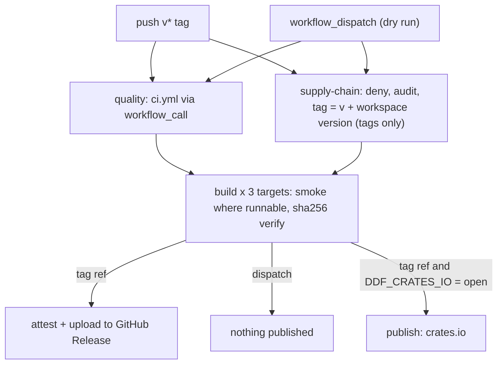

# Release And Publication Plan

This document defines how Deep-Diff-Forge moves from commit to public artifact.

## Status 2026-10-31 (0.5.0)

- The workspace version on `main` is **0.5.0**, tagged `v0.5.0` on 2026-10-31
  by owner decision. Pushing any later `v*` tag is the owner's decision too.
- Published GitHub releases: `v0.1.0` (2026-06-22), `v0.2.0` (2026-06-24) and
  `v0.3.0` (2026-10-29), `v0.4.0` (2026-10-30) and `v0.5.0` (2026-10-31). `0.2.1` was never tagged.
- crates.io is on hold by owner decision until the codebase is
  production-hardened. `release.yml` publishes only when the repository
  variable `DDF_CRATES_IO` is `open`.
- `deep-diff-forge deploy release` reports this posture as a declared snapshot:
  `github` and `gitlab` published, `github-release` and `crates.io` blocked
  (a build cannot know whether its own version was tagged).
- The workflows are described below exactly as `.github/workflows/ci.yml` and
  `.github/workflows/release.yml` define them.

## Release Channels

| Channel | Purpose | Today |
| --- | --- | --- |
| `main` | Current development branch. | 0.5.0, reached only through pull requests (branch ruleset). |
| GitHub Releases | Primary binary release and project visibility. | `v0.1.0`, `v0.2.0`, `v0.3.0`, `v0.4.0`, `v0.5.0`. |
| GitLab mirror | Secondary remote and redundancy. | Pushed to match GitHub. |
| crates.io | Rust library and CLI distribution. | On hold (`DDF_CRATES_IO`). |
| cargo-binstall | Fast binary installation. | Not configured (no binstall metadata in any `Cargo.toml`). |
| package managers | Later, after CLI stabilizes. | None. |

## Versioning

Semantic versioning. The plan below is the original 2026-06 sequence, kept as
written; the releases did not follow it (`v0.2.0` already held 12 crates,
including the TUI, daemon and learning crates; the review and SDK crates came
later; 0.5.0 is the current development line):

```text
0.1.0: model and CLI bootstrap
0.2.0: patch parser and projections
0.3.0: pager-compatible CLI
0.4.0: syntax layer
0.5.0: TUI review
0.6.0: daemon and cache
1.0.0: stable CLI, model, and daemon API
```

## Pre-Release Checklist

The local replica of the CI gate is `just ci` ([`scripts/ci_local.sh`](../scripts/ci_local.sh)):
it runs every step of the `secrets`, `msrv`, `gate` and `supply-chain` jobs and
prints PASS/FAIL per step (exit 0 only if all pass, 2 if `cargo` is missing).
`just gate-release` is the smaller gate `just release-tag` runs: `fmt`, `check`,
`clippy`, `pedantic`, `test`, `contracts` and `docs`. The checklist:

- [ ] `just ci` passes
- [ ] `scripts/diff_mutation.sh origin/main` leaves 0 missed mutants (the CI diff-mutation job)
- [ ] `cargo fmt --all --check`
- [ ] `CARGO_TARGET_DIR=target cargo check --workspace --locked`
- [ ] `CARGO_TARGET_DIR=target cargo clippy --workspace --all-targets --locked -- -D warnings`
- [ ] `CARGO_TARGET_DIR=target cargo clippy --workspace --all-targets --locked -- -D warnings -W clippy::pedantic`
- [ ] `CARGO_TARGET_DIR=target cargo test --workspace --locked`
- [ ] `cargo check --locked --manifest-path fuzz/Cargo.toml --bins`
- [ ] `cargo deny check` and `cargo deny --manifest-path fuzz/Cargo.toml --locked check`
- [ ] `cargo audit --deny warnings` for both `Cargo.lock` and `fuzz/Cargo.lock`
- [ ] `DDF_SOAK_SECONDS=10 python3 scripts/security/daemon_soak.py`
- [ ] `python3 scripts/security/privacy_probe.py`
- [ ] Regenerated `sbom.spdx.json` matches the committed dependency graph
- [ ] A `workflow_dispatch` run of `release.yml` on the release commit passes
      (the dry run; it runs the macOS tests too, as the tag run does)
- [ ] The version moved everywhere it is stated: workspace and fuzz manifests, both lock
      files, the SBOM, and the Python package (`sdk/python/pyproject.toml` and
      `deep_diff_forge.__version__`; `cli/tests/python_sdk.rs` fails if they differ)
- [ ] Docs updated
- [ ] `CHANGELOG.md` updated

Corpus regression snapshots and release receipts were part of the original
checklist; neither has tooling yet.

## Tag And Push

`main` reaches GitHub only through a merged pull request: the branch ruleset
requires a PR, eleven passing checks (the PR-time jobs of `ci.yml`), an
up-to-date branch, and allows no bypass. The tag is cut from that commit with
the `justfile` recipe:

```bash
just release-tag 0.5.0
```

`release-tag` refuses a version that differs from `[workspace.package].version`
or a dirty tree, runs `just gate-release`, creates an annotated tag `vX.Y.Z`,
and pushes it to the remotes named `origin` (GitHub) and `gitlab`. The tag push
starts `release.yml`. crates.io publishes only when `DDF_CRATES_IO == 'open'`
(see below).

## Artifact Layout

Release assets uploaded on a tag run:

```text
deep-diff-forge-vX.Y.Z-x86_64-unknown-linux-gnu.tar.gz
deep-diff-forge-vX.Y.Z-aarch64-unknown-linux-gnu.tar.gz   (from the release after v0.5.0)
deep-diff-forge-vX.Y.Z-x86_64-apple-darwin.tar.gz
deep-diff-forge-vX.Y.Z-aarch64-apple-darwin.tar.gz
*.tar.gz.sha256 (one per archive)
sbom.spdx.json (from the x86_64 Linux build)
```

Each archive holds one directory with the `deep-diff-forge` binary,
`README.md`, `LICENSE-MIT` and `LICENSE-APACHE`.

Integrity is a SHA-256 file per archive plus GitHub build-provenance attestations; there is no
signed `checksums.txt` (corrected 2026-10-27, anchor E-02).

## GitHub Actions

### `ci.yml`

Triggers: `pull_request`, `push` to `main`, `workflow_call` (from
`release.yml`), weekly `schedule` (Monday 04:23 UTC) and `workflow_dispatch`.
Toolchain pinned to 1.99.1 except where noted.

| Job (check name) | Runner | Runs on | What it does |
| --- | --- | --- | --- |
| `secrets` (secret scan (gitleaks)) | ubuntu-26.04 | every trigger | gitleaks 8.30.1, SHA-256-pinned, over full history. |
| `msrv` (declared Rust 1.88 compatibility) | ubuntu-26.04 | every trigger | `cargo check --workspace --all-targets --locked` on 1.88.0. |
| `macos` (macOS tests) | macos-latest | every trigger (each pull request since 2026-10-30) | `cargo test --workspace --locked --no-fail-fast`. |
| `linux-arm64` (Linux arm64 tests) | ubuntu-24.04-arm | every trigger (since 2026-10-31) | `cargo test --workspace --locked --no-fail-fast`, then `scripts/check_glibc_floor.sh` on the debug binary. Not required on pull requests; gates every release build (through `quality`). |
| `launchd` (macOS launchd agent) | macos-latest | every trigger (since 2026-10-31) | Builds the CLI and runs `scripts/launchd_smoke.sh`: the `contrib/launchd` agent, pointed at the built binary, is bootstrapped into `gui/<uid>` (or `user/<uid>`), answers `daemon health` with launchd's pid, is restarted after SIGKILL, is not restarted after `daemon stop` (socket gone), and is unloaded by `launchctl bootout`. Not required on pull requests; skipped in release runs (`release: true`) until it has a record on hosted runners. |
| `gate` (deploy gate-feature) | ubuntu-26.04 | every trigger | Review-policy check and selftest, exemption-oracle tests, fmt, check, clippy `-D warnings`, pedantic (workspace, patch without default features, fuzz crate), tests, rustdoc `-D warnings`, contract probes, `deploy status --json`, fuzz-harness compile, soak leak-check and bench-comparison regression tests (`scripts/security/test_daemon_soak.py`, `scripts/test_bench_compare.py`), 10 s hostile daemon soak, privacy probes, Python SDK against the built binary. |
| `review-controller-evidence` (review controller mutation and fuzz evidence) | ubuntu-26.04 | every trigger | Scoped cargo-mutants of the review controller; 10 s instrumented fuzz smoke for every target in `fuzz/Cargo.toml` (`scripts/fuzz_target.sh --list`) (`nightly-2026-10-25`; fails if a declared target is not run); builds the council gate image and runs the rootless-Podman planted-breach suite (`council_sandbox`, 12 probes). |
| `bench` (bench (base vs head)) | ubuntu-26.04 | `pull_request` only | Builds the merge base and the head in release mode, runs `bench --quick --json` alternately three times, and compares the best medians with `scripts/bench_compare.py`. Required since 2026-10-31 (owner decision). |
| `diff-mutation` (diff mutation (shard k/4)) | ubuntu-26.04 | `pull_request` only | `scripts/diff_mutation.sh origin/$BASE_REF k/4`: cargo-mutants 27.1.0 on the PR's changed Rust lines under `crates/`; a missed mutant or timeout fails. |
| `supply-chain` (supply chain audit) | ubuntu-26.04 | every trigger | cargo-deny (root and fuzz), `cargo audit --deny warnings` (root and fuzz lockfiles), SPDX SBOM regenerated and compared with the committed one. |

On a pull request thirteen checks run (`secrets`, `msrv`, `macos`, `linux-arm64`, `launchd`,
`gate`, `review-controller-evidence`, four `diff-mutation` shards, `supply-chain`, `bench`); eleven
of them, all but `linux-arm64` and `launchd`, are ruleset 25868121's required checks (`bench` added on 2026-10-31; measured with `gh api`; the ruleset lives in GitHub settings, not in the repository).

### `release.yml`

Triggers: `push` of a `v*` tag, and `workflow_dispatch` (dry run). Default
permission `contents: read`; only `build` elevates.

| Job | Runner | What it does |
| --- | --- | --- |
| `quality` | (calls `ci.yml` with `release: true`) | The full CI workflow, and `build` waits for all of it. On a tag push its event is `push`, so `diff-mutation` and `bench` are skipped; `macos` and `linux-arm64` run and gate the build although pull requests do not require `linux-arm64`; `launchd` is skipped (`release: true`) until its smoke has a record on hosted runners. |
| `supply-chain` (supply chain gate) | ubuntu-26.04 | cargo-deny and cargo-audit as in CI; on a tag, refuses a tag that is not `v` + the workspace version. |
| `build` (build &lt;target&gt;) | ubuntu-24.04 (x86_64 Linux), ubuntu-24.04-arm (arm64 Linux), macos-latest (both macOS) | Needs `quality` and `supply-chain`. `cargo build --release --locked -p deep-diff-forge-cli` for `x86_64-unknown-linux-gnu`, `aarch64-unknown-linux-gnu`, `x86_64-apple-darwin`, `aarch64-apple-darwin`. Every binary is run (smoke): `--version` must equal the workspace version and `--stdin-patch --json` must produce a review document; a Linux binary must need no `GLIBC_` version newer than the floor (`scripts/check_glibc_floor.sh`, glibc 2.34); the x86_64 macOS binary is cross-built and run under Rosetta 2 (`run_under: arch -x86_64`, installed if missing), after `file` confirms it is x86_64. Packages, writes and re-verifies the `.sha256`. On a pushed `v*` tag only (never a dispatch, even from a tag): build-provenance attestation for archives, checksums and SBOM, and upload to the GitHub Release. |
| `publish` (crates.io publish (owner-gated)) | ubuntu-26.04 | Runs only on a pushed `v*` tag (never a dispatch) **and** when `vars.DDF_CRATES_IO == 'open'`. Runs in the `release` environment (deployment policy: `v*` tags only). Publishes the 14 crates in dependency order, skipping crates already live and retrying crates.io's rate limit; fails if `CARGO_REGISTRY_TOKEN` is unset, since the owner opened the gate. |

The Linux binaries are built on ubuntu-24.04 (and its arm64 image) on purpose: they link
against the build image's glibc, and a 26.04 build would not run on 24.04-era systems. Their
declared floor is glibc 2.34 (measured on the v0.5.0 x86_64 binary; on glibc 2.34 to 2.38 the
loader prints one stderr warning per run, see
[supported platforms](../README.md#supported-platforms)). musl is not built: the tree-sitter C
code needs a musl C toolchain and nothing would test the result.



Both workflows pin third-party Actions to full commit SHAs, do not persist
checkout credentials, and bound every job with `timeout-minutes`. See
[`SECURITY.md`](../SECURITY.md) for the threat model and residual
account-level controls.

## Publication Receipts

Target design, not implemented: no tool writes `reports/releases/`. The one
receipt recipe today is `just receipt-bootstrap`, which writes
`reports/deployments/<UTC stamp>/` (git-ignored). The planned layout:

```text
reports/releases/vX.Y.Z/
  source.txt
  remotes.txt
  checks.txt
  tests.txt
  corpus.txt
  package.txt
  checksums.txt
  publish.txt
```

## Mirror Policy

GitHub is the primary remote:

```text
https://github.com/Louranicas/deep-diff-forge
```

GitLab mirror is live under the authenticated namespace (`lukeomahoney`, not the
GitHub username `Louranicas`), created via push-to-create and private by default:

```text
git@gitlab.com:lukeomahoney/deep-diff-forge.git
https://gitlab.com/lukeomahoney/deep-diff-forge
```

Both remotes carry the same `main`. GitHub `main` changes only through merged
pull requests; the GitLab mirror is then pushed to the same commit:

```bash
git push gitlab main
```

Note: the GitLab namespace differs from GitHub. The earlier "project not found"
blocker was a namespace mismatch (`Louranicas` is the GitHub user; the GitLab
account is `lukeomahoney`) — resolved by repointing the remote.

## Deployment Link

- Framework: [Codebase Deployment Framework](DEPLOYMENT_FRAMEWORK.md)
