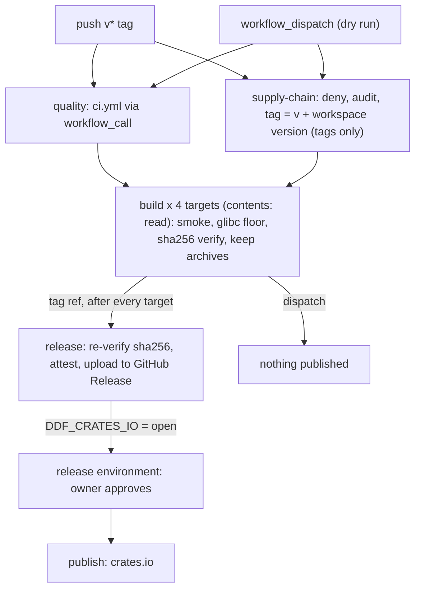

# Release And Publication Plan

This document defines how Deep-Diff-Forge moves from commit to public artifact.

## Status of 0.11.0 and the releases before it

- **0.11.0** is the agent-loop release: the document `deep-diff-forge.diagnostics.v0`, engine
  protocol 3, a stop that judges the project's frontier and one-parent commits in the judge's
  bound mode, and one meaning for exit 7. It fixes `eval` and `agent doctor --gate`, which exited
  0 when the reader of their output had gone in 0.10.0 and earlier
  ([DDF-2026-011](advisories/DDF-2026-011.md)), and closes the miss
  [DDF-2026-006](advisories/DDF-2026-006.md) declared; its known issues, contract changes and
  the order of the cutover with forge-warden are in its [release notes](release-notes/0.11.0.md).
  It is released as the signed tag `v0.11.0`, published on GitLab, Gitea and Forgejo with a
  binary built locally for Linux x86_64 and its `RELEASE-MANIFEST.json` signed beside
  `SHA256SUMS`; GitHub mirrors its release page from the GitLab files, and its crates are
  published on crates.io from the tag's commit ([Local release](#local-release-from-084),
  **Publish**).
- **0.10.0** reads a `diff --git` section only if its headers are a shape Git's own diff
  writes, and fixes six misses of 0.9.0 and earlier
  ([DDF-2026-004](advisories/DDF-2026-004.md) to [DDF-2026-008](advisories/DDF-2026-008.md) and
  [DDF-2026-010](advisories/DDF-2026-010.md); the number 009 was not used); its contract changes
  and the order of the cutover with forge-warden are in its
  [release notes](release-notes/0.10.0.md). It is released as the signed tag `v0.10.0`, published
  on GitLab, Gitea and Forgejo with a binary built locally for Linux x86_64; GitHub mirrors its
  release page from the GitLab files, and its fourteen crates are published on crates.io from the
  tag's commit ([Local release](#local-release-from-084), **Publish**).
- **0.9.0** adds five integrity signals and the agent hooks, and fixes a process spawn cut
  across two sections of one path and two costs quadratic in the length of a line, in 0.8.4
  and earlier ([DDF-2026-003](advisories/DDF-2026-003.md)). It was released as the signed tag
  `v0.9.0` (2026-11-18), published on GitLab, Gitea and Forgejo with a binary built locally for
  Linux x86_64; it is not built by `release.yml`. Its release page is mirrored on GitHub (since
  2026-11-22, from the GitLab files), and its fourteen crates are on crates.io (2026-11-23).
- **0.8.4 was released** as the signed tag `v0.8.4` (2026-11-17), the last tag before 0.9.0, and
  published on GitLab, Gitea and Forgejo on 2026-11-18 (`SHA256SUMS` signed by the owner; the
  local verify passed): a security release for v0.8.3's review of `Files … differ` lines and of
  one path in several sections (rescore of v0.8.3, G1 and G2), with the fix for Rust code the
  code view hid. Its release page is mirrored on GitHub since 2026-11-22.
- **0.8.3 was released** as the signed tag `v0.8.3` (2026-11-11 UTC), the last tag before 0.8.4: a security release for v0.8.2's review of bare `diff --git` lines
  and of modes (rescore of v0.8.2, GHSA-rq5r-p3g9-phff), with three dependency updates, one of
  which the supply chain gate needs (rustix 1.1.6, RUSTSEC-2026-0486). Its assets and tag
  cannot change (Immutable Releases); pushing any later `v*` tag is the owner's decision.
- **0.8.2 was released** as the signed tag `v0.8.2` (2026-11-10): a security
  release for v0.8.1's copy, name, mode and binary-header review (N1-N3 of the v0.8.1 rescore and F1-F2 of the rescore before
  the v0.8.2 tag; GHSA-gp5v-m67f-gmgp, published 2026-11-10). Immutable Releases is on (since
  2026-11-05), so its assets and tag cannot change. Pushing any later `v*` tag is the owner's decision.
- Published GitHub releases: `v0.1.0` (2026-06-22), `v0.2.0` (2026-06-24) and
  `v0.3.0` (2026-10-29), `v0.4.0` (2026-10-30), `v0.5.0` (2026-10-31), `v0.6.0` (2026-11-02), `v0.7.0` (2026-11-03), `v0.8.0` (2026-11-07), `v0.8.1` (2026-11-08), `v0.8.2` (2026-11-10) and `v0.8.3` (2026-11-11 UTC). `0.2.1` was never tagged. `v0.8.4` and
  `v0.9.0` have GitHub release pages since 2026-11-22: mirrors of the GitLab release, with the
  same six files, not built by `release.yml`.
- **crates.io:** 0.9.0 was published on 2026-11-23 (owner's decision, lifting the hold): the
  fourteen crates other than `deep-diff-forge-testkit` (test-only), with `cargo publish
  --workspace --exclude deep-diff-forge-testkit --locked` from the tag's commit after a dry run;
  the twelve names published at 0.2.0 keep that version as yanked. From 0.10.0 on, publishing the
  crates is a step of the release ([Local release](#local-release-from-084), **Publish**).
  `release.yml`'s `publish` job, which runs only when the repository variable `DDF_CRATES_IO` is
  `open`, is not used.
- **Owner decision 2026-11-01:** the GitHub `release` environment requires the
  owner's approval (required reviewer) and deploys only from `v*` tags (measured
  with `gh api .../environments`). Only the crates.io `publish` job runs in it,
  so a tag run builds, attests and uploads without waiting, and a publish waits
  for the owner even with the gate open.
- `deep-diff-forge deploy release` reports the posture as a declared snapshot. From 0.10.0
  every target is published: `gitlab`, `gitea`, `forgejo`, `github` and `github-release` (the
  GitHub mirrors) and `crates.io`. In 0.8.4 and 0.9.0 it said `gitlab`, `gitea` and `forgejo`
  published, `github` and `github-release` skipped (a skipped target is not pending) and
  `crates.io` blocked; up to 0.8.3, `github` and `gitlab` published and `github-release` and
  `crates.io` blocked.
- The workflows are described below exactly as `.github/workflows/ci.yml` and
  `.github/workflows/release.yml` define them.

## Release Channels

| Channel | Purpose | Today |
| --- | --- | --- |
| `main` | Current development branch. | 0.11.0 (from 0.8.4 merged on GitLab; GitHub's `main` is brought level by a pull request); up to 0.8.3 it was reached only through pull requests (branch ruleset). |
| GitHub Releases | Up to v0.8.3 the primary binary release; from 0.8.4 a mirror of the GitLab release. | `v0.1.0`, `v0.2.0`, `v0.3.0`, `v0.4.0`, `v0.5.0`, `v0.6.0`, `v0.7.0`, `v0.8.0`, `v0.8.1`, `v0.8.2`, `v0.8.3` built by `release.yml`; `v0.8.4` and `v0.9.0` mirrored (2026-11-22), `v0.10.0` and `v0.11.0` mirrored from their GitLab files. |
| GitLab | Up to 0.8.3 a mirror; from 0.8.4 the repository of record and the place of release and contribution (merge requests). | Up to 0.8.3 pushed to match GitHub; from 0.8.4 every signed tag and its release files are published here ([local release](#local-release-from-084)). |
| crates.io | Rust library and CLI distribution. | 0.9.0, fourteen crates (2026-11-23); from 0.10.0 a step of every release, 0.10.0 and 0.11.0 from their tags. |
| cargo-binstall | Fast binary installation. | Not configured (no binstall metadata in any `Cargo.toml`). |
| package managers | Later, after CLI stabilizes. | None. |

## Versioning

Semantic versioning. The plan below is the original 2026-06 sequence, kept as
written; the releases did not follow it (`v0.2.0` already held 12 crates,
including the TUI, daemon and learning crates; the review and SDK crates came
later; 0.11.0 is the newest release):

```text
0.1.0: model and CLI bootstrap
0.2.0: patch parser and projections
0.3.0: pager-compatible CLI
0.4.0: syntax layer
0.5.0: TUI review
0.6.0: daemon and cache
1.0.0: stable CLI, model, and daemon API
```

**The Rust API before 1.0 (decided 2026-11-23).** A minor release may break the Rust API of a
library crate, and its notes say where. `deep_diff_forge_pipeline::Coverage` stays a closed
enum in 0.10.0: its five values are every coverage outcome, and a caller may match it
exhaustively, so a sixth outcome would be a breaking change of that crate. **Decided for the
0.x line in 0.11.0** (OD-N, the coordinator's ruling, shown to the owner at the release): the
public enums and structs stay as they are (those that are closed, `Coverage` among them, stay
closed, and those that carry `#[non_exhaustive]` now, `PatchParseError` and `RankedFile`
among them, keep it); a release that adds a variant or a public field says so under the Rust
API breaks of its notes, as 0.10.0 did; `#[non_exhaustive]` for the others, `Error::source` and
the SDK gaps are taken up for 1.0 and not before.

## Pre-Release Checklist

The local replica of the CI gate is `just ci` ([`scripts/ci_local.sh`](../scripts/ci_local.sh)):
it runs every step of the `secrets`, `msrv`, `gate` and `supply-chain` jobs and
prints PASS/FAIL per step (exit 0 only if all pass, 2 if `cargo` or the pinned Rust 1.99.1 with
rustfmt and clippy is missing). Like CI, every step but the MSRV check runs on Rust 1.99.1, not the
rustup default. Each step's line carries its time and what it skipped, in one form:
`PASS test (312.4 s; skipped: 7 tests ignored)`, `PASS comparison corpus manifest (0.1 s; skipped:
no corpus here (…))`; the contract matrix's line also carries `real rows: N run, M skipped` (the
rows that need a forge-warden). A failed step's line is followed by the last 15 lines of its
output. At the end the gate writes a JSON receipt (the commit, whether the checkout had
uncommitted changes, when it began, each step's name, status, seconds and skip reason, and the
number failed) and prints its path, `receipt: <path>`: beside the gate's scratch directory, or
the file `DDF_GATE_RECEIPT` names. `scripts/long_tmpdir.sh <base>` prints a temp directory as long
and as indirect as macOS's (a link of 49 characters to a directory of 57); run a suite with
`TMPDIR` set to it to meet on Linux what a long temp path meets on macOS. Run `scripts/diff_mutation.sh` from anywhere in the checkout: it moves to the root.
`just gate-release` is the smaller gate `just release-tag` runs: `fmt`, `check`,
`clippy`, `pedantic`, `test`, `contracts` and `docs`. The checklist:

- [ ] `just ci` passes
- [ ] `scripts/diff_mutation.sh origin/main` leaves 0 missed mutants (the CI diff-mutation job)
- [ ] `cargo fmt --all --check`
- [ ] `CARGO_TARGET_DIR=target cargo check --workspace --locked`
- [ ] `CARGO_TARGET_DIR=target cargo clippy --workspace --all-targets --locked -- -D warnings`
- [ ] `CARGO_TARGET_DIR=target cargo clippy --workspace --all-targets --locked -- -D warnings -W clippy::pedantic`
- [ ] `CARGO_TARGET_DIR=target cargo test --workspace --locked`
- [ ] `cargo check --locked --manifest-path fuzz/Cargo.toml --bins`
- [ ] `cargo deny check` and `cargo deny --manifest-path fuzz/Cargo.toml --locked check`
- [ ] `cargo audit --deny warnings` for both `Cargo.lock` and `fuzz/Cargo.lock`
- [ ] `DDF_SOAK_SECONDS=10 python3 scripts/security/daemon_soak.py`
- [ ] `python3 scripts/security/privacy_probe.py`
- [ ] Regenerated `sbom.spdx.json` matches the committed dependency graph
- [ ] Up to 0.8.3: a `workflow_dispatch` run of `release.yml` on the release commit passes
      (the dry run; it runs the macOS tests too, as the tag run does). From 0.8.4:
      `scripts/test_release_local.sh` passes and `scripts/release_local.sh build` succeeds on
      the release commit ([Local release](#local-release-from-084))
- [ ] The version moved everywhere it is stated: workspace and fuzz manifests, both lock
      files, the SBOM, and the Python package (`sdk/python/pyproject.toml` and
      `deep_diff_forge.__version__`; `cli/tests/python_sdk.rs` fails if they differ)
- [ ] Docs updated
- [ ] `CHANGELOG.md` updated
- [ ] The release notes' commands run (from 0.11.0, part of the workspace tests):
      `cli/tests/release_notes_commands.rs` runs every full command line quoted in backticks in
      `docs/release-notes/<version>.md` of the tree's version and of the newest released one,
      placeholders (`DIR`, `PATH`, `<…>`) with a stand-in, and fails naming the file and line of
      any that is a usage error (exit 2). The 0.10.0 notes quoted a command 0.10.0 refused.

Corpus regression snapshots and release receipts were part of the original
checklist; neither has tooling yet.

Run the local fuzz campaign before the tag: `DDF_FUZZ_CORPUS_ROOT=<a directory on disk> just
fuzz-campaign` (`scripts/campaign_local.sh`, 300 s per target, 18 targets, about 90 minutes
plus builds). It must end `result: GREEN`, and its RECEIPT is cited in `EVIDENCE.md`.

## Tag And Push

Up to 0.8.3, `main` reached GitHub only through a merged pull request: the branch ruleset
requires a PR, thirteen passing checks (the PR-time jobs of `ci.yml` and the two
CodeQL analyses of `codeql.yml`), an
up-to-date branch, and allows no bypass. From 0.8.4 nothing runs at GitHub: `main` moves on
GitLab, and the release commit passes `scripts/ci_local.sh` instead. The tag is cut with the
`justfile` recipe, on the `HEAD` of the worktree it runs in, under the procedure below:

```bash
just release-tag 0.8.4
```

`release-tag` refuses a version that differs from `[workspace.package].version`
or a status-visible change (`git status --porcelain` prints anything, checked before the gate
and again after it: a tracked change, or an untracked file Git does not ignore, such as a stray
`build.rs` Cargo would compile), and refuses unless the remotes named `gitlab`, `gitea` and `forgejo` all
exist and none of their fetch or push URLs contains `github.com` (in any case), before the gate
and before signing. It then runs `just gate-release`, creates a signed annotated tag `vX.Y.Z`
(see [Signed Tags](#signed-tags)), and pushes it to those three remotes only, never `origin`
(GitHub). Up to 0.8.3 the recipe pushed to `origin` and `gitlab`, and the tag push started
`release.yml`; from 0.8.4 the tag starts nothing, and the release is built and checked as in
[Local release](#local-release-from-084), which also publishes the crates.

What the recipe does not check (reviews of 0.8.4, VR84C-M-1 and VR84C-M-2):

- **Ignored files.** `git status --porcelain` does not list a file that `.gitignore`,
  `.git/info/exclude` or a global excludes file ignores, nor an untracked file when
  `status.showUntrackedFiles=no` is set; Cargo compiles an ignored package-root `build.rs` all
  the same, so the gate could run on an input the commit does not hold.
- **`HEAD`.** The recipe tags the `HEAD` current when it signs and does not compare it with the
  `HEAD` at the start. A commit made in the worktree while the gate runs leaves a clean status,
  and the tag then names a commit the gate did not run on. The status checks do not prove that
  the tag names the gated commit.

So the release relies on this procedure: the tag is cut in a dedicated release worktree,
freshly cloned, used by nobody else and under the release operator's exclusive control, with no
ignored or untracked files before the recipe starts (`git status --porcelain --ignored
--untracked-files=all` prints nothing; without `--untracked-files=all`, a
`status.showUntrackedFiles=no` setting hides ignored files from this check too) and a stable
`HEAD` for the whole recipe. The owner's release script, outside this repository, first runs
`scripts/ci_local.sh` in a second fresh clone of the same commit. It then runs the recipe
unchanged in the release clone, with the push URLs of the three remotes pointed at local
staging repositories. It pushes the signed tag to GitLab, Gitea and Forgejo only if `HEAD` is
still the commit it started from, the tag names that commit, and the tag verifies. The recipe
alone signs and pushes in one step: run without that script, a wrong tag would only be found
after it was pushed.

## Signed Tags

Release tags are SSH-signed from v0.6.0 on (owner decision 2026-11-03).
`scripts/sign_release_tag.sh`, which `release-tag` calls, signs the tag with the
caller's `user.signingkey` and keeps it only if `git tag -v` verifies it against
`.github/allowed_signers`. A tag signed by any other key, or unsigned, is deleted
before the push; tags are immutable once pushed. `repo_scripts.rs` runs the
script against scratch keys: a trusted key, an untrusted key and no signers file.

The signing key is used for nothing else and stays on the owner's machine. To
sign, point git at it for the release command only:

```bash
GIT_CONFIG_COUNT=1 GIT_CONFIG_KEY_0=user.signingkey \
  GIT_CONFIG_VALUE_0=~/.ssh/id_ed25519_ddf_release_signing.pub just release-tag X.Y.Z
```

The release workflow checks the same thing on the server side. Before anything is built, its
supply-chain gate runs `scripts/verify_release_tag.sh` on the pushed tag, against the
`.github/allowed_signers` from `main`. It never uses the tagged commit's copy, which a tag on
another branch could supply. An unsigned, lightweight or foreign-signed tag fails the release.
So does a signed tag on a commit that is not on `main` (since 2026-11-07): a release is built
only from reviewed code. A dry run checks the newest `v*` tag the same way.

What this does not cover: GitHub runs the `release.yml` of the tagged commit, so a branch that
also edits `release.yml` could drop both checks. Doing that needs push access to a branch and
the release-signing key, so it is the owner's own risk. The tag ruleset (26252036) stops a
pushed `v*` tag being moved or deleted, but not created; restricting creation would close the
gap and is the owner's decision.

To verify a release tag from a clone:

```bash
git -c gpg.ssh.allowedSignersFile=.github/allowed_signers tag -v v0.8.3
```

Rotating the key means adding the new public key to `.github/allowed_signers`
(and, from 0.8.4, to `.github/release_allowed_signers`) in a reviewed change before the first
tag it signs. Old lines stay, so older tags
keep verifying. Whether GitHub and GitLab show the tag as "Verified" depends on
the key also being registered as a signing key on each account; the
`allowed_signers` check above does not.

## Local release (from 0.8.4)

0.8.4 is built and published without GitHub (owner decision 2026-11-16); `release.yml` is not
used for releases from 0.8.4. `scripts/release_local.sh` runs its build and check steps on the
owner's machine. It publishes, pushes, tags and signs nothing, and contacts no network service:
cargo runs offline (`cargo fetch --locked` once beforehand, outside the tool), and git reads only
the local repository. Its self-test is `scripts/test_release_local.sh` (`just release-local-test`).

- **Build.** In the `fedora-toolbox-44` toolbox, with the toolchain that `scripts/ci_local.sh`
  pins at the commit (Rust 1.99.1):

  ```bash
  scripts/release_local.sh build <commit> <outdir>     # just release-local-build <commit> <outdir>
  ```

  It exports the commit twice with `git archive`, into two new directories, builds each with
  `release.yml`'s exact command, `cargo build --release --locked -p deep-diff-forge-cli --target
  x86_64-unknown-linux-gnu`, in an environment holding only `HOME`, `PATH`, `TMPDIR`,
  `CARGO_HOME`, `RUSTUP_HOME`, the toolchain pin and offline mode, and stops, writing nothing,
  unless the two binaries have the same SHA-256. It then runs `release.yml`'s smoke
  (`--version` and a review document) and `scripts/check_glibc_floor.sh` (glibc 2.34), writes the
  SBOM, packs the archive with `scripts/package_release.py` (`SOURCE_DATE_EPOCH` = the commit
  time), and writes into `<outdir>`, which must not exist: the archive, its `.sha256`,
  `sbom.spdx.json`, `release-receipt.json` (commit, toolchain, both build hashes, every file's
  SHA-256), `RELEASE-MANIFEST.json` and `SHA256SUMS` over all of them. The manifest (0.11.0,
  schema `deep-diff-forge.release-manifest.v0`) says what the binary reads and writes, each
  of those values read from the binary itself, with the command that gave it in its member
  `sources`, beside what the build knows (the commit, the target, the binary's and the
  archive's SHA-256): the version (`--version`), the rank
  schema and `scorer_sha256` (`--stdin-patch --rank --json` on `fixtures/patch/basic.patch`),
  the diagnostics schema (`--stdin-patch --diagnostics --json`), the verdict schemas the stop
  hook reads, the hook-state schemas it reads and the one it writes and the ledger version
  (`deep-diff-forge doctor`, its lines `verdict_schemas_read`, `hook_state_schemas_read` and
  `ledger_version`), and the engine protocol and methods (`rpc`, `engine.initialize`); a member
  with no value writes nothing. A `<commit>` that is a tag must be
  `v<workspace version>`. The receipt also lists the checks run on the artefact and the
  gate's result: set `DDF_GATE_LOG` to the log of `scripts/ci_local.sh` for the release commit
  (its `gate on` and `steps failed` lines); without it the receipt says "not given".
- **Sign.** The owner signs `SHA256SUMS` and, from 0.11.0, `RELEASE-MANIFEST.json` with the
  release key, each in a namespace used for nothing else (a signature in namespace `git` is one
  git accepts on a tag or commit, and one namespace per file keeps either signature from
  standing for the other file):

  ```bash
  ssh-keygen -Y sign -f ~/.ssh/id_ed25519_ddf_release_signing -n deep-diff-forge-release-sha256sums <outdir>/SHA256SUMS
  ssh-keygen -Y sign -f ~/.ssh/id_ed25519_ddf_release_signing -n deep-diff-forge-release-manifest <outdir>/RELEASE-MANIFEST.json
  ```

  Anyone can check the manifest's signature alone with the signers file:

  ```bash
  ssh-keygen -Y verify -f .github/release_allowed_signers -I <principal> -n deep-diff-forge-release-manifest -s <dir>/RELEASE-MANIFEST.json.sig < <dir>/RELEASE-MANIFEST.json
  ```

- **Publish.** The signed tag goes to GitLab (`https://gitlab.com/lukeomahoney/deep-diff-forge`),
  Gitea and Forgejo through `just release-tag`; the archive and the other files of `<outdir>`,
  with `SHA256SUMS.sig` and `RELEASE-MANIFEST.json.sig`, are attached to the tag's release on GitLab. These are the owner's
  steps. GitLab is the place of release; GitHub gets the tag (with `release.yml` disabled for
  the push, since a tag there starts it) and a release page with the same files, as a mirror.
  From 0.10.0 the crates are published from the tag's commit, a dry run first, then
  `cargo publish --workspace --exclude deep-diff-forge-testkit --locked` (permanent: a published
  version can be yanked, never replaced).
- **Verify.** From a clone that has the tag and `gitlab/main` (fetch them first; the tool uses no
  remote):

  ```bash
  scripts/release_local.sh verify v0.8.4 <dir> .github/release_allowed_signers
  just release-local-verify v0.8.4 <dir> .github/release_allowed_signers
  ```

  It passes only if (1) `scripts/verify_release_tag.sh` accepts the tag against the signers
  file, its commit is on `gitlab/main` and the tag is `v<workspace version>`; (2) `SHA256SUMS`
  lists exactly the files of `<dir>` but the two signatures, each matches, `SHA256SUMS.sig`
  verifies against the signers file in namespace `deep-diff-forge-release-sha256sums`,
  `RELEASE-MANIFEST.json.sig` in namespace `deep-diff-forge-release-manifest`, and every member
  of the manifest has a value; (3) the archive's members are exactly the five it packs (the
  directory, `LICENSE-APACHE`, `LICENSE-MIT`, `README.md` and the binary), the receipt and the
  manifest name the tag's commit and version, the manifest names the archive by its SHA-256,
  and a fresh build of the tag's commit gives the binary of the receipt, of the manifest and of
  the archive. One file serves checks 1 and 2, so
  `.github/release_allowed_signers` holds the release key, the principal and key of
  `.github/allowed_signers`, for the namespaces `git` and `deep-diff-forge-release-sha256sums`,
  and from 0.11.0 `deep-diff-forge-release-manifest` (added to that line by the release commit
  of 0.11.0, the first release that ships a manifest, and accepted by the owner with the merge
  of its release merge request; owner decision OD-K).
  `.github/allowed_signers` stays `git` only: `just release-tag` and `release.yml` read it, and
  `repo_scripts.rs` requires that form of each of its lines. Rotating the key means changing
  both files in one commit.

- **Targets.** Only `x86_64-unknown-linux-gnu` is built: the build machine has no
  `aarch64-unknown-linux-gnu` Rust target or cross linker, and there is no macOS runner. The
  `aarch64-unknown-linux-gnu`, `x86_64-apple-darwin` and `aarch64-apple-darwin` binaries of
  v0.8.3 remain on its GitHub release; none is built for this release. Each build has a receipt
  ([runs on record](reference/supported-platforms.md#runs-on-record)).
- **Reproducibility.** The binary does not depend on the checkout path: the two builds of every
  `build` run are made at two different paths and must be equal (measured; see
  [EVIDENCE.md](../EVIDENCE.md)). The binary holds the registry source path under `CARGO_HOME`,
  so a rebuild gives the same SHA-256 only with the same toolchain and the same `CARGO_HOME`
  path (both are in the receipt). That second half is inferred from the strings in the binary,
  not measured.
- **What it does not give.** No build-provenance attestation, no CI run on the release commit
  (the local gate `scripts/ci_local.sh` instead), and no binary for the other three targets.
- **Known limits of releasing without GitHub (0.8.4; reviews of 0.8.4).**
  - The GitLab project is private: on 2026-11-16 its API answered an anonymous request with 404. Until
    the owner makes it public, its clone URL, the release files and the issue routes (ordinary
    and confidential) are closed to the public.
  - The binary holds the build account's `CARGO_HOME` path (`~/.cargo` of that account, so the
    account's name). A third party's `verify` passes check 3 only when it rebuilds at that path
    with the receipt's toolchain. `--remap-path-prefix` is parked for a later release.
  - `cargo deny` and `cargo audit` in `scripts/ci_local.sh` fetch the RustSec advisory database
    from github.com: a read that bills nothing, but the gate needs github.com reachable.
  - The edits to `.github/ISSUE_TEMPLATE` are inert: GitHub reads them from its `main`, which
    stays at 0.8.3, and GitLab does not read them.
  - The README's "Latest release" badge reads GitLab's releases. The README shipped in the
    0.9.0 archive still carries GitHub's badge, which shows v0.8.3.

## Artifact Layout

Release assets uploaded on a tag run (to v0.8.3; for 0.8.4 see [Local release](#local-release-from-084)):

```text
deep-diff-forge-vX.Y.Z-x86_64-unknown-linux-gnu.tar.gz
deep-diff-forge-vX.Y.Z-aarch64-unknown-linux-gnu.tar.gz   (since v0.6.0)
deep-diff-forge-vX.Y.Z-x86_64-apple-darwin.tar.gz
deep-diff-forge-vX.Y.Z-aarch64-apple-darwin.tar.gz
*.tar.gz.sha256 (one per archive)
sbom.spdx.json (from the x86_64 Linux build)
```

Each archive holds one directory with the `deep-diff-forge` binary,
`README.md`, `LICENSE-MIT` and `LICENSE-APACHE`.

Integrity is a SHA-256 file per archive plus GitHub build-provenance attestations; there is no
signed `checksums.txt` (corrected 2026-10-27, anchor E-02).

### Reproducible archives

Since 2026-11-03 (expert circle, C14), the archives are packed by `scripts/package_release.py`,
not `tar czf`. It uses Python's stdlib, so the same code runs on the Linux and macOS runners. It
sorts the entries under one directory and stamps every entry with `SOURCE_DATE_EPOCH`, which
release.yml sets to the commit time. Every entry is owned by uid and gid 0 with no names. The
binary gets mode 0755 and the documents 0644. The format is USTAR, and the gzip header carries
no file name and mtime 0. Packing the same files again gives the same bytes; `repo_scripts.rs`
tests that, and a control test shows that `tar czf` does not.

To compare a release archive with a rebuild, compare the uncompressed tar streams. The gzip bytes
also depend on the zlib build.

```bash
SOURCE_DATE_EPOCH="$(git log -1 --format=%ct vX.Y.Z)" python3 -I scripts/package_release.py \
  deep-diff-forge-vX.Y.Z-TARGET out/ target/TARGET/release/deep-diff-forge README.md LICENSE-MIT LICENSE-APACHE
gzip -dc out/deep-diff-forge-vX.Y.Z-TARGET.tar.gz | sha256sum
gzip -dc deep-diff-forge-vX.Y.Z-TARGET.tar.gz | sha256sum   # the released archive
```

The archive is reproducible given the binary. The binary itself is reproducible only on the same
toolchain and runner image. Every runner label is pinned to a major image (`ubuntu-24.04`,
`ubuntu-22.04-arm`, and since 2026-11-03 `macos-26`, the image `macos-latest` named then), and
`release_workflow.rs` fails on any `-latest` label. GitHub still updates a pinned image's
patch level weekly, so a rebuild is byte-identical only on the same image version.

## GitHub Actions

### `ci.yml`

Triggers: `pull_request`, `push` to `main`, `workflow_call` (from
`release.yml`), weekly `schedule` (Monday 04:23 UTC) and `workflow_dispatch`.
Toolchain pinned to 1.99.1 except where noted.

| Job (check name) | Runner | Runs on | What it does |
| --- | --- | --- | --- |
| `secrets` (secret scan (gitleaks)) | ubuntu-26.04 | every trigger | gitleaks 8.30.1, SHA-256-pinned, over full history. With the pre-push hook, the control that stands in for the non-provider patterns and validity checks GitHub does not offer this user-owned repository ([SECURITY.md](../SECURITY.md#supply-chain-and-releases)). |
| `msrv` (declared Rust 1.88 compatibility) | ubuntu-26.04 | every trigger | `cargo check --workspace --all-targets --locked` on 1.88.0. |
| `macos` (macOS tests) | macos-26 | every trigger (each pull request since 2026-10-30) | `cargo test --workspace --locked --no-fail-fast`. |
| `linux-arm64` (Linux arm64 tests) | ubuntu-22.04-arm | every trigger (since 2026-10-31) | `cargo test --workspace --locked --no-fail-fast`, then `scripts/check_glibc_floor.sh` on the debug binary. Not required on pull requests; gates every release build (through `quality`). |
| `launchd` (macOS launchd agent) | macos-26 | every trigger (since 2026-10-31) | Builds the CLI and runs `scripts/launchd_smoke.sh`: the `contrib/launchd` agent, pointed at the built binary, is bootstrapped into `gui/<uid>` (or `user/<uid>`), answers `daemon health` with launchd's pid, is restarted after SIGKILL, is not restarted after `daemon stop` (socket gone), and is unloaded by `launchctl bootout`. Not required on pull requests; skipped in release runs (`release: true`) until it has a record on hosted runners. |
| `gate` (deploy gate-feature) | ubuntu-26.04 | every trigger | Review-policy check and selftest, exemption-oracle tests, fmt, check, clippy `-D warnings`, pedantic (workspace, patch without default features, fuzz crate), tests, rustdoc `-D warnings`, contract probes, `deploy status --json`, fuzz-harness compile, soak leak-check and bench-comparison regression tests (`scripts/security/test_daemon_soak.py`, `scripts/test_bench_compare.py`), 10 s hostile daemon soak, privacy probes, Python SDK against the built binary. |
| `review-controller-evidence` (review controller mutation and fuzz evidence) | ubuntu-26.04 | every trigger | Scoped cargo-mutants of the review controller; 10 s instrumented fuzz smoke for every target in `fuzz/Cargo.toml` (`scripts/fuzz_target.sh --list`) (`nightly-2026-10-25`; fails if a declared target is not run); builds the council gate image and runs the rootless-Podman planted-breach suite (`council_sandbox`, 12 probes). |
| `bench` (bench (base vs head)) | ubuntu-26.04 | `pull_request` only | Builds the merge base and the head in release mode, runs `bench --quick --json` alternately three times, and compares the best medians with `scripts/bench_compare.py`. Required since 2026-10-31 (owner decision). |
| `diff-mutation` (diff mutation (shard k/4)) | ubuntu-26.04 | `pull_request` only | `scripts/diff_mutation.sh origin/$BASE_REF k/4`: cargo-mutants 27.1.0 on the PR's changed Rust lines under `crates/`; a missed mutant or timeout fails. Job limit 300 minutes, since each mutant runs the whole workspace suite (a 107-mutant shard of PR #83 did not finish in 120). |
| `supply-chain` (supply chain audit) | ubuntu-26.04 | every trigger | cargo-deny (root and fuzz), `cargo audit --deny warnings` (root and fuzz lockfiles), SPDX SBOM regenerated and compared with the committed one. |

On a pull request thirteen checks run (`secrets`, `msrv`, `macos`, `linux-arm64`, `launchd`,
`gate`, `review-controller-evidence`, four `diff-mutation` shards, `supply-chain`, `bench`); eleven
of them, all but `linux-arm64` and `launchd`, are required by ruleset 25868121 (`bench` added on 2026-10-31), and so are `codeql.yml`'s `codeql (rust)` and `codeql (actions)` (added 2026-11-02, after 14 consecutive passing runs of 4 to 5 minutes), thirteen in all (measured with `gh api`; the ruleset lives in GitHub settings, not in the repository).

### `release.yml`

Not used for releases from 0.8.4 ([Local release](#local-release-from-084)); described as it
ran up to v0.8.3. Triggers: `push` of a `v*` tag, and `workflow_dispatch` (dry run). Default
permission `contents: read`; only `release` elevates, and it compiles and runs nothing.

| Job | Runner | What it does |
| --- | --- | --- |
| `quality` | (calls `ci.yml` with `release: true`) | The full CI workflow, and `build` waits for all of it. On a tag push its event is `push`, so `diff-mutation` and `bench` are skipped; `macos` and `linux-arm64` run and gate the build although pull requests do not require `linux-arm64`; `launchd` is skipped (`release: true`) until its smoke has a record on hosted runners. |
| `supply-chain` (supply chain gate) | ubuntu-26.04 | cargo-deny and cargo-audit as in CI; on a tag, refuses a tag that is not `v` + the workspace version. |
| `build` (build &lt;target&gt;) | ubuntu-24.04 (x86_64 Linux), ubuntu-22.04-arm (arm64 Linux), macos-26 (both macOS) | Needs `quality` and `supply-chain`. `cargo build --release --locked -p deep-diff-forge-cli` for `x86_64-unknown-linux-gnu`, `aarch64-unknown-linux-gnu`, `x86_64-apple-darwin`, `aarch64-apple-darwin`. Every binary is run (smoke): `--version` must equal the workspace version and `--stdin-patch --json` must produce a review document; a Linux binary must need no `GLIBC_` version newer than the floor (`scripts/check_glibc_floor.sh`, glibc 2.34); the x86_64 macOS binary is cross-built and run under Rosetta 2 (`run_under: arch -x86_64`, installed if missing), after `file` confirms it is x86_64. Packages, writes and re-verifies the `.sha256`, and keeps the archives (and the x86_64 Linux leg's SBOM) as workflow artifacts. Permissions `contents: read` only: it runs every dependency's build scripts and proc macros, so it holds no write or OIDC token, on a tag or a dry run. |
| `release` (GitHub Release) | ubuntu-26.04 | On a pushed `v*` tag only (never a dispatch, even from a tag). Needs `build`, so it starts only after **every** target built and passed smoke: a failed platform leaves no release rather than a partial one. Holds `contents: write`, `attestations: write` and `id-token: write`, and checks out, compiles and runs no project code. Downloads the archives and SBOM, re-verifies every `.sha256`, attests build provenance for archives, checksums and SBOM, and uploads them to the GitHub Release in one step. |
| `publish` (crates.io publish (owner-gated)) | ubuntu-26.04 | Needs `release`. Runs only on a pushed `v*` tag (never a dispatch) **and** when `vars.DDF_CRATES_IO == 'open'`. Runs in the `release` environment (deployment policy: `v*` tags only; required reviewer: the owner, since 2026-11-01). Publishes the 14 crates in dependency order, skipping crates already live and retrying crates.io's rate limit; fails if `CARGO_REGISTRY_TOKEN` is unset, since the owner opened the gate. |

The Linux binaries are built on older images on purpose (x86_64 on ubuntu-24.04, arm64 on
ubuntu-22.04-arm): they link against the build image's glibc, and a 26.04 build would not run on
24.04-era systems. The arm64 binary built on ubuntu-24.04-arm needed `GLIBC_2.39` (measured in
PR #79), hence the older arm64 image. Their
declared floor is glibc 2.34 (measured on the v0.5.0 x86_64 binary; on glibc 2.34 to 2.38 the
loader prints one stderr warning per run, see
[supported platforms](reference/supported-platforms.md)). musl is not built: the tree-sitter C
code needs a musl C toolchain and nothing would test the result.



Both workflows pin third-party Actions to full commit SHAs, do not persist
checkout credentials, and bound every job with `timeout-minutes`. See
[`SECURITY.md`](../SECURITY.md) for the threat model and residual
account-level controls.

## Publication Receipts

Target design, not implemented: no tool writes `reports/releases/`. The one
receipt recipe today is `just receipt-bootstrap`, which writes
`reports/deployments/<UTC stamp>/` (git-ignored). The planned layout:

```text
reports/releases/vX.Y.Z/
  source.txt
  remotes.txt
  checks.txt
  tests.txt
  corpus.txt
  package.txt
  checksums.txt
  publish.txt
```

## Mirror Policy

From 0.8.4 nothing is pushed to GitHub: GitLab is the repository of record, with mirrors on
Gitea and Forgejo, and GitHub keeps `main` and the tags as they were after v0.8.3. Up to 0.8.3,
GitHub was the primary remote:

```text
https://github.com/Louranicas/deep-diff-forge
```

GitLab mirror is live under the authenticated namespace (`lukeomahoney`, not the
GitHub username `Louranicas`), created via push-to-create and private by default:

```text
git@gitlab.com:lukeomahoney/deep-diff-forge.git
https://gitlab.com/lukeomahoney/deep-diff-forge
```

Both remotes carry the same `main`. GitHub `main` changes only through merged
pull requests; the GitLab mirror is then pushed to the same commit:

```bash
git push gitlab main
```

Note: the GitLab namespace differs from GitHub. The earlier "project not found"
blocker was a namespace mismatch (`Louranicas` is the GitHub user; the GitLab
account is `lukeomahoney`) — resolved by repointing the remote.

## Deployment Link

- Framework: [Codebase Deployment Framework](DEPLOYMENT_FRAMEWORK.md)
