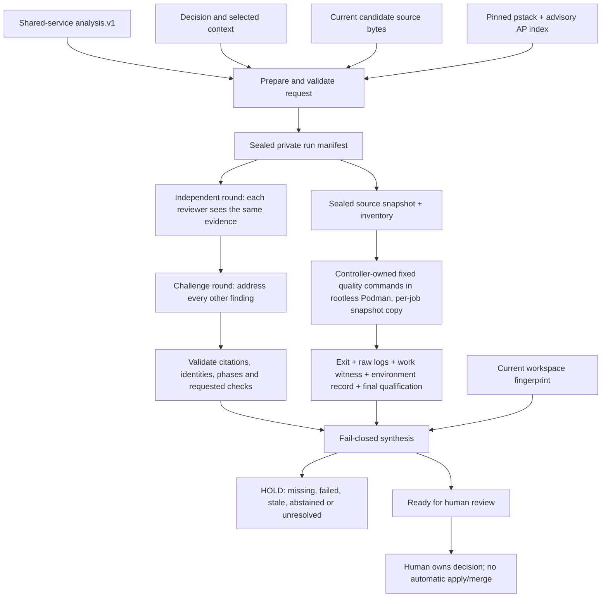

# Review roster, adversarial council and verification controller

This is the local implementation of the requested Claude Code/Codex review roster and expert circle. It connects the existing analysis.v1 artifact to captured review context, independent provider rounds, explicit counter-review and measured quality gates. It makes unsupported, missing, failed and stale results visible. The final state is **ready_for_human_review**, never automatic approval.

[Vault hub](obsidian://open?vault=deep-diff-forge.vault&file=Implementation%2FReview%20Council) · [Implementation ledger](RECOMMENDATION_INTEGRATION.md) · [Quality workflow](../.github/workflows/ci.yml) · [HDD reference provenance](../review-policy/provenance.json)

## Scope and maturity

The new `deep-diff-forge-review` crate is a runnable Unix CLI/library workflow. It adds no daemon or automatic background model calls. Existing TUI/daemon clients are not yet council clients. All selected provider calls and verification jobs are explicit operator actions. No model is allowed to install a plugin, change code, select arbitrary shell commands, write a gate result, merge or publish.

A roster must contain two configured adapter families. Multiple personas on one client do not satisfy that check. These are **configured adapter identities**, not a cryptographic attestation of the model behind a custom endpoint. When `model` is null, the client's default model is used and its actual model identity is unmeasured. Pin concrete available model IDs for controlled comparisons. Code does not claim that personas produce statistically independent reasoning. Builder family is explicit and self-reviews are identified in the prompts. Neither configured diversity nor consensus proves correctness.

The analysis scope is the supplied changed-source artifact, not every outstanding Git change or a complete repository review. Candidate file bytes are independently checked against the shared snapshot digest and captured in full. Optional context is selected by the operator. The workspace fingerprint binds tool/review receipts to tracked and non-ignored untracked files, modes and HEAD. Every candidate file must be inside that fingerprinted inventory; a gitignored candidate file is refused at `prepare`. Quality gates do not run in the repository: they run in a sandbox against a copy of the source snapshot sealed at `prepare` (see [Gate sandbox](#gate-sandbox)). Ignored files, the dependency sources fetched by the vendoring step, and the host environment are outside the fingerprint; the gate toolchain is identified by the recorded local image ID, not by the fingerprint. Do not interpret it as a whole-system provenance proof.

## Source findings and provenance

The HDD sources are:

- HEE-v5: `/var/mnt/storage/herdr-engineering-engine-v5`, observed HEAD `a75c914bfa79a74d9aec2980ba08ffa845f1f03a`. The read references are `.claude/AGENT_ROSTER.md`, `.claude/RUST.md`, `.claude/TESTING.md` and `.claude/tools/source_scan.py`. Their source hashes are recorded. HEE itself was neither modified nor built.
- Antipattern crosswalk: `/var/mnt/storage/hee5-evidence/reference/drive-heev5-friday-20261017/extracted/HEEv5_Antipattern_Integration_v0.8-R5/HEEv5_Antipattern_Integration_v0.8-R5/AP_CROSSWALK.json`. All **50 entries** are preserved verbatim, including `SOURCE_REGISTER_PRESENT__HEE5_ENFORCEMENT_UNVERIFIED`, original source links and the instruction to inspect original source rows before implementing a detector. It is a review inventory, not a finding that every pattern exists here.
- Lauren Tan's pstack: `/var/mnt/storage/hee5-evidence/reference/pstack-e43c7ee`, version **0.15.9**, commit `e43c7ee26e0038c6c1fa8380dd34ce86ff94cb2a`. The HDD upstream clone at `/var/mnt/storage/exemplars/poteto/upstream/cursor-plugins` has the same HEAD. All 162 manifest entries (161 source files plus pin metadata) were checksum-verified. This is a pinned HDD reference, not a claim to the latest online release.

Selected pstack documents and the complete MIT license are packaged under [the review crate's policy directory](../crates/deep-diff-forge-review/policy/). The rubric, encode-lessons principle and prove-it-works principle enter every captured manifest and prompt. The 50-row advisory antipattern index also enters the context. `review_policy_check.py` verifies the imported policy digests. The full Cursor plugin is not globally installed or executed. Its Cursor-specific agents, model aliases, PR automations and unrelated scripts are not silently enabled. HEE's authority/HOLD/fence rules are reference context for that project, not permissions granted to this product.

HEE learning → DDF mechanism:

| Learning | Implemented control | Remaining qualification |
| --- | --- | --- |
| Independent verifier/refuter, not a builder's self-grade | Distinct configured provider families; blind initial round; explicit cross-review; immutable raw provider artifacts | Actual runtime model identity and empirical independence need verification for the chosen deployment |
| AP-04 / AP-14: bound acquisition, do not silently clip | Bounded context/report/source reads; explicit rejection; output-limit diagnostics mark incomplete transcripts | Output limit detection is cooperative, not an OS disk quota |
| AP-15 / AP-35: structural ownership and bounded fan-out | Exclusive controller lock; create-new jobs; 2–12 admitted reviewers; serial explicit jobs | No distributed scheduler or multi-host lock is claimed |
| AP-29: exit zero is insufficient | Model output must pass typed admission; test/fuzz jobs need nonzero observed work; mutation needs successful baseline and coherent outcome rows | Test and fuzz work witnesses are parsed from output the candidate's own code can print, and the mutation witness is written inside the job's writable directory; they are sanity checks, not adversarial proof (see [residual risks](#gate-sandbox-residual-risks)) |
| AP-30 / AP-34: bind results to real artifacts | Sealed source snapshot exported at `prepare`; each gate's private copy fingerprinted before and after against the sealed tree; live checkout still checked before every job; captured candidate digest; output/report hashes; finalized qualification separate from process exit; refusal markers cannot be overridden by a qualification | No cryptographic signer authentication against a hostile local account |
| AP-32: isolate mutation state | Every gate job, including mutation, runs in its own `work/` copy with its own `CARGO_HOME`, `TMPDIR` and (except mutation) `CARGO_TARGET_DIR` under `/work`; the shared normal target is never mounted. A real contamination failure and its regression are retained in the evidence note | The gate toolchain is a pinned image identified by local image ID, not a reproducible or signature-verified build |
| AP-31 / AP-38: bound waits, do not kill by process name | Deadline and owned process group cleanup, tested with a child process; gate containers carry a conmon `--timeout` backstop and are removed by their unique name | Container limits cover PIDs and memory only; no CPU or disk quota |
| AP-26: do not regex Rust declarations | Parsed TOML and JSON for policy checks; common typed Rust controller | Fifty semantic antipattern detectors are **not** implemented |
| AP-01 / AP-41: one owner for shared facts | Canonical core changed-source digest reused by analysis and council | Further cache/build identities remain separate work |
| pstack: go deep, attack premise, encode recurring fixes structurally | Common rubric plus specialist lenses; falsification routes; mandatory measured checks; subtractor role | Outcome quality needs held-out evaluation; no novelty or superiority claim |

## Architecture



```mermaid
sequenceDiagram
  participant Human
  participant Controller
  participant Codex
  participant Claude as Claude Code
  participant Tools as Verification tools
  Human->>Controller: prepare request + analysis + decision
  Controller->>Controller: verify candidate digest; seal context, roster and source tree; export source snapshot
  Human->>Controller: run configured independent reviewer
  Controller->>Codex: captured prompt + common strict response schema
  Codex-->>Controller: untrusted structured report
  Controller->>Controller: validate; retain raw output; qualify accepted artifact
  Human->>Controller: run other independent reviewer
  Controller->>Claude: same captured evidence, no earlier review
  Claude-->>Controller: untrusted structured report
  Human->>Controller: challenge round after all independent reports exist
  Controller->>Codex: other reviewers' findings + captured evidence
  Controller->>Claude: other reviewers' findings + captured evidence
  Human->>Controller: run specific required quality gate
  Controller->>Tools: fixed argv in rootless Podman on a private snapshot copy, deadline, owned process group
  Tools-->>Controller: logs and measurements
  Controller->>Controller: remove container by name; validate work witness and before/after snapshot-copy identity
  Human->>Controller: status
  Controller-->>Human: HOLD or ready_for_human_review, reasons and exact scope
```

## Review roster and expert personas

Every reviewer applies the same correctness, boundary, verification and complexity rubric. The persona adds a lens; it does not exempt that reviewer from the common rubric.

| Default slot | Adapter | Persona and adversarial responsibility |
| --- | --- | --- |
| correctness-codex | Codex | Reachable invariants, errors, boundary values, encodings and compatibility |
| security-claude | Claude Code | Injection, authority, hostile input, credentials and resource amplification |
| architecture-claude | Claude Code | Attack the premise, compare smaller alternatives, ownership, dependency direction and migration cost |
| falsifier-codex | Codex | Break what passed; find vacuous assertions, missing controls and surviving mutants |
| performance-claude | Claude Code | Complexity, allocation, contention, latency; require a reproducible measurement |
| subtractor-codex | Codex | Remove unnecessary machinery and duplicated authority while preserving required behavior |

`roster` profile permits a smaller two-family roster. `important_decision` additionally requires correctness, security, architecture and falsifier lenses and fuzz/mutation gates. Missing reviewers do not lower a quorum. A failed provider is not silently replaced. Findings remain claims; citations establish location/integrity, not semantic support. High/critical independent findings cannot be erased by later agreement or retraction: revise the candidate/decision and create a new run.

## CLI usage

Build with `cargo build --locked -p deep-diff-forge-cli`. The local reviewed build is also reachable via `ddf-integration-20261025` on this machine.

```sh
ddf-integration-20261025 council example > council-request.json
```

Edit the concrete repository, analysis/decision paths, builder family, selected contexts, providers/models and budgets. The template intentionally does not invent a latest model slug or credentials. Produce analysis.v1 with the existing `analyze` command from stable base/candidate snapshot directories. All source paths in that artifact must match current candidate file bytes; renamed/copied/binary source adaptation remains unsupported.

```sh
ddf-integration-20261025 council prepare council-request.json /absolute/new-run-directory
ddf-integration-20261025 council status /absolute/new-run-directory
# Missing evidence returns HOLD and exit 7, never a successful empty review.

ddf-integration-20261025 council review /absolute/new-run-directory correctness-codex independent --execute
ddf-integration-20261025 council review /absolute/new-run-directory security-claude independent --execute
# Run every other configured reviewer before beginning any challenge job.
ddf-integration-20261025 council review /absolute/new-run-directory correctness-codex challenge --execute
# Run the challenge job for every configured reviewer.

# Gates refuse unless the gate image is set and present locally; see "Gate sandbox".
export DDF_COUNCIL_GATE_IMAGE=localhost/ddf-council-gate:20261025
ddf-integration-20261025 council gate /absolute/new-run-directory format --execute
ddf-integration-20261025 council gate /absolute/new-run-directory check --execute
ddf-integration-20261025 council gate /absolute/new-run-directory clippy --execute
ddf-integration-20261025 council gate /absolute/new-run-directory pedantic --execute
ddf-integration-20261025 council gate /absolute/new-run-directory tests --execute
ddf-integration-20261025 council gate /absolute/new-run-directory antipatterns --execute
ddf-integration-20261025 council gate /absolute/new-run-directory fuzz --execute
ddf-integration-20261025 council gate /absolute/new-run-directory mutation --execute
ddf-integration-20261025 council status /absolute/new-run-directory
```

The output directory's parent must exist, and the new run must be outside the reviewed repository. Existing runs/jobs/reports are never overwritten. `council import <run> <report.json>` admits external structured reports but explicitly labels manual import unverified; it cannot satisfy a missing measured provider invocation. The run's `manifest.json` and captured artifacts are reviewable before `--execute`. Preparation/status do not launch a hosted model. No execution occurs merely because a reviewer requested a check.

Exit 0 means the requested operation completed under its contract; status exit 0 specifically means ready for human review. Exit 7 is HOLD/failed/inconclusive execution. Exit 4 is malformed input, stale admission, existing artifact or protocol/IO failure. No command implies acceptance, merge, release or deployment.

<a id="tuicr-export"></a>

### Exporting admitted findings to tuicr (DDF-R54)

`council export-tuicr` files admitted council findings into a local tuicr (0.27.0) review session as *local draft notes*. It is a read-only analysis adapter in the sense of the vault plan: it never submits to a forge, marks a file or hunk reviewed, resolves or deletes a comment, or turns a model claim into an approval.

```sh
# Dry run (default): every identity check, then the planned notes as JSON. Never invokes tuicr, never writes.
ddf-integration-20261025 council export-tuicr /absolute/run-directory --session ~/.local/share/tuicr/reviews/sessions/<hash>.json
# Perform the writes through `tuicr review add`.
ddf-integration-20261025 council export-tuicr /absolute/run-directory --session <session.json> --execute
# Explicitly file findings whose anchor cannot be verified as review-level notes instead of refusing.
ddf-integration-20261025 council export-tuicr /absolute/run-directory --session <session.json> --allow-review-level --execute
```

Find the session path with `tuicr review list --repo <repository>`. Rules, each covered by [the export tests](../crates/deep-diff-forge-cli/tests/council_tuicr.rs):

- **Admission.** Only reports whose bytes validate against the sealed manifest *and* match a passed controller `qualification.json` digest are exported; the provider transcript must match its execution receipt. A tampered report or transcript refuses the whole export. A manual `council import` (no qualification) is listed under `skipped_reports` and never exported.
- **Repository identity.** The session's `repo_path` must canonicalize to the run's repository. Pull-request sessions (`pr_session_key` set or `diff_source: pull_request`), unknown `diff_source` values and session versions other than `1.3` are refused.
- **Anchoring.** A finding's first `candidate:<path>` citation is its anchor; findings citing only analysis/decision/policy artifacts become review-level notes. The anchor is accepted only if the session lists the file and the bytes the session's new side shows equal the run's sealed snapshot copy `<run>/source/<path>` (whose digest must still equal the manifest artifact). Those bytes are determined from `diff_source`: the working-tree file for `working_tree`, `unstaged`, `staged_and_unstaged`, `working_tree_and_commits`, `staged_unstaged_and_commits`, `file` and `pristine`; the index blob (`git cat-file blob :<path>`) for `staged`; and the blob at `base_commit` for `commit_range`, which tuicr sets to the newest commit of `commit_range` (the adapter checks that). Ranges must lie within the reviewed file's line count and always target the `new` side.
- **Mismatch policy.** A mismatch means the run did not review what the session shows, so by default the export is refused with a typed `unanchored` error before anything is written: rejecting a mismatched revision is the successful boundary outcome. `--allow-review-level` is the explicit downgrade: such findings become review-level notes whose text records why they are not anchored. Session/repository identity failures are never downgradable.
- **Provenance.** Every note starts with `[DDF-COUNCIL run=<run-id> reviewer=<id> round=<round> finding=<id>]`, then severity, the observed model identity (Claude's stdout `modelUsage` keys or Codex's stderr `model:` line; `unknown` otherwise), the requested model, the admitted report path and SHA-256, and the statement "Model claim, not verified fact". The tuicr author is `council:<reviewer> (<observed model>)`.
- **Idempotency.** The ledger lives in the run at `exports/tuicr/<session-id>/`. Before each write a create-new intent marker `<sha256(key)>.pending` is written; after tuicr reports the comment and the session file is re-read to contain it, a create-new record `<sha256(key)>.json` stores the tuicr comment id. Re-running is a no-op. If tuicr fails and the session provably lacks the comment, the marker is removed; a marker left by an interrupted run is resolved by adopting the matching comment from the session, or else refused as `interrupted` for an operator to inspect.
- **tuicr invocation.** The binary is the first executable `tuicr` in an absolute `PATH` entry. It runs with fixed argv and no shell: `tuicr review list --repo <repository>` (the session must be listed, so tuicr saves into the same file; it may be open in a live tuicr, because tuicr locks CLI writes and the running TUI polls and merges external edits) and `tuicr review add --session <path> --input -` with the JSON payload on stdin. A non-zero exit is a typed `tuicr failed` error carrying tuicr's stderr; the returned JSON must describe the requested new-side local draft.

tuicr locates its store with `directories::ProjectDirs` (`$XDG_DATA_HOME/tuicr/reviews`, default `~/.local/share/tuicr/reviews`) and saves an edited session at a path derived from its slug and canonical repository, not necessarily at the `--session` path given; hence the `review list` preflight and the post-write re-read. tuicr has no non-interactive way to create a session. The opt-in real-tuicr test (`DDF_TUICR_IT=1`) therefore writes a minimal 1.3 session file in an isolated `HOME`/`XDG_DATA_HOME`/`XDG_CONFIG_HOME`, lets `tuicr review add` save it into the isolated store, asserts the stored path lies under the isolated data directory, and then exports into it. Without the variable it prints `UNMEASURED:`.

## Exact quality checks

Every command below runs inside the [gate sandbox](#gate-sandbox) with working directory `/work/src`, the job's private copy of the sealed snapshot. Paths beginning `/work` are container paths inside that job's own `jobs/<job>/work/` directory.

| Gate | Fixed command/measurement | Failure semantics |
| --- | --- | --- |
| format | cargo fmt --all --check | Tool failure/timeout/source change holds |
| check | cargo check --workspace --all-targets --locked | Compilation failure/missing tool/source change holds |
| clippy | cargo clippy --workspace --all-targets --locked -- -D warnings | Warnings are failures |
| pedantic | Same with -W clippy::pedantic | No lint waiver is introduced |
| tests | cargo test --workspace --locked | Requires successful tool plus nonzero observed passed tests; zero work is inconclusive |
| antipatterns | python3 /work/review_policy_check.py (the controller's embedded copy of the pinned checker, not the candidate's script) | Parses manifests and pinned metadata of the snapshot; requires `state: passed` and nonzero workspace members checked; does not certify the 50 semantic patterns absent |
| fuzz | cargo +nightly fuzz run for each explicit target, corpus `/work/corpus` seeded from the snapshot, artifacts in `/work/fuzz-artifacts/`, declared time/input budgets | Every target must succeed and show nonzero executed cases; empty/unavailable/timeout/crash is not PASS |
| mutation | cargo mutants --package the-explicit-package --test-workspace true --timeout 30 --output /work/mutation-results | Requires successful baseline, coherent per-mutant outcomes, nonzero caught mutants, zero missed, zero timeouts; unviable outcomes remain visible |

Each gate job, including mutation, gets its own `work/` directory and never sees the normal build cache (AP-32). Non-mutation gates set `CARGO_TARGET_DIR=/work/target`; the mutation gate deliberately leaves `CARGO_TARGET_DIR` unset, because cargo-mutants copies the tree per build and a shared target directory would cross-contaminate those copies. The mutation witness is `jobs/gate-mutation/work/mutation-results/mutants.out/outcomes.json`; its SHA-256 is recorded in the job's qualification and rechecked on every status. Mutation scope is the explicitly named package, while the test scope is the entire workspace so CLI/dependent integration tests can kill mutations in the review library. Requested checks appearing in model findings become additional outstanding evidence requirements. They are never executed automatically. The controller does not interpret a model's shell snippet as a command. No percentage score or majority vote overrides these requirements.

The subprocess output limit is an 8 MiB combined trigger checked cooperatively. Owned processes are killed on timeout/output excess. Retained streams are capped to 8 MiB each, and `transcript-limit.json` explicitly marks incomplete transcripts and observed byte counts. Such runs never qualify. This is not an OS disk quota and a burst may exceed the trigger before detection. Gate containers additionally carry `--pids-limit=8192` and `--memory=32g`; there is no CPU or disk quota. Files and run directories are private, create-new and fsynced. A stale controller lock after interruption requires operator inspection; there is no unsafe automatic lock-stealing or silent result replay.

<a id="gate-sandbox"></a>

## Gate sandbox

The first live council run (r2) produced seven HIGH findings from both provider families against the earlier gate design, in which quality gates ran as the controller's own user in the live, mutable checkout. In summary:

1. **Receipt forgery.** Gate subprocesses (build scripts, tests, fuzz targets, the repository's own policy script) could write passing receipts and qualification files into the run directory.
2. **Unproven tested bytes.** Before/after fingerprints of a mutable tree do not prove which bytes were tested (an A→B→A change between the two observations is invisible), and gitignored candidate files sat outside the fingerprint.
3. **Ambient authority and self-grading.** Gates inherited credentials and network, and the antipatterns gate executed the candidate's own `scripts/security/review_policy_check.py`.
4. **Refusal override.** A `qualification.json` could overwrite refusal markers; this was confirmed in `storage.rs`.

This section describes the replacement. Gates now run in a rootless Podman container against a private copy of a source snapshot sealed at `prepare`.

### Threat model

- **Untrusted:** the candidate code under review, and everything it can cause to run. That includes build scripts, proc macros, tests, fuzz targets, benches, its Cargo configuration, its lockfile and the dependencies that lockfile names.
- **Trusted:** the controller binary (including the policy checker compiled into it), the operator, the operator-built gate image and the Podman installation.
- **Out of scope:** other processes running as the operator's uid *outside* the sandbox. Run directories are protected only by file mode (private, create-new) and receipts are not signed. Any same-uid process can already rewrite the run directory, replace the controller binary or read the operator's credentials directly, so there is nothing for the controller to defend. Defending against such processes would need a separate uid or signed receipts. Neither is implemented.

### Controls and the findings they answer

| Control | Code | r2 finding answered |
| --- | --- | --- |
| `prepare` builds a source inventory (Git HEAD plus tracked and non-ignored untracked paths). It copies exactly those files into `<run>/source/`, writes `source-inventory.json`, then re-fingerprints the copy and refuses if it differs from the sealed `source_tree` | `storage.rs` `inventory`, `copy_tree`, `fingerprint_tree`, `prepare` | (2) the tested bytes are a sealed copy, not the live tree |
| Candidate files must be members of the inventory, so a gitignored candidate file is refused | `storage.rs` `verify_candidate` | (2) gitignored candidates outside the fingerprint |
| Each gate job gets `jobs/<job>/work/src`, a fresh copy of the sealed snapshot. That copy is fingerprinted against the sealed tree before the run and again after it; any difference is not PASS. The live checkout is still fingerprinted before every job, so a changed workspace stales the run | `execution.rs` `prepare_work`, `run` | (2) ABA on a mutable tree |
| Only `jobs/<job>/work/` is mounted (at `/work`). Receipts, logs, `environment.json`, `qualification.json` and refusal markers live in `jobs/<job>/`, which the container cannot reach | `sandbox.rs` `argv`, `execution.rs` `launch_argv` | (1) gate code writing receipts into the run directory |
| No host home is mounted. `HOME`, `CARGO_HOME` and `TMPDIR` point into `/work`, and only the variables listed in `environment.json` are passed. Gates run with `--network=none` and `CARGO_NET_OFFLINE=true`, except for the one vendoring job | `sandbox.rs` `env`, `argv` | (3) inherited credentials and network |
| The antipatterns gate runs `python3 /work/review_policy_check.py`. That file is the controller's embedded copy (`include_str!`) of `crates/deep-diff-forge-review/policy/review_policy_check.py`, and it checks the snapshot from its working directory | `execution.rs` `POLICY_CHECK`, `gate_argv` | (3) self-grading |
| In `executions()`, a `protocol-error.txt` or `qualification-error.txt` marker lowers any outcome that would otherwise be `Passed`. A qualification can lower an outcome but cannot restore `Passed` over a marker | `storage.rs` `executions` | (4) qualification overriding refusal |
| `run_gate` resolves `DDF_COUNCIL_GATE_IMAGE` to a local image ID before creating any job. It refuses if the variable is unset or the image is not present locally, and it never pulls. Every job records the image name and ID in `environment.json` | `sandbox.rs` `from_env`, `image_id`, `record`; `execution.rs` `run_gate` | An unavailable sandbox does not consume an immutable job slot |
| Each container is named `ddf-council-<first 16 chars of run id>-<job>` and is force-removed by that name (`podman rm --force --time 0`) after every job, whatever the outcome | `sandbox.rs` `container_name`, `remove`; `execution.rs` `run` | Cleanup when the Podman client is killed but the container lives on |

### Podman invocation

Every gate job runs `$DDF_COUNCIL_PODMAN run` (the default runtime is `podman`) with these flags. The source of truth is `sandbox.rs` `Sandbox::argv`.

| Flag | Why |
| --- | --- |
| `--rm` | Leave no container state behind after a normal exit. Removal by name covers abnormal exits |
| `--pull=never` | Run only the operator-admitted local image; Podman "never pull[s] the image but use[s] the one from the local containers storage" |
| `--read-only` | The image root filesystem cannot be modified, so toolchains cannot be altered between or during jobs |
| `--cap-drop=all`, `--security-opt=no-new-privileges` | No capabilities, and no privilege gain through setuid binaries |
| `--userns=keep-id` | Podman "creates a user namespace where the current user's UID:GID are mapped to the same values in the container", so `/work` files stay owned by the operator and nothing runs as container root |
| `--init` | An init "forwards signals and reaps processes", so test and fuzz children are reaped and signalled |
| `--pids-limit=8192`, `--memory=32g` | Bound fork and memory amplification. This is not a CPU or disk quota |
| `--log-driver=none` | Measured on this host on 2026-10-25, with the Podman client's stdout/stderr redirected to files. `passthrough` produced an empty transcript at exit 0, while `none`, `k8s-file` and the default all delivered both streams. `none` was chosen so candidate output is not also duplicated into container logs |
| `--name=ddf-council-…` | Gives each container a deterministic, unique handle for forced removal |
| `--timeout=<request timeout + 60>` | Podman's `--timeout` is the "maximum time a container is allowed to run before conmon sends it the kill signal". It backs up the controller's own deadline. Podman also documents that "Podman can exit but conmon continues to run", which is why killing the client is not enough and the controller removes the container by name |
| `--network=none` | No network for any gate. Only the vendoring job omits this flag |
| `--volume=<job>/work:/work:Z` | The job's only writable mount. `Z` relabels it private to this container for SELinux |
| `--volume=<vendor>:/vendor:ro,z` | The run's vendored dependencies, read-only, with a shared label because every gate job mounts the same directory |
| `--env=HOME=/work/home`, `CARGO_HOME=/work/cargo-home`, `TMPDIR=/work/tmp`, `CARGO_NET_OFFLINE=true`, and `CARGO_TARGET_DIR=/work/target` for every gate except mutation | Explicit, recorded environment, with no inherited variables |
| `--workdir=/work/src` | Commands run in the snapshot copy |

The toolchains are baked into the image rather than mounted from the host `~/.rustup` or `~/.cargo`. Podman's volume documentation says "Do not relabel system files and directories", and its example for sharing a home directory disables SELinux separation instead (`--security-opt label=disable`). Mounting the operator's home would also expose credentials. Source: [podman-run(1)](https://docs.podman.io/en/latest/markdown/podman-run.1.html), for `--timeout`, conmon, `:z`/`:Z`, `--userns=keep-id`, `--pull`, `--init` and `--read-only`.

The image is defined by [`review-policy/sandbox/Containerfile`](../review-policy/sandbox/Containerfile). It is a Fedora 44 base pinned by digest, with Rust 1.99.1 (clippy and rustfmt), `nightly-2026-10-25` reachable as `cargo +nightly`, cargo-mutants 27.1.0, cargo-fuzz 0.13.2, gcc and python3, and it runs as `USER 1000:1000`.

### Dependency vendoring

Offline gates still need crate sources. Before the first gate that builds Rust (every gate except antipatterns), `run_gate` runs a `sandbox-vendor` job once per run. That job runs in the same sandbox, against its own snapshot copy, with the default network:

```text
cargo vendor --locked --versioned-dirs [--sync fuzz/Cargo.toml] /work/vendor
```

The `--sync fuzz/Cargo.toml` part is added only if the snapshot contains that file. The job must reach `Passed`, or every later gate refuses with "dependency vendoring did not pass; inspect jobs/sandbox-vendor and prepare a new run". The resulting `jobs/sandbox-vendor/work/vendor` is mounted read-only at `/vendor` in each later gate. Each gate's `cargo-home/config.toml` replaces `crates-io` with that directory.

This is the only networked job. `cargo vendor` resolves and downloads crates named by the manifests and lockfile, but it does not compile them, so no build script, proc macro, test or fuzz target from the candidate or its dependencies runs while the network is available. Cargo also checks downloaded registry crates against the `Cargo.lock` checksums. Both points are inferred from Cargo's documented behaviour and the code comment in `execution.rs`; neither has been tested adversarially here.

Only `crates-io` is replaced. A candidate with git or alternative-registry dependencies would fail offline gates (inferred, not tested).

### Operator setup

1. Build the image. The header of the Containerfile gives the command:

   ```sh
   podman build --pull=never -t localhost/ddf-council-gate:20261025 -f review-policy/sandbox/Containerfile review-policy/sandbox
   ```

   `--pull=never` refuses to fetch the base image, so on a fresh machine first pull the digest-pinned `FROM` reference: `podman pull registry.fedoraproject.org/fedora:44@sha256:0d2a354d…`, using the full digest from the Containerfile. The build itself needs network; the gates do not.
2. Set `DDF_COUNCIL_GATE_IMAGE=localhost/ddf-council-gate:20261025`, or another local tag you built. On this host, `podman image inspect` gives that tag the image ID `bb89cf38bca362967cfa33c43efc709016a09acdcab562fb361d393aa8ce185f` (measured 2026-10-25).
3. On Fedora Atomic (Silverblue/Kinoite), Podman is on the host and not in the default Toolbx container. Measured here: `fedora-toolbox-44` has `flatpak-spawn` but no `podman`. You have two options:
   - Run the controller on the host.
   - From a toolbox, set `DDF_COUNCIL_PODMAN="flatpak-spawn --host podman"`. The variable is split on whitespace into the runtime argv.

   Do not treat Toolbx as the isolation layer. It is documented to give "seamless access to the user's home directory", sockets, D-Bus, the SSH agent, `/dev` and the host filesystem at `/run/host` ([containertoolbx.org](https://containertoolbx.org/)), so it is not a security boundary.

<a id="gate-sandbox-residual-risks"></a>

### Residual risks

- **Work witnesses are sanity checks, not adversarial proof.** The tests witness counts `test result: ok. N` lines on stdout, and the fuzz witness parses libFuzzer's `Done N runs in S second(s)` on stderr. Candidate code shares those streams and can print fabricated lines. The mutation witness `outcomes.json` is written by cargo-mutants inside `/work`, which candidate test code can also write. The sandbox stops a gate from forging the *controller's* receipt, qualification or markers. It does not stop the candidate from lying to the tool whose output is being parsed.
- **Image admission is local tag plus recorded image ID, not signature verification.** Anyone who can write the operator's container storage can replace the tag. The recorded ID shows after the fact which image ran. Status does not re-verify that the image still exists or still has that ID.
- **`keep-id` maps the operator's uid into the container.** Isolation rests on namespaces, the mount set, dropped capabilities and `no-new-privileges`, not on a separate uid. A container or kernel escape lands as the operator.
- **The vendor step fetches what the candidate's lockfile names.** It runs with network and (inferred) honours the candidate's own Cargo configuration from the snapshot, so a hostile candidate can make it contact registries or hosts of its choosing and download arbitrary crate sources. Those sources then run, offline, inside later gates.
- **Resource bounds are partial.** There are PID and memory limits, but no CPU or disk quota.
- **Same-uid processes outside the sandbox remain out of scope**, as described in the threat model.

### Evidence status

- **Measured (2026-10-25, this host):**
  - The `--log-driver` comparison described above. This was reported by the implementing agent.
  - The local image ID of `localhost/ddf-council-gate:20261025`.
  - `python3 scripts/security/review_policy_check.py --selftest` and the plain invocation of the compatibility wrapper both succeeded when run from outside the repository root: 6 self-tests OK, `state: passed`, 13 workspace members checked.
- **Inferred:** the claims above about Cargo's checksum and no-compilation behaviour during vendoring, and the git-dependency limitation.
- **Unmeasured in this document:**
  - Workspace test results for this change.
  - The opt-in `council_sandbox` integration test (`DDF_COUNCIL_SANDBOX_IT=1`).
  - The CI step that builds the image and runs that test on GitHub-hosted runners.
  - Any adversarial attempt to escape the container or forge a receipt from inside it.

  For test results, see the vault verification receipt.

## Provider contracts

Codex runs non-interactively with a read-only sandbox, ignored ambient user config/rules, ephemeral session, disabled shell/unified-exec/apps features, strict output schema and a private working directory. Claude Code runs in print/safe/restricted mode with an empty tool list, strict empty MCP configuration, no slash commands and no session persistence. No bypass-permissions option is used. The captured code and policy are passed explicitly as input.

These flags reduce ambient capabilities; they are not a claim of a fully hermetic operating-system sandbox or independently authenticated model lineage. Client versions/availability and their actual account configuration matter. Failed auth or unsupported flags produce a visible failed/unavailable required reviewer. Current protocol tests use deterministic fake CLI executables, not live authenticated hosted model runs.

Primary protocol references: [OpenAI non-interactive Codex](https://learn.chatgpt.com/docs/non-interactive-mode) and [Anthropic programmatic Claude Code](https://code.claude.com/docs/en/headless). Local installed `--help`/feature output was cross-checked. The response contract is validated again by typed Rust; a subprocess exit 0, a no-blockers caption, missing structured_output, stale run ID, unknown reviewer, duplicate finding, fabricated citation or invalid range cannot mint accepted evidence.

## Verification and remaining work

The current verification receipt and exact scope live in the vault's **Implementation/Review Council Verification 2026-10-25**. Historical first-increment evidence remains separate. Tests include policy refusals, actual CLI processes with two deterministic provider substitutes, phase ordering, missing gates, stale workspace/report rejection, protocol failure, timeouts, owned child cleanup, explicit transcript limits and zero-work tool refusals. The short local report fuzz campaign and scoped mutation campaign are bounded measurements, not full-codebase qualification. The gate sandbox change is covered by its own evidence status in [Gate sandbox](#gate-sandbox); this document does not assert that its tests pass.

Remaining work includes live provider/account qualification, observed actual model identity, held-out review-quality evaluation, adversarially robust work witnesses (test/fuzz/mutation counts that candidate code cannot fabricate), signature-verified or reproducible gate images, CPU/disk quotas for gate containers, protection against same-uid processes outside the sandbox (separate uid or signed receipts), git/alternative-registry dependency vendoring, broader or crate-specific antipattern detectors with planted controls, complete mutation/fuzz campaigns, durable human finding dispositions/exception handling, cancellation/recovery UX, and migration into daemon/TUI consumers. No automatic approval mechanism has been added.

## Exact module routes

<a id="council-boundary"></a>

### crates/deep-diff-forge-review/src/lib.rs

Public API boundary; separate typed review claims from controller-owned execution and human authority.

[Exact crate/module](../crates/deep-diff-forge-review/src/lib.rs) ↔ [module vault note](obsidian://open?vault=deep-diff-forge.vault&file=Implementation%2FModules%2Fcouncil--crates--deep-diff-forge-review--src--lib)

<a id="typed-protocol"></a>

### crates/deep-diff-forge-review/src/model.rs

Typed providers, personas, phases, findings, citations, execution outcomes and final qualification.

[Exact crate/module](../crates/deep-diff-forge-review/src/model.rs) ↔ [module vault note](obsidian://open?vault=deep-diff-forge.vault&file=Implementation%2FModules%2Fcouncil--crates--deep-diff-forge-review--src--model)

<a id="admission-and-synthesis"></a>

### crates/deep-diff-forge-review/src/policy.rs

Fail-closed request/report admission and synthesis: no missing quorum, stale evidence or vote-based approval.

[Exact crate/module](../crates/deep-diff-forge-review/src/policy.rs) ↔ [module vault note](obsidian://open?vault=deep-diff-forge.vault&file=Implementation%2FModules%2Fcouncil--crates--deep-diff-forge-review--src--policy)

<a id="capture-and-storage"></a>

### crates/deep-diff-forge-review/src/storage.rs

Bounded private context capture, canonical candidate snapshot verification, source inventory and identity, sealed source snapshot export, and immutable qualified artifacts in which refusal markers win.

[Exact crate/module](../crates/deep-diff-forge-review/src/storage.rs) ↔ [module vault note](obsidian://open?vault=deep-diff-forge.vault&file=Implementation%2FModules%2Fcouncil--crates--deep-diff-forge-review--src--storage)

<a id="execution-controller"></a>

### crates/deep-diff-forge-review/src/execution.rs

Fixed provider/gate argv, sandboxed gate jobs on per-job snapshot copies, one networked vendoring job, the embedded policy checker, deadlines, owned process groups, output limits and non-vacuous work qualification.

[Exact crate/module](../crates/deep-diff-forge-review/src/execution.rs) ↔ [module vault note](obsidian://open?vault=deep-diff-forge.vault&file=Implementation%2FModules%2Fcouncil--crates--deep-diff-forge-review--src--execution)

<a id="gate-sandbox-module"></a>

### crates/deep-diff-forge-review/src/sandbox.rs

Rootless Podman gate sandbox: fixed flags, explicit environment, `/work` and read-only `/vendor` mounts, `environment.json` record, container naming and forced removal. Design: [Gate sandbox](#gate-sandbox).

[Exact crate/module](../crates/deep-diff-forge-review/src/sandbox.rs)

<a id="gate-image"></a>

### review-policy/sandbox/Containerfile

Digest-pinned gate image with the exact toolchains and tools gates run; built by the operator, never pulled by the controller.

[Exact file](../review-policy/sandbox/Containerfile)

<a id="council-cli"></a>

### crates/deep-diff-forge-review/src/cli.rs

Explicit preparation/status/import and opt-in execution commands; manual reports cannot mint provider evidence.

[Exact crate/module](../crates/deep-diff-forge-review/src/cli.rs) ↔ [module vault note](obsidian://open?vault=deep-diff-forge.vault&file=Implementation%2FModules%2Fcouncil--crates--deep-diff-forge-review--src--cli)

<a id="policy-controls"></a>

### crates/deep-diff-forge-review/tests/contracts.rs

Planted negative controls for authority, phase, freshness, citations, missing evidence and budgets.

[Exact crate/module](../crates/deep-diff-forge-review/tests/contracts.rs) ↔ [module vault note](obsidian://open?vault=deep-diff-forge.vault&file=Implementation%2FModules%2Fcouncil--crates--deep-diff-forge-review--tests--contracts)

<a id="cli-controls"></a>

### crates/deep-diff-forge-cli/tests/council.rs

Actual CLI process lifecycle with fake providers and tools, plus timeout/owned-child cleanup and zero-work refusals.

[Exact crate/module](../crates/deep-diff-forge-cli/tests/council.rs) ↔ [module vault note](obsidian://open?vault=deep-diff-forge.vault&file=Implementation%2FModules%2Fcouncil--crates--deep-diff-forge-cli--tests--council)

<a id="tuicr-export-module"></a>

### crates/deep-diff-forge-review/src/tuicr.rs

Read-only DDF→tuicr export: admitted reports only, repository and per-file byte identity per `diff_source`, new-side anchors, provenance text, create-new ledger and fixed-argv tuicr calls. Design: [Exporting admitted findings to tuicr](#tuicr-export).

[Exact crate/module](../crates/deep-diff-forge-review/src/tuicr.rs)

<a id="tuicr-export-controls"></a>

### crates/deep-diff-forge-cli/tests/council_tuicr.rs

Export through the actual CLI with fake providers and a fake tuicr, plus one opt-in real-tuicr round trip in an isolated store.

[Exact crate/module](../crates/deep-diff-forge-cli/tests/council_tuicr.rs)

<a id="canonical-snapshot"></a>

### crates/deep-diff-forge-core/src/snapshot.rs

One canonical changed-source digest reused by analysis and council; explicit absence and framed paths/bytes.

[Exact crate/module](../crates/deep-diff-forge-core/src/snapshot.rs) ↔ [module vault note](obsidian://open?vault=deep-diff-forge.vault&file=Implementation%2FModules%2Fcouncil--crates--deep-diff-forge-core--src--snapshot)

<a id="parsed-antipattern-guard"></a>

### crates/deep-diff-forge-review/policy/review_policy_check.py

Canonical, pinned checker: parse workspace TOML and provenance JSON; check lint inheritance and source labels without pretending to detect all semantic antipatterns. The controller embeds this file and runs it inside the gate sandbox with the snapshot copy as working directory. `scripts/security/review_policy_check.py` is a compatibility wrapper for CI and humans that runs it against the repository root; council gates never execute the wrapper.

[Exact crate/module](../crates/deep-diff-forge-review/policy/review_policy_check.py) · [compatibility wrapper](../scripts/security/review_policy_check.py) ↔ [module vault note](obsidian://open?vault=deep-diff-forge.vault&file=Implementation%2FModules%2Fcouncil--scripts--security--review_policy_check)

<a id="report-fuzz"></a>

### fuzz/fuzz_targets/council_report.rs

Bounded untrusted report parsing, validation and accepted-output serialization stability.

[Exact crate/module](../fuzz/fuzz_targets/council_report.rs) ↔ [module vault note](obsidian://open?vault=deep-diff-forge.vault&file=Implementation%2FModules%2Fcouncil--fuzz--fuzz_targets--council_report)

<a id="reference-provenance"></a>

### review-policy/provenance.json

Exact HDD paths, source commits and checksums; copied references retain their original qualification and license.

[Exact crate/module](../review-policy/provenance.json) ↔ [module vault note](obsidian://open?vault=deep-diff-forge.vault&file=Implementation%2FModules%2Fcouncil--review-policy--provenance)

<a id="advisory-catalogue"></a>

### crates/deep-diff-forge-review/policy/antipatterns.json

All 50 imported AP rows are byte-preserved advisory reference data, not automatic findings or qualified detectors.

[Exact crate/module](../crates/deep-diff-forge-review/policy/antipatterns.json) ↔ [module vault note](obsidian://open?vault=deep-diff-forge.vault&file=Implementation%2FModules%2Fcouncil--crates--deep-diff-forge-review--policy--antipatterns)


## Local execution environment

On this machine, `ddf-council-20261025` runs the council subcommand in the existing `fedora-toolbox-44` environment with the explicit integration target directory. For example: `ddf-council-20261025 gate /absolute/run pedantic --execute`. The host helper `ddf-integration-20261025` also exposes council commands. Gate commands no longer use the caller's compiler or tools: they run in the gate image (see [Gate sandbox](#gate-sandbox)). That toolbox has no `podman` (measured 2026-10-25), so a gate launched from it needs `DDF_COUNCIL_PODMAN="flatpak-spawn --host podman"`; otherwise run the controller on the host. Either way `DDF_COUNCIL_GATE_IMAGE` must be set, and gates refuse without it. No fallback silently changes the environment or lowers permissions. Model authentication/availability inside the chosen environment still requires live qualification. Installed CLI versions observed were codex-cli 0.164.0 and Claude Code 2.1.310; these are observations, not minimum-version or backend-identity guarantees.
