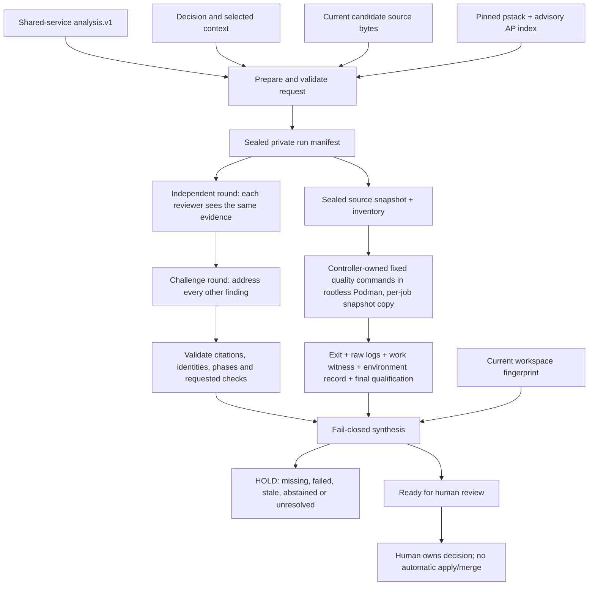

# Review roster, adversarial council and verification controller

This is the local implementation of the requested Claude Code/Codex review roster and expert circle. It connects the existing analysis.v1 artifact to captured review context, independent provider rounds, explicit counter-review and measured quality gates. It makes unsupported, missing, failed and stale results visible. The final state is **ready_for_human_review**, never automatic approval.

[Vault hub](obsidian://open?vault=deep-diff-forge.vault&file=Implementation%2FReview%20Council) · [Implementation ledger](RECOMMENDATION_INTEGRATION.md) · [Quality workflow](../.github/workflows/ci.yml) · [HDD reference provenance](../review-policy/provenance.json)

## Scope and maturity

The new `deep-diff-forge-review` crate is a runnable Unix CLI/library workflow. It adds no daemon or automatic background model calls. Existing TUI/daemon clients are not yet council clients. All selected provider calls and verification jobs are explicit operator actions. No model is allowed to install a plugin, change code, select arbitrary shell commands, write a gate result, merge or publish.

A roster must contain two configured adapter families. Multiple personas on one client do not satisfy that check. These are **configured adapter identities**, not a cryptographic attestation of the model behind a custom endpoint. When `model` is null, the client's default model is used and its actual model identity is unmeasured. Pin concrete available model IDs for controlled comparisons. Code does not claim that personas produce statistically independent reasoning. Builder family is explicit and self-reviews are identified in the prompts. Neither configured diversity nor consensus proves correctness.

The analysis scope is the supplied changed-source artifact, not every outstanding Git change or a complete repository review. Candidate file bytes are independently checked against the shared snapshot digest and captured in full. Optional context is selected by the operator. The workspace fingerprint binds tool/review receipts to tracked and non-ignored untracked files, modes and HEAD. Every candidate file must be inside that fingerprinted inventory; a gitignored candidate file is refused at `prepare`. Quality gates do not run in the repository: they run in a sandbox against a copy of the source snapshot sealed at `prepare` (see [Gate sandbox](#gate-sandbox)). Ignored files, the dependency sources fetched by the vendoring step, and the host environment are outside the fingerprint; the gate toolchain is identified by the recorded local image ID, not by the fingerprint. Do not interpret it as a whole-system provenance proof.

## Source findings and provenance

The HDD sources are:

- HEE-v5: `/var/mnt/storage/herdr-engineering-engine-v5`, observed HEAD `a75c914bfa79a74d9aec2980ba08ffa845f1f03a`. The read references are `.claude/AGENT_ROSTER.md`, `.claude/RUST.md`, `.claude/TESTING.md` and `.claude/tools/source_scan.py`. Their source hashes are recorded. HEE itself was neither modified nor built.
- Antipattern crosswalk: `/var/mnt/storage/hee5-evidence/reference/drive-heev5-friday-20261017/extracted/HEEv5_Antipattern_Integration_v0.8-R5/HEEv5_Antipattern_Integration_v0.8-R5/AP_CROSSWALK.json`. All **50 entries** are preserved verbatim, including `SOURCE_REGISTER_PRESENT__HEE5_ENFORCEMENT_UNVERIFIED`, original source links and the instruction to inspect original source rows before implementing a detector. It is a review inventory, not a finding that every pattern exists here.
- Lauren Tan's pstack: `/var/mnt/storage/hee5-evidence/reference/pstack-e43c7ee`, version **0.15.9**, commit `e43c7ee26e0038c6c1fa8380dd34ce86ff94cb2a`. The HDD upstream clone at `/var/mnt/storage/exemplars/poteto/upstream/cursor-plugins` has the same HEAD. All 162 manifest entries (161 source files plus pin metadata) were checksum-verified. This is a pinned HDD reference, not a claim to the latest online release.

Selected pstack documents and the complete MIT license are packaged under [the review crate's policy directory](../crates/deep-diff-forge-review/policy/). The rubric, encode-lessons principle and prove-it-works principle enter every captured manifest and prompt. The 50-row advisory antipattern index also enters the context. `review_policy_check.py` verifies the imported policy digests. The full Cursor plugin is not globally installed or executed. Its Cursor-specific agents, model aliases, PR automations and unrelated scripts are not silently enabled. HEE's authority/HOLD/fence rules are reference context for that project, not permissions granted to this product.

HEE learning → DDF mechanism:

| Learning | Implemented control | Remaining qualification |
| --- | --- | --- |
| Independent verifier/refuter, not a builder's self-grade | Distinct configured provider families; blind initial round; explicit cross-review; immutable raw provider artifacts | Actual runtime model identity and empirical independence need verification for the chosen deployment |
| AP-04 / AP-14: bound acquisition, do not silently clip | Bounded context/report/source reads; explicit rejection; output-limit diagnostics mark incomplete transcripts | Output limit detection is cooperative, not an OS disk quota |
| AP-15 / AP-35: structural ownership and bounded fan-out | Exclusive controller lock; create-new jobs; 2–12 admitted reviewers; serial explicit jobs | No distributed scheduler or multi-host lock is claimed |
| AP-29: exit zero is insufficient | Model output must pass typed admission; test/fuzz jobs need nonzero observed work; mutation needs successful baseline and coherent outcome rows | Test and fuzz work witnesses are parsed from output the candidate's own code can print, and the mutation witness is written inside the job's writable directory; they are sanity checks, not adversarial proof (see [residual risks](#gate-sandbox-residual-risks)) |
| AP-30 / AP-34: bind results to real artifacts | Sealed source snapshot exported at `prepare`; each gate's private copy fingerprinted before and after against the sealed tree; live checkout still checked before every job; captured candidate digest; output/report hashes; finalized qualification separate from process exit; refusal markers cannot be overridden by a qualification | No cryptographic signer authentication against a hostile local account |
| AP-32: isolate mutation state | Every gate job, including mutation, runs in its own `work/` copy with its own `CARGO_HOME`, `TMPDIR` and (except mutation) `CARGO_TARGET_DIR` under `/work`; the shared normal target is never mounted. A real contamination failure and its regression are retained in the evidence note | The gate toolchain is a pinned image identified by local image ID, not a reproducible or signature-verified build |
| AP-31 / AP-38: bound waits, do not kill by process name | Deadline and owned process group cleanup, tested with a child process; gate containers carry a conmon `--timeout` backstop and are removed by their unique name | Container limits cover PIDs and memory only; no CPU or disk quota |
| AP-26: do not regex Rust declarations | Parsed TOML and JSON for policy checks; common typed Rust controller | Fifty semantic antipattern detectors are **not** implemented |
| AP-01 / AP-41: one owner for shared facts | Canonical core changed-source digest reused by analysis and council | Further cache/build identities remain separate work |
| pstack: go deep, attack premise, encode recurring fixes structurally | Common rubric plus specialist lenses; falsification routes; mandatory measured checks; subtractor role | Outcome quality needs held-out evaluation; no novelty or superiority claim |

## Architecture



```mermaid
sequenceDiagram
  participant Human
  participant Controller
  participant Codex
  participant Claude as Claude Code
  participant Tools as Verification tools
  Human->>Controller: prepare request + analysis + decision
  Controller->>Controller: verify candidate digest; seal context, roster and source tree; export source snapshot
  Human->>Controller: run configured independent reviewer
  Controller->>Codex: captured prompt + common strict response schema
  Codex-->>Controller: untrusted structured report
  Controller->>Controller: validate; retain raw output; qualify accepted artifact
  Human->>Controller: run other independent reviewer
  Controller->>Claude: same captured evidence, no earlier review
  Claude-->>Controller: untrusted structured report
  Human->>Controller: challenge round after all independent reports exist
  Controller->>Codex: other reviewers' findings + captured evidence
  Controller->>Claude: other reviewers' findings + captured evidence
  Human->>Controller: run specific required quality gate
  Controller->>Tools: fixed argv in rootless Podman on a private snapshot copy, deadline, owned process group
  Tools-->>Controller: logs and measurements
  Controller->>Controller: remove container by name; validate work witness and before/after snapshot-copy identity
  Human->>Controller: status
  Controller-->>Human: HOLD or ready_for_human_review, reasons and exact scope
```

## Review roster and expert personas

Every reviewer applies the same correctness, boundary, verification and complexity rubric. The persona adds a lens; it does not exempt that reviewer from the common rubric.

| Default slot | Adapter | Persona and adversarial responsibility |
| --- | --- | --- |
| correctness-codex | Codex | Reachable invariants, errors, boundary values, encodings and compatibility |
| security-claude | Claude Code | Injection, authority, hostile input, credentials and resource amplification |
| architecture-claude | Claude Code | Attack the premise, compare smaller alternatives, ownership, dependency direction and migration cost |
| falsifier-codex | Codex | Break what passed; find vacuous assertions, missing controls and surviving mutants |
| performance-claude | Claude Code | Complexity, allocation, contention, latency; require a reproducible measurement |
| subtractor-codex | Codex | Remove unnecessary machinery and duplicated authority while preserving required behavior |

`roster` profile permits a smaller two-family roster. `important_decision` additionally requires correctness, security, architecture and falsifier lenses and fuzz/mutation gates. Missing reviewers do not lower a quorum. A failed provider is not silently replaced. Findings remain claims; citations establish location/integrity, not semantic support. High/critical independent findings cannot be erased by later agreement or retraction: revise the candidate/decision and create a new run.

## CLI usage

Build with `cargo build --locked -p deep-diff-forge-cli`. The local reviewed build is also reachable via `ddf-integration-20261025` on this machine.

```sh
ddf-integration-20261025 council example > council-request.json
```

Edit the concrete repository, analysis/decision paths, builder family, selected contexts, providers/models and budgets. The template intentionally does not invent a latest model slug or credentials. Produce analysis.v1 with the existing `analyze` command from stable base/candidate snapshot directories. All source paths in that artifact must match current candidate file bytes; renamed/copied/binary source adaptation remains unsupported.

```sh
ddf-integration-20261025 council prepare council-request.json /absolute/new-run-directory
ddf-integration-20261025 council status /absolute/new-run-directory
# Missing evidence returns HOLD and exit 7, never a successful empty review.

ddf-integration-20261025 council review /absolute/new-run-directory correctness-codex independent --execute
ddf-integration-20261025 council review /absolute/new-run-directory security-claude independent --execute
# Run every other configured reviewer before beginning any challenge job.
ddf-integration-20261025 council review /absolute/new-run-directory correctness-codex challenge --execute
# Run the challenge job for every configured reviewer.

# Gates refuse unless the gate image is set and present locally; see "Gate sandbox".
export DDF_COUNCIL_GATE_IMAGE=localhost/ddf-council-gate:20261026c
ddf-integration-20261025 council gate /absolute/new-run-directory format --execute
ddf-integration-20261025 council gate /absolute/new-run-directory check --execute
ddf-integration-20261025 council gate /absolute/new-run-directory clippy --execute
ddf-integration-20261025 council gate /absolute/new-run-directory pedantic --execute
ddf-integration-20261025 council gate /absolute/new-run-directory tests --execute
ddf-integration-20261025 council gate /absolute/new-run-directory antipatterns --execute
ddf-integration-20261025 council gate /absolute/new-run-directory fuzz --execute
ddf-integration-20261025 council gate /absolute/new-run-directory mutation --execute
ddf-integration-20261025 council status /absolute/new-run-directory
```

The output directory's parent must exist, and the new run must be outside the reviewed repository. Existing runs/jobs/reports are never overwritten. `council import <run> <report.json>` admits external structured reports but explicitly labels manual import unverified; it cannot satisfy a missing measured provider invocation. The run's `manifest.json` and captured artifacts are reviewable before `--execute`. Preparation/status do not launch a hosted model. No execution occurs merely because a reviewer requested a check.

Exit 0 means the requested operation completed under its contract; status exit 0 specifically means ready for human review. Exit 7 is HOLD/failed/inconclusive execution. Exit 4 is malformed input, stale admission, existing artifact or protocol/IO failure. No command implies acceptance, merge, release or deployment.

<a id="tuicr-export"></a>

### Exporting admitted findings to tuicr (DDF-R54)

`council export-tuicr` files admitted council findings into a local tuicr (0.27.0) review session as *local draft notes*. It is a read-only analysis adapter in the sense of the vault plan: it never submits to a forge, marks a file or hunk reviewed, resolves or deletes a comment, or turns a model claim into an approval.

```sh
# Dry run (default): every identity check, then the planned notes as JSON. Never invokes tuicr, never writes.
ddf-integration-20261025 council export-tuicr /absolute/run-directory --session ~/.local/share/tuicr/reviews/sessions/<hash>.json
# Perform the writes through `tuicr review add`.
ddf-integration-20261025 council export-tuicr /absolute/run-directory --session <session.json> --execute
# Explicitly file findings whose anchor cannot be verified as review-level notes instead of refusing.
ddf-integration-20261025 council export-tuicr /absolute/run-directory --session <session.json> --allow-review-level --execute
```

Find the session path with `tuicr review list --repo <repository>`. Rules, each covered by [the export tests](../crates/deep-diff-forge-cli/tests/council_tuicr.rs):

- **Admission.** Only reports whose bytes validate against the sealed manifest *and* match a passed controller `qualification.json` digest are exported; the provider transcript must match its execution receipt. A tampered report or transcript refuses the whole export. A manual `council import` (no qualification) is listed under `skipped_reports` and never exported.
- **Repository identity.** The session's `repo_path` must canonicalize to the run's repository. Pull-request sessions (`pr_session_key` set or `diff_source: pull_request`), unknown `diff_source` values and session versions other than `1.3` are refused.
- **Anchoring.** A finding's first `candidate:<path>` citation is its anchor; findings citing only analysis/decision/policy artifacts become review-level notes. The anchor is accepted only if the session lists the file and the bytes the session's new side shows equal the run's sealed snapshot copy `<run>/source/<path>` (whose digest must still equal the manifest artifact). Those bytes are determined from `diff_source`: the working-tree file for `working_tree`, `unstaged`, `staged_and_unstaged`, `working_tree_and_commits`, `staged_unstaged_and_commits`, `file` and `pristine`; the index blob (`git cat-file blob :<path>`) for `staged`; and the blob at `base_commit` for `commit_range`, which tuicr sets to the newest commit of `commit_range` (the adapter checks that). Ranges must lie within the reviewed file's line count and always target the `new` side.
- **Mismatch policy.** A mismatch means the run did not review what the session shows, so by default the export is refused with a typed `unanchored` error before anything is written: rejecting a mismatched revision is the successful boundary outcome. `--allow-review-level` is the explicit downgrade: such findings become review-level notes whose text records why they are not anchored. Session/repository identity failures are never downgradable.
- **Provenance.** Every note starts with `[DDF-COUNCIL run=<run-id> reviewer=<id> round=<round> finding=<id>]`, then severity, the observed model identity (Claude's stdout `modelUsage` keys or Codex's stderr `model:` line; `unknown` otherwise), the requested model, the admitted report path and SHA-256, and the statement "Model claim, not verified fact". The tuicr author is `council:<reviewer> (<observed model>)`.
- **Idempotency.** The ledger lives in the run at `exports/tuicr/<session-id>/`. Before each write a create-new intent marker `<sha256(key)>.pending` is written; after tuicr reports the comment and the session file is re-read to contain it, a create-new record `<sha256(key)>.json` stores the tuicr comment id. Re-running is a no-op. If tuicr fails and the session provably lacks the comment, the marker is removed; a marker left by an interrupted run is resolved by adopting the matching comment from the session, or else refused as `interrupted` for an operator to inspect.
- **tuicr invocation.** The binary is the first executable `tuicr` in an absolute `PATH` entry. It runs with fixed argv and no shell: `tuicr review list --repo <repository>` (the session must be listed, so tuicr saves into the same file; it may be open in a live tuicr, because tuicr locks CLI writes and the running TUI polls and merges external edits) and `tuicr review add --session <path> --input -` with the JSON payload on stdin. A non-zero exit is a typed `tuicr failed` error carrying tuicr's stderr; the returned JSON must describe the requested new-side local draft.

tuicr locates its store with `directories::ProjectDirs` (`$XDG_DATA_HOME/tuicr/reviews`, default `~/.local/share/tuicr/reviews`) and saves an edited session at a path derived from its slug and canonical repository, not necessarily at the `--session` path given; hence the `review list` preflight and the post-write re-read. tuicr has no non-interactive way to create a session. The opt-in real-tuicr test (`DDF_TUICR_IT=1`) therefore writes a minimal 1.3 session file in an isolated `HOME`/`XDG_DATA_HOME`/`XDG_CONFIG_HOME`, lets `tuicr review add` save it into the isolated store, asserts the stored path lies under the isolated data directory, and then exports into it. Without the variable it prints `UNMEASURED:`.

<a id="decision-journal"></a>

### Decision journal fed by tuicr dispositions (DDF-R18)

`council import-tuicr` is the reverse direction. It reads a local tuicr (0.27.0) session and appends what humans did there to an append-only journal in the run, `<run>/decisions.jsonl`. It never writes to tuicr. A recorded event is an observation of a human decision, not an approval or a verified fact.

```sh
# Dry run (default): every check, then the events it would append, as JSON. Writes nothing.
ddf-integration-20261025 council import-tuicr /absolute/run-directory --session <session.json>
# Append the events.
ddf-integration-20261025 council import-tuicr /absolute/run-directory --session <session.json> --execute
```

Exit 0 means the import completed. Exit 7 means the events include a conflict; they are still appended in `--execute` mode. Exit 4 is a refusal, and nothing is appended. Rules, each covered by [the journal tests](../crates/deep-diff-forge-cli/tests/council_tuicr.rs):

- **Event schema** (`deep-diff-forge.decision.v1`, one JSON object per line):
  - Identity: `seq`, `prev`, `run_id`, `session_id`, `revision` (`diff_source`, `base_commit`, `new_side`), `comment_id`, and `content_sha256` of the comment text.
  - Anchoring: `anchor` (`review`, `file`, or `lines` with `file`, `side`, `start_line`, `end_line`), and `content_hash`, the tuicr `FileReview.content_hash` of the anchored file.
  - Payload: `kind`, `actor` (`name`, `basis`), `ddf_authored`, `comment_type`, `lifecycle_state`, `previous_lifecycle_state`, `content` (verbatim, untrusted), `links`, `reviewed`, `reviewed_hunks`, `conflict`, `supersedes`, and `hash`.
  - `hash` is the SHA-256 of the line serialized with `hash` set to `""`.
  - `kind` is one of:
    - `comment_added`: a comment not written by this run's export.
    - `disposition`: such a comment linked to a council finding.
    - `revised`: changed content.
    - `restored`
    - `lifecycle`: a `local_draft`/`pushed_draft`/`submitted` transition.
    - `deleted`: a tombstone.
    - `file_review`: a change in `reviewed` or `reviewed_hunks`.
- **DDF authorship and actors.** A comment counts as DDF-authored only if its id is in this run's export ledger (`exports/tuicr/<session-id>/*.json`). The author string is not used for this. An export intent marker without a completion record refuses the import.
  - For human comments, `actor.name` is the tuicr `author` field, with basis `tuicr_author`. It is free-form and unauthenticated.
  - tuicr records no editor for changes to council notes and no actor for reviewed marks. Those events carry the name `unrecorded`, with basis `unrecorded`.
- **Linking rule.** Tags in the comment text take precedence. A tag is `[ddf:<reviewer>/<round>/finding/<finding-id>]` (the export ledger key), or a quoted note header `[DDF-COUNCIL run=<this run> reviewer=<r> round=<round> finding=<id>]`. Each tag must name an exported finding note. Tags for other runs, unknown keys, summaries and response notes link nothing. A tag is at most 256 bytes.
  - With no valid tag, the comment links to every exported finding note on the same file and side whose line range overlaps its own.
  - Review-level and file-level comments link only by tag.
- **Conflicts, not last-writer-wins.**
  - A journaled or exported comment whose text changed gets a new `revised` event. The event references the prior event by `supersedes`.
  - If that comment is a council note, which changes only when someone outside DDF edits it, the event carries a `conflict` reason and the command exits 7. The baseline for a council note is the ledger's `content_sha256`.
  - Earlier events are never changed or removed. A comment that disappears gets a `deleted` tombstone.
- **Chain and tamper evidence.**
  - `prev` chains every event to the one before it. The first event's `prev` is 64 zeros.
  - Each import that appends also writes a create-new checkpoint `<run>/decisions.checkpoints/<seq>.json` holding the head hash.
  - Before planning, the whole journal is verified: each line must be the event's own canonical serialization, `seq` must be consecutive, every `prev` and `hash` must recompute, and `run_id` must match. Every checkpoint must still name an event the journal holds.
  - An edited, reordered, partially written or truncated journal is refused. This includes a deleted journal whose checkpoints remain.
  - Appends use `O_APPEND` after checking that the file length still equals the verified length, under a create-new `decisions.lock`.
  - These are local consistency checks, not signatures. A same-uid process that rewrites the journal, its checkpoints and all hashes together is not detected.
- **Stale revision refusal.** All refusals reject the whole import, and nothing is appended.
  - The session must pass the export's identity checks: version, no forge session, and the same repository.
  - Its `base_commit` must be a full commit id equal to the HEAD in the run's `source-inventory.json`. That inventory and the sealed snapshot are first re-verified against the manifest's `source_tree` fingerprint.
  - Every event anchored to a file requires the bytes the session shows for that file to equal `<run>/source/<path>`. These bytes are resolved per `diff_source`, as in the export. The file must also be in the inventory.
  - A review-level event requires this for every file the session lists. A listed file outside the inventory is refused if the session can show bytes for it, and is otherwise skipped (for example, tuicr's commit-message pseudo-files).
- **Reviewed marks.** tuicr's `content_hash` is an FNV-1a hash over its own rendered diff hunks, so DDF cannot recompute it from the snapshot. A positive mark (`reviewed` or any `reviewed_hunks`) is therefore refused in two cases:
  - It has no `content_hash`.
  - Its `content_hash` differs from the one pinned by the first journaled positive mark for that file.

  The byte check above also applies to the mark.
- **Idempotency and bounds.** Re-running against an unchanged session plans and appends nothing.
  - The session file is capped at 32 MiB and the journal at 64 MiB.
  - Comment ids must be short identifiers and must be unique across the session.
  - File keys must be relative paths with only normal components.
  - Unknown lifecycle states and comment sides are refused.

## Exact quality checks

Every command below runs inside the [gate sandbox](#gate-sandbox) with working directory `/src`, the job's private copy of the sealed snapshot, mounted read-only. Paths beginning `/work` are container paths inside that job's own writable `jobs/<job>/work/` directory.

| Gate | Fixed command/measurement | Failure semantics |
| --- | --- | --- |
| format | cargo fmt --all --check | Tool failure/timeout/source change holds |
| check | cargo check --workspace --all-targets --locked | Compilation failure/missing tool/source change holds |
| clippy | cargo clippy --workspace --all-targets --locked -- -D warnings | Warnings are failures |
| pedantic | Same with -W clippy::pedantic | No lint waiver is introduced |
| tests | cargo test --workspace --locked | Requires successful tool plus nonzero observed passed tests; zero work is inconclusive |
| antipatterns | python3 /work/review_policy_check.py (the controller's embedded copy of the pinned checker, not the candidate's script) | Parses manifests and pinned metadata of the snapshot; requires `state: passed` and nonzero workspace members checked; does not certify the 50 semantic patterns absent |
| fuzz | cargo +nightly fuzz run for each explicit target, corpus `/work/corpus` seeded from the snapshot, artifacts in `/work/fuzz-artifacts/`, declared time/input budgets | Every target must succeed and show nonzero executed cases; empty/unavailable/timeout/crash is not PASS |
| mutation | First the [exemption oracle](#exemption-oracle-r12) job, which refuses before any mutation job slot; then cargo mutants --package the-explicit-package --test-workspace true --jobs 4 --timeout 300 --output /work/mutation-results, plus `--in-diff /work/mutation.diff` when the request sets `mutation_base` | Requires successful baseline, coherent per-mutant outcomes, nonzero caught mutants, zero missed, zero timeouts; unviable outcomes remain visible |

Each gate job, including mutation, gets its own `work/` directory and never sees the normal build cache (AP-32). Non-mutation gates set `CARGO_TARGET_DIR=/work/target`; the mutation gate deliberately leaves `CARGO_TARGET_DIR` unset, because cargo-mutants copies the tree per build and a shared target directory would cross-contaminate those copies. The mutation witness is `jobs/gate-mutation/work/mutation-results/mutants.out/outcomes.json`; it is read without following any symlink or opening a FIFO, and the SHA-256 of exactly the bytes judged is recorded in the job's qualification and rechecked on every status. Mutation scope is the explicitly named package, while the test scope is the entire workspace so CLI/dependent integration tests can kill mutations in the review library. Requested checks appearing in model findings become additional outstanding evidence requirements. They are never executed automatically. The controller does not interpret a model's shell snippet as a command. No percentage score or majority vote overrides these requirements.

The subprocess output limit is an 8 MiB combined trigger checked cooperatively. Owned processes are killed on timeout/output excess. Retained streams are capped to 8 MiB each, and `transcript-limit.json` explicitly marks incomplete transcripts and observed byte counts. Such runs never qualify. This is not an OS disk quota and a burst may exceed the trigger before detection. Gate containers additionally carry `--pids-limit=8192`, `--memory=32g`, `--memory-swap=32g` (no swap) and `--cpus=<host CPUs − 1>`; there is no disk quota. Files and run directories are private, create-new and fsynced. A stale controller lock after interruption requires operator inspection; there is no unsafe automatic lock-stealing or silent result replay.

<a id="gate-sandbox"></a>

## Gate sandbox

The first live council run (r2) produced seven HIGH findings from both provider families against the earlier gate design, in which quality gates ran as the controller's own user in the live, mutable checkout. In summary:

1. **Receipt forgery.** Gate subprocesses (build scripts, tests, fuzz targets, the repository's own policy script) could write passing receipts and qualification files into the run directory.
2. **Unproven tested bytes.** Before/after fingerprints of a mutable tree do not prove which bytes were tested (an A→B→A change between the two observations is invisible), and gitignored candidate files sat outside the fingerprint.
3. **Ambient authority and self-grading.** Gates inherited credentials and network, and the antipatterns gate executed the candidate's own `scripts/security/review_policy_check.py`.
4. **Refusal override.** A `qualification.json` could overwrite refusal markers; this was confirmed in `storage.rs`.

This section describes the replacement. Gates now run in a rootless Podman container against a private, read-only-mounted copy of a source snapshot sealed at `prepare`.

Council run r4 then reviewed that sandbox, and six reviewers concurred on four HIGH findings, four MEDIUM and three LOW:

1. (HIGH) The networked vendoring job ran candidate-selected code: `cargo` resolved through the rustup proxy with the snapshot as working directory, so a candidate `rust-toolchain(.toml)` could select a toolchain path and a candidate `.cargo/config.toml` could select credential providers and other executables.
2. (HIGH) The vendoring output `jobs/sandbox-vendor/work/vendor` was candidate-writable. It was accepted with a check that follows symlinks, then mounted into later gates with `:z`, so a symlink could make Podman mount and relabel a host directory.
3. (HIGH) Gates ran on a writable `/work/src`, so a build script or `rustc` wrapper could change a file and restore it between the before and after fingerprints (A→B→A).
4. (HIGH) The mutation witness read blocked forever on a FIFO. (MEDIUM) Host-side reads rejected only a symlink leaf, so a container-written directory symlink was followed.
5. (MEDIUM) Jobs launched the mutable tag, not the resolved image ID. (LOW) Receipts did not name the sandbox image.
6. (MEDIUM) The status of `podman rm` was ignored, and the runtime control commands had no deadline.
7. (MEDIUM) A job slot was created before the lock and workspace-staleness checks, so a refused job still consumed it.
8. (LOW) Container names were derived from the run ID alone and could collide across invocations.
9. (LOW) There was no swap bound and no CPU bound.
10. (MEDIUM) Some real-Podman probes were vacuous: any connect error counted as "no network", and a read-only root could not be told apart from a permission refusal.

[r4 hardening](#gate-sandbox-r4) maps each of them to its control and to the test that shows it refusing a planted breach.

### Threat model

- **Untrusted:** the candidate code under review, and everything it can cause to run. That includes build scripts, proc macros, tests, fuzz targets, benches, its Cargo configuration, its lockfile and the dependencies that lockfile names.
- **Trusted:** the controller binary (including the policy checker compiled into it), the operator, the operator-built gate image and the Podman installation.
- **Out of scope:** other processes running as the operator's uid *outside* the sandbox. Run directories are protected only by file mode (private, create-new) and receipts are not signed. Any same-uid process can already rewrite the run directory, replace the controller binary or read the operator's credentials directly, so there is nothing for the controller to defend. Defending against such processes would need a separate uid or signed receipts. Neither is implemented.

### Controls and the findings they answer

| Control | Code | Finding answered |
| --- | --- | --- |
| `prepare` builds a source inventory (Git HEAD plus tracked and non-ignored untracked paths). It copies exactly those files into `<run>/source/`, writes `source-inventory.json`, then re-fingerprints the copy and refuses if it differs from the sealed `source_tree` | `storage.rs` `inventory`, `copy_tree`, `fingerprint_tree`, `prepare` | r2 (2): the tested bytes are a sealed copy, not the live tree |
| Candidate files must be members of the inventory, so a gitignored candidate file is refused | `storage.rs` `verify_candidate` | r2 (2): gitignored candidates outside the fingerprint |
| Each gate job gets `jobs/<job>/src`, a fresh copy of the sealed snapshot, mounted **read-only** at `/src` (the working directory). Writable scratch is a separate `jobs/<job>/work` at `/work`. The copy is fingerprinted against the sealed tree before and after the run, and any difference is not PASS | `execution.rs` `prepare_work`, `run`; `sandbox.rs` `argv` | r2 (2), r4 (3): A→B→A needs a writable source, and the gate has none |
| Only `jobs/<job>/work/` is writable (at `/work`). Receipts, logs, `environment.json`, `qualification.json` and refusal markers live in `jobs/<job>/`, which the container cannot reach | `sandbox.rs` `argv`, `execution.rs` `launch_argv` | r2 (1): gate code writing receipts into the run directory |
| No host home is mounted. `HOME` and `TMPDIR` point into `/work`, `CARGO_HOME` is a controller-written read-only mount (see below), and only the variables listed in `environment.json` are passed. Gates run with `--network=none` and `CARGO_NET_OFFLINE=true`, except for the one vendoring job | `sandbox.rs` `env`, `argv` | r2 (3): inherited credentials and network |
| The antipatterns gate runs `python3 /work/review_policy_check.py`. That file is the controller's embedded copy (`include_str!`) of `crates/deep-diff-forge-review/policy/review_policy_check.py`, and it checks the snapshot from its working directory | `execution.rs` `POLICY_CHECK`, `gate_argv` | r2 (3): self-grading |
| In `executions()`, a `protocol-error.txt` or `qualification-error.txt` marker lowers any outcome that would otherwise be `Passed`. A qualification can lower an outcome but cannot restore `Passed` over a marker | `storage.rs` `executions` | r2 (4): qualification overriding refusal |
| Before any job slot exists, `run_gate` checks, in order: the runtime and image ID; candidate toolchain configuration; the controller lock; the live workspace fingerprint; and the sealed snapshot's fingerprint. The live workspace is checked again before each later job's slot | `execution.rs` `run_gate`, `admit`, `require_fresh` | r4 (7): a refusal never burns a slot |

<a id="gate-sandbox-r4"></a>

### r4 hardening

Each control below was demonstrated against a planted breach. **Fake** marks the deterministic fake-Podman tests in `crates/deep-diff-forge-cli/tests/council.rs`, which exercise controller logic against real files, symlinks and FIFOs on the host. **Real** marks the opt-in real-Podman test `real_sandbox_refuses_planted_breaches` in `council_sandbox.rs`. "Mutation-checked" means the control was disabled in the source and its test then failed; the code was restored afterwards.

| Finding | Control | Evidence |
| --- | --- | --- |
| 1 Vendoring ran candidate-selected code | **Refusal:** a snapshot whose inventory contains `.cargo/config`, `.cargo/config.toml`, `rust-toolchain` or `rust-toolchain.toml` at *any* depth is refused by every gate, before the lock or any job slot ("snapshot contains candidate toolchain configuration …"). **Override:** every job, including vendoring, gets `RUSTUP_TOOLCHAIN=1.99.1`. Precedence is `+toolchain` > `RUSTUP_TOOLCHAIN` > toolchain file, so the fuzz gate's explicit `cargo +nightly` still selects nightly. **No candidate config in reach:** with the working directory `/src`, Cargo's config search covers only `/src/.cargo` and `/.cargo` (read-only image root) plus `CARGO_HOME`, and the controller writes `CARGO_HOME` | **Measured, fake:** `candidate_toolchain_configuration_is_refused_before_any_job_slot` (four names plus a nested `fuzz/.cargo/config.toml`; jobs dir empty; mutation-checked). **Measured, real:** the planted `rust-toolchain.toml` and `.cargo/config.toml` are refused with no job created. The "toolchain file" probe uses the container's initial environment (`/proc/1/environ`): a planted `channel = "nightly"` file yields `rustc 1.99.1`, and its positive control (the same environment without `RUSTUP_TOOLCHAIN`) yields nightly. Against the bce40ee controller the probe reports BREACH. **Measured (manual Podman):** a `rust-toolchain.toml` with `path = "/work/evil"` is honoured without `RUSTUP_TOOLCHAIN` ("invalid toolchain: the path '/work/evil' has no bin/ directory") and ignored with it |
| 2 Vendoring output symlink → host bind mount | After the vendoring container is proved gone, the controller walks `jobs/sandbox-vendor/work/vendor` with `symlink_metadata`, never following a link. It accepts only real directories and regular files, within 100,000 entries (files and directories) and 2 GiB, and refuses anything else before creating anything. It then copies the tree into a new controller-owned `<run>/vendor` (files `0400`/`0500`) and re-measures the copy. The digest of names, kinds, executable bits and contents goes into `jobs/sandbox-vendor/vendor-seal.json`. Gates mount only `<run>/vendor`, and only after re-measuring it against that seal. Each gate's `environment.json` records `vendor_sha256` | **Measured, fake:** `vendoring_output_is_sealed_and_planted_links_or_fifos_are_never_mounted` (a symlink inside the output, a symlinked output root and a FIFO are all refused with no seal, no `<run>/vendor` and no gate slot; a byte added to the sealed copy is refused before the next gate's slot; mutation-checked, both for the refusal and for the re-measure). **Measured, real:** a wrapper plants `vendor/escape → <host dir>` after the real vendoring container exits; vendoring is refused ("symlink or special file"), and neither `<run>/vendor` nor `jobs/gate-check` exists |
| 3 Writable source A→B→A | Source mounted `/src:ro,Z`. Empirically (see below), no gate needs to write the source except cargo-fuzz, which always creates `fuzz/artifacts/<target>`. The controller pre-creates that mountpoint in its copy, outside the inventory, and mounts a 64 MiB `nosuid,nodev,noexec` tmpfs there, owned by the job user. Crash inputs still go to `-artifact_prefix=/work/fuzz-artifacts/`. Cargo-config-selected wrappers and runners (`build.rustc-wrapper`, `target.*.runner`, linkers, `[env]` and so on) are not neutralised through environment variables, which could never cover every key. They are unreachable instead, because candidate Cargo config is refused (finding 1) and the controller's `CARGO_HOME` is mounted `ro`. A candidate process can still create `/work/.cargo/config.toml`, but `/work` is not an ancestor of the working directory `/src` | **Measured, real:** probe "write /src/src/lib.rs" fails with EROFS (os error 30). The file is owned by the job's uid through keep-id, so only the read-only mount can produce EROFS. **Measured, fake:** `gates_launch_the_resolved_image_id_with_read_only_inputs_and_bounded_resources` and `fuzz_jobs_get_a_scratch_artifact_mount_over_the_read_only_source` check the exact mounts |
| 4 FIFO hang, directory symlinks followed | `storage::read_bytes` opens with `O_NOFOLLOW \| O_NONBLOCK`, then `fstat`s and refuses anything that is not a regular file. `read_untrusted` and `untrusted_metadata` additionally refuse a symlink or non-directory in *every* component below a trusted root. They are used for the mutation witness (at qualification and on every `status`), the before and after source fingerprints, the snapshot copy, fuzz seeds and the vendoring walk. Mutation qualification reads the witness once and digests exactly the bytes it judged | **Measured, fake:** `a_fifo_or_symlinked_directory_mutation_witness_is_refused_without_hanging` (a real FIFO at `outcomes.json` and a symlinked `mutants.out` each give `inconclusive` with "mutation witness refused"). Mutation checks: following intermediate symlinks makes it fail; with no leaf pre-check `O_NONBLOCK`+`fstat` alone still refuses the FIFO; with neither, the controller hangs (the test's 150 s watchdog fires). **Measured, real:** the probe crate's own test, run by real cargo-mutants, renames `mutants.out` and leaves a symlink. The gate is `inconclusive` ("mutation witness refused"), while the unplanted positive control on the same crate passes with a recorded witness digest |
| 5 Tag race; receipts lacked sandbox identity | The tag is resolved to a 64-hex image ID before any slot exists, and the container is launched by that ID. The ID is recorded in `environment.json` and in a new `image_id` field of the execution receipt (absent for provider jobs, so older receipts still load) | **Measured, fake:** the fake runtime refuses to run anything but the resolved ID, and the receipt carries it (mutation-checked by launching the tag); an ID that is not 64-hex is refused before any slot. **Measured, real:** the receipt's `image_id` equals `podman image inspect` |
| 6 `rm` status ignored; no deadlines | After every gate job: `podman rm --force --time 0 <name>`, then `podman container exists <name>`, which must answer exit 1. Any other answer, or none within 30 s, writes `qualification-error.txt` and lowers `Passed` to `Inconclusive`, and nothing in `work/` is read for qualification. `image inspect`, `rm` and `container exists` each run in their own process group under a 30 s deadline, with a detached output reader so a lingering descendant cannot hold the deadline open | **Measured, fake:** `a_container_that_is_not_provably_removed_never_qualifies` (`exists` answers 0, or hangs: gate `inconclusive`; the same fault on the vendoring job: no seal, no `<run>/vendor`; mutation-checked) and `an_unresolvable_or_hanging_image_lookup_is_refused_before_any_job_slot` (a hanging inspect is refused within the deadline with jobs empty; mutation-checked by raising the deadline). **Measured, real:** `container exists` answers 1 after a real gate, also through `flatpak-spawn --host` |
| 7 Slot burned before admission | Order is as in the controls table above; the lock is held for the whole gate invocation | **Measured, fake:** `a_changed_workspace_or_held_lock_is_refused_before_any_job_slot` and the tampered-snapshot case of `gates_run_on_the_sealed_snapshot_and_refuse_a_tampered_one` (jobs dir empty; mutation-checked) |
| 8 Name collision | Container name `ddf-council-<16 of run id>-<job>-<16 hex nonce from /dev/urandom>`, recorded as `container_name` | **Measured, fake:** `container_names_carry_a_per_invocation_nonce` (the old derived name is held by "another invocation", the gate still passes, and that name is never removed; mutation-checked) |
| 9 Resources | `--memory=32g --memory-swap=32g` (no swap) and `--cpus=<host CPUs − 1, min 1>` | **Measured, real:** probe "cgroup bounds" reads `memory.max=34359738368 memory.swap.max=0 cpu.max=1500000 100000 pids.max=8192` on this 16-CPU host. Against the bce40ee controller it reports BREACH (`memory.swap.max=34359738368`, `cpu.max=max`) |
| 10 Vacuous probes | Every refusal must carry the specific errno only the control produces: credentials `ENOENT`; connect `ENETUNREACH` (101), since a timeout or reset would mean packets left; run-directory write `ENOENT`; writes to `/etc`, `/opt/ddf-probe-writable` and `/src` `EROFS` (30). Positive controls: `/opt/ddf-probe-writable` (new in image `:20261025c`) is owned by the gate user, and the test first shows a container without `--read-only` can write there; the toolchain probe has its unpinned control; the witness probe has its unplanted control | **Measured, real:** all 12 probes `refused` with those errnos. Against the bce40ee controller, three report BREACH (source write, cgroup bounds, toolchain file) |

**What each gate writes (measured 2026-10-25, manual Podman, DDF at bce40ee, source mounted read-only on `:20261025b`):** `cargo fmt --all --check`, `cargo check --workspace --all-targets --locked`, the pedantic clippy command and `cargo test --workspace --locked` (1,085 passed) all succeed with no source writes. `--locked` stops lockfile writes, and `CARGO_TARGET_DIR=/work/target` takes build output. `cargo +nightly fuzz run` fails with EROFS creating `/src/fuzz/artifacts/council_report/` until the tmpfs is mounted, then succeeds (2,435,420 runs in 11 s). cargo-mutants copies the source into `$TMPDIR` (`/work/tmp`) and writes only `--output`; a sharded run caught 1 of 1 mutants. With `CARGO_HOME` mounted read-only, the workspace check, a fuzz run and a sharded mutants run all still succeed. The antipatterns checker writes nothing (`state: passed`, 13 members).

**Through the real controller (measured 2026-10-25, image `:20261025c`):** a council run on a copy of this branch's working tree, with the toolbox-built controller and `DDF_COUNCIL_PODMAN="flatpak-spawn --host podman"`, gave these results. Vendoring sealed 9,008 files and 204,093,575 bytes into `<run>/vendor` (digest `942c5ce9…`). `format` passed (167 s including vendoring and sealing), `pedantic` passed (56 s), `tests` passed with 1,094 observed passed tests (336 s), `fuzz` (`council_report`, 20 s budget) passed with 3,301,024 runs in 21 s (209 s including the nightly release build), and `antipatterns` passed (`state: passed`, 13 members; the job itself took 0.7 s). Wall time between gates also includes controller admission, which measured 4.7 s when the host was idle. One stall of about 4.7 minutes before the antipatterns slot was not reproduced; the inferred cause is filesystem flush contention after the fuzz build, and it was not measured.

<a id="gate-sandbox-r6"></a>

### r6 follow-ups

Council r6 (run `1381e8c5…`, 12/12 reports admitted, all gates but mutation passed) reviewed the r4 hardening at `5b703b9`. Each row below was demonstrated by a fake-Podman negative control that fails against `5b703b9` and passes with the fix.

| Finding (r6) | Control | Evidence |
| --- | --- | --- |
| Fuzz tmpfs hides sealed source (HIGH; raised independently by correctness, falsifier and subtractor, concurred by security) | `fuzz/artifacts` is the fuzz gate's writable tmpfs mountpoint. A snapshot with anything at or under it is refused by every gate before the lock or any job slot ("snapshot contains … under the fuzz artifact mountpoint"), so the mountpoint the controller creates never covers fingerprinted bytes | **Measured, fake:** `sealed_paths_under_the_fuzz_artifact_mountpoint_are_refused_before_any_job_slot` (a file and a nested path; `fuzz` and `tests` gates; jobs dir empty) |
| Deleted configuration falsely refused | The toolchain-configuration refusal skips inventoried paths absent from the sealed snapshot: a tracked-but-deleted file is never copied, so it selects nothing | **Measured, fake:** `deleted_toolchain_configuration_selects_nothing_and_is_not_refused` |
| Test-count overflow | The tests witness sums captions with `checked_add`; an overflowing sum is unmeasured (`Inconclusive`), never a controller panic or a wrap | **Measured, fake:** the `overflow` case of `empty_mutation_fuzz_or_test_runs_are_inconclusive_even_at_exit_zero`. Against `5b703b9` the controller panics ("attempt to add with overflow") |
| Control-command descendants survive | When a runtime control command exits, its process group is killed before its output is awaited, as `supervise` already did for jobs. A descendant holding the pipe no longer stalls the lookup to its 30 s deadline or outlives it | **Measured, fake:** `a_control_command_descendant_is_killed_when_the_runtime_exits` (the descendant's `/proc` entry is gone; the gate passes in under 25 s) |
| Mutation gate could never pass (r6 gate outcome, not a model finding) | cargo-mutants 27.1.0 times its baseline on the mutated package's own tests but runs each mutant against the workspace suite. The fixed `--timeout 30` was below the 71 s suite, so all 929 mutants timed out and the gate hit the 900 s request timeout. The per-mutant timeout is now 300 s with 4 workers. An optional request field `mutation_base` (a full lowercase commit ID, never a revision expression) makes `prepare` seal `git diff <base>` of tracked files as `<run>/mutation.diff`, with its digest in the manifest (`mutation_diff_sha256`). The mutation gate re-verifies that digest before any job slot, stages the diff into `/work` and passes `--in-diff`. On this tree that is 65 mutants instead of 957. Both fields are omitted from the sealed JSON when unset, so earlier run IDs still verify. Untracked files are not in the diff, so their mutants are not measured | **Measured, fake:** `a_mutation_base_scopes_mutation_to_a_sealed_diff_and_a_changed_diff_is_refused` (argv, staged bytes and a tampered diff refused with an empty jobs dir); `mutation_base_is_a_full_commit_id_never_a_revision_expression`. **Measured:** the r6 gate log (`TIMEOUT … 0s build + 30s test` for every mutant). The real gate on `:20261025c` is measured by the next council run |
| Seal walk unbounded in directories | Directories count against the seal's 100,000-entry budget, and each listing is read lazily up to the remaining budget, so an output of empty directories is refused rather than collected | **Measured, fake:** the `vendor_dirs` case (100,001 empty directories) of `vendoring_output_is_sealed_and_planted_links_or_fifos_are_never_mounted` |

Not changed, and why (model claims, triaged by the operator; see the vault note `Reviews/Council r6 Triage 2026-10-25.md`):
- **Mutation-gate Cargo config in `/work`** (architecture, security; concurred, but how cargo-mutants 27.1.0 behaves is unmeasured): cargo-mutants builds under `/work/tmp`, so `/work/.cargo/config.toml`, which candidate tests can write during the baseline, is a Cargo config ancestor of the mutated builds. The `/src` ancestor argument in row 1 of the r4 table applies to the top-level gate commands only. This is recorded as a residual, below.
- **Image identity per invocation, not per run; candidate-writable witnesses; `Option<&GateLaunch>`; duplicate tree passes** were rebutted in the challenge round as policy additions without a stated requirement.
- **Recording the launched argv in the receipt** and **dropping fsyncs on disposable job copies** are accepted as improvements, not defects, and left for a later slice.

<a id="gate-sandbox-r7"></a>

### r7 follow-ups

Council r7 (run `09c8d772…`, 12/12 reports) reviewed `5b703b9..592fc3f`: the r6 fixes, the diff-scoped mutation gate and the structural-diff budget change. Each row below has a fake-Podman or unit negative control that fails against `592fc3f` and passes with the fix, unless noted.

| Finding (r7) | Control | Evidence |
| --- | --- | --- |
| The mutation scope could be shrunk or hijacked through Git (HIGH: correctness and subtractor on assume-unchanged, falsifier on `-diff` attributes and clean filters; security on attributes and untracked files) | `mutation_scope::capture` replaces `git diff <base>` of the working tree. It never asks Git to compare: each base blob is read raw (`git cat-file blob <base>:./<path>`, no filters, textconv or attributes), each inventoried file is read from the workspace inside the unchanged-workspace window, and the zero-context unified diff is built in-process. Every inventoried file is included, tracked or untracked, not only `.rs` (`#[path]` can make any file a module). An exact line LCS is used per file within 16 M cells; above that, the whole changed middle is reported, which over-includes and never omits | **Measured, fake:** `index_flags_attributes_and_untracked_files_cannot_shrink_the_mutation_scope` (a `-diff` file, an assume-unchanged file and an untracked file are all in `mutation.diff`). **Unit:** `the_diff_reconstructs_the_new_file_and_marks_only_unmatched_lines` (exhaustive over 241 small files, applying every diff and checking minimality); `longer_random_files_get_minimal_diffs` (3,000 seeded pairs of up to 15 lines); `adjacent_unchanged_lines_produce_no_empty_hunk`; `a_middle_beyond_the_budget_is_reported_whole_never_omitted`. The backtrack's cursors are driven by `for` and `find`, so no mutant can make it hang (the gate counts a timeout as unmeasured) |
| Candidate code could exempt itself from mutation (found while rehearsing r8, not by the council) | The gate passes `--no-config`, so a candidate `.cargo/mutants.toml` (`exclude_re`, `examine_globs`, …) is never read. A snapshot whose `.rs` files contain cargo-mutants' skip attribute, in any form including `cfg_attr`, is refused by the mutation gate before any job slot; the needle is assembled at run time so the controller does not match itself. A non-`.rs` file pulled in by `#[path]` is not scanned (residual) | **Measured, fake:** `candidate_code_cannot_exempt_itself_from_the_mutation_gate` (refused with an empty jobs dir; the tests gate still runs) and the `--no-config` assertion in `mutation_jobs_own_a_build_cache_and_cannot_contaminate_normal_tests` |
| `mutation_base` unbound (architecture) | Prepare refuses a base that is not an ancestor of `HEAD` (`git merge-base --is-ancestor`). The base stays an operator choice, sealed in the manifest | **Measured, fake:** `a_mutation_base_that_is_not_an_ancestor_of_head_is_refused` (no run directory created) |
| Staged diff in candidate-writable `/work` (security, low) | The sealed diff is staged into the job's Cargo home, mounted read-only at `/cargo-home`, and passed as `--in-diff /cargo-home/mutation.diff` | **Measured, fake:** the argv and staged-bytes assertions of `a_mutation_base_scopes_mutation_to_a_sealed_diff_and_a_changed_diff_is_refused` |
| A deleted `fuzz/artifacts` file breaks the fuzz gate (correctness) | Any inventoried path at or under the mountpoint is refused, deleted or not, because the controller would create the mountpoint over the sealed deletion. Deleted toolchain configuration is still exempt | **Measured, fake:** the deleted case of `sealed_paths_under_the_fuzz_artifact_mountpoint_are_refused_before_any_job_slot` |
| The fuzz mountpoint is defined twice (architecture, low) | One `sandbox::FUZZ_ARTIFACTS` (relative), used by admission, mountpoint creation and the `--tmpfs` flag | By construction |
| Descendant-cleanup test races its own cleanup (correctness, falsifier, subtractor) | The fake runtime exits only after the descendant has recorded its pid; the test polls up to 10 s for the reaped `/proc` entry | Test-only |
| Anchored diff: total work unbounded across gaps (security, performance) | The gaps' cells are summed against `LCS_CELL_BUDGET`, so per-file work is at most the line table plus the budget | **Unit:** `the_gaps_together_stay_within_the_cell_budget` (four 810 K-cell gaps are analysed; eight degrade) |
| Anchored diff labelled `analyzed` like an exact one (architecture) | `StructuralDiff::minimal` is true only for the exact LCS path; analysis.v1 coverage records carry `"minimal"` beside `"degraded"`. The coverage label stays `analyzed`, because the script is valid and every reported change is real | **Unit:** `minimal` asserted on the exact and anchored regressions |
| Move search quadratic once large scripts reach it (performance, subtractor) | `mark_moves` indexes insert runs by token text once and matches each delete run with a hash lookup, preserving the earliest-unused-match semantics | Existing move tests unchanged |
| The default whole-package mutation gate cannot fit the 3,600 s request cap on this workspace (architecture, performance) | Not changed. Whole-package mode stays for small packages; `important_decision` councils on this repository set `mutation_base`. A 957-mutant package at about 71 s per mutant needs hours | Documented here and in the residuals |
| Cap rewrites (`<< 20`, `saturating_sub`) remove mutants without boundary tests (architecture, security) | Not changed. The caps keep their values, and their only arithmetic mutant (a zero cap) is caught. Boundary tests at 4 MiB or 16 MiB would need fixtures of that size in every mutant's test run | Disclosed |

<a id="gate-sandbox-r8"></a>

### r8 follow-ups

Council r8 (run `1bdbab0a…`) reviewed `592fc3f..51894f8`: the `mutation_scope` redesign and the r7 fixes. Every gate except mutation had passed by the time the reviews ran, including the tests gate, which counted 1,159 tests in the sandbox.

| Finding (r8) | Control | Evidence |
| --- | --- | --- |
| Replacement refs (and grafts) substitute a base blob, hiding a change (HIGH; all five correctness, architecture, falsifier, security and subtractor reviewers) | `storage::git_bytes` runs every Git command with `--no-replace-objects`, `GIT_NO_REPLACE_OBJECTS=1` and `GIT_GRAFT_FILE=/dev/null` | **Measured, fake:** `replacement_refs_cannot_substitute_a_base_blob` (a `git replace` of the base blob with the candidate's bytes; the change is still in scope) |
| Lazy fetch can run transports on the host (security) | `GIT_NO_LAZY_FETCH=1` and `-c protocol.allow=never` on every Git command | By construction (no promisor fixture) |
| The skip-attribute byte needle misses `#[mutants :: skip]` and comment-separated forms (HIGH; all five correctness, architecture, falsifier, performance and security reviewers; subtractor on false refusals) | `mutation_scope::has_skip_attribute` drops whitespace, comments (nested too) and `r#` prefixes, and skips string, byte-string, raw-string and char literals before matching the path. A mention in a comment or string is no longer a refusal | **Unit:** 19 positive spellings and 13 negatives, including this module's own source. **Measured, fake:** the spaced `cfg_attr` case of `candidate_code_cannot_exempt_itself_from_the_mutation_gate` |
| Unescaped paths can forge diff headers (architecture, security, subtractor) | A path with any control character is refused at prepare | **Measured, fake:** `binary_files_are_out_of_scope_and_control_characters_in_paths_are_refused` |
| Binary files make a non-UTF-8 diff (correctness) | A file that is not UTF-8 on either side is out of scope: it cannot be compiled as Rust or mutated | Same test (the sealed diff is UTF-8, without `asset.bin`) |
| The scope was read from the live workspace, not the sealed snapshot (architecture) | `prepare` copies and verifies the snapshot first, then builds the scope from the snapshot's bytes. A base that is not an ancestor is refused before any directory exists, and any later refusal removes the run directory this call created | Existing scope tests now run against the snapshot; the control-character case checks no run is left |
| Empty sides and allocation (correctness, falsifier, subtractor, performance) | At most 1 Mi lines a side per file, so an empty side's table is bounded too. Lines are interned, so one comparison costs one integer comparison, not one memcmp of a long line. The exact LCS stops at 64 M cells across all files, after which middles are reported whole | **Unit:** `the_line_cap_bounds_each_side`; `cell_budgets_bound_the_exact_lcs_per_file_and_in_total` (four files at exactly the per-file budget are exact; the fifth is whole) |
| The test oracle ignored new-side coordinates (falsifier) | `apply` checks every hunk's new start and length against the reconstructed file | All `mutation_scope` unit tests |
| The base bytes come from an object store the author can write (architecture, challenge round, HIGH) | Before any directory exists, prepare runs `git fsck --no-dangling --no-reflogs <base>` (replacements off, no fetches). Git does not re-hash a loose object on read: a forged object under a genuine blob ID is served by `cat-file` and caught only by `fsck` ("hash-path mismatch"). With the check, the operator's base ID is the root of trust for every base blob. About 9 s on this repository; it scales with the object store | **Measured:** a planted forged loose object is served by `cat-file` and refused by `fsck` (rc 3). **Measured, fake:** `a_forged_base_object_is_refused_before_any_run_exists` |
| A pure deletion selects no mutants (architecture, challenge round) | Measured with cargo-mutants 27.1.0 (`--list --in-diff`): a zero-context hunk that only deletes lines selects nothing, while a changed line selects its line and whole-function mutants. Each deletion-only region is widened by the unchanged line before it, or after it at the start of a file, and regions that then overlap are merged. The widened hunk selected the shrunken function's mutants | **Measured:** the throwaway-crate comparison above. **Unit:** `pure_deletions_mark_a_neighbouring_line` (mid-file, start, touching and merged cases), and the exhaustive and random checks that every pure deletion marks its neighbour and nothing more |
| `mutation_base` not pinned to an object ID (architecture) | Rebutted by construction: `validate_request` already admits only a full 40- or 64-hex object ID, and replacements are now off, so the ID names one commit | — |
| One `cat-file` per file (performance) | Not changed: 202 tracked files here. Batching is a follow-up | Residual |
| `minimal` has no reader; the Cargo home doubles as an input mount (architecture, low) | Not changed. `minimal` is for reviewers and later admission policy; the read-only Cargo home is the one controller-written mount a mutation job already has | Disclosed |

<a id="gate-sandbox-r9"></a>

### r9 follow-ups

Council r9 (run `1ea218af…`) reviewed `51894f8..2cd4568`. All of its evidence gates passed in the sandbox (1,167 tests). Its reviewers converged on these findings:

| Finding (r9) | Control | Evidence |
| --- | --- | --- |
| fsck checks once, but the blobs are read later, so a loose object swapped in between goes unseen (HIGH; all six reviewers) | `fsck` is gone. Every base object is re-hashed against its ID by `git hash-object` (Git's collision-detecting SHA-1) at the moment it is read: the operator's base commit, each tree on the way down, and each changed file's blob. Nothing read is trusted unverified, so there is no check-to-use gap. Unchanged files are found with one `hash-object --stdin-paths` over the snapshot, compared with the verified tree's blob IDs, and never read through Git (that one `hash-object` call does read every snapshot byte; corrected after council r10, performance F3) | **Measured, fake:** `a_forged_base_object_is_refused_before_any_run_exists`. The candidate changes the file, so its base blob is read, and the blob is forged to the candidate's bytes ("a base object does not hash to its ID") |
| A non-UTF-8 base drops new Rust from scope (HIGH; all six reviewers) | Only the new side must be UTF-8. A base that is not UTF-8 diffs as empty, so the whole new file is in scope | **Measured, fake:** `a_binary_base_file_turned_into_rust_is_in_scope` |
| `#[path]` modules that are not `.rs` escape the skip scan (HIGH; architecture, falsifier, security, subtractor) | The scan follows `#[path = "…"]` literals (also under `cfg_attr`) to the files they name, whatever their extension, repeatedly, matching by file name, which over-includes | **Measured, fake:** `a_skip_attribute_in_a_non_rs_path_module_is_refused`. **Unit:** `path_attributes_name_their_module_files` |
| A shebang with an unmatched quote hides a real skip attribute (HIGH; correctness, falsifier, subtractor) | The lexer skips a first-line shebang as rustc does: `#!` not followed by `[`. `#![…]` stays an inner attribute | **Unit:** two shebang positives and an inner-attribute negative |
| `ar#"x"` lexed as a raw string (architecture) | A raw string or raw identifier starts only at a token's start, or after a `b`/`c` prefix | **Unit:** the `foo!(ar#"x")` positive |
| Deletion widening can mark only a blank line (HIGH; correctness, falsifier, architecture) | A pure deletion is widened on both sides, through blank lines, to the nearest non-blank line before and after it, stopping at neighbouring regions | **Unit:** the `#[cfg(any())]` case of `pure_deletions_mark_a_neighbouring_line`, and both-side neighbour checks in the exhaustive and random tests |
| The lexer fails open on desync: an unterminated literal or comment swallows the rest of the file (architecture, challenge round, HIGH) | A literal or comment still open at the end marks the lex as desynchronised, and a desynchronised file that mentions both `mutants` and `skip` anywhere is refused. Valid Rust never ends inside a literal, so only a lexer disagreement with rustc can trigger it | **Unit:** four desync positives (an unterminated string, block comment and raw string; a raw string closed early) and two desync negatives that never mention skip |
| The exemption control is a denylist that predicts cargo-mutants (architecture, challenge round) | Not changed. A positive control (for example, checking `cargo mutants --list` against the functions the diff touches) is a follow-up | Disclosed |
| Paths that could confuse a diff parser (security, low) | Refused as well: any whitespace other than a plain space, and a leading `"` | — |
| One `cat-file` per unchanged file (performance) | Unchanged files are skipped by hash, unread | By construction |
| New logic inside macros is not mutated (security, medium) | Not changed: cargo-mutants does not look inside macro token streams. Disclosed as a residual | — |
| `git_bytes` has no deadline (performance, medium) | Not changed: prepare is operator-run and fails closed on error. Disclosed | — |

<a id="gate-sandbox-r10"></a>

### r10 follow-ups

Council r10 (run `ebf5d834…`) reviewed `2cd4568..bec1a49`. Every evidence gate passed in the sandbox (1,173 tests). Security found no hole in the verified object walk. The remaining findings are in the exemption lexer and its scan:

| Finding (r10) | Control | Evidence |
| --- | --- | --- |
| Escaped `#[path]` literals (`"hid\x64en.txt"`) bypass the scan (HIGH; architecture, correctness, falsifier, security, subtractor) | Captured literals are unescaped (`\x`, `\u{…}`, `\n`, `\t`, `\r`, `\0`, `\\`, quotes, line continuations), so the scan follows the value rustc resolves | **Measured, fake:** the `hidden.txt` case of `escaped_path_literals_and_non_rs_cargo_targets_are_scanned`. **Unit:** `path_attributes_name_their_module_files` |
| Non-`.rs` Cargo target roots are never scanned (HIGH; architecture, correctness, falsifier, subtractor) | Every `Cargo.toml` seeds the scan with its `path = "…"` values, in basic or literal TOML strings | **Measured, fake:** the `root.inc` case of the same test. **Unit:** `manifest_paths_name_target_roots_in_either_string_style` |
| The shebang rule diverges from rustc: comments before `[`, and a byte-order mark (HIGH; architecture, correctness, security) | A BOM is stripped first. `#!` is a shebang unless the next token after whitespace and comments is `[` | **Unit:** the BOM and `#!/*x*/[` positives |
| `U+200E`/`U+200F` inside the path (HIGH; architecture) | The lexer drops Rust's `Pattern_White_Space`, which includes the directional marks | **Unit:** the `\u{200e}`/`\u{200f}` positive |
| A comment line stops deletion widening before the newly enabled item (HIGH; correctness, falsifier, security, subtractor) | Widening passes through blank, comment and attribute lines | **Unit:** the `// note` case of `pure_deletions_mark_a_neighbouring_line` |
| The module queue grows quadratically with duplicates (performance, correctness, falsifier, subtractor, security) | Inventory is indexed by file name once; each file is queued at most once; each new name is looked up once | By construction |
| A symlink replaced by a file with its target bytes is skipped as unchanged (security, low) | Only regular-file modes (`100644`, `100755`) count as base blobs | **Measured, fake:** `a_symlink_replaced_by_a_file_with_its_target_bytes_is_in_scope` |
| A space in a header path may end the name for some parsers (security) | Paths with any whitespace are refused | **Measured, fake:** the `plain space.rs` case of `path_characters_that_could_confuse_a_diff_parser_are_refused` |
| Challenge round: a literal's suffix (`"a"r#…`) or a non-ASCII identifier continuation (`e\u{301}r#…`) opened a raw string (security, HIGH) | After a literal, the next identifier is its suffix. Every non-ASCII, non-whitespace character continues an identifier, a superset of `XID_Continue` that fails closed | **Unit:** three balanced-quote positives |
| Challenge round: a gate rewritten in place (`#[cfg(any())]` → `#[cfg(all())]`) marks only the attribute line (architecture, HIGH) | A region whose new lines are all blank, comment or attribute lines is widened like a pure deletion | **Unit:** the rewritten-gate case of `pure_deletions_mark_a_neighbouring_line` |
| Challenge round: a line-based scope cannot express code enabled without being edited, such as a removed `cfg` on `mod x;`, a feature default changed in `Cargo.toml`, or a `build.rs` (architecture, security) | Not changed: a residual of any diff-scoped mutation gate. For such changes, run the whole-package gate (no `mutation_base`) on a package small enough to fit the timeout | Disclosed |
| `hash-object` format checks could refuse a legitimate historical object (architecture, low) | `--literally`: only the ID must match | — |
| Double lexing; an input thread for every Git command (performance, low) | One pass per file; a writer thread only when there is input | — |
| **The exemption control is a denylist that predicts cargo-mutants** (architecture, r9 and r10) | **Not changed, and the main open item.** Every round has found a lexer divergence. The robust fixes need a decision: either **(a)** build the gate image's cargo-mutants with skip-attribute support compiled out, so nothing needs predicting, or **(b)** detect with `syn`, the parser cargo-mutants uses, adding it as a direct controller dependency. Both affect the supply-chain gates (image provenance, or cargo-deny, cargo-audit and the SBOM) | Disclosed; recommended for the next slice |

<a id="exemption-oracle-r12"></a>

### r12: the exemption oracle replaces the denylist

> Steps 2 and 3 below (HIR spans) were superseded in [r13](#lexer-retired-r13) by differential compilation, after council r12 showed that an enclosing-module macro defeats span containment.

The decision record is in the project vault (`Strategy/Decision Record Exemption Control 2026-10-26.md`). Rehearsing it showed that the skip attribute was one of six ways cargo-mutants 27.1.0 leaves an item unmutated. `src/visit.rs` also skips any attribute whose path *ends in* `test`, `#[cfg(test)]`, every `unsafe fn`, any method named `new`, and empty bodies. Each route below compiles as production code and gets zero mutants from stock cargo-mutants (measured on a planted workspace). The r8–r11 lexer looked for none of the first four:

| Route | Spelling |
| --- | --- |
| Path-suffix test attribute | `#[idm::test]` on a production fn, where `idm` is a three-line local identity proc macro |
| Shadowed built-in | `use idm::test;` then a bare `#[test] pub fn …`, called from production code |
| Build-script cfg | `build.rs` prints `cargo:rustc-cfg=test`, so `#[cfg(test)]` code is compiled into the normal build |
| `unsafe fn` | Workspace lints forbid it, but the candidate controls `Cargo.toml` |
| Renaming macro | A path-suffix `test` attribute whose expansion renames the fn; production calls the new name |

Deciding "test code" needs name resolution and the build configuration, which no syntactic scan has; cargo-mutants itself gets the shadowed `#[test]` wrong. So the gate now asks the compiler. Before the mutation job slot exists, the controller runs `policy/exemption_oracle.py` (compiled in, like the policy checker) as the offline sandbox job `sandbox-exemption-oracle`:

1. It lists the mutation scope (`--package`, plus `--in-diff` when there is a `mutation_base`) with the gate's cargo-mutants and with `ddf-cargo-mutants-noexclude`. That is the same crates.io archive, pinned by its index checksum, with `review-policy/sandbox/cargo-mutants-noexclude.patch` switching attribute and `unsafe fn` exclusions off. A function only the second lists was hidden by an exclusion.
2. It dumps the non-test HIR (`cargo rustc -- -Zunpretty=hir-tree`) of the package's lib and bin targets with the stable gate toolchain. `RUSTC_BOOTSTRAP` names only that crate, so proc-macro crates stay on stable and cannot emit `def_site` spans.
3. A hidden function is refused when any production HIR span lies inside its source span, which includes its attributes. A macro can only give its output spans it received or the call site, both inside the item, so a renamed expansion is still caught. Genuine tests are absent from the non-test build and pass.
4. The run is inconclusive, and refused, if a target dumps no spans, or if no function the gate mutates has a production span.

| Finding | Control | Evidence |
| --- | --- | --- |
| The exemption control predicted cargo-mutants with a denylist lexer (architecture, councils r9 and r10; every round found a divergence) | The oracle above; the lexer refusal was kept for r12 as a fast first check and retired in [r13](#lexer-retired-r13) | **Measured, fake:** `shipped_code_hidden_from_cargo_mutants_refuses_the_mutation_gate`, `test_only_code_hidden_from_cargo_mutants_is_allowed`, `an_oracle_without_production_spans_is_inconclusive_and_refused`. All three fail against `cf8bb22`. **Measured, prototype:** the planted workspace, 5 of 5 routes refused and its genuine test allowed; the DDF workspace at `cf8bb22`, 0 of 1,012 hidden functions refused (all are tests), 715 of 717 mutated functions covered (the other two are `cfg(not(unix))` twins). The r11 diff took 9.5 s |
| "Unchanged files are never read" overstated it (performance F3, r10) | Wording corrected in the r9 row above | — |
| Found while measuring the lexer catalogue against the oracle: its span pattern required a `.rs` path, so a hidden function in a `#[path]` module named `hidden.txt` would have been allowed | Spans are matched by rustc's `:line:col: line:col (#` suffix, whatever the extension | **Measured, fake:** the `exempt_txt` case of `shipped_code_hidden_from_cargo_mutants_refuses_the_mutation_gate` (fails with the old pattern). **Measured, prototype:** the escaped `hid\x64en.txt` module and a `[lib] path = "src/lib.txt"` root are refused |
| The controller trusted the oracle's exit code or its witness without cross-checking (r12 rehearsal: 4 missed mutants) | Both must agree: exit 0, `state: passed` and at least one dumped target | **Measured, fake:** `the_controller_checks_the_oracle_witness_as_well_as_its_exit` (a zero-target pass at exit 0, and a pass at exit 1, both refused) |
| The r8–r11 lexer catalogue, against the oracle | Every spelling cargo-mutants 27.1.0 honours is refused: plain, a comment inside the path, the escaped `#[path]` module, a non-`.rs` root. `#[cfg_attr(all(), mutants :: skip)]` is not honoured by cargo-mutants at all (its `parse_nested_meta` rejects the `all()` predicate), so it is mutated normally instead of refused. A BOM+shebang file cannot be parsed by cargo-mutants, so the listing fails and the oracle is inconclusive (refused) | **Measured, prototype:** the scratch catalogue workspace (`~/.local/state/deep-diff-forge-qa-20261025/exemption-oracle-20261026/catalogue`) |
| Real Podman | The planted `build.rs` printing `cargo:rustc-cfg=test` is refused by the oracle before any mutation job exists; the honest probe crate reaches the mutation job (positive control) | **Measured, real:** `real_sandbox_refuses_planted_breaches` on `:20261026a` at `481f5b0`, all 12 breach probes refused as before |

**Residual.**
- Candidate build scripts and proc macros run while the HIR is produced, so a hostile macro could print a forged tree and exit 0. That is residual 1 below, lying to the tool, and the oracle does not defend against it. It closes *declarative* exemption: code that cargo-mutants skips by design while it still ships.
- Code cargo-mutants never examines stays unmutated in both listings and is not an exemption: `fn new`, empty bodies, `macro_rules!` and `include!` bodies, and build scripts. A future coverage-completeness check (production HIR spans on changed lines that no mutated function contains) would surface them; it is not implemented.

<a id="lexer-retired-r13"></a>

### r13: council r12 follow-ups — differential compilation, and the lexer retired

Council r12 (run `8e3b0abb…`) reviewed `bec1a49..049955a`. All 8 evidence gates passed in the sandbox, and the exemption oracle passed on its first real run (16 of 16 mutated functions covered). 5 of 6 independent reports were admitted. The controller rejected architecture-claude's report for citing a file that does not exist (`deep-diff-forge-storage/src/storage.rs`), so the challenge round did not start. The admitted reports agree on these findings, and the rejected report's two HIGHs repeat them:

| Finding (r12) | Control | Evidence |
| --- | --- | --- |
| An attribute macro on an *enclosing module* re-spans every descendant token to its own call site, so a shipped function has no span inside its own span (HIGH; correctness, falsifier, subtractor) | **Span containment is replaced by differential compilation.** The oracle copies the snapshot and replaces each hidden function's body (cargo-mutants' own `FnValue` body span) with a line-preserving `loop {}`. It builds the package's production MIR from both trees with the stable `--emit=mir`, and refuses when the MIR changes. Renaming or re-spanning a changed body cannot hide the change. Each function whose body alone changes the MIR is named (up to 32) | **Measured, prototype:** an ancestor-module re-parsing macro is refused, along with the five r12 routes. **Measured, fake:** `shipped_code_hidden_from_cargo_mutants_refuses_the_mutation_gate` |
| `rlib`, `dylib`, `cdylib` and `staticlib` library targets were skipped (HIGH; falsifier, security, subtractor, architecture) | Every library kind is built with `--lib`. Outputs are numbered, because a lib and a bin may share a name (the positive control caught that collision while this was being measured) | **Measured, prototype:** a `cdylib`+`rlib` library beside a bin is refused. **Fake:** the metadata lists `["rlib","cdylib"]` |
| Whitespace in a path broke the span regex; differently spelled paths fell open (HIGH; correctness, falsifier; security medium) | No span parsing: bodies are edited at the paths cargo-mutants itself parsed | **Measured, prototype:** `#[path = "hidden file.rs"]` is refused |
| The oracle built default features; the gate tests workspace-unified features (HIGH; correctness) | MIR is built with exactly the features `cargo metadata`'s resolve enables for the package (`--no-default-features --features …`). A bin is built only if its `required-features` are enabled (falsifier, medium) | **Measured, prototype:** a `ship` feature enabled only by another member is refused |
| The oracle environment was detectable (`RUSTC_BOOTSTRAP`) (HIGH; security) | No unstable flag or `RUSTC_BOOTSTRAP`: `--emit=mir` is stable. A build script can still tell the job apart, for example from its parent process. That is residual 1 (lying to the tool) | **Fake:** the fake `cargo` asserts `RUSTC_BOOTSTRAP` is unset |
| Found while measuring r13: a production `const fn` used in a `const` item breaks the neutralised build (const evaluation of `loop {}`), which the first r13 draft treated as inconclusive | A neutralised copy that no longer builds counts as a change: code absent from the production build cannot break it. Only the unmodified tree must build | **Measured, prototype:** a `const fn`, a generic `fn<T: Into<u64>>` and a private `#[inline(always)]` hidden function are each refused. **Measured, fake:** `hidden_code_whose_neutralisation_breaks_the_build_ships` (fails against the previous oracle) |
| Pipe deadlock on a large stderr (medium; four reviewers) | Every tool runs through `communicate()` | By construction |
| Containment was quadratic (performance) | Gone: one baseline build, one control build and one batch build; bisection only on refusal | DDF r12 diff: 3 builds, 12 s |
| Deletion widening stopped inside a multi-line `/* … */` (HIGH; correctness), and inside a multi-line attribute | `code_lines` tracks nested block comments and attribute brackets across lines. Strings are not lexed, so a misread can only widen further | **Unit:** `code_lines_skip_comments_and_attributes_across_lines`, and `deletion_widening_passes_multi_line_comments_and_attributes` (fails with the old classifier) |
| The lexer was a second policy authority with its own false positives (subtractor, architecture) | **Retired.** `refuse_mutation_exemptions`, the `#[path]` and Cargo-target scan, and `mutation_scope`'s lexer are removed with their tests, about 580 lines. The r8–r11 rows above are kept as history | — |
| Oracle logic was untested below the fake (architecture, medium) | The prototype catalogue is kept as evidence. The real-Podman probe exercises the shipped script end to end | **Measured, real:** `exemption_oracle_probe` |

**Positive control.** Neutralizing one function the gate mutates must change the MIR, or the run is inconclusive. If nothing is hidden, the oracle passes without building anything.

**Measured on DDF** (`deep-diff-forge-review`, the whole package): 35 hidden functions, all tests. Batch neutralization leaves the MIR unchanged, the control changes it, and the run takes 17 s.

**Removed.** The span-based "unexamined changed lines" advisory added earlier on this branch needed `-Zunpretty`, and so `RUSTC_BOOTSTRAP`.

**What remains against self-exemption:**
- `--no-config`;
- the candidate toolchain-configuration refusal;
- the oracle.

A skip attribute on code that never ships, such as a genuine test, is now allowed. `cfg_attr(all(), mutants :: skip)`, which cargo-mutants does not honour, is mutated normally.

**Residual.**
- A candidate that detects the oracle job and builds differently there, or forges compiler output, is residual 1.
- Code cargo-mutants never examines stays unmutated: `fn new`, empty bodies, `macro_rules!` and `include!` bodies, and build scripts.
- A hidden function without a `FnValue` body span makes the run inconclusive.

<a id="gate-build-oracle-r14"></a>

### r14: council r13 follow-ups — the oracle builds as the gate builds

Council r13 (run `5fc1d260…`) reviewed `bec1a49..c0c0d6a`, and it is the first complete council of the oracle: 12/12 reports and 8/8 evidence gates (1,175 tests; mutation 82 mutants, 81 caught, 0 missed). On the real run the oracle saw 20 hidden functions, the MIR was unchanged, and the control moved. The findings and their fixes:

| Finding (r13) | Control | Evidence |
| --- | --- | --- |
| A shipped body that already *is* the replacement (`{ loop {} }`) leaves the MIR unchanged (HIGH; correctness, falsifier, subtractor; 5/5) | Two replacements, `loop {}` and `panic!()`. Hidden code ships if either changes the MIR or breaks the build; no body equals both | **Measured, prototype:** `{ loop {} }` and `{ panic!() }` bodies are refused |
| The oracle rebuilt the gate's configuration by hand: the package's own features, not the dependency features unified across the workspace; the dev profile, not the test profile (HIGH; falsifier 5/5, correctness, architecture) | The oracle runs the gate's own build, `cargo test --workspace --no-run`. The observable is the package's **non-test** lib and bin MIR, chosen from Cargo's JSON artifact messages; test harnesses are excluded. Features, dependency unification, profile and target are therefore the gate's | **Measured, prototype:** DDF diff and whole package pass (20 and 37 hidden functions); all routes are refused. **Fake:** the build asserts the gate environment |
| Paths and build counts let a build script tell oracle builds apart (`tree-N`, `CARGO_TARGET_DIR`) (HIGH; security 5/5, architecture) | Every build uses one cargo-mutants-style path (`$TMPDIR/cargo-mutants-src-*.tmp`, target inside) and the mutation gate's environment (the job launches with the mutation flag, so there is no `CARGO_TARGET_DIR`). Remaining tells (the emitted-MIR flag, `CARGO_INCREMENTAL=0`, the parent process) are residual 1 | **Fake:** asserts that `CARGO_TARGET_DIR` is unset |
| `env!("CARGO_MANIFEST_DIR")` made honest code look shipped, and let the control pass trivially (5/5) | One path for every build | **Measured, prototype:** an honest crate using `env!` passes |
| A failing control build counted as a change (5/5) | The control must build *and* change the MIR. Up to 5 mutated functions are tried, since a `const fn` cannot be neutralized | Fake: `a_comparison_the_positive_control_cannot_move_is_inconclusive_and_refused` |
| No check that the comparison itself is stable | The unmodified tree is built twice, the second time forcing a recompile, and the two must agree. Measured: incremental sessions reorder interned allocations, so builds run with `CARGO_INCREMENTAL=0` and allocation numbers are canonicalized | **Fake:** `a_build_that_does_not_reproduce_is_inconclusive_and_refused`. **Measured:** fresh and rebuilt MIR are byte-identical without incremental compilation |
| A source directory named `target` was dropped from the copy (5/5) | Only a top-level `target` holding Cargo's `CACHEDIR.TAG` is skipped | **Measured, prototype:** an honest crate with `src/target/mod.rs` passes |
| A `]` or `/*` inside a string moved `code_lines` (HIGH; correctness, falsifier, subtractor, security; 5/5) | Plain, byte and raw strings are followed across lines | **Unit:** `#[doc = "]"]`, `r#"…"#`, a multi-line string and `"**/*.rs"`. The widening test with `#[doc = "]"]` fails against the r13 scanner |
| Whitespace refusal blocked the diff scope repo-wide (low, 5/5) | Only changed files, which get a header, must avoid whitespace and a leading quote. Control characters are still refused for every path, because hashing is line-oriented | **Fake:** `only_changed_files_need_header_safe_names` (fails against r13) |
| Stale "HIR" doc comment; an interrupted job wedged with an opaque error (low) | Doc corrected; a missing qualification names the cause and asks for a new run | — |
| "Bisection" was linear (performance) | Wording: one build pair per hidden function, up to 32, and only on refusal | — |

**Cost on DDF:** 5 builds for a pass (original twice, control, two batches), about 25 s.

**Residuals:**
- The oracle job gets its own full timeout (performance, low).
- The no-exclusion patch is tied to cargo-mutants 27.1.0 and fails the image build if it no longer applies (architecture, medium).
- Below-function exemptions are not possible on stable Rust (security, needs_test). **Measured:** `#[mutants::skip]` on a match arm ("expected non-macro attribute"), a statement (E0658) or an expression (E0658) does not compile, and `#[cfg_attr(test, mutants::skip)]` on an arm breaks the gate's own test build.
- `code_lines` is still a scanner in the scope path (architecture, medium). It is fail-safe except where a character literal holding `"` opens a string, which only over-includes.

<a id="genuine-test-code-r15"></a>

### r15: council r14 follow-ups — hidden code must be genuine test code

Council r14 (run `278bbc34…`) reviewed `c0c0d6a..4ccaf10`: 12/12 reports and 8/8 gates (1,177 tests; mutation 76 of 76 caught). On its first real run, oracle v3 saw 20 hidden functions, ran 5 builds, was reproducible and had a live control. The findings and the r15 controls:

| Finding (r14) | Control | Evidence |
| --- | --- | --- |
| "The gate's build is not the shipped build": code compiled only in release, on another target or with another feature passed as absent (challenge HIGH; security, architecture) | **A hidden function must be genuine test code.** Neutralizing it must change or break a *test harness* of the gate build, and must change no *non-test* unit. Code compiled nowhere is refused, matching the gate: listed, its mutants would survive and hold the run | **Measured, prototype:** a `#[cfg(not(debug_assertions))]` hidden fn is refused ("compiled nowhere"). **Fake:** `hidden_code_compiled_nowhere_is_refused` |
| Non-test bins are not built by `cargo test --no-run` without integration tests (HIGH; architecture 4 concur); a bin-only package had no observable (correctness) | The oracle builds `cargo build --workspace --lib --bins --tests --keep-going`. Measured: the test units have the same hashes as the gate's `cargo test --no-run`, reused fresh, and the non-test bins are built too. Uplifted artifacts are resolved to their `deps/` hard links by inode | **Measured, prototype:** a `cdylib`+`rlib` library beside a bin is refused |
| A failed test-harness build was counted as shipping (correctness, subtractor; 5/5) | `--keep-going` reports each unit. A broken non-test unit means the code ships; a broken harness means test code | **Measured, prototype:** a test-only `const fn` used in a test constant is allowed. **Fake:** `a_test_harness_that_stops_building_proves_test_code_not_shipping` |
| `--emit=mir` in `CARGO_ENCODED_RUSTFLAGS` was a tell to build scripts (HIGH; security 5/5) | The controller gives the **mutation job the same flag** (`sandbox::MUTATION_RUSTFLAGS`), so both jobs carry it. `CARGO_INCREMENTAL` is no longer set: allocations are now named by a hash of their contents and sorted, which makes fresh, incremental and non-incremental builds of one source identical (measured). The oracle also sets cargo-mutants' `INSTA_UPDATE` and `INSTA_FORCE_PASS` | **Fake:** `the_mutation_job_emits_mir_like_the_oracle`. Measured: the canonical MIR digest is equal across fresh, incremental and non-incremental builds |
| The control search stopped at the first build that succeeded (5/5) | It continues until a control builds *and* changes non-test MIR (up to 5) | Fake: the blind-comparison test |
| The reproducibility check could compare a cached unit (5/5) | The second build touches every target root of the package | — |
| A character literal holding `"` desynchronized `code_lines` and under-included (HIGH; 4 reviewers) | `char_literal` skips `'x'`, `'"'`, multi-byte and escaped literals; lifetimes and labels are untouched | **Unit:** `char_literals_and_lifetimes_are_told_apart`; the widening case `'"'` then `#[doc = "]"]` fails against r14 |
| Quadratic hash counting (HIGH; 3 reviewers) | Counted only at a raw string's quotes | **Unit:** a 64 KiB run of `#` |
| Overlapping nested spans in a batch (falsifier) | Spans nested in another of the same file are dropped; the outer replacement removes them | — |
| The header check ran after 64 MiB reads (performance) | It runs before any read of the file | — |
| `python3` without `-I` (security, low) | `python3 -I` | — |
| The controller trusted reproducibility implicitly (architecture, low) | The controller requires `reproducible: true` itself | Fake: forged-witness case |

**Cost:** more builds, since every hidden function is proved individually: one per replacement until a harness moves. Measured on DDF: the r12 diff (20 hidden functions) took 45 builds and 87 s; the whole package (37) took 79 builds and 145 s. The mutation job now also writes MIR dumps.

**Residuals:**
- A build script can still tell the oracle job from the mutation job by its parent process or timing; that is residual 1.
- Genuine test code for another platform (`cfg(all(test, windows))`) is refused on this host, consistent with the gate, where such listed mutants would survive.
- Code cargo-mutants never examines stays unmutated.

<a id="every-configuration-r16"></a>

### r16: council r15 follow-ups — test code in the gate, shipped nowhere

Council r15 (run `43066928…`) reviewed `4ccaf10..1ff04ff`: 12/12 reports and 8/8 gates (mutation 76 of 76 caught). On its first real run oracle v4 had 3 hidden functions, all proven test code, reproducible, with a live control. Findings and controls:

| Finding (r15) | Control | Evidence |
| --- | --- | --- |
| The criterion samples one configuration: `cfg(any(test, not(debug_assertions)))`, `cfg(any(test, feature = "x"))` or a release-only `build.rs` cfg puts code in a debug test harness while it ships elsewhere (HIGH; architecture, falsifier, security 5/5; challenge HIGHs) | Hidden code must be test code **in the gate** and absent from **every shipping configuration** the oracle can build. The batch neutralization is checked against `--release`, `--all-features`, `--no-default-features` and `--release --all-features`, as well as the gate configuration. A configuration that does not build cannot ship and is recorded as such | **Measured, prototype:** both dual-configuration routes are refused ("ships" in release and all-features), and the release-only route is now "ships". **Fake:** `test_code_that_ships_in_another_configuration_is_refused` |
| `cargo build` uses the dev profile; the gate uses the test profile, which a candidate can customize (HIGH; correctness, needs_test) | The gate configuration is `cargo build --profile test --lib --bins --tests`. Measured, with `[profile.test] debug-assertions = false`: `cargo test --no-run` builds both the library and the harness with the test profile, and `cargo build --profile test` reproduces the same unit hashes, which plain `cargo build` does not | Measured on DDF with a customized test profile |
| A partial baseline build was accepted (exit code discarded), and the control's "built" check was vacuous (HIGH; subtractor, falsifier; architecture and correctness 5/5) | Every unmodified build must exit 0. The control must keep **every** non-test unit building and change one | **Fake:** the blind-control and reproducibility tests |
| Any harness failure counted as proof of test code (5/5) | A harness counts as broken *by the edit* only when a compiler error points inside that function's body. A non-test unit counts as broken only with an error in an edited file | **Fake:** `a_test_harness_that_stops_building_proves_test_code_not_shipping` (the error is placed in the body) |
| Canonicalization rewrote `alloc` inside string literals, collapsed undefined references, and depended on visit order for cyclic allocations (5/5) | String literals are skipped. Undefined references are refused. Allocations are named by colour refinement of their contents until the partition is stable, which is order-independent and handles cycles | **Unit:** `test_exemption_oracle.py`, 13 tests; the cycle, literal and undefined cases fail against the r15 oracle |
| `lib` was stripped from every artifact name (5/5) | `lib` is stripped only from library files (`rlib`, `rmeta`, `so`, `a`, `dylib`, `dll`) | **Unit:** `liberty-3c` and `library-2b` keep their names |
| The header check, moved before the read, refused changed binary files with whitespace in their names (5/5) | Back after the UTF-8 test: only changed *text* files get headers | **Fake:** `a_changed_binary_file_needs_no_header_safe_name` (fails against r15) |
| The `#` regression test never reached the raw-string path and could not fail (5/5) | 1 MiB runs in code and inside a raw string. Eager counting would take about 2^39 comparisons | Unit |
| Runtime `.cargo/config` in an ancestor of the build directory (challenge, security) | The oracle refuses any `.cargo/config*` outside `CARGO_HOME` in the tree or its ancestors, before and after every build | By construction |
| The oracle core was untested below the fake (security, needs_test) | `policy/test_exemption_oracle.py` runs in CI's gate job and in the local replica | 13 unit tests |
| Linear cost and the 64-function cliff (architecture 4–1; performance) | Harness membership is proved from **per-function MIR sections**, matched uniquely by module path or by the `<impl at file:line>` that contains the method. Ambiguous matches fall back to individual builds. Measured on DDF: the whole package (38 hidden functions) takes 30 builds in 142 s across 5 configurations, against 79 builds in 145 s for one configuration in r15; the r15 diff takes 17 builds in 108 s | Measured |
| MIR emission cost in the mutation gate was unmeasured (performance, needs_test) | Measured: council r14's mutation gate (no flag) took 13 min 49 s and council r15's (flag plus oracle v4) took 15 min 41 s, both for 76 mutants; the combined overhead is at most 1 min 52 s (+13 %) | Measured from the council driver logs |

**Residuals:**
- Other target triples are not built.
- A build script that detects the oracle job, or forged compiler output, is residual 1.
- The gate environment now carries the oracle's MIR flag; that is a deliberate parity commitment (architecture, contested 2–2–1).

<a id="allow-list-r17"></a>

### r17: council r16 follow-ups — exclusions are allow-listed, not classified

Council r16 (run `2a569cea…`) reviewed `1ff04ff..9d38f43`: 12/12 reports and 8/8 gates (mutation 8 of 8 caught). On the real run oracle v5 passed with all five configurations built. Its consensus closes this line of design: **a sampled set of configurations cannot prove "ships nowhere"**.
- Non-monotone feature conditions such as `cfg(any(test, all(feature = "a", not(feature = "b"))))` escape it (correctness, falsifier, security, subtractor; 5/5).
- So do candidate-defined profiles (architecture challenge).
- A shipping configuration that failed to build was silently dropped (architecture, security, subtractor; 5/5).
- The harness proof was unsound: section matching ignored the file (5/5 ×3); harness reproducibility was unchecked (5/5 ×3); and error attribution compared lines but not columns.

**r17 stops classifying exclusions and allow-lists them** (`policy/exemption_oracle.py`, schema v6):

1. The scope is listed three times with the same pinned crate: the gate's cargo-mutants; `ddf-cargo-mutants-strict` (`review-policy/sandbox/cargo-mutants-strict.patch`: honours only exact `#[cfg(test)]` and a bare `#[test]`); and the no-exclusion build. cargo-mutants' own `syn` parse decides all three.
2. A function the gate skips that the strict build still lists was hidden by something else: `mutants::skip`, a test-suffixed attribute, `unsafe fn`, or a condition on features or profiles carried by such an attribute. **It is refused outright, with no builds, whatever its cfg.** No configuration can matter.
3. A function hidden only by the allow-list is test code by its source. The two non-declarative ways it could still ship are a shadowed `#[test]` and a build script printing `cargo:rustc-cfg=test`. Both are checked by neutralizing the allow-listed bodies (`loop {}` and `panic!()`) and comparing canonical non-test MIR in the gate build (`--profile test`, the gate's own units) and in release.
   - Both unmodified builds must succeed, and the gate build must reproduce.
   - `--keep-going` keeps a harness broken by a neutralized test-only `const fn` from hiding the non-test result.
   - A non-test unit missing from an edited build reads as changed, which fails closed.
4. **Removed:** the harness proof and section matching (every r16 harness finding); the three sampled feature configurations (the configuration-space findings); and attribution beyond 8 functions.

| Finding (r16) | Disposition | Evidence |
| --- | --- | --- |
| Configuration sampling is incomplete (features, profiles) | Closed structurally: only `#[cfg(test)]` and `#[test]` may hide code. Every other exclusion is refused | **Measured, prototype:** the dual-configuration and release-only routes are refused with 0 builds |
| Unbuilt shipping configurations were dropped | Both configurations must build, or the run is inconclusive | Fake: the unmodified-build path |
| Section match ignores the file; harness reproducibility; error columns | Gone: there is no harness proof | — |
| Identifiers named like `allocN`; a lone `"` in a hex dump | An `allocN` that names no allocation is left as written; a string literal never spans lines | **Unit:** two new cases |
| Colour refinement can be quadratic | Bounded at 16 rounds. Each round is a pure function of the last, so the result stays order-independent | — |
| Attribution builds after certain refusal | Only up to 8 allow-listed functions, and only when they ship | — |
| The controller ignored `configurations` | Every configuration the witness records was built, or the oracle refused | — |
| Doc drift | The controller doc names the allow-list | — |

**Measured:**
- The catalogue's 17 attack routes are all refused. All but two are refused by the allow-list with zero builds. The shadowed `#[test]` and the build.rs `cfg(test)` route are refused by the build check.
- The honest crate passes, and a test-only `const fn` is recognized as test code.
- DDF's whole package: 38 hidden functions, all allow-listed, passed in 8 builds and 71 s (v5: 30 builds, 142 s).

**Residuals:**
- A build script or proc macro that keys `cfg(test)` or its output to a configuration other than gate and release, or that detects the oracle, is residual 1.
- `#[tokio::test]` and other path-qualified test attributes outside a `#[cfg(test)]` module are refused. Wrap them in `#[cfg(test)] mod tests`.

<a id="cfg-test-only-r18"></a>

### r18: council r17 follow-ups — only `#[cfg(test)]`, every member, and a diff-builder bug

Council r17 (run `8a35a3d1…`) reviewed `1ff04ff..a2b362e` with all 12 reports. Its mutation gate was refused before any job: the oracle could not list the scope, because cargo-mutants rejected the **sealed mutation diff** ("hunks not in order or overlap"). That is a latent defect in `mutation_scope` (r10's widening), fixed here.

| Finding (r17) | Control | Evidence |
| --- | --- | --- |
| **The sealed diff had touching hunks.** Widening can carry a region right up to the next one, and a pure insertion (`-3,0`) then starts on the line the previous hunk ends on; cargo-mutants rejects the pair | Regions merge on overlap, and also when they touch and the later one is empty on a side. Every hunk on each side must start after the last line the previous hunk names | **Unit:** `widened_regions_that_touch_the_next_one_become_one_hunk`. The random-file property tests now assert header ordering, and **fail with the old merge rule**: the defect was latent since r10 |
| A bare `#[test]` is name-resolved: `#[cfg(feature = "ship")] use m::test;` makes it another macro under a feature (HIGH; falsifier 5/5, security 5/5) | **The allow-list is only `#[cfg(test)]`**, as upstream `attr_is_cfg_test` parses it: the whole argument must be the identifier `test`. A `#[test]` must sit inside a `#[cfg(test)]` item. DDF's own tests already do | **Measured, prototype:** the bare top-level `#[test]`, the feature-conditional import and `#[cfg(any(test))]` are refused with 0 builds; a genuine `#[cfg(test)]` test is allowed |
| A `#[path]` include ships the mutation package's code from another workspace member (HIGH; correctness, subtractor) | The non-test units of **every workspace member** are compared | By construction (the workspace is already built) |
| Identifiers named like allocations were rewritten (5/5) | Only MIR's reference syntax counts (`{allocN:`, `╾allocN<…`, `allocN+0x…`). Measured: DDF's MIR has 993 allocations and no named references, so the old pattern only ever touched identifiers. Definition multiplicity is kept | **Unit:** identifier case |
| Release had no control and no reproducibility check (architecture 4/1; performance 3/2) | Both configurations reproduce, and the positive control must move both | Measured on DDF: the control moves gate and release |
| A build script could restore a neutralized file during the build (security, challenge) | After every edited build, the edited files must hold what the oracle wrote | **Fake:** `a_build_that_restores_a_neutralised_file_is_inconclusive` (fails against r17) |
| Builds ran after a certain refusal (5/5) | Any disallowed exclusion refuses before building | 0 builds in the prototype |
| `outermost` was quadratic (5/5) | One sort and one sweep | — |
| The controller ignored `configurations` | `oracle_passed`: every recorded configuration built, reproducible, control moved | **Fake:** forged-witness case (fails against r17) |

**Measured:**
- DDF's whole package: 38 hidden functions, all under `#[cfg(test)]`, pass in 10 builds and 100 s, with controls moving in gate and release.
- The catalogue: every route except the build-script `cfg(test)` is refused with zero builds; that one is caught by the build check.

**Residual:** a build script or proc macro that sets `cfg(test)` or changes its output only in a configuration other than gate and release, or detects the oracle, is residual 1.

<a id="incremental-history-r19"></a>

### r19: council r18 follow-ups — incremental history, path dependencies, cargo's own build-script report

Council r18 (run `f2baaa43…`) reviewed `a2b362e..e45aad0` with 11 of 12 reports; the falsifier's challenge round failed its protocol. All 7 evidence gates passed. **The oracle refused DDF's own diff**: three genuine `#[cfg(test)]` functions in `mutation_scope.rs` were reported as compiled into the gate build. That was a false refusal, and it blocked the mutation gate.

| Finding (r18) | Control | Evidence |
| --- | --- | --- |
| **False refusal: incremental history** (operator, from the r18 witness) | `target/<profile>/incremental` is removed before every oracle build, so the changed units compile from scratch. The environment stays the gate's: no `CARGO_INCREMENTAL` variable for a build script to read. Before a batch is called shipped, the unmodified tree is rebuilt, and drift from its first build makes the verdict **inconclusive**, not a refusal of test code | **Measured, gate image `:20261026c`:** with incremental reuse, a plain rebuild after the control's edit was restored differs from the first build (rustc duplicated the `"passed"` and `"state"` allocations of `oracle_passed`), and both neutralisations "moved". Without incremental state, rebuild = base, both "same". The v8 oracle passes the r18 snapshot in 10 builds and 108 s. **Fake:** `incremental_history_does_not_read_as_shipped_test_code` and `a_comparison_that_drifted_is_inconclusive_not_a_refusal_of_test_code`, both fail against r18 |
| A path dependency outside the workspace can `#[path]`-include the code; `cargo metadata --no-deps` lists members only (HIGH; security 4/0, architecture 4/0) | Every **path package** is observed (`source` null in the full, offline `cargo metadata`). Members are identified by `workspace_members`. Registry and git packages cannot name a snapshot file. Reproducibility touches every observed root inside the tree (falsifier, 3/1) | **Fake:** `a_path_dependency_outside_the_workspace_is_observed` (fails against r18); the real r18 snapshot resolves offline from the sealed vendor copy |
| The controller accepted a witness that omitted a configuration (HIGH; falsifier 4/1, subtractor 4/0, security 4/0) | The controller owns `ORACLE_CONFIGURATIONS = [gate, release]`. `configurations` and `control.configurations` must each be keyed by **exactly** that set | **Fake:** omitted-release, omitted-control and extra-configuration witnesses are refused (fail against r18). A complete witness passes (positive control) |
| A build script's `cfg(test)` was only inferred from MIR (challenge HIGH, security; architecture) | Cargo's `build-script-executed` message lists each `rustc-cfg`, so `test` from any path package's build script is refused directly, after the two unmodified builds | **Measured, cargo 1.99.1:** the message names the package by `package_id` only (no `manifest_path`), and the first draft missed it. Caught by the real-Podman probe, which now asserts the direct refusal in 2 builds |
| One control had to move both configurations (correctness 4/0) | Each configuration finds its own control | Witness shape `control.configurations.{gate,release}` |
| The control loop and attribution did not short-circuit (performance 4/0) | Attribution stops at the first configuration that moves | Worst case: 2 + 2 + 10 + 4 + 2 + 8×4 = **52 builds**; typical: 10 |
| `check`'s doc comment sat on `assert_hunks_ordered` (architecture 4/0) | Split | — |

**Residual, recorded:**
- A build script that copies hidden code into `OUT_DIR` for an `include!` that ships (correctness): generated code is outside cargo-mutants' reach whatever its origin, so it is the same class as code generated from a non-Rust file.
- A proc macro that always emits the same body, so neutralising cannot move it (subtractor): it needs a `cfg(test)` build script, which is now refused directly. Otherwise it is residual 1 (lying to the tool).
- Incremental history is suppressed, not modelled. Any remaining build-history effect reads as drift (inconclusive), never as a refusal or a pass.

<a id="dep-info-r20"></a>

### r20: council r19 follow-ups — what rustc read, drift on every path, the controller reads the outcome

Council r19 (run `4946f232…`) reviewed `e45aad0..d3498a1` with **all 12 reports and 8/8 gates**:
- the oracle passed 2 hidden functions in 10 builds;
- the mutation gate caught 12 of 12 mutants.

| Finding (r19) | Control | Evidence |
| --- | --- | --- |
| A unit can compile code the neutralisation never touches. The finding named non-path packages (HIGH; security 5/0, architecture challenge). Its premise is partly wrong: a dependency's `rustc-cfg=test` applies only to that dependency. The class is real, though: an absolute `include!("/src/…")` compiles the **unneutralised snapshot** | **Each non-test unit's dep-info** (the files rustc read) is checked after every build. Refused: any unit reading the snapshot outside the build tree, and any registry or git unit reading a tree file other than its own `OUT_DIR` output. Workspace paths in dep-info are relative to the tree (measured; the first draft resolved them against `/src`, and the real-Podman positive control refused clean code until fixed) | **Real Podman:** a binary `include!`ing `/src/src/t.rs` is **not refused by v8** (gate exit 7) and is refused by v9. **Fake:** `a_registry_unit_that_reads_the_tree_is_refused` fails against v8 |
| The drift guard ran only when something already shipped, so history that masked a neutralisation could pass (HIGH; falsifier 4/1, correctness 5/0, architecture) | The unmodified tree is rebuilt in **every** configuration after the neutralised builds; drift is inconclusive. Cost: +2 builds | **Fake:** `drift_on_a_passing_comparison_is_inconclusive` fails against v8 |
| The controller checked preconditions, not the outcome (architecture 5/0) | `oracle_passed` also requires `refused` and `reasons` to be empty arrays, and, with hidden functions, `shipping_configurations` too | **Fake:** forged witnesses with refusals, reasons, shipping or a missing field are refused; fails against v8 |
| One forged witness exercised both exact-set checks (falsifier 5/0) | Split into one witness per map | — |
| Build-script `cfg(test)` was consulted only after the first builds (architecture 5/0) | Direct reports from any build are acted on before the verdict | — |
| A candidate `target/` without `CACHEDIR.TAG` was copied (security) | The snapshot's top-level `target/` is never copied | — |
| No real-rustc witness of the MIR comparison (architecture 4/1) | A real probe: a binary `include!`s another binary's `#[cfg(test)]` module file | **Real Podman:** refused as "allow-listed but compiled into …" |
| An attribute macro emits a fixed body for a `#[cfg(test)]` function (subtractor, 3/2) | **Scope, documented:** the hidden body never ships; the shipped body is the macro's. Code from dependencies, from another crate's macro expansion, or generated files is outside the mutation gate by construction | — |
| The oracle shares a uid with candidate build scripts, which could tamper with the witness (security challenge) | Recorded as the same trust class as the mutation job, whose outcomes candidate tests already influence (see residuals) | — |

**Cost.** Typical 12 builds (10 + drift). Worst case 54. The job keeps the request timeout.

<a id="stop-rule-r21"></a>

### r21: council r20 follow-ups — dep-info fails closed, as an allow-list; the stop rule

Council r20 (run `0fd3cac8…`) reviewed `d3498a1..36d5e7c` with all 12 reports and 8/8 gates; mutation caught 7 of 7. Hosted CI on PR #5 was green at `5aa9675`.

| Finding (r20) | Control | Evidence |
| --- | --- | --- |
| **The dep-info check failed open** (HIGH; architecture 4/0, correctness 4/0, falsifier 5/0, security 5/0, subtractor 5/0). Cargo reports a build script as `build/<pkg>-<hash>/build-script-build`; its dep-info belongs to the hard-linked `build_script_build-<hash>` beside it, and the lookup searched `deps/` only | A unit whose dep-info cannot be found, or that names a file which no longer exists, makes the verdict **inconclusive**. Same-inode siblings in the unit's own directory are searched | **Measured on DDF:** with the fail-closed rule and the old lookup, **38 units (every build script) had no dep-info**, so v9 never inspected them. With the sibling lookup: passed, 12 builds, 134 s. **Fake:** the build-script shape fails 12 tests without the sibling lookup |
| A deny-list of places (security, 2/3) | **Allow-list:** a path package may read the build tree; a registry or git package its own directory; every unit `target/` (outputs and `OUT_DIR`). Without `-Z binary-dep-depinfo`, rustc names no sysroot files (measured) | **Fake:** `reads_elsewhere` is refused, and `vanished` and `no_dep_info` are inconclusive; this fails against v9 |
| U+2028 split dep-info lines; trailing `:` was stripped from prerequisites | Lines end only at `\n`; only the target loses its colon | **Unit tests** |
| Two precondition witnesses also lacked the configuration maps (falsifier 5/0) | Each is complete except for its one field | — |
| **A run-time build script can read or copy the snapshot, or play symlink games** (architecture 2/3, security; challenge HIGH) | **Stop rule (architecture, "detector growth"):** the oracle observes what cargo and rustc report. Run-time behaviour of build scripts and proc macros is one residual class: reading, copying, symlinking, generating code, detecting the job. It is visible in the reviewed diff, and no further detector is added for it | Recorded in the oracle docstring and here |

<a id="dep-info-roles-r22"></a>

### r22: council r21 follow-ups — dep-info rules by role; stage C closes

Council r21 (run `b3aa0f3c…`) reviewed `36d5e7c..1f9dbc0` with all 12 reports and 7/7 evidence gates.
- **No HIGH findings.** The three Claude reviewers returned *no blockers*; the three Codex reviewers requested changes for consensus MEDIUMs, all addressed here.
- The mutation gate was **inconclusive by design**: the diff changes no Rust in the mutation package, so cargo-mutants reported "No mutants to filter", and an empty run is unmeasured, not a pass.

| Finding (r21) | Control | Evidence |
| --- | --- | --- |
| dep-info roles were merged, so a missing input under `target/` was exempt; an empty `.d`, or a planted `.d` naming another output, counted as evidence (correctness 5/0, falsifier 5/0, architecture challenge) | The dep-info is parsed into **rules**. A unit's evidence is only a rule whose **target is one of the unit's own files**. Every **prerequisite must exist**, `target/` included, and lie in the tree (path package), the package's own directory (registry or git) or `target/`. A rule with no input is unverified | **Fake:** `planted_dep_info`, `empty_dep_info` and `missing_generated` are inconclusive and fail against v10. **Measured on DDF:** passed, 12 builds, 127 s; every real unit's rule names its own output |
| Witnesses still confounded two preconditions (correctness, falsifier 5/0) | The build-status witness now carries `control.configurations` | — |
| The sibling scan was quadratic (performance 5/0, subtractor 5/0) | Each directory other than `deps/` is indexed once per build | — |
| **The stop rule's premise is false for dependencies** (architecture 5/0, security 5/0): a registry crate's build script is not in the reviewed diff | **Premise corrected:** for path packages the code is in the diff; for a dependency only the `Cargo.lock` change is, and its code is governed by the supply-chain gate (`cargo-deny`: crates.io only, no unknown git), not by the oracle | Docstring and here |

**Close-out:** with no HIGH findings in r21 and every consensus MEDIUM addressed with a failing-first control, stage C merges under the stop rule.

### Podman invocation

Every gate job runs `$DDF_COUNCIL_PODMAN run` (the default runtime is `podman`) with these flags. The source of truth is `sandbox.rs` `Sandbox::argv`.

| Flag | Why |
| --- | --- |
| `--rm` | Leave no container state behind after a normal exit. Removal by name, followed by `container exists`, covers abnormal exits |
| `--pull=never` | Run only the operator-admitted local image; Podman "never pull[s] the image but use[s] the one from the local containers storage" |
| `--read-only` | The image root filesystem cannot be modified, so toolchains cannot be altered between or during jobs. Podman's default `--read-only-tmpfs` still mounts tmpfs on `/tmp`, `/var/tmp`, `/run` and `/dev/shm`; those are per-container and discarded |
| `--cap-drop=all`, `--security-opt=no-new-privileges` | No capabilities, and no privilege gain through setuid binaries |
| `--userns=keep-id` | Podman "creates a user namespace where the current user's UID:GID are mapped to the same values in the container", so `/work` files stay owned by the operator and nothing runs as container root |
| `--user=<uid>:<gid>` | The controller's own uid and gid, read from `/proc/self`. Without it the job runs as the image's `USER 1000`, which cannot read the controller's private source copy when the operator's uid differs (measured on a GitHub runner, uid 1001: "could not find `Cargo.toml` in `/src`"). Added on stage A (`e075e00`) |
| `--init` | An init "forwards signals and reaps processes", so test and fuzz children are reaped and signalled |
| `--pids-limit=8192`, `--memory=32g`, `--memory-swap=32g`, `--cpus=<host CPUs − 1>` | Bound fork and memory amplification, with no swap, and leave one CPU to the supervising controller. This is not a disk quota |
| `--log-driver=none` | Measured on this host on 2026-10-25, with the Podman client's stdout/stderr redirected to files. `passthrough` produced an empty transcript at exit 0, while `none`, `k8s-file` and the default all delivered both streams. `none` was chosen so candidate output is not also duplicated into container logs |
| `--name=ddf-council-…-<nonce>` | A handle unique to this invocation, used for forced removal and the removal proof |
| `--timeout=<request timeout + 60>` | Podman's `--timeout` is the "maximum time a container is allowed to run before conmon sends it the kill signal". It backs up the controller's own deadline. Podman also documents that "Podman can exit but conmon continues to run", which is why killing the client is not enough and the controller removes the container by name |
| `--network=none` | No network for any gate. Only the vendoring job omits this flag |
| `--volume=<job>/work:/work:Z` | The job's only writable mount. `Z` relabels it private to this container for SELinux |
| `--volume=<job>/src:/src:ro,Z` | The job's copy of the sealed snapshot, read-only |
| `--volume=<job>/cargo-home:/cargo-home:ro,Z` | Controller-written `config.toml` that replaces `crates-io` with `/vendor`; read-only, so candidate code cannot redirect later Cargo invocations in the same job (all gates except vendoring and antipatterns) |
| `--volume=<run>/vendor:/vendor:ro,z` | The controller's sealed copy of the vendored dependencies, read-only, with a shared label because every gate job mounts the same directory. It is a real directory the controller created, so the relabel cannot reach a path the candidate chose |
| `--tmpfs=/src/fuzz/artifacts:rw,nosuid,nodev,noexec,size=64m,U` | Fuzz gate only, when the snapshot has `fuzz/`: the directory cargo-fuzz insists on creating |
| `--env=HOME=/work/home`, `CARGO_HOME=/cargo-home` (vendoring and antipatterns: `/work/cargo-home`), `TMPDIR=/work/tmp`, `RUSTUP_TOOLCHAIN=1.99.1`, `CARGO_NET_OFFLINE=true`, and `CARGO_TARGET_DIR=/work/target` for every gate except mutation | Explicit, recorded environment, with no inherited variables |
| `--workdir=/src` | Commands run in the read-only snapshot copy |
| image **ID** (not tag) | Resolved once before any slot; see finding 5 |

The toolchains are baked into the image rather than mounted from the host `~/.rustup` or `~/.cargo`. Podman's volume documentation says "Do not relabel system files and directories", and its example for sharing a home directory disables SELinux separation instead (`--security-opt label=disable`). Mounting the operator's home would also expose credentials. Source: [podman-run(1)](https://docs.podman.io/en/latest/markdown/podman-run.1.html), for `--timeout`, conmon, `:z`/`:Z`, `--userns=keep-id`, `--pull`, `--init` and `--read-only`.

The image is defined by [`review-policy/sandbox/Containerfile`](../review-policy/sandbox/Containerfile). It is a Fedora 44 base pinned by digest, with Rust 1.99.1 (clippy and rustfmt), `nightly-2026-10-25` reachable as `cargo +nightly`, cargo-mutants 27.1.0, cargo-fuzz 0.13.2, gcc and python3, and the probe positive-control directory `/opt/ddf-probe-writable`. It runs as `USER 1000:1000`. The controller's `STABLE_TOOLCHAIN` constant must name a toolchain installed in the image; if it does not, every Rust gate fails closed (inferred: rustup cannot install into the read-only image root, and gates have no network).

### Dependency vendoring

Offline gates still need crate sources. Before the first gate that builds Rust (every gate except antipatterns), `run_gate` runs a `sandbox-vendor` job once per run. That job runs in the same sandbox, against its own read-only snapshot copy, with the default network and a scratch `CARGO_HOME`:

```text
cargo vendor --locked --versioned-dirs [--sync fuzz/Cargo.toml] /work/vendor
```

The `--sync fuzz/Cargo.toml` part is added only if the snapshot contains that file. The job must reach `Passed`, the container must be proved removed, and its output must pass the seal walk (finding 2). Otherwise every later gate refuses with "dependency vendoring did not pass; inspect jobs/sandbox-vendor and prepare a new run". Gates mount only the sealed `<run>/vendor`, re-measured against `vendor-seal.json` before each gate's slot is created. Measured for this repository: 9,008 files, 204,093,575 bytes.

This is the only networked job. Two things are measured: candidate toolchain files and Cargo config cannot reach it (finding 1), and `cargo vendor` succeeds against a read-only source. Two are inferred from Cargo's documented behaviour, not adversarially tested here: that `cargo vendor` compiles nothing (no build script, proc macro, test or fuzz target runs while the network is available), and that it checks downloaded registry crates against the `Cargo.lock` checksums.

Only `crates-io` is replaced. A candidate with git or alternative-registry dependencies would fail offline gates (inferred, not tested).

### Operator setup

1. Build the image. The header of the Containerfile gives the command:

   ```sh
   podman build --pull=never -t localhost/ddf-council-gate:20261026c -f review-policy/sandbox/Containerfile review-policy/sandbox
   ```

   `--pull=never` refuses to fetch the base image, so on a fresh machine first pull the digest-pinned `FROM` reference: `podman pull registry.fedoraproject.org/fedora:44@sha256:0d2a354d…`, using the full digest from the Containerfile. The build itself needs network; the gates do not.
2. Set `DDF_COUNCIL_GATE_IMAGE=localhost/ddf-council-gate:20261026c`, or another local tag you built. On this host, `podman image inspect` gives that tag the image ID `8f4ea620d02155bfb4dd97dd43a1d2dff1147f6d3739ab0a6125ea687a5f2d4b` (measured 2026-10-26; its build log shows the crate checksum `OK` and both patches applied). It carries `ddf-cargo-mutants-noexclude` and `ddf-cargo-mutants-strict` for the [exemption oracle](#allow-list-r17); the mutation gate refuses on an image without them. Earlier images: `:20261026b` (`32976d40…`) honours a bare `#[test]` in its strict build; `:20261026a` (`d739908e…`) has no strict build; `:20261025c` (`74a31d36…`) has neither. `:20261025b` (`d26503c7…`) lacks `/opt/ddf-probe-writable`, so the planted-breach test's positive control fails on it. The first image, `:20261025` (`bb89cf38…`), lacked `git` and a C++ compiler. Council r4's tests and fuzz gates failed closed on it: the Git-backed fixtures could not run, and `libfuzzer-sys` could not compile.
3. On Fedora Atomic (Silverblue/Kinoite), Podman is on the host and not in the default Toolbx container. Measured here: `fedora-toolbox-44` has `flatpak-spawn` but no `podman`. You have two options:
   - Run the controller on the host.
   - From a toolbox, set `DDF_COUNCIL_PODMAN="flatpak-spawn --host podman"`. The variable is split on whitespace into the runtime argv. Exit statuses propagate through it; `container exists` answers 1 for an absent container (measured).

   Do not treat Toolbx as the isolation layer. It is documented to give "seamless access to the user's home directory", sockets, D-Bus, the SSH agent, `/dev` and the host filesystem at `/run/host` ([containertoolbx.org](https://containertoolbx.org/)), so it is not a security boundary.

<a id="gate-sandbox-residual-risks"></a>

### Residual risks

- **Work witnesses are sanity checks, not adversarial proof.** The tests witness counts `test result: ok. N` lines on stdout, and the fuzz witness parses libFuzzer's `Done N runs in S second(s)` on stderr. Candidate code shares those streams and can print fabricated lines. The mutation witness `outcomes.json` is written by cargo-mutants inside `/work`, which candidate test code can also write; the strict reader stops it from hanging or redirecting the controller, but not from writing plausible JSON. Within one mutation job, candidate code can also influence later cargo-mutants steps through `/work` (for example its copied tree in `/work/tmp`). The sandbox stops a gate from forging the *controller's* receipt, qualification or markers, and from changing the source it is fingerprinted on. It does not stop the candidate from lying to the tool whose output is being parsed.
- **Image admission is local tag plus recorded image ID, not signature verification.** Anyone who can write the operator's container storage can replace the tag. The ID is pinned from admission to launch within one gate invocation and recorded in the receipt. Status does not re-verify that the image still exists or still has that ID.
- **`keep-id` maps the operator's uid into the container.** Isolation rests on namespaces, the mount set, dropped capabilities and `no-new-privileges`, not on a separate uid. A container or kernel escape lands as the operator.
- **The vendoring step fetches what the candidate's lockfile and manifests name.** Candidate Cargo config and toolchain files are refused, but `[patch]`, git and path entries in `Cargo.toml` and `Cargo.lock` still direct which hosts it contacts and which sources it downloads. Those sources then run, offline, inside later gates.
- **The toolchain-config refusal is name-based.** It covers the four file names Cargo and rustup read, at any depth in the inventory. A future Cargo or rustup that reads another file name would not be covered until it is added; `RUSTUP_TOOLCHAIN` and the read-only `CARGO_HOME` remain as independent layers.
- **The real-Podman FIFO probe is unmeasured.** The FIFO control is measured with a real FIFO on the host in the fake-Podman test. The real-Podman witness probe plants a directory symlink instead: a FIFO planted before cargo-mutants' own final write would block cargo-mutants itself (a timeout, not a witness read), and a plant after it cannot happen because `--init` ends every process when cargo-mutants exits (inferred).
- **Host reads are component-checked, not `openat`-anchored.** There is a window between the component checks and the open. Reads happen only after the container is proved gone, so the remaining racer would be a same-uid process outside the sandbox, which is out of scope.
- **The mutation scope is only as wide as the operator's `mutation_base`.** A base just below the tip measures little; prepare only checks that it is an ancestor of `HEAD`. Without a base, the whole package is mutated, which does not fit the request timeout on large packages (957 mutants here).
- **Mutation builds have a writable Cargo config ancestor.** cargo-mutants copies the tree to `/work/tmp`, so a `/work/.cargo/config.toml` written by candidate tests during the baseline can select a `rustc-wrapper` for the mutated builds (inferred from Cargo's config search; unmeasured against cargo-mutants 27.1.0). Its reach is the mutation measurement inside that one job, which is already candidate-influenced (see the first item); it cannot reach the network, `/src`, the sealed vendor copy or controller evidence.
- **Resource bounds are fixed, not host-relative.** `--memory=32g` can exceed a smaller host's RAM, and `--cpus` leaves the controller no spare CPU on a one-CPU host. The seal walk buffers each accepted file whole, up to the remaining 2 GiB budget, outside the container's limits.
- **Out of scope for this change:** a disk quota on `/work` (a gate can fill the host disk); per-gate timeouts (one request-wide timeout applies to every gate; council r6's mutation gate timed out at 900 s, now addressed by the diff scope and per-mutant timeout above, not by per-gate timeouts); and a generic controller (gate commands, toolchain constant and fuzz layout are specific to this Rust workspace's needs).
- **Same-uid processes outside the sandbox remain out of scope**, as described in the threat model.

### Evidence status

- **Measured (2026-10-25, this host):**
  - Every r4 control in the [r4 hardening](#gate-sandbox-r4) table, with the evidence given in its row: fake-Podman negative controls (each mutation-checked as stated) and the real-Podman planted-breach test on `:20261025c` (all 12 probes refused with their specific errnos, the positive controls succeed, and the witness, vendor-symlink and toolchain-config plants are refused).
  - The same real-Podman test against the bce40ee controller: BREACH on the source write, the cgroup bounds and the toolchain file.
  - The per-gate write survey and the run through the real controller described above.
  - The `--log-driver` comparison. `passthrough` dropped redirected streams; `none` delivered them.
  - Council r4 found two gate-image gaps (missing `git`, missing `c++`). Both gates failed closed and neither was reported as passed.
- **Inferred:** Cargo's checksum and no-compilation behaviour during vendoring; the git-dependency limitation; the fail-closed behaviour if `STABLE_TOOLCHAIN` is missing from the image; that a post-exit FIFO plant is impossible under `--init`.
- **Unmeasured in this document:**
  - The real-Podman FIFO witness probe (see residual risks).
  - The mutation gate on this repository's own `deep-diff-forge-review` package in the new sandbox. Mutation was measured on the probe crate and on a sharded `deep-diff-forge-core` run only.
  - The CI step that builds the image and runs the planted-breach test on GitHub-hosted runners. *Superseded 2026-10-26: measured passing on `main` at run 40274253094; see [`EVIDENCE.md`](../EVIDENCE.md#review-council-and-ci-2026-10-26).*
  - Container or kernel escape attempts beyond the planted probes, and forging parsed tool output (see residual risks).

  For test results, see the vault verification receipt.

## Provider contracts

Codex runs non-interactively with a read-only sandbox, ignored ambient user config/rules, ephemeral session, disabled shell/unified-exec/apps features, strict output schema and a private working directory. Claude Code runs in print/safe/restricted mode with an empty tool list, strict empty MCP configuration, no slash commands and no session persistence. No bypass-permissions option is used. The captured code and policy are passed explicitly as input.

These flags reduce ambient capabilities; they are not a claim of a fully hermetic operating-system sandbox or independently authenticated model lineage. Client versions/availability and their actual account configuration matter. Failed auth or unsupported flags produce a visible failed/unavailable required reviewer. Current protocol tests use deterministic fake CLI executables, not live authenticated hosted model runs.

Primary protocol references: [OpenAI non-interactive Codex](https://learn.chatgpt.com/docs/non-interactive-mode) and [Anthropic programmatic Claude Code](https://code.claude.com/docs/en/headless). Local installed `--help`/feature output was cross-checked. The response contract is validated again by typed Rust; a subprocess exit 0, a no-blockers caption, missing structured_output, stale run ID, unknown reviewer, duplicate finding, fabricated citation or invalid range cannot mint accepted evidence.

## Verification and remaining work

The current verification receipt and exact scope live in the vault's **Implementation/Review Council Verification 2026-10-25**. Historical first-increment evidence remains separate. Tests include policy refusals, actual CLI processes with two deterministic provider substitutes, phase ordering, missing gates, stale workspace/report rejection, protocol failure, timeouts, owned child cleanup, explicit transcript limits and zero-work tool refusals. The short local report fuzz campaign and scoped mutation campaign are bounded measurements, not full-codebase qualification. The gate sandbox change is covered by its own evidence status in [Gate sandbox](#gate-sandbox); this document does not assert that its tests pass.

Remaining work includes live provider/account qualification, observed actual model identity, held-out review-quality evaluation, adversarially robust work witnesses (test/fuzz/mutation counts that candidate code cannot fabricate), signature-verified or reproducible gate images, CPU/disk quotas for gate containers, protection against same-uid processes outside the sandbox (separate uid or signed receipts), git/alternative-registry dependency vendoring, broader or crate-specific antipattern detectors with planted controls, complete mutation/fuzz campaigns, durable human finding dispositions/exception handling, cancellation/recovery UX, and migration into daemon/TUI consumers. No automatic approval mechanism has been added.

## Exact module routes

<a id="council-boundary"></a>

### crates/deep-diff-forge-review/src/lib.rs

Public API boundary; separate typed review claims from controller-owned execution and human authority.

[Exact crate/module](../crates/deep-diff-forge-review/src/lib.rs) ↔ [module vault note](obsidian://open?vault=deep-diff-forge.vault&file=Implementation%2FModules%2Fcouncil--crates--deep-diff-forge-review--src--lib)

<a id="typed-protocol"></a>

### crates/deep-diff-forge-review/src/model.rs

Typed providers, personas, phases, findings, citations, execution outcomes and final qualification.

[Exact crate/module](../crates/deep-diff-forge-review/src/model.rs) ↔ [module vault note](obsidian://open?vault=deep-diff-forge.vault&file=Implementation%2FModules%2Fcouncil--crates--deep-diff-forge-review--src--model)

<a id="admission-and-synthesis"></a>

### crates/deep-diff-forge-review/src/policy.rs

Fail-closed request/report admission and synthesis: no missing quorum, stale evidence or vote-based approval.

[Exact crate/module](../crates/deep-diff-forge-review/src/policy.rs) ↔ [module vault note](obsidian://open?vault=deep-diff-forge.vault&file=Implementation%2FModules%2Fcouncil--crates--deep-diff-forge-review--src--policy)

<a id="capture-and-storage"></a>

### crates/deep-diff-forge-review/src/storage.rs

Bounded private context capture, canonical candidate snapshot verification, source inventory and identity, sealed source snapshot export, and immutable qualified artifacts in which refusal markers win.

[Exact crate/module](../crates/deep-diff-forge-review/src/storage.rs) ↔ [module vault note](obsidian://open?vault=deep-diff-forge.vault&file=Implementation%2FModules%2Fcouncil--crates--deep-diff-forge-review--src--storage)

<a id="execution-controller"></a>

### crates/deep-diff-forge-review/src/execution.rs

Fixed provider/gate argv, admission before any job slot, sandboxed gate jobs on read-only per-job snapshot copies, candidate toolchain-config refusal, one networked vendoring job whose output is sealed before use, the embedded policy checker, deadlines, owned process groups, output limits and non-vacuous work qualification.

[Exact crate/module](../crates/deep-diff-forge-review/src/execution.rs) ↔ [module vault note](obsidian://open?vault=deep-diff-forge.vault&file=Implementation%2FModules%2Fcouncil--crates--deep-diff-forge-review--src--execution)

<a id="gate-sandbox-module"></a>

### crates/deep-diff-forge-review/src/sandbox.rs

Rootless Podman gate sandbox: fixed flags launched by image ID, explicit environment with a pinned `RUSTUP_TOOLCHAIN`, writable `/work` plus read-only `/src`, `/cargo-home` and `/vendor` mounts, `environment.json` record, nonce container naming, and forced removal with a removal proof under deadlines. Design: [Gate sandbox](#gate-sandbox).

[Exact crate/module](../crates/deep-diff-forge-review/src/sandbox.rs)

<a id="gate-image"></a>

### review-policy/sandbox/Containerfile

Digest-pinned gate image with the exact toolchains and tools gates run; built by the operator, never pulled by the controller.

[Exact file](../review-policy/sandbox/Containerfile)

<a id="council-cli"></a>

### crates/deep-diff-forge-review/src/cli.rs

Explicit preparation/status/import and opt-in execution commands; manual reports cannot mint provider evidence.

[Exact crate/module](../crates/deep-diff-forge-review/src/cli.rs) ↔ [module vault note](obsidian://open?vault=deep-diff-forge.vault&file=Implementation%2FModules%2Fcouncil--crates--deep-diff-forge-review--src--cli)

<a id="policy-controls"></a>

### crates/deep-diff-forge-review/tests/contracts.rs

Planted negative controls for authority, phase, freshness, citations, missing evidence and budgets.

[Exact crate/module](../crates/deep-diff-forge-review/tests/contracts.rs) ↔ [module vault note](obsidian://open?vault=deep-diff-forge.vault&file=Implementation%2FModules%2Fcouncil--crates--deep-diff-forge-review--tests--contracts)

<a id="cli-controls"></a>

### crates/deep-diff-forge-cli/tests/council.rs

Actual CLI process lifecycle with fake providers and tools, plus timeout/owned-child cleanup and zero-work refusals.

[Exact crate/module](../crates/deep-diff-forge-cli/tests/council.rs) ↔ [module vault note](obsidian://open?vault=deep-diff-forge.vault&file=Implementation%2FModules%2Fcouncil--crates--deep-diff-forge-cli--tests--council)

<a id="tuicr-export-module"></a>

### crates/deep-diff-forge-review/src/tuicr.rs

Read-only DDF→tuicr export: admitted reports only, repository and per-file byte identity per `diff_source`, new-side anchors, provenance text, create-new ledger and fixed-argv tuicr calls. Design: [Exporting admitted findings to tuicr](#tuicr-export).

[Exact crate/module](../crates/deep-diff-forge-review/src/tuicr.rs)

<a id="decision-journal-module"></a>

### crates/deep-diff-forge-review/src/journal.rs

tuicr→DDF decision journal: an append-only, hash-chained `decisions.jsonl` with checkpoints. It records actor-attributed dispositions, revisions and conflicts, lifecycle transitions, tombstones and reviewed marks. It refuses stale revisions and bytes. Design: [Decision journal](#decision-journal).

[Exact crate/module](../crates/deep-diff-forge-review/src/journal.rs)

<a id="tuicr-export-controls"></a>

### crates/deep-diff-forge-cli/tests/council_tuicr.rs

Export and decision-journal import through the actual CLI with fake providers and a fake tuicr. It also has two opt-in real-tuicr tests in an isolated store: the export round trip, and a `tuicr review add` human comment imported as a disposition.

[Exact crate/module](../crates/deep-diff-forge-cli/tests/council_tuicr.rs)

<a id="canonical-snapshot"></a>

### crates/deep-diff-forge-core/src/snapshot.rs

One canonical changed-source digest reused by analysis and council; explicit absence and framed paths/bytes.

[Exact crate/module](../crates/deep-diff-forge-core/src/snapshot.rs) ↔ [module vault note](obsidian://open?vault=deep-diff-forge.vault&file=Implementation%2FModules%2Fcouncil--crates--deep-diff-forge-core--src--snapshot)

<a id="parsed-antipattern-guard"></a>

### crates/deep-diff-forge-review/policy/review_policy_check.py

Canonical, pinned checker: parse workspace TOML and provenance JSON; check lint inheritance and source labels without pretending to detect all semantic antipatterns. The controller embeds this file and runs it inside the gate sandbox with the snapshot copy as working directory. `scripts/security/review_policy_check.py` is a compatibility wrapper for CI and humans that runs it against the repository root; council gates never execute the wrapper.

[Exact crate/module](../crates/deep-diff-forge-review/policy/review_policy_check.py) · [compatibility wrapper](../scripts/security/review_policy_check.py) ↔ [module vault note](obsidian://open?vault=deep-diff-forge.vault&file=Implementation%2FModules%2Fcouncil--scripts--security--review_policy_check)

### crates/deep-diff-forge-review/policy/exemption_oracle.py

Mutation-exemption oracle: list the mutation scope with the gate's cargo-mutants and with the image's no-exclusion build; neutralise each hidden function's body in a copy of the snapshot; build the package's production MIR (`--emit=mir`, workspace-unified features) from both trees, and refuse when hidden code changes it. A positive control must change the MIR. The controller embeds this file and runs it in the sandbox job `sandbox-exemption-oracle` before the mutation gate; see [r12](#exemption-oracle-r12) and [r13](#lexer-retired-r13). Its image dependency is `ddf-cargo-mutants-noexclude`, built from the pinned crate and `review-policy/sandbox/cargo-mutants-noexclude.patch`.

[Exact crate/module](../crates/deep-diff-forge-review/policy/exemption_oracle.py) · [patch](../review-policy/sandbox/cargo-mutants-noexclude.patch)

<a id="report-fuzz"></a>

### fuzz/fuzz_targets/council_report.rs

Bounded untrusted report parsing, validation and accepted-output serialization stability.

[Exact crate/module](../fuzz/fuzz_targets/council_report.rs) ↔ [module vault note](obsidian://open?vault=deep-diff-forge.vault&file=Implementation%2FModules%2Fcouncil--fuzz--fuzz_targets--council_report)

<a id="reference-provenance"></a>

### review-policy/provenance.json

Exact HDD paths, source commits and checksums; copied references retain their original qualification and license.

[Exact crate/module](../review-policy/provenance.json) ↔ [module vault note](obsidian://open?vault=deep-diff-forge.vault&file=Implementation%2FModules%2Fcouncil--review-policy--provenance)

<a id="advisory-catalogue"></a>

### crates/deep-diff-forge-review/policy/antipatterns.json

All 50 imported AP rows are byte-preserved advisory reference data, not automatic findings or qualified detectors.

[Exact crate/module](../crates/deep-diff-forge-review/policy/antipatterns.json) ↔ [module vault note](obsidian://open?vault=deep-diff-forge.vault&file=Implementation%2FModules%2Fcouncil--crates--deep-diff-forge-review--policy--antipatterns)


## Local execution environment

On this machine, `ddf-council-20261025` runs the council subcommand in the existing `fedora-toolbox-44` environment with the explicit integration target directory. For example: `ddf-council-20261025 gate /absolute/run pedantic --execute`. The host helper `ddf-integration-20261025` also exposes council commands. Gate commands no longer use the caller's compiler or tools: they run in the gate image (see [Gate sandbox](#gate-sandbox)). That toolbox has no `podman` (measured 2026-10-25), so a gate launched from it needs `DDF_COUNCIL_PODMAN="flatpak-spawn --host podman"`; otherwise run the controller on the host. Either way `DDF_COUNCIL_GATE_IMAGE` must be set, and gates refuse without it. No fallback silently changes the environment or lowers permissions. Model authentication/availability inside the chosen environment still requires live qualification. Installed CLI versions observed were codex-cli 0.164.0 and Claude Code 2.1.310; these are observations, not minimum-version or backend-identity guarantees.
