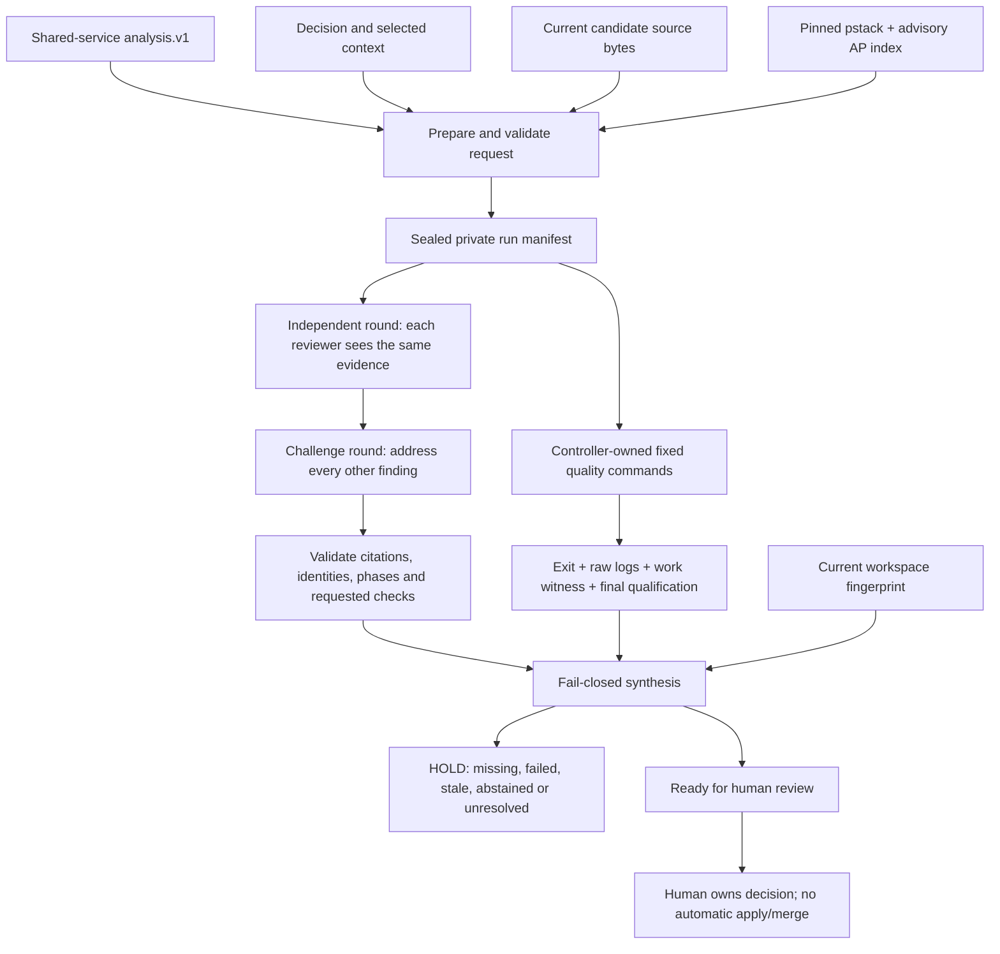

# Review roster, adversarial council and verification controller

This is the local implementation of the requested Claude Code/Codex review roster and expert circle. It connects the existing analysis.v1 artifact to captured review context, independent provider rounds, explicit counter-review and measured quality gates. It makes unsupported, missing, failed and stale results visible. The final state is **ready_for_human_review**, never automatic approval.

[Vault hub](obsidian://open?vault=deep-diff-forge.vault&file=Implementation%2FReview%20Council) · [Implementation ledger](RECOMMENDATION_INTEGRATION.md) · [Quality workflow](../.github/workflows/ci.yml) · [HDD reference provenance](../review-policy/provenance.json)

## Scope and maturity

The new `deep-diff-forge-review` crate is a runnable Unix CLI/library workflow. It adds no daemon or automatic background model calls. Existing TUI/daemon clients are not yet council clients. All selected provider calls and verification jobs are explicit operator actions. No model is allowed to install a plugin, change code, select arbitrary shell commands, write a gate result, merge or publish.

A roster must contain two configured adapter families. Multiple personas on one client do not satisfy that check. These are **configured adapter identities**, not a cryptographic attestation of the model behind a custom endpoint. When `model` is null, the client's default model is used and its actual model identity is unmeasured. Pin concrete available model IDs for controlled comparisons. Code does not claim that personas produce statistically independent reasoning. Builder family is explicit and self-reviews are identified in the prompts. Neither configured diversity nor consensus proves correctness.

The analysis scope is the supplied changed-source artifact, not every outstanding Git change or a complete repository review. Candidate file bytes are independently checked against the shared snapshot digest and captured in full. Optional context is selected by the operator. The workspace fingerprint binds tool/review receipts to tracked and non-ignored untracked files, modes and HEAD. Ignored files, external dependencies, compiler binaries, system environment and build hermeticity are outside that fingerprint. Do not interpret it as a whole-system provenance proof.

## Source findings and provenance

The HDD sources are:

- HEE-v5: `/var/mnt/storage/herdr-engineering-engine-v5`, observed HEAD `a75c914bfa79a74d9aec2980ba08ffa845f1f03a`. The read references are `.claude/AGENT_ROSTER.md`, `.claude/RUST.md`, `.claude/TESTING.md` and `.claude/tools/source_scan.py`. Their source hashes are recorded. HEE itself was neither modified nor built.
- Antipattern crosswalk: `/var/mnt/storage/hee5-evidence/reference/drive-heev5-friday-20261017/extracted/HEEv5_Antipattern_Integration_v0.8-R5/HEEv5_Antipattern_Integration_v0.8-R5/AP_CROSSWALK.json`. All **50 entries** are preserved verbatim, including `SOURCE_REGISTER_PRESENT__HEE5_ENFORCEMENT_UNVERIFIED`, original source links and the instruction to inspect original source rows before implementing a detector. It is a review inventory, not a finding that every pattern exists here.
- Lauren Tan's pstack: `/var/mnt/storage/hee5-evidence/reference/pstack-e43c7ee`, version **0.15.9**, commit `e43c7ee26e0038c6c1fa8380dd34ce86ff94cb2a`. The HDD upstream clone at `/var/mnt/storage/exemplars/poteto/upstream/cursor-plugins` has the same HEAD. All 162 manifest entries (161 source files plus pin metadata) were checksum-verified. This is a pinned HDD reference, not a claim to the latest online release.

Selected pstack documents and the complete MIT license are packaged under [the review crate's policy directory](../crates/deep-diff-forge-review/policy/). The rubric, encode-lessons principle and prove-it-works principle enter every captured manifest and prompt. The 50-row advisory antipattern index also enters the context. `review_policy_check.py` verifies the imported policy digests. The full Cursor plugin is not globally installed or executed. Its Cursor-specific agents, model aliases, PR automations and unrelated scripts are not silently enabled. HEE's authority/HOLD/fence rules are reference context for that project, not permissions granted to this product.

HEE learning → DDF mechanism:

| Learning | Implemented control | Remaining qualification |
| --- | --- | --- |
| Independent verifier/refuter, not a builder's self-grade | Distinct configured provider families; blind initial round; explicit cross-review; immutable raw provider artifacts | Actual runtime model identity and empirical independence need verification for the chosen deployment |
| AP-04 / AP-14: bound acquisition, do not silently clip | Bounded context/report/source reads; explicit rejection; output-limit diagnostics mark incomplete transcripts | Output limit detection is cooperative, not an OS disk quota |
| AP-15 / AP-35: structural ownership and bounded fan-out | Exclusive controller lock; create-new jobs; 2–12 admitted reviewers; serial explicit jobs | No distributed scheduler or multi-host lock is claimed |
| AP-29: exit zero is insufficient | Model output must pass typed admission; test/fuzz jobs need nonzero observed work; mutation needs successful baseline and coherent outcome rows | Trusted toolchain/output remains an execution assumption |
| AP-30 / AP-34: bind results to real artifacts | Before/after source fingerprints; captured candidate digest; output/report hashes; finalized qualification separate from process exit | No cryptographic signer authentication against a hostile local account |
| AP-32: isolate mutation state | Every mutation job owns a private build-cache directory; the shared normal target is not inherited. A real contamination failure and its regression are retained in the evidence note | Full hermetic toolchain isolation remains future work |
| AP-31 / AP-38: bound waits, do not kill by process name | Deadline and owned process group cleanup, tested with a child process | Not a container/VM resource isolation boundary |
| AP-26: do not regex Rust declarations | Parsed TOML and JSON for policy checks; common typed Rust controller | Fifty semantic antipattern detectors are **not** implemented |
| AP-01 / AP-41: one owner for shared facts | Canonical core changed-source digest reused by analysis and council | Further cache/build identities remain separate work |
| pstack: go deep, attack premise, encode recurring fixes structurally | Common rubric plus specialist lenses; falsification routes; mandatory measured checks; subtractor role | Outcome quality needs held-out evaluation; no novelty or superiority claim |

## Architecture



```mermaid
sequenceDiagram
  participant Human
  participant Controller
  participant Codex
  participant Claude as Claude Code
  participant Tools as Verification tools
  Human->>Controller: prepare request + analysis + decision
  Controller->>Controller: verify candidate digest; seal context, roster and source tree
  Human->>Controller: run configured independent reviewer
  Controller->>Codex: captured prompt + common strict response schema
  Codex-->>Controller: untrusted structured report
  Controller->>Controller: validate; retain raw output; qualify accepted artifact
  Human->>Controller: run other independent reviewer
  Controller->>Claude: same captured evidence, no earlier review
  Claude-->>Controller: untrusted structured report
  Human->>Controller: challenge round after all independent reports exist
  Controller->>Codex: other reviewers' findings + captured evidence
  Controller->>Claude: other reviewers' findings + captured evidence
  Human->>Controller: run specific required quality gate
  Controller->>Tools: fixed argv, deadline, owned process group
  Tools-->>Controller: logs and measurements
  Controller->>Controller: validate work witness and before/after source identity
  Human->>Controller: status
  Controller-->>Human: HOLD or ready_for_human_review, reasons and exact scope
```

## Review roster and expert personas

Every reviewer applies the same correctness, boundary, verification and complexity rubric. The persona adds a lens; it does not exempt that reviewer from the common rubric.

| Default slot | Adapter | Persona and adversarial responsibility |
| --- | --- | --- |
| correctness-codex | Codex | Reachable invariants, errors, boundary values, encodings and compatibility |
| security-claude | Claude Code | Injection, authority, hostile input, credentials and resource amplification |
| architecture-claude | Claude Code | Attack the premise, compare smaller alternatives, ownership, dependency direction and migration cost |
| falsifier-codex | Codex | Break what passed; find vacuous assertions, missing controls and surviving mutants |
| performance-claude | Claude Code | Complexity, allocation, contention, latency; require a reproducible measurement |
| subtractor-codex | Codex | Remove unnecessary machinery and duplicated authority while preserving required behavior |

`roster` profile permits a smaller two-family roster. `important_decision` additionally requires correctness, security, architecture and falsifier lenses and fuzz/mutation gates. Missing reviewers do not lower a quorum. A failed provider is not silently replaced. Findings remain claims; citations establish location/integrity, not semantic support. High/critical independent findings cannot be erased by later agreement or retraction: revise the candidate/decision and create a new run.

## CLI usage

Build with `cargo build --locked -p deep-diff-forge-cli`. The local reviewed build is also reachable via `ddf-integration-20261025` on this machine.

```sh
ddf-integration-20261025 council example > council-request.json
```

Edit the concrete repository, analysis/decision paths, builder family, selected contexts, providers/models and budgets. The template intentionally does not invent a latest model slug or credentials. Produce analysis.v1 with the existing `analyze` command from stable base/candidate snapshot directories. All source paths in that artifact must match current candidate file bytes; renamed/copied/binary source adaptation remains unsupported.

```sh
ddf-integration-20261025 council prepare council-request.json /absolute/new-run-directory
ddf-integration-20261025 council status /absolute/new-run-directory
# Missing evidence returns HOLD and exit 7, never a successful empty review.

ddf-integration-20261025 council review /absolute/new-run-directory correctness-codex independent --execute
ddf-integration-20261025 council review /absolute/new-run-directory security-claude independent --execute
# Run every other configured reviewer before beginning any challenge job.
ddf-integration-20261025 council review /absolute/new-run-directory correctness-codex challenge --execute
# Run the challenge job for every configured reviewer.

ddf-integration-20261025 council gate /absolute/new-run-directory format --execute
ddf-integration-20261025 council gate /absolute/new-run-directory check --execute
ddf-integration-20261025 council gate /absolute/new-run-directory clippy --execute
ddf-integration-20261025 council gate /absolute/new-run-directory pedantic --execute
ddf-integration-20261025 council gate /absolute/new-run-directory tests --execute
ddf-integration-20261025 council gate /absolute/new-run-directory antipatterns --execute
ddf-integration-20261025 council gate /absolute/new-run-directory fuzz --execute
ddf-integration-20261025 council gate /absolute/new-run-directory mutation --execute
ddf-integration-20261025 council status /absolute/new-run-directory
```

The output directory's parent must exist, and the new run must be outside the reviewed repository. Existing runs/jobs/reports are never overwritten. `council import <run> <report.json>` admits external structured reports but explicitly labels manual import unverified; it cannot satisfy a missing measured provider invocation. The run's `manifest.json` and captured artifacts are reviewable before `--execute`. Preparation/status do not launch a hosted model. No execution occurs merely because a reviewer requested a check.

Exit 0 means the requested operation completed under its contract; status exit 0 specifically means ready for human review. Exit 7 is HOLD/failed/inconclusive execution. Exit 4 is malformed input, stale admission, existing artifact or protocol/IO failure. No command implies acceptance, merge, release or deployment.

## Exact quality checks

| Gate | Fixed command/measurement | Failure semantics |
| --- | --- | --- |
| format | cargo fmt --all --check | Tool failure/timeout/source change holds |
| check | cargo check --workspace --all-targets --locked | Compilation failure/missing tool/source change holds |
| clippy | cargo clippy --workspace --all-targets --locked -- -D warnings | Warnings are failures |
| pedantic | Same with -W clippy::pedantic | No lint waiver is introduced |
| tests | cargo test --workspace --locked | Requires successful tool plus nonzero observed passed tests; zero work is inconclusive |
| antipatterns | python3 scripts/security/review_policy_check.py | Parses manifests and pinned metadata; requires nonempty inventory; does not certify the 50 semantic patterns absent |
| fuzz | cargo +nightly fuzz run for each explicit target, separate external corpus, declared time/input budgets | Every target must succeed and show nonzero executed cases; empty/unavailable/timeout/crash is not PASS |
| mutation | cargo mutants --package the-explicit-package --test-workspace true --timeout 30 --output private-run | Requires successful baseline, coherent per-mutant outcomes, nonzero caught mutants, zero missed, zero timeouts; unviable outcomes remain visible |

Each mutation job sets its own private CARGO_TARGET_DIR under the job directory; it never reuses the normal build cache (AP-32). Mutation scope is the explicitly named package, while the test scope is the entire workspace so CLI/dependent integration tests can kill mutations in the review library. Requested checks appearing in model findings become additional outstanding evidence requirements. They are never executed automatically. The controller does not interpret a model's shell snippet as a command. No percentage score or majority vote overrides these requirements.

The subprocess output limit is an 8 MiB combined trigger checked cooperatively. Owned processes are killed on timeout/output excess. Retained streams are capped to 8 MiB each, and `transcript-limit.json` explicitly marks incomplete transcripts and observed byte counts. Such runs never qualify. This is not an OS disk/memory/CPU quota and a burst may exceed the trigger before detection. Files and run directories are private, create-new and fsynced. A stale controller lock after interruption requires operator inspection; there is no unsafe automatic lock-stealing or silent result replay.

## Provider contracts

Codex runs non-interactively with a read-only sandbox, ignored ambient user config/rules, ephemeral session, disabled shell/unified-exec/apps features, strict output schema and a private working directory. Claude Code runs in print/safe/restricted mode with an empty tool list, strict empty MCP configuration, no slash commands and no session persistence. No bypass-permissions option is used. The captured code and policy are passed explicitly as input.

These flags reduce ambient capabilities; they are not a claim of a fully hermetic operating-system sandbox or independently authenticated model lineage. Client versions/availability and their actual account configuration matter. Failed auth or unsupported flags produce a visible failed/unavailable required reviewer. Current protocol tests use deterministic fake CLI executables, not live authenticated hosted model runs.

Primary protocol references: [OpenAI non-interactive Codex](https://learn.chatgpt.com/docs/non-interactive-mode) and [Anthropic programmatic Claude Code](https://code.claude.com/docs/en/headless). Local installed `--help`/feature output was cross-checked. The response contract is validated again by typed Rust; a subprocess exit 0, a no-blockers caption, missing structured_output, stale run ID, unknown reviewer, duplicate finding, fabricated citation or invalid range cannot mint accepted evidence.

## Verification and remaining work

The current verification receipt and exact scope live in the vault's **Implementation/Review Council Verification 2026-10-25**. Historical first-increment evidence remains separate. Tests include policy refusals, actual CLI processes with two deterministic provider substitutes, phase ordering, missing gates, stale workspace/report rejection, protocol failure, timeouts, owned child cleanup, explicit transcript limits and zero-work tool refusals. The short local report fuzz campaign and scoped mutation campaign are bounded measurements, not full-codebase qualification.

Remaining work includes live provider/account qualification, observed actual model identity, held-out review-quality evaluation, hermetic source/build capture, broader or crate-specific antipattern detectors with planted controls, complete mutation/fuzz campaigns, durable human finding dispositions/exception handling, cancellation/recovery UX, and migration into daemon/TUI consumers. No automatic approval mechanism has been added.

## Exact module routes

<a id="council-boundary"></a>

### crates/deep-diff-forge-review/src/lib.rs

Public API boundary; separate typed review claims from controller-owned execution and human authority.

[Exact crate/module](../crates/deep-diff-forge-review/src/lib.rs) ↔ [module vault note](obsidian://open?vault=deep-diff-forge.vault&file=Implementation%2FModules%2Fcouncil--crates--deep-diff-forge-review--src--lib)

<a id="typed-protocol"></a>

### crates/deep-diff-forge-review/src/model.rs

Typed providers, personas, phases, findings, citations, execution outcomes and final qualification.

[Exact crate/module](../crates/deep-diff-forge-review/src/model.rs) ↔ [module vault note](obsidian://open?vault=deep-diff-forge.vault&file=Implementation%2FModules%2Fcouncil--crates--deep-diff-forge-review--src--model)

<a id="admission-and-synthesis"></a>

### crates/deep-diff-forge-review/src/policy.rs

Fail-closed request/report admission and synthesis: no missing quorum, stale evidence or vote-based approval.

[Exact crate/module](../crates/deep-diff-forge-review/src/policy.rs) ↔ [module vault note](obsidian://open?vault=deep-diff-forge.vault&file=Implementation%2FModules%2Fcouncil--crates--deep-diff-forge-review--src--policy)

<a id="capture-and-storage"></a>

### crates/deep-diff-forge-review/src/storage.rs

Bounded private context capture, canonical candidate snapshot verification, source identity and immutable qualified artifacts.

[Exact crate/module](../crates/deep-diff-forge-review/src/storage.rs) ↔ [module vault note](obsidian://open?vault=deep-diff-forge.vault&file=Implementation%2FModules%2Fcouncil--crates--deep-diff-forge-review--src--storage)

<a id="execution-controller"></a>

### crates/deep-diff-forge-review/src/execution.rs

Fixed provider/gate argv, deadlines, owned process groups, output limits and non-vacuous work qualification.

[Exact crate/module](../crates/deep-diff-forge-review/src/execution.rs) ↔ [module vault note](obsidian://open?vault=deep-diff-forge.vault&file=Implementation%2FModules%2Fcouncil--crates--deep-diff-forge-review--src--execution)

<a id="council-cli"></a>

### crates/deep-diff-forge-review/src/cli.rs

Explicit preparation/status/import and opt-in execution commands; manual reports cannot mint provider evidence.

[Exact crate/module](../crates/deep-diff-forge-review/src/cli.rs) ↔ [module vault note](obsidian://open?vault=deep-diff-forge.vault&file=Implementation%2FModules%2Fcouncil--crates--deep-diff-forge-review--src--cli)

<a id="policy-controls"></a>

### crates/deep-diff-forge-review/tests/contracts.rs

Planted negative controls for authority, phase, freshness, citations, missing evidence and budgets.

[Exact crate/module](../crates/deep-diff-forge-review/tests/contracts.rs) ↔ [module vault note](obsidian://open?vault=deep-diff-forge.vault&file=Implementation%2FModules%2Fcouncil--crates--deep-diff-forge-review--tests--contracts)

<a id="cli-controls"></a>

### crates/deep-diff-forge-cli/tests/council.rs

Actual CLI process lifecycle with fake providers and tools, plus timeout/owned-child cleanup and zero-work refusals.

[Exact crate/module](../crates/deep-diff-forge-cli/tests/council.rs) ↔ [module vault note](obsidian://open?vault=deep-diff-forge.vault&file=Implementation%2FModules%2Fcouncil--crates--deep-diff-forge-cli--tests--council)

<a id="canonical-snapshot"></a>

### crates/deep-diff-forge-core/src/snapshot.rs

One canonical changed-source digest reused by analysis and council; explicit absence and framed paths/bytes.

[Exact crate/module](../crates/deep-diff-forge-core/src/snapshot.rs) ↔ [module vault note](obsidian://open?vault=deep-diff-forge.vault&file=Implementation%2FModules%2Fcouncil--crates--deep-diff-forge-core--src--snapshot)

<a id="parsed-antipattern-guard"></a>

### scripts/security/review_policy_check.py

Parse workspace TOML and provenance JSON; check lint inheritance and source labels without pretending to detect all semantic antipatterns.

[Exact crate/module](../scripts/security/review_policy_check.py) ↔ [module vault note](obsidian://open?vault=deep-diff-forge.vault&file=Implementation%2FModules%2Fcouncil--scripts--security--review_policy_check)

<a id="report-fuzz"></a>

### fuzz/fuzz_targets/council_report.rs

Bounded untrusted report parsing, validation and accepted-output serialization stability.

[Exact crate/module](../fuzz/fuzz_targets/council_report.rs) ↔ [module vault note](obsidian://open?vault=deep-diff-forge.vault&file=Implementation%2FModules%2Fcouncil--fuzz--fuzz_targets--council_report)

<a id="reference-provenance"></a>

### review-policy/provenance.json

Exact HDD paths, source commits and checksums; copied references retain their original qualification and license.

[Exact crate/module](../review-policy/provenance.json) ↔ [module vault note](obsidian://open?vault=deep-diff-forge.vault&file=Implementation%2FModules%2Fcouncil--review-policy--provenance)

<a id="advisory-catalogue"></a>

### crates/deep-diff-forge-review/policy/antipatterns.json

All 50 imported AP rows are byte-preserved advisory reference data, not automatic findings or qualified detectors.

[Exact crate/module](../crates/deep-diff-forge-review/policy/antipatterns.json) ↔ [module vault note](obsidian://open?vault=deep-diff-forge.vault&file=Implementation%2FModules%2Fcouncil--crates--deep-diff-forge-review--policy--antipatterns)


## Local execution environment

On this machine, `ddf-council-20261025` runs the council subcommand in the existing `fedora-toolbox-44` environment with the installed C compiler, Rust and verification tools and the explicit integration target directory. For example: `ddf-council-20261025 gate /absolute/run pedantic --execute`. The host helper `ddf-integration-20261025` also exposes council commands, but child compiler/tool availability follows its caller environment. No fallback silently changes the environment or lowers permissions. Model authentication/availability inside the chosen environment still requires live qualification. Installed CLI versions observed were codex-cli 0.164.0 and Claude Code 2.1.310; these are observations, not minimum-version or backend-identity guarantees.
