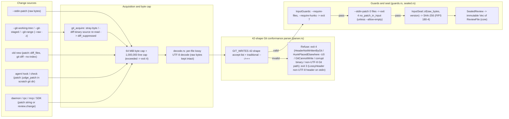
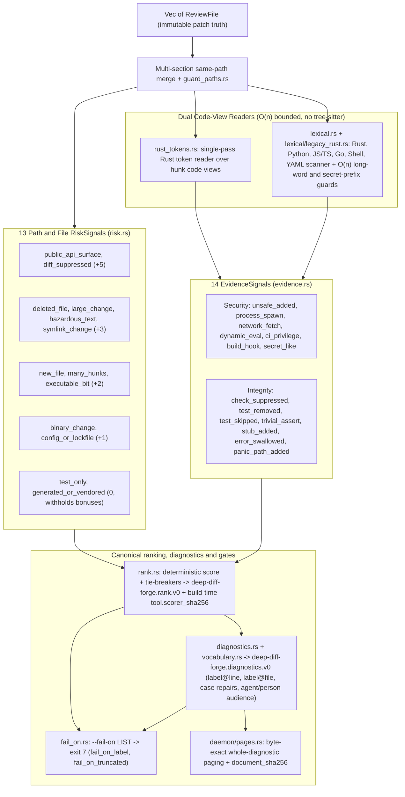
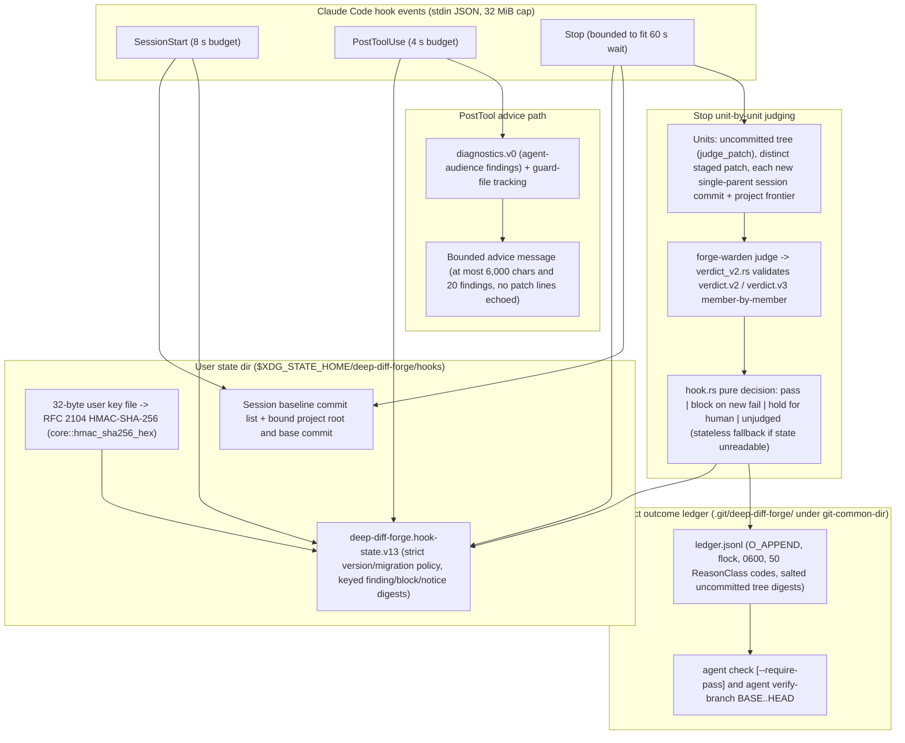
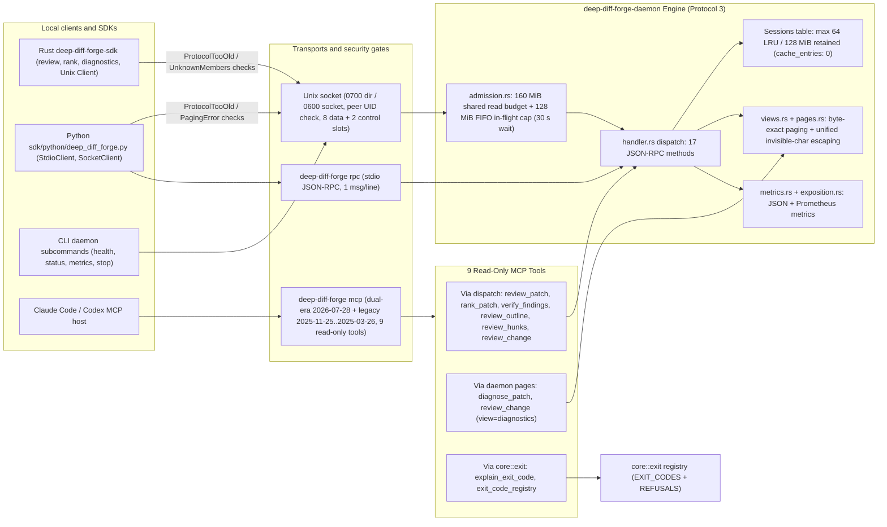
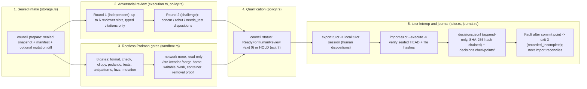

# Architectural Schematics

> **As-built schematics at `v0.11.0`.** Every diagram and table in sections 1 through 9 below
> reflects the code shipped on `main` at **`v0.11.0`**. The crate-edge list in
> [Current crates and edges](#current-crates-and-edges) is generated from
> [`docs/crate-edges.txt`](crate-edges.txt), which
> `crates/deep-diff-forge-cli/tests/crate_edges.rs` holds equal to `cargo metadata`. Unbuilt or
> withdrawn pre-0.3.0 target concepts are separated in
> [Historical Target Design Notes](#historical-target-design-notes).

## What exists today (`v0.11.0`)

Status labels: **shipped** is everything in this list; **planned** (unowned) are the `git`,
`planner`, `ui-model`, and `fixtures` crates, a shared cache, subscriptions, and directory pairs;
**withdrawn** are the items marked withdrawn below.

- **Crates:** **15 workspace crates** (**14 published** plus the dev-only, unpublished `testkit`)
  in [Current crates and edges](#current-crates-and-edges) below. See also
  [ARCHITECTURE.md](ARCHITECTURE.md#crates-as-built-v0110).
- **Process modes that exist:** CLI one-shot (`--stdin-patch`, `--git-working-tree`,
  `--git-staged`, `--git-range`, `<old> <new>`, `semantic`, `highlight`, `structural`, `analyze`,
  `findings verify`, `eval`, `bench`, `learn`, `council`, `deploy`, `envelope`, `schema`,
  `explain`, `agent {setup,doctor,check,verify-branch,hook}`); interactive TUI (`review`,
  `review --probe`); optional Unix-socket daemon (`daemon path|start|health|status|stop|metrics`,
  Protocol 3, 17 methods); stdio `rpc` and dual-era stdio `mcp` (9 read-only tools); and library
  use via `deep-diff-forge-sdk` (Rust) and `sdk/python/deep_diff_forge.py` (Python stdlib).
  `--cluster [--parallel serial|auto|N]` runs bounded parallel `patch` and `risk` lanes.
- **Withdrawn 2026-10-31:** the `chain`, `cluster` and `loom` top-level subcommands, each refused
  with exit 2 and its replacement (`deep-diff-forge --help`, "WITHDRAWN").
- **No shared cache:** the daemon holds bounded LRU sessions only (64 sessions / 128 MiB retained);
  `daemon.health` reports `cache_entries: 0` (`crates/deep-diff-forge-daemon/src/handler.rs`,
  decision D-03).

## Current crates and edges

Generated from `docs/crate-edges.txt` (checked against `cargo metadata` by
`crates/deep-diff-forge-cli/tests/crate_edges.rs`); edit the table, not this block.

<!-- crate-edges:begin -->
- `agent` → core, patch [dev]
- `cli` → agent, cluster, core, daemon, graph, learning, patch, pipeline, projection, review, syntax, tui, testkit [dev]
- `cluster` → core, graph, patch [dev]
- `core` → (no workspace dependencies)
- `daemon` → agent, core, graph, patch, testkit [dev]
- `graph` → core, patch [dev]
- `learning` → testkit [dev]
- `patch` → core, testkit [dev]
- `pipeline` → core, graph, patch, projection, syntax
- `projection` → core, patch [dev]
- `review` → core, testkit [dev]
- `sdk` → core, daemon (cfg(unix)), graph, patch, testkit [dev]
- `syntax` → core
- `testkit` → (no workspace dependencies)
- `tui` → agent, cluster, core, daemon, graph, learning, patch, projection, syntax
<!-- crate-edges:end -->

## 1. Workspace Crate DAG (`v0.11.0`)

One-way acyclic dependency graph across all 15 workspace crates (42 normal edges, 10 dev-only
edges). Note that `graph` depends **only on `core`** in normal dependencies (`patch` is dev-only)
and has no dependency on `syntax`; `learning` has no normal workspace dependencies; `sdk --> daemon`
is gated by `cfg(unix)`.

```mermaid
flowchart TB
    subgraph Surfaces["Entry surfaces"]
        cli["deep-diff-forge-cli"]
        tui["deep-diff-forge-tui"]
        sdk["deep-diff-forge-sdk"]
    end

    subgraph Orchestrators["Services, pipelines and review"]
        daemon["deep-diff-forge-daemon"]
        pipeline["deep-diff-forge-pipeline"]
        cluster["deep-diff-forge-cluster"]
        review["deep-diff-forge-review"]
    end

    subgraph Engines["Domain crates"]
        patch["deep-diff-forge-patch"]
        graph["deep-diff-forge-graph"]
        syntax["deep-diff-forge-syntax"]
        projection["deep-diff-forge-projection"]
        agent["deep-diff-forge-agent"]
        learning["deep-diff-forge-learning"]
    end

    subgraph Foundation["Vocabulary and test support"]
        core["deep-diff-forge-core"]
        testkit["deep-diff-forge-testkit (dev-only)"]
    end

    cli --> tui
    cli --> pipeline
    cli --> cluster
    cli --> daemon
    cli --> review
    cli --> learning
    cli --> agent
    cli --> syntax
    cli --> projection
    cli --> graph
    cli --> patch
    cli --> core

    tui --> daemon
    tui --> cluster
    tui --> learning
    tui --> agent
    tui --> syntax
    tui --> projection
    tui --> graph
    tui --> patch
    tui --> core

    sdk -- "cfg(unix)" --> daemon
    sdk --> graph
    sdk --> patch
    sdk --> core

    daemon --> agent
    daemon --> graph
    daemon --> patch
    daemon --> core

    pipeline --> syntax
    pipeline --> projection
    pipeline --> graph
    pipeline --> patch
    pipeline --> core

    cluster --> graph
    cluster --> core

    review --> core
    patch --> core
    graph --> core
    syntax --> core
    projection --> core
    agent --> core

    agent -. "dev" .-> patch
    cluster -. "dev" .-> patch
    graph -. "dev" .-> patch
    projection -. "dev" .-> patch
    cli -. "dev" .-> testkit
    daemon -. "dev" .-> testkit
    learning -. "dev" .-> testkit
    patch -. "dev" .-> testkit
    review -. "dev" .-> testkit
    sdk -. "dev" .-> testkit
```

## 2. Ingestion and 42-Shape Guard/Seal Pipeline

Every sealed review surface enters through `deep-diff-forge-patch` so the CLI, daemon, `rpc`, MCP,
and SDK enforce identical byte caps, conformance refusals, input contracts, and SHA-256 provenance.



## 3. Dual-Reader 27-Signal Risk and `diagnostics.v0` Engine

`deep-diff-forge-graph` reads `Vec<ReviewFile>` without mutating patch truth and without calling
tree-sitter. Multi-section patches touching the same path are merged before scoring.



## 4. Agent Hook State v13, HMAC Keyed History, Ledger, and Stop-Judging Flow

`deep-diff-forge agent hook` keeps all decision logic pure in `cli/src/hook.rs` and isolates I/O,
locking, and external judging in `cli/src/hook_run.rs`. Every hook exits `0` to Claude Code (never
exit `2`), surfacing any unjudged failure visibly.



## 5. Daemon Protocol 3, 9 MCP Tools, and SDK Topology

One shared `Engine` and `dispatch` implementation (`crates/deep-diff-forge-daemon/src/handler.rs`)
serves the Unix-socket daemon, stdio `rpc`, and the dual-era stdio `mcp` server.



**All 17 Daemon JSON-RPC Methods (`PROTOCOL_VERSION = 3`):**
- Protocol 0: `engine.initialize`, `daemon.health`, `daemon.status`, `daemon.shutdown`, `diff.plan`, `session.open`, `session.snapshot`, `session.close`
- Protocol 1: `engine.methods`, `diff.compute`, `diff.rank`, `review.outline`, `review.hunks`, `review.change`
- Protocol 2: `daemon.metrics`, `findings.verify`
- Protocol 3: `diff.diagnostics`

## 6. Review Council Sandbox and Decision Journal Recovery

`deep-diff-forge-review` separates reviewer claims from controller-owned sandboxed execution and
human authority. Nothing is approved automatically.



## 7. Process Modes (`v0.11.0`)

| Mode | Process model | Primary use case | Status at `v0.11.0` |
| --- | --- | --- | --- |
| Library mode | Caller links `deep-diff-forge-sdk` (or engine crates) directly. | Embedded tools, Rust services, CI tooling. | Shipped (`review`, `rank`, `diagnostics`, `exit`, Unix `Client`). |
| CLI one-shot | `deep-diff-forge` runs once and exits with registered exit codes. | Pager, CI gates (`--fail-on`), shell pipelines, `eval`, `bench`. | Shipped. |
| Interactive TUI | `deep-diff-forge review` owns terminal event loop (ratatui). | Interactive review cockpit, mouse/keyboard, `--findings`, `--probe`. | Shipped. |
| Local daemon | `deep-diff-forge daemon` serves JSON-RPC 2.0 over Unix socket. | Multi-client local sessions, Protocol 3, Prometheus/JSON metrics. | Shipped (opt-in; 8 data + 2 control slots, 160 MiB read / 128 MiB in-flight caps, 64 LRU sessions, `cache_entries: 0`). |
| Stdio RPC / MCP | `deep-diff-forge rpc`, `deep-diff-forge mcp`. | Coding agents and scripts without a daemon (Python `StdioClient`, 9 MCP tools). | Shipped. |
| Agent hooks | `deep-diff-forge agent hook session-start\|post-tool\|stop`. | Live Claude Code advice (`diagnostics.v0`), stop judging (`forge-warden`), ledger. | Shipped (`hook-state.v13`, `.git/deep-diff-forge/ledger.jsonl`). |
| Review council | `deep-diff-forge council prepare\|review\|gate\|status\|export-tuicr\|import-tuicr`. | Multi-provider adversarial review + rootless Podman gates + human journal. | Shipped (council exit codes `0`, `3`, `4`, `7`). |
| Parallel lanes | `--cluster [--parallel serial\|auto\|N]` on `--stdin-patch` / `--git-*` / `<old> <new>`. | Bounded local parallelism over `patch` and `risk` dimensions. | Shipped (`cluster` top-level subcommand withdrawn 2026-10-31 -> exit 2). |
| Chain / Loom runners | `deep-diff-forge chain`, `deep-diff-forge loom`. | Historical target subcommands. | Withdrawn 2026-10-31 -> exit 2 (`--jsonl` uses `pipeline` stages). |

## 8. Crate Schematic (`v0.11.0` Workspace Layout)

```text
deep-diff-forge/
  crates/
    deep-diff-forge-core/        Model, InputSeal (SHA-256 + HMAC-SHA-256), exit & refusal registry, safety utils.
    deep-diff-forge-patch/       42-shape Git conformance parser, SealedReview, InputGuards, git_acquire, judge_patch, review.v0.
    deep-diff-forge-projection/  Renderer-neutral inline & side-by-side rows, note rows, grapheme cell widths.
    deep-diff-forge-pipeline/    IngestStage, RenderStage (--jsonl), shared source-pair analyze service.
    deep-diff-forge-syntax/      Budgeted tree-sitter Rust parser, symbols, ANSI highlight, token structural_diff.
    deep-diff-forge-graph/       Dual-reader (rust_tokens + lexical) 27-signal ranking (rank.v0 + scorer_sha256) & diagnostics.v0.
    deep-diff-forge-agent/       Annotation grounding/sanitization, anchor validation, findings.v0 verification.
    deep-diff-forge-cluster/     Bounded std::thread::scope patch & risk lanes, deterministic join & receipt.
    deep-diff-forge-learning/    Local redacted JSONL receipt store, TrustPolicy, library-level learners & promotion gate.
    deep-diff-forge-daemon/      Unix-socket JSON-RPC 2.0 server (Protocol 3, 17 methods), admission, sessions, paging, metrics.
    deep-diff-forge-tui/         Interactive ratatui review cockpit (tree, diffview, notes, command palette, headless probe).
    deep-diff-forge-review/      Adversarial council, 8 rootless Podman gates, mutation_scope, tuicr interop, hash-chained journal.
    deep-diff-forge-sdk/         Stable Rust facade (review, rank, diagnostics, exit, Unix daemon Client).
    deep-diff-forge-cli/         deep-diff-forge binary: CLI, rpc, 9-tool MCP, agent hooks/ledger, eval, bench, deploy.
    deep-diff-forge-testkit/     Dev-only, unpublished Scratch owner-private temp directory helper.
  sdk/python/                    Zero-dependency Python stdlib client (StdioClient, SocketClient, Protocol 3).
  fuzz/                          18 libFuzzer targets (fuzz/Cargo.toml; 19 .rs files including shared stdio_invariants.rs).
  fixtures/                      eval (73 cases), eval-refused-by-parser, diagnostics, patch, protocol, council, corpus.
```

## 9. API Surface Map (`v0.11.0`)

| Surface | Stability / Scope | Location | Audience |
| --- | --- | --- | --- |
| Rust SDK facade | Stable (`#[non_exhaustive]` errors, opaque types) | `crates/deep-diff-forge-sdk/src/lib.rs` | Rust callers, CI tools, daemon clients. |
| Python SDK client | Stable stdlib wrapper (Protocol 3) | `sdk/python/deep_diff_forge.py` | Python automation, agents, scripts. |
| Core model & exit registry | Stable vocabulary (schema-versioned) | `crates/deep-diff-forge-core/src/{lib,exit,seal}.rs` | All crates, SDK consumers, orchestrators. |
| CLI & machine schemas | Stable (`review.v0`, `rank.v0`, `diagnostics.v0`, `ddf.result.v1`, `findings.v0`) | `crates/deep-diff-forge-cli/src/{main,contract,refusal}.rs` | Humans, Bash, CI, coding agents. |
| Daemon JSON-RPC 2.0 | Additive Protocol 3 (17 methods via `engine.methods`) | `crates/deep-diff-forge-daemon/src/{protocol,handler,pages,views}.rs` | Local daemons, `rpc`, SDKs. |
| MCP stdio server | Dual-era (`2026-07-28` + legacy, 9 read-only tools) | `crates/deep-diff-forge-cli/src/mcp.rs` | Claude Code, Codex, MCP hosts. |
| Agent hook & ledger | Versioned (`hook-state.v13`, ledger v1, 50 `ReasonClass` codes) | `crates/deep-diff-forge-cli/src/{hook,hook_run,ledger,reason,verdict_v2}.rs` | Claude Code hooks, `forge-warden`, branch verification. |
| Review council & journal | Versioned (`decision.v1`, council exits `0`/`3`/`4`/`7`) | `crates/deep-diff-forge-review/src/{lib,model,journal,tuicr}.rs` | Adversarial review operators, `tuicr` users. |
| Engine internals | Internal workspace APIs | `patch`, `graph`, `syntax`, `projection`, `pipeline`, `cluster`, `agent`, `learning` | Workspace crates only. |

## Historical Target Design Notes

The pre-0.3.0 target architecture envisioned several components that are **not built** (or were
**withdrawn**) as of `v0.11.0`:

- **Planned, unowned:** standalone `deep-diff-forge-git` (`gix`-based), `deep-diff-forge-planner`
  (region-level strategy planner), `deep-diff-forge-ui-model`, `deep-diff-forge-fixtures`, a
  shared content-addressed AST/diff cache in the daemon, multi-client push subscriptions, desktop
  IDE adapters, and directory-pair inputs.
- **Withdrawn (2026-10-31):** `deep-diff-forge-loom` and the `chain`, `cluster`, and `loom`
  top-level subcommands (each refused with exit 2).
- **Exemplar lessons kept:** patch truth vs. semantic twin separation (Hunk + Difftastic),
  budgeted tree-sitter parsing with explicit fallbacks (Difftastic), readable terminal projections
  and note rows (Delta + diff-so-fancy), and strict exit-code automation trust (classic `diff` and
  `git apply`).
- **System maps note (2026-10-28):** Five historical system maps were derived from `cba2ee7` in
  private notes and are not published; the six schematics above supersede them from `v0.11.0`
  source.

## Deployment Link

- Framework: [Codebase Deployment Framework](DEPLOYMENT_FRAMEWORK.md)
