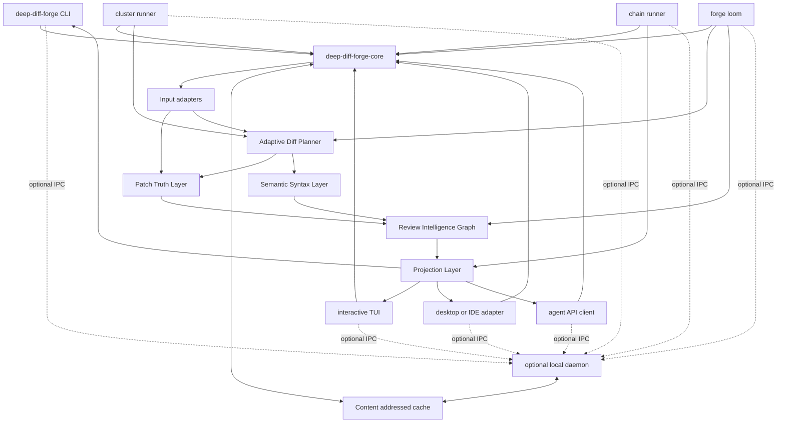
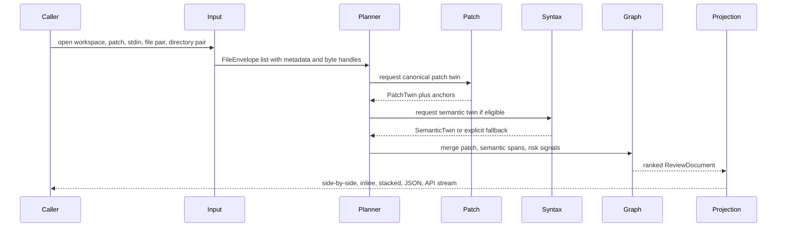
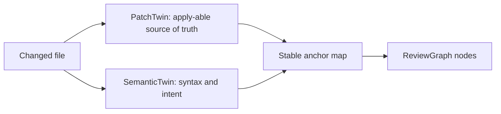
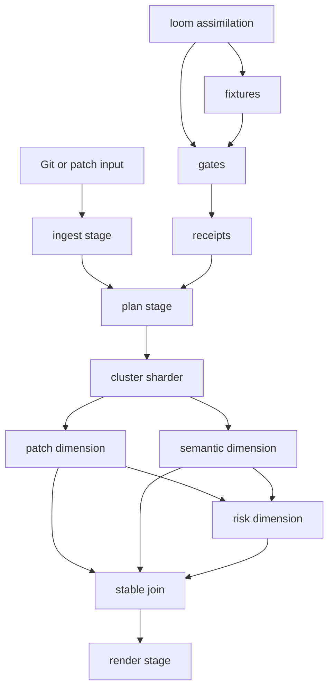
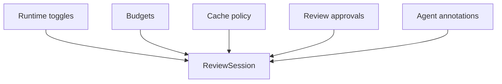
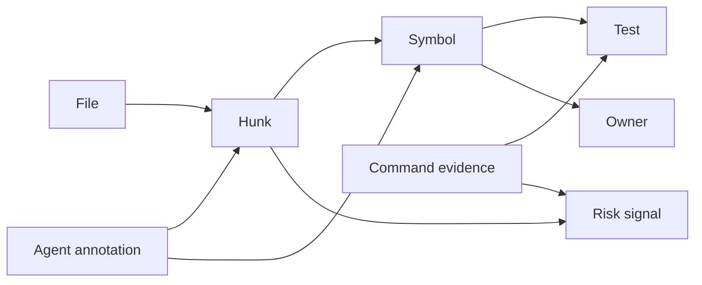

# Architectural Schematics

> **Target design, not a description of the code** (anchor E-01, 2026-10-27). Crates, commands and caches named here may not exist. The crates and edges that do exist are generated in [Current crates and edges](SCHEMATICS.md#current-crates-and-edges) from `docs/crate-edges.txt`, which a test holds equal to `cargo metadata`.

This document is the target implementation map for Deep-Diff-Forge. It turns the product vision into concrete boundaries, APIs, processes, and data flows.

## What exists today (0.3.0)

- **Crates:** the 14 in [Current crates and edges](#current-crates-and-edges) below. The as-built
  crate graph and data flow are drawn in [ARCHITECTURE.md](ARCHITECTURE.md#crates-as-built-030).
  `git`, `planner` and `loom` crates do not exist.
- **Process modes that exist:** CLI one-shot; `review` (interactive TUI, patch on stdin); the
  optional Unix-socket daemon (`daemon start|health|status|stop`); `rpc` and `mcp` (stdio, no
  daemon); and library use through `deep-diff-forge-sdk`. `--cluster` on `--stdin-patch` or a
  Git selection runs the cluster crate's lanes.
- **Refused today:** the `chain`, `cluster` and `loom` subcommands and `deep-diff-forge <old>
  <new>` (`deep-diff-forge --help`, "NOT YET IMPLEMENTED").
- **No shared cache:** the daemon holds sessions only; `daemon.health` reports
  `cache_entries: 0` (`crates/deep-diff-forge-daemon/src/handler.rs`, decision D-03).

The diagrams below the generated block are target design unless a section says otherwise.

## System maps (2026-10-28)

Derived from the code at `cba2ee7`, in the owner's local vault (the `obsidian://` links do not open for other readers):

- [End-to-End Stack Map](obsidian://open?vault=deep-diff-forge.vault&file=Diagrams%2FEnd-to-End%20Stack%20Map%202026-10-28)
- [Feature Map](obsidian://open?vault=deep-diff-forge.vault&file=Diagrams%2FFeature%20Map%202026-10-28)
- [Capacity Map](obsidian://open?vault=deep-diff-forge.vault&file=Diagrams%2FCapacity%20Map%202026-10-28)
- [API Map](obsidian://open?vault=deep-diff-forge.vault&file=Diagrams%2FAPI%20Map%202026-10-28)
- [Socket Map](obsidian://open?vault=deep-diff-forge.vault&file=Diagrams%2FSocket%20Map%202026-10-28)

## Current crates and edges

Generated from `docs/crate-edges.txt` (checked against `cargo metadata` by
`crates/deep-diff-forge-cli/tests/crate_edges.rs`); edit the table, not this block.

<!-- crate-edges:begin -->
- `agent` → core, patch [dev]
- `cli` → cluster, core, daemon, graph, learning, patch, pipeline, projection, review, syntax, tui
- `cluster` → core, graph, patch [dev]
- `core` → (no workspace dependencies)
- `daemon` → core, graph, patch
- `graph` → core, patch [dev]
- `learning` → (no workspace dependencies)
- `patch` → core
- `pipeline` → core, graph, patch, projection, syntax
- `projection` → core, patch [dev]
- `review` → core
- `sdk` → core, daemon (cfg(unix)), graph, patch
- `syntax` → core
- `tui` → agent, cluster, core, daemon, graph, learning, patch, projection, syntax
<!-- crate-edges:end -->

## Exemplar Lessons

Deep-Diff-Forge borrows deliberately, but does not clone.

| Source | Lesson kept | Boundary |
| --- | --- | --- |
| Hunk | Review-first UI, Git/worktree awareness, patch truth, comments, AI approval flow, renderer/controller separation. | Hunk's broad desktop surface is not the core. Deep-Diff-Forge keeps the core renderer-neutral. |
| Difftastic | Syntax-tree diffing, explicit fallbacks, parser budgets, sample-heavy regression culture. | Difftastic output is not patchable, so semantic diffing cannot be canonical patch truth. |
| Delta | Pager adoption, terminal polish, syntax-highlighted readable output. | Pretty rendering is a projection, not the engine model. |
| diff-so-fancy | Human-friendly patch readability. | It is line-patch oriented and not enough for semantic review. |
| classic diff | Patch compatibility, exit-code trust, automation stability. | It lacks semantic and review intelligence. |

## System Topology



## Process Modes

| Mode | Process model | Use case | Status at 0.3.0 |
| --- | --- | --- | --- |
| Library mode | Caller links `deep-diff-forge-sdk` (or the engine crates) directly. | Desktop apps, IDEs, tests, embedded tools. | Built: `deep-diff-forge-sdk`. |
| CLI one-shot | `deep-diff-forge` runs once and exits. | Pager, CI, shell workflows. | Built. |
| Chain runner | `deep-diff-forge chain` runs declared stages. | Bash, Claude Code, reproducible pipelines. | Not built; refused. The pipeline crate runs ingest and render for `--jsonl`. |
| Cluster runner | `deep-diff-forge cluster` runs dimensional lanes in parallel. | Large repos, corpora, bounded local parallelism. | Not built as a subcommand; refused. `--cluster [--parallel N]` runs patch and risk lanes. |
| Interactive TUI | `deep-diff-forge review` owns terminal event loop. | Review stream, mouse navigation, runtime toggles. | Built (`review`, `review --probe` for a headless frame). |
| Loom runner | `deep-diff-forge loom` creates plans, fixtures, gates, and receipts. | Assimilating exemplar lessons and new capabilities. | Not built; refused. Only `loom-contract` prints the contract. |
| Local daemon | `deep-diff-forge daemon` exposes JSON-RPC over a Unix socket. | Repeated review sessions from several local clients. | Built, opt-in. Sessions only, no shared cache. |
| Stdio JSON-RPC / MCP | `deep-diff-forge rpc`, `deep-diff-forge mcp`. | Agents and scripts without a daemon. | Built. |

The daemon is not required for correctness. Its listener accepts at most 8 connections, but one
engine serves them, so requests run one at a time (`crates/deep-diff-forge-daemon/src/serve.rs`,
`MAX_CONNECTIONS`).

## Core Data Pipeline



## Patch Twin And Semantic Twin



The patch twin is allowed to exist without the semantic twin. The semantic twin is never allowed to replace patch truth.

## Crate Schematic

Target layout. At 0.3.0, `deep-diff-forge-git` and `deep-diff-forge-planner` and
`deep-diff-forge-loom` do not exist; `deep-diff-forge-review`, `deep-diff-forge-learning` and
`deep-diff-forge-sdk` exist and are not listed here. Side-by-side rows are built in
`deep-diff-forge-projection`, not `deep-diff-forge-patch`.

```text
deep-diff-forge/
  crates/
    deep-diff-forge-core/       Stable model, IDs, planner vocabulary, graph vocabulary.
    deep-diff-forge-cli/        Pager-compatible command surface.
    deep-diff-forge-patch/      Unified patch parser, renderer, side-by-side row builder.
    deep-diff-forge-git/        gix-first Git status, tree, index, worktree, and compare adapters.
    deep-diff-forge-syntax/     Tree-sitter registry, syntax tree lowering, semantic matching.
    deep-diff-forge-planner/    Strategy selection, budgets, fallback records, generated-file detection.
    deep-diff-forge-graph/      Review Intelligence Graph, risk ranking, ownership/test links.
    deep-diff-forge-projection/ Renderer-neutral projections: inline, side-by-side, stacked, JSON.
    deep-diff-forge-pipeline/   Chain stages, stream codecs, manifest runner.
    deep-diff-forge-cluster/    Dimensional sharding, parallel lanes, deterministic joins.
    deep-diff-forge-loom/       Assimilation plans, fixture synthesis, gates, receipts.
    deep-diff-forge-tui/        Terminal UI, mouse support, responsive split/stack review.
    deep-diff-forge-agent/      Agent annotation API, provenance, approval and evidence protocol.
    deep-diff-forge-daemon/     Optional local daemon and IPC server.
```

## API Surface Map

Public APIs are split by stability. Target table; rows naming `deep-diff-forge-loom` or
`deep-diff-forge-planner` describe crates that do not exist. The stable Rust interface today is
`deep-diff-forge-sdk`; the daemon's implemented methods are listed by `engine.methods`
([API_AND_IPC.md](API_AND_IPC.md)).

| Stability | Location | Audience |
| --- | --- | --- |
| Stable model API | `crates/deep-diff-forge-core/src/lib.rs` | All crates, plugin authors, API clients. |
| Stable CLI API | `crates/deep-diff-forge-cli/src/main.rs` and command modules | Users, scripts, Git integration. |
| Stable pipeline API | `deep-diff-forge-pipeline` | Bash, Claude Code, CI, reproducible chains. |
| Experimental engine API | `deep-diff-forge-daemon` IPC methods | TUI, desktop adapters, agents. |
| Experimental cluster API | `deep-diff-forge-cluster` | Large repo and corpus runners. |
| Experimental loom API | `deep-diff-forge-loom` | Feature assimilation and receipt generation. |
| Internal strategy API | `deep-diff-forge-planner` | Engine crates only. |
| Internal parser API | `deep-diff-forge-syntax` and `deep-diff-forge-patch` | Engine crates only. |

## Chain, Cluster, And Loom Schematic



The chain path is the default Unix-filter path. The cluster path is the same
work split into deterministic lanes. The loom path feeds the engine with
planned, tested, receipt-backed implementation changes.

## Runtime Control Plane



Runtime toggles are inputs to projection and planning, not mutation of patch truth.

## Review Intelligence Graph



Graph ranking starts with deterministic signals:

- file status and change size
- generated/vendor/test/source classification
- syntax parse status
- control-flow or public API edits
- dependency fan-out
- test ownership and stale coverage hints
- agent claims with or without evidence

## Top-Tail Performance And Novelty Choices

These are the high-leverage choices that push the design beyond central tendency.

| Choice | Why it matters |
| --- | --- |
| Patch/semantic twin model | Keeps patch trust while adding syntax insight. Most tools pick one. |
| Content-addressed AST cache | Reuses parse results across sessions, worktrees, and UI clients. |
| Region-level strategy planning | Avoids whole-file syntax diff cost when only some regions need it. |
| Progressive review graph | UI can show ranked files before every semantic span finishes. |
| Grounded agent annotations | Separates evidence-backed claims from speculative AI text. |
| Budgeted semantic diff | Every parser/graph strategy has byte, node, and time ceilings. |
| Renderer-neutral projections | TUI, desktop, IDE, and JSON share the same core model. |
| Optional daemon only for shared state | Preserves CLI simplicity while enabling elite latency for large repos. |

## Deployment Link

- Framework: [Codebase Deployment Framework](DEPLOYMENT_FRAMEWORK.md)
